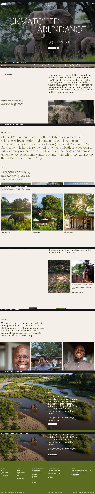
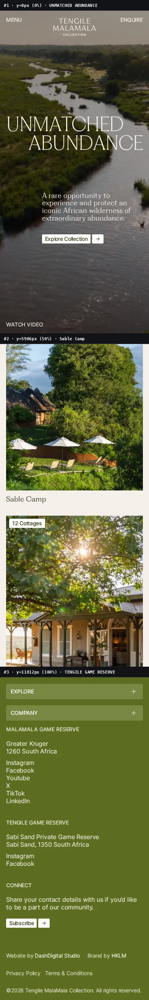

# UI Design System & Master Generation Blueprint: tengilemalamala-com

> **Luxury Safari Experiences in Greater Kruger & Sabi Sand · Tengile MalaMa...** (https://tengilemalamala.com/) — Discover luxury safari experiences in Greater Kruger and Sabi Sand. Wildlife, luxury accommodation and unforgettable Big Five encounters....





---

## 1. Executive Visual Persona & Design Archetype

- **Brand Essence & Persona**: **Luxury Safari Experiences in Greater Kruger & Sabi Sand · Tengile MalaMa...** (`https://tengilemalamala.com/`). Discover luxury safari experiences in Greater Kruger and Sabi Sand. Wildlife, luxury accommodation and unforgettable Big Five encounters....
- **Capture Provenance**: Live browser capture (`tier1_fast`, HTTP `200`, captured `2026-11-24`).
- **Visual Archetype**: **Light-Substrate Editorial & Modular Grid System (`#f5eee9` canvas, `#373f1d` ink, `#5c6e21` accent)**.
- **Anti-AI-Slop Differentiators**:
  - **Live-Computed Chromatic Polarity**: Anchors the viewport in `#f5eee9` (live computed `body` `background-color` (`computed_styles.json`)) paired with `#373f1d` primary typography and `#5c6e21` accents.
  - **Grounded Typographic Hierarchy**: Pairs `PP Fragment` for display copy (`UNMATCHED ABUNDANCE`) with `Inter`.
  - **Calibrated Spatial Grid & Motion**: Combines `1440px` container bounds (`gap: 4px`, padding `12px`) with `cubic-bezier(.19,1,.22,1)` easing and Lenis Smooth Scroll (`data-lenis`), Three.js / WebGL Canvas Pipeline.

---

## 2. Spatial Architecture & Modular Grid Mathematics

### Viewport Allocation & Container Geometry
- **Captured Journey Filmstrips**: Desktop `1280×6624px` (`assets/desktop-journey.webp`, `8` keyframes up to `y=10666px` / doc `11566px`), Mobile `390×2616px` (`assets/mobile-journey.webp`, `3` keyframes).
- **Master Container Bounds**: `1440px` (full-bleed `100%` desktop stage measured on `1440px` viewport).
- **Canvas Lateral Padding & Spacing**: `12px` lateral canvas padding with `4px` grid gap.
- **Border Radius Scale**: `2px`, `4px`, `14px`, `50%`.

### Responsive Breakpoint Architecture
- **Desktop Layout**: Multi-column CSS Grid / Flexbox layout at `1440px` (`max-width: 1440px`, `gap: 4px`).
- **Mobile Layout**: Single-column vertical stack at `390px` viewport width with `12px` horizontal padding.
- **Extracted CSS Media Queries**: `@media only screen and (max-width:1023px)`, `@media only screen and (min-width:1920px)`, `@media only screen and (min-width:1024px)`, `@media only screen and (max-width:390px)`.

---

## 3. Color System, Materiality & Atmospheric Lighting

### Semantic Palette & Source Grounding
| Semantic Role | Ground-Truth Value | Extracted Live / CSS Source |
|---|---|---|
| **Primary Canvas Substrate** | `#f5eee9` | live computed `body` `background-color` (`computed_styles.json`) |
| **Primary Typography Ink** | `#373f1d` | live computed `main` `color` (`computed_styles.json`) |
| **Elevated Surface / Card Substrate** | `#fbf8f6` | live computed `a` `background-color` (`computed_styles.json`) |
| **Interactive Accent / Highlight** | `#5c6e21` | `css-module__3-RGkq__cookie a:fo... { color: #5c6e21 }` |
| **Secondary / Muted Copy** | `#a5a593` | `odule-scss-module__mj8AIq__subm... { color: #a5a593 }` |
| **Structural Hairline Border** | `#e3e1d4` | `Banner-module-scss-module__3-RG... { border-top: #e3e1d4 }` |

### Sanitized Root CSS Variables (`ui-ux.md` Ground Truth)
| Variable Name | Extracted Value | Semantic Role |
|---|---|---|
| `--lvh` | `1vh` | Layout / Spatial Grid Token |
| `--svh` | `1vh` | Layout / Spatial Grid Token |
| `--offset` | `150dvw` | Dimension / Scale Token |
| `--size` | `1440` | Layout / Spatial Grid Token |
| `--duration` | `120s` | Motion / Easing Token |
| `--plyr-color-main` | `#fbf8f6` | Brand / Palette Token |
| `--plyr-video-control-color` | `#fbf8f6` | Brand / Palette Token |
| `--plyr-font-size-small` | `14px` | Typography / Scale Token |
| `--plyr-range-track-height` | `2px` | Layout / Spatial Grid Token |
| `--plyr-range-thumb-height` | `0px` | Layout / Spatial Grid Token |
| `--plyr-video-progress-buffered-background` | `#fbf8f61a` | Canvas / Surface Token |
| `--tengilemalamala--bg` | `#f5eee9` | Canvas Substrate (from live computed `body` `background-color` (`computed_styles.json`)) |
| `--tengilemalamala--ink` | `#373f1d` | Primary Typography Ink (computed-derived) |
| `--tengilemalamala--surface` | `#fbf8f6` | Surface Substrate (computed-derived) |
| `--tengilemalamala--accent` | `#5c6e21` | Interactive Accent (computed-derived) |
| `--tengilemalamala--muted` | `#a5a593` | Secondary Ink (computed-derived) |

---

## 4. Typographic Scale & Editorial Hierarchy

### Font Family Stacks
- **Display Typography**: `PP Fragment`.
- **Primary Body Stack**: `Inter`.
- **Technical / Metadata Stack**: not declared in live computed styles (uses primary stack / `ui-monospace`).

### Typographic Scale & Rules (Live Computed & Stylesheet Grounded)
- **Hero Display (`H1`)**: live computed `h1` (`font-size: 120px`, `line-height: 108px`, `font-weight: 220`, `letter-spacing: -2.4px`).
- **Section Heading (`H2`)**: live computed `h2` (`font-size: 32px`, `line-height: 36.8px`, `font-weight: 310`).
- **Body Copy**: live computed `body` (`font-size: 16px`, `line-height: 20px`, `font-weight: 400`, `letter-spacing: -0.16px`); rule `p` (`letter-spacing: -.01em`).
- **Metadata & Navigation Labels**: live computed `nav/a` (`font-size: 40px`, `line-height: 40px`, `font-weight: 220`, `letter-spacing: -0.16px`).

---

## 5. Choreographed Motion & Interaction Physics

### Primary Easing Curves
- **Extracted Timing Functions**: `cubic-bezier(.19,1,.22,1)`, `cubic-bezier(.165,.84,.44,1)`, `cubic-bezier(.25,.46,.45,.94)`.

### Per-Element Transition & Choreography Rules
- **Selector `Banner-module-scss-module__3-RGkq...`**: `transition: color .3s` extracted from `tengilemalamala-com` stylesheet.
- **Selector `-module-scss-module__3-RGkq__sett...`**: `transition: background-color .3s` extracted from `tengilemalamala-com` stylesheet.
- **Selector `e-scss-module__3-RGkq__settingsTo...`**: `transition: all .3s` extracted from `tengilemalamala-com` stylesheet.
- **Extracted Easing Curve (`cubic-bezier(.19,1,.22,1)`)**: Governs interactive state transitions across `<header.site-header>` and `<section.site-header>`.
- **Runtime Interaction Engine**: Integrates Lenis Smooth Scroll (`data-lenis`), Three.js / WebGL Canvas Pipeline with `prefers-reduced-motion: reduce` fallback guards.
### Measured Runtime Scroll & Interaction Telemetry (`behavioral_journey_v2`)
- **Scroll Driver Mode**: `native` (max document height `11566px`, deepest scrollY reached `10666px` across `8` desktop keyframes).
- **Detected Scroll / Motion Libraries**: `Lenis`.
- **Nav / Drawer Probe (`Open menu`)**: Triggered visual change (pixel diff `88.016`, captured in `assets/state-nav.webp`); revealed links: About, Accommodation, Experiences, Conservation, Partner Hub, Stories.
- **Hover Physics (`primary_cta` · `Explore Collection`)**: Computed transition `0s` / `ease` (no static color/transform shift captured at rest).
- **Hover Physics (`first_card` · `Khensani River Lodge View lodge K...`)**: Computed transition `0s` / `ease` (no static color/transform shift captured at rest).
- **Interactive Control Probe (`carousel_next` · `Next`)**: Triggered visual diff `61.739` (attr ` -> `, captured in `assets/state-interactive.webp`).
- **Route Transition Architecture**: First internal navigation (`/accommodation/tengile-river-lodge`) measured as `direct` in `1307ms`.

---

## 6. Component Wireframe & Structural DOM Map

### Visual Layout Schematic — Desktop (`1440px`, Grounded in `dom.html` & Landmark Bounding Boxes)
```
┌────────────────────────────────────────────────────────────────────────┐
│ DESKTOP VIEWPORT (1440px) — Luxury Safari Experiences in Greater Kruge │
│ ====================================================================== │
│ [ <header.site-header> (1440x34px)    | About · Accommodation · Expe ] │
│ ---------------------------------------------------------------------- │
│ | HERO STAGE: <section.no-loader> (w=1440px)                         | │
│ | H1: UNMATCHED ABUNDANCE                                            | │
│ | Substrate: #f5eee9 | Ink: #373f1d | Accent: #5c6e21                | │
│ ---------------------------------------------------------------------- │
│ | SHOWCASE GRID (<section.site-header>) max-w: 1440px                | │
│ | +------------------------------+  +------------------------------+ | │
│ | | U N M A T C H E D A B U N D  |  | A Thriving Wilderness        | | │
│ | +------------------------------+  +------------------------------+ | │
│ ---------------------------------------------------------------------- │
│ | DETAIL MODULE (<section.no-lenis>) — Accommodation                 | │
│ ---------------------------------------------------------------------- │
│ [ FOOTER (<footer.action-card-) | https://tengilemalamala.com/         │
└────────────────────────────────────────────────────────────────────────┘
```

### Visual Layout Schematic — Mobile Reflow (`390px`)
```
┌────────────────────────────────────────────────────────────────────────┐
│ MOBILE VIEWPORT REFLOW (390px) — Single-Column Stack (gap: 4px)        │
│ ====================================================================== │
│ [ HEADER BAR (<header.site-header>    ) | Compact Menu (390px)         │
│ ---------------------------------------------------------------------- │
│ | HERO STAGE (<section.no-loader>) — 390px Vertical Lead             | │
│ | H1: UNMATCHED ABUNDANCE                                            | │
│ ---------------------------------------------------------------------- │
│ | SHOWCASE STACK (<section.site-header>) — 1-Col Stack               | │
│ | [ Item 1: U N M A T C H E D A B U N D A N C E                    ] | │
│ | [ Item 2: A Thriving Wilderness                                  ] | │
│ ---------------------------------------------------------------------- │
│ | DETAIL STACK (<section.no-lenis>) — 1-Col (Accommodation)          | │
│ ---------------------------------------------------------------------- │
│ [ FOOTER (<footer.action-card-) | Stacked 390px Colophon               │
└────────────────────────────────────────────────────────────────────────┘
```

### Granular DOM Region Breakdown
1. **Brand Header & Navigation Bar (<header.site-header> — `tengilemalamala-com`)**:
   - Landmark `<header class="site-header">` (`1440x34px`) hosting `Luxury Safari Experiences in Greater` navigation (`About · Accommodation · Experiences · Conservation · Partner Hub`), DOM attributes (`data-next-head`, `data-nscript="beforeInteractive"`, `data-n-g`, `data-n-css`), and stylesheet rule `nner-module-scss-module__3-RGkq__... { width:auto;right:1.6rem }`.
2. **Hero Stage & Focal Lead (<section.no-loader> — `UNMATCHED ABUNDANCE`)**:
   - Landmark `<section class="no-loader">` presenting display lead `UNMATCHED ABUNDANCE` and copy excerpt *"A rare opportunity to experience and protect an iconic African wi"* over `#f5eee9` canvas and `#373f1d` ink.
3. **Primary Showcase & Content Grid (<section.site-header> — `U N M A T C H E D A B U N D A N C `)**:
   - Landmark `<section class="site-header">` rendering section `U N M A T C H E D A B U N D A N C E` with copy *"U N M A T C H E D A B U N D A N C E"*, asset references (`icon-32.png`, `icon-16.png`, `inter-regular.woff2`, `inter-medium.woff2`), and grid rule `er-module-scss-module__3-RGkq__co... { text-decoration:underline;transition:color .3s }`.
4. **Interactive Detail & Feature Matrix (<section.no-lenis> — `A Thriving Wilderness`)**:
   - Landmark `<section class="no-lenis">` framing `A Thriving Wilderness` and `Accommodation` (*"Explore Collection"*) with `#fbf8f6` surface cards, `#5c6e21` accents, and `module__3-RGkq__cookie a:focus-vi... { color:5c6e21 }`.
5. **Colophon & Global Directory Footer (<footer.action-card-click-label> — `https://tengilemalamala.com/`)**:
   - Landmark `<footer class="action-card-click-label">` anchoring `Luxury Safari Experiences in Gre` footer links (`About · Accommodation · Experiences · Conservation · Partner Hub`), copy *"Along one of the most wildlife-rich stretches of the Sand Ri"*, and `#e3e1d4` structural dividers.
### Full Vertical Scroll Sequence (Desktop `1440×900` Keyframes)
- **Step 01** (`y=0px`, `0%`): Active landmark `UNMATCHED ABUNDANCE` · sticky/fixed elements: `2`
- **Step 02** (`y=850px`, `8%`): Active landmark `A THRIVING WILDERNESS` · sticky/fixed elements: `2`
- **Step 03** (`y=2550px`, `24%`): Active landmark `ACCOMMODATION` · sticky/fixed elements: `1`
- **Step 04** (`y=4250px`, `40%`): Active landmark `Khensani River Lodge` · sticky/fixed elements: `1`
- **Step 05** (`y=6800px`, `64%`): Active landmark `Khensani River Lodge` · sticky/fixed elements: `1`
- **Step 06** (`y=8500px`, `80%`): Active landmark `COMMUNITY` · sticky/fixed elements: `1`
- **Step 07** (`y=10200px`, `96%`): Active landmark `PLAN A TRIP` · sticky/fixed elements: `1`
- **Step 08** (`y=10666px`, `100%`): Active landmark `Khensani River Lodge` · sticky/fixed elements: `1`

### Multi-Page Internal Route Map
- **Detail Route (`/accommodation/tengile-river-lodge`)**: `https://tengilemalamala.com/accommodation/tengile-river-lodge` — H1: `TENGILE RIVER LODGE`, scrollHeight `13731px`, transition `direct` (`1307ms`)
- **About Route (`/about`)**: `https://tengilemalamala.com/about` — H1: `ABOUT THE COLLECTION`, scrollHeight `22161px`, transition `direct` (`913ms`)
- **Detail Route (`/accommodation/rattrays-lodge`)**: `https://tengilemalamala.com/accommodation/rattrays-lodge` — H1: `RATTRAY'S LODGE`, scrollHeight `12021px`, transition `direct` (`679ms`)

---

## 7. Master Zero-Shot AI Generation Prompt

```markdown
# Master Zero-Shot Frontend Generation Prompt: tengilemalamala-com (Luxury Safari Experiences in Greater Kruger & Sabi Sand · Tengile MalaMa...)

You are a principal frontend architect and design systems engineer. Build a complete, production-ready web application replicating the exact design system, DOM landmarks, typographic hierarchy, color tokens, and motion physics of `tengilemalamala-com` (**Luxury Safari Experiences in Greater Kruger & Sabi Sand · Tengile MalaMa...** — `https://tengilemalamala.com/`).

### 1. Visual Archetype & Anti-AI-Slop Mandates
- **Archetype**: Light-Substrate Editorial & Modular Grid System (`#f5eee9` canvas, `#373f1d` ink, `#5c6e21` accent).
- **Identity & Domain Context**: Discover luxury safari experiences in Greater Kruger and Sabi Sand. Wildlife, luxury accommodation and unforgettable Big Five encounters....
- **Primary Substrate**: `#f5eee9` (live computed `body` `background-color` (`computed_styles.json`)), **Primary Ink**: `#373f1d`, **Accent / Highlight**: `#5c6e21`.
- **Site-Specific Differentiators**:
  - **Live-Computed Chromatic Polarity**: Anchors the viewport in `#f5eee9` (live computed `body` `background-color` (`computed_styles.json`)) paired with `#373f1d` primary typography and `#5c6e21` accents.
  - **Grounded Typographic Hierarchy**: Pairs `PP Fragment` for display copy (`UNMATCHED ABUNDANCE`) with `Inter`.
  - **Calibrated Spatial Grid & Motion**: Combines `1440px` container bounds (`gap: 4px`, padding `12px`) with `cubic-bezier(.19,1,.22,1)` easing and Lenis Smooth Scroll (`data-lenis`), Three.js / WebGL Canvas Pipeline.

### 2. Ground-Truth CSS Variables (`:root` Token Contract)
Declare and consume these exact custom properties extracted from `tengilemalamala-com` in your global stylesheet:

:root {
  /* Luxury Safari Experiences in Greater Kruger & Sabi Sand · Tengile MalaMa... (tengilemalamala-com) — Live-Grounded CSS Variables */
  --lvh: 1vh; /* Layout / Spatial Grid Token (tengilemalamala-com) */
  --svh: 1vh; /* Layout / Spatial Grid Token (tengilemalamala-com) */
  --offset: 150dvw; /* Dimension / Scale Token (tengilemalamala-com) */
  --size: 1440; /* Layout / Spatial Grid Token (tengilemalamala-com) */
  --duration: 120s; /* Motion / Easing Token (tengilemalamala-com) */
  --plyr-color-main: #fbf8f6; /* Brand / Palette Token (tengilemalamala-com) */
  --plyr-video-control-color: #fbf8f6; /* Brand / Palette Token (tengilemalamala-com) */
  --plyr-font-size-small: 14px; /* Typography / Scale Token (tengilemalamala-com) */
  --plyr-range-track-height: 2px; /* Layout / Spatial Grid Token (tengilemalamala-com) */
  --plyr-range-thumb-height: 0px; /* Layout / Spatial Grid Token (tengilemalamala-com) */
  --plyr-video-progress-buffered-background: #fbf8f61a; /* Canvas / Surface Token (tengilemalamala-com) */
  --tengilemalamala--bg: #f5eee9; /* Canvas Substrate (from live computed `body` `background-color` (`computed_styles.json`)) (tengilemalamala-com) */
  --tengilemalamala--ink: #373f1d; /* Primary Typography Ink (computed-derived) (tengilemalamala-com) */
  --tengilemalamala--surface: #fbf8f6; /* Surface Substrate (computed-derived) (tengilemalamala-com) */
  --tengilemalamala--accent: #5c6e21; /* Interactive Accent (computed-derived) (tengilemalamala-com) */
  --tengilemalamala--muted: #a5a593; /* Secondary Ink (computed-derived) (tengilemalamala-com) */
}

### 3. Semantic Color & Materiality Contract
Map every surface, ink, and border strictly to these source-grounded tokens:
- **Primary Canvas Substrate**: `#f5eee9` — grounded in live computed `body` `background-color` (`computed_styles.json`)
- **Primary Typography Ink**: `#373f1d` — grounded in live computed `main` `color` (`computed_styles.json`)
- **Elevated Surface / Card Substrate**: `#fbf8f6` — grounded in live computed `a` `background-color` (`computed_styles.json`)
- **Interactive Accent / Highlight**: `#5c6e21` — grounded in `css-module__3-RGkq__cookie a:fo... { color: #5c6e21 }`
- **Secondary / Muted Copy**: `#a5a593` — grounded in `odule-scss-module__mj8AIq__subm... { color: #a5a593 }`
- **Structural Hairline Border**: `#e3e1d4` — grounded in `Banner-module-scss-module__3-RG... { border-top: #e3e1d4 }`

### 4. Spatial Grid, Container Bounds & Responsive Breakpoints
- **Desktop Viewport Reference**: `1280×6624px` (multi-frame vertical journey filmstrip (6624px), `1440px` standard desktop width).
- **Mobile Viewport Reference**: `390×2616px` (multi-frame vertical journey filmstrip (2616px), `390px` standard mobile width).
- **Container Max-Width**: `1440px` (full-bleed `100%` desktop stage measured on `1440px` viewport)
- **Padding & Gutters**: `12px` lateral canvas padding with `4px` grid gap
- **Desktop Grid**: Multi-column CSS Grid / Flexbox layout at `1440px` (`max-width: 1440px`, `gap: 4px`)
- **Mobile Adaptation**: Single-column vertical stack at `390px` viewport width with `12px` horizontal padding
- **Media Queries**: `@media only screen and (max-width:1023px)`, `@media only screen and (min-width:1920px)`, `@media only screen and (min-width:1024px)`, `@media only screen and (max-width:390px)`
- **Corner Radii**: `2px`, `4px`, `14px`, `50%`

### 5. Typography & Editorial Scale Contract
- **Display Font Stack**: `PP Fragment`
- **Body Font Stack**: `Inter`
- **Monospace / Technical Font Stack**: not declared in live computed styles (uses primary stack / `ui-monospace`)
- **H1 Display Rule**: live computed `h1` (`font-size: 120px`, `line-height: 108px`, `font-weight: 220`, `letter-spacing: -2.4px`)
- **H2 Section Rule**: live computed `h2` (`font-size: 32px`, `line-height: 36.8px`, `font-weight: 310`)
- **Body Copy Rule**: live computed `body` (`font-size: 16px`, `line-height: 20px`, `font-weight: 400`, `letter-spacing: -0.16px`); rule `p` (`letter-spacing: -.01em`)
- **Metadata & Index Rule**: live computed `nav/a` (`font-size: 40px`, `line-height: 40px`, `font-weight: 220`, `letter-spacing: -0.16px`)

### 6. Component Hierarchy, Verbatim Copy & Real DOM Landmarks
Scaffold `tengilemalamala-com` (`Luxury Safari Experiences in Greater Kruger & Sabi Sand · Tengile MalaMa...`) with these exact structural regions, extracted copy, and CSS rules from `dom.html`:
1. **Brand Header & Navigation Bar (<header.site-header> — `tengilemalamala-com`)**:
   - DOM & Selectors: Landmark `<header class="site-header">` (`1440x34px`) hosting `Luxury Safari Experiences in Greater` navigation (`About · Accommodation · Experiences · Conservation · Partner Hub`), DOM attributes (`data-next-head`, `data-nscript="beforeInteractive"`, `data-n-g`, `data-n-css`), and stylesheet rule `nner-module-scss-module__3-RGkq__... { width:auto;right:1.6rem }`.
   - Responsive Contract: Header `Brand Header & Navigation Bar (<header.site-header> — `tengilemalamala-com`)` (`tengilemalamala-com`) adapts across `@media only screen and (max-width:1023px)`, `@media only screen and (min-width:1920px)`, `@media only screen and (min-width:1024px)`, `@media only screen and (max-width:390px)` with `cubic-bezier(.19,1,.22,1)`, `cubic-bezier(.165,.84,.44,1)`, `cubic-bezier(.25,.46,.45,.94)` transitions and links `About · Accommodation · Experiences · Conservation · Partner Hub`.
2. **Hero Stage & Focal Lead (<section.no-loader> — `UNMATCHED ABUNDANCE`)**:
   - DOM & Selectors: Landmark `<section class="no-loader">` presenting display lead `UNMATCHED ABUNDANCE` and copy excerpt *"A rare opportunity to experience and protect an iconic African wi"* over `#f5eee9` canvas and `#373f1d` ink.
   - Responsive Contract: Hero stage (`1280×6624px` desktop / `390×2616px` mobile) sets `#f5eee9` background with `#373f1d` headline `UNMATCHED ABUNDANCE`.
3. **Primary Showcase & Content Grid (<section.site-header> — `U N M A T C H E D A B U N D A N C `)**:
   - DOM & Selectors: Landmark `<section class="site-header">` rendering section `U N M A T C H E D A B U N D A N C E` with copy *"U N M A T C H E D A B U N D A N C E"*, asset references (`icon-32.png`, `icon-16.png`, `inter-regular.woff2`, `inter-medium.woff2`), and grid rule `er-module-scss-module__3-RGkq__co... { text-decoration:underline;transition:color .3s }`.
   - Responsive Contract: Showcase grid `Primary Showcase & Content Grid (<section.site-header> — `U N M A T C H E D A B U N D A N C `)` applies Multi-column CSS Grid / Flexbox layout at `1440px` (`max-width: 1440px`, `gap: 4px`) on desktop and Single-column vertical stack at `390px` viewport width with `12px` horizontal padding on mobile.
4. **Interactive Detail & Feature Matrix (<section.no-lenis> — `A Thriving Wilderness`)**:
   - DOM & Selectors: Landmark `<section class="no-lenis">` framing `A Thriving Wilderness` and `Accommodation` (*"Explore Collection"*) with `#fbf8f6` surface cards, `#5c6e21` accents, and `module__3-RGkq__cookie a:focus-vi... { color:5c6e21 }`.
   - Responsive Contract: Detail module `Interactive Detail & Feature Matrix (<section.no-lenis> — `A Thriving Wilderness`)` uses `2px`, `4px`, `14px`, `50%` radii, `#5c6e21` highlights, and assets (icon-32.png, icon-16.png, inter-regular.woff2).
5. **Colophon & Global Directory Footer (<footer.action-card-click-label> — `https://tengilemalamala.com/`)**:
   - DOM & Selectors: Landmark `<footer class="action-card-click-label">` anchoring `Luxury Safari Experiences in Gre` footer links (`About · Accommodation · Experiences · Conservation · Partner Hub`), copy *"Along one of the most wildlife-rich stretches of the Sand Ri"*, and `#e3e1d4` structural dividers.
   - Responsive Contract: Footer `Colophon & Global Directory Footer (<footer.action-card-click-label> — `https://tengilemalamala.com/`)` aligns to `1440px` (full-bleed `100%` desktop stage measured on `1440px` viewport) with `12px` lateral canvas padding with `4px` grid gap and attributes (data-next-head, data-nscript="beforeInteractive", data-n-g).

#### Verbatim DOM Copy Excerpts (`dom.html`)
- Copy Excerpt 1: *"A rare opportunity to experience and protect an iconic African wilderness of extra..."*
- Copy Excerpt 2: *"U N M A T C H E D A B U N D A N C E"*
- Copy Excerpt 3: *"Explore Collection"*
- Copy Excerpt 4: *"Along one of the most wildlife-rich stretches of the Sand River in the Sabi Sand r..."*

### 7. Motion, Extracted Stylesheet Rules & Interaction Choreography
- **Primary Easing Functions**: `cubic-bezier(.19,1,.22,1)`, `cubic-bezier(.165,.84,.44,1)`, `cubic-bezier(.25,.46,.45,.94)`
- **Extracted Stylesheet Rules (`tengilemalamala-com`)**:
- `nner-module-scss-module__3-RGkq__... { width:auto;right:1.6rem }`
- `er-module-scss-module__3-RGkq__co... { text-decoration:underline;transition:color .3s }`
- `module__3-RGkq__cookie a:focus-vi... { color:5c6e21 }`
- `ner-module-scss-module__3-RGkq__a... { padding:12px }`
- `ner-module-scss-module__3-RGkq__c... { padding-bottom:0 }`
- **Per-Selector Transition Rules**:
- **Selector `Banner-module-scss-module__3-RGkq...`**: `transition: color .3s` extracted from `tengilemalamala-com` stylesheet.
- **Selector `-module-scss-module__3-RGkq__sett...`**: `transition: background-color .3s` extracted from `tengilemalamala-com` stylesheet.
- **Selector `e-scss-module__3-RGkq__settingsTo...`**: `transition: all .3s` extracted from `tengilemalamala-com` stylesheet.
- **Extracted Easing Curve (`cubic-bezier(.19,1,.22,1)`)**: Governs interactive state transitions across `<header.site-header>` and `<section.site-header>`.
- **Runtime Interaction Engine**: Integrates Lenis Smooth Scroll (`data-lenis`), Three.js / WebGL Canvas Pipeline with `prefers-reduced-motion: reduce` fallback guards.
### 7b. Full-Page Scroll Choreography, Interactive States & Multi-Page Routes
- **Scroll Mechanics**: Implement `native` vertical progression up to `11566px` across 8 distinct viewport chapters using Lenis.
- **Vertical Chapter Sequence**: UNMATCHED ABUNDANCE (0%) -> A THRIVING WILDERNESS (8%) -> ACCOMMODATION (24%) -> Khensani River Lodge (40%) -> Khensani River Lodge (64%) -> COMMUNITY (80%) -> PLAN A TRIP (96%) -> Khensani River Lodge (100%).
- **Navigation Drawer / Menu State**: Replicate interactive menu toggle (`Open menu`) with Escape-to-close keyboard handling.
- **Multi-Page Routes**: Scaffold internal routes `/accommodation/tengile-river-lodge` (detail, direct), `/about` (about, direct), `/accommodation/rattrays-lodge` (detail, direct) sharing the global header/footer shell and design tokens.

### 8. Technical Deliverables
- Implement in Next.js (App Router) with TypeScript and Tailwind CSS consuming the `:root` custom properties defined above for `tengilemalamala-com`.
- Reproduce both the `1440px` desktop architecture and `390px` mobile breakpoint transitions, preserving semantic HTML5 landmarks (`<header>`, `<nav>`, `<main>`, `<section>`, `<footer>`) and `prefers-reduced-motion` accessibility guards.
```
---

## 8. Full-Page Scroll Journey, Interactive States & Subpage Inventory

### Desktop Scroll Keyframes (`1440×900` WebP)
| Step | Scroll Y | Progress | Active Landmark / Section | Sticky/Fixed | Visual Asset |
| :---: | :---: | :---: | :--- | :---: | :--- |
| `#01` | `0px` | `0%` | UNMATCHED ABUNDANCE | `2` | [desktop-step-01.webp](assets/desktop-step-01.webp) |
| `#02` | `850px` | `8%` | A THRIVING WILDERNESS | `2` | [desktop-step-02.webp](assets/desktop-step-02.webp) |
| `#03` | `2550px` | `24%` | ACCOMMODATION | `1` | [desktop-step-03.webp](assets/desktop-step-03.webp) |
| `#04` | `4250px` | `40%` | Khensani River Lodge | `1` | [desktop-step-04.webp](assets/desktop-step-04.webp) |
| `#05` | `6800px` | `64%` | Khensani River Lodge | `1` | [desktop-step-05.webp](assets/desktop-step-05.webp) |
| `#06` | `8500px` | `80%` | COMMUNITY | `1` | [desktop-step-06.webp](assets/desktop-step-06.webp) |
| `#07` | `10200px` | `96%` | PLAN A TRIP | `1` | [desktop-step-07.webp](assets/desktop-step-07.webp) |
| `#08` | `10666px` | `100%` | Khensani River Lodge | `1` | [desktop-step-08.webp](assets/desktop-step-08.webp) |

### Mobile Condensed Keyframes (`390×844` WebP)
| Step | Scroll Y | Progress | Active Landmark | Visual Asset |
| :---: | :---: | :---: | :--- | :--- |
| `#01` | `0px` | `0%` | UNMATCHED ABUNDANCE | [mobile-step-01.webp](assets/mobile-step-01.webp) |
| `#02` | `5906px` | `50%` | Sable Camp | [mobile-step-02.webp](assets/mobile-step-02.webp) |
| `#03` | `11812px` | `100%` | TENGILE GAME RESERVE | [mobile-step-03.webp](assets/mobile-step-03.webp) |

### Interactive UI State Captures (`1440×900` WebP)
| State Type | Trigger / Observation | Visual Asset |
| :--- | :--- | :--- |
| `nav_menu` | Nav/Menu opened (`Open menu`, diff `88.016`) | [state-nav.webp](assets/state-nav.webp) |
| `interactive_control` | Control `carousel_next` (`Next`, diff `61.739`) | [state-interactive.webp](assets/state-interactive.webp) |

### Internal Subpage Filmstrips (`1080px` Wide WebP)
| # | Template | Route URL | H1 / Title | Scroll Height | Transition | Filmstrip Asset |
| :-: | :---: | :--- | :--- | :---: | :---: | :--- |
| `1` | `detail` | `https://tengilemalamala.com/accommodation/tengile-river-lodge` | TENGILE RIVER LODGE | `13731px` | `direct` (`1307ms`) | [subpage-01-accommodation-tengile-river-lodge.webp](assets/subpage-01-accommodation-tengile-river-lodge.webp) |
| `2` | `about` | `https://tengilemalamala.com/about` | ABOUT THE COLLECTION | `22161px` | `direct` (`913ms`) | [subpage-02-about.webp](assets/subpage-02-about.webp) |
| `3` | `detail` | `https://tengilemalamala.com/accommodation/rattrays-lodge` | RATTRAY'S LODGE | `12021px` | `direct` (`679ms`) | [subpage-03-accommodation-rattrays-lodge.webp](assets/subpage-03-accommodation-rattrays-lodge.webp) |

