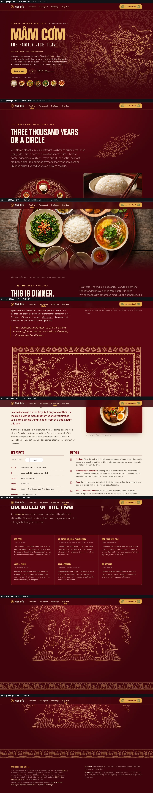
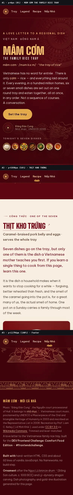

# UI Design System & Master Generation Blueprint: the-family-rice-tray-vercel-app

> **Mâm Cơm — the Vietnamese family rice tray** (https://the-family-rice-tray.vercel.app) — A love letter to mâm cơm, the round tray of shared dishes at the centre of every Vietnamese home — laid out on the face of a Đông Sơn bro...





---

## 1. Executive Visual Persona & Design Archetype

- **Brand Essence & Persona**: **Mâm Cơm — the Vietnamese family rice tray** (`https://the-family-rice-tray.vercel.app`). A love letter to mâm cơm, the round tray of shared dishes at the centre of every Vietnamese home — laid out on the face of a Đông Sơn bro...
- **Capture Provenance**: Live browser capture (`tier1_fast`, HTTP `200`, captured `2026-11-24`).
- **Visual Archetype**: **High-Contrast Obsidian / Atmospheric Design System (`#5e0712` canvas, `#f7efe0` ink, `#ff0000` accent)**.
- **Anti-AI-Slop Differentiators**:
  - **Live-Computed Chromatic Polarity**: Anchors the viewport in `#5e0712` (live computed `body` `background-color` (`computed_styles.json`)) paired with `#f7efe0` primary typography and `#ff0000` accents.
  - **Grounded Typographic Hierarchy**: Pairs `Big Shoulders Display` for display copy (`MÂM CƠM THE FAMILY RICE TRAY`) with `Be Vietnam Pro`.
  - **Calibrated Spatial Grid & Motion**: Combines `1440px` container bounds (`gap: 25.92px`, padding `0.85rem`) with `cubic-bezier(0.22,0.61,0.36,1)` easing and Three.js / WebGL Canvas Pipeline.

---

## 2. Spatial Architecture & Modular Grid Mathematics

### Viewport Allocation & Container Geometry
- **Captured Journey Filmstrips**: Desktop `1280×6624px` (`assets/desktop-journey.webp`, `8` keyframes up to `y=9647px` / doc `10547px`), Mobile `390×2616px` (`assets/mobile-journey.webp`, `3` keyframes).
- **Master Container Bounds**: `1440px` (full-bleed `100%` desktop stage measured on `1440px` viewport).
- **Canvas Lateral Padding & Spacing**: `0.85rem` lateral canvas padding with `25.92px` grid gap.
- **Border Radius Scale**: `50%`, `0px 0px 14px 14px`, `4px`, `2px`.

### Responsive Breakpoint Architecture
- **Desktop Layout**: Multi-column CSS Grid / Flexbox layout at `1440px` (`max-width: 1440px`, `gap: 25.92px`).
- **Mobile Layout**: Single-column vertical stack at `390px` viewport width with `0.85rem` horizontal padding.
- **Extracted CSS Media Queries**: `@media (max-width: 560px)`, `@media (prefers-reduced-motion: reduce)`, `@media (max-width: 720px)`, `@media (min-width: 561px) and (max-width: 959px)`.

---

## 3. Color System, Materiality & Atmospheric Lighting

### Semantic Palette & Source Grounding
| Semantic Role | Ground-Truth Value | Extracted Live / CSS Source |
|---|---|---|
| **Primary Canvas Substrate** | `#5e0712` | live computed `body` `background-color` (`computed_styles.json`) |
| **Primary Typography Ink** | `#f7efe0` | live computed `main` `color` (`computed_styles.json`) |
| **Elevated Surface / Card Substrate** | `#3f040c` | live computed `footer` `background-color` (`computed_styles.json`) |
| **Interactive Accent / Highlight** | `#ff0000` | `.stepper button { color: red }` (`#ff0000`) |
| **Secondary / Muted Copy** | `#f0be6b` | live computed `p` `color` (`computed_styles.json`) |
| **Structural Hairline Border** | `#a0582e` | `.btn--ghost { border: #a0582e }` |
| **Variable Token (`--red-700`)** | `#7a0a18` | `var(--red-700)` in `:root` |
| **Variable Token (`--red-600`)** | `#8b0c1c` | `var(--red-600)` in `:root` |
| **Variable Token (`--red-500`)** | `#a8121f` | `var(--red-500)` in `:root` |
| **Variable Token (`--gold-400`)** | `#e3a94a` | `var(--gold-400)` in `:root` |
| **Variable Token (`--gold-200`)** | `#f7d9a0` | `var(--gold-200)` in `:root` |
| **Variable Token (`--jade`)** | `#2e6b58` | `var(--jade)` in `:root` |
| **Variable Token (`--jade-light`)** | `#7fb8a2` | `var(--jade-light)` in `:root` |
| **Variable Token (`--cream-dim`)** | `#dccdb4` | `var(--cream-dim)` in `:root` |
| **Variable Token (`--ink`)** | `#1a0509` | `var(--ink)` in `:root` |

### Sanitized Root CSS Variables (`ui-ux.md` Ground Truth)
| Variable Name | Extracted Value | Semantic Role |
|---|---|---|
| `--red-900` | `#3f040c` | Color / Atmospheric Token |
| `--red-800` | `#5e0712` | Color / Atmospheric Token |
| `--red-700` | `#7a0a18` | Color / Atmospheric Token |
| `--red-600` | `#8b0c1c` | Color / Atmospheric Token |
| `--red-500` | `#a8121f` | Color / Atmospheric Token |
| `--gold-400` | `#e3a94a` | Color / Atmospheric Token |
| `--gold-300` | `#f0be6b` | Color / Atmospheric Token |
| `--gold-200` | `#f7d9a0` | Color / Atmospheric Token |
| `--jade` | `#2e6b58` | Color / Atmospheric Token |
| `--jade-light` | `#7fb8a2` | Canvas / Surface Token |
| `--cream` | `#f7efe0` | Color / Atmospheric Token |
| `--cream-dim` | `#dccdb4` | Color / Atmospheric Token |
| `--cream-faint` | `rgba(247, 239, 224, 0.62)` | Color / Atmospheric Token |
| `--ink` | `#1a0509` | Typography Ink Token |
| `--font-display` | `"Big Shoulders Display", "Arial Narrow", system-ui, sans-serif` | Typography / Scale Token |
| `--font-body` | `"Be Vietnam Pro", system-ui, -apple-system, "Segoe UI", sans-serif` | Typography / Scale Token |

---

## 4. Typographic Scale & Editorial Hierarchy

### Font Family Stacks
- **Display Typography**: `Big Shoulders Display`.
- **Primary Body Stack**: `Be Vietnam Pro`.
- **Technical / Metadata Stack**: not declared in live computed styles (uses primary stack / `ui-monospace`).

### Typographic Scale & Rules (Live Computed & Stylesheet Grounded)
- **Hero Display (`H1`)**: live computed `h1` (`font-size: 134.4px`, `line-height: 110.208px`, `font-weight: 900`, `letter-spacing: -2.016px`); CSS variables `--font-display: "Big Shoulders Display", "Arial Narrow", system-ui, sans-serif`; rule `h1` (`font-size: var(--t-hero)`, `line-height: 0.82`, `letter-spacing: -0.015em`, `font-weight: 900`).
- **Section Heading (`H2`)**: live computed `h2` (`font-size: 120px`, `line-height: 108px`, `font-weight: 900`, `letter-spacing: -1.2px`); CSS variables `--t-h2: clamp(2.4rem, 6vw, 4.6rem)`; rule `h2` (`font-size: var(--t-h2)`, `font-weight: 900`).
- **Body Copy**: live computed `body` (`font-size: 18.56px`, `line-height: 31.9232px`, `font-weight: 300`); CSS variables `--font-body: "Be Vietnam Pro", system-ui, -apple-system, "Segoe UI", sans-serif`, `--t-body: clamp(1rem, 0.55vw + 0.9rem, 1.16rem)`; rule `body` (`font-size: var(--t-body)`, `line-height: 1.72`, `font-weight: 300`).
- **Metadata & Navigation Labels**: live computed `nav/a` (`font-size: 18.56px`, `line-height: 31.9232px`, `font-weight: 300`).

---

## 5. Choreographed Motion & Interaction Physics

### Primary Easing Curves
- **Extracted Timing Functions**: `cubic-bezier(0.22,0.61,0.36,1)`, `cubic-bezier(0.34,0.02,0.2,1)`.

### Per-Element Transition & Choreography Rules
- **Selector `.skip-link`**: `transition: translate 0.18s var(--ease)` extracted from `the-family-rice-tray-vercel-app` stylesheet.
- **Selector `.wl`**: `transition: color 0.18s var(--ease), border-color 0.18s var(--ease)` extracted from `the-family-rice-tray-vercel-app` stylesheet.
- **Selector `.btn`**: `transition: background-color 0.2s var(--ease), color 0.2s var(--ease), bor...` extracted from `the-family-rice-tray-vercel-app` stylesheet.
- **Extracted Easing Curve (`cubic-bezier(0.22,0.61,0.36,1)`)**: Governs interactive state transitions across `<header.masthead>` and `<section.section>`.
- **Runtime Interaction Engine**: Integrates Three.js / WebGL Canvas Pipeline with `prefers-reduced-motion: reduce` fallback guards.
### Measured Runtime Scroll & Interaction Telemetry (`behavioral_journey_v2`)
- **Scroll Driver Mode**: `native` (max document height `10547px`, deepest scrollY reached `9647px` across `8` desktop keyframes).
- **Detected Scroll / Motion Libraries**: Native browser scroll / standard CSS transitions.
- **Hover Physics (`primary_cta` · `Set the tray`)**: `backgroundColor`: `rgb(227, 169, 74)` -> `rgb(247, 217, 160)` (`transition-duration: 0.2s, 0.2s, 0.2s, 0.2s`, `timing: cubic-bezier(0.22, 0.61, 0.36, 1), cubic-bezier(0.22, 0.61, 0.36, 1), cubic-bezier(0.22, 0.61, 0.36, 1), cubic-bezier(0.22, 0.61, 0.36, 1)`).
- **Interactive Control Probe (`tab` · `Thịt kho trứng — caramel-braised...`)**: Triggered visual diff `10.763` (attr `false -> true`, captured in `assets/state-interactive.webp`).

---

## 6. Component Wireframe & Structural DOM Map

### Visual Layout Schematic — Desktop (`1440px`, Grounded in `dom.html` & Landmark Bounding Boxes)
```
┌────────────────────────────────────────────────────────────────────────┐
│ DESKTOP VIEWPORT (1440px) — Mâm Cơm — the Vietnamese family rice tray  │
│ ====================================================================== │
│ [ <header.masthead> (1440x67px)       | The Tray · The Legend · The  ] │
│ ---------------------------------------------------------------------- │
│ | HERO STAGE: <section.hero> (w=1440px)                              | │
│ | H1: MÂM CƠM THE FAMILY RICE TRAY                                   | │
│ | Substrate: #5e0712 | Ink: #f7efe0 | Accent: #ff0000                | │
│ ---------------------------------------------------------------------- │
│ | SHOWCASE GRID (<section.section>) max-w: 1440px                    | │
│ | +------------------------------+  +------------------------------+ | │
│ | | Mâm Cơm The family rice tray |  | Three thousand years on a ci | | │
│ | +------------------------------+  +------------------------------+ | │
│ ---------------------------------------------------------------------- │
│ | DETAIL MODULE (<section.feast>) — Thịt Kho Trứng                   | │
│ ---------------------------------------------------------------------- │
│ [ FOOTER (<footer.footer>     ) | https://the-family-rice-tray.vercel  │
└────────────────────────────────────────────────────────────────────────┘
```

### Visual Layout Schematic — Mobile Reflow (`390px`)
```
┌────────────────────────────────────────────────────────────────────────┐
│ MOBILE VIEWPORT REFLOW (390px) — Single-Column Stack (gap: 25.92px)    │
│ ====================================================================== │
│ [ HEADER BAR (<header.masthead>       ) | Compact Menu (390px)         │
│ ---------------------------------------------------------------------- │
│ | HERO STAGE (<section.hero>) — 390px Vertical Lead                  | │
│ | H1: MÂM CƠM THE FAMILY RICE TRAY                                   | │
│ ---------------------------------------------------------------------- │
│ | SHOWCASE STACK (<section.section>) — 1-Col Stack                   | │
│ | [ Item 1: Mâm Cơm The family rice tray                           ] | │
│ | [ Item 2: Three thousand years on a circle                       ] | │
│ ---------------------------------------------------------------------- │
│ | DETAIL STACK (<section.feast>) — 1-Col (Thịt Kho Trứng)            | │
│ ---------------------------------------------------------------------- │
│ [ FOOTER (<footer.footer>     ) | Stacked 390px Colophon               │
└────────────────────────────────────────────────────────────────────────┘
```

### Granular DOM Region Breakdown
1. **Brand Header & Navigation Bar (<header.masthead> — `the-family-rice-tray-vercel-app`)**:
   - Landmark `<header class="masthead">` (`1440x67px`) hosting `Mâm Cơm — the Vietnamese family rice` navigation (`The Tray · The Legend · The Recipe · Nếp Nhà`), DOM attributes (`data-audio-toggle`, `data-audio`, `data-jump="tab-com"`, `data-jump="tab-thitkho"`), and stylesheet rule `after { box-sizing: border-box; }`.
2. **Hero Stage & Focal Lead (<section.hero> — `MÂM CƠM THE FAMILY RICE TRAY`)**:
   - Landmark `<section class="hero">` presenting display lead `MÂM CƠM THE FAMILY RICE TRAY` and copy excerpt *"A LOVE LETTER TO A REGIONAL DISH VIỆT NAM · ĐÔNG NAM Á"* over `#5e0712` canvas and `#f7efe0` ink.
3. **Primary Showcase & Content Grid (<section.section> — `Mâm Cơm The family rice tray`)**:
   - Landmark `<section class="section tray-section">` rendering section `Mâm Cơm The family rice tray` with copy *"A love letter to a regional dish Việt Nam · Đông Nam Á"*, asset references (`favicon.ico`, `favicon.svg`, `apple-touch-icon.png`, `site.webmanifest`), and grid rule `html { -webkit-text-size-adjust: 100%; }`.
4. **Interactive Detail & Feature Matrix (<section.feast> — `Three thousand years on a circle`)**:
   - Landmark `<section class="feast">` framing `Three thousand years on a circle` and `Thịt Kho Trứng` (*"Việt Nam · Đông Nam Á"*) with `#3f040c` surface cards, `#ff0000` accents, and `img { max-width: 100%; height: auto; display: block; }`.
5. **Colophon & Global Directory Footer (<footer.footer> — `https://the-family-rice-tray.vercel.app`)**:
   - Landmark `<footer class="footer">` anchoring `Mâm Cơm — the Vietnamese family ` footer links (`The Tray · The Legend · The Recipe · Nếp Nhà`), copy *"mâm cơm · /məm kəːm/ · “the tray of rice”"*, and `#a0582e` structural dividers.
### Full Vertical Scroll Sequence (Desktop `1440×900` Keyframes)
- **Step 01** (`y=0px`, `0%`): Active landmark `MÂM CƠM THE FAMILY RICE TRAY` · sticky/fixed elements: `1`
- **Step 02** (`y=850px`, `9%`): Active landmark `THREE THOUSAND YEARS ON A CIRCLE` · sticky/fixed elements: `1`
- **Step 03** (`y=2550px`, `26%`): Active landmark `THIS IS DINNER. ALL OF IT, AT ONCE.` · sticky/fixed elements: `1`
- **Step 04** (`y=4250px`, `44%`): Active landmark `TONIGHT` · sticky/fixed elements: `1`
- **Step 05** (`y=5950px`, `62%`): Active landmark `THỊT KHO TRỨNG` · sticky/fixed elements: `1`
- **Step 06** (`y=7650px`, `79%`): Active landmark `MỜI CƠM` · sticky/fixed elements: `1`
- **Step 07** (`y=9350px`, `97%`): Active landmark `Footer` · sticky/fixed elements: `1`
- **Step 08** (`y=9647px`, `100%`): Active landmark `Footer` · sticky/fixed elements: `1`

---

## 7. Master Zero-Shot AI Generation Prompt

```markdown
# Master Zero-Shot Frontend Generation Prompt: the-family-rice-tray-vercel-app (Mâm Cơm — the Vietnamese family rice tray)

You are a principal frontend architect and design systems engineer. Build a complete, production-ready web application replicating the exact design system, DOM landmarks, typographic hierarchy, color tokens, and motion physics of `the-family-rice-tray-vercel-app` (**Mâm Cơm — the Vietnamese family rice tray** — `https://the-family-rice-tray.vercel.app`).

### 1. Visual Archetype & Anti-AI-Slop Mandates
- **Archetype**: High-Contrast Obsidian / Atmospheric Design System (`#5e0712` canvas, `#f7efe0` ink, `#ff0000` accent).
- **Identity & Domain Context**: A love letter to mâm cơm, the round tray of shared dishes at the centre of every Vietnamese home — laid out on the face of a Đông Sơn bro...
- **Primary Substrate**: `#5e0712` (live computed `body` `background-color` (`computed_styles.json`)), **Primary Ink**: `#f7efe0`, **Accent / Highlight**: `#ff0000`.
- **Site-Specific Differentiators**:
  - **Live-Computed Chromatic Polarity**: Anchors the viewport in `#5e0712` (live computed `body` `background-color` (`computed_styles.json`)) paired with `#f7efe0` primary typography and `#ff0000` accents.
  - **Grounded Typographic Hierarchy**: Pairs `Big Shoulders Display` for display copy (`MÂM CƠM THE FAMILY RICE TRAY`) with `Be Vietnam Pro`.
  - **Calibrated Spatial Grid & Motion**: Combines `1440px` container bounds (`gap: 25.92px`, padding `0.85rem`) with `cubic-bezier(0.22,0.61,0.36,1)` easing and Three.js / WebGL Canvas Pipeline.

### 2. Ground-Truth CSS Variables (`:root` Token Contract)
Declare and consume these exact custom properties extracted from `the-family-rice-tray-vercel-app` in your global stylesheet:

:root {
  /* Mâm Cơm — the Vietnamese family rice tray (the-family-rice-tray-vercel-app) — Live-Grounded CSS Variables */
  --red-900: #3f040c; /* Color / Atmospheric Token (the-family-rice-tray-vercel-app) */
  --red-800: #5e0712; /* Color / Atmospheric Token (the-family-rice-tray-vercel-app) */
  --red-700: #7a0a18; /* Color / Atmospheric Token (the-family-rice-tray-vercel-app) */
  --red-600: #8b0c1c; /* Color / Atmospheric Token (the-family-rice-tray-vercel-app) */
  --red-500: #a8121f; /* Color / Atmospheric Token (the-family-rice-tray-vercel-app) */
  --gold-400: #e3a94a; /* Color / Atmospheric Token (the-family-rice-tray-vercel-app) */
  --gold-300: #f0be6b; /* Color / Atmospheric Token (the-family-rice-tray-vercel-app) */
  --gold-200: #f7d9a0; /* Color / Atmospheric Token (the-family-rice-tray-vercel-app) */
  --jade: #2e6b58; /* Color / Atmospheric Token (the-family-rice-tray-vercel-app) */
  --jade-light: #7fb8a2; /* Canvas / Surface Token (the-family-rice-tray-vercel-app) */
  --cream: #f7efe0; /* Color / Atmospheric Token (the-family-rice-tray-vercel-app) */
  --cream-dim: #dccdb4; /* Color / Atmospheric Token (the-family-rice-tray-vercel-app) */
  --cream-faint: rgba(247, 239, 224, 0.62); /* Color / Atmospheric Token (the-family-rice-tray-vercel-app) */
  --ink: #1a0509; /* Typography Ink Token (the-family-rice-tray-vercel-app) */
  --font-display: "Big Shoulders Display", "Arial Narrow", system-ui, sans-serif; /* Typography / Scale Token (the-family-rice-tray-vercel-app) */
  --font-body: "Be Vietnam Pro", system-ui, -apple-system, "Segoe UI", sans-serif; /* Typography / Scale Token (the-family-rice-tray-vercel-app) */
}

### 3. Semantic Color & Materiality Contract
Map every surface, ink, and border strictly to these source-grounded tokens:
- **Primary Canvas Substrate**: `#5e0712` — grounded in live computed `body` `background-color` (`computed_styles.json`)
- **Primary Typography Ink**: `#f7efe0` — grounded in live computed `main` `color` (`computed_styles.json`)
- **Elevated Surface / Card Substrate**: `#3f040c` — grounded in live computed `footer` `background-color` (`computed_styles.json`)
- **Interactive Accent / Highlight**: `#ff0000` — grounded in `.stepper button { color: red }` (`#ff0000`)
- **Secondary / Muted Copy**: `#f0be6b` — grounded in live computed `p` `color` (`computed_styles.json`)
- **Structural Hairline Border**: `#a0582e` — grounded in `.btn--ghost { border: #a0582e }`
- **Variable Token (`--red-700`)**: `#7a0a18` — grounded in `var(--red-700)` in `:root`
- **Variable Token (`--red-600`)**: `#8b0c1c` — grounded in `var(--red-600)` in `:root`
- **Variable Token (`--red-500`)**: `#a8121f` — grounded in `var(--red-500)` in `:root`
- **Variable Token (`--gold-400`)**: `#e3a94a` — grounded in `var(--gold-400)` in `:root`
- **Variable Token (`--gold-200`)**: `#f7d9a0` — grounded in `var(--gold-200)` in `:root`
- **Variable Token (`--jade`)**: `#2e6b58` — grounded in `var(--jade)` in `:root`
- **Variable Token (`--jade-light`)**: `#7fb8a2` — grounded in `var(--jade-light)` in `:root`
- **Variable Token (`--cream-dim`)**: `#dccdb4` — grounded in `var(--cream-dim)` in `:root`
- **Variable Token (`--ink`)**: `#1a0509` — grounded in `var(--ink)` in `:root`

### 4. Spatial Grid, Container Bounds & Responsive Breakpoints
- **Desktop Viewport Reference**: `1280×6624px` (multi-frame vertical journey filmstrip (6624px), `1440px` standard desktop width).
- **Mobile Viewport Reference**: `390×2616px` (multi-frame vertical journey filmstrip (2616px), `390px` standard mobile width).
- **Container Max-Width**: `1440px` (full-bleed `100%` desktop stage measured on `1440px` viewport)
- **Padding & Gutters**: `0.85rem` lateral canvas padding with `25.92px` grid gap
- **Desktop Grid**: Multi-column CSS Grid / Flexbox layout at `1440px` (`max-width: 1440px`, `gap: 25.92px`)
- **Mobile Adaptation**: Single-column vertical stack at `390px` viewport width with `0.85rem` horizontal padding
- **Media Queries**: `@media (max-width: 560px)`, `@media (prefers-reduced-motion: reduce)`, `@media (max-width: 720px)`, `@media (min-width: 561px) and (max-width: 959px)`
- **Corner Radii**: `50%`, `0px 0px 14px 14px`, `4px`, `2px`

### 5. Typography & Editorial Scale Contract
- **Display Font Stack**: `Big Shoulders Display`
- **Body Font Stack**: `Be Vietnam Pro`
- **Monospace / Technical Font Stack**: not declared in live computed styles (uses primary stack / `ui-monospace`)
- **H1 Display Rule**: live computed `h1` (`font-size: 134.4px`, `line-height: 110.208px`, `font-weight: 900`, `letter-spacing: -2.016px`); CSS variables `--font-display: "Big Shoulders Display", "Arial Narrow", system-ui, sans-serif`; rule `h1` (`font-size: var(--t-hero)`, `line-height: 0.82`, `letter-spacing: -0.015em`, `font-weight: 900`)
- **H2 Section Rule**: live computed `h2` (`font-size: 120px`, `line-height: 108px`, `font-weight: 900`, `letter-spacing: -1.2px`); CSS variables `--t-h2: clamp(2.4rem, 6vw, 4.6rem)`; rule `h2` (`font-size: var(--t-h2)`, `font-weight: 900`)
- **Body Copy Rule**: live computed `body` (`font-size: 18.56px`, `line-height: 31.9232px`, `font-weight: 300`); CSS variables `--font-body: "Be Vietnam Pro", system-ui, -apple-system, "Segoe UI", sans-serif`, `--t-body: clamp(1rem, 0.55vw + 0.9rem, 1.16rem)`; rule `body` (`font-size: var(--t-body)`, `line-height: 1.72`, `font-weight: 300`)
- **Metadata & Index Rule**: live computed `nav/a` (`font-size: 18.56px`, `line-height: 31.9232px`, `font-weight: 300`)

### 6. Component Hierarchy, Verbatim Copy & Real DOM Landmarks
Scaffold `the-family-rice-tray-vercel-app` (`Mâm Cơm — the Vietnamese family rice tray`) with these exact structural regions, extracted copy, and CSS rules from `dom.html`:
1. **Brand Header & Navigation Bar (<header.masthead> — `the-family-rice-tray-vercel-app`)**:
   - DOM & Selectors: Landmark `<header class="masthead">` (`1440x67px`) hosting `Mâm Cơm — the Vietnamese family rice` navigation (`The Tray · The Legend · The Recipe · Nếp Nhà`), DOM attributes (`data-audio-toggle`, `data-audio`, `data-jump="tab-com"`, `data-jump="tab-thitkho"`), and stylesheet rule `after { box-sizing: border-box; }`.
   - Responsive Contract: Header `Brand Header & Navigation Bar (<header.masthead> — `the-family-rice-tray-vercel-app`)` (`the-family-rice-tray-vercel-app`) adapts across `@media (max-width: 560px)`, `@media (prefers-reduced-motion: reduce)`, `@media (max-width: 720px)`, `@media (min-width: 561px) and (max-width: 959px)` with `cubic-bezier(0.22,0.61,0.36,1)`, `cubic-bezier(0.34,0.02,0.2,1)` transitions and links `The Tray · The Legend · The Recipe · Nếp Nhà`.
2. **Hero Stage & Focal Lead (<section.hero> — `MÂM CƠM THE FAMILY RICE TRAY`)**:
   - DOM & Selectors: Landmark `<section class="hero">` presenting display lead `MÂM CƠM THE FAMILY RICE TRAY` and copy excerpt *"A LOVE LETTER TO A REGIONAL DISH VIỆT NAM · ĐÔNG NAM Á"* over `#5e0712` canvas and `#f7efe0` ink.
   - Responsive Contract: Hero stage (`1280×6624px` desktop / `390×2616px` mobile) sets `#5e0712` background with `#f7efe0` headline `MÂM CƠM THE FAMILY RICE TRAY`.
3. **Primary Showcase & Content Grid (<section.section> — `Mâm Cơm The family rice tray`)**:
   - DOM & Selectors: Landmark `<section class="section tray-section">` rendering section `Mâm Cơm The family rice tray` with copy *"A love letter to a regional dish Việt Nam · Đông Nam Á"*, asset references (`favicon.ico`, `favicon.svg`, `apple-touch-icon.png`, `site.webmanifest`), and grid rule `html { -webkit-text-size-adjust: 100%; }`.
   - Responsive Contract: Showcase grid `Primary Showcase & Content Grid (<section.section> — `Mâm Cơm The family rice tray`)` applies Multi-column CSS Grid / Flexbox layout at `1440px` (`max-width: 1440px`, `gap: 25.92px`) on desktop and Single-column vertical stack at `390px` viewport width with `0.85rem` horizontal padding on mobile.
4. **Interactive Detail & Feature Matrix (<section.feast> — `Three thousand years on a circle`)**:
   - DOM & Selectors: Landmark `<section class="feast">` framing `Three thousand years on a circle` and `Thịt Kho Trứng` (*"Việt Nam · Đông Nam Á"*) with `#3f040c` surface cards, `#ff0000` accents, and `img { max-width: 100%; height: auto; display: block; }`.
   - Responsive Contract: Detail module `Interactive Detail & Feature Matrix (<section.feast> — `Three thousand years on a circle`)` uses `50%`, `0px 0px 14px 14px`, `4px`, `2px` radii, `#ff0000` highlights, and assets (favicon.ico, favicon.svg, apple-touch-icon.png).
5. **Colophon & Global Directory Footer (<footer.footer> — `https://the-family-rice-tray.vercel.app`)**:
   - DOM & Selectors: Landmark `<footer class="footer">` anchoring `Mâm Cơm — the Vietnamese family ` footer links (`The Tray · The Legend · The Recipe · Nếp Nhà`), copy *"mâm cơm · /məm kəːm/ · “the tray of rice”"*, and `#a0582e` structural dividers.
   - Responsive Contract: Footer `Colophon & Global Directory Footer (<footer.footer> — `https://the-family-rice-tray.vercel.app`)` aligns to `1440px` (full-bleed `100%` desktop stage measured on `1440px` viewport) with `0.85rem` lateral canvas padding with `25.92px` grid gap and attributes (data-audio-toggle, data-audio, data-jump="tab-com").

#### Verbatim DOM Copy Excerpts (`dom.html`)
- Copy Excerpt 1: *"A LOVE LETTER TO A REGIONAL DISH VIỆT NAM · ĐÔNG NAM Á"*
- Copy Excerpt 2: *"A love letter to a regional dish Việt Nam · Đông Nam Á"*
- Copy Excerpt 3: *"Việt Nam · Đông Nam Á"*
- Copy Excerpt 4: *"mâm cơm · /məm kəːm/ · “the tray of rice”"*

### 7. Motion, Extracted Stylesheet Rules & Interaction Choreography
- **Primary Easing Functions**: `cubic-bezier(0.22,0.61,0.36,1)`, `cubic-bezier(0.34,0.02,0.2,1)`
- **Extracted Stylesheet Rules (`the-family-rice-tray-vercel-app`)**:
- `after { box-sizing: border-box; }`
- `html { -webkit-text-size-adjust: 100%; }`
- `img { max-width: 100%; height: auto; display: block; }`
- `h4 { margin: 0; line-height: 1.02; font-weight: 800; letter-spacing: -0.01em; }`
- `p:last-child { margin-bottom: 0; }`
- **Per-Selector Transition Rules**:
- **Selector `.skip-link`**: `transition: translate 0.18s var(--ease)` extracted from `the-family-rice-tray-vercel-app` stylesheet.
- **Selector `.wl`**: `transition: color 0.18s var(--ease), border-color 0.18s var(--ease)` extracted from `the-family-rice-tray-vercel-app` stylesheet.
- **Selector `.btn`**: `transition: background-color 0.2s var(--ease), color 0.2s var(--ease), bor...` extracted from `the-family-rice-tray-vercel-app` stylesheet.
- **Extracted Easing Curve (`cubic-bezier(0.22,0.61,0.36,1)`)**: Governs interactive state transitions across `<header.masthead>` and `<section.section>`.
- **Runtime Interaction Engine**: Integrates Three.js / WebGL Canvas Pipeline with `prefers-reduced-motion: reduce` fallback guards.
### 7b. Full-Page Scroll Choreography, Interactive States & Multi-Page Routes
- **Scroll Mechanics**: Implement `native` vertical progression up to `10547px` across 8 distinct viewport chapters.
- **Vertical Chapter Sequence**: MÂM CƠM THE FAMILY RICE TRAY (0%) -> THREE THOUSAND YEARS ON A C... (9%) -> THIS IS DINNER. ALL OF IT,... (26%) -> TONIGHT (44%) -> THỊT KHO TRỨNG (62%) -> MỜI CƠM (79%) -> Footer (97%) -> Footer (100%).
- **Hover Micro-Interaction (`primary_cta`)**: Animate `backgroundColor` with `0.2s, 0.2s, 0.2s, 0.2s cubic-bezier(0.22, 0.61, 0.36, 1), cubic-bezier(0.22, 0.61, 0.36, 1), cubic-bezier(0.22, 0.61, 0.36, 1), cubic-bezier(0.22, 0.61, 0.36, 1)`.

### 8. Technical Deliverables
- Implement in Next.js (App Router) with TypeScript and Tailwind CSS consuming the `:root` custom properties defined above for `the-family-rice-tray-vercel-app`.
- Reproduce both the `1440px` desktop architecture and `390px` mobile breakpoint transitions, preserving semantic HTML5 landmarks (`<header>`, `<nav>`, `<main>`, `<section>`, `<footer>`) and `prefers-reduced-motion` accessibility guards.
```
---

## 8. Full-Page Scroll Journey, Interactive States & Subpage Inventory

### Desktop Scroll Keyframes (`1440×900` WebP)
| Step | Scroll Y | Progress | Active Landmark / Section | Sticky/Fixed | Visual Asset |
| :---: | :---: | :---: | :--- | :---: | :--- |
| `#01` | `0px` | `0%` | MÂM CƠM THE FAMILY RICE TRAY | `1` | [desktop-step-01.webp](assets/desktop-step-01.webp) |
| `#02` | `850px` | `9%` | THREE THOUSAND YEARS ON A CIRCLE | `1` | [desktop-step-02.webp](assets/desktop-step-02.webp) |
| `#03` | `2550px` | `26%` | THIS IS DINNER. ALL OF IT, AT ONCE. | `1` | [desktop-step-03.webp](assets/desktop-step-03.webp) |
| `#04` | `4250px` | `44%` | TONIGHT | `1` | [desktop-step-04.webp](assets/desktop-step-04.webp) |
| `#05` | `5950px` | `62%` | THỊT KHO TRỨNG | `1` | [desktop-step-05.webp](assets/desktop-step-05.webp) |
| `#06` | `7650px` | `79%` | MỜI CƠM | `1` | [desktop-step-06.webp](assets/desktop-step-06.webp) |
| `#07` | `9350px` | `97%` | Footer | `1` | [desktop-step-07.webp](assets/desktop-step-07.webp) |
| `#08` | `9647px` | `100%` | Footer | `1` | [desktop-step-08.webp](assets/desktop-step-08.webp) |

### Mobile Condensed Keyframes (`390×844` WebP)
| Step | Scroll Y | Progress | Active Landmark | Visual Asset |
| :---: | :---: | :---: | :--- | :--- |
| `#01` | `0px` | `0%` | MÂM CƠM THE FAMILY RICE TRAY | [mobile-step-01.webp](assets/mobile-step-01.webp) |
| `#02` | `5898px` | `50%` | THỊT KHO TRỨNG | [mobile-step-02.webp](assets/mobile-step-02.webp) |
| `#03` | `11796px` | `100%` | Footer | [mobile-step-03.webp](assets/mobile-step-03.webp) |

### Interactive UI State Captures (`1440×900` WebP)
| State Type | Trigger / Observation | Visual Asset |
| :--- | :--- | :--- |
| `interactive_control` | Control `tab` (`Thịt kho trứng — caramel-brai...`, diff `10.763`) | [state-interactive.webp](assets/state-interactive.webp) |

