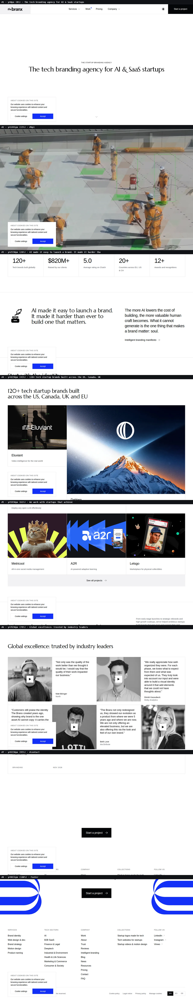
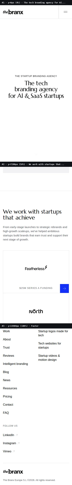

# UI Design System & Master Generation Blueprint: thebranx-com

> **The branding agency for startups, AI & SaaS - The Branx** (https://thebranx.com) — The Branx builds category-defining brands and websites for AI, SaaS and B2B tech startups: strategy, identity, web design and motion, fro...





---

## 1. Executive Visual Persona & Design Archetype

- **Brand Essence & Persona**: **The branding agency for startups, AI & SaaS - The Branx** (`https://thebranx.com`). The Branx builds category-defining brands and websites for AI, SaaS and B2B tech startups: strategy, identity, web design and motion, fro...
- **Capture Provenance**: Live browser capture (`tier1_fast`, HTTP `200`, captured `2026-11-24`).
- **Visual Archetype**: **Light-Substrate Editorial & Modular Grid System (`#ffffff` canvas, `#050608` ink, `#0000ff` accent)**.
- **Anti-AI-Slop Differentiators**:
  - **Live-Computed Chromatic Polarity**: Anchors the viewport in `#ffffff` (live computed `body` `background-color` (`computed_styles.json`)) paired with `#050608` primary typography and `#0000ff` accents.
  - **Grounded Typographic Hierarchy**: Pairs `Marcellus` for display copy (`The tech branding agency for AI & Sa`) with `Helvetica Neue` and `SFMono-Regular`.
  - **Calibrated Spatial Grid & Motion**: Combines `96rem` container bounds (`gap: var(--bx-space-3)`, padding `var(--bx-section)`) with `cubic-bezier(.4,0,.2,1)` easing and Three.js / WebGL Canvas Pipeline, Lottie Vector Animation Player.

---

## 2. Spatial Architecture & Modular Grid Mathematics

### Viewport Allocation & Container Geometry
- **Captured Journey Filmstrips**: Desktop `1280×6624px` (`assets/desktop-journey.webp`, `8` keyframes up to `y=9831px` / doc `10731px`), Mobile `390×2616px` (`assets/mobile-journey.webp`, `3` keyframes).
- **Master Container Bounds**: `96rem` (non-`@media` desktop container stylesheet rule).
- **Canvas Lateral Padding & Spacing**: `var(--bx-section)` lateral canvas padding with `var(--bx-space-3)` grid gap.
- **Border Radius Scale**: `.25rem`, `50%`, `52px`, `44px`.

### Responsive Breakpoint Architecture
- **Desktop Layout**: Multi-column CSS Grid / Flexbox layout at `1440px` (`max-width: 96rem`, `gap: var(--bx-space-3)`).
- **Mobile Layout**: Single-column vertical stack at `390px` viewport width with `var(--bx-section)` horizontal padding.
- **Extracted CSS Media Queries**: `@media (min-width:40rem)`, `@media (min-width:48rem)`, `@media (min-width:64rem)`, `@media (min-width:80rem)`.

---

## 3. Color System, Materiality & Atmospheric Lighting

### Semantic Palette & Source Grounding
| Semantic Role | Ground-Truth Value | Extracted Live / CSS Source |
|---|---|---|
| **Primary Canvas Substrate** | `#ffffff` | live computed `body` `background-color` (`computed_styles.json`) |
| **Primary Typography Ink** | `#050608` | live computed `h1` `color` (`computed_styles.json`) |
| **Elevated Surface / Card Substrate** | `#ffff00` | `.bg-yellow-200 { background-color: yellow }` (`#ffff00`) |
| **Interactive Accent / Highlight** | `#0000ff` | `.bx-btn--primary { background-color: blue }` (`#0000ff`) |
| **Secondary / Muted Copy** | `#85888e` | `var(--bx-muted)` in `:root` |
| **Structural Hairline Border** | `#232426` | `var(--bx-line)` in `:root` |
| **Variable Token (`--bx-gray-1`)** | `#151618` | `var(--bx-gray-1)` in `:root` |
| **Variable Token (`--bx-gray-2`)** | `#202124` | `var(--bx-gray-2)` in `:root` |
| **Variable Token (`--bx-gray-3`)** | `#2c2d31` | `var(--bx-gray-3)` in `:root` |
| **Variable Token (`--bx-blue`)** | `#122ff7` | `var(--bx-blue)` in `:root` |
| **Variable Token (`--bx-accent`)** | `#326cff` | `var(--bx-accent)` in `:root` |
| **Variable Token (`--bx-success`)** | `#51e08a` | `var(--bx-success)` in `:root` |
| **Variable Token (`--bx-attention`)** | `#de8637` | `var(--bx-attention)` in `:root` |

### Sanitized Root CSS Variables (`ui-ux.md` Ground Truth)
| Variable Name | Extracted Value | Semantic Role |
|---|---|---|
| `--bx-ink` | `#fff` | Typography Ink Token |
| `--bx-ink-rgb` | `255, 255, 255` | Typography Ink Token |
| `--bx-paper` | `#050608` | Canvas / Surface Token |
| `--bx-paper-rgb` | `5, 6, 8` | Canvas / Surface Token |
| `--bx-muted` | `#85888e` | Color / Atmospheric Token |
| `--bx-line` | `#232426` | Color / Atmospheric Token |
| `--bx-gray-1` | `#151618` | Color / Atmospheric Token |
| `--bx-gray-2` | `#202124` | Color / Atmospheric Token |
| `--bx-gray-3` | `#2c2d31` | Color / Atmospheric Token |
| `--bx-blue` | `#122ff7` | Color / Atmospheric Token |
| `--bx-blue-ink` | `#fff` | Typography Ink Token |
| `--bx-cta-ink` | `#050608` | Typography Ink Token |
| `--bx-accent` | `#326cff` | Brand / Palette Token |
| `--bx-focus` | `var(--bx-accent)` | Design System Custom Token |
| `--bx-success` | `#51e08a` | Color / Atmospheric Token |
| `--bx-attention` | `#de8637` | Color / Atmospheric Token |

---

## 4. Typographic Scale & Editorial Hierarchy

### Font Family Stacks
- **Display Typography**: `Marcellus`.
- **Primary Body Stack**: `Helvetica Neue`.
- **Technical / Metadata Stack**: `SFMono-Regular`.

### Typographic Scale & Rules (Live Computed & Stylesheet Grounded)
- **Hero Display (`H1`)**: live computed `h1` (`font-size: 48.96px`, `line-height: 47.9808px`, `font-weight: 300`, `letter-spacing: -1.4688px`); CSS variables `--bx-display-ls: -.01em`, `--bx-fs-display: clamp(44px, 5.6vw, 120px)`, `--bx-lh-display: 1.05`; rule `h1` (`font-size: var(--bx-fs-statement)`, `line-height: var(--bx-lh-statement)`).
- **Section Heading (`H2`)**: live computed `h2` (`font-size: 48.96px`, `line-height: 49.9392px`, `font-weight: 300`, `letter-spacing: -0.4896px`); CSS variables `--bx-fs-h2: clamp(32px, 3.6vw, 72px)`, `--text-3xl: var(--bx-fs-h2)`, `--text-3xl--line-height: calc(2.25 / 1.875)`; rule `h2` (`font-size: var(--text-xl)`).
- **Body Copy**: live computed `body` (`font-size: 16px`, `line-height: 25.6px`, `font-weight: 400`); CSS variables `--bx-fs-body: 16px`, `--bx-lh-body: 1.6`, `--leading-body: var(--bx-lh-body)`; rule `p` (`font-size: var(--bx-fs-lead)`, `line-height: var(--bx-lh-body)`).
- **Metadata & Navigation Labels**: live computed `nav/a` (`font-size: 16px`, `line-height: 25.6px`, `font-weight: 400`); CSS variables `--bx-mono: ui-monospace, SFMono-Regular, Menlo, Consolas, monospace`, `--bx-fs-small: 15px`, `--font-mono: var(--bx-mono)`.

---

## 5. Choreographed Motion & Interaction Physics

### Primary Easing Curves
- **Extracted Timing Functions**: `cubic-bezier(.4,0,.2,1)`, `cubic-bezier(.76,0,.24,1)`, `cubic-bezier(.16,1,.3,1)`.

### Per-Element Transition & Choreography Rules
- **Selector `layer theme`**: `transition: .15s` extracted from `thebranx-com` stylesheet.
- **Selector `.transition`**: `transition: var(--tw-ease,var(--default-transition-timing-function))` extracted from `thebranx-com` stylesheet.
- **Selector `body`**: `transition: background-color var(--bx-dur-slow) var(--bx-ease)` extracted from `thebranx-com` stylesheet.
- **Extracted Easing Curve (`cubic-bezier(.4,0,.2,1)`)**: Governs interactive state transitions across `<header.bx-navbar>` and `<section.bx-section>`.
- **Runtime Interaction Engine**: Integrates Three.js / WebGL Canvas Pipeline, Lottie Vector Animation Player with `prefers-reduced-motion: reduce` fallback guards.
### Measured Runtime Scroll & Interaction Telemetry (`behavioral_journey_v2`)
- **Scroll Driver Mode**: `native` (max document height `10731px`, deepest scrollY reached `9831px` across `8` desktop keyframes).
- **Detected Scroll / Motion Libraries**: Native browser scroll / standard CSS transitions.
- **Nav / Drawer Probe**: Tested trigger `Services` (diff `0.744`, below state-capture threshold).
- **Hover Physics (`primary_cta` · `Letsgo Marketplace for physical c...`)**: Computed transition `0s` / `ease` (no static color/transform shift captured at rest).
- **Interactive Control Probe (`accordion` · `Websites`)**: Triggered visual diff `13.45` (attr `false -> true`, captured in `assets/state-interactive.webp`).
- **Theme Toggle Probe (`Dark mode`)**: Toggled body background `rgb(255, 255, 255)` -> `rgb(19, 20, 22)` and ink `rgb(5, 6, 8)` -> `rgb(255, 255, 255)`.
- **Route Transition Architecture**: First internal navigation (`/work`) measured as `SPA` in `1071ms`.

---

## 6. Component Wireframe & Structural DOM Map

### Visual Layout Schematic — Desktop (`1440px`, Grounded in `dom.html` & Landmark Bounding Boxes)
```
┌────────────────────────────────────────────────────────────────────────┐
│ DESKTOP VIEWPORT (1440px) — The branding agency for startups, AI & Saa │
│ ====================================================================== │
│ [ <header.bx-navbar> (1440x73px)      | Brand identity · Web design  ] │
│ ---------------------------------------------------------------------- │
│ | HERO STAGE: <section.bx-imm> (w=1440px)                            | │
│ | H1: The tech branding agency for AI & SaaS startups                | │
│ | Substrate: #ffffff | Ink: #050608 | Accent: #0000ff                | │
│ ---------------------------------------------------------------------- │
│ | SHOWCASE GRID (<section.bx-section>) max-w: 96rem                  | │
│ | +------------------------------+  +------------------------------+ | │
│ | | The Branx turns complex tech |  | AI made it easy to launch a  | | │
│ | +------------------------------+  +------------------------------+ | │
│ ---------------------------------------------------------------------- │
│ | DETAIL MODULE (<section.bx-philosophy>) — Start with the identi    | │
│ ---------------------------------------------------------------------- │
│ [ FOOTER (<footer.bx-footer>  ) | https://thebranx.com                 │
└────────────────────────────────────────────────────────────────────────┘
```

### Visual Layout Schematic — Mobile Reflow (`390px`)
```
┌────────────────────────────────────────────────────────────────────────┐
│ MOBILE VIEWPORT REFLOW (390px) — Single-Column Stack (gap: var(--bx)   │
│ ====================================================================== │
│ [ HEADER BAR (<header.bx-navbar>      ) | Compact Menu (390px)         │
│ ---------------------------------------------------------------------- │
│ | HERO STAGE (<section.bx-imm>) — 390px Vertical Lead                | │
│ | H1: The tech branding agency for AI & SaaS startups                | │
│ ---------------------------------------------------------------------- │
│ | SHOWCASE STACK (<section.bx-section>) — 1-Col Stack                | │
│ | [ Item 1: The Branx turns complex tech into category-defini...   ] | │
│ | [ Item 2: AI made it easy to launch a brand. It made it har...   ] | │
│ ---------------------------------------------------------------------- │
│ | DETAIL STACK (<section.bx-philosophy>) — 1-Col (Start with the ide)  │
│ ---------------------------------------------------------------------- │
│ [ FOOTER (<footer.bx-footer>  ) | Stacked 390px Colophon               │
└────────────────────────────────────────────────────────────────────────┘
```

### Granular DOM Region Breakdown
1. **Brand Header & Navigation Bar (<header.bx-navbar> — `thebranx-com`)**:
   - Landmark `<header class="bx-navbar">` (`1440x73px`) hosting `The branding agency for startups, AI` navigation (`Brand identity · Web design & dev. · Strategy & messaging · Motion design · Product naming`), DOM attributes (`data-precedence="next"`, `data-precedence="next"`, `data-ch2css="true"`, `data-bx-nav`), and stylesheet rule `llus_b0edf5b9-module__eeLBqG__cla... { font-family:Marcellus,Marcellus Fallback;font-style:normal;font-weight:400 }`.
2. **Hero Stage & Focal Lead (<section.bx-imm> — `The tech branding agency for AI & `)**:
   - Landmark `<section class="bx-imm">` presenting display lead `The tech branding agency for AI & SaaS startups` and copy excerpt *"THE STARTUP BRANDING AGENCY"* over `#ffffff` canvas and `#050608` ink.
3. **Primary Showcase & Content Grid (<section.bx-section> — `The Branx turns complex tech into `)**:
   - Landmark `<section class="bx-section">` rendering section `The Branx turns complex tech into category-defini...` with copy *"The startup branding agency"*, asset references (`ec2f4458eb06f74e-s.p.217u6tza6bra...`, `0u5m-o-ck0mfs.css`, `44nobezqmqmh0.css`, `194ug3jq7qzm9.js`), and grid rule `ellus_b0edf5b9-module__eeLBqG__va... { --font-marcellus:"Marcellus", "Marcellus Fallback" }`.
4. **Interactive Detail & Feature Matrix (<section.bx-philosophy> — `AI made it easy to launch a brand.`)**:
   - Landmark `<section class="bx-philosophy">` framing `AI made it easy to launch a brand. It made it har...` and `Start with the identity. Add the rest when you're...` (*"The tech branding agency"*) with `#ffff00` surface cards, `#0000ff` accents, and `backdrop { box-sizing:border-box;border:0 solid;margin:0;padding:0 }`.
5. **Colophon & Global Directory Footer (<footer.bx-footer> — `https://thebranx.com`)**:
   - Landmark `<footer class="bx-footer">` anchoring `The branding agency for startups` footer links (`Brand identity · Web design & dev. · Strategy & messaging · Motion design · Product naming`), copy *"for AI & SaaS startups"*, and `#232426` structural dividers.
### Full Vertical Scroll Sequence (Desktop `1440×900` Keyframes)
- **Step 01** (`y=0px`, `0%`): Active landmark `The tech branding agency for AI & SaaS startups` · sticky/fixed elements: `3`
- **Step 02** (`y=1441px`, `15%`): Active landmark `#kpi` · sticky/fixed elements: `2`
- **Step 03** (`y=2550px`, `26%`): Active landmark `AI made it easy to launch a brand. It made it har...` · sticky/fixed elements: `1`
- **Step 04** (`y=4250px`, `43%`): Active landmark `120+ tech startup brands built across the US, Can...` · sticky/fixed elements: `1`
- **Step 05** (`y=5950px`, `61%`): Active landmark `We work with startups that achieve` · sticky/fixed elements: `1`
- **Step 06** (`y=7650px`, `78%`): Active landmark `Global excellence: trusted by industry leaders` · sticky/fixed elements: `1`
- **Step 07** (`y=9350px`, `95%`): Active landmark `#contact` · sticky/fixed elements: `1`
- **Step 08** (`y=9831px`, `100%`): Active landmark `Footer` · sticky/fixed elements: `1`

### Multi-Page Internal Route Map
- **Listing Route (`/work`)**: `https://thebranx.com/work` — H1: `120+ tech startup brands built across the US, Can...`, scrollHeight `5479px`, transition `SPA` (`1071ms`)
- **Detail Route (`/services/brand-identity`)**: `https://thebranx.com/services/brand-identity` — H1: `Brand identity for AI & SaaS startups`, scrollHeight `6974px`, transition `direct` (`1124ms`)
- **About Route (`/contact`)**: `https://thebranx.com/contact` — H1: `Tell us about your project`, scrollHeight `2323px`, transition `direct` (`604ms`)

---

## 7. Master Zero-Shot AI Generation Prompt

```markdown
# Master Zero-Shot Frontend Generation Prompt: thebranx-com (The branding agency for startups, AI & SaaS - The Branx)

You are a principal frontend architect and design systems engineer. Build a complete, production-ready web application replicating the exact design system, DOM landmarks, typographic hierarchy, color tokens, and motion physics of `thebranx-com` (**The branding agency for startups, AI & SaaS - The Branx** — `https://thebranx.com`).

### 1. Visual Archetype & Anti-AI-Slop Mandates
- **Archetype**: Light-Substrate Editorial & Modular Grid System (`#ffffff` canvas, `#050608` ink, `#0000ff` accent).
- **Identity & Domain Context**: The Branx builds category-defining brands and websites for AI, SaaS and B2B tech startups: strategy, identity, web design and motion, fro...
- **Primary Substrate**: `#ffffff` (live computed `body` `background-color` (`computed_styles.json`)), **Primary Ink**: `#050608`, **Accent / Highlight**: `#0000ff`.
- **Site-Specific Differentiators**:
  - **Live-Computed Chromatic Polarity**: Anchors the viewport in `#ffffff` (live computed `body` `background-color` (`computed_styles.json`)) paired with `#050608` primary typography and `#0000ff` accents.
  - **Grounded Typographic Hierarchy**: Pairs `Marcellus` for display copy (`The tech branding agency for AI & Sa`) with `Helvetica Neue` and `SFMono-Regular`.
  - **Calibrated Spatial Grid & Motion**: Combines `96rem` container bounds (`gap: var(--bx-space-3)`, padding `var(--bx-section)`) with `cubic-bezier(.4,0,.2,1)` easing and Three.js / WebGL Canvas Pipeline, Lottie Vector Animation Player.

### 2. Ground-Truth CSS Variables (`:root` Token Contract)
Declare and consume these exact custom properties extracted from `thebranx-com` in your global stylesheet:

:root {
  /* The branding agency for startups, AI & SaaS - The Branx (thebranx-com) — Live-Grounded CSS Variables */
  --bx-ink: #fff; /* Typography Ink Token (thebranx-com) */
  --bx-ink-rgb: 255, 255, 255; /* Typography Ink Token (thebranx-com) */
  --bx-paper: #050608; /* Canvas / Surface Token (thebranx-com) */
  --bx-paper-rgb: 5, 6, 8; /* Canvas / Surface Token (thebranx-com) */
  --bx-muted: #85888e; /* Color / Atmospheric Token (thebranx-com) */
  --bx-line: #232426; /* Color / Atmospheric Token (thebranx-com) */
  --bx-gray-1: #151618; /* Color / Atmospheric Token (thebranx-com) */
  --bx-gray-2: #202124; /* Color / Atmospheric Token (thebranx-com) */
  --bx-gray-3: #2c2d31; /* Color / Atmospheric Token (thebranx-com) */
  --bx-blue: #122ff7; /* Color / Atmospheric Token (thebranx-com) */
  --bx-blue-ink: #fff; /* Typography Ink Token (thebranx-com) */
  --bx-cta-ink: #050608; /* Typography Ink Token (thebranx-com) */
  --bx-accent: #326cff; /* Brand / Palette Token (thebranx-com) */
  --bx-focus: var(--bx-accent); /* Design System Custom Token (thebranx-com) */
  --bx-success: #51e08a; /* Color / Atmospheric Token (thebranx-com) */
  --bx-attention: #de8637; /* Color / Atmospheric Token (thebranx-com) */
}

### 3. Semantic Color & Materiality Contract
Map every surface, ink, and border strictly to these source-grounded tokens:
- **Primary Canvas Substrate**: `#ffffff` — grounded in live computed `body` `background-color` (`computed_styles.json`)
- **Primary Typography Ink**: `#050608` — grounded in live computed `h1` `color` (`computed_styles.json`)
- **Elevated Surface / Card Substrate**: `#ffff00` — grounded in `.bg-yellow-200 { background-color: yellow }` (`#ffff00`)
- **Interactive Accent / Highlight**: `#0000ff` — grounded in `.bx-btn--primary { background-color: blue }` (`#0000ff`)
- **Secondary / Muted Copy**: `#85888e` — grounded in `var(--bx-muted)` in `:root`
- **Structural Hairline Border**: `#232426` — grounded in `var(--bx-line)` in `:root`
- **Variable Token (`--bx-gray-1`)**: `#151618` — grounded in `var(--bx-gray-1)` in `:root`
- **Variable Token (`--bx-gray-2`)**: `#202124` — grounded in `var(--bx-gray-2)` in `:root`
- **Variable Token (`--bx-gray-3`)**: `#2c2d31` — grounded in `var(--bx-gray-3)` in `:root`
- **Variable Token (`--bx-blue`)**: `#122ff7` — grounded in `var(--bx-blue)` in `:root`
- **Variable Token (`--bx-accent`)**: `#326cff` — grounded in `var(--bx-accent)` in `:root`
- **Variable Token (`--bx-success`)**: `#51e08a` — grounded in `var(--bx-success)` in `:root`
- **Variable Token (`--bx-attention`)**: `#de8637` — grounded in `var(--bx-attention)` in `:root`

### 4. Spatial Grid, Container Bounds & Responsive Breakpoints
- **Desktop Viewport Reference**: `1280×6624px` (multi-frame vertical journey filmstrip (6624px), `1440px` standard desktop width).
- **Mobile Viewport Reference**: `390×2616px` (multi-frame vertical journey filmstrip (2616px), `390px` standard mobile width).
- **Container Max-Width**: `96rem` (non-`@media` desktop container stylesheet rule)
- **Padding & Gutters**: `var(--bx-section)` lateral canvas padding with `var(--bx-space-3)` grid gap
- **Desktop Grid**: Multi-column CSS Grid / Flexbox layout at `1440px` (`max-width: 96rem`, `gap: var(--bx-space-3)`)
- **Mobile Adaptation**: Single-column vertical stack at `390px` viewport width with `var(--bx-section)` horizontal padding
- **Media Queries**: `@media (min-width:40rem)`, `@media (min-width:48rem)`, `@media (min-width:64rem)`, `@media (min-width:80rem)`
- **Corner Radii**: `.25rem`, `50%`, `52px`, `44px`

### 5. Typography & Editorial Scale Contract
- **Display Font Stack**: `Marcellus`
- **Body Font Stack**: `Helvetica Neue`
- **Monospace / Technical Font Stack**: `SFMono-Regular`
- **H1 Display Rule**: live computed `h1` (`font-size: 48.96px`, `line-height: 47.9808px`, `font-weight: 300`, `letter-spacing: -1.4688px`); CSS variables `--bx-display-ls: -.01em`, `--bx-fs-display: clamp(44px, 5.6vw, 120px)`, `--bx-lh-display: 1.05`; rule `h1` (`font-size: var(--bx-fs-statement)`, `line-height: var(--bx-lh-statement)`)
- **H2 Section Rule**: live computed `h2` (`font-size: 48.96px`, `line-height: 49.9392px`, `font-weight: 300`, `letter-spacing: -0.4896px`); CSS variables `--bx-fs-h2: clamp(32px, 3.6vw, 72px)`, `--text-3xl: var(--bx-fs-h2)`, `--text-3xl--line-height: calc(2.25 / 1.875)`; rule `h2` (`font-size: var(--text-xl)`)
- **Body Copy Rule**: live computed `body` (`font-size: 16px`, `line-height: 25.6px`, `font-weight: 400`); CSS variables `--bx-fs-body: 16px`, `--bx-lh-body: 1.6`, `--leading-body: var(--bx-lh-body)`; rule `p` (`font-size: var(--bx-fs-lead)`, `line-height: var(--bx-lh-body)`)
- **Metadata & Index Rule**: live computed `nav/a` (`font-size: 16px`, `line-height: 25.6px`, `font-weight: 400`); CSS variables `--bx-mono: ui-monospace, SFMono-Regular, Menlo, Consolas, monospace`, `--bx-fs-small: 15px`, `--font-mono: var(--bx-mono)`

### 6. Component Hierarchy, Verbatim Copy & Real DOM Landmarks
Scaffold `thebranx-com` (`The branding agency for startups, AI & SaaS - The Branx`) with these exact structural regions, extracted copy, and CSS rules from `dom.html`:
1. **Brand Header & Navigation Bar (<header.bx-navbar> — `thebranx-com`)**:
   - DOM & Selectors: Landmark `<header class="bx-navbar">` (`1440x73px`) hosting `The branding agency for startups, AI` navigation (`Brand identity · Web design & dev. · Strategy & messaging · Motion design · Product naming`), DOM attributes (`data-precedence="next"`, `data-precedence="next"`, `data-ch2css="true"`, `data-bx-nav`), and stylesheet rule `llus_b0edf5b9-module__eeLBqG__cla... { font-family:Marcellus,Marcellus Fallback;font-style:normal;font-weight:400 }`.
   - Responsive Contract: Header `Brand Header & Navigation Bar (<header.bx-navbar> — `thebranx-com`)` (`thebranx-com`) adapts across `@media (min-width:40rem)`, `@media (min-width:48rem)`, `@media (min-width:64rem)`, `@media (min-width:80rem)` with `cubic-bezier(.4,0,.2,1)`, `cubic-bezier(.76,0,.24,1)`, `cubic-bezier(.16,1,.3,1)` transitions and links `Brand identity · Web design & dev. · Strategy & messaging · Motion design · Product naming`.
2. **Hero Stage & Focal Lead (<section.bx-imm> — `The tech branding agency for AI & `)**:
   - DOM & Selectors: Landmark `<section class="bx-imm">` presenting display lead `The tech branding agency for AI & SaaS startups` and copy excerpt *"THE STARTUP BRANDING AGENCY"* over `#ffffff` canvas and `#050608` ink.
   - Responsive Contract: Hero stage (`1280×6624px` desktop / `390×2616px` mobile) sets `#ffffff` background with `#050608` headline `The tech branding agency for AI & SaaS startups`.
3. **Primary Showcase & Content Grid (<section.bx-section> — `The Branx turns complex tech into `)**:
   - DOM & Selectors: Landmark `<section class="bx-section">` rendering section `The Branx turns complex tech into category-defini...` with copy *"The startup branding agency"*, asset references (`ec2f4458eb06f74e-s.p.217u6tza6bra...`, `0u5m-o-ck0mfs.css`, `44nobezqmqmh0.css`, `194ug3jq7qzm9.js`), and grid rule `ellus_b0edf5b9-module__eeLBqG__va... { --font-marcellus:"Marcellus", "Marcellus Fallback" }`.
   - Responsive Contract: Showcase grid `Primary Showcase & Content Grid (<section.bx-section> — `The Branx turns complex tech into `)` applies Multi-column CSS Grid / Flexbox layout at `1440px` (`max-width: 96rem`, `gap: var(--bx-space-3)`) on desktop and Single-column vertical stack at `390px` viewport width with `var(--bx-section)` horizontal padding on mobile.
4. **Interactive Detail & Feature Matrix (<section.bx-philosophy> — `AI made it easy to launch a brand.`)**:
   - DOM & Selectors: Landmark `<section class="bx-philosophy">` framing `AI made it easy to launch a brand. It made it har...` and `Start with the identity. Add the rest when you're...` (*"The tech branding agency"*) with `#ffff00` surface cards, `#0000ff` accents, and `backdrop { box-sizing:border-box;border:0 solid;margin:0;padding:0 }`.
   - Responsive Contract: Detail module `Interactive Detail & Feature Matrix (<section.bx-philosophy> — `AI made it easy to launch a brand.`)` uses `.25rem`, `50%`, `52px`, `44px` radii, `#0000ff` highlights, and assets (ec2f4458eb06f74e-s.p.217u6tza6bra..., 0u5m-o-ck0mfs.css, 44nobezqmqmh0.css).
5. **Colophon & Global Directory Footer (<footer.bx-footer> — `https://thebranx.com`)**:
   - DOM & Selectors: Landmark `<footer class="bx-footer">` anchoring `The branding agency for startups` footer links (`Brand identity · Web design & dev. · Strategy & messaging · Motion design · Product naming`), copy *"for AI & SaaS startups"*, and `#232426` structural dividers.
   - Responsive Contract: Footer `Colophon & Global Directory Footer (<footer.bx-footer> — `https://thebranx.com`)` aligns to `96rem` (non-`@media` desktop container stylesheet rule) with `var(--bx-section)` lateral canvas padding with `var(--bx-space-3)` grid gap and attributes (data-precedence="next", data-precedence="next", data-ch2css="true").

#### Verbatim DOM Copy Excerpts (`dom.html`)
- Copy Excerpt 1: *"THE STARTUP BRANDING AGENCY"*
- Copy Excerpt 2: *"The startup branding agency"*
- Copy Excerpt 3: *"The tech branding agency"*
- Copy Excerpt 4: *"for AI & SaaS startups"*

### 7. Motion, Extracted Stylesheet Rules & Interaction Choreography
- **Primary Easing Functions**: `cubic-bezier(.4,0,.2,1)`, `cubic-bezier(.76,0,.24,1)`, `cubic-bezier(.16,1,.3,1)`
- **Extracted Stylesheet Rules (`thebranx-com`)**:
- `llus_b0edf5b9-module__eeLBqG__cla... { font-family:Marcellus,Marcellus Fallback;font-style:normal;font-weight:400 }`
- `ellus_b0edf5b9-module__eeLBqG__va... { --font-marcellus:"Marcellus", "Marcellus Fallback" }`
- `backdrop { box-sizing:border-box;border:0 solid;margin:0;padding:0 }`
- `file-selector-button { box-sizing:border-box;border:0 solid;margin:0;padding:0 }`
- `strong { font-weight:bolder }`
- **Per-Selector Transition Rules**:
- **Selector `layer theme`**: `transition: .15s` extracted from `thebranx-com` stylesheet.
- **Selector `.transition`**: `transition: var(--tw-ease,var(--default-transition-timing-function))` extracted from `thebranx-com` stylesheet.
- **Selector `body`**: `transition: background-color var(--bx-dur-slow) var(--bx-ease)` extracted from `thebranx-com` stylesheet.
- **Extracted Easing Curve (`cubic-bezier(.4,0,.2,1)`)**: Governs interactive state transitions across `<header.bx-navbar>` and `<section.bx-section>`.
- **Runtime Interaction Engine**: Integrates Three.js / WebGL Canvas Pipeline, Lottie Vector Animation Player with `prefers-reduced-motion: reduce` fallback guards.
### 7b. Full-Page Scroll Choreography, Interactive States & Multi-Page Routes
- **Scroll Mechanics**: Implement `native` vertical progression up to `10731px` across 8 distinct viewport chapters.
- **Vertical Chapter Sequence**: The tech branding agency fo... (0%) -> #kpi (15%) -> AI made it easy to launch a... (26%) -> 120+ tech startup brands bu... (43%) -> We work with startups that... (61%) -> Global excellence: trusted... (78%) -> #contact (95%) -> Footer (100%).
- **Multi-Page Routes**: Scaffold internal routes `/work` (listing, SPA), `/services/brand-identity` (detail, direct), `/contact` (about, direct) sharing the global header/footer shell and design tokens.

### 8. Technical Deliverables
- Implement in Next.js (App Router) with TypeScript and Tailwind CSS consuming the `:root` custom properties defined above for `thebranx-com`.
- Reproduce both the `1440px` desktop architecture and `390px` mobile breakpoint transitions, preserving semantic HTML5 landmarks (`<header>`, `<nav>`, `<main>`, `<section>`, `<footer>`) and `prefers-reduced-motion` accessibility guards.
```
---

## 8. Full-Page Scroll Journey, Interactive States & Subpage Inventory

### Desktop Scroll Keyframes (`1440×900` WebP)
| Step | Scroll Y | Progress | Active Landmark / Section | Sticky/Fixed | Visual Asset |
| :---: | :---: | :---: | :--- | :---: | :--- |
| `#01` | `0px` | `0%` | The tech branding agency for AI & SaaS startups | `3` | [desktop-step-01.webp](assets/desktop-step-01.webp) |
| `#02` | `1441px` | `15%` | #kpi | `2` | [desktop-step-02.webp](assets/desktop-step-02.webp) |
| `#03` | `2550px` | `26%` | AI made it easy to launch a brand. It made it... | `1` | [desktop-step-03.webp](assets/desktop-step-03.webp) |
| `#04` | `4250px` | `43%` | 120+ tech startup brands built across the US,... | `1` | [desktop-step-04.webp](assets/desktop-step-04.webp) |
| `#05` | `5950px` | `61%` | We work with startups that achieve | `1` | [desktop-step-05.webp](assets/desktop-step-05.webp) |
| `#06` | `7650px` | `78%` | Global excellence: trusted by industry leaders | `1` | [desktop-step-06.webp](assets/desktop-step-06.webp) |
| `#07` | `9350px` | `95%` | #contact | `1` | [desktop-step-07.webp](assets/desktop-step-07.webp) |
| `#08` | `9831px` | `100%` | Footer | `1` | [desktop-step-08.webp](assets/desktop-step-08.webp) |

### Mobile Condensed Keyframes (`390×844` WebP)
| Step | Scroll Y | Progress | Active Landmark | Visual Asset |
| :---: | :---: | :---: | :--- | :--- |
| `#01` | `0px` | `0%` | The tech branding agency for AI & SaaS st... | [mobile-step-01.webp](assets/mobile-step-01.webp) |
| `#02` | `7200px` | `50%` | We work with startups that achieve | [mobile-step-02.webp](assets/mobile-step-02.webp) |
| `#03` | `14400px` | `100%` | Footer | [mobile-step-03.webp](assets/mobile-step-03.webp) |

### Interactive UI State Captures (`1440×900` WebP)
| State Type | Trigger / Observation | Visual Asset |
| :--- | :--- | :--- |
| `interactive_control` | Control `accordion` (`Websites`, diff `13.45`) | [state-interactive.webp](assets/state-interactive.webp) |

### Internal Subpage Filmstrips (`1080px` Wide WebP)
| # | Template | Route URL | H1 / Title | Scroll Height | Transition | Filmstrip Asset |
| :-: | :---: | :--- | :--- | :---: | :---: | :--- |
| `1` | `listing` | `https://thebranx.com/work` | 120+ tech startup brands built across... | `5479px` | `SPA` (`1071ms`) | [subpage-01-work.webp](assets/subpage-01-work.webp) |
| `2` | `detail` | `https://thebranx.com/services/brand-identity` | Brand identity for AI & SaaS startups | `6974px` | `direct` (`1124ms`) | [subpage-02-services-brand-identity.webp](assets/subpage-02-services-brand-identity.webp) |
| `3` | `about` | `https://thebranx.com/contact` | Tell us about your project | `2323px` | `direct` (`604ms`) | [subpage-03-contact.webp](assets/subpage-03-contact.webp) |

