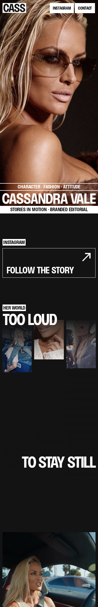

# UI Design System & Master Generation Blueprint: thecassandravale-com

> **Cassandra Vale · Fashion, Stories & Branded Content** (https://thecassandravale.com/) — Cassandra Vale brings together fashion, short-form stories, editorial imagery and branded collaborations.


---

## 1. Executive Visual Persona & Design Archetype

- **Brand Essence & Persona**: **Cassandra Vale · Fashion, Stories & Branded Content** (`https://thecassandravale.com/`). Cassandra Vale brings together fashion, short-form stories, editorial imagery and branded collaborations.
- **Capture Provenance**: Live browser capture (`tier1_fast`, HTTP `200`, captured `2026-11-23`).
- **Visual Archetype**: **High-Contrast Obsidian / Atmospheric Design System (`#131313` canvas, `#ffffff` ink, `#ff1053` accent)**.
- **Anti-AI-Slop Differentiators**:
  - **Live-Computed Chromatic Polarity**: Anchors the viewport in `#131313` (live computed `body` `background-color` (`computed_styles.json`)) paired with `#ffffff` primary typography and `#ff1053` accents.
  - **Grounded Typographic Hierarchy**: Pairs `Monument` for display copy (`TOO LOUD`) with `Monument` and `Andale Mono`.
  - **Calibrated Spatial Grid & Motion**: Combines `1280px` container bounds (`gap: 6px`, padding `6px`) with `cubic-bezier(.15,.75,.4,1)` easing and Lenis Smooth Scroll (`data-lenis`), Swiper Touch Carousel Engine.

---

## 2. Spatial Architecture & Modular Grid Mathematics



### Viewport Allocation & Container Geometry
- **Captured Viewport Dimensions**: Desktop `1440×2400px` (`assets/desktop.png`, clamped at 2400px live multi-section capture), Mobile `390×2400px` (`assets/mobile.png`, clamped at 2400px live multi-section capture).
- **Master Container Bounds**: `1280px` (non-`@media` desktop container stylesheet rule).
- **Canvas Lateral Padding & Spacing**: `6px` lateral canvas padding with `6px` grid gap.
- **Border Radius Scale**: `2px`, `10px`, `50%`, `4px`.

### Responsive Breakpoint Architecture
- **Desktop Layout**: Multi-column CSS Grid / Flexbox layout at `1440px` (`max-width: 1280px`, `gap: 6px`).
- **Mobile Layout**: Single-column vertical stack at `390px` viewport width with `6px` horizontal padding.
- **Extracted CSS Media Queries**: `@media only screen and (min-width :1000px)`, `@media only screen and (min-width :1px) and (max-width :999px)`, `@media only screen and (max-width:999px)`, `@media (prefers-reduced-motion:reduce)`.

---

## 3. Color System, Materiality & Atmospheric Lighting

### Semantic Palette & Source Grounding
| Semantic Role | Ground-Truth Value | Extracted Live / CSS Source |
|---|---|---|
| **Primary Canvas Substrate** | `#131313` | live computed `body` `background-color` (`computed_styles.json`) |
| **Primary Typography Ink** | `#ffffff` | live computed `h1` `color` (`computed_styles.json`) |
| **Elevated Surface / Card Substrate** | `#000000` | `slide-out-widget-area-toggle .l... { background-color: #000000 }` |
| **Interactive Accent / Highlight** | `#ff1053` | `var(--nectar-extra-color-gradient-1)` in `:root` |
| **Secondary / Muted Copy** | `#888888` | `gle #single-meta ul .meta-share... { color: #888888 }` |
| **Structural Hairline Border** | `#2c353b` | `#wp-admin-bar-my-account.with-a... { border: #2c353b }` |
| **Variable Token (`--nectar-extra-color-gradient-1`)** | `#3452ff` | `var(--nectar-extra-color-gradient-1)` in `:root` |
| **Variable Token (`--nectar-extra-color-gradient-2`)** | `#32d6ff` | `var(--nectar-extra-color-gradient-2)` in `:root` |
| **Variable Token (`--nectar-extra-color-gradient-2`)** | `#2ac4ea` | `var(--nectar-extra-color-gradient-2)` in `:root` |
| **Variable Token (`--nectar-extra-color-2`)** | `#bf7741` | `var(--nectar-extra-color-2)` in `:root` |
| **Variable Token (`--nectar-extra-color-3`)** | `#bb3a4e` | `var(--nectar-extra-color-3)` in `:root` |

### Sanitized Root CSS Variables (`ui-ux.md` Ground Truth)
| Variable Name | Extracted Value | Semantic Role |
|---|---|---|
| `--wp--style--global--content-size` | `1300px` | Layout / Spatial Grid Token |
| `--wp--style--global--wide-size` | `1300px` | Layout / Spatial Grid Token |
| `--wp-admin--admin-bar--height` | `32px` | Layout / Spatial Grid Token |
| `--scroll-bar-w` | `-2px` | Dimension / Scale Token |
| `--nectar-font-light-color` | `#ffffff` | Canvas / Surface Token |
| `--page-color-change-section-transition-time` | `0.8s` | Brand / Palette Token |
| `--nectar-cubic-bezier-out` | `cubic-bezier(0.3, 1, 0.3, 1)` | Brand / Palette Token |
| `--nectar-cubic-bezier-in-out` | `cubic-bezier(0.76, 0, 0.24, 1)` | Brand / Palette Token |
| `--nectar-header-hover-timing` | `0.65s` | Brand / Palette Token |
| `--mobile-container-width` | `88%` | Layout / Spatial Grid Token |
| `--nectar-extra-color-gradient-1` | `linear-gradient(to right,#ff1053,#3452ff)` | Brand / Palette Token |
| `--nectar-extra-color-gradient-2` | `linear-gradient(to right,#32d6ff,#2AC4EA)` | Brand / Palette Token |
| `--nectar-accent-color` | `#ffffff` | Brand / Palette Token |
| `--nectar-extra-color-1` | `#131313` | Brand / Palette Token |
| `--nectar-extra-color-2` | `#bf7741` | Brand / Palette Token |
| `--nectar-extra-color-3` | `#bb3a4e` | Brand / Palette Token |

---

## 4. Typographic Scale & Editorial Hierarchy

### Font Family Stacks
- **Display Typography**: `Monument`.
- **Primary Body Stack**: `Monument`.
- **Technical / Metadata Stack**: `Andale Mono`.

### Typographic Scale & Rules (Live Computed & Stylesheet Grounded)
- **Hero Display (`H1`)**: live computed `h1` (`font-size: 201.6px`, `line-height: 161.28px`, `font-weight: 700`, `letter-spacing: -10.08px`); rule `h1` (`font-size: 44px`, `line-height: 54px`, `font-weight: 600`).
- **Section Heading (`H2`)**: live computed `h3 (primary section heading)` (`font-size: 26px`, `line-height: 26px`, `font-weight: 700`, `letter-spacing: -0.26px`); rule `h2` (`font-weight: 600`).
- **Body Copy**: live computed `body` (`font-size: 16px`, `line-height: 29px`, `font-weight: 400`); CSS variables `--nectar-body-line-height: 29px`, `--nectar-body-font-size: 16px`; rule `p` (`font-size: 14px`).
- **Metadata & Navigation Labels**: live computed `nav/a` (`font-size: 16px`, `line-height: 29px`, `font-weight: 400`); rule `.label` (`font-size: 14px`, `line-height: 1`).

---

## 5. Choreographed Motion & Interaction Physics

### Primary Easing Curves
- **Extracted Timing Functions**: `cubic-bezier(.15,.75,.4,1)`, `cubic-bezier(.19,1,.22,1)`, `cubic-bezier(.3,1,.3,1)`.

### Per-Element Transition & Choreography Rules
- **Selector `#top #logo.no-image`**: `transition: color .3s ease,margin .3s ease` extracted from `thecassandravale-com` stylesheet.
- **Selector `t="1"] .lines-button.x2.close .li...`**: `transition: top .5s ease,-webkit-transform .3s .4s ease,background-color ....` extracted from `thecassandravale-com` stylesheet.
- **Selector `toggle .lines-button.x2.close .li...`**: `transition: top .5s ease,-webkit-transform .3s ease,background-color .2s e...` extracted from `thecassandravale-com` stylesheet.
- **Extracted Easing Curve (`cubic-bezier(.15,.75,.4,1)`)**: Governs interactive state transitions across `<header.js>` and `<div.lenis-scrolling>`.
- **Runtime Interaction Engine**: Integrates Lenis Smooth Scroll (`data-lenis`), Swiper Touch Carousel Engine with `prefers-reduced-motion: reduce` fallback guards.

---

## 6. Component Wireframe & Structural DOM Map

### Visual Layout Schematic — Desktop (`1440px`, Grounded in `dom.html` & Landmark Bounding Boxes)
```
┌────────────────────────────────────────────────────────────────────────┐
│ DESKTOP VIEWPORT (1440px) — Cassandra Vale · Fashion, Stories & Brande │
│ ====================================================================== │
│ [ <header.js> (1440x49px)             | Overview · Index · Archive · ] │
│ ---------------------------------------------------------------------- │
│ | HERO STAGE: <div.lenis> (w=1440px)                                 | │
│ | H1: TOO LOUD                                                       | │
│ | Substrate: #131313 | Ink: #ffffff | Accent: #ff1053                | │
│ ---------------------------------------------------------------------- │
│ | SHOWCASE GRID (<div.lenis-scrolling>) max-w: 1280px                | │
│ | +------------------------------+  +------------------------------+ | │
│ | | SHE TAKES THE LONG WAY, THE  |  | TO MAKE IT WORTH SHOWING UP  | | │
│ | +------------------------------+  +------------------------------+ | │
│ ---------------------------------------------------------------------- │
│ | DETAIL MODULE (<div.js_active>) — ARTEM MARKOVSKY / ARC            | │
│ ---------------------------------------------------------------------- │
│ [ FOOTER (<footer.vc_desktop> ) | https://thecassandravale.com/        │
└────────────────────────────────────────────────────────────────────────┘
```

### Visual Layout Schematic — Mobile Reflow (`390px`)
```
┌────────────────────────────────────────────────────────────────────────┐
│ MOBILE VIEWPORT REFLOW (390px) — Single-Column Stack (gap: 6px)        │
│ ====================================================================== │
│ [ HEADER BAR (<header.js>             ) | Compact Menu (390px)         │
│ ---------------------------------------------------------------------- │
│ | HERO STAGE (<div.lenis>) — 390px Vertical Lead                     | │
│ | H1: TOO LOUD                                                       | │
│ ---------------------------------------------------------------------- │
│ | SHOWCASE STACK (<div.lenis-scrolling>) — 1-Col Stack               | │
│ | [ Item 1: SHE TAKES THE LONG WAY, THE FAST LANE, OR WHATEV       ] | │
│ | [ Item 2: TO MAKE IT WORTH SHOWING UP FOR.                       ] | │
│ ---------------------------------------------------------------------- │
│ | DETAIL STACK (<div.js_active>) — 1-Col (ARTEM MARKOVSKY / )        | │
│ ---------------------------------------------------------------------- │
│ [ FOOTER (<footer.vc_desktop> ) | Stacked 390px Colophon               │
└────────────────────────────────────────────────────────────────────────┘
```

### Granular DOM Region Breakdown
1. **Brand Header & Navigation Bar (<header.js> — `thecassandravale-com`)**:
   - Landmark `<header class="js">` (`1440x49px`) hosting `Cassandra Vale · Fashion, Stories & ` navigation (`Overview · Index · Archive · About · Contact`), DOM attributes (`data-pagespeed-no-defer`, `data-nowprocket`, `data-wpacu-skip`, `data-no-optimize`), and stylesheet rule `logo.no-image { transition:color .3s ease,margin .3s ease }`.
2. **Hero Stage & Focal Lead (<div.lenis> — `TOO LOUD`)**:
   - Landmark `<div class="lenis">` presenting display lead `TOO LOUD` and copy excerpt *"SHE TAKES THE LONG WAY, THE FAST LANE, OR WHATEVER MAKES A BETTER"* over `#131313` canvas and `#ffffff` ink.
3. **Primary Showcase & Content Grid (<div.lenis-scrolling> — `SHE TAKES THE LONG WAY, THE FAST L`)**:
   - Landmark `<div class="lenis-scrolling">` rendering section `SHE TAKES THE LONG WAY, THE FAST LANE, OR WHATEV` with copy *"TO MAKE IT WORTH SHOWING UP FOR."*, asset references (`embed`, `icomoon.woff`, `HERO5_OPT-1024x768.jpg`, `HERO5_OPT.jpg`), and grid rule `.transparent { pointer-events:none }`.
4. **Interactive Detail & Feature Matrix (<div.js_active> — `TO MAKE IT WORTH SHOWING UP FOR.`)**:
   - Landmark `<div class="js_active">` framing `TO MAKE IT WORTH SHOWING UP FOR.` and `ARTEM MARKOVSKY / ARCR` (*"ARTEM MARKOVSKY / ARCR"*) with `#000000` surface cards, `#ff1053` accents, and `.transparent>.nectar-global-section { pointer-events:all }`.
5. **Colophon & Global Directory Footer (<footer.vc_desktop> — `https://thecassandravale.com/`)**:
   - Landmark `<footer class="vc_desktop">` anchoring `Cassandra Vale · Fashion, Storie` footer links (`Overview · Index · Archive · About · Contact`), copy *"TO MAKE IT WORTH SHOWING UP FOR."*, and `#2c353b` structural dividers.

---

## 7. Master Zero-Shot AI Generation Prompt

```markdown
# Master Zero-Shot Frontend Generation Prompt: thecassandravale-com (Cassandra Vale · Fashion, Stories & Branded Content)

You are a principal frontend architect and design systems engineer. Build a complete, production-ready web application replicating the exact design system, DOM landmarks, typographic hierarchy, color tokens, and motion physics of `thecassandravale-com` (**Cassandra Vale · Fashion, Stories & Branded Content** — `https://thecassandravale.com/`).

### 1. Visual Archetype & Anti-AI-Slop Mandates
- **Archetype**: High-Contrast Obsidian / Atmospheric Design System (`#131313` canvas, `#ffffff` ink, `#ff1053` accent).
- **Identity & Domain Context**: Cassandra Vale brings together fashion, short-form stories, editorial imagery and branded collaborations.
- **Primary Substrate**: `#131313` (live computed `body` `background-color` (`computed_styles.json`)), **Primary Ink**: `#ffffff`, **Accent / Highlight**: `#ff1053`.
- **Site-Specific Differentiators**:
  - **Live-Computed Chromatic Polarity**: Anchors the viewport in `#131313` (live computed `body` `background-color` (`computed_styles.json`)) paired with `#ffffff` primary typography and `#ff1053` accents.
  - **Grounded Typographic Hierarchy**: Pairs `Monument` for display copy (`TOO LOUD`) with `Monument` and `Andale Mono`.
  - **Calibrated Spatial Grid & Motion**: Combines `1280px` container bounds (`gap: 6px`, padding `6px`) with `cubic-bezier(.15,.75,.4,1)` easing and Lenis Smooth Scroll (`data-lenis`), Swiper Touch Carousel Engine.

### 2. Ground-Truth CSS Variables (`:root` Token Contract)
Declare and consume these exact custom properties extracted from `thecassandravale-com` in your global stylesheet:

:root {
  /* Cassandra Vale · Fashion, Stories & Branded Content (thecassandravale-com) — Live-Grounded CSS Variables */
  --wp--style--global--content-size: 1300px; /* Layout / Spatial Grid Token (thecassandravale-com) */
  --wp--style--global--wide-size: 1300px; /* Layout / Spatial Grid Token (thecassandravale-com) */
  --wp-admin--admin-bar--height: 32px; /* Layout / Spatial Grid Token (thecassandravale-com) */
  --scroll-bar-w: -2px; /* Dimension / Scale Token (thecassandravale-com) */
  --nectar-font-light-color: #ffffff; /* Canvas / Surface Token (thecassandravale-com) */
  --page-color-change-section-transition-time: 0.8s; /* Brand / Palette Token (thecassandravale-com) */
  --nectar-cubic-bezier-out: cubic-bezier(0.3, 1, 0.3, 1); /* Brand / Palette Token (thecassandravale-com) */
  --nectar-cubic-bezier-in-out: cubic-bezier(0.76, 0, 0.24, 1); /* Brand / Palette Token (thecassandravale-com) */
  --nectar-header-hover-timing: 0.65s; /* Brand / Palette Token (thecassandravale-com) */
  --mobile-container-width: 88%; /* Layout / Spatial Grid Token (thecassandravale-com) */
  --nectar-extra-color-gradient-1: linear-gradient(to right,#ff1053,#3452ff); /* Brand / Palette Token (thecassandravale-com) */
  --nectar-extra-color-gradient-2: linear-gradient(to right,#32d6ff,#2AC4EA); /* Brand / Palette Token (thecassandravale-com) */
  --nectar-accent-color: #ffffff; /* Brand / Palette Token (thecassandravale-com) */
  --nectar-extra-color-1: #131313; /* Brand / Palette Token (thecassandravale-com) */
  --nectar-extra-color-2: #bf7741; /* Brand / Palette Token (thecassandravale-com) */
  --nectar-extra-color-3: #bb3a4e; /* Brand / Palette Token (thecassandravale-com) */
}

### 3. Semantic Color & Materiality Contract
Map every surface, ink, and border strictly to these source-grounded tokens:
- **Primary Canvas Substrate**: `#131313` — grounded in live computed `body` `background-color` (`computed_styles.json`)
- **Primary Typography Ink**: `#ffffff` — grounded in live computed `h1` `color` (`computed_styles.json`)
- **Elevated Surface / Card Substrate**: `#000000` — grounded in `slide-out-widget-area-toggle .l... { background-color: #000000 }`
- **Interactive Accent / Highlight**: `#ff1053` — grounded in `var(--nectar-extra-color-gradient-1)` in `:root`
- **Secondary / Muted Copy**: `#888888` — grounded in `gle #single-meta ul .meta-share... { color: #888888 }`
- **Structural Hairline Border**: `#2c353b` — grounded in `#wp-admin-bar-my-account.with-a... { border: #2c353b }`
- **Variable Token (`--nectar-extra-color-gradient-1`)**: `#3452ff` — grounded in `var(--nectar-extra-color-gradient-1)` in `:root`
- **Variable Token (`--nectar-extra-color-gradient-2`)**: `#32d6ff` — grounded in `var(--nectar-extra-color-gradient-2)` in `:root`
- **Variable Token (`--nectar-extra-color-gradient-2`)**: `#2ac4ea` — grounded in `var(--nectar-extra-color-gradient-2)` in `:root`
- **Variable Token (`--nectar-extra-color-2`)**: `#bf7741` — grounded in `var(--nectar-extra-color-2)` in `:root`
- **Variable Token (`--nectar-extra-color-3`)**: `#bb3a4e` — grounded in `var(--nectar-extra-color-3)` in `:root`

### 4. Spatial Grid, Container Bounds & Responsive Breakpoints
- **Desktop Viewport Reference**: `1440×2400px` (clamped at 2400px live multi-section capture, `1440px` standard desktop width).
- **Mobile Viewport Reference**: `390×2400px` (clamped at 2400px live multi-section capture, `390px` standard mobile width).
- **Container Max-Width**: `1280px` (non-`@media` desktop container stylesheet rule)
- **Padding & Gutters**: `6px` lateral canvas padding with `6px` grid gap
- **Desktop Grid**: Multi-column CSS Grid / Flexbox layout at `1440px` (`max-width: 1280px`, `gap: 6px`)
- **Mobile Adaptation**: Single-column vertical stack at `390px` viewport width with `6px` horizontal padding
- **Media Queries**: `@media only screen and (min-width :1000px)`, `@media only screen and (min-width :1px) and (max-width :999px)`, `@media only screen and (max-width:999px)`, `@media (prefers-reduced-motion:reduce)`
- **Corner Radii**: `2px`, `10px`, `50%`, `4px`

### 5. Typography & Editorial Scale Contract
- **Display Font Stack**: `Monument`
- **Body Font Stack**: `Monument`
- **Monospace / Technical Font Stack**: `Andale Mono`
- **H1 Display Rule**: live computed `h1` (`font-size: 201.6px`, `line-height: 161.28px`, `font-weight: 700`, `letter-spacing: -10.08px`); rule `h1` (`font-size: 44px`, `line-height: 54px`, `font-weight: 600`)
- **H2 Section Rule**: live computed `h3 (primary section heading)` (`font-size: 26px`, `line-height: 26px`, `font-weight: 700`, `letter-spacing: -0.26px`); rule `h2` (`font-weight: 600`)
- **Body Copy Rule**: live computed `body` (`font-size: 16px`, `line-height: 29px`, `font-weight: 400`); CSS variables `--nectar-body-line-height: 29px`, `--nectar-body-font-size: 16px`; rule `p` (`font-size: 14px`)
- **Metadata & Index Rule**: live computed `nav/a` (`font-size: 16px`, `line-height: 29px`, `font-weight: 400`); rule `.label` (`font-size: 14px`, `line-height: 1`)

### 6. Component Hierarchy, Verbatim Copy & Real DOM Landmarks
Scaffold `thecassandravale-com` (`Cassandra Vale · Fashion, Stories & Branded Content`) with these exact structural regions, extracted copy, and CSS rules from `dom.html`:
1. **Brand Header & Navigation Bar (<header.js> — `thecassandravale-com`)**:
   - DOM & Selectors: Landmark `<header class="js">` (`1440x49px`) hosting `Cassandra Vale · Fashion, Stories & ` navigation (`Overview · Index · Archive · About · Contact`), DOM attributes (`data-pagespeed-no-defer`, `data-nowprocket`, `data-wpacu-skip`, `data-no-optimize`), and stylesheet rule `logo.no-image { transition:color .3s ease,margin .3s ease }`.
   - Responsive Contract: Header `Brand Header & Navigation Bar (<header.js> — `thecassandravale-com`)` (`thecassandravale-com`) adapts across `@media only screen and (min-width :1000px)`, `@media only screen and (min-width :1px) and (max-width :999px)`, `@media only screen and (max-width:999px)`, `@media (prefers-reduced-motion:reduce)` with `cubic-bezier(.15,.75,.4,1)`, `cubic-bezier(.19,1,.22,1)`, `cubic-bezier(.3,1,.3,1)` transitions and links `Overview · Index · Archive · About · Contact`.
2. **Hero Stage & Focal Lead (<div.lenis> — `TOO LOUD`)**:
   - DOM & Selectors: Landmark `<div class="lenis">` presenting display lead `TOO LOUD` and copy excerpt *"SHE TAKES THE LONG WAY, THE FAST LANE, OR WHATEVER MAKES A BETTER"* over `#131313` canvas and `#ffffff` ink.
   - Responsive Contract: Hero stage (`1440×2400px` desktop / `390×2400px` mobile) sets `#131313` background with `#ffffff` headline `TOO LOUD`.
3. **Primary Showcase & Content Grid (<div.lenis-scrolling> — `SHE TAKES THE LONG WAY, THE FAST L`)**:
   - DOM & Selectors: Landmark `<div class="lenis-scrolling">` rendering section `SHE TAKES THE LONG WAY, THE FAST LANE, OR WHATEV` with copy *"TO MAKE IT WORTH SHOWING UP FOR."*, asset references (`embed`, `icomoon.woff`, `HERO5_OPT-1024x768.jpg`, `HERO5_OPT.jpg`), and grid rule `.transparent { pointer-events:none }`.
   - Responsive Contract: Showcase grid `Primary Showcase & Content Grid (<div.lenis-scrolling> — `SHE TAKES THE LONG WAY, THE FAST L`)` applies Multi-column CSS Grid / Flexbox layout at `1440px` (`max-width: 1280px`, `gap: 6px`) on desktop and Single-column vertical stack at `390px` viewport width with `6px` horizontal padding on mobile.
4. **Interactive Detail & Feature Matrix (<div.js_active> — `TO MAKE IT WORTH SHOWING UP FOR.`)**:
   - DOM & Selectors: Landmark `<div class="js_active">` framing `TO MAKE IT WORTH SHOWING UP FOR.` and `ARTEM MARKOVSKY / ARCR` (*"ARTEM MARKOVSKY / ARCR"*) with `#000000` surface cards, `#ff1053` accents, and `.transparent>.nectar-global-section { pointer-events:all }`.
   - Responsive Contract: Detail module `Interactive Detail & Feature Matrix (<div.js_active> — `TO MAKE IT WORTH SHOWING UP FOR.`)` uses `2px`, `10px`, `50%`, `4px` radii, `#ff1053` highlights, and assets (embed, icomoon.woff, HERO5_OPT-1024x768.jpg).
5. **Colophon & Global Directory Footer (<footer.vc_desktop> — `https://thecassandravale.com/`)**:
   - DOM & Selectors: Landmark `<footer class="vc_desktop">` anchoring `Cassandra Vale · Fashion, Storie` footer links (`Overview · Index · Archive · About · Contact`), copy *"TO MAKE IT WORTH SHOWING UP FOR."*, and `#2c353b` structural dividers.
   - Responsive Contract: Footer `Colophon & Global Directory Footer (<footer.vc_desktop> — `https://thecassandravale.com/`)` aligns to `1280px` (non-`@media` desktop container stylesheet rule) with `6px` lateral canvas padding with `6px` grid gap and attributes (data-pagespeed-no-defer, data-nowprocket, data-wpacu-skip).

#### Verbatim DOM Copy Excerpts (`dom.html`)
- Copy Excerpt 1: *"SHE TAKES THE LONG WAY, THE FAST LANE, OR WHATEVER MAKES A BETTER STORY."*
- Copy Excerpt 2: *"TO MAKE IT WORTH SHOWING UP FOR."*
- Copy Excerpt 3: *"ARTEM MARKOVSKY / ARCR"*

### 7. Motion, Extracted Stylesheet Rules & Interaction Choreography
- **Primary Easing Functions**: `cubic-bezier(.15,.75,.4,1)`, `cubic-bezier(.19,1,.22,1)`, `cubic-bezier(.3,1,.3,1)`
- **Extracted Stylesheet Rules (`thecassandravale-com`)**:
- `logo.no-image { transition:color .3s ease,margin .3s ease }`
- `.transparent { pointer-events:none }`
- `.transparent>.nectar-global-section { pointer-events:all }`
- `top nav ul a .icon-salient-search { opacity:1!important }`
- `area-toggle a:hover .lines-button... { opacity:.8!important }`
- **Per-Selector Transition Rules**:
- **Selector `#top #logo.no-image`**: `transition: color .3s ease,margin .3s ease` extracted from `thecassandravale-com` stylesheet.
- **Selector `t="1"] .lines-button.x2.close .li...`**: `transition: top .5s ease,-webkit-transform .3s .4s ease,background-color ....` extracted from `thecassandravale-com` stylesheet.
- **Selector `toggle .lines-button.x2.close .li...`**: `transition: top .5s ease,-webkit-transform .3s ease,background-color .2s e...` extracted from `thecassandravale-com` stylesheet.
- **Extracted Easing Curve (`cubic-bezier(.15,.75,.4,1)`)**: Governs interactive state transitions across `<header.js>` and `<div.lenis-scrolling>`.
- **Runtime Interaction Engine**: Integrates Lenis Smooth Scroll (`data-lenis`), Swiper Touch Carousel Engine with `prefers-reduced-motion: reduce` fallback guards.

### 8. Technical Deliverables
- Implement in Next.js (App Router) with TypeScript and Tailwind CSS consuming the `:root` custom properties defined above for `thecassandravale-com`.
- Reproduce both the `1440px` desktop architecture and `390px` mobile breakpoint transitions, preserving semantic HTML5 landmarks (`<header>`, `<nav>`, `<main>`, `<section>`, `<footer>`) and `prefers-reduced-motion` accessibility guards.
```
