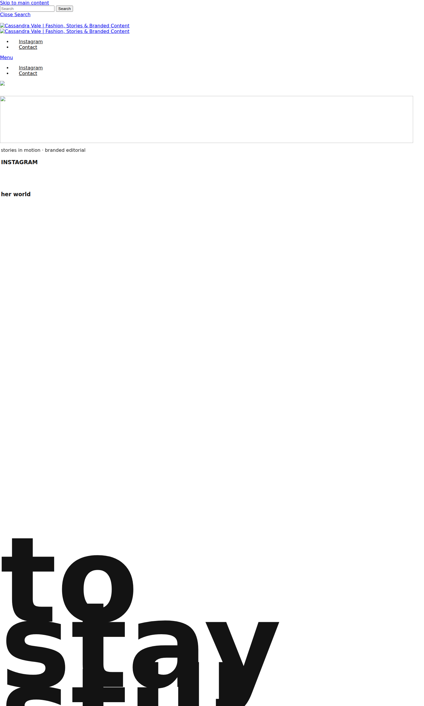

# UI Design System & Master Generation Blueprint: thecassandravale-com

> **Cassandra Vale · Fashion, Stories & Branded Content** (https://thecassandravale.com/) — Cassandra Vale brings together fashion, short-form stories, editorial imagery and branded collaborations.



---

## 1. Executive Visual Persona & Design Archetype

- **Brand Essence & Persona**: **Cassandra Vale · Fashion, Stories & Branded Content** (`https://thecassandravale.com/`). Cassandra Vale brings together fashion, short-form stories, editorial imagery and branded collaborations.
- **Visual Archetype**: **Light-Substrate Editorial & Modular Grid System (`#ffffff` canvas, `#131313` ink, `#bb3a4e` accent)**.
- **Anti-AI-Slop Differentiators**:
  - **Source-Grounded Chromatic Polarity**: Anchors the viewport in `#ffffff` (`var(--nectar-accent-color)` in `:root`) paired with `#131313` primary typography and `#bb3a4e` accents.
  - **Extracted Typographic Hierarchy**: Pairs `Monument` for display copy (`INSTAGRAM`) with `ffffff` and not declared in static CSS (uses primary stack / `ui-monospace`).
  - **Calibrated Spatial Grid & Motion**: Combines `20px` container bounds (`gap: 6px`, padding `6px`) with `cubic-bezier(.3,1,.3,1)` easing and Lenis Smooth Scroll (`data-lenis`), Swiper Touch Carousel Engine.

---

## 2. Spatial Architecture & Modular Grid Mathematics


### Viewport Allocation & Container Geometry
- **Captured Viewport Dimensions**: Desktop `1440×2400px` (`assets/desktop.png`, capped at 2400px multi-section capture), Mobile `390×2400px` (`assets/mobile.png`, capped at 2400px multi-section capture).
- **Master Container Bounds**: `20px` extracted from `thecassandravale-com` stylesheet.
- **Canvas Lateral Padding & Spacing**: `6px` lateral canvas padding with `6px` grid gap.
- **Border Radius Scale**: `10px`, `50%`, `2px`, `4px`.

### Responsive Breakpoint Architecture
- **Desktop Layout**: Multi-column CSS Grid / Flexbox layout at `1440px` (`max-width: 20px`, `gap: 6px`).
- **Mobile Layout**: Single-column vertical stack at `390px` viewport width with `6px` horizontal padding.
- **Extracted CSS Media Queries**: `@media (prefers-reduced-motion:reduce)`, `@media screen and (max-width:782px)`, `@media screen and (max-width:600px)`, `@media screen and (max-width:400px)`.

---

## 3. Color System, Materiality & Atmospheric Lighting

### Semantic Palette & Source Grounding
| Semantic Role | Ground-Truth Value | Extracted CSS Source / Selector |
|---|---|---|
| **Primary Canvas Substrate** | `#ffffff` | `var(--nectar-accent-color)` in `:root` |
| **Primary Typography Ink** | `#131313` | `var(--nectar-extra-color-1)` in `:root` |
| **Elevated Surface / Card Substrate** | `#bf7741` | `var(--nectar-extra-color-2)` in `:root` |
| **Interactive Accent / Highlight** | `#bb3a4e` | `var(--nectar-extra-color-3)` in `:root` |
| **Secondary / Muted Copy** | `#f0f0f1` | `#wpadminbar>#wp-toolbar span.no... { color: #f0f0f1 }` |
| **Structural Hairline Border** | `#2c3338` | `#wpadminbar .shortlink-input { background: #2c3338 }` |
| **Variable Token (`--nectar-extra-color-gradient-1`)** | `#ff1053` | `var(--nectar-extra-color-gradient-1)` in `:root` |
| **Variable Token (`--nectar-extra-color-gradient-1`)** | `#3452ff` | `var(--nectar-extra-color-gradient-1)` in `:root` |
| **Variable Token (`--nectar-extra-color-gradient-2`)** | `#32d6ff` | `var(--nectar-extra-color-gradient-2)` in `:root` |
| **Variable Token (`--nectar-extra-color-gradient-2`)** | `#2AC4EA` | `var(--nectar-extra-color-gradient-2)` in `:root` |

### Sanitized Root CSS Variables (`ui-ux.md` Ground Truth)
| Variable Name | Extracted Value | Semantic Role |
|---|---|---|
| `--wp-admin--admin-bar--height` | `32px` | Layout / Spatial Grid Token |
| `--mobile-container-width` | `88%` | Layout / Spatial Grid Token |
| `--nectar-extra-color-gradient-1` | `linear-gradient(to right,#ff1053,#3452ff)` | Brand / Palette Token |
| `--nectar-extra-color-gradient-2` | `linear-gradient(to right,#32d6ff,#2AC4EA)` | Brand / Palette Token |
| `--nectar-accent-color` | `#ffffff` | Brand / Palette Token |
| `--nectar-extra-color-1` | `#131313` | Brand / Palette Token |
| `--nectar-extra-color-2` | `#bf7741` | Brand / Palette Token |
| `--nectar-extra-color-3` | `#bb3a4e` | Brand / Palette Token |
| `--nectar-bg-color` | `#131313` | Canvas / Surface Token |
| `--nectar-font-color` | `#ffffff` | Brand / Palette Token |
| `--nectar-font-light-color` | `#ffffff` | Canvas / Surface Token |
| `--header-nav-height` | `49px` | Layout / Spatial Grid Token |
| `--nectar-menu-padding` | `10px` | Brand / Palette Token |
| `--nectar-menu-item-spacing` | `10px` | Brand / Palette Token |
| `--nectar-ocm-icon-width` | `22px` | Brand / Palette Token |
| `--nectar-border-thickness` | `2px` | Brand / Palette Token |

---

## 4. Typographic Scale & Editorial Hierarchy

### Font Family Stacks
- **Display Typography**: `Monument`.
- **Primary Body Stack**: `ffffff`.
- **Technical / Metadata Stack**: not declared in static CSS (uses primary stack / `ui-monospace`).

### Typographic Scale & Rules (Extracted from Stylesheet & Variables)
- **Hero Display (`H1`)**: rule `h1` (`font-size: 35px`, `font-weight: 700`).
- **Section Heading (`H2`)**: rule `h2` (`font-size: 45px!important`, `line-height: 51px!important`).
- **Body Copy**: CSS variables `--nectar-body-line-height: 29px`, `--nectar-body-font-size: 16px`; rule `p` (`font-size: 16px`, `line-height: 20px`).
- **Metadata & Navigation Labels**: rule `small` (`font-size: 15px`, `letter-spacing: 2px`, `font-weight: 600`).

---

## 5. Choreographed Motion & Interaction Physics

### Primary Easing Curves
- **Extracted Timing Functions**: `cubic-bezier(.3,1,.3,1)`, `cubic-bezier(.215,.61,.355,1)`, `cubic-bezier(.3,1,.3,.95)`.

### Per-Element Transition & Choreography Rules
- **Selector `#wpadminbar *`**: `transition: none` extracted from `thecassandravale-com` stylesheet.
- **Selector `#wpadminbar .ab-item:before`**: `transition: color .1s ease-in-out` extracted from `thecassandravale-com` stylesheet.
- **Selector `search #adminbarsearch input.admi...`**: `transition: .4s` extracted from `thecassandravale-com` stylesheet.
- **Extracted Easing Curve (`cubic-bezier(.3,1,.3,1)`)**: Governs interactive state transitions across `<header.js>` and `<div.home>`.
- **Runtime Interaction Engine**: Integrates Lenis Smooth Scroll (`data-lenis`), Swiper Touch Carousel Engine with `prefers-reduced-motion: reduce` fallback guards.

---

## 6. Component Wireframe & Structural DOM Map

### Visual Layout Schematic (Grounded in `dom.html` — `1440px` Desktop & `390px` Mobile Reflow)
```
┌────────────────────────────────────────────────────────────────────────┐
│ DESKTOP VIEWPORT (1440px) — Cassandra Vale · Fashion, Stories & Brande │
│ ====================================================================== │
│ [ <header.js>              | Skip to main content                   ]  │
│ ---------------------------------------------------------------------- │
│ | HERO STAGE: <div.lenis>                                          |   │
│ | H1: INSTAGRAM                                                    |   │
│ | Substrate: #ffffff    | Ink: #131313    | Accent: #bb3a4e        |   │
│ ---------------------------------------------------------------------- │
│ | SHOWCASE GRID (<div.home>                ) max-w: 20px           |   │
│ | +------------------------------+  +------------------------------+ | │
│ | | her world                    |  | Too loud                     | | │
│ | +------------------------------+  +------------------------------+ | │
│ ---------------------------------------------------------------------- │
│ | MOBILE VIEWPORT REFLOW (390px) — Single-Column Stack (gap: 6px   ) | │
│ | [<header.js>] -> [<div.lenis>] -> [<div.home>] |                     │
│ ---------------------------------------------------------------------- │
│ [ FOOTER (<footer.page-template-) | https://thecassandravale.com/      │
└────────────────────────────────────────────────────────────────────────┘
```

### Granular DOM Region Breakdown
1. **Brand Header & Navigation Bar (<header.js> — `thecassandravale-com`)**:
   - Landmark `<header class="js">` hosting `Cassandra Vale · Fashion, Stories & ` navigation (`Skip to main content`), DOM attributes (`data-pagespeed-no-defer`, `data-nowprocket`, `data-wpacu-skip`, `data-no-optimize`), and stylesheet rule `html { --wp-admin--admin-bar--height:32px;scroll-padding-top:var(--wp-admin--ad... }`.
2. **Hero Stage & Focal Lead (<div.lenis> — `INSTAGRAM`)**:
   - Landmark `<div class="lenis">` presenting display lead `INSTAGRAM` and copy excerpt *"Skip to main content"* over `#ffffff` canvas and `#131313` ink.
3. **Primary Showcase & Content Grid (<div.home> — `her world`)**:
   - Landmark `<div class="home">` rendering section `her world` with copy *"SHE TAKES THE LONG WAY, THE FAST LANE, OR WHATEVER MAKES A BETTER"*, asset references (`embed`, `icomoon.woff`, `HERO5_OPT-1024x768.jpg`, `HERO5_OPT.jpg`), and grid rule `wpadminbar .ab-empty-item { cursor:default }`.
4. **Interactive Detail & Feature Matrix (<div.wp-singular> — `Too loud`)**:
   - Landmark `<div class="wp-singular">` framing `Too loud` and `to stay still` (*"TO MAKE IT WORTH SHOWING UP FOR."*) with `#bf7741` surface cards, `#bb3a4e` accents, and `wp-toolbar span.noticon { color:f0f0f1 }`.
5. **Colophon & Global Directory Footer (<footer.page-template-default> — `https://thecassandravale.com/`)**:
   - Landmark `<footer class="page-template-default">` anchoring `Cassandra Vale · Fashion, Storie` footer links (`Skip to main content`), copy *"ARTEM MARKOVSKY / ARCR"*, and `#2c3338` structural dividers.

---

## 7. Master Zero-Shot AI Generation Prompt

```markdown
# Master Zero-Shot Frontend Generation Prompt: thecassandravale-com (Cassandra Vale · Fashion, Stories & Branded Content)

You are a principal frontend architect and design systems engineer. Build a complete, production-ready web application replicating the exact design system, DOM landmarks, typographic hierarchy, color tokens, and motion physics of `thecassandravale-com` (**Cassandra Vale · Fashion, Stories & Branded Content** — `https://thecassandravale.com/`).

### 1. Visual Archetype & Anti-AI-Slop Mandates
- **Archetype**: Light-Substrate Editorial & Modular Grid System (`#ffffff` canvas, `#131313` ink, `#bb3a4e` accent).
- **Identity & Domain Context**: Cassandra Vale brings together fashion, short-form stories, editorial imagery and branded collaborations.
- **Primary Substrate**: `#ffffff` (`var(--nectar-accent-color)` in `:root`), **Primary Ink**: `#131313`, **Accent / Highlight**: `#bb3a4e`.
- **Site-Specific Differentiators**:
  - **Source-Grounded Chromatic Polarity**: Anchors the viewport in `#ffffff` (`var(--nectar-accent-color)` in `:root`) paired with `#131313` primary typography and `#bb3a4e` accents.
  - **Extracted Typographic Hierarchy**: Pairs `Monument` for display copy (`INSTAGRAM`) with `ffffff` and not declared in static CSS (uses primary stack / `ui-monospace`).
  - **Calibrated Spatial Grid & Motion**: Combines `20px` container bounds (`gap: 6px`, padding `6px`) with `cubic-bezier(.3,1,.3,1)` easing and Lenis Smooth Scroll (`data-lenis`), Swiper Touch Carousel Engine.

### 2. Ground-Truth CSS Variables (`:root` Token Contract)
Declare and consume these exact custom properties extracted from `thecassandravale-com` in your global stylesheet:

:root {
  /* Cassandra Vale · Fashion, Stories & Branded Content (thecassandravale-com) — Ground-Truth Extracted CSS Variables */
  --wp-admin--admin-bar--height: 32px; /* Layout / Spatial Grid Token (thecassandravale-com) */
  --mobile-container-width: 88%; /* Layout / Spatial Grid Token (thecassandravale-com) */
  --nectar-extra-color-gradient-1: linear-gradient(to right,#ff1053,#3452ff); /* Brand / Palette Token (thecassandravale-com) */
  --nectar-extra-color-gradient-2: linear-gradient(to right,#32d6ff,#2AC4EA); /* Brand / Palette Token (thecassandravale-com) */
  --nectar-accent-color: #ffffff; /* Brand / Palette Token (thecassandravale-com) */
  --nectar-extra-color-1: #131313; /* Brand / Palette Token (thecassandravale-com) */
  --nectar-extra-color-2: #bf7741; /* Brand / Palette Token (thecassandravale-com) */
  --nectar-extra-color-3: #bb3a4e; /* Brand / Palette Token (thecassandravale-com) */
  --nectar-bg-color: #131313; /* Canvas / Surface Token (thecassandravale-com) */
  --nectar-font-color: #ffffff; /* Brand / Palette Token (thecassandravale-com) */
  --nectar-font-light-color: #ffffff; /* Canvas / Surface Token (thecassandravale-com) */
  --header-nav-height: 49px; /* Layout / Spatial Grid Token (thecassandravale-com) */
  --nectar-menu-padding: 10px; /* Brand / Palette Token (thecassandravale-com) */
  --nectar-menu-item-spacing: 10px; /* Brand / Palette Token (thecassandravale-com) */
  --nectar-ocm-icon-width: 22px; /* Brand / Palette Token (thecassandravale-com) */
  --nectar-border-thickness: 2px; /* Brand / Palette Token (thecassandravale-com) */
}

### 3. Semantic Color & Materiality Contract
Map every surface, ink, and border strictly to these source-grounded tokens:
- **Primary Canvas Substrate**: `#ffffff` — grounded in `var(--nectar-accent-color)` in `:root`
- **Primary Typography Ink**: `#131313` — grounded in `var(--nectar-extra-color-1)` in `:root`
- **Elevated Surface / Card Substrate**: `#bf7741` — grounded in `var(--nectar-extra-color-2)` in `:root`
- **Interactive Accent / Highlight**: `#bb3a4e` — grounded in `var(--nectar-extra-color-3)` in `:root`
- **Secondary / Muted Copy**: `#f0f0f1` — grounded in `#wpadminbar>#wp-toolbar span.no... { color: #f0f0f1 }`
- **Structural Hairline Border**: `#2c3338` — grounded in `#wpadminbar .shortlink-input { background: #2c3338 }`
- **Variable Token (`--nectar-extra-color-gradient-1`)**: `#ff1053` — grounded in `var(--nectar-extra-color-gradient-1)` in `:root`
- **Variable Token (`--nectar-extra-color-gradient-1`)**: `#3452ff` — grounded in `var(--nectar-extra-color-gradient-1)` in `:root`
- **Variable Token (`--nectar-extra-color-gradient-2`)**: `#32d6ff` — grounded in `var(--nectar-extra-color-gradient-2)` in `:root`
- **Variable Token (`--nectar-extra-color-gradient-2`)**: `#2AC4EA` — grounded in `var(--nectar-extra-color-gradient-2)` in `:root`

### 4. Spatial Grid, Container Bounds & Responsive Breakpoints
- **Desktop Viewport Reference**: `1440×2400px` (capped at 2400px multi-section capture, `1440px` standard desktop width).
- **Mobile Viewport Reference**: `390×2400px` (capped at 2400px multi-section capture, `390px` standard mobile width).
- **Container Max-Width**: `20px` extracted from `thecassandravale-com` stylesheet
- **Padding & Gutters**: `6px` lateral canvas padding with `6px` grid gap
- **Desktop Grid**: Multi-column CSS Grid / Flexbox layout at `1440px` (`max-width: 20px`, `gap: 6px`)
- **Mobile Adaptation**: Single-column vertical stack at `390px` viewport width with `6px` horizontal padding
- **Media Queries**: `@media (prefers-reduced-motion:reduce)`, `@media screen and (max-width:782px)`, `@media screen and (max-width:600px)`, `@media screen and (max-width:400px)`
- **Corner Radii**: `10px`, `50%`, `2px`, `4px`

### 5. Typography & Editorial Scale Contract
- **Display Font Stack**: `Monument`
- **Body Font Stack**: `ffffff`
- **Monospace / Technical Font Stack**: not declared in static CSS (uses primary stack / `ui-monospace`)
- **H1 Display Rule**: rule `h1` (`font-size: 35px`, `font-weight: 700`)
- **H2 Section Rule**: rule `h2` (`font-size: 45px!important`, `line-height: 51px!important`)
- **Body Copy Rule**: CSS variables `--nectar-body-line-height: 29px`, `--nectar-body-font-size: 16px`; rule `p` (`font-size: 16px`, `line-height: 20px`)
- **Metadata & Index Rule**: rule `small` (`font-size: 15px`, `letter-spacing: 2px`, `font-weight: 600`)

### 6. Component Hierarchy, Verbatim Copy & Real DOM Landmarks
Scaffold `thecassandravale-com` (`Cassandra Vale · Fashion, Stories & Branded Content`) with these exact structural regions, extracted copy, and CSS rules from `dom.html`:
1. **Brand Header & Navigation Bar (<header.js> — `thecassandravale-com`)**:
   - DOM & Selectors: Landmark `<header class="js">` hosting `Cassandra Vale · Fashion, Stories & ` navigation (`Skip to main content`), DOM attributes (`data-pagespeed-no-defer`, `data-nowprocket`, `data-wpacu-skip`, `data-no-optimize`), and stylesheet rule `html { --wp-admin--admin-bar--height:32px;scroll-padding-top:var(--wp-admin--ad... }`.
   - Responsive Contract: Header `Brand Header & Navigation Bar (<header.js> — `thecassandravale-com`)` (`thecassandravale-com`) adapts across `@media (prefers-reduced-motion:reduce)`, `@media screen and (max-width:782px)`, `@media screen and (max-width:600px)`, `@media screen and (max-width:400px)` with `cubic-bezier(.3,1,.3,1)`, `cubic-bezier(.215,.61,.355,1)`, `cubic-bezier(.3,1,.3,.95)` transitions and links `Skip to main content`.
2. **Hero Stage & Focal Lead (<div.lenis> — `INSTAGRAM`)**:
   - DOM & Selectors: Landmark `<div class="lenis">` presenting display lead `INSTAGRAM` and copy excerpt *"Skip to main content"* over `#ffffff` canvas and `#131313` ink.
   - Responsive Contract: Hero stage (`1440×2400px` desktop / `390×2400px` mobile) sets `#ffffff` background with `#131313` headline `INSTAGRAM`.
3. **Primary Showcase & Content Grid (<div.home> — `her world`)**:
   - DOM & Selectors: Landmark `<div class="home">` rendering section `her world` with copy *"SHE TAKES THE LONG WAY, THE FAST LANE, OR WHATEVER MAKES A BETTER"*, asset references (`embed`, `icomoon.woff`, `HERO5_OPT-1024x768.jpg`, `HERO5_OPT.jpg`), and grid rule `wpadminbar .ab-empty-item { cursor:default }`.
   - Responsive Contract: Showcase grid `Primary Showcase & Content Grid (<div.home> — `her world`)` applies Multi-column CSS Grid / Flexbox layout at `1440px` (`max-width: 20px`, `gap: 6px`) on desktop and Single-column vertical stack at `390px` viewport width with `6px` horizontal padding on mobile.
4. **Interactive Detail & Feature Matrix (<div.wp-singular> — `Too loud`)**:
   - DOM & Selectors: Landmark `<div class="wp-singular">` framing `Too loud` and `to stay still` (*"TO MAKE IT WORTH SHOWING UP FOR."*) with `#bf7741` surface cards, `#bb3a4e` accents, and `wp-toolbar span.noticon { color:f0f0f1 }`.
   - Responsive Contract: Detail module `Interactive Detail & Feature Matrix (<div.wp-singular> — `Too loud`)` uses `10px`, `50%`, `2px`, `4px` radii, `#bb3a4e` highlights, and assets (embed, icomoon.woff, HERO5_OPT-1024x768.jpg).
5. **Colophon & Global Directory Footer (<footer.page-template-default> — `https://thecassandravale.com/`)**:
   - DOM & Selectors: Landmark `<footer class="page-template-default">` anchoring `Cassandra Vale · Fashion, Storie` footer links (`Skip to main content`), copy *"ARTEM MARKOVSKY / ARCR"*, and `#2c3338` structural dividers.
   - Responsive Contract: Footer `Colophon & Global Directory Footer (<footer.page-template-default> — `https://thecassandravale.com/`)` aligns to `20px` extracted from `thecassandravale-com` stylesheet with `6px` lateral canvas padding with `6px` grid gap and attributes (data-pagespeed-no-defer, data-nowprocket, data-wpacu-skip).

#### Verbatim DOM Copy Excerpts (`dom.html`)
- Copy Excerpt 1: *"Skip to main content"*
- Copy Excerpt 2: *"SHE TAKES THE LONG WAY, THE FAST LANE, OR WHATEVER MAKES A BETTER STORY."*
- Copy Excerpt 3: *"TO MAKE IT WORTH SHOWING UP FOR."*
- Copy Excerpt 4: *"ARTEM MARKOVSKY / ARCR"*

### 7. Motion, Extracted Stylesheet Rules & Interaction Choreography
- **Primary Easing Functions**: `cubic-bezier(.3,1,.3,1)`, `cubic-bezier(.215,.61,.355,1)`, `cubic-bezier(.3,1,.3,.95)`
- **Extracted Stylesheet Rules (`thecassandravale-com`)**:
- `html { --wp-admin--admin-bar--height:32px;scroll-padding-top:var(--wp-admin--ad... }`
- `wpadminbar .ab-empty-item { cursor:default }`
- `wp-toolbar span.noticon { color:f0f0f1 }`
- `wp-admin-bar-site-name a.ab-item { white-space:nowrap }`
- `wpadminbar ul li:before { content:normal }`
- **Per-Selector Transition Rules**:
- **Selector `#wpadminbar *`**: `transition: none` extracted from `thecassandravale-com` stylesheet.
- **Selector `#wpadminbar .ab-item:before`**: `transition: color .1s ease-in-out` extracted from `thecassandravale-com` stylesheet.
- **Selector `search #adminbarsearch input.admi...`**: `transition: .4s` extracted from `thecassandravale-com` stylesheet.
- **Extracted Easing Curve (`cubic-bezier(.3,1,.3,1)`)**: Governs interactive state transitions across `<header.js>` and `<div.home>`.
- **Runtime Interaction Engine**: Integrates Lenis Smooth Scroll (`data-lenis`), Swiper Touch Carousel Engine with `prefers-reduced-motion: reduce` fallback guards.

### 8. Technical Deliverables
- Implement in Next.js (App Router) with TypeScript and Tailwind CSS consuming the `:root` custom properties defined above for `thecassandravale-com`.
- Reproduce both the `1440px` desktop architecture and `390px` mobile breakpoint transitions, preserving semantic HTML5 landmarks (`<header>`, `<nav>`, `<main>`, `<section>`, `<footer>`) and `prefers-reduced-motion` accessibility guards.
```
