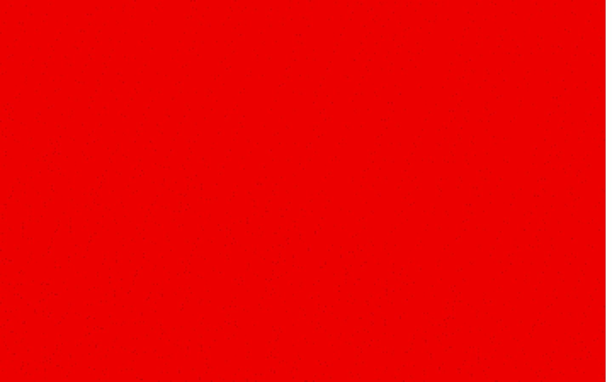
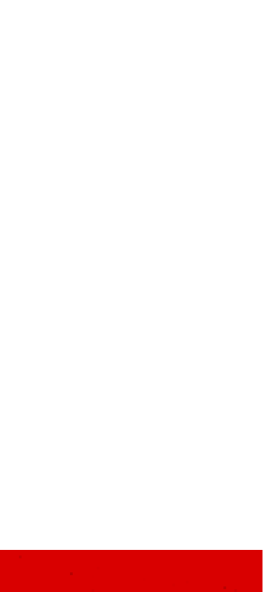

# UI Design System & Master Generation Blueprint: thecontenders-co

> **The Contenders · Strategic Brand & Design Consultancy** (https://thecontenders.co/) — Where business meets brand. The Contenders is an independent Australian consultancy creating distinctive brands that deliver measurable i...



---

## 1. Executive Visual Persona & Design Archetype

- **Brand Essence & Persona**: **The Contenders · Strategic Brand & Design Consultancy** (`https://thecontenders.co/`). Where business meets brand. The Contenders is an independent Australian consultancy creating distinctive brands that deliver measurable i...
- **Capture Provenance**: Live browser capture (`tier2_webgl`, HTTP `200`, captured `2026-11-23`).
- **Visual Archetype**: **Light-Gallery WebGL / Canvas Interactive Experience (`#ffffff` / `#ed0000`)**.
- **Anti-AI-Slop Differentiators**:
  - **Live-Computed Chromatic Polarity**: Anchors the viewport in `#ffffff` (live computed `body` `background-color` (`computed_styles.json`)) paired with `#000000` primary typography and `#ed0000` accents.
  - **Grounded Typographic Hierarchy**: Pairs `Mesapholic` for display copy (`THE CONTENDERS IS A CONSULTANCY WHER`) with `DieGrotesk` and `iki-mono-variable`.
  - **Calibrated Spatial Grid & Motion**: Combines `96rem` container bounds (`gap: 24px`, padding `var(--inline-spacing)`) with `cubic-bezier(0,0,.2,1)` easing and Lenis Smooth Scroll (`data-lenis`), Three.js / WebGL Canvas Pipeline.

---

## 2. Spatial Architecture & Modular Grid Mathematics



### Viewport Allocation & Container Geometry
- **Captured Viewport Dimensions**: Desktop `1440×900px` (`assets/desktop.png`, single-viewport 100vh live capture (900px)), Mobile `390×844px` (`assets/mobile.png`, single-viewport 100vh live capture (844px)).
- **Master Container Bounds**: `96rem` (non-`@media` desktop container stylesheet rule).
- **Canvas Lateral Padding & Spacing**: `var(--inline-spacing)` lateral canvas padding with `24px` grid gap.
- **Border Radius Scale**: `.3125rem`, `.375rem`, `2147483647px`, `var(--radius-md)`.

### Responsive Breakpoint Architecture
- **Desktop Layout**: Multi-column CSS Grid / Flexbox layout at `1440px` (`max-width: 96rem`, `gap: 24px`).
- **Mobile Layout**: Single-column vertical stack at `390px` viewport width with `var(--inline-spacing)` horizontal padding.
- **Extracted CSS Media Queries**: `@media (min-width:37.5rem)`, `@media (min-width:48rem)`, `@media (min-width:80rem)`, `@media (min-width:96rem)`.

---

## 3. Color System, Materiality & Atmospheric Lighting

### Semantic Palette & Source Grounding
| Semantic Role | Ground-Truth Value | Extracted Live / CSS Source |
|---|---|---|
| **Primary Canvas Substrate** | `#ffffff` | live computed `body` `background-color` (`computed_styles.json`) |
| **Primary Typography Ink** | `#000000` | live computed `main` `color` (`computed_styles.json`) |
| **Elevated Surface / Card Substrate** | `#e5e5e5` | `.bg-black-10 { background-color: #e5e5e5 }` |
| **Interactive Accent / Highlight** | `#ed0000` | `.homepage-intro-link__artwork { color: #ed0000 }` |
| **Secondary / Muted Copy** | `#808080` | `.text-gray-900 { color: gray }` (`#808080`) |
| **Structural Hairline Border** | `#b2b2b2` | `.border-black-30 { border-color: #b2b2b2 }` |

### Sanitized Root CSS Variables (`ui-ux.md` Ground Truth)
| Variable Name | Extracted Value | Semantic Role |
|---|---|---|
| `--color-background` | `var(--color-white)` | Canvas / Surface Token |
| `--color-foreground` | `var(--color-black)` | Typography Ink Token |
| `--color-border` | `var(--color-black-30)` | Brand / Palette Token |
| `--color-active-link` | `var(--color-red)` | Typography Ink Token |
| `--color-blockquote` | `var(--color-black-60)` | Brand / Palette Token |
| `--font-serif` | `var(--font-mesapholic), serif` | Typography / Scale Token |
| `--font-sans` | `var(--font-die-grotesk), sans-serif` | Typography / Scale Token |
| `--font-mono` | `"iki-mono-variable", sans-serif` | Typography / Scale Token |
| `--heading-xxl-font-family` | `var(--font-serif)` | Typography Ink Token |
| `--heading-xxl-font-size` | `10rem` | Typography Ink Token |
| `--heading-xxl-font-weight` | `400` | Typography Ink Token |
| `--heading-xxl-line-height` | `80%` | Typography Ink Token |
| `--heading-xl-font-family` | `var(--font-serif)` | Typography Ink Token |
| `--heading-xl-font-size` | `12.4rem` | Typography Ink Token |
| `--heading-xl-font-weight` | `400` | Typography Ink Token |
| `--heading-xl-line-height` | `80%` | Typography Ink Token |

---

## 4. Typographic Scale & Editorial Hierarchy

### Font Family Stacks
- **Display Typography**: `Mesapholic`.
- **Primary Body Stack**: `DieGrotesk`.
- **Technical / Metadata Stack**: `iki-mono-variable`.

### Typographic Scale & Rules (Live Computed & Stylesheet Grounded)
- **Hero Display (`H1`)**: live computed `h1` (`font-size: 180px`, `line-height: 144px`, `font-weight: 400`); CSS variables `--heading-h1-font-family: var(--font-serif)`, `--heading-h1-font-size: 4rem`, `--heading-h1-font-weight: 400`.
- **Section Heading (`H2`)**: CSS variables `--heading-h2-font-family: var(--font-serif)`, `--heading-h2-font-size: 3.5rem`, `--heading-h2-font-weight: 400`.
- **Body Copy**: live computed `body` (`font-size: 16px`, `line-height: 24px`, `font-weight: 200`); CSS variables `--body-l-font-family: var(--font-sans)`, `--body-l-font-size: 1.125rem`, `--body-l-font-weight: 400`.
- **Metadata & Navigation Labels**: live computed `nav/a` (`font-size: 16px`, `line-height: 24px`, `font-weight: 200`); CSS variables `--font-mono: "iki-mono-variable", sans-serif`, `--heading-h1-letter-spacing: -.02em`, `--heading-h2-letter-spacing: -.02em`.

---

## 5. Choreographed Motion & Interaction Physics

### Primary Easing Curves
- **Extracted Timing Functions**: `cubic-bezier(0,0,.2,1)`, `cubic-bezier(.4,0,.2,1)`, `cubic-bezier(.78,0,.22,1)`.

### Per-Element Transition & Choreography Rules
- **Selector `layer theme`**: `transition: .15s` extracted from `thecontenders-co` stylesheet.
- **Selector `body`**: `transition: background-color .85s ease-out` extracted from `thecontenders-co` stylesheet.
- **Selector `.transition`**: `transition: var(--tw-ease,var(--default-transition-timing-function))` extracted from `thecontenders-co` stylesheet.
- **Extracted Easing Curve (`cubic-bezier(0,0,.2,1)`)**: Governs interactive state transitions across `<nav.py-4>` and `<section.homepage-intro-copy:nth(2)>`.
- **Runtime Interaction Engine**: Integrates Lenis Smooth Scroll (`data-lenis`), Three.js / WebGL Canvas Pipeline with `prefers-reduced-motion: reduce` fallback guards.

---

## 6. Component Wireframe & Structural DOM Map

### Visual Layout Schematic — Desktop (`1440px`, Grounded in `dom.html` & Landmark Bounding Boxes)
```
┌────────────────────────────────────────────────────────────────────────┐
│ DESKTOP VIEWPORT (1440px) — The Contenders · Strategic Brand & Design  │
│ ====================================================================== │
│ [ <nav.py-4> (1385x134px)             | Overview · Index · Archive · ] │
│ ---------------------------------------------------------------------- │
│ | HERO STAGE: <section.homepage-intro-copy> (w=1425px)               | │
│ | H1: THE CONTENDERS IS A CONSULTANCY WHERE BUSINESS ME...           | │
│ | Substrate: #ffffff | Ink: #000000 | Accent: #ed0000                | │
│ ---------------------------------------------------------------------- │
│ | SHOWCASE GRID (<section.homepage-intro-co) max-w: 96rem            | │
│ | +------------------------------+  +------------------------------+ | │
│ | | THE CONTENDERS               |  | THE CONTENDERS IS A CONSULTA | | │
│ | +------------------------------+  +------------------------------+ | │
│ ---------------------------------------------------------------------- │
│ | DETAIL MODULE (<section.homepage-intro-co) — WE UNDERSTAND THAT YO | │
│ ---------------------------------------------------------------------- │
│ [ FOOTER (<footer.fixed>      ) | https://thecontenders.co/            │
└────────────────────────────────────────────────────────────────────────┘
```

### Visual Layout Schematic — Mobile Reflow (`390px`)
```
┌────────────────────────────────────────────────────────────────────────┐
│ MOBILE VIEWPORT REFLOW (390px) — Single-Column Stack (gap: 24px)       │
│ ====================================================================== │
│ [ HEADER BAR (<nav.py-4>              ) | Compact Menu (390px)         │
│ ---------------------------------------------------------------------- │
│ | HERO STAGE (<section.homepage-intro-) — 390px Vertical Lead        | │
│ | H1: THE CONTENDERS IS A CONSULTANCY WHERE BUSINESS ME...           | │
│ ---------------------------------------------------------------------- │
│ | SHOWCASE STACK (<section.homepage-intr) — 1-Col Stack              | │
│ | [ Item 1: THE CONTENDERS                                         ] | │
│ | [ Item 2: THE CONTENDERS IS A CONSULTANCY WHERE BUSINESS M       ] | │
│ ---------------------------------------------------------------------- │
│ | DETAIL STACK (<section.homepage-intro-) — 1-Col (WE UNDERSTAND THAT) │
│ ---------------------------------------------------------------------- │
│ [ FOOTER (<footer.fixed>      ) | Stacked 390px Colophon               │
└────────────────────────────────────────────────────────────────────────┘
```

### Granular DOM Region Breakdown
1. **Brand Header & Navigation Bar (<nav.py-4> — `thecontenders-co`)**:
   - Landmark `<nav class="py-4 navbar-transition-excluded">` (`1385x134px`) hosting `The Contenders · Strategic Brand & D` navigation (`Overview · Index · Archive · About · Contact`), DOM attributes (`data-precedence="next"`, `data-theme="white"`, `data-homepage="true"`, `data-lenis-prevent="true"`), and stylesheet rule `.WkV8yq_className { font-family:DieGrotesk,DieGrotesk Fallback }`.
2. **Hero Stage & Focal Lead (<section.homepage-intro-copy> — `THE CONTENDERS IS A CONSULTANCY WH`)**:
   - Landmark `<section class="homepage-intro-copy">` presenting display lead `THE CONTENDERS IS A CONSULTANCY WHERE BUSINESS ME...` and copy excerpt *"In the spirit of reconciliation, The Contenders acknowledges the "* over `#ffffff` canvas and `#000000` ink.
3. **Primary Showcase & Content Grid (<section.homepage-intro-copy:nth(2)> — `THE CONTENDERS`)**:
   - Landmark `<section class="homepage-intro-copy">` rendering section `THE CONTENDERS` with copy *"THE CONTENDERS IS A CONSULTANCY WHERE BUSINESS MEETS BRAND."*, asset references (`Horizontal-3fa5268f-53f1-4223-a6c...`, `Compact-7923dd47-d322-4f23-802c-c...`, `00k7ot6zx_lfg.css`, `123l3rregymnq.js`), and grid rule `.WkV8yq_variable { --font-die-grotesk:"DieGrotesk", "DieGrotesk Fallback" }`.
4. **Interactive Detail & Feature Matrix (<section.homepage-intro-copy:nth(3)> — `THE CONTENDERS IS A CONSULTANCY WH`)**:
   - Landmark `<section class="homepage-intro-copy">` framing `THE CONTENDERS IS A CONSULTANCY WHERE BUSINESS M` and `WE UNDERSTAND THAT YOUR ORGANISATION IS FIGHTING` (*"WE UNDERSTAND THAT YOUR ORGANISATION IS FIGHTING FOR SOMETHING."*) with `#e5e5e5` surface cards, `#ed0000` accents, and `.HMGLSG_className { font-family:Mesapholic,Mesapholic Fallback }`.
5. **Colophon & Global Directory Footer (<footer.fixed> — `https://thecontenders.co/`)**:
   - Landmark `<footer class="fixed">` anchoring `The Contenders · Strategic Brand` footer links (`Overview · Index · Archive · About · Contact`), copy *"GREATER GROWTH. GREATER INFLUENCE. GREATER IMPACT."*, and `#b2b2b2` structural dividers.

---

## 7. Master Zero-Shot AI Generation Prompt

```markdown
# Master Zero-Shot Frontend Generation Prompt: thecontenders-co (The Contenders · Strategic Brand & Design Consultancy)

You are a principal frontend architect and design systems engineer. Build a complete, production-ready web application replicating the exact design system, DOM landmarks, typographic hierarchy, color tokens, and motion physics of `thecontenders-co` (**The Contenders · Strategic Brand & Design Consultancy** — `https://thecontenders.co/`).

### 1. Visual Archetype & Anti-AI-Slop Mandates
- **Archetype**: Light-Gallery WebGL / Canvas Interactive Experience (`#ffffff` / `#ed0000`).
- **Identity & Domain Context**: Where business meets brand. The Contenders is an independent Australian consultancy creating distinctive brands that deliver measurable i...
- **Primary Substrate**: `#ffffff` (live computed `body` `background-color` (`computed_styles.json`)), **Primary Ink**: `#000000`, **Accent / Highlight**: `#ed0000`.
- **Site-Specific Differentiators**:
  - **Live-Computed Chromatic Polarity**: Anchors the viewport in `#ffffff` (live computed `body` `background-color` (`computed_styles.json`)) paired with `#000000` primary typography and `#ed0000` accents.
  - **Grounded Typographic Hierarchy**: Pairs `Mesapholic` for display copy (`THE CONTENDERS IS A CONSULTANCY WHER`) with `DieGrotesk` and `iki-mono-variable`.
  - **Calibrated Spatial Grid & Motion**: Combines `96rem` container bounds (`gap: 24px`, padding `var(--inline-spacing)`) with `cubic-bezier(0,0,.2,1)` easing and Lenis Smooth Scroll (`data-lenis`), Three.js / WebGL Canvas Pipeline.

### 2. Ground-Truth CSS Variables (`:root` Token Contract)
Declare and consume these exact custom properties extracted from `thecontenders-co` in your global stylesheet:

:root {
  /* The Contenders · Strategic Brand & Design Consultancy (thecontenders-co) — Live-Grounded CSS Variables */
  --color-background: var(--color-white); /* Canvas / Surface Token (thecontenders-co) */
  --color-foreground: var(--color-black); /* Typography Ink Token (thecontenders-co) */
  --color-border: var(--color-black-30); /* Brand / Palette Token (thecontenders-co) */
  --color-active-link: var(--color-red); /* Typography Ink Token (thecontenders-co) */
  --color-blockquote: var(--color-black-60); /* Brand / Palette Token (thecontenders-co) */
  --font-serif: var(--font-mesapholic), serif; /* Typography / Scale Token (thecontenders-co) */
  --font-sans: var(--font-die-grotesk), sans-serif; /* Typography / Scale Token (thecontenders-co) */
  --font-mono: "iki-mono-variable", sans-serif; /* Typography / Scale Token (thecontenders-co) */
  --heading-xxl-font-family: var(--font-serif); /* Typography Ink Token (thecontenders-co) */
  --heading-xxl-font-size: 10rem; /* Typography Ink Token (thecontenders-co) */
  --heading-xxl-font-weight: 400; /* Typography Ink Token (thecontenders-co) */
  --heading-xxl-line-height: 80%; /* Typography Ink Token (thecontenders-co) */
  --heading-xl-font-family: var(--font-serif); /* Typography Ink Token (thecontenders-co) */
  --heading-xl-font-size: 12.4rem; /* Typography Ink Token (thecontenders-co) */
  --heading-xl-font-weight: 400; /* Typography Ink Token (thecontenders-co) */
  --heading-xl-line-height: 80%; /* Typography Ink Token (thecontenders-co) */
}

### 3. Semantic Color & Materiality Contract
Map every surface, ink, and border strictly to these source-grounded tokens:
- **Primary Canvas Substrate**: `#ffffff` — grounded in live computed `body` `background-color` (`computed_styles.json`)
- **Primary Typography Ink**: `#000000` — grounded in live computed `main` `color` (`computed_styles.json`)
- **Elevated Surface / Card Substrate**: `#e5e5e5` — grounded in `.bg-black-10 { background-color: #e5e5e5 }`
- **Interactive Accent / Highlight**: `#ed0000` — grounded in `.homepage-intro-link__artwork { color: #ed0000 }`
- **Secondary / Muted Copy**: `#808080` — grounded in `.text-gray-900 { color: gray }` (`#808080`)
- **Structural Hairline Border**: `#b2b2b2` — grounded in `.border-black-30 { border-color: #b2b2b2 }`

### 4. Spatial Grid, Container Bounds & Responsive Breakpoints
- **Desktop Viewport Reference**: `1440×900px` (single-viewport 100vh live capture (900px), `1440px` standard desktop width).
- **Mobile Viewport Reference**: `390×844px` (single-viewport 100vh live capture (844px), `390px` standard mobile width).
- **Container Max-Width**: `96rem` (non-`@media` desktop container stylesheet rule)
- **Padding & Gutters**: `var(--inline-spacing)` lateral canvas padding with `24px` grid gap
- **Desktop Grid**: Multi-column CSS Grid / Flexbox layout at `1440px` (`max-width: 96rem`, `gap: 24px`)
- **Mobile Adaptation**: Single-column vertical stack at `390px` viewport width with `var(--inline-spacing)` horizontal padding
- **Media Queries**: `@media (min-width:37.5rem)`, `@media (min-width:48rem)`, `@media (min-width:80rem)`, `@media (min-width:96rem)`
- **Corner Radii**: `.3125rem`, `.375rem`, `2147483647px`, `var(--radius-md)`

### 5. Typography & Editorial Scale Contract
- **Display Font Stack**: `Mesapholic`
- **Body Font Stack**: `DieGrotesk`
- **Monospace / Technical Font Stack**: `iki-mono-variable`
- **H1 Display Rule**: live computed `h1` (`font-size: 180px`, `line-height: 144px`, `font-weight: 400`); CSS variables `--heading-h1-font-family: var(--font-serif)`, `--heading-h1-font-size: 4rem`, `--heading-h1-font-weight: 400`
- **H2 Section Rule**: CSS variables `--heading-h2-font-family: var(--font-serif)`, `--heading-h2-font-size: 3.5rem`, `--heading-h2-font-weight: 400`
- **Body Copy Rule**: live computed `body` (`font-size: 16px`, `line-height: 24px`, `font-weight: 200`); CSS variables `--body-l-font-family: var(--font-sans)`, `--body-l-font-size: 1.125rem`, `--body-l-font-weight: 400`
- **Metadata & Index Rule**: live computed `nav/a` (`font-size: 16px`, `line-height: 24px`, `font-weight: 200`); CSS variables `--font-mono: "iki-mono-variable", sans-serif`, `--heading-h1-letter-spacing: -.02em`, `--heading-h2-letter-spacing: -.02em`

### 6. Component Hierarchy, Verbatim Copy & Real DOM Landmarks
Scaffold `thecontenders-co` (`The Contenders · Strategic Brand & Design Consultancy`) with these exact structural regions, extracted copy, and CSS rules from `dom.html`:
1. **Brand Header & Navigation Bar (<nav.py-4> — `thecontenders-co`)**:
   - DOM & Selectors: Landmark `<nav class="py-4 navbar-transition-excluded">` (`1385x134px`) hosting `The Contenders · Strategic Brand & D` navigation (`Overview · Index · Archive · About · Contact`), DOM attributes (`data-precedence="next"`, `data-theme="white"`, `data-homepage="true"`, `data-lenis-prevent="true"`), and stylesheet rule `.WkV8yq_className { font-family:DieGrotesk,DieGrotesk Fallback }`.
   - Responsive Contract: Header `Brand Header & Navigation Bar (<nav.py-4> — `thecontenders-co`)` (`thecontenders-co`) adapts across `@media (min-width:37.5rem)`, `@media (min-width:48rem)`, `@media (min-width:80rem)`, `@media (min-width:96rem)` with `cubic-bezier(0,0,.2,1)`, `cubic-bezier(.4,0,.2,1)`, `cubic-bezier(.78,0,.22,1)` transitions and links `Overview · Index · Archive · About · Contact`.
2. **Hero Stage & Focal Lead (<section.homepage-intro-copy> — `THE CONTENDERS IS A CONSULTANCY WH`)**:
   - DOM & Selectors: Landmark `<section class="homepage-intro-copy">` presenting display lead `THE CONTENDERS IS A CONSULTANCY WHERE BUSINESS ME...` and copy excerpt *"In the spirit of reconciliation, The Contenders acknowledges the "* over `#ffffff` canvas and `#000000` ink.
   - Responsive Contract: Hero stage (`1440×900px` desktop / `390×844px` mobile) sets `#ffffff` background with `#000000` headline `THE CONTENDERS IS A CONSULTANCY WHERE BUSINESS ME...`.
3. **Primary Showcase & Content Grid (<section.homepage-intro-copy:nth(2)> — `THE CONTENDERS`)**:
   - DOM & Selectors: Landmark `<section class="homepage-intro-copy">` rendering section `THE CONTENDERS` with copy *"THE CONTENDERS IS A CONSULTANCY WHERE BUSINESS MEETS BRAND."*, asset references (`Horizontal-3fa5268f-53f1-4223-a6c...`, `Compact-7923dd47-d322-4f23-802c-c...`, `00k7ot6zx_lfg.css`, `123l3rregymnq.js`), and grid rule `.WkV8yq_variable { --font-die-grotesk:"DieGrotesk", "DieGrotesk Fallback" }`.
   - Responsive Contract: Showcase grid `Primary Showcase & Content Grid (<section.homepage-intro-copy:nth(2)> — `THE CONTENDERS`)` applies Multi-column CSS Grid / Flexbox layout at `1440px` (`max-width: 96rem`, `gap: 24px`) on desktop and Single-column vertical stack at `390px` viewport width with `var(--inline-spacing)` horizontal padding on mobile.
4. **Interactive Detail & Feature Matrix (<section.homepage-intro-copy:nth(3)> — `THE CONTENDERS IS A CONSULTANCY WH`)**:
   - DOM & Selectors: Landmark `<section class="homepage-intro-copy">` framing `THE CONTENDERS IS A CONSULTANCY WHERE BUSINESS M` and `WE UNDERSTAND THAT YOUR ORGANISATION IS FIGHTING` (*"WE UNDERSTAND THAT YOUR ORGANISATION IS FIGHTING FOR SOMETHING."*) with `#e5e5e5` surface cards, `#ed0000` accents, and `.HMGLSG_className { font-family:Mesapholic,Mesapholic Fallback }`.
   - Responsive Contract: Detail module `Interactive Detail & Feature Matrix (<section.homepage-intro-copy:nth(3)> — `THE CONTENDERS IS A CONSULTANCY WH`)` uses `.3125rem`, `.375rem`, `2147483647px`, `var(--radius-md)` radii, `#ed0000` highlights, and assets (Horizontal-3fa5268f-53f1-4223-a6c..., Compact-7923dd47-d322-4f23-802c-c..., 00k7ot6zx_lfg.css).
5. **Colophon & Global Directory Footer (<footer.fixed> — `https://thecontenders.co/`)**:
   - DOM & Selectors: Landmark `<footer class="fixed">` anchoring `The Contenders · Strategic Brand` footer links (`Overview · Index · Archive · About · Contact`), copy *"GREATER GROWTH. GREATER INFLUENCE. GREATER IMPACT."*, and `#b2b2b2` structural dividers.
   - Responsive Contract: Footer `Colophon & Global Directory Footer (<footer.fixed> — `https://thecontenders.co/`)` aligns to `96rem` (non-`@media` desktop container stylesheet rule) with `var(--inline-spacing)` lateral canvas padding with `24px` grid gap and attributes (data-precedence="next", data-theme="white", data-homepage="true").

#### Verbatim DOM Copy Excerpts (`dom.html`)
- Copy Excerpt 1: *"In the spirit of reconciliation, The Contenders acknowledges the Traditional Custo..."*
- Copy Excerpt 2: *"THE CONTENDERS IS A CONSULTANCY WHERE BUSINESS MEETS BRAND."*
- Copy Excerpt 3: *"WE UNDERSTAND THAT YOUR ORGANISATION IS FIGHTING FOR SOMETHING."*
- Copy Excerpt 4: *"GREATER GROWTH. GREATER INFLUENCE. GREATER IMPACT."*

### 7. Motion, Extracted Stylesheet Rules & Interaction Choreography
- **Primary Easing Functions**: `cubic-bezier(0,0,.2,1)`, `cubic-bezier(.4,0,.2,1)`, `cubic-bezier(.78,0,.22,1)`
- **Extracted Stylesheet Rules (`thecontenders-co`)**:
- `.WkV8yq_className { font-family:DieGrotesk,DieGrotesk Fallback }`
- `.WkV8yq_variable { --font-die-grotesk:"DieGrotesk", "DieGrotesk Fallback" }`
- `.HMGLSG_className { font-family:Mesapholic,Mesapholic Fallback }`
- `.HMGLSG_variable { --font-mesapholic:"Mesapholic", "Mesapholic Fallback" }`
- `backdrop { box-sizing:border-box;border:0 solid;margin:0;padding:0 }`
- **Per-Selector Transition Rules**:
- **Selector `layer theme`**: `transition: .15s` extracted from `thecontenders-co` stylesheet.
- **Selector `body`**: `transition: background-color .85s ease-out` extracted from `thecontenders-co` stylesheet.
- **Selector `.transition`**: `transition: var(--tw-ease,var(--default-transition-timing-function))` extracted from `thecontenders-co` stylesheet.
- **Extracted Easing Curve (`cubic-bezier(0,0,.2,1)`)**: Governs interactive state transitions across `<nav.py-4>` and `<section.homepage-intro-copy:nth(2)>`.
- **Runtime Interaction Engine**: Integrates Lenis Smooth Scroll (`data-lenis`), Three.js / WebGL Canvas Pipeline with `prefers-reduced-motion: reduce` fallback guards.

### 8. Technical Deliverables
- Implement in Next.js (App Router) with TypeScript and Tailwind CSS consuming the `:root` custom properties defined above for `thecontenders-co`.
- Reproduce both the `1440px` desktop architecture and `390px` mobile breakpoint transitions, preserving semantic HTML5 landmarks (`<header>`, `<nav>`, `<main>`, `<section>`, `<footer>`) and `prefers-reduced-motion` accessibility guards.
```
