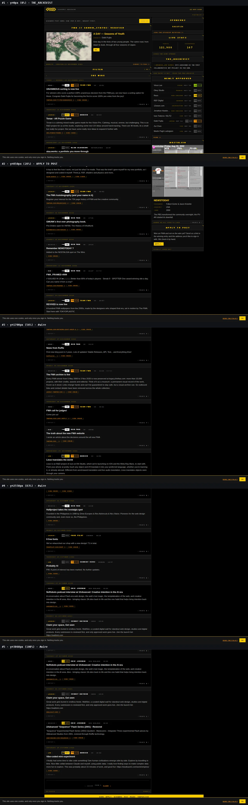
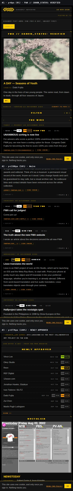

# UI Design System & Master Generation Blueprint: thefwa-net

> **FWA Wire — winners' newswire** (https://thefwa.net/) — News from FWA winners — hires, launches, talks and work in progress. One post per person per day, newest first. No algorithm, no ranking.





---

## 1. Executive Visual Persona & Design Archetype

- **Brand Essence & Persona**: **FWA Wire — winners' newswire** (`https://thefwa.net/`). News from FWA winners — hires, launches, talks and work in progress. One post per person per day, newest first. No algorithm, no ranking.
- **Capture Provenance**: Live browser capture (`tier1_fast`, HTTP `200`, captured `2026-11-24`).
- **Visual Archetype**: **High-Contrast Obsidian / Atmospheric Design System (`#000000` canvas, `#ffcc00` ink, `#ff9900` accent)**.
- **Anti-AI-Slop Differentiators**:
  - **Live-Computed Chromatic Polarity**: Anchors the viewport in `#000000` (live computed `body` `background-color` (`computed_styles.json`)) paired with `#ffcc00` primary typography and `#ff9900` accents.
  - **Grounded Typographic Hierarchy**: Pairs `Silkscreen` for display copy (`FWA // CANON_STATUS: VERIFIED`) with `Verdana`.
  - **Calibrated Spatial Grid & Motion**: Combines `1440px` container bounds (`gap: 10px`, padding `8px`) with `cubic-bezier(0.25,0.1,0.25,1)` easing and Three.js / WebGL Canvas Pipeline.

---

## 2. Spatial Architecture & Modular Grid Mathematics

### Viewport Allocation & Container Geometry
- **Captured Journey Filmstrips**: Desktop `1280×4140px` (`assets/desktop-journey.webp`, `5` keyframes up to `y=3060px` / doc `3960px`), Mobile `390×2616px` (`assets/mobile-journey.webp`, `3` keyframes).
- **Master Container Bounds**: `1440px` (full-bleed `100%` viewport stage).
- **Canvas Lateral Padding & Spacing**: `8px` lateral canvas padding with `10px` grid gap.
- **Border Radius Scale**: `0px` (sharp unrounded corners).

### Responsive Breakpoint Architecture
- **Desktop Layout**: Multi-column CSS Grid / Flexbox layout at `1440px` (`max-width: 1440px`, `gap: 10px`).
- **Mobile Layout**: Single-column vertical stack at `390px` viewport width with `8px` horizontal padding.
- **Extracted CSS Media Queries**: `@media (prefers-reduced-motion:reduce)`, `@media (min-width:760px)`, `@media (max-width:520px)`, `@media (max-width:519px)`.

---

## 3. Color System, Materiality & Atmospheric Lighting

### Semantic Palette & Source Grounding
| Semantic Role | Ground-Truth Value | Extracted Live / CSS Source |
|---|---|---|
| **Primary Canvas Substrate** | `#000000` | live computed `body` `background-color` (`computed_styles.json`) |
| **Primary Typography Ink** | `#ffcc00` | live computed `h2` `color` (`computed_styles.json`) |
| **Elevated Surface / Card Substrate** | `#0c0c0c` | live computed `section` `background-color` (`computed_styles.json`) |
| **Interactive Accent / Highlight** | `#ff9900` | live computed `button` `color` (`computed_styles.json`) |
| **Secondary / Muted Copy** | `#7e7e7e` | live computed `a` `color` (`computed_styles.json`) |
| **Structural Hairline Border** | `#303030` | `var(--line)` in `:root` |
| **Variable Token (`--inset`)** | `#151515` | `var(--inset)` in `:root` |
| **Variable Token (`--line-hi`)** | `#4a4a4a` | `var(--line-hi)` in `:root` |
| **Variable Token (`--body`)** | `#b4b4b4` | `var(--body)` in `:root` |
| **Variable Token (`--bright`)** | `#e6e6e6` | `var(--bright)` in `:root` |
| **Variable Token (`--yellow-dk`)** | `#8a6e00` | `var(--yellow-dk)` in `:root` |
| **Variable Token (`--green`)** | `#9acd00` | `var(--green)` in `:root` |

### Sanitized Root CSS Variables (`ui-ux.md` Ground Truth)
| Variable Name | Extracted Value | Semantic Role |
|---|---|---|
| `--void` | `#000000` | Color / Atmospheric Token |
| `--panel` | `#0C0C0C` | Color / Atmospheric Token |
| `--inset` | `#151515` | Color / Atmospheric Token |
| `--line` | `#303030` | Color / Atmospheric Token |
| `--line-hi` | `#4A4A4A` | Color / Atmospheric Token |
| `--dim` | `#7E7E7E` | Color / Atmospheric Token |
| `--body` | `#B4B4B4` | Color / Atmospheric Token |
| `--bright` | `#E6E6E6` | Color / Atmospheric Token |
| `--yellow` | `#FFCC00` | Color / Atmospheric Token |
| `--yellow-dk` | `#8A6E00` | Color / Atmospheric Token |
| `--amber` | `#FF9900` | Color / Atmospheric Token |
| `--green` | `#9ACD00` | Color / Atmospheric Token |
| `--logo-knockout` | `var(--inset)` | Design System Custom Token |
| `--thefwa-net-bg` | `#000000` | Canvas Substrate (from live computed `body` `background-color` (`computed_styles.json`)) |
| `--thefwa-net-ink` | `#ffcc00` | Primary Typography Ink (computed-derived) |
| `--thefwa-net-surface` | `#0c0c0c` | Surface Substrate (computed-derived) |

---

## 4. Typographic Scale & Editorial Hierarchy

### Font Family Stacks
- **Display Typography**: `Silkscreen`.
- **Primary Body Stack**: `Verdana`.
- **Technical / Metadata Stack**: not declared in live computed styles (uses primary stack / `ui-monospace`).

### Typographic Scale & Rules (Live Computed & Stylesheet Grounded)
- **Hero Display (`H1`)**: observed font-size ladder: `11px`, `14px`, `12px`, `11.5px`, `8px`.
- **Section Heading (`H2`)**: live computed `h2` (`font-size: 11px`, `line-height: 16.5px`, `font-weight: 700`, `letter-spacing: 2.42px`); rule `h2` (`font-size: 11px`, `letter-spacing: .22em`, `font-weight: 700`).
- **Body Copy**: live computed `body` (`font-size: 12px`, `line-height: 18px`, `font-weight: 400`); rule `body` (`font-size: 12px`, `line-height: 1.5`).
- **Metadata & Navigation Labels**: live computed `nav/a` (`font-size: 12px`, `line-height: 18px`, `font-weight: 400`); rule `.meta` (`font-size: 8px`, `letter-spacing: .06em`).

---

## 5. Choreographed Motion & Interaction Physics

### Primary Easing Curves
- **Extracted Timing Functions**: `cubic-bezier(0.25,0.1,0.25,1)`.

### Per-Element Transition & Choreography Rules
- **Selector `.dropzone`**: `transition: border-color .12s` extracted from `thefwa-net` stylesheet.
- **Standard CSS Easing (`cubic-bezier(0.25,0.1,0.25,1)`)**: Default timing curve (no custom `cubic-bezier()` declared in captured CSS).
- **Runtime Interaction Engine**: Integrates Three.js / WebGL Canvas Pipeline with `prefers-reduced-motion: reduce` fallback guards.
### Measured Runtime Scroll & Interaction Telemetry (`behavioral_journey_v2`)
- **Scroll Driver Mode**: `native` (max document height `3960px`, deepest scrollY reached `3060px` across `5` desktop keyframes).
- **Detected Scroll / Motion Libraries**: Native browser scroll / standard CSS transitions.
- **Hover Physics (`primary_cta` · `SIGN IN`)**: `color`: `rgb(126, 126, 126)` -> `rgb(255, 153, 0)`; `backgroundColor`: `rgb(255, 204, 0)` -> `rgb(255, 153, 0)`; `borderColor`: `rgb(126, 126, 126)` -> `rgb(255, 153, 0)` (`transition-duration: 0s`, `timing: ease`).
- **Hover Physics (`first_card` · `[ NEWS ] FWA FWA FWA JUDGE TEAM F...`)**: Computed transition `0s` / `ease` (no static color/transform shift captured at rest).
- **Interactive Control Probe (`accordion`)**: Tested `FILTER [ + ]` (diff `3.514`).
- **Route Transition Architecture**: First internal navigation (`/label/rob`) measured as `MPA` in `1353ms`.

---

## 6. Component Wireframe & Structural DOM Map

### Visual Layout Schematic — Desktop (`1440px`, Grounded in `dom.html` & Landmark Bounding Boxes)
```
┌────────────────────────────────────────────────────────────────────────┐
│ DESKTOP VIEWPORT (1440px) — FWA Wire — winners' newswire               │
│ ====================================================================== │
│ [ <nav.pager> (598x45px)              | older →                      ] │
│ ---------------------------------------------------------------------- │
│ | HERO STAGE: <section.panel> (w=1440px)                             | │
│ | H1: FWA // CANON_STATUS: VERIFIED                                  | │
│ | Substrate: #000000 | Ink: #ffcc00 | Accent: #ff9900                | │
│ ---------------------------------------------------------------------- │
│ | SHOWCASE GRID (<section.filters>) max-w: 1440px                    | │
│ | +------------------------------+  +------------------------------+ | │
│ | | A DAY — Seasons of Youth     |  | Posted by FWA winners >>> on | | │
│ | +------------------------------+  +------------------------------+ | │
│ ---------------------------------------------------------------------- │
│ | DETAIL MODULE (<section.wire>) — Winners post here. On             | │
│ ---------------------------------------------------------------------- │
│ [ FOOTER (<footer.ticker>     ) | https://thefwa.net/                  │
└────────────────────────────────────────────────────────────────────────┘
```

### Visual Layout Schematic — Mobile Reflow (`390px`)
```
┌────────────────────────────────────────────────────────────────────────┐
│ MOBILE VIEWPORT REFLOW (390px) — Single-Column Stack (gap: 10px)       │
│ ====================================================================== │
│ [ HEADER BAR (<nav.pager>             ) | Compact Menu (390px)         │
│ ---------------------------------------------------------------------- │
│ | HERO STAGE (<section.panel>) — 390px Vertical Lead                 | │
│ | H1: FWA // CANON_STATUS: VERIFIED                                  | │
│ ---------------------------------------------------------------------- │
│ | SHOWCASE STACK (<section.filters>) — 1-Col Stack                   | │
│ | [ Item 1: A DAY — Seasons of Youth                               ] | │
│ | [ Item 2: Posted by FWA winners >>> one post per person pe       ] | │
│ ---------------------------------------------------------------------- │
│ | DETAIL STACK (<section.wire>) — 1-Col (Winners post here.)         | │
│ ---------------------------------------------------------------------- │
│ [ FOOTER (<footer.ticker>     ) | Stacked 390px Colophon               │
└────────────────────────────────────────────────────────────────────────┘
```

### Granular DOM Region Breakdown
1. **Brand Header & Navigation Bar (<nav.pager> — `thefwa-net`)**:
   - Landmark `<nav class="pager">` (`598x45px`) hosting `FWA Wire — winners' newswire` navigation (`older →`), DOM attributes (`data-id="90"`, `data-view="image"`, `data-seen="p90:image"`, `data-src="/media/posts/mwtbqeue..."`), and stylesheet rule `html { -webkit-text-size-adjust:100% }`.
2. **Hero Stage & Focal Lead (<section.panel> — `FWA // CANON_STATUS: VERIFIED`)**:
   - Landmark `<section class="panel">` presenting display lead `FWA // CANON_STATUS: VERIFIED` and copy excerpt *"CREDITSDaiki Fujita"* over `#000000` canvas and `#ffcc00` ink.
3. **Primary Showcase & Content Grid (<section.filters> — `A DAY — Seasons of Youth`)**:
   - Landmark `<section class="panel filters">` rendering section `A DAY — Seasons of Youth` with copy *"Posted by FWA winners >>> one post per person per day >>> newest "*, asset references (`favicon.ico`, `icon.svg`, `apple-touch-icon.png`, `manifest.webmanifest`), and grid rule `.px { font-family:'Silkscreen',monospace;font-weight:400;letter-spacing:.02em }`.
4. **Interactive Detail & Feature Matrix (<section.wire> — `Posted by FWA winners >>> one post`)**:
   - Landmark `<section class="panel wire">` framing `Posted by FWA winners >>> one post per person pe` and `Winners post here. One item a day, newest first.` (*"Winners post here. One item a day, newest first."*) with `#0c0c0c` surface cards, `#ff9900` accents, and `.shell { max-width:940px;margin:0 auto;padding:8px }`.
5. **Colophon & Global Directory Footer (<footer.ticker> — `https://thefwa.net/`)**:
   - Landmark `<footer class="ticker">` anchoring `FWA Wire — winners' newswire` footer links (`older →`), copy *"Credits Daiki Fujita"*, and `#303030` structural dividers.
### Full Vertical Scroll Sequence (Desktop `1440×900` Keyframes)
- **Step 01** (`y=0px`, `0%`): Active landmark `THE_ARCHIVIST` · sticky/fixed elements: `1`
- **Step 02** (`y=850px`, `28%`): Active landmark `APPLY TO POST` · sticky/fixed elements: `1`
- **Step 03** (`y=1700px`, `56%`): Active landmark `#wire` · sticky/fixed elements: `1`
- **Step 04** (`y=2550px`, `83%`): Active landmark `#wire` · sticky/fixed elements: `1`
- **Step 05** (`y=3060px`, `100%`): Active landmark `#wire` · sticky/fixed elements: `1`

### Multi-Page Internal Route Map
- **Detail Route (`/label/rob`)**: `https://thefwa.net/label/rob` — H1: `ROB — FWA Wire`, scrollHeight `3778px`, transition `MPA` (`1353ms`)
- **Detail Route (`/label/news`)**: `https://thefwa.net/label/news` — H1: `NEWS — FWA Wire`, scrollHeight `2812px`, transition `direct` (`432ms`)
- **Detail Route (`/label/launch`)**: `https://thefwa.net/label/launch` — H1: `LAUNCH — FWA Wire`, scrollHeight `4030px`, transition `direct` (`306ms`)

---

## 7. Master Zero-Shot AI Generation Prompt

```markdown
# Master Zero-Shot Frontend Generation Prompt: thefwa-net (FWA Wire — winners' newswire)

You are a principal frontend architect and design systems engineer. Build a complete, production-ready web application replicating the exact design system, DOM landmarks, typographic hierarchy, color tokens, and motion physics of `thefwa-net` (**FWA Wire — winners' newswire** — `https://thefwa.net/`).

### 1. Visual Archetype & Anti-AI-Slop Mandates
- **Archetype**: High-Contrast Obsidian / Atmospheric Design System (`#000000` canvas, `#ffcc00` ink, `#ff9900` accent).
- **Identity & Domain Context**: News from FWA winners — hires, launches, talks and work in progress. One post per person per day, newest first. No algorithm, no ranking.
- **Primary Substrate**: `#000000` (live computed `body` `background-color` (`computed_styles.json`)), **Primary Ink**: `#ffcc00`, **Accent / Highlight**: `#ff9900`.
- **Site-Specific Differentiators**:
  - **Live-Computed Chromatic Polarity**: Anchors the viewport in `#000000` (live computed `body` `background-color` (`computed_styles.json`)) paired with `#ffcc00` primary typography and `#ff9900` accents.
  - **Grounded Typographic Hierarchy**: Pairs `Silkscreen` for display copy (`FWA // CANON_STATUS: VERIFIED`) with `Verdana`.
  - **Calibrated Spatial Grid & Motion**: Combines `1440px` container bounds (`gap: 10px`, padding `8px`) with `cubic-bezier(0.25,0.1,0.25,1)` easing and Three.js / WebGL Canvas Pipeline.

### 2. Ground-Truth CSS Variables (`:root` Token Contract)
Declare and consume these exact custom properties extracted from `thefwa-net` in your global stylesheet:

:root {
  /* FWA Wire — winners' newswire (thefwa-net) — Live-Grounded CSS Variables */
  --void: #000000; /* Color / Atmospheric Token (thefwa-net) */
  --panel: #0C0C0C; /* Color / Atmospheric Token (thefwa-net) */
  --inset: #151515; /* Color / Atmospheric Token (thefwa-net) */
  --line: #303030; /* Color / Atmospheric Token (thefwa-net) */
  --line-hi: #4A4A4A; /* Color / Atmospheric Token (thefwa-net) */
  --dim: #7E7E7E; /* Color / Atmospheric Token (thefwa-net) */
  --body: #B4B4B4; /* Color / Atmospheric Token (thefwa-net) */
  --bright: #E6E6E6; /* Color / Atmospheric Token (thefwa-net) */
  --yellow: #FFCC00; /* Color / Atmospheric Token (thefwa-net) */
  --yellow-dk: #8A6E00; /* Color / Atmospheric Token (thefwa-net) */
  --amber: #FF9900; /* Color / Atmospheric Token (thefwa-net) */
  --green: #9ACD00; /* Color / Atmospheric Token (thefwa-net) */
  --logo-knockout: var(--inset); /* Design System Custom Token (thefwa-net) */
  --thefwa-net-bg: #000000; /* Canvas Substrate (from live computed `body` `background-color` (`computed_styles.json`)) (thefwa-net) */
  --thefwa-net-ink: #ffcc00; /* Primary Typography Ink (computed-derived) (thefwa-net) */
  --thefwa-net-surface: #0c0c0c; /* Surface Substrate (computed-derived) (thefwa-net) */
}

### 3. Semantic Color & Materiality Contract
Map every surface, ink, and border strictly to these source-grounded tokens:
- **Primary Canvas Substrate**: `#000000` — grounded in live computed `body` `background-color` (`computed_styles.json`)
- **Primary Typography Ink**: `#ffcc00` — grounded in live computed `h2` `color` (`computed_styles.json`)
- **Elevated Surface / Card Substrate**: `#0c0c0c` — grounded in live computed `section` `background-color` (`computed_styles.json`)
- **Interactive Accent / Highlight**: `#ff9900` — grounded in live computed `button` `color` (`computed_styles.json`)
- **Secondary / Muted Copy**: `#7e7e7e` — grounded in live computed `a` `color` (`computed_styles.json`)
- **Structural Hairline Border**: `#303030` — grounded in `var(--line)` in `:root`
- **Variable Token (`--inset`)**: `#151515` — grounded in `var(--inset)` in `:root`
- **Variable Token (`--line-hi`)**: `#4a4a4a` — grounded in `var(--line-hi)` in `:root`
- **Variable Token (`--body`)**: `#b4b4b4` — grounded in `var(--body)` in `:root`
- **Variable Token (`--bright`)**: `#e6e6e6` — grounded in `var(--bright)` in `:root`
- **Variable Token (`--yellow-dk`)**: `#8a6e00` — grounded in `var(--yellow-dk)` in `:root`
- **Variable Token (`--green`)**: `#9acd00` — grounded in `var(--green)` in `:root`

### 4. Spatial Grid, Container Bounds & Responsive Breakpoints
- **Desktop Viewport Reference**: `1280×4140px` (multi-frame vertical journey filmstrip (4140px), `1440px` standard desktop width).
- **Mobile Viewport Reference**: `390×2616px` (multi-frame vertical journey filmstrip (2616px), `390px` standard mobile width).
- **Container Max-Width**: `1440px` (full-bleed `100%` viewport stage)
- **Padding & Gutters**: `8px` lateral canvas padding with `10px` grid gap
- **Desktop Grid**: Multi-column CSS Grid / Flexbox layout at `1440px` (`max-width: 1440px`, `gap: 10px`)
- **Mobile Adaptation**: Single-column vertical stack at `390px` viewport width with `8px` horizontal padding
- **Media Queries**: `@media (prefers-reduced-motion:reduce)`, `@media (min-width:760px)`, `@media (max-width:520px)`, `@media (max-width:519px)`
- **Corner Radii**: `0px` (sharp unrounded corners)

### 5. Typography & Editorial Scale Contract
- **Display Font Stack**: `Silkscreen`
- **Body Font Stack**: `Verdana`
- **Monospace / Technical Font Stack**: not declared in live computed styles (uses primary stack / `ui-monospace`)
- **H1 Display Rule**: observed font-size ladder: `11px`, `14px`, `12px`, `11.5px`, `8px`
- **H2 Section Rule**: live computed `h2` (`font-size: 11px`, `line-height: 16.5px`, `font-weight: 700`, `letter-spacing: 2.42px`); rule `h2` (`font-size: 11px`, `letter-spacing: .22em`, `font-weight: 700`)
- **Body Copy Rule**: live computed `body` (`font-size: 12px`, `line-height: 18px`, `font-weight: 400`); rule `body` (`font-size: 12px`, `line-height: 1.5`)
- **Metadata & Index Rule**: live computed `nav/a` (`font-size: 12px`, `line-height: 18px`, `font-weight: 400`); rule `.meta` (`font-size: 8px`, `letter-spacing: .06em`)

### 6. Component Hierarchy, Verbatim Copy & Real DOM Landmarks
Scaffold `thefwa-net` (`FWA Wire — winners' newswire`) with these exact structural regions, extracted copy, and CSS rules from `dom.html`:
1. **Brand Header & Navigation Bar (<nav.pager> — `thefwa-net`)**:
   - DOM & Selectors: Landmark `<nav class="pager">` (`598x45px`) hosting `FWA Wire — winners' newswire` navigation (`older →`), DOM attributes (`data-id="90"`, `data-view="image"`, `data-seen="p90:image"`, `data-src="/media/posts/mwtbqeue..."`), and stylesheet rule `html { -webkit-text-size-adjust:100% }`.
   - Responsive Contract: Header `Brand Header & Navigation Bar (<nav.pager> — `thefwa-net`)` (`thefwa-net`) adapts across `@media (prefers-reduced-motion:reduce)`, `@media (min-width:760px)`, `@media (max-width:520px)`, `@media (max-width:519px)` with `cubic-bezier(0.25,0.1,0.25,1)` transitions and links `older →`.
2. **Hero Stage & Focal Lead (<section.panel> — `FWA // CANON_STATUS: VERIFIED`)**:
   - DOM & Selectors: Landmark `<section class="panel">` presenting display lead `FWA // CANON_STATUS: VERIFIED` and copy excerpt *"CREDITSDaiki Fujita"* over `#000000` canvas and `#ffcc00` ink.
   - Responsive Contract: Hero stage (`1280×4140px` desktop / `390×2616px` mobile) sets `#000000` background with `#ffcc00` headline `FWA // CANON_STATUS: VERIFIED`.
3. **Primary Showcase & Content Grid (<section.filters> — `A DAY — Seasons of Youth`)**:
   - DOM & Selectors: Landmark `<section class="panel filters">` rendering section `A DAY — Seasons of Youth` with copy *"Posted by FWA winners >>> one post per person per day >>> newest "*, asset references (`favicon.ico`, `icon.svg`, `apple-touch-icon.png`, `manifest.webmanifest`), and grid rule `.px { font-family:'Silkscreen',monospace;font-weight:400;letter-spacing:.02em }`.
   - Responsive Contract: Showcase grid `Primary Showcase & Content Grid (<section.filters> — `A DAY — Seasons of Youth`)` applies Multi-column CSS Grid / Flexbox layout at `1440px` (`max-width: 1440px`, `gap: 10px`) on desktop and Single-column vertical stack at `390px` viewport width with `8px` horizontal padding on mobile.
4. **Interactive Detail & Feature Matrix (<section.wire> — `Posted by FWA winners >>> one post`)**:
   - DOM & Selectors: Landmark `<section class="panel wire">` framing `Posted by FWA winners >>> one post per person pe` and `Winners post here. One item a day, newest first.` (*"Winners post here. One item a day, newest first."*) with `#0c0c0c` surface cards, `#ff9900` accents, and `.shell { max-width:940px;margin:0 auto;padding:8px }`.
   - Responsive Contract: Detail module `Interactive Detail & Feature Matrix (<section.wire> — `Posted by FWA winners >>> one post`)` uses `0px` (sharp unrounded corners) radii, `#ff9900` highlights, and assets (favicon.ico, icon.svg, apple-touch-icon.png).
5. **Colophon & Global Directory Footer (<footer.ticker> — `https://thefwa.net/`)**:
   - DOM & Selectors: Landmark `<footer class="ticker">` anchoring `FWA Wire — winners' newswire` footer links (`older →`), copy *"Credits Daiki Fujita"*, and `#303030` structural dividers.
   - Responsive Contract: Footer `Colophon & Global Directory Footer (<footer.ticker> — `https://thefwa.net/`)` aligns to `1440px` (full-bleed `100%` viewport stage) with `8px` lateral canvas padding with `10px` grid gap and attributes (data-id="90", data-view="image", data-seen="p90:image").

#### Verbatim DOM Copy Excerpts (`dom.html`)
- Copy Excerpt 1: *"CREDITSDaiki Fujita"*
- Copy Excerpt 2: *"Posted by FWA winners >>> one post per person per day >>> newest first, always >>>..."*
- Copy Excerpt 3: *"Winners post here. One item a day, newest first."*
- Copy Excerpt 4: *"Credits Daiki Fujita"*

### 7. Motion, Extracted Stylesheet Rules & Interaction Choreography
- **Primary Easing Functions**: `cubic-bezier(0.25,0.1,0.25,1)`
- **Extracted Stylesheet Rules (`thefwa-net`)**:
- `html { -webkit-text-size-adjust:100% }`
- `.px { font-family:'Silkscreen',monospace;font-weight:400;letter-spacing:.02em }`
- `.shell { max-width:940px;margin:0 auto;padding:8px }`
- `.strip.lead { display:flex;align-items:center;gap:10px;color:var(--dim) }`
- `.strip.lead svg { width:58px;height:auto;color:var(--yellow);flex:none }`
- **Per-Selector Transition Rules**:
- **Selector `.dropzone`**: `transition: border-color .12s` extracted from `thefwa-net` stylesheet.
- **Standard CSS Easing (`cubic-bezier(0.25,0.1,0.25,1)`)**: Default timing curve (no custom `cubic-bezier()` declared in captured CSS).
- **Runtime Interaction Engine**: Integrates Three.js / WebGL Canvas Pipeline with `prefers-reduced-motion: reduce` fallback guards.
### 7b. Full-Page Scroll Choreography, Interactive States & Multi-Page Routes
- **Scroll Mechanics**: Implement `native` vertical progression up to `3960px` across 5 distinct viewport chapters.
- **Vertical Chapter Sequence**: THE_ARCHIVIST (0%) -> APPLY TO POST (28%) -> #wire (56%) -> #wire (83%) -> #wire (100%).
- **Hover Micro-Interaction (`primary_cta`)**: Animate `color, backgroundColor, borderColor` with `0s ease`.
- **Multi-Page Routes**: Scaffold internal routes `/label/rob` (detail, MPA), `/label/news` (detail, direct), `/label/launch` (detail, direct) sharing the global header/footer shell and design tokens.

### 8. Technical Deliverables
- Implement in Next.js (App Router) with TypeScript and Tailwind CSS consuming the `:root` custom properties defined above for `thefwa-net`.
- Reproduce both the `1440px` desktop architecture and `390px` mobile breakpoint transitions, preserving semantic HTML5 landmarks (`<header>`, `<nav>`, `<main>`, `<section>`, `<footer>`) and `prefers-reduced-motion` accessibility guards.
```
---

## 8. Full-Page Scroll Journey, Interactive States & Subpage Inventory

### Desktop Scroll Keyframes (`1440×900` WebP)
| Step | Scroll Y | Progress | Active Landmark / Section | Sticky/Fixed | Visual Asset |
| :---: | :---: | :---: | :--- | :---: | :--- |
| `#01` | `0px` | `0%` | THE_ARCHIVIST | `1` | [desktop-step-01.webp](assets/desktop-step-01.webp) |
| `#02` | `850px` | `28%` | APPLY TO POST | `1` | [desktop-step-02.webp](assets/desktop-step-02.webp) |
| `#03` | `1700px` | `56%` | #wire | `1` | [desktop-step-03.webp](assets/desktop-step-03.webp) |
| `#04` | `2550px` | `83%` | #wire | `1` | [desktop-step-04.webp](assets/desktop-step-04.webp) |
| `#05` | `3060px` | `100%` | #wire | `1` | [desktop-step-05.webp](assets/desktop-step-05.webp) |

### Mobile Condensed Keyframes (`390×844` WebP)
| Step | Scroll Y | Progress | Active Landmark | Visual Asset |
| :---: | :---: | :---: | :--- | :--- |
| `#01` | `0px` | `0%` | FWA // CANON_STATUS: VERIFIED | [mobile-step-01.webp](assets/mobile-step-01.webp) |
| `#02` | `2388px` | `50%` | #wire | [mobile-step-02.webp](assets/mobile-step-02.webp) |
| `#03` | `4776px` | `100%` | NEWLY APPROVED | [mobile-step-03.webp](assets/mobile-step-03.webp) |

### Internal Subpage Filmstrips (`1080px` Wide WebP)
| # | Template | Route URL | H1 / Title | Scroll Height | Transition | Filmstrip Asset |
| :-: | :---: | :--- | :--- | :---: | :---: | :--- |
| `1` | `detail` | `https://thefwa.net/label/rob` | ROB — FWA Wire | `3778px` | `MPA` (`1353ms`) | [subpage-01-label-rob.webp](assets/subpage-01-label-rob.webp) |
| `2` | `detail` | `https://thefwa.net/label/news` | NEWS — FWA Wire | `2812px` | `direct` (`432ms`) | [subpage-02-label-news.webp](assets/subpage-02-label-news.webp) |
| `3` | `detail` | `https://thefwa.net/label/launch` | LAUNCH — FWA Wire | `4030px` | `direct` (`306ms`) | [subpage-03-label-launch.webp](assets/subpage-03-label-launch.webp) |

