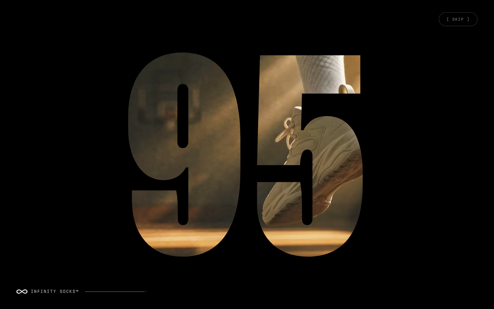

# UI Design System & Master Generation Blueprint: theinfinitysocks-com

> **Infinity Socks — Performance Basketball Socks** (https://theinfinitysocks.com/) — Infinity performance basketball socks. Court System™ — four technologies engineered for the hardwood. Tested by professional players. Pro...



---

## 1. Executive Visual Persona & Design Archetype

- **Brand Essence & Persona**: **Infinity Socks — Performance Basketball Socks** (`https://theinfinitysocks.com/`). Infinity performance basketball socks. Court System™ — four technologies engineered for the hardwood. Tested by professional players. Pro...
- **Capture Provenance**: Live browser capture (`tier2_webgl`, HTTP `200`, captured `2026-11-23`).
- **Visual Archetype**: **Light-Gallery WebGL / Canvas Interactive Experience (`#ede4d2` / `#c96f4a`)**.
- **Anti-AI-Slop Differentiators**:
  - **Live-Computed Chromatic Polarity**: Anchors the viewport in `#ede4d2` (live computed `body` `background-color` (`computed_styles.json`)) paired with `#211a12` primary typography and `#c96f4a` accents.
  - **Grounded Typographic Hierarchy**: Pairs `FK Screamer` for display copy (`High-Performance Socks High-Performa`) with `Geist` and `SFMono-Regular`.
  - **Calibrated Spatial Grid & Motion**: Combines `1440px` container bounds (`gap: 16px`, padding `20px`) with `cubic-bezier(.625,.05,0,1)` easing and Lenis Smooth Scroll (`data-lenis`), GSAP Timeline & ScrollTrigger.

---

## 2. Spatial Architecture & Modular Grid Mathematics


### Viewport Allocation & Container Geometry
- **Captured Viewport Dimensions**: Desktop `1440×900px` (`assets/desktop.png`, single-viewport 100vh live capture (900px)), Mobile `390×844px` (`assets/mobile.png`, single-viewport 100vh live capture (844px)).
- **Master Container Bounds**: `1440px` (full-bleed `100%` desktop stage measured on `1440px` viewport).
- **Canvas Lateral Padding & Spacing**: `20px` lateral canvas padding with `16px` grid gap.
- **Border Radius Scale**: `var(--cc-radius)`, `var(--cc-radius-btn)`, `var(--cc-radius-switch)`, `var(--btn-radius)`.

### Responsive Breakpoint Architecture
- **Desktop Layout**: Multi-column CSS Grid / Flexbox layout at `1440px` (`max-width: 1440px`, `gap: 16px`).
- **Mobile Layout**: Single-column vertical stack at `390px` viewport width with `20px` horizontal padding.
- **Extracted CSS Media Queries**: `@media (max-width:40em)`, `@media (prefers-reduced-motion:reduce)`, `@media screen and (max-width:991px)`, `@media screen and (max-width:767px)`.

---

## 3. Color System, Materiality & Atmospheric Lighting

### Semantic Palette & Source Grounding
| Semantic Role | Ground-Truth Value | Extracted Live / CSS Source |
|---|---|---|
| **Primary Canvas Substrate** | `#ede4d2` | live computed `body` `background-color` (`computed_styles.json`) |
| **Primary Typography Ink** | `#211a12` | live computed `main` `color` (`computed_styles.json`) |
| **Elevated Surface / Card Substrate** | `#f6f0e2` | live computed `a` `background-color` (`computed_styles.json`) |
| **Interactive Accent / Highlight** | `#c96f4a` | `.cc__banner .cc__link:hover { color: #c96f4a }` |
| **Secondary / Muted Copy** | `#6b6b6b` | `var(--cc-color-muted)` in `:root` |
| **Structural Hairline Border** | `#f1e9d9` | `var(--hairline)` in `:root` (`rgba(255, 250, 240, .22)`) |

### Sanitized Root CSS Variables (`ui-ux.md` Ground Truth)
| Variable Name | Extracted Value | Semantic Role |
|---|---|---|
| `--fsa` | `.5` | Design System Custom Token |
| `--size-unit` | `16` | Layout / Spatial Grid Token |
| `--size-container-ideal` | `1440` | Layout / Spatial Grid Token |
| `--size-container-min` | `992px` | Layout / Spatial Grid Token |
| `--size-container-max` | `6000px` | Layout / Spatial Grid Token |
| `--size-container` | `clamp(var(--size-container-min), 100vw, var(--size-container-max))` | Layout / Spatial Grid Token |
| `--font-body` | `"Geist", system-ui, sans-serif` | Typography / Scale Token |
| `--font-heading` | `"FK Screamer", "Arial Narrow", Impact, sans-serif` | Typography Ink Token |
| `--font-mono` | `"Geist Mono", ui-monospace, Menlo, monospace` | Typography / Scale Token |
| `--text-xs` | `.75em` | Typography Ink Token |
| `--text-sm` | `.8125em` | Typography Ink Token |
| `--text-base` | `.875em` | Typography Ink Token |
| `--text-md` | `1em` | Typography Ink Token |
| `--text-lg` | `1.125em` | Typography Ink Token |
| `--text-xl` | `1.25em` | Typography Ink Token |
| `--text-2xl` | `1.5em` | Typography Ink Token |

---

## 4. Typographic Scale & Editorial Hierarchy

### Font Family Stacks
- **Display Typography**: `FK Screamer`.
- **Primary Body Stack**: `Geist`.
- **Technical / Metadata Stack**: `SFMono-Regular`.

### Typographic Scale & Rules (Live Computed & Stylesheet Grounded)
- **Hero Display (`H1`)**: live computed `h1` (`font-size: 100.8px`, `line-height: 90.72px`, `font-weight: 900`); CSS variables `--text-4xl: 2.25em`, `--display: var(--font-heading)`, `--h1-top: 18.2%`.
- **Section Heading (`H2`)**: live computed `h2` (`font-size: 30px`, `line-height: 42.9px`, `font-weight: 400`, `letter-spacing: 0.6px`); CSS variables `--text-2xl: 1.5em`, `--text-3xl: 1.875em`.
- **Body Copy**: live computed `body` (`font-size: 16px`, `line-height: 22.88px`, `font-weight: 400`); CSS variables `--font-body: "Geist", system-ui, sans-serif`, `--text-base: .875em`, `--body: var(--font-body)`.
- **Metadata & Navigation Labels**: live computed `nav/a` (`font-size: 10.5px`, `line-height: 15.015px`, `font-weight: 400`, `letter-spacing: 1.47px`); CSS variables `--font-mono: "Geist Mono", ui-monospace, Menlo, monospace`, `--text-xs: .75em`, `--text-sm: .8125em`; rule `small` (`font-size: calc(var(--size-font) * .6875)`, `letter-spacing: .26em`).

---

## 5. Choreographed Motion & Interaction Physics

### Primary Easing Curves
- **Extracted Timing Functions**: `cubic-bezier(.625,.05,0,1)`, `cubic-bezier(.4,0,.2,1)`, `cubic-bezier(.32,.72,0,1)`.

### Per-Element Transition & Choreography Rules
- **Selector `.cc__backdrop`**: `transition: opacity var(--cc-duration) var(--cc-ease)` extracted from `theinfinitysocks-com` stylesheet.
- **Selector `.cc__dialog`**: `transition: opacity var(--cc-duration) var(--cc-ease),transform var(--cc-d...` extracted from `theinfinitysocks-com` stylesheet.
- **Selector `.cc__link`**: `transition: color var(--cc-duration-fast)` extracted from `theinfinitysocks-com` stylesheet.
- **Extracted Easing Curve (`cubic-bezier(.625,.05,0,1)`)**: Governs interactive state transitions across `<header.cc__dialog-head>` and `<section.court>`.
- **Runtime Interaction Engine**: Integrates Lenis Smooth Scroll (`data-lenis`), GSAP Timeline & ScrollTrigger, Three.js / WebGL Canvas Pipeline with `prefers-reduced-motion: reduce` fallback guards.

---

## 6. Component Wireframe & Structural DOM Map

### Visual Layout Schematic — Desktop (`1440px`, Grounded in `dom.html` & Landmark Bounding Boxes)
```
┌────────────────────────────────────────────────────────────────────────┐
│ DESKTOP VIEWPORT (1440px) — Infinity Socks — Performance Basketball So │
│ ====================================================================== │
│ [ <header.cc__dialog-hea (1440px)     | Overview · Index · Archive · ] │
│ ---------------------------------------------------------------------- │
│ | HERO STAGE: <section.hero> (w=1440px)                              | │
│ | H1: High-Performance Socks High-Performance Socks Hig...           | │
│ | Substrate: #ede4d2 | Ink: #211a12 | Accent: #c96f4a                | │
│ ---------------------------------------------------------------------- │
│ | SHOWCASE GRID (<section.court>) max-w: 1440px                      | │
│ | +------------------------------+  +------------------------------+ | │
│ | | Trusted every possession.    |  | One pair of socks. Four quar | | │
│ | +------------------------------+  +------------------------------+ | │
│ ---------------------------------------------------------------------- │
│ | DETAIL MODULE (<section.qq>) — ImpactShield™                       | │
│ ---------------------------------------------------------------------- │
│ [ FOOTER (<footer.cc__dialog-a) | https://theinfinitysocks.com/        │
└────────────────────────────────────────────────────────────────────────┘
```

### Visual Layout Schematic — Mobile Reflow (`390px`)
```
┌────────────────────────────────────────────────────────────────────────┐
│ MOBILE VIEWPORT REFLOW (390px) — Single-Column Stack (gap: 16px)       │
│ ====================================================================== │
│ [ HEADER BAR (<header.cc__dialog-head>) | Compact Menu (390px)         │
│ ---------------------------------------------------------------------- │
│ | HERO STAGE (<section.hero>) — 390px Vertical Lead                  | │
│ | H1: High-Performance Socks High-Performance Socks Hig...           | │
│ ---------------------------------------------------------------------- │
│ | SHOWCASE STACK (<section.court>) — 1-Col Stack                     | │
│ | [ Item 1: Trusted every possession.                              ] | │
│ | [ Item 2: One pair of socks. Four quarters of excellence.        ] | │
│ ---------------------------------------------------------------------- │
│ | DETAIL STACK (<section.qq>) — 1-Col (ImpactShield™)                | │
│ ---------------------------------------------------------------------- │
│ [ FOOTER (<footer.cc__dialog-a) | Stacked 390px Colophon               │
└────────────────────────────────────────────────────────────────────────┘
```

### Granular DOM Region Breakdown
1. **Brand Header & Navigation Bar (<header.cc__dialog-head> — `theinfinitysocks-com`)**:
   - Landmark `<header class="cc__dialog-head">` (`1440px`) hosting `Infinity Socks — Performance Basketb` navigation (`Overview · Index · Archive · About · Contact`), DOM attributes (`data-skip`, `data-motion-toggle`, `data-motion-label`, `data-cc-host`), and stylesheet rule `after { box-sizing:border-box }`.
2. **Hero Stage & Focal Lead (<section.hero> — `High-Performance Socks High-Perfor`)**:
   - Landmark `<section class="hero hero--h1a">` presenting display lead `High-Performance Socks High-Performance Socks Hig...` and copy excerpt *"“Still dry — even though I played a whole game.”"* over `#ede4d2` canvas and `#211a12` ink.
3. **Primary Showcase & Content Grid (<section.court> — `Trusted every possession.`)**:
   - Landmark `<section class="court">` rendering section `Trusted every possession.` with copy *"High-Performance Socks High-Performance Socks High-Performance So"*, asset references (`favicon.ico`, `favicon.svg`, `apple-touch-icon.png`, `site.webmanifest`), and grid rule `button { font:inherit;color:inherit;background:none;border:0;margin:0;cursor:poin... }`.
4. **Interactive Detail & Feature Matrix (<section.qq> — `One pair of socks. Four quarters o`)**:
   - Landmark `<section class="qq">` framing `One pair of socks. Four quarters of excellence.` and `ImpactShield™` (*"High-Performance Socks"*) with `#f6f0e2` surface cards, `#c96f4a` accents, and `.cc__placeholder :focus-visible { outline:2px solid var(--cc-color-focus);outline-offset:2px }`.
5. **Colophon & Global Directory Footer (<footer.cc__dialog-actions> — `https://theinfinitysocks.com/`)**:
   - Landmark `<footer class="cc__dialog-actions cc__actions">` anchoring `Infinity Socks — Performance Bas` footer links (`Overview · Index · Archive · About · Contact`), copy *"Engineered for the Hardwood"*, and `#f1e9d9` structural dividers.

---

## 7. Master Zero-Shot AI Generation Prompt

```markdown
# Master Zero-Shot Frontend Generation Prompt: theinfinitysocks-com (Infinity Socks — Performance Basketball Socks)

You are a principal frontend architect and design systems engineer. Build a complete, production-ready web application replicating the exact design system, DOM landmarks, typographic hierarchy, color tokens, and motion physics of `theinfinitysocks-com` (**Infinity Socks — Performance Basketball Socks** — `https://theinfinitysocks.com/`).

### 1. Visual Archetype & Anti-AI-Slop Mandates
- **Archetype**: Light-Gallery WebGL / Canvas Interactive Experience (`#ede4d2` / `#c96f4a`).
- **Identity & Domain Context**: Infinity performance basketball socks. Court System™ — four technologies engineered for the hardwood. Tested by professional players. Pro...
- **Primary Substrate**: `#ede4d2` (live computed `body` `background-color` (`computed_styles.json`)), **Primary Ink**: `#211a12`, **Accent / Highlight**: `#c96f4a`.
- **Site-Specific Differentiators**:
  - **Live-Computed Chromatic Polarity**: Anchors the viewport in `#ede4d2` (live computed `body` `background-color` (`computed_styles.json`)) paired with `#211a12` primary typography and `#c96f4a` accents.
  - **Grounded Typographic Hierarchy**: Pairs `FK Screamer` for display copy (`High-Performance Socks High-Performa`) with `Geist` and `SFMono-Regular`.
  - **Calibrated Spatial Grid & Motion**: Combines `1440px` container bounds (`gap: 16px`, padding `20px`) with `cubic-bezier(.625,.05,0,1)` easing and Lenis Smooth Scroll (`data-lenis`), GSAP Timeline & ScrollTrigger.

### 2. Ground-Truth CSS Variables (`:root` Token Contract)
Declare and consume these exact custom properties extracted from `theinfinitysocks-com` in your global stylesheet:

:root {
  /* Infinity Socks — Performance Basketball Socks (theinfinitysocks-com) — Live-Grounded CSS Variables */
  --fsa: .5; /* Design System Custom Token (theinfinitysocks-com) */
  --size-unit: 16; /* Layout / Spatial Grid Token (theinfinitysocks-com) */
  --size-container-ideal: 1440; /* Layout / Spatial Grid Token (theinfinitysocks-com) */
  --size-container-min: 992px; /* Layout / Spatial Grid Token (theinfinitysocks-com) */
  --size-container-max: 6000px; /* Layout / Spatial Grid Token (theinfinitysocks-com) */
  --size-container: clamp(var(--size-container-min), 100vw, var(--size-container-max)); /* Layout / Spatial Grid Token (theinfinitysocks-com) */
  --font-body: "Geist", system-ui, sans-serif; /* Typography / Scale Token (theinfinitysocks-com) */
  --font-heading: "FK Screamer", "Arial Narrow", Impact, sans-serif; /* Typography Ink Token (theinfinitysocks-com) */
  --font-mono: "Geist Mono", ui-monospace, Menlo, monospace; /* Typography / Scale Token (theinfinitysocks-com) */
  --text-xs: .75em; /* Typography Ink Token (theinfinitysocks-com) */
  --text-sm: .8125em; /* Typography Ink Token (theinfinitysocks-com) */
  --text-base: .875em; /* Typography Ink Token (theinfinitysocks-com) */
  --text-md: 1em; /* Typography Ink Token (theinfinitysocks-com) */
  --text-lg: 1.125em; /* Typography Ink Token (theinfinitysocks-com) */
  --text-xl: 1.25em; /* Typography Ink Token (theinfinitysocks-com) */
  --text-2xl: 1.5em; /* Typography Ink Token (theinfinitysocks-com) */
}

### 3. Semantic Color & Materiality Contract
Map every surface, ink, and border strictly to these source-grounded tokens:
- **Primary Canvas Substrate**: `#ede4d2` — grounded in live computed `body` `background-color` (`computed_styles.json`)
- **Primary Typography Ink**: `#211a12` — grounded in live computed `main` `color` (`computed_styles.json`)
- **Elevated Surface / Card Substrate**: `#f6f0e2` — grounded in live computed `a` `background-color` (`computed_styles.json`)
- **Interactive Accent / Highlight**: `#c96f4a` — grounded in `.cc__banner .cc__link:hover { color: #c96f4a }`
- **Secondary / Muted Copy**: `#6b6b6b` — grounded in `var(--cc-color-muted)` in `:root`
- **Structural Hairline Border**: `#f1e9d9` — grounded in `var(--hairline)` in `:root` (`rgba(255, 250, 240, .22)`)

### 4. Spatial Grid, Container Bounds & Responsive Breakpoints
- **Desktop Viewport Reference**: `1440×900px` (single-viewport 100vh live capture (900px), `1440px` standard desktop width).
- **Mobile Viewport Reference**: `390×844px` (single-viewport 100vh live capture (844px), `390px` standard mobile width).
- **Container Max-Width**: `1440px` (full-bleed `100%` desktop stage measured on `1440px` viewport)
- **Padding & Gutters**: `20px` lateral canvas padding with `16px` grid gap
- **Desktop Grid**: Multi-column CSS Grid / Flexbox layout at `1440px` (`max-width: 1440px`, `gap: 16px`)
- **Mobile Adaptation**: Single-column vertical stack at `390px` viewport width with `20px` horizontal padding
- **Media Queries**: `@media (max-width:40em)`, `@media (prefers-reduced-motion:reduce)`, `@media screen and (max-width:991px)`, `@media screen and (max-width:767px)`
- **Corner Radii**: `var(--cc-radius)`, `var(--cc-radius-btn)`, `var(--cc-radius-switch)`, `var(--btn-radius)`

### 5. Typography & Editorial Scale Contract
- **Display Font Stack**: `FK Screamer`
- **Body Font Stack**: `Geist`
- **Monospace / Technical Font Stack**: `SFMono-Regular`
- **H1 Display Rule**: live computed `h1` (`font-size: 100.8px`, `line-height: 90.72px`, `font-weight: 900`); CSS variables `--text-4xl: 2.25em`, `--display: var(--font-heading)`, `--h1-top: 18.2%`
- **H2 Section Rule**: live computed `h2` (`font-size: 30px`, `line-height: 42.9px`, `font-weight: 400`, `letter-spacing: 0.6px`); CSS variables `--text-2xl: 1.5em`, `--text-3xl: 1.875em`
- **Body Copy Rule**: live computed `body` (`font-size: 16px`, `line-height: 22.88px`, `font-weight: 400`); CSS variables `--font-body: "Geist", system-ui, sans-serif`, `--text-base: .875em`, `--body: var(--font-body)`
- **Metadata & Index Rule**: live computed `nav/a` (`font-size: 10.5px`, `line-height: 15.015px`, `font-weight: 400`, `letter-spacing: 1.47px`); CSS variables `--font-mono: "Geist Mono", ui-monospace, Menlo, monospace`, `--text-xs: .75em`, `--text-sm: .8125em`; rule `small` (`font-size: calc(var(--size-font) * .6875)`, `letter-spacing: .26em`)

### 6. Component Hierarchy, Verbatim Copy & Real DOM Landmarks
Scaffold `theinfinitysocks-com` (`Infinity Socks — Performance Basketball Socks`) with these exact structural regions, extracted copy, and CSS rules from `dom.html`:
1. **Brand Header & Navigation Bar (<header.cc__dialog-head> — `theinfinitysocks-com`)**:
   - DOM & Selectors: Landmark `<header class="cc__dialog-head">` (`1440px`) hosting `Infinity Socks — Performance Basketb` navigation (`Overview · Index · Archive · About · Contact`), DOM attributes (`data-skip`, `data-motion-toggle`, `data-motion-label`, `data-cc-host`), and stylesheet rule `after { box-sizing:border-box }`.
   - Responsive Contract: Header `Brand Header & Navigation Bar (<header.cc__dialog-head> — `theinfinitysocks-com`)` (`theinfinitysocks-com`) adapts across `@media (max-width:40em)`, `@media (prefers-reduced-motion:reduce)`, `@media screen and (max-width:991px)`, `@media screen and (max-width:767px)` with `cubic-bezier(.625,.05,0,1)`, `cubic-bezier(.4,0,.2,1)`, `cubic-bezier(.32,.72,0,1)` transitions and links `Overview · Index · Archive · About · Contact`.
2. **Hero Stage & Focal Lead (<section.hero> — `High-Performance Socks High-Perfor`)**:
   - DOM & Selectors: Landmark `<section class="hero hero--h1a">` presenting display lead `High-Performance Socks High-Performance Socks Hig...` and copy excerpt *"“Still dry — even though I played a whole game.”"* over `#ede4d2` canvas and `#211a12` ink.
   - Responsive Contract: Hero stage (`1440×900px` desktop / `390×844px` mobile) sets `#ede4d2` background with `#211a12` headline `High-Performance Socks High-Performance Socks Hig...`.
3. **Primary Showcase & Content Grid (<section.court> — `Trusted every possession.`)**:
   - DOM & Selectors: Landmark `<section class="court">` rendering section `Trusted every possession.` with copy *"High-Performance Socks High-Performance Socks High-Performance So"*, asset references (`favicon.ico`, `favicon.svg`, `apple-touch-icon.png`, `site.webmanifest`), and grid rule `button { font:inherit;color:inherit;background:none;border:0;margin:0;cursor:poin... }`.
   - Responsive Contract: Showcase grid `Primary Showcase & Content Grid (<section.court> — `Trusted every possession.`)` applies Multi-column CSS Grid / Flexbox layout at `1440px` (`max-width: 1440px`, `gap: 16px`) on desktop and Single-column vertical stack at `390px` viewport width with `20px` horizontal padding on mobile.
4. **Interactive Detail & Feature Matrix (<section.qq> — `One pair of socks. Four quarters o`)**:
   - DOM & Selectors: Landmark `<section class="qq">` framing `One pair of socks. Four quarters of excellence.` and `ImpactShield™` (*"High-Performance Socks"*) with `#f6f0e2` surface cards, `#c96f4a` accents, and `.cc__placeholder :focus-visible { outline:2px solid var(--cc-color-focus);outline-offset:2px }`.
   - Responsive Contract: Detail module `Interactive Detail & Feature Matrix (<section.qq> — `One pair of socks. Four quarters o`)` uses `var(--cc-radius)`, `var(--cc-radius-btn)`, `var(--cc-radius-switch)`, `var(--btn-radius)` radii, `#c96f4a` highlights, and assets (favicon.ico, favicon.svg, apple-touch-icon.png).
5. **Colophon & Global Directory Footer (<footer.cc__dialog-actions> — `https://theinfinitysocks.com/`)**:
   - DOM & Selectors: Landmark `<footer class="cc__dialog-actions cc__actions">` anchoring `Infinity Socks — Performance Bas` footer links (`Overview · Index · Archive · About · Contact`), copy *"Engineered for the Hardwood"*, and `#f1e9d9` structural dividers.
   - Responsive Contract: Footer `Colophon & Global Directory Footer (<footer.cc__dialog-actions> — `https://theinfinitysocks.com/`)` aligns to `1440px` (full-bleed `100%` desktop stage measured on `1440px` viewport) with `20px` lateral canvas padding with `16px` grid gap and attributes (data-skip, data-motion-toggle, data-motion-label).

#### Verbatim DOM Copy Excerpts (`dom.html`)
- Copy Excerpt 1: *"“Still dry — even though I played a whole game.”"*
- Copy Excerpt 2: *"High-Performance Socks High-Performance Socks High-Performance Socks"*
- Copy Excerpt 3: *"High-Performance Socks"*
- Copy Excerpt 4: *"Engineered for the Hardwood"*

### 7. Motion, Extracted Stylesheet Rules & Interaction Choreography
- **Primary Easing Functions**: `cubic-bezier(.625,.05,0,1)`, `cubic-bezier(.4,0,.2,1)`, `cubic-bezier(.32,.72,0,1)`
- **Extracted Stylesheet Rules (`theinfinitysocks-com`)**:
- `after { box-sizing:border-box }`
- `button { font:inherit;color:inherit;background:none;border:0;margin:0;cursor:poin... }`
- `.cc__placeholder :focus-visible { outline:2px solid var(--cc-color-focus);outline-offset:2px }`
- `.cc__dialog:focus { outline:none }`
- `html.cc-scroll-lock { overflow:hidden!important }`
- **Per-Selector Transition Rules**:
- **Selector `.cc__backdrop`**: `transition: opacity var(--cc-duration) var(--cc-ease)` extracted from `theinfinitysocks-com` stylesheet.
- **Selector `.cc__dialog`**: `transition: opacity var(--cc-duration) var(--cc-ease),transform var(--cc-d...` extracted from `theinfinitysocks-com` stylesheet.
- **Selector `.cc__link`**: `transition: color var(--cc-duration-fast)` extracted from `theinfinitysocks-com` stylesheet.
- **Extracted Easing Curve (`cubic-bezier(.625,.05,0,1)`)**: Governs interactive state transitions across `<header.cc__dialog-head>` and `<section.court>`.
- **Runtime Interaction Engine**: Integrates Lenis Smooth Scroll (`data-lenis`), GSAP Timeline & ScrollTrigger, Three.js / WebGL Canvas Pipeline with `prefers-reduced-motion: reduce` fallback guards.

### 8. Technical Deliverables
- Implement in Next.js (App Router) with TypeScript and Tailwind CSS consuming the `:root` custom properties defined above for `theinfinitysocks-com`.
- Reproduce both the `1440px` desktop architecture and `390px` mobile breakpoint transitions, preserving semantic HTML5 landmarks (`<header>`, `<nav>`, `<main>`, `<section>`, `<footer>`) and `prefers-reduced-motion` accessibility guards.
```
