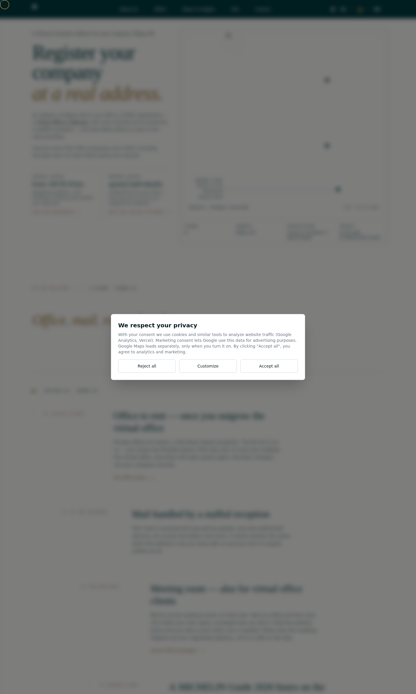
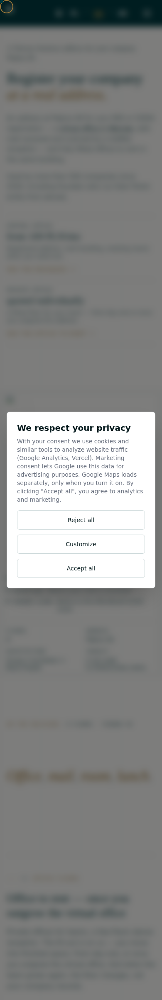

# UI Design System & Master Generation Blueprint: thenest-pl_en

> **The Nest — a registered business address in central Warsaw** (https://thenest.pl/en) — Register your Polish company at Piękna 49 in central Warsaw. Virtual office from 109 PLN/mo net, private offices quoted individually, mai...



---

## 1. Executive Visual Persona & Design Archetype

- **Brand Essence & Persona**: **The Nest — a registered business address in central Warsaw** (`https://thenest.pl/en`). Register your Polish company at Piękna 49 in central Warsaw. Virtual office from 109 PLN/mo net, private offices quoted individually, mai...
- **Visual Archetype**: **Light-Substrate Editorial & Modular Grid System (`#eef0ea` canvas, `#04191c` ink, `#ffe2e2` accent)**.
- **Anti-AI-Slop Differentiators**:
  - **Source-Grounded Chromatic Polarity**: Anchors the viewport in `#eef0ea` (`var(--rd-ivory)` in `:root`) paired with `#04191c` primary typography and `#ffe2e2` accents.
  - **Extracted Typographic Hierarchy**: Pairs `Bodoni Moda` for display copy (`A Warsaw business address for your c`) with `Bodoni Moda Fallback` and `SF Mono`.
  - **Calibrated Spatial Grid & Motion**: Combines `767px` container bounds (`gap: 2px`, padding `1.35rem`) with `cubic-bezier(.23,1,.32,1)` easing.

---

## 2. Spatial Architecture & Modular Grid Mathematics



### Viewport Allocation & Container Geometry
- **Captured Viewport Dimensions**: Desktop `1440×2400px` (`assets/desktop.png`, capped at 2400px multi-section capture), Mobile `390×2400px` (`assets/mobile.png`, capped at 2400px multi-section capture).
- **Master Container Bounds**: `767px` extracted from `thenest-pl_en` stylesheet.
- **Canvas Lateral Padding & Spacing**: `1.35rem` lateral canvas padding with `2px` grid gap.
- **Border Radius Scale**: `999px`, `.25rem`, `var(--radius-2xl)`, `var(--radius-3xl)`.

### Responsive Breakpoint Architecture
- **Desktop Layout**: Multi-column CSS Grid / Flexbox layout at `1440px` (`max-width: 767px`, `gap: 2px`).
- **Mobile Layout**: Single-column vertical stack at `390px` viewport width with `1.35rem` horizontal padding.
- **Extracted CSS Media Queries**: `@media (min-width:40rem)`, `@media (prefers-reduced-motion:reduce)`, `@media (min-width:1024px)`, `@media (min-width:768px)`.

---

## 3. Color System, Materiality & Atmospheric Lighting

### Semantic Palette & Source Grounding
| Semantic Role | Ground-Truth Value | Extracted CSS Source / Selector |
|---|---|---|
| **Primary Canvas Substrate** | `#eef0ea` | `var(--rd-ivory)` in `:root` |
| **Primary Typography Ink** | `#04191c` | `var(--rd-deep)` in `:root` |
| **Elevated Surface / Card Substrate** | `#fef2f2` | `var(--color-red-50)` in `:root` |
| **Interactive Accent / Highlight** | `#ffe2e2` | `var(--color-red-100)` in `:root` |
| **Secondary / Muted Copy** | `#ffa3a3` | `var(--color-red-300)` in `:root` |
| **Structural Hairline Border** | `#ff6568` | `var(--color-red-400)` in `:root` |
| **Variable Token (`--rd-rule`)** | `#003a4024` | `var(--rd-rule)` in `:root` |
| **Variable Token (`--rd-rule-strong`)** | `#003a4047` | `var(--rd-rule-strong)` in `:root` |
| **Variable Token (`--rd-rule-invert`)** | `#e9ebe62e` | `var(--rd-rule-invert)` in `:root` |
| **Variable Token (`--rd-rule-invert-strong`)** | `#e9ebe657` | `var(--rd-rule-invert-strong)` in `:root` |
| **Variable Token (`--rd-ivory-dim`)** | `#eef0ead1` | `var(--rd-ivory-dim)` in `:root` |
| **Variable Token (`--rd-ivory-faint`)** | `#eef0ea99` | `var(--rd-ivory-faint)` in `:root` |
| **Variable Token (`--color-red-500`)** | `#fb2c36` | `var(--color-red-500)` in `:root` |

### Sanitized Root CSS Variables (`ui-ux.md` Ground Truth)
| Variable Name | Extracted Value | Semantic Role |
|---|---|---|
| `--rd-rule` | `#003a4024` | Color / Atmospheric Token |
| `--rd-rule-strong` | `#003a4047` | Color / Atmospheric Token |
| `--rd-rule-invert` | `#e9ebe62e` | Color / Atmospheric Token |
| `--rd-rule-invert-strong` | `#e9ebe657` | Color / Atmospheric Token |
| `--rd-ivory` | `#eef0ea` | Color / Atmospheric Token |
| `--rd-ivory-dim` | `#eef0ead1` | Color / Atmospheric Token |
| `--rd-ivory-faint` | `#eef0ea99` | Color / Atmospheric Token |
| `--rd-deep` | `#04191c` | Color / Atmospheric Token |
| `--rd-container` | `1200px` | Layout / Spatial Grid Token |
| `--font-display` | `"Bodoni Moda", "Bodoni Moda Fallback"` | Typography / Scale Token |
| `--font-serif` | `ui-serif,Georgia,Cambria,"Times New Roman",Times,serif` | Typography / Scale Token |
| `--color-red-50` | `#fef2f2` | Brand / Palette Token |
| `--color-red-100` | `#ffe2e2` | Brand / Palette Token |
| `--color-red-300` | `#ffa3a3` | Brand / Palette Token |
| `--color-red-400` | `#ff6568` | Brand / Palette Token |
| `--color-red-500` | `#fb2c36` | Brand / Palette Token |

---

## 4. Typographic Scale & Editorial Hierarchy

### Font Family Stacks
- **Display Typography**: `Bodoni Moda`.
- **Primary Body Stack**: `Bodoni Moda Fallback`.
- **Technical / Metadata Stack**: `SF Mono`.

### Typographic Scale & Rules (Extracted from Stylesheet & Variables)
- **Hero Display (`H1`)**: CSS variables `--font-display: "Bodoni Moda", "Bodoni Moda Fallback"`, `--text-4xl: 2.25rem`, `--text-4xl--line-height: calc(2.5/2.25)`.
- **Section Heading (`H2`)**: CSS variables `--text-2xl: 1.5rem`, `--text-2xl--line-height: calc(2/1.5)`, `--text-3xl: 1.875rem`.
- **Body Copy**: CSS variables `--text-base: 1rem`, `--text-base--line-height: calc(1.5/1)`.
- **Metadata & Navigation Labels**: CSS variables `--text-xs: .75rem`, `--text-xs--line-height: calc(1/.75)`, `--text-sm: .875rem`.

---

## 5. Choreographed Motion & Interaction Physics

### Primary Easing Curves
- **Extracted Timing Functions**: `cubic-bezier(.23,1,.32,1)`, `cubic-bezier(0,0,.2,1)`, `cubic-bezier(.16,1,.3,1)`.

### Per-Element Transition & Choreography Rules
- **Selector `.rd-underline`**: `transition: background-size .25s cubic-bezier(.23,1,.32,1)` extracted from `thenest-pl_en` stylesheet.
- **Selector `.rd-callout-line`**: `transition: none!important` extracted from `thenest-pl_en` stylesheet.
- **Selector `.rd-callout-label`**: `transition: none!important` extracted from `thenest-pl_en` stylesheet.
- **Extracted Easing Curve (`cubic-bezier(.23,1,.32,1)`)**: Governs interactive state transitions across `<header.fixed>` and `<section.relative>`.
- **State & Hover Choreography**: Opacity and transform transitions on `<section.relative>` and `<section.relative>` interactive targets.

---

## 6. Component Wireframe & Structural DOM Map

### Visual Layout Schematic (Grounded in `dom.html` — `1440px` Desktop & `390px` Mobile Reflow)
```
┌────────────────────────────────────────────────────────────────────────┐
│ DESKTOP VIEWPORT (1440px) — The Nest — a registered business address i │
│ ====================================================================== │
│ [ <header.fixed>           | About Us · Offers · News & Insights ·  ]  │
│ ---------------------------------------------------------------------- │
│ | HERO STAGE: <section.relative>                                   |   │
│ | H1: A Warsaw business address for your company. Piękn...         |   │
│ | Substrate: #eef0ea    | Ink: #04191c    | Accent: #ffe2e2        |   │
│ ---------------------------------------------------------------------- │
│ | SHOWCASE GRID (<section.relative>        ) max-w: 767px          |   │
│ | +------------------------------+  +------------------------------+ | │
│ | | Register your company at a r |  | Everything under one address | | │
│ | +------------------------------+  +------------------------------+ | │
│ ---------------------------------------------------------------------- │
│ | MOBILE VIEWPORT REFLOW (390px) — Single-Column Stack (gap: 2px   ) | │
│ | [<header.fixed>] -> [<section.relative>] -> [<section.relative>] |   │
│ ---------------------------------------------------------------------- │
│ [ FOOTER (<footer.border-t>     ) | https://thenest.pl/en              │
└────────────────────────────────────────────────────────────────────────┘
```

### Granular DOM Region Breakdown
1. **Brand Header & Navigation Bar (<header.fixed> — `thenest-pl_en`)**:
   - Landmark `<header class="fixed top-0">` hosting `The Nest — a registered business add` navigation (`About Us · Offers · News & Insights · FAQ · Contact`), DOM attributes (`data-scroll-behavior="smooth"`, `data-precedence="next"`, `data-precedence="next"`, `data-precedence="next"`), and stylesheet rule `.rd-serif { font-family:var(--font-display), "Iowan Old Style", Palatino, Georgia, s... }`.
2. **Hero Stage & Focal Lead (<section.relative> — `A Warsaw business address for your`)**:
   - Landmark `<section class="relative overflow-hidden">` presenting display lead `A Warsaw business address for your company. Piękn...` and copy excerpt *"Skip to main content"* over `#eef0ea` canvas and `#04191c` ink.
3. **Primary Showcase & Content Grid (<section.relative> — `Register your company at a real ad`)**:
   - Landmark `<section class="relative overflow-hidden">` rendering section `Register your company at a real address.` with copy *"Register your company"*, asset references (`7665c2bcc9077b83-s.p.3nqaju0iyo2m...`, `cd9c266256ef2177-s.p.0ia0bwd-fjee...`, `thenest-logo-white.svg`, `2qf24jap9hfz0.css`), and grid rule `.rd-rule { border-color:var(--rd-rule) }`.
4. **Interactive Detail & Feature Matrix (<section.relative> — `Everything under one address. Offi`)**:
   - Landmark `<section class="relative overflow-hidden">` framing `Everything under one address. Office , mail , roo...` and `Office to rent — once you outgrow the virtual office` (*"at a real address."*) with `#fef2f2` surface cards, `#ffe2e2` accents, and `.rd-rule-strong { border-color:var(--rd-rule-strong) }`.
5. **Colophon & Global Directory Footer (<footer.border-t> — `https://thenest.pl/en`)**:
   - Landmark `<footer class="border-t border-border">` anchoring `The Nest — a registered business` footer links (`About Us · Offers · News & Insights · FAQ · Contact`), copy *"An address at Piękna 49 for your KRS or CEIDG registration —"*, and `#ff6568` structural dividers.

---

## 7. Master Zero-Shot AI Generation Prompt

```markdown
# Master Zero-Shot Frontend Generation Prompt: thenest-pl_en (The Nest — a registered business address in central Warsaw)

You are a principal frontend architect and design systems engineer. Build a complete, production-ready web application replicating the exact design system, DOM landmarks, typographic hierarchy, color tokens, and motion physics of `thenest-pl_en` (**The Nest — a registered business address in central Warsaw** — `https://thenest.pl/en`).

### 1. Visual Archetype & Anti-AI-Slop Mandates
- **Archetype**: Light-Substrate Editorial & Modular Grid System (`#eef0ea` canvas, `#04191c` ink, `#ffe2e2` accent).
- **Identity & Domain Context**: Register your Polish company at Piękna 49 in central Warsaw. Virtual office from 109 PLN/mo net, private offices quoted individually, mai...
- **Primary Substrate**: `#eef0ea` (`var(--rd-ivory)` in `:root`), **Primary Ink**: `#04191c`, **Accent / Highlight**: `#ffe2e2`.
- **Site-Specific Differentiators**:
  - **Source-Grounded Chromatic Polarity**: Anchors the viewport in `#eef0ea` (`var(--rd-ivory)` in `:root`) paired with `#04191c` primary typography and `#ffe2e2` accents.
  - **Extracted Typographic Hierarchy**: Pairs `Bodoni Moda` for display copy (`A Warsaw business address for your c`) with `Bodoni Moda Fallback` and `SF Mono`.
  - **Calibrated Spatial Grid & Motion**: Combines `767px` container bounds (`gap: 2px`, padding `1.35rem`) with `cubic-bezier(.23,1,.32,1)` easing.

### 2. Ground-Truth CSS Variables (`:root` Token Contract)
Declare and consume these exact custom properties extracted from `thenest-pl_en` in your global stylesheet:

:root {
  /* The Nest — a registered business address in central Warsaw (thenest-pl_en) — Ground-Truth Extracted CSS Variables */
  --rd-rule: #003a4024; /* Color / Atmospheric Token (thenest-pl_en) */
  --rd-rule-strong: #003a4047; /* Color / Atmospheric Token (thenest-pl_en) */
  --rd-rule-invert: #e9ebe62e; /* Color / Atmospheric Token (thenest-pl_en) */
  --rd-rule-invert-strong: #e9ebe657; /* Color / Atmospheric Token (thenest-pl_en) */
  --rd-ivory: #eef0ea; /* Color / Atmospheric Token (thenest-pl_en) */
  --rd-ivory-dim: #eef0ead1; /* Color / Atmospheric Token (thenest-pl_en) */
  --rd-ivory-faint: #eef0ea99; /* Color / Atmospheric Token (thenest-pl_en) */
  --rd-deep: #04191c; /* Color / Atmospheric Token (thenest-pl_en) */
  --rd-container: 1200px; /* Layout / Spatial Grid Token (thenest-pl_en) */
  --font-display: "Bodoni Moda", "Bodoni Moda Fallback"; /* Typography / Scale Token (thenest-pl_en) */
  --font-serif: ui-serif,Georgia,Cambria,"Times New Roman",Times,serif; /* Typography / Scale Token (thenest-pl_en) */
  --color-red-50: #fef2f2; /* Brand / Palette Token (thenest-pl_en) */
  --color-red-100: #ffe2e2; /* Brand / Palette Token (thenest-pl_en) */
  --color-red-300: #ffa3a3; /* Brand / Palette Token (thenest-pl_en) */
  --color-red-400: #ff6568; /* Brand / Palette Token (thenest-pl_en) */
  --color-red-500: #fb2c36; /* Brand / Palette Token (thenest-pl_en) */
}

### 3. Semantic Color & Materiality Contract
Map every surface, ink, and border strictly to these source-grounded tokens:
- **Primary Canvas Substrate**: `#eef0ea` — grounded in `var(--rd-ivory)` in `:root`
- **Primary Typography Ink**: `#04191c` — grounded in `var(--rd-deep)` in `:root`
- **Elevated Surface / Card Substrate**: `#fef2f2` — grounded in `var(--color-red-50)` in `:root`
- **Interactive Accent / Highlight**: `#ffe2e2` — grounded in `var(--color-red-100)` in `:root`
- **Secondary / Muted Copy**: `#ffa3a3` — grounded in `var(--color-red-300)` in `:root`
- **Structural Hairline Border**: `#ff6568` — grounded in `var(--color-red-400)` in `:root`
- **Variable Token (`--rd-rule`)**: `#003a4024` — grounded in `var(--rd-rule)` in `:root`
- **Variable Token (`--rd-rule-strong`)**: `#003a4047` — grounded in `var(--rd-rule-strong)` in `:root`
- **Variable Token (`--rd-rule-invert`)**: `#e9ebe62e` — grounded in `var(--rd-rule-invert)` in `:root`
- **Variable Token (`--rd-rule-invert-strong`)**: `#e9ebe657` — grounded in `var(--rd-rule-invert-strong)` in `:root`
- **Variable Token (`--rd-ivory-dim`)**: `#eef0ead1` — grounded in `var(--rd-ivory-dim)` in `:root`
- **Variable Token (`--rd-ivory-faint`)**: `#eef0ea99` — grounded in `var(--rd-ivory-faint)` in `:root`
- **Variable Token (`--color-red-500`)**: `#fb2c36` — grounded in `var(--color-red-500)` in `:root`

### 4. Spatial Grid, Container Bounds & Responsive Breakpoints
- **Desktop Viewport Reference**: `1440×2400px` (capped at 2400px multi-section capture, `1440px` standard desktop width).
- **Mobile Viewport Reference**: `390×2400px` (capped at 2400px multi-section capture, `390px` standard mobile width).
- **Container Max-Width**: `767px` extracted from `thenest-pl_en` stylesheet
- **Padding & Gutters**: `1.35rem` lateral canvas padding with `2px` grid gap
- **Desktop Grid**: Multi-column CSS Grid / Flexbox layout at `1440px` (`max-width: 767px`, `gap: 2px`)
- **Mobile Adaptation**: Single-column vertical stack at `390px` viewport width with `1.35rem` horizontal padding
- **Media Queries**: `@media (min-width:40rem)`, `@media (prefers-reduced-motion:reduce)`, `@media (min-width:1024px)`, `@media (min-width:768px)`
- **Corner Radii**: `999px`, `.25rem`, `var(--radius-2xl)`, `var(--radius-3xl)`

### 5. Typography & Editorial Scale Contract
- **Display Font Stack**: `Bodoni Moda`
- **Body Font Stack**: `Bodoni Moda Fallback`
- **Monospace / Technical Font Stack**: `SF Mono`
- **H1 Display Rule**: CSS variables `--font-display: "Bodoni Moda", "Bodoni Moda Fallback"`, `--text-4xl: 2.25rem`, `--text-4xl--line-height: calc(2.5/2.25)`
- **H2 Section Rule**: CSS variables `--text-2xl: 1.5rem`, `--text-2xl--line-height: calc(2/1.5)`, `--text-3xl: 1.875rem`
- **Body Copy Rule**: CSS variables `--text-base: 1rem`, `--text-base--line-height: calc(1.5/1)`
- **Metadata & Index Rule**: CSS variables `--text-xs: .75rem`, `--text-xs--line-height: calc(1/.75)`, `--text-sm: .875rem`

### 6. Component Hierarchy, Verbatim Copy & Real DOM Landmarks
Scaffold `thenest-pl_en` (`The Nest — a registered business address in central Warsaw`) with these exact structural regions, extracted copy, and CSS rules from `dom.html`:
1. **Brand Header & Navigation Bar (<header.fixed> — `thenest-pl_en`)**:
   - DOM & Selectors: Landmark `<header class="fixed top-0">` hosting `The Nest — a registered business add` navigation (`About Us · Offers · News & Insights · FAQ · Contact`), DOM attributes (`data-scroll-behavior="smooth"`, `data-precedence="next"`, `data-precedence="next"`, `data-precedence="next"`), and stylesheet rule `.rd-serif { font-family:var(--font-display), "Iowan Old Style", Palatino, Georgia, s... }`.
   - Responsive Contract: Header `Brand Header & Navigation Bar (<header.fixed> — `thenest-pl_en`)` (`thenest-pl_en`) adapts across `@media (min-width:40rem)`, `@media (prefers-reduced-motion:reduce)`, `@media (min-width:1024px)`, `@media (min-width:768px)` with `cubic-bezier(.23,1,.32,1)`, `cubic-bezier(0,0,.2,1)`, `cubic-bezier(.16,1,.3,1)` transitions and links `About Us · Offers · News & Insights · FAQ · Contact`.
2. **Hero Stage & Focal Lead (<section.relative> — `A Warsaw business address for your`)**:
   - DOM & Selectors: Landmark `<section class="relative overflow-hidden">` presenting display lead `A Warsaw business address for your company. Piękn...` and copy excerpt *"Skip to main content"* over `#eef0ea` canvas and `#04191c` ink.
   - Responsive Contract: Hero stage (`1440×2400px` desktop / `390×2400px` mobile) sets `#eef0ea` background with `#04191c` headline `A Warsaw business address for your company. Piękn...`.
3. **Primary Showcase & Content Grid (<section.relative> — `Register your company at a real ad`)**:
   - DOM & Selectors: Landmark `<section class="relative overflow-hidden">` rendering section `Register your company at a real address.` with copy *"Register your company"*, asset references (`7665c2bcc9077b83-s.p.3nqaju0iyo2m...`, `cd9c266256ef2177-s.p.0ia0bwd-fjee...`, `thenest-logo-white.svg`, `2qf24jap9hfz0.css`), and grid rule `.rd-rule { border-color:var(--rd-rule) }`.
   - Responsive Contract: Showcase grid `Primary Showcase & Content Grid (<section.relative> — `Register your company at a real ad`)` applies Multi-column CSS Grid / Flexbox layout at `1440px` (`max-width: 767px`, `gap: 2px`) on desktop and Single-column vertical stack at `390px` viewport width with `1.35rem` horizontal padding on mobile.
4. **Interactive Detail & Feature Matrix (<section.relative> — `Everything under one address. Offi`)**:
   - DOM & Selectors: Landmark `<section class="relative overflow-hidden">` framing `Everything under one address. Office , mail , roo...` and `Office to rent — once you outgrow the virtual office` (*"at a real address."*) with `#fef2f2` surface cards, `#ffe2e2` accents, and `.rd-rule-strong { border-color:var(--rd-rule-strong) }`.
   - Responsive Contract: Detail module `Interactive Detail & Feature Matrix (<section.relative> — `Everything under one address. Offi`)` uses `999px`, `.25rem`, `var(--radius-2xl)`, `var(--radius-3xl)` radii, `#ffe2e2` highlights, and assets (7665c2bcc9077b83-s.p.3nqaju0iyo2m..., cd9c266256ef2177-s.p.0ia0bwd-fjee..., thenest-logo-white.svg).
5. **Colophon & Global Directory Footer (<footer.border-t> — `https://thenest.pl/en`)**:
   - DOM & Selectors: Landmark `<footer class="border-t border-border">` anchoring `The Nest — a registered business` footer links (`About Us · Offers · News & Insights · FAQ · Contact`), copy *"An address at Piękna 49 for your KRS or CEIDG registration —"*, and `#ff6568` structural dividers.
   - Responsive Contract: Footer `Colophon & Global Directory Footer (<footer.border-t> — `https://thenest.pl/en`)` aligns to `767px` extracted from `thenest-pl_en` stylesheet with `1.35rem` lateral canvas padding with `2px` grid gap and attributes (data-scroll-behavior="smooth", data-precedence="next", data-precedence="next").

#### Verbatim DOM Copy Excerpts (`dom.html`)
- Copy Excerpt 1: *"Skip to main content"*
- Copy Excerpt 2: *"Register your company"*
- Copy Excerpt 3: *"at a real address."*
- Copy Excerpt 4: *"An address at Piękna 49 for your KRS or CEIDG registration — a virtual office in W..."*

### 7. Motion, Extracted Stylesheet Rules & Interaction Choreography
- **Primary Easing Functions**: `cubic-bezier(.23,1,.32,1)`, `cubic-bezier(0,0,.2,1)`, `cubic-bezier(.16,1,.3,1)`
- **Extracted Stylesheet Rules (`thenest-pl_en`)**:
- `.rd-serif { font-family:var(--font-display), "Iowan Old Style", Palatino, Georgia, s... }`
- `.rd-rule { border-color:var(--rd-rule) }`
- `.rd-rule-strong { border-color:var(--rd-rule-strong) }`
- `.rd-grid-backdrop { background-size:8.3333% 100%,100% 240px }`
- `.rd-dim { background:var(--rd-rule);transform-origin:0;height:1px;position:relative }`
- **Per-Selector Transition Rules**:
- **Selector `.rd-underline`**: `transition: background-size .25s cubic-bezier(.23,1,.32,1)` extracted from `thenest-pl_en` stylesheet.
- **Selector `.rd-callout-line`**: `transition: none!important` extracted from `thenest-pl_en` stylesheet.
- **Selector `.rd-callout-label`**: `transition: none!important` extracted from `thenest-pl_en` stylesheet.
- **Extracted Easing Curve (`cubic-bezier(.23,1,.32,1)`)**: Governs interactive state transitions across `<header.fixed>` and `<section.relative>`.
- **State & Hover Choreography**: Opacity and transform transitions on `<section.relative>` and `<section.relative>` interactive targets.

### 8. Technical Deliverables
- Implement in Next.js (App Router) with TypeScript and Tailwind CSS consuming the `:root` custom properties defined above for `thenest-pl_en`.
- Reproduce both the `1440px` desktop architecture and `390px` mobile breakpoint transitions, preserving semantic HTML5 landmarks (`<header>`, `<nav>`, `<main>`, `<section>`, `<footer>`) and `prefers-reduced-motion` accessibility guards.
```
