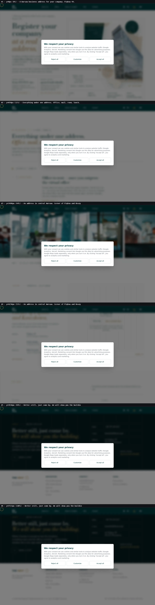
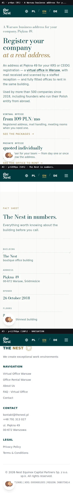

# UI Design System & Master Generation Blueprint: thenest-pl_en

> **The Nest — a registered business address in central Warsaw** (https://thenest.pl/en) — Register your Polish company at Piękna 49 in central Warsaw. Virtual office from 109 PLN/mo net, private offices quoted individually, mai...





---

## 1. Executive Visual Persona & Design Archetype

- **Brand Essence & Persona**: **The Nest — a registered business address in central Warsaw** (`https://thenest.pl/en`). Register your Polish company at Piękna 49 in central Warsaw. Virtual office from 109 PLN/mo net, private offices quoted individually, mai...
- **Capture Provenance**: Live browser capture (`tier1_fast`, HTTP `200`, captured `2026-11-24`).
- **Visual Archetype**: **Light-Substrate Editorial & Modular Grid System (`#ffffff` canvas, `#003a40` ink, `#9b7739` accent)**.
- **Anti-AI-Slop Differentiators**:
  - **Live-Computed Chromatic Polarity**: Anchors the viewport in `#ffffff` (live computed `body` `background-color` (`computed_styles.json`)) paired with `#003a40` primary typography and `#9b7739` accents.
  - **Grounded Typographic Hierarchy**: Pairs `Bodoni Moda` for display copy (`A Warsaw business address for your c`) with `Segoe UI` and `SFMono-Regular`.
  - **Calibrated Spatial Grid & Motion**: Combines `96rem` container bounds (`gap: 2px`, padding `1.35rem`) with `cubic-bezier(.23,1,.32,1)` easing.

---

## 2. Spatial Architecture & Modular Grid Mathematics

### Viewport Allocation & Container Geometry
- **Captured Journey Filmstrips**: Desktop `1280×4968px` (`assets/desktop-journey.webp`, `6` keyframes up to `y=7723px` / doc `8623px`), Mobile `390×2616px` (`assets/mobile-journey.webp`, `3` keyframes).
- **Master Container Bounds**: `96rem` (non-`@media` desktop container stylesheet rule).
- **Canvas Lateral Padding & Spacing**: `1.35rem` lateral canvas padding with `2px` grid gap.
- **Border Radius Scale**: `4px`, `999px`, `.25rem`, `var(--radius-2xl)`.

### Responsive Breakpoint Architecture
- **Desktop Layout**: Multi-column CSS Grid / Flexbox layout at `1440px` (`max-width: 96rem`, `gap: 2px`).
- **Mobile Layout**: Single-column vertical stack at `390px` viewport width with `1.35rem` horizontal padding.
- **Extracted CSS Media Queries**: `@media (min-width:40rem)`, `@media (prefers-reduced-motion:reduce)`, `@media (min-width:1024px)`, `@media (min-width:768px)`.

---

## 3. Color System, Materiality & Atmospheric Lighting

### Semantic Palette & Source Grounding
| Semantic Role | Ground-Truth Value | Extracted Live / CSS Source |
|---|---|---|
| **Primary Canvas Substrate** | `#ffffff` | live computed `body` `background-color` (`computed_styles.json`) |
| **Primary Typography Ink** | `#003a40` | live computed `main` `color` (`computed_styles.json`) |
| **Elevated Surface / Card Substrate** | `#fafaf8` | live computed `section` `background-color` (`computed_styles.json`) |
| **Interactive Accent / Highlight** | `#9b7739` | `var(--brand-gold)` in `:root` |
| **Secondary / Muted Copy** | `#6b7280` | `var(--muted-foreground)` in `:root` |
| **Structural Hairline Border** | `#e5e7eb` | `var(--border)` in `:root` |
| **Variable Token (`--secondary`)** | `#f5f5f5` | `var(--secondary)` in `:root` |

### Sanitized Root CSS Variables (`ui-ux.md` Ground Truth)
| Variable Name | Extracted Value | Semantic Role |
|---|---|---|
| `--brand-teal` | `#003a40` | Brand / Palette Token |
| `--brand-gold` | `#9b7739` | Brand / Palette Token |
| `--brand-white` | `#fff` | Canvas / Surface Token |
| `--background` | `#fff` | Canvas / Surface Token |
| `--foreground` | `#003a40` | Typography Ink Token |
| `--card` | `#fff` | Color / Atmospheric Token |
| `--card-foreground` | `#003a40` | Typography Ink Token |
| `--popover` | `#fff` | Color / Atmospheric Token |
| `--popover-foreground` | `#003a40` | Typography Ink Token |
| `--primary` | `#003a40` | Brand / Palette Token |
| `--primary-foreground` | `#fff` | Typography Ink Token |
| `--secondary` | `#f5f5f5` | Brand / Palette Token |
| `--secondary-foreground` | `#003a40` | Typography Ink Token |
| `--muted` | `#f5f5f5` | Color / Atmospheric Token |
| `--muted-foreground` | `#6b7280` | Typography Ink Token |
| `--accent` | `#9b7739` | Brand / Palette Token |

---

## 4. Typographic Scale & Editorial Hierarchy

### Font Family Stacks
- **Display Typography**: `Bodoni Moda`.
- **Primary Body Stack**: `Segoe UI`.
- **Technical / Metadata Stack**: `SFMono-Regular`.

### Typographic Scale & Rules (Live Computed & Stylesheet Grounded)
- **Hero Display (`H1`)**: live computed `h1` (`font-size: 18.4px`, `line-height: 25.3px`, `font-weight: 400`); CSS variables `--text-4xl: 2.25rem`, `--text-4xl--line-height: calc(2.5/2.25)`, `--text-5xl: 3rem`.
- **Section Heading (`H2`)**: live computed `h2` (`font-size: 68.8px`, `line-height: 67.424px`, `font-weight: 400`, `letter-spacing: -1.376px`); CSS variables `--text-2xl: 1.5rem`, `--text-2xl--line-height: calc(2/1.5)`, `--text-3xl: 1.875rem`.
- **Body Copy**: live computed `body` (`font-size: 16px`, `line-height: 24px`, `font-weight: 400`); CSS variables `--text-base: 1rem`, `--text-base--line-height: calc(1.5/1)`.
- **Metadata & Navigation Labels**: live computed `nav/a` (`font-size: 16px`, `line-height: 24px`, `font-weight: 400`); CSS variables `--text-xs: .75rem`, `--text-xs--line-height: calc(1/.75)`, `--text-sm: .875rem`.

---

## 5. Choreographed Motion & Interaction Physics

### Primary Easing Curves
- **Extracted Timing Functions**: `cubic-bezier(.23,1,.32,1)`, `cubic-bezier(0,0,.2,1)`, `cubic-bezier(.16,1,.3,1)`.

### Per-Element Transition & Choreography Rules
- **Selector `.rd-underline`**: `transition: background-size .25s cubic-bezier(.23,1,.32,1)` extracted from `thenest-pl_en` stylesheet.
- **Selector `.rd-callout-line`**: `transition: none!important` extracted from `thenest-pl_en` stylesheet.
- **Selector `.rd-callout-label`**: `transition: none!important` extracted from `thenest-pl_en` stylesheet.
- **Extracted Easing Curve (`cubic-bezier(.23,1,.32,1)`)**: Governs interactive state transitions across `<header.top-0>` and `<section.text-teal>`.
- **State & Hover Choreography**: Opacity and transform transitions on `<section.bg-cream>` and `<section.text-teal>` interactive targets.
### Measured Runtime Scroll & Interaction Telemetry (`behavioral_journey_v2`)
- **Scroll Driver Mode**: `native` (max document height `8623px`, deepest scrollY reached `7723px` across `6` desktop keyframes).
- **Detected Scroll / Motion Libraries**: `Lenis`.
- **Hover Physics (`primary_cta` · `About Us`)**: Computed transition `0.2s` / `cubic-bezier(0.4, 0, 0.2, 1)` (no static color/transform shift captured at rest).
- **Hover Physics (`first_card` · `VIRTUAL OFFICE from 109 PLN/mo Re...`)**: Computed transition `0.15s` / `cubic-bezier(0.4, 0, 0.2, 1)` (no static color/transform shift captured at rest).
- **Interactive Control Probe (`accordion`)**: Tested `Is a virtual office legal?` (diff `1.344`).
- **Route Transition Architecture**: First internal navigation (`/news`) measured as `direct` in `544ms`.

---

## 6. Component Wireframe & Structural DOM Map

### Visual Layout Schematic — Desktop (`1440px`, Grounded in `dom.html` & Landmark Bounding Boxes)
```
┌────────────────────────────────────────────────────────────────────────┐
│ DESKTOP VIEWPORT (1440px) — The Nest — a registered business address i │
│ ====================================================================== │
│ [ <header.top-0> (1440x64px)          | About Us · Offers · News & I ] │
│ ---------------------------------------------------------------------- │
│ | HERO STAGE: <section.bg-cream> (w=1440px)                          | │
│ | H1: A Warsaw business address for your company. Piękn...           | │
│ | Substrate: #ffffff | Ink: #003a40 | Accent: #9b7739                | │
│ ---------------------------------------------------------------------- │
│ | SHOWCASE GRID (<section.text-teal>) max-w: 96rem                   | │
│ | +------------------------------+  +------------------------------+ | │
│ | | Register your company at a r |  | Everything under one address | | │
│ | +------------------------------+  +------------------------------+ | │
│ ---------------------------------------------------------------------- │
│ | DETAIL MODULE (<section.relative>) — Office to rent — once         | │
│ ---------------------------------------------------------------------- │
│ [ FOOTER (<footer.border-borde) | https://thenest.pl/en                │
└────────────────────────────────────────────────────────────────────────┘
```

### Visual Layout Schematic — Mobile Reflow (`390px`)
```
┌────────────────────────────────────────────────────────────────────────┐
│ MOBILE VIEWPORT REFLOW (390px) — Single-Column Stack (gap: 2px)        │
│ ====================================================================== │
│ [ HEADER BAR (<header.top-0>          ) | Compact Menu (390px)         │
│ ---------------------------------------------------------------------- │
│ | HERO STAGE (<section.bg-cream>) — 390px Vertical Lead              | │
│ | H1: A Warsaw business address for your company. Piękn...           | │
│ ---------------------------------------------------------------------- │
│ | SHOWCASE STACK (<section.text-teal>) — 1-Col Stack                 | │
│ | [ Item 1: Register your company at a real address.               ] | │
│ | [ Item 2: Everything under one address. Office , mail , roo...   ] | │
│ ---------------------------------------------------------------------- │
│ | DETAIL STACK (<section.relative>) — 1-Col (Office to rent — o)     | │
│ ---------------------------------------------------------------------- │
│ [ FOOTER (<footer.border-borde) | Stacked 390px Colophon               │
└────────────────────────────────────────────────────────────────────────┘
```

### Granular DOM Region Breakdown
1. **Brand Header & Navigation Bar (<header.top-0> — `thenest-pl_en`)**:
   - Landmark `<header class="top-0 left-0">` (`1440x64px`) hosting `The Nest — a registered business add` navigation (`About Us · Offers · News & Insights · FAQ · Contact`), DOM attributes (`data-scroll-behavior="smooth"`, `data-precedence="next"`, `data-precedence="next"`, `data-precedence="next"`), and stylesheet rule `.rd-serif { font-family:var(--font-display), "Iowan Old Style", Palatino, Georgia, s... }`.
2. **Hero Stage & Focal Lead (<section.bg-cream> — `A Warsaw business address for your`)**:
   - Landmark `<section class="bg-cream relative">` presenting display lead `A Warsaw business address for your company. Piękn...` and copy excerpt *"An address at Piękna 49 for your KRS or CEIDG registration — a vi"* over `#ffffff` canvas and `#003a40` ink.
3. **Primary Showcase & Content Grid (<section.text-teal> — `Register your company at a real ad`)**:
   - Landmark `<section class="bg-cream text-teal">` rendering section `Register your company at a real address.` with copy *"Register your company"*, asset references (`7665c2bcc9077b83-s.p.3nqaju0iyo2m...`, `cd9c266256ef2177-s.p.0ia0bwd-fjee...`, `thenest-logo-white.svg`, `2qf24jap9hfz0.css`), and grid rule `.rd-rule { border-color:var(--rd-rule) }`.
4. **Interactive Detail & Feature Matrix (<section.relative> — `Everything under one address. Offi`)**:
   - Landmark `<section class="relative overflow-hidden">` framing `Everything under one address. Office , mail , roo...` and `Office to rent — once you outgrow the virtual office` (*"at a real address."*) with `#fafaf8` surface cards, `#9b7739` accents, and `.rd-rule-strong { border-color:var(--rd-rule-strong) }`.
5. **Colophon & Global Directory Footer (<footer.border-border> — `https://thenest.pl/en`)**:
   - Landmark `<footer class="border-border bg-background">` anchoring `The Nest — a registered business` footer links (`About Us · Offers · News & Insights · FAQ · Contact`), copy *"Used by more than 500 companies since 2018, including founde"*, and `#e5e7eb` structural dividers.
### Full Vertical Scroll Sequence (Desktop `1440×900` Keyframes)
- **Step 01** (`y=0px`, `0%`): Active landmark `A Warsaw business address for your company. Piękn...` · sticky/fixed elements: `2`
- **Step 02** (`y=850px`, `11%`): Active landmark `Everything under one address. Office, mail, room,...` · sticky/fixed elements: `3`
- **Step 03** (`y=3400px`, `44%`): Active landmark `An address in central Warsaw. Corner of Piękna an...` · sticky/fixed elements: `3`
- **Step 04** (`y=4250px`, `55%`): Active landmark `An address in central Warsaw. Corner of Piękna an...` · sticky/fixed elements: `3`
- **Step 05** (`y=7650px`, `99%`): Active landmark `Better still, just come by. We will show you the...` · sticky/fixed elements: `3`
- **Step 06** (`y=7723px`, `100%`): Active landmark `Better still, just come by. We will show you the...` · sticky/fixed elements: `3`

### Multi-Page Internal Route Map
- **Listing Route (`/news`)**: `https://thenest.pl/news` — H1: `News and guides`, scrollHeight `3352px`, transition `direct` (`544ms`)
- **Detail Route (`/offers/virtual-office`)**: `https://thenest.pl/offers/virtual-office` — H1: `A virtual office in Warsaw. An address you can re...`, scrollHeight `11929px`, transition `direct` (`891ms`)
- **About Route (`/about`)**: `https://thenest.pl/about` — H1: `The Nest — a boutique office building where 500+...`, scrollHeight `10133px`, transition `direct` (`1069ms`)

---

## 7. Master Zero-Shot AI Generation Prompt

```markdown
# Master Zero-Shot Frontend Generation Prompt: thenest-pl_en (The Nest — a registered business address in central Warsaw)

You are a principal frontend architect and design systems engineer. Build a complete, production-ready web application replicating the exact design system, DOM landmarks, typographic hierarchy, color tokens, and motion physics of `thenest-pl_en` (**The Nest — a registered business address in central Warsaw** — `https://thenest.pl/en`).

### 1. Visual Archetype & Anti-AI-Slop Mandates
- **Archetype**: Light-Substrate Editorial & Modular Grid System (`#ffffff` canvas, `#003a40` ink, `#9b7739` accent).
- **Identity & Domain Context**: Register your Polish company at Piękna 49 in central Warsaw. Virtual office from 109 PLN/mo net, private offices quoted individually, mai...
- **Primary Substrate**: `#ffffff` (live computed `body` `background-color` (`computed_styles.json`)), **Primary Ink**: `#003a40`, **Accent / Highlight**: `#9b7739`.
- **Site-Specific Differentiators**:
  - **Live-Computed Chromatic Polarity**: Anchors the viewport in `#ffffff` (live computed `body` `background-color` (`computed_styles.json`)) paired with `#003a40` primary typography and `#9b7739` accents.
  - **Grounded Typographic Hierarchy**: Pairs `Bodoni Moda` for display copy (`A Warsaw business address for your c`) with `Segoe UI` and `SFMono-Regular`.
  - **Calibrated Spatial Grid & Motion**: Combines `96rem` container bounds (`gap: 2px`, padding `1.35rem`) with `cubic-bezier(.23,1,.32,1)` easing.

### 2. Ground-Truth CSS Variables (`:root` Token Contract)
Declare and consume these exact custom properties extracted from `thenest-pl_en` in your global stylesheet:

:root {
  /* The Nest — a registered business address in central Warsaw (thenest-pl_en) — Live-Grounded CSS Variables */
  --brand-teal: #003a40; /* Brand / Palette Token (thenest-pl_en) */
  --brand-gold: #9b7739; /* Brand / Palette Token (thenest-pl_en) */
  --brand-white: #fff; /* Canvas / Surface Token (thenest-pl_en) */
  --background: #fff; /* Canvas / Surface Token (thenest-pl_en) */
  --foreground: #003a40; /* Typography Ink Token (thenest-pl_en) */
  --card: #fff; /* Color / Atmospheric Token (thenest-pl_en) */
  --card-foreground: #003a40; /* Typography Ink Token (thenest-pl_en) */
  --popover: #fff; /* Color / Atmospheric Token (thenest-pl_en) */
  --popover-foreground: #003a40; /* Typography Ink Token (thenest-pl_en) */
  --primary: #003a40; /* Brand / Palette Token (thenest-pl_en) */
  --primary-foreground: #fff; /* Typography Ink Token (thenest-pl_en) */
  --secondary: #f5f5f5; /* Brand / Palette Token (thenest-pl_en) */
  --secondary-foreground: #003a40; /* Typography Ink Token (thenest-pl_en) */
  --muted: #f5f5f5; /* Color / Atmospheric Token (thenest-pl_en) */
  --muted-foreground: #6b7280; /* Typography Ink Token (thenest-pl_en) */
  --accent: #9b7739; /* Brand / Palette Token (thenest-pl_en) */
}

### 3. Semantic Color & Materiality Contract
Map every surface, ink, and border strictly to these source-grounded tokens:
- **Primary Canvas Substrate**: `#ffffff` — grounded in live computed `body` `background-color` (`computed_styles.json`)
- **Primary Typography Ink**: `#003a40` — grounded in live computed `main` `color` (`computed_styles.json`)
- **Elevated Surface / Card Substrate**: `#fafaf8` — grounded in live computed `section` `background-color` (`computed_styles.json`)
- **Interactive Accent / Highlight**: `#9b7739` — grounded in `var(--brand-gold)` in `:root`
- **Secondary / Muted Copy**: `#6b7280` — grounded in `var(--muted-foreground)` in `:root`
- **Structural Hairline Border**: `#e5e7eb` — grounded in `var(--border)` in `:root`
- **Variable Token (`--secondary`)**: `#f5f5f5` — grounded in `var(--secondary)` in `:root`

### 4. Spatial Grid, Container Bounds & Responsive Breakpoints
- **Desktop Viewport Reference**: `1280×4968px` (multi-frame vertical journey filmstrip (4968px), `1440px` standard desktop width).
- **Mobile Viewport Reference**: `390×2616px` (multi-frame vertical journey filmstrip (2616px), `390px` standard mobile width).
- **Container Max-Width**: `96rem` (non-`@media` desktop container stylesheet rule)
- **Padding & Gutters**: `1.35rem` lateral canvas padding with `2px` grid gap
- **Desktop Grid**: Multi-column CSS Grid / Flexbox layout at `1440px` (`max-width: 96rem`, `gap: 2px`)
- **Mobile Adaptation**: Single-column vertical stack at `390px` viewport width with `1.35rem` horizontal padding
- **Media Queries**: `@media (min-width:40rem)`, `@media (prefers-reduced-motion:reduce)`, `@media (min-width:1024px)`, `@media (min-width:768px)`
- **Corner Radii**: `4px`, `999px`, `.25rem`, `var(--radius-2xl)`

### 5. Typography & Editorial Scale Contract
- **Display Font Stack**: `Bodoni Moda`
- **Body Font Stack**: `Segoe UI`
- **Monospace / Technical Font Stack**: `SFMono-Regular`
- **H1 Display Rule**: live computed `h1` (`font-size: 18.4px`, `line-height: 25.3px`, `font-weight: 400`); CSS variables `--text-4xl: 2.25rem`, `--text-4xl--line-height: calc(2.5/2.25)`, `--text-5xl: 3rem`
- **H2 Section Rule**: live computed `h2` (`font-size: 68.8px`, `line-height: 67.424px`, `font-weight: 400`, `letter-spacing: -1.376px`); CSS variables `--text-2xl: 1.5rem`, `--text-2xl--line-height: calc(2/1.5)`, `--text-3xl: 1.875rem`
- **Body Copy Rule**: live computed `body` (`font-size: 16px`, `line-height: 24px`, `font-weight: 400`); CSS variables `--text-base: 1rem`, `--text-base--line-height: calc(1.5/1)`
- **Metadata & Index Rule**: live computed `nav/a` (`font-size: 16px`, `line-height: 24px`, `font-weight: 400`); CSS variables `--text-xs: .75rem`, `--text-xs--line-height: calc(1/.75)`, `--text-sm: .875rem`

### 6. Component Hierarchy, Verbatim Copy & Real DOM Landmarks
Scaffold `thenest-pl_en` (`The Nest — a registered business address in central Warsaw`) with these exact structural regions, extracted copy, and CSS rules from `dom.html`:
1. **Brand Header & Navigation Bar (<header.top-0> — `thenest-pl_en`)**:
   - DOM & Selectors: Landmark `<header class="top-0 left-0">` (`1440x64px`) hosting `The Nest — a registered business add` navigation (`About Us · Offers · News & Insights · FAQ · Contact`), DOM attributes (`data-scroll-behavior="smooth"`, `data-precedence="next"`, `data-precedence="next"`, `data-precedence="next"`), and stylesheet rule `.rd-serif { font-family:var(--font-display), "Iowan Old Style", Palatino, Georgia, s... }`.
   - Responsive Contract: Header `Brand Header & Navigation Bar (<header.top-0> — `thenest-pl_en`)` (`thenest-pl_en`) adapts across `@media (min-width:40rem)`, `@media (prefers-reduced-motion:reduce)`, `@media (min-width:1024px)`, `@media (min-width:768px)` with `cubic-bezier(.23,1,.32,1)`, `cubic-bezier(0,0,.2,1)`, `cubic-bezier(.16,1,.3,1)` transitions and links `About Us · Offers · News & Insights · FAQ · Contact`.
2. **Hero Stage & Focal Lead (<section.bg-cream> — `A Warsaw business address for your`)**:
   - DOM & Selectors: Landmark `<section class="bg-cream relative">` presenting display lead `A Warsaw business address for your company. Piękn...` and copy excerpt *"An address at Piękna 49 for your KRS or CEIDG registration — a vi"* over `#ffffff` canvas and `#003a40` ink.
   - Responsive Contract: Hero stage (`1280×4968px` desktop / `390×2616px` mobile) sets `#ffffff` background with `#003a40` headline `A Warsaw business address for your company. Piękn...`.
3. **Primary Showcase & Content Grid (<section.text-teal> — `Register your company at a real ad`)**:
   - DOM & Selectors: Landmark `<section class="bg-cream text-teal">` rendering section `Register your company at a real address.` with copy *"Register your company"*, asset references (`7665c2bcc9077b83-s.p.3nqaju0iyo2m...`, `cd9c266256ef2177-s.p.0ia0bwd-fjee...`, `thenest-logo-white.svg`, `2qf24jap9hfz0.css`), and grid rule `.rd-rule { border-color:var(--rd-rule) }`.
   - Responsive Contract: Showcase grid `Primary Showcase & Content Grid (<section.text-teal> — `Register your company at a real ad`)` applies Multi-column CSS Grid / Flexbox layout at `1440px` (`max-width: 96rem`, `gap: 2px`) on desktop and Single-column vertical stack at `390px` viewport width with `1.35rem` horizontal padding on mobile.
4. **Interactive Detail & Feature Matrix (<section.relative> — `Everything under one address. Offi`)**:
   - DOM & Selectors: Landmark `<section class="relative overflow-hidden">` framing `Everything under one address. Office , mail , roo...` and `Office to rent — once you outgrow the virtual office` (*"at a real address."*) with `#fafaf8` surface cards, `#9b7739` accents, and `.rd-rule-strong { border-color:var(--rd-rule-strong) }`.
   - Responsive Contract: Detail module `Interactive Detail & Feature Matrix (<section.relative> — `Everything under one address. Offi`)` uses `4px`, `999px`, `.25rem`, `var(--radius-2xl)` radii, `#9b7739` highlights, and assets (7665c2bcc9077b83-s.p.3nqaju0iyo2m..., cd9c266256ef2177-s.p.0ia0bwd-fjee..., thenest-logo-white.svg).
5. **Colophon & Global Directory Footer (<footer.border-border> — `https://thenest.pl/en`)**:
   - DOM & Selectors: Landmark `<footer class="border-border bg-background">` anchoring `The Nest — a registered business` footer links (`About Us · Offers · News & Insights · FAQ · Contact`), copy *"Used by more than 500 companies since 2018, including founde"*, and `#e5e7eb` structural dividers.
   - Responsive Contract: Footer `Colophon & Global Directory Footer (<footer.border-border> — `https://thenest.pl/en`)` aligns to `96rem` (non-`@media` desktop container stylesheet rule) with `1.35rem` lateral canvas padding with `2px` grid gap and attributes (data-scroll-behavior="smooth", data-precedence="next", data-precedence="next").

#### Verbatim DOM Copy Excerpts (`dom.html`)
- Copy Excerpt 1: *"An address at Piękna 49 for your KRS or CEIDG registration — a virtual office in W..."*
- Copy Excerpt 2: *"Register your company"*
- Copy Excerpt 3: *"at a real address."*
- Copy Excerpt 4: *"Used by more than 500 companies since 2018, including founders who run their Polis..."*

### 7. Motion, Extracted Stylesheet Rules & Interaction Choreography
- **Primary Easing Functions**: `cubic-bezier(.23,1,.32,1)`, `cubic-bezier(0,0,.2,1)`, `cubic-bezier(.16,1,.3,1)`
- **Extracted Stylesheet Rules (`thenest-pl_en`)**:
- `.rd-serif { font-family:var(--font-display), "Iowan Old Style", Palatino, Georgia, s... }`
- `.rd-rule { border-color:var(--rd-rule) }`
- `.rd-rule-strong { border-color:var(--rd-rule-strong) }`
- `.rd-grid-backdrop { background-size:8.3333% 100%,100% 240px }`
- `.rd-dim { background:var(--rd-rule);transform-origin:0;height:1px;position:relative }`
- **Per-Selector Transition Rules**:
- **Selector `.rd-underline`**: `transition: background-size .25s cubic-bezier(.23,1,.32,1)` extracted from `thenest-pl_en` stylesheet.
- **Selector `.rd-callout-line`**: `transition: none!important` extracted from `thenest-pl_en` stylesheet.
- **Selector `.rd-callout-label`**: `transition: none!important` extracted from `thenest-pl_en` stylesheet.
- **Extracted Easing Curve (`cubic-bezier(.23,1,.32,1)`)**: Governs interactive state transitions across `<header.top-0>` and `<section.text-teal>`.
- **State & Hover Choreography**: Opacity and transform transitions on `<section.bg-cream>` and `<section.text-teal>` interactive targets.
### 7b. Full-Page Scroll Choreography, Interactive States & Multi-Page Routes
- **Scroll Mechanics**: Implement `native` vertical progression up to `8623px` across 6 distinct viewport chapters using Lenis.
- **Vertical Chapter Sequence**: A Warsaw business address f... (0%) -> Everything under one addres... (11%) -> An address in central Warsa... (44%) -> An address in central Warsa... (55%) -> Better still, just come by.... (99%) -> Better still, just come by.... (100%).
- **Multi-Page Routes**: Scaffold internal routes `/news` (listing, direct), `/offers/virtual-office` (detail, direct), `/about` (about, direct) sharing the global header/footer shell and design tokens.

### 8. Technical Deliverables
- Implement in Next.js (App Router) with TypeScript and Tailwind CSS consuming the `:root` custom properties defined above for `thenest-pl_en`.
- Reproduce both the `1440px` desktop architecture and `390px` mobile breakpoint transitions, preserving semantic HTML5 landmarks (`<header>`, `<nav>`, `<main>`, `<section>`, `<footer>`) and `prefers-reduced-motion` accessibility guards.
```
---

## 8. Full-Page Scroll Journey, Interactive States & Subpage Inventory

### Desktop Scroll Keyframes (`1440×900` WebP)
| Step | Scroll Y | Progress | Active Landmark / Section | Sticky/Fixed | Visual Asset |
| :---: | :---: | :---: | :--- | :---: | :--- |
| `#01` | `0px` | `0%` | A Warsaw business address for your company. P... | `2` | [desktop-step-01.webp](assets/desktop-step-01.webp) |
| `#02` | `850px` | `11%` | Everything under one address. Office, mail, r... | `3` | [desktop-step-02.webp](assets/desktop-step-02.webp) |
| `#03` | `3400px` | `44%` | An address in central Warsaw. Corner of Piękn... | `3` | [desktop-step-03.webp](assets/desktop-step-03.webp) |
| `#04` | `4250px` | `55%` | An address in central Warsaw. Corner of Piękn... | `3` | [desktop-step-04.webp](assets/desktop-step-04.webp) |
| `#05` | `7650px` | `99%` | Better still, just come by. We will show you... | `3` | [desktop-step-05.webp](assets/desktop-step-05.webp) |
| `#06` | `7723px` | `100%` | Better still, just come by. We will show you... | `3` | [desktop-step-06.webp](assets/desktop-step-06.webp) |

### Mobile Condensed Keyframes (`390×844` WebP)
| Step | Scroll Y | Progress | Active Landmark | Visual Asset |
| :---: | :---: | :---: | :--- | :--- |
| `#01` | `0px` | `0%` | A Warsaw business address for your compan... | [mobile-step-01.webp](assets/mobile-step-01.webp) |
| `#02` | `5899px` | `50%` | The Nest in numbers. | [mobile-step-02.webp](assets/mobile-step-02.webp) |
| `#03` | `11798px` | `100%` | NAVIGATION | [mobile-step-03.webp](assets/mobile-step-03.webp) |

### Internal Subpage Filmstrips (`1080px` Wide WebP)
| # | Template | Route URL | H1 / Title | Scroll Height | Transition | Filmstrip Asset |
| :-: | :---: | :--- | :--- | :---: | :---: | :--- |
| `1` | `listing` | `https://thenest.pl/news` | News and guides | `3352px` | `direct` (`544ms`) | [subpage-01-news.webp](assets/subpage-01-news.webp) |
| `2` | `detail` | `https://thenest.pl/offers/virtual-office` | A virtual office in Warsaw. An addres... | `11929px` | `direct` (`891ms`) | [subpage-02-offers-virtual-office.webp](assets/subpage-02-offers-virtual-office.webp) |
| `3` | `about` | `https://thenest.pl/about` | The Nest — a boutique office building... | `10133px` | `direct` (`1069ms`) | [subpage-03-about.webp](assets/subpage-03-about.webp) |

