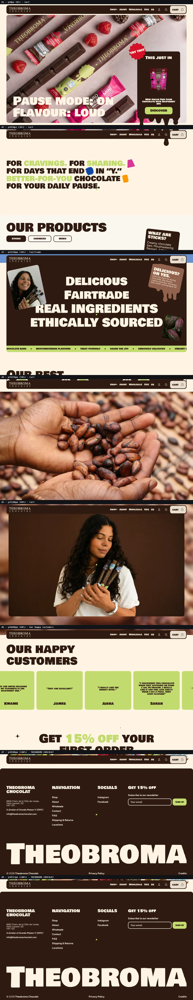
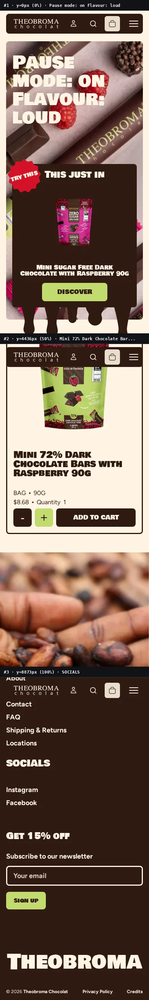

# UI Design System & Master Generation Blueprint: theobromachocolat-com

> **Cure Your Chocolate Craving · Theobroma Chocolate** (https://theobromachocolat.com/) — Shop handcrafted fine chocolate online at Theobroma Chocolate. Premium ingredients, small batch quality, and fast shipping. Order yours t...





---

## 1. Executive Visual Persona & Design Archetype

- **Brand Essence & Persona**: **Cure Your Chocolate Craving · Theobroma Chocolate** (`https://theobromachocolat.com/`). Shop handcrafted fine chocolate online at Theobroma Chocolate. Premium ingredients, small batch quality, and fast shipping. Order yours t...
- **Capture Provenance**: Live browser capture (`tier1_fast`, HTTP `200`, captured `2026-11-24`).
- **Visual Archetype**: **Light-Gallery WebGL / Canvas Interactive Experience (`#fff4e3` / `#ff0000`)**.
- **Anti-AI-Slop Differentiators**:
  - **Live-Computed Chromatic Polarity**: Anchors the viewport in `#fff4e3` (live computed `body` `background-color` (`computed_styles.json`)) paired with `#000000` primary typography and `#ff0000` accents.
  - **Grounded Typographic Hierarchy**: Pairs `Bowlby One SC` for display copy (`Pause mode: on Flavour: loud`) with `Figtree` and `SFMono-Regular`.
  - **Calibrated Spatial Grid & Motion**: Combines `1536px` container bounds (`gap: 16px`, padding `48px`) with `cubic-bezier(.38,.19,.18,1)` easing and Swiper Touch Carousel Engine, Barba.js Page Transition Router.

---

## 2. Spatial Architecture & Modular Grid Mathematics

### Viewport Allocation & Container Geometry
- **Captured Journey Filmstrips**: Desktop `1280×6624px` (`assets/desktop-journey.webp`, `8` keyframes up to `y=8513px` / doc `9413px`), Mobile `390×2616px` (`assets/mobile-journey.webp`, `3` keyframes).
- **Master Container Bounds**: `1536px` (non-`@media` desktop container stylesheet rule).
- **Canvas Lateral Padding & Spacing**: `48px` lateral canvas padding with `16px` grid gap.
- **Border Radius Scale**: `var(--radius)`, `60%`, `var(--style-border-radius-inputs)`, `4px`.

### Responsive Breakpoint Architecture
- **Desktop Layout**: Multi-column CSS Grid / Flexbox layout at `1440px` (`max-width: 1536px`, `gap: 16px`).
- **Mobile Layout**: Single-column vertical stack at `390px` viewport width with `48px` horizontal padding.
- **Extracted CSS Media Queries**: `@media screen and (min-width:769px)`, `@media screen and (max-width:768px)`, `@media screen and (forced-colors:active)`, `@media screen and (width<=750px)`.

---

## 3. Color System, Materiality & Atmospheric Lighting

### Semantic Palette & Source Grounding
| Semantic Role | Ground-Truth Value | Extracted Live / CSS Source |
|---|---|---|
| **Primary Canvas Substrate** | `#fff4e3` | live computed `body` `background-color` (`computed_styles.json`) |
| **Primary Typography Ink** | `#000000` | live computed `button` `color` (`computed_styles.json`) |
| **Elevated Surface / Card Substrate** | `#f6f6f7` | `.welcome { background-color: #f6f6f7 }` |
| **Interactive Accent / Highlight** | `#ff0000` | `ion .hero--product-cta .product... { background-color: red }` (`#ff0000`) |
| **Secondary / Muted Copy** | `#d83594` | `var(--pink)` in `:root` |
| **Structural Hairline Border** | `#ffffff` | `on.loading>.loading-overlay__sp... { stroke: #ffffff }` |
| **Variable Token (`--color-foreground`)** | `#2f1b12` | `var(--color-foreground)` in `:root` |
| **Variable Token (`--tint-green`)** | `#d7f087` | `var(--tint-green)` in `:root` |
| **Variable Token (`--tint-eggshell`)** | `#fdf7ee` | `var(--tint-eggshell)` in `:root` |
| **Variable Token (`--tint-brown`)** | `#452618` | `var(--tint-brown)` in `:root` |
| **Variable Token (`--green`)** | `#c2db6f` | `var(--green)` in `:root` |
| **Variable Token (`--link-green`)** | `#b1cf4e` | `var(--link-green)` in `:root` |
| **Variable Token (`--lbrown`)** | `#91624d` | `var(--lbrown)` in `:root` |

### Sanitized Root CSS Variables (`ui-ux.md` Ground Truth)
| Variable Name | Extracted Value | Semantic Role |
|---|---|---|
| `--font-primary--family` | `"Work Sans", sans-serif` | Brand / Palette Token |
| `--font-primary--style` | `normal` | Brand / Palette Token |
| `--font-primary--weight` | `400` | Brand / Palette Token |
| `--color-background` | `#fff4e3` | Canvas / Surface Token |
| `--color-foreground` | `#2F1B12` | Typography Ink Token |
| `--style-border-radius-inputs` | `4px` | Elevation / Border Token |
| `--tint-green` | `#d7f087` | Canvas / Surface Token |
| `--tint-eggshell` | `#fdf7ee27` | Canvas / Surface Token |
| `--ting-white` | `#fdf7eea1` | Canvas / Surface Token |
| `--tint-brown` | `#45261876` | Canvas / Surface Token |
| `--tint` | `#2f1b1217` | Canvas / Surface Token |
| `--green` | `#c2db6f` | Color / Atmospheric Token |
| `--link-green` | `#b1cf4e` | Typography Ink Token |
| `--eggshell` | `#fff4e3` | Color / Atmospheric Token |
| `--brown` | `#2f1b12` | Color / Atmospheric Token |
| `--lbrown` | `#91624d` | Color / Atmospheric Token |

---

## 4. Typographic Scale & Editorial Hierarchy

### Font Family Stacks
- **Display Typography**: `Bowlby One SC`.
- **Primary Body Stack**: `Figtree`.
- **Technical / Metadata Stack**: `SFMono-Regular`.

### Typographic Scale & Rules (Live Computed & Stylesheet Grounded)
- **Hero Display (`H1`)**: live computed `h1` (`font-size: 86.4px`, `line-height: 86.4px`, `font-weight: 400`); CSS variables `--h1: 6vw`; rule `h1` (`font-size: var(--h1)`).
- **Section Heading (`H2`)**: live computed `h2` (`font-size: 86.4px`, `line-height: 86.4px`, `font-weight: 400`); CSS variables `--h2: 52px`; rule `h2` (`font-size: 1rem`).
- **Body Copy**: live computed `body` (`font-size: 16px`, `line-height: 16px`, `font-weight: 400`); rule `p` (`font-size: var(--h4)`).
- **Metadata & Navigation Labels**: live computed `nav/a` (`font-size: 16px`, `line-height: 16px`, `font-weight: 400`).

---

## 5. Choreographed Motion & Interaction Physics

### Primary Easing Curves
- **Extracted Timing Functions**: `cubic-bezier(.38,.19,.18,1)`, `cubic-bezier(1,0,.8,.2)`, `cubic-bezier(.34,1.56,.64,1)`.

### Per-Element Transition & Choreography Rules
- **Selector `.button .inner`**: `transition: all .6s var(--curve)` extracted from `theobromachocolat-com` stylesheet.
- **Selector `.button:after`**: `transition: scale .6s var(--curve)` extracted from `theobromachocolat-com` stylesheet.
- **Selector `.Accordion .Accordion--tab`**: `transition: max-height .5s var(--gygi-curve)` extracted from `theobromachocolat-com` stylesheet.
- **Extracted Easing Curve (`cubic-bezier(.38,.19,.18,1)`)**: Governs interactive state transitions across `<header.site-header>` and `<div.mouse-follow:nth(2)>`.
- **Runtime Interaction Engine**: Integrates Swiper Touch Carousel Engine, Barba.js Page Transition Router, HTML5 `<canvas>` Interactive Viewport Surface with `prefers-reduced-motion: reduce` fallback guards.
### Measured Runtime Scroll & Interaction Telemetry (`behavioral_journey_v2`)
- **Scroll Driver Mode**: `native` (max document height `9413px`, deepest scrollY reached `8513px` across `8` desktop keyframes).
- **Detected Scroll / Motion Libraries**: `GSAP/ScrollTrigger`, `WebGL/Canvas`.
- **Hover Physics (`primary_cta` · `Sticks ▸`)**: Computed transition `0.6s` / `cubic-bezier(0.38, 0.19, 0.18, 1)` (no static color/transform shift captured at rest).
- **Route Transition Architecture**: First internal navigation (`/collections/sticks`) measured as `direct` in `1704ms`.

---

## 6. Component Wireframe & Structural DOM Map

### Visual Layout Schematic — Desktop (`1440px`, Grounded in `dom.html` & Landmark Bounding Boxes)
```
┌────────────────────────────────────────────────────────────────────────┐
│ DESKTOP VIEWPORT (1440px) — Cure Your Chocolate Craving · Theobroma Ch │
│ ====================================================================== │
│ [ <header.site-header> (1440x80px)    | Sticks ▸ · Chunkies ▸ · Mini ] │
│ ---------------------------------------------------------------------- │
│ | HERO STAGE: <div.mouse-follow> (w=1440px)                          | │
│ | H1: Pause mode: on Flavour: loud                                   | │
│ | Substrate: #fff4e3 | Ink: #000000 | Accent: #ff0000                | │
│ ---------------------------------------------------------------------- │
│ | SHOWCASE GRID (<div.mouse-follow:nth(2)>) max-w: 1536px            | │
│ | +------------------------------+  +------------------------------+ | │
│ | | YOUR CART IS CURRENTLY EMPTY |  | Your cart is currently empty | | │
│ | +------------------------------+  +------------------------------+ | │
│ ---------------------------------------------------------------------- │
│ | DETAIL MODULE (<div.mouse-follow:nth(3)>) — FOR CRAVINGS. FOR SHA  | │
│ ---------------------------------------------------------------------- │
│ [ FOOTER (<footer.full-width> ) | https://theobromachocolat.com/       │
└────────────────────────────────────────────────────────────────────────┘
```

### Visual Layout Schematic — Mobile Reflow (`390px`)
```
┌────────────────────────────────────────────────────────────────────────┐
│ MOBILE VIEWPORT REFLOW (390px) — Single-Column Stack (gap: 16px)       │
│ ====================================================================== │
│ [ HEADER BAR (<header.site-header>    ) | Compact Menu (390px)         │
│ ---------------------------------------------------------------------- │
│ | HERO STAGE (<div.mouse-follow>) — 390px Vertical Lead              | │
│ | H1: Pause mode: on Flavour: loud                                   | │
│ ---------------------------------------------------------------------- │
│ | SHOWCASE STACK (<div.mouse-follow:nth() — 1-Col Stack              | │
│ | [ Item 1: YOUR CART IS CURRENTLY EMPTY.                          ] | │
│ | [ Item 2: Your cart is currently empty.                          ] | │
│ ---------------------------------------------------------------------- │
│ | DETAIL STACK (<div.mouse-follow:nth(3)) — 1-Col (FOR CRAVINGS. FOR ) │
│ ---------------------------------------------------------------------- │
│ [ FOOTER (<footer.full-width> ) | Stacked 390px Colophon               │
└────────────────────────────────────────────────────────────────────────┘
```

### Granular DOM Region Breakdown
1. **Brand Header & Navigation Bar (<header.site-header> — `theobromachocolat-com`)**:
   - Landmark `<header class="site-header">` (`1440x80px`) hosting `Cure Your Chocolate Craving · Theobr` navigation (`Sticks ▸ · Chunkies ▸ · Minis ▸ · View all · Shop▾`), DOM attributes (`data-source-attribution="shopify.exit_intersti..."`, `data-shopify`, `data-source-attribution="shopify.loadfeatures"`, `data-source-attribution="shopify.dynamic_check..."`), and stylesheet rule `button { background-color:transparent;border:none }`.
2. **Hero Stage & Focal Lead (<div.mouse-follow> — `Pause mode: on Flavour: loud`)**:
   - Landmark `<div class="mouse-follow">` presenting display lead `Pause mode: on Flavour: loud` and copy excerpt *"YOUR CART IS CURRENTLY EMPTY."* over `#fff4e3` canvas and `#000000` ink.
3. **Primary Showcase & Content Grid (<div.mouse-follow:nth(2)> — `YOUR CART IS CURRENTLY EMPTY.`)**:
   - Landmark `<div class="mouse-follow">` rendering section `YOUR CART IS CURRENTLY EMPTY.` with copy *"Your cart is currently empty."*, asset references (`fonts.shopifycdn.com`, `fonts.googleapis.com`, `fonts.gstatic.com`, `css2`), and grid rule `.button:hover:after { scale:1.05 }`.
4. **Interactive Detail & Feature Matrix (<div.mouse-follow:nth(3)> — `Your cart is currently empty.`)**:
   - Landmark `<div class="mouse-follow">` framing `Your cart is currently empty.` and `FOR CRAVINGS. FOR SHARING. FOR DAYS THAT END IN ` (*"FOR CRAVINGS. FOR SHARING. FOR DAYS THAT END IN “Y.” BETTER-FOR-Y"*) with `#f6f6f7` surface cards, `#ff0000` accents, and `.Accordion .Accordion--tab-trigger { overflow:hidden }`.
5. **Colophon & Global Directory Footer (<footer.full-width> — `https://theobromachocolat.com/`)**:
   - Landmark `<footer class="full-width full-width-padded">` anchoring `Cure Your Chocolate Craving · Th` footer links (`Sticks ▸ · Chunkies ▸ · Minis ▸ · View all · Shop▾`), copy *"Creamy chocolate bars. Mouthwatering flavours. Just enough f"*, and `#ffffff` structural dividers.
### Full Vertical Scroll Sequence (Desktop `1440×900` Keyframes)
- **Step 01** (`y=0px`, `0%`): Active landmark `Cart` · sticky/fixed elements: `2`
- **Step 02** (`y=850px`, `10%`): Active landmark `Cart` · sticky/fixed elements: `2`
- **Step 03** (`y=2550px`, `30%`): Active landmark `Fairtrade` · sticky/fixed elements: `2`
- **Step 04** (`y=4250px`, `50%`): Active landmark `Cart` · sticky/fixed elements: `2`
- **Step 05** (`y=5100px`, `60%`): Active landmark `Cart` · sticky/fixed elements: `2`
- **Step 06** (`y=6800px`, `80%`): Active landmark `Our happy customers` · sticky/fixed elements: `2`
- **Step 07** (`y=8500px`, `100%`): Active landmark `THEOBROMA CHOCOLAT` · sticky/fixed elements: `2`
- **Step 08** (`y=8513px`, `100%`): Active landmark `THEOBROMA CHOCOLAT` · sticky/fixed elements: `2`

### Multi-Page Internal Route Map
- **Detail Route (`/collections/sticks`)**: `https://theobromachocolat.com/collections/sticks` — H1: `Sticks`, scrollHeight `3884px`, transition `direct` (`1704ms`)
- **Detail Route (`/collections/chunkies`)**: `https://theobromachocolat.com/collections/chunkies` — H1: `Chunkies`, scrollHeight `2515px`, transition `direct` (`1798ms`)
- **Detail Route (`/collections/minis`)**: `https://theobromachocolat.com/collections/minis` — H1: `Minis`, scrollHeight `2516px`, transition `direct` (`963ms`)

---

## 7. Master Zero-Shot AI Generation Prompt

```markdown
# Master Zero-Shot Frontend Generation Prompt: theobromachocolat-com (Cure Your Chocolate Craving · Theobroma Chocolate)

You are a principal frontend architect and design systems engineer. Build a complete, production-ready web application replicating the exact design system, DOM landmarks, typographic hierarchy, color tokens, and motion physics of `theobromachocolat-com` (**Cure Your Chocolate Craving · Theobroma Chocolate** — `https://theobromachocolat.com/`).

### 1. Visual Archetype & Anti-AI-Slop Mandates
- **Archetype**: Light-Gallery WebGL / Canvas Interactive Experience (`#fff4e3` / `#ff0000`).
- **Identity & Domain Context**: Shop handcrafted fine chocolate online at Theobroma Chocolate. Premium ingredients, small batch quality, and fast shipping. Order yours t...
- **Primary Substrate**: `#fff4e3` (live computed `body` `background-color` (`computed_styles.json`)), **Primary Ink**: `#000000`, **Accent / Highlight**: `#ff0000`.
- **Site-Specific Differentiators**:
  - **Live-Computed Chromatic Polarity**: Anchors the viewport in `#fff4e3` (live computed `body` `background-color` (`computed_styles.json`)) paired with `#000000` primary typography and `#ff0000` accents.
  - **Grounded Typographic Hierarchy**: Pairs `Bowlby One SC` for display copy (`Pause mode: on Flavour: loud`) with `Figtree` and `SFMono-Regular`.
  - **Calibrated Spatial Grid & Motion**: Combines `1536px` container bounds (`gap: 16px`, padding `48px`) with `cubic-bezier(.38,.19,.18,1)` easing and Swiper Touch Carousel Engine, Barba.js Page Transition Router.

### 2. Ground-Truth CSS Variables (`:root` Token Contract)
Declare and consume these exact custom properties extracted from `theobromachocolat-com` in your global stylesheet:

:root {
  /* Cure Your Chocolate Craving · Theobroma Chocolate (theobromachocolat-com) — Live-Grounded CSS Variables */
  --font-primary--family: "Work Sans", sans-serif; /* Brand / Palette Token (theobromachocolat-com) */
  --font-primary--style: normal; /* Brand / Palette Token (theobromachocolat-com) */
  --font-primary--weight: 400; /* Brand / Palette Token (theobromachocolat-com) */
  --color-background: #fff4e3; /* Canvas / Surface Token (theobromachocolat-com) */
  --color-foreground: #2F1B12; /* Typography Ink Token (theobromachocolat-com) */
  --style-border-radius-inputs: 4px; /* Elevation / Border Token (theobromachocolat-com) */
  --tint-green: #d7f087; /* Canvas / Surface Token (theobromachocolat-com) */
  --tint-eggshell: #fdf7ee27; /* Canvas / Surface Token (theobromachocolat-com) */
  --ting-white: #fdf7eea1; /* Canvas / Surface Token (theobromachocolat-com) */
  --tint-brown: #45261876; /* Canvas / Surface Token (theobromachocolat-com) */
  --tint: #2f1b1217; /* Canvas / Surface Token (theobromachocolat-com) */
  --green: #c2db6f; /* Color / Atmospheric Token (theobromachocolat-com) */
  --link-green: #b1cf4e; /* Typography Ink Token (theobromachocolat-com) */
  --eggshell: #fff4e3; /* Color / Atmospheric Token (theobromachocolat-com) */
  --brown: #2f1b12; /* Color / Atmospheric Token (theobromachocolat-com) */
  --lbrown: #91624d; /* Color / Atmospheric Token (theobromachocolat-com) */
}

### 3. Semantic Color & Materiality Contract
Map every surface, ink, and border strictly to these source-grounded tokens:
- **Primary Canvas Substrate**: `#fff4e3` — grounded in live computed `body` `background-color` (`computed_styles.json`)
- **Primary Typography Ink**: `#000000` — grounded in live computed `button` `color` (`computed_styles.json`)
- **Elevated Surface / Card Substrate**: `#f6f6f7` — grounded in `.welcome { background-color: #f6f6f7 }`
- **Interactive Accent / Highlight**: `#ff0000` — grounded in `ion .hero--product-cta .product... { background-color: red }` (`#ff0000`)
- **Secondary / Muted Copy**: `#d83594` — grounded in `var(--pink)` in `:root`
- **Structural Hairline Border**: `#ffffff` — grounded in `on.loading>.loading-overlay__sp... { stroke: #ffffff }`
- **Variable Token (`--color-foreground`)**: `#2f1b12` — grounded in `var(--color-foreground)` in `:root`
- **Variable Token (`--tint-green`)**: `#d7f087` — grounded in `var(--tint-green)` in `:root`
- **Variable Token (`--tint-eggshell`)**: `#fdf7ee` — grounded in `var(--tint-eggshell)` in `:root`
- **Variable Token (`--tint-brown`)**: `#452618` — grounded in `var(--tint-brown)` in `:root`
- **Variable Token (`--green`)**: `#c2db6f` — grounded in `var(--green)` in `:root`
- **Variable Token (`--link-green`)**: `#b1cf4e` — grounded in `var(--link-green)` in `:root`
- **Variable Token (`--lbrown`)**: `#91624d` — grounded in `var(--lbrown)` in `:root`

### 4. Spatial Grid, Container Bounds & Responsive Breakpoints
- **Desktop Viewport Reference**: `1280×6624px` (multi-frame vertical journey filmstrip (6624px), `1440px` standard desktop width).
- **Mobile Viewport Reference**: `390×2616px` (multi-frame vertical journey filmstrip (2616px), `390px` standard mobile width).
- **Container Max-Width**: `1536px` (non-`@media` desktop container stylesheet rule)
- **Padding & Gutters**: `48px` lateral canvas padding with `16px` grid gap
- **Desktop Grid**: Multi-column CSS Grid / Flexbox layout at `1440px` (`max-width: 1536px`, `gap: 16px`)
- **Mobile Adaptation**: Single-column vertical stack at `390px` viewport width with `48px` horizontal padding
- **Media Queries**: `@media screen and (min-width:769px)`, `@media screen and (max-width:768px)`, `@media screen and (forced-colors:active)`, `@media screen and (width<=750px)`
- **Corner Radii**: `var(--radius)`, `60%`, `var(--style-border-radius-inputs)`, `4px`

### 5. Typography & Editorial Scale Contract
- **Display Font Stack**: `Bowlby One SC`
- **Body Font Stack**: `Figtree`
- **Monospace / Technical Font Stack**: `SFMono-Regular`
- **H1 Display Rule**: live computed `h1` (`font-size: 86.4px`, `line-height: 86.4px`, `font-weight: 400`); CSS variables `--h1: 6vw`; rule `h1` (`font-size: var(--h1)`)
- **H2 Section Rule**: live computed `h2` (`font-size: 86.4px`, `line-height: 86.4px`, `font-weight: 400`); CSS variables `--h2: 52px`; rule `h2` (`font-size: 1rem`)
- **Body Copy Rule**: live computed `body` (`font-size: 16px`, `line-height: 16px`, `font-weight: 400`); rule `p` (`font-size: var(--h4)`)
- **Metadata & Index Rule**: live computed `nav/a` (`font-size: 16px`, `line-height: 16px`, `font-weight: 400`)

### 6. Component Hierarchy, Verbatim Copy & Real DOM Landmarks
Scaffold `theobromachocolat-com` (`Cure Your Chocolate Craving · Theobroma Chocolate`) with these exact structural regions, extracted copy, and CSS rules from `dom.html`:
1. **Brand Header & Navigation Bar (<header.site-header> — `theobromachocolat-com`)**:
   - DOM & Selectors: Landmark `<header class="site-header">` (`1440x80px`) hosting `Cure Your Chocolate Craving · Theobr` navigation (`Sticks ▸ · Chunkies ▸ · Minis ▸ · View all · Shop▾`), DOM attributes (`data-source-attribution="shopify.exit_intersti..."`, `data-shopify`, `data-source-attribution="shopify.loadfeatures"`, `data-source-attribution="shopify.dynamic_check..."`), and stylesheet rule `button { background-color:transparent;border:none }`.
   - Responsive Contract: Header `Brand Header & Navigation Bar (<header.site-header> — `theobromachocolat-com`)` (`theobromachocolat-com`) adapts across `@media screen and (min-width:769px)`, `@media screen and (max-width:768px)`, `@media screen and (forced-colors:active)`, `@media screen and (width<=750px)` with `cubic-bezier(.38,.19,.18,1)`, `cubic-bezier(1,0,.8,.2)`, `cubic-bezier(.34,1.56,.64,1)` transitions and links `Sticks ▸ · Chunkies ▸ · Minis ▸ · View all · Shop▾`.
2. **Hero Stage & Focal Lead (<div.mouse-follow> — `Pause mode: on Flavour: loud`)**:
   - DOM & Selectors: Landmark `<div class="mouse-follow">` presenting display lead `Pause mode: on Flavour: loud` and copy excerpt *"YOUR CART IS CURRENTLY EMPTY."* over `#fff4e3` canvas and `#000000` ink.
   - Responsive Contract: Hero stage (`1280×6624px` desktop / `390×2616px` mobile) sets `#fff4e3` background with `#000000` headline `Pause mode: on Flavour: loud`.
3. **Primary Showcase & Content Grid (<div.mouse-follow:nth(2)> — `YOUR CART IS CURRENTLY EMPTY.`)**:
   - DOM & Selectors: Landmark `<div class="mouse-follow">` rendering section `YOUR CART IS CURRENTLY EMPTY.` with copy *"Your cart is currently empty."*, asset references (`fonts.shopifycdn.com`, `fonts.googleapis.com`, `fonts.gstatic.com`, `css2`), and grid rule `.button:hover:after { scale:1.05 }`.
   - Responsive Contract: Showcase grid `Primary Showcase & Content Grid (<div.mouse-follow:nth(2)> — `YOUR CART IS CURRENTLY EMPTY.`)` applies Multi-column CSS Grid / Flexbox layout at `1440px` (`max-width: 1536px`, `gap: 16px`) on desktop and Single-column vertical stack at `390px` viewport width with `48px` horizontal padding on mobile.
4. **Interactive Detail & Feature Matrix (<div.mouse-follow:nth(3)> — `Your cart is currently empty.`)**:
   - DOM & Selectors: Landmark `<div class="mouse-follow">` framing `Your cart is currently empty.` and `FOR CRAVINGS. FOR SHARING. FOR DAYS THAT END IN ` (*"FOR CRAVINGS. FOR SHARING. FOR DAYS THAT END IN “Y.” BETTER-FOR-Y"*) with `#f6f6f7` surface cards, `#ff0000` accents, and `.Accordion .Accordion--tab-trigger { overflow:hidden }`.
   - Responsive Contract: Detail module `Interactive Detail & Feature Matrix (<div.mouse-follow:nth(3)> — `Your cart is currently empty.`)` uses `var(--radius)`, `60%`, `var(--style-border-radius-inputs)`, `4px` radii, `#ff0000` highlights, and assets (fonts.shopifycdn.com, fonts.googleapis.com, fonts.gstatic.com).
5. **Colophon & Global Directory Footer (<footer.full-width> — `https://theobromachocolat.com/`)**:
   - DOM & Selectors: Landmark `<footer class="full-width full-width-padded">` anchoring `Cure Your Chocolate Craving · Th` footer links (`Sticks ▸ · Chunkies ▸ · Minis ▸ · View all · Shop▾`), copy *"Creamy chocolate bars. Mouthwatering flavours. Just enough f"*, and `#ffffff` structural dividers.
   - Responsive Contract: Footer `Colophon & Global Directory Footer (<footer.full-width> — `https://theobromachocolat.com/`)` aligns to `1536px` (non-`@media` desktop container stylesheet rule) with `48px` lateral canvas padding with `16px` grid gap and attributes (data-source-attribution="shopify.exit_intersti...", data-shopify, data-source-attribution="shopify.loadfeatures").

#### Verbatim DOM Copy Excerpts (`dom.html`)
- Copy Excerpt 1: *"YOUR CART IS CURRENTLY EMPTY."*
- Copy Excerpt 2: *"Your cart is currently empty."*
- Copy Excerpt 3: *"FOR CRAVINGS. FOR SHARING. FOR DAYS THAT END IN “Y.” BETTER-FOR-YOU CHOCOLATE FOR..."*
- Copy Excerpt 4: *"Creamy chocolate bars. Mouthwatering flavours. Just enough for every day."*

### 7. Motion, Extracted Stylesheet Rules & Interaction Choreography
- **Primary Easing Functions**: `cubic-bezier(.38,.19,.18,1)`, `cubic-bezier(1,0,.8,.2)`, `cubic-bezier(.34,1.56,.64,1)`
- **Extracted Stylesheet Rules (`theobromachocolat-com`)**:
- `button { background-color:transparent;border:none }`
- `.button:hover:after { scale:1.05 }`
- `.Accordion .Accordion--tab-trigger { overflow:hidden }`
- `.Accordion .Accordion--tab { max-height:0;transition:max-height .5s var(--gygi-curve) }`
- `.Accordion .Accordion--tab-content { padding-top:1rem }`
- **Per-Selector Transition Rules**:
- **Selector `.button .inner`**: `transition: all .6s var(--curve)` extracted from `theobromachocolat-com` stylesheet.
- **Selector `.button:after`**: `transition: scale .6s var(--curve)` extracted from `theobromachocolat-com` stylesheet.
- **Selector `.Accordion .Accordion--tab`**: `transition: max-height .5s var(--gygi-curve)` extracted from `theobromachocolat-com` stylesheet.
- **Extracted Easing Curve (`cubic-bezier(.38,.19,.18,1)`)**: Governs interactive state transitions across `<header.site-header>` and `<div.mouse-follow:nth(2)>`.
- **Runtime Interaction Engine**: Integrates Swiper Touch Carousel Engine, Barba.js Page Transition Router, HTML5 `<canvas>` Interactive Viewport Surface with `prefers-reduced-motion: reduce` fallback guards.
### 7b. Full-Page Scroll Choreography, Interactive States & Multi-Page Routes
- **Scroll Mechanics**: Implement `native` vertical progression up to `9413px` across 8 distinct viewport chapters using GSAP/ScrollTrigger, WebGL/Canvas.
- **Vertical Chapter Sequence**: Cart (0%) -> Cart (10%) -> Fairtrade (30%) -> Cart (50%) -> Cart (60%) -> Our happy customers (80%) -> THEOBROMA CHOCOLAT (100%) -> THEOBROMA CHOCOLAT (100%).
- **Multi-Page Routes**: Scaffold internal routes `/collections/sticks` (detail, direct), `/collections/chunkies` (detail, direct), `/collections/minis` (detail, direct) sharing the global header/footer shell and design tokens.

### 8. Technical Deliverables
- Implement in Next.js (App Router) with TypeScript and Tailwind CSS consuming the `:root` custom properties defined above for `theobromachocolat-com`.
- Reproduce both the `1440px` desktop architecture and `390px` mobile breakpoint transitions, preserving semantic HTML5 landmarks (`<header>`, `<nav>`, `<main>`, `<section>`, `<footer>`) and `prefers-reduced-motion` accessibility guards.
```
---

## 8. Full-Page Scroll Journey, Interactive States & Subpage Inventory

### Desktop Scroll Keyframes (`1440×900` WebP)
| Step | Scroll Y | Progress | Active Landmark / Section | Sticky/Fixed | Visual Asset |
| :---: | :---: | :---: | :--- | :---: | :--- |
| `#01` | `0px` | `0%` | Cart | `2` | [desktop-step-01.webp](assets/desktop-step-01.webp) |
| `#02` | `850px` | `10%` | Cart | `2` | [desktop-step-02.webp](assets/desktop-step-02.webp) |
| `#03` | `2550px` | `30%` | Fairtrade | `2` | [desktop-step-03.webp](assets/desktop-step-03.webp) |
| `#04` | `4250px` | `50%` | Cart | `2` | [desktop-step-04.webp](assets/desktop-step-04.webp) |
| `#05` | `5100px` | `60%` | Cart | `2` | [desktop-step-05.webp](assets/desktop-step-05.webp) |
| `#06` | `6800px` | `80%` | Our happy customers | `2` | [desktop-step-06.webp](assets/desktop-step-06.webp) |
| `#07` | `8500px` | `100%` | THEOBROMA CHOCOLAT | `2` | [desktop-step-07.webp](assets/desktop-step-07.webp) |
| `#08` | `8513px` | `100%` | THEOBROMA CHOCOLAT | `2` | [desktop-step-08.webp](assets/desktop-step-08.webp) |

### Mobile Condensed Keyframes (`390×844` WebP)
| Step | Scroll Y | Progress | Active Landmark | Visual Asset |
| :---: | :---: | :---: | :--- | :--- |
| `#01` | `0px` | `0%` | Pause mode: on Flavour: loud | [mobile-step-01.webp](assets/mobile-step-01.webp) |
| `#02` | `4436px` | `50%` | Mini 72% Dark Chocolate Bars with Raspber... | [mobile-step-02.webp](assets/mobile-step-02.webp) |
| `#03` | `8873px` | `100%` | SOCIALS | [mobile-step-03.webp](assets/mobile-step-03.webp) |

### Internal Subpage Filmstrips (`1080px` Wide WebP)
| # | Template | Route URL | H1 / Title | Scroll Height | Transition | Filmstrip Asset |
| :-: | :---: | :--- | :--- | :---: | :---: | :--- |
| `1` | `detail` | `https://theobromachocolat.com/collections/sticks` | Sticks | `3884px` | `direct` (`1704ms`) | [subpage-01-collections-sticks.webp](assets/subpage-01-collections-sticks.webp) |
| `2` | `detail` | `https://theobromachocolat.com/collections/chunkies` | Chunkies | `2515px` | `direct` (`1798ms`) | [subpage-02-collections-chunkies.webp](assets/subpage-02-collections-chunkies.webp) |
| `3` | `detail` | `https://theobromachocolat.com/collections/minis` | Minis | `2516px` | `direct` (`963ms`) | [subpage-03-collections-minis.webp](assets/subpage-03-collections-minis.webp) |

