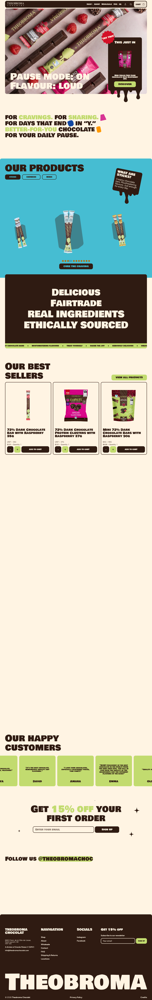
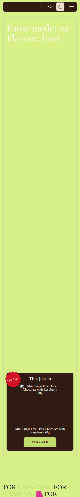

# UI Design System & Master Generation Blueprint: theobromachocolat-com

> **Cure Your Chocolate Craving · Theobroma Chocolate** (https://theobromachocolat.com/) — Shop handcrafted fine chocolate online at Theobroma Chocolate. Premium ingredients, small batch quality, and fast shipping. Order yours t...



---

## 1. Executive Visual Persona & Design Archetype

- **Brand Essence & Persona**: **Cure Your Chocolate Craving · Theobroma Chocolate** (`https://theobromachocolat.com/`). Shop handcrafted fine chocolate online at Theobroma Chocolate. Premium ingredients, small batch quality, and fast shipping. Order yours t...
- **Visual Archetype**: **Light-Gallery WebGL / Canvas Interactive Experience (`#d7f087` / `#fff4e3`)**.
- **Anti-AI-Slop Differentiators**:
  - **Source-Grounded Chromatic Polarity**: Anchors the viewport in `#d7f087` (`var(--tint-green)` in `:root`) paired with `#2f1b12` primary typography and `#fff4e3` accents.
  - **Extracted Typographic Hierarchy**: Pairs `Bowlby One SC` for display copy (`Cart`) with `Figtree` and not declared in static CSS (uses primary stack / `ui-monospace`).
  - **Calibrated Spatial Grid & Motion**: Combines `768px` container bounds (`gap: 1rem`, padding `1rem`) with `cubic-bezier(.38,.19,.18,1)` easing and Swiper Touch Carousel Engine, Barba.js Page Transition Router.

---

## 2. Spatial Architecture & Modular Grid Mathematics



### Viewport Allocation & Container Geometry
- **Captured Viewport Dimensions**: Desktop `1440×9412px` (`assets/desktop.png`, full-page scroll capture), Mobile `390×2400px` (`assets/mobile.png`, capped at 2400px multi-section capture).
- **Master Container Bounds**: `768px` extracted from `theobromachocolat-com` stylesheet.
- **Canvas Lateral Padding & Spacing**: `1rem` lateral canvas padding with `1rem` grid gap.
- **Border Radius Scale**: `4px`, `var(--radius)`, `60%`, `var(--style-border-radius-inputs)`.

### Responsive Breakpoint Architecture
- **Desktop Layout**: Multi-column CSS Grid / Flexbox layout at `1440px` (`max-width: 768px`, `gap: 1rem`).
- **Mobile Layout**: Single-column vertical stack at `390px` viewport width with `1rem` horizontal padding.
- **Extracted CSS Media Queries**: `@media screen and (forced-colors:active)`, `@media screen and (width<=750px)`, `@media screen and (min-width:769px)`, `@media screen and (max-width:768px)`.

---

## 3. Color System, Materiality & Atmospheric Lighting

### Semantic Palette & Source Grounding
| Semantic Role | Ground-Truth Value | Extracted CSS Source / Selector |
|---|---|---|
| **Primary Canvas Substrate** | `#d7f087` | `var(--tint-green)` in `:root` |
| **Primary Typography Ink** | `#c2db6f` | `var(--green)` in `:root` |
| **Elevated Surface / Card Substrate** | `#b1cf4e` | `var(--link-green)` in `:root` |
| **Interactive Accent / Highlight** | `#fff4e3` | `var(--eggshell)` in `:root` |
| **Secondary / Muted Copy** | `#2f1b12` | `var(--brown)` in `:root` |
| **Structural Hairline Border** | `#91624d` | `var(--lbrown)` in `:root` |
| **Variable Token (`--tint-eggshell`)** | `#fdf7ee27` | `var(--tint-eggshell)` in `:root` |
| **Variable Token (`--ting-white`)** | `#fdf7eea1` | `var(--ting-white)` in `:root` |
| **Variable Token (`--tint-brown`)** | `#45261876` | `var(--tint-brown)` in `:root` |
| **Variable Token (`--tint`)** | `#2f1b1217` | `var(--tint)` in `:root` |
| **Variable Token (`--blue`)** | `#1147a2` | `var(--blue)` in `:root` |
| **Variable Token (`--lblue`)** | `#3368c2` | `var(--lblue)` in `:root` |
| **Variable Token (`--orange`)** | `#ff9800` | `var(--orange)` in `:root` |
| **Variable Token (`--pink`)** | `#d83594` | `var(--pink)` in `:root` |
| **Variable Token (`--red`)** | `#d31127` | `var(--red)` in `:root` |
| **Variable Token (`--yellow`)** | `#ffc800` | `var(--yellow)` in `:root` |

### Sanitized Root CSS Variables (`ui-ux.md` Ground Truth)
| Variable Name | Extracted Value | Semantic Role |
|---|---|---|
| `--tint-green` | `#d7f087` | Canvas / Surface Token |
| `--tint-eggshell` | `#fdf7ee27` | Canvas / Surface Token |
| `--ting-white` | `#fdf7eea1` | Canvas / Surface Token |
| `--tint-brown` | `#45261876` | Canvas / Surface Token |
| `--tint` | `#2f1b1217` | Canvas / Surface Token |
| `--green` | `#c2db6f` | Color / Atmospheric Token |
| `--link-green` | `#b1cf4e` | Typography Ink Token |
| `--eggshell` | `#fff4e3` | Color / Atmospheric Token |
| `--brown` | `#2f1b12` | Color / Atmospheric Token |
| `--lbrown` | `#91624d` | Color / Atmospheric Token |
| `--blue` | `#1147a2` | Color / Atmospheric Token |
| `--lblue` | `#3368c2` | Color / Atmospheric Token |
| `--orange` | `#ff9800` | Color / Atmospheric Token |
| `--pink` | `#d83594` | Typography Ink Token |
| `--red` | `#d31127` | Color / Atmospheric Token |
| `--yellow` | `#ffc800` | Color / Atmospheric Token |

---

## 4. Typographic Scale & Editorial Hierarchy

### Font Family Stacks
- **Display Typography**: `Bowlby One SC`.
- **Primary Body Stack**: `Figtree`.
- **Technical / Metadata Stack**: not declared in static CSS (uses primary stack / `ui-monospace`).

### Typographic Scale & Rules (Extracted from Stylesheet & Variables)
- **Hero Display (`H1`)**: CSS variables `--h1: 6vw`; rule `h1` (`font-size: var(--h1)`).
- **Section Heading (`H2`)**: CSS variables `--h2: 52px`; rule `h2` (`font-size: 1rem`).
- **Body Copy**: rule `p` (`font-size: var(--h4)`).
- **Metadata & Navigation Labels**: not explicitly declared on tag in static CSS (stylesheet font-size ladder: `1em`, `var(--h1)`, `var(--h2)`, `var(--h3)`, `var(--h4)`).

---

## 5. Choreographed Motion & Interaction Physics

### Primary Easing Curves
- **Extracted Timing Functions**: `cubic-bezier(.38,.19,.18,1)`.

### Per-Element Transition & Choreography Rules
- **Selector `.shopify-payment-button__button`**: `transition: background .2s ease-in-out` extracted from `theobromachocolat-com` stylesheet.
- **Selector `.button .inner`**: `transition: all .6s var(--curve)` extracted from `theobromachocolat-com` stylesheet.
- **Selector `.button:after`**: `transition: scale .6s var(--curve)` extracted from `theobromachocolat-com` stylesheet.
- **Extracted Easing Curve (`cubic-bezier(.38,.19,.18,1)`)**: Governs interactive state transitions across `<header.site-header>` and `<div.mouse-follow>`.
- **Runtime Interaction Engine**: Integrates Swiper Touch Carousel Engine, Barba.js Page Transition Router, HTML5 `<canvas>` Interactive Viewport Surface with `prefers-reduced-motion: reduce` fallback guards.

---

## 6. Component Wireframe & Structural DOM Map

### Visual Layout Schematic (Grounded in `dom.html` — `1440px` Desktop & `390px` Mobile Reflow)
```
┌────────────────────────────────────────────────────────────────────────┐
│ DESKTOP VIEWPORT (1440px) — Cure Your Chocolate Craving · Theobroma Ch │
│ ====================================================================== │
│ [ <header.site-header>     | Sticks ▸ · Chunkies ▸ · Minis ▸ · View ]  │
│ ---------------------------------------------------------------------- │
│ | HERO STAGE: <div.mouse-follow>                                   |   │
│ | H1: Cart                                                         |   │
│ | Substrate: #d7f087    | Ink: #2f1b12    | Accent: #fff4e3        |   │
│ ---------------------------------------------------------------------- │
│ | SHOWCASE GRID (<div.mouse-follow>        ) max-w: 768px          |   │
│ | +------------------------------+  +------------------------------+ | │
│ | | Pause mode: on Flavour: loud |  | Mini Sugar Free Dark Chocola | | │
│ | +------------------------------+  +------------------------------+ | │
│ ---------------------------------------------------------------------- │
│ | MOBILE VIEWPORT REFLOW (390px) — Single-Column Stack (gap: 1rem  ) | │
│ | [<header.site-heade] -> [<div.mouse-follow>] -> [<div.mouse-follow>] │
│ ---------------------------------------------------------------------- │
│ [ FOOTER (<footer.full-width>   ) | https://theobromachocolat.com/     │
└────────────────────────────────────────────────────────────────────────┘
```

### Granular DOM Region Breakdown
1. **Brand Header & Navigation Bar (<header.site-header> — `theobromachocolat-com`)**:
   - Landmark `<header class="site-header">` hosting `Cure Your Chocolate Craving · Theobr` navigation (`Sticks ▸ · Chunkies ▸ · Minis ▸ · View all · Shop▾`), DOM attributes (`data-source-attribution="shopify.exit_intersti..."`, `data-shopify`, `data-source-attribution="shopify.loadfeatures"`, `data-source-attribution="shopify.dynamic_check..."`), and stylesheet rule `.shopify-payment-button__button--... { visibility:hidden }`.
2. **Hero Stage & Focal Lead (<div.mouse-follow> — `Cart`)**:
   - Landmark `<div class="mouse-follow">` presenting display lead `Cart` and copy excerpt *"Your cart is currently empty."* over `#d7f087` canvas and `#2f1b12` ink.
3. **Primary Showcase & Content Grid (<div.mouse-follow> — `Pause mode: on Flavour: loud`)**:
   - Landmark `<div class="mouse-follow">` rendering section `Pause mode: on Flavour: loud` with copy *"FOR CRAVINGS. FOR SHARING. FOR DAYS THAT END IN “Y.” BETTER-FOR-Y"*, asset references (`fonts.shopifycdn.com`, `fonts.googleapis.com`, `fonts.gstatic.com`, `css2`), and grid rule `opify-payment-button__button--unb... { background-color:1990c6;padding:1em 2em }`.
4. **Interactive Detail & Feature Matrix (<div.mouse-follow> — `Mini Sugar Free Dark Chocolate wit`)**:
   - Landmark `<div class="mouse-follow">` framing `Mini Sugar Free Dark Chocolate with Raspberry 90g` and `OUR PRODUCTS` (*"Creamy chocolate bars. Mouthwatering flavours. Just enough for ev"*) with `#b1cf4e` surface cards, `#fff4e3` accents, and `ptions.shopify-payment-button__sk... { width:50%;margin-left:25%;margin-right:25%;border-radius:4px!important;h... }`.
5. **Colophon & Global Directory Footer (<footer.full-width> — `https://theobromachocolat.com/`)**:
   - Landmark `<footer class="full-width full-width-padded">` anchoring `Cure Your Chocolate Craving · Th` footer links (`Sticks ▸ · Chunkies ▸ · Minis ▸ · View all · Shop▾`), copy *"Clusters with crunch. Chocolate with protein. Built for the "*, and `#91624d` structural dividers.

---

## 7. Master Zero-Shot AI Generation Prompt

```markdown
# Master Zero-Shot Frontend Generation Prompt: theobromachocolat-com (Cure Your Chocolate Craving · Theobroma Chocolate)

You are a principal frontend architect and design systems engineer. Build a complete, production-ready web application replicating the exact design system, DOM landmarks, typographic hierarchy, color tokens, and motion physics of `theobromachocolat-com` (**Cure Your Chocolate Craving · Theobroma Chocolate** — `https://theobromachocolat.com/`).

### 1. Visual Archetype & Anti-AI-Slop Mandates
- **Archetype**: Light-Gallery WebGL / Canvas Interactive Experience (`#d7f087` / `#fff4e3`).
- **Identity & Domain Context**: Shop handcrafted fine chocolate online at Theobroma Chocolate. Premium ingredients, small batch quality, and fast shipping. Order yours t...
- **Primary Substrate**: `#d7f087` (`var(--tint-green)` in `:root`), **Primary Ink**: `#2f1b12`, **Accent / Highlight**: `#fff4e3`.
- **Site-Specific Differentiators**:
  - **Source-Grounded Chromatic Polarity**: Anchors the viewport in `#d7f087` (`var(--tint-green)` in `:root`) paired with `#2f1b12` primary typography and `#fff4e3` accents.
  - **Extracted Typographic Hierarchy**: Pairs `Bowlby One SC` for display copy (`Cart`) with `Figtree` and not declared in static CSS (uses primary stack / `ui-monospace`).
  - **Calibrated Spatial Grid & Motion**: Combines `768px` container bounds (`gap: 1rem`, padding `1rem`) with `cubic-bezier(.38,.19,.18,1)` easing and Swiper Touch Carousel Engine, Barba.js Page Transition Router.

### 2. Ground-Truth CSS Variables (`:root` Token Contract)
Declare and consume these exact custom properties extracted from `theobromachocolat-com` in your global stylesheet:

:root {
  /* Cure Your Chocolate Craving · Theobroma Chocolate (theobromachocolat-com) — Ground-Truth Extracted CSS Variables */
  --tint-green: #d7f087; /* Canvas / Surface Token (theobromachocolat-com) */
  --tint-eggshell: #fdf7ee27; /* Canvas / Surface Token (theobromachocolat-com) */
  --ting-white: #fdf7eea1; /* Canvas / Surface Token (theobromachocolat-com) */
  --tint-brown: #45261876; /* Canvas / Surface Token (theobromachocolat-com) */
  --tint: #2f1b1217; /* Canvas / Surface Token (theobromachocolat-com) */
  --green: #c2db6f; /* Color / Atmospheric Token (theobromachocolat-com) */
  --link-green: #b1cf4e; /* Typography Ink Token (theobromachocolat-com) */
  --eggshell: #fff4e3; /* Color / Atmospheric Token (theobromachocolat-com) */
  --brown: #2f1b12; /* Color / Atmospheric Token (theobromachocolat-com) */
  --lbrown: #91624d; /* Color / Atmospheric Token (theobromachocolat-com) */
  --blue: #1147a2; /* Color / Atmospheric Token (theobromachocolat-com) */
  --lblue: #3368c2; /* Color / Atmospheric Token (theobromachocolat-com) */
  --orange: #ff9800; /* Color / Atmospheric Token (theobromachocolat-com) */
  --pink: #d83594; /* Typography Ink Token (theobromachocolat-com) */
  --red: #d31127; /* Color / Atmospheric Token (theobromachocolat-com) */
  --yellow: #ffc800; /* Color / Atmospheric Token (theobromachocolat-com) */
}

### 3. Semantic Color & Materiality Contract
Map every surface, ink, and border strictly to these source-grounded tokens:
- **Primary Canvas Substrate**: `#d7f087` — grounded in `var(--tint-green)` in `:root`
- **Primary Typography Ink**: `#c2db6f` — grounded in `var(--green)` in `:root`
- **Elevated Surface / Card Substrate**: `#b1cf4e` — grounded in `var(--link-green)` in `:root`
- **Interactive Accent / Highlight**: `#fff4e3` — grounded in `var(--eggshell)` in `:root`
- **Secondary / Muted Copy**: `#2f1b12` — grounded in `var(--brown)` in `:root`
- **Structural Hairline Border**: `#91624d` — grounded in `var(--lbrown)` in `:root`
- **Variable Token (`--tint-eggshell`)**: `#fdf7ee27` — grounded in `var(--tint-eggshell)` in `:root`
- **Variable Token (`--ting-white`)**: `#fdf7eea1` — grounded in `var(--ting-white)` in `:root`
- **Variable Token (`--tint-brown`)**: `#45261876` — grounded in `var(--tint-brown)` in `:root`
- **Variable Token (`--tint`)**: `#2f1b1217` — grounded in `var(--tint)` in `:root`
- **Variable Token (`--blue`)**: `#1147a2` — grounded in `var(--blue)` in `:root`
- **Variable Token (`--lblue`)**: `#3368c2` — grounded in `var(--lblue)` in `:root`
- **Variable Token (`--orange`)**: `#ff9800` — grounded in `var(--orange)` in `:root`
- **Variable Token (`--pink`)**: `#d83594` — grounded in `var(--pink)` in `:root`
- **Variable Token (`--red`)**: `#d31127` — grounded in `var(--red)` in `:root`
- **Variable Token (`--yellow`)**: `#ffc800` — grounded in `var(--yellow)` in `:root`

### 4. Spatial Grid, Container Bounds & Responsive Breakpoints
- **Desktop Viewport Reference**: `1440×9412px` (full-page scroll capture, `1440px` standard desktop width).
- **Mobile Viewport Reference**: `390×2400px` (capped at 2400px multi-section capture, `390px` standard mobile width).
- **Container Max-Width**: `768px` extracted from `theobromachocolat-com` stylesheet
- **Padding & Gutters**: `1rem` lateral canvas padding with `1rem` grid gap
- **Desktop Grid**: Multi-column CSS Grid / Flexbox layout at `1440px` (`max-width: 768px`, `gap: 1rem`)
- **Mobile Adaptation**: Single-column vertical stack at `390px` viewport width with `1rem` horizontal padding
- **Media Queries**: `@media screen and (forced-colors:active)`, `@media screen and (width<=750px)`, `@media screen and (min-width:769px)`, `@media screen and (max-width:768px)`
- **Corner Radii**: `4px`, `var(--radius)`, `60%`, `var(--style-border-radius-inputs)`

### 5. Typography & Editorial Scale Contract
- **Display Font Stack**: `Bowlby One SC`
- **Body Font Stack**: `Figtree`
- **Monospace / Technical Font Stack**: not declared in static CSS (uses primary stack / `ui-monospace`)
- **H1 Display Rule**: CSS variables `--h1: 6vw`; rule `h1` (`font-size: var(--h1)`)
- **H2 Section Rule**: CSS variables `--h2: 52px`; rule `h2` (`font-size: 1rem`)
- **Body Copy Rule**: rule `p` (`font-size: var(--h4)`)
- **Metadata & Index Rule**: not explicitly declared on tag in static CSS (stylesheet font-size ladder: `1em`, `var(--h1)`, `var(--h2)`, `var(--h3)`, `var(--h4)`)

### 6. Component Hierarchy, Verbatim Copy & Real DOM Landmarks
Scaffold `theobromachocolat-com` (`Cure Your Chocolate Craving · Theobroma Chocolate`) with these exact structural regions, extracted copy, and CSS rules from `dom.html`:
1. **Brand Header & Navigation Bar (<header.site-header> — `theobromachocolat-com`)**:
   - DOM & Selectors: Landmark `<header class="site-header">` hosting `Cure Your Chocolate Craving · Theobr` navigation (`Sticks ▸ · Chunkies ▸ · Minis ▸ · View all · Shop▾`), DOM attributes (`data-source-attribution="shopify.exit_intersti..."`, `data-shopify`, `data-source-attribution="shopify.loadfeatures"`, `data-source-attribution="shopify.dynamic_check..."`), and stylesheet rule `.shopify-payment-button__button--... { visibility:hidden }`.
   - Responsive Contract: Header `Brand Header & Navigation Bar (<header.site-header> — `theobromachocolat-com`)` (`theobromachocolat-com`) adapts across `@media screen and (forced-colors:active)`, `@media screen and (width<=750px)`, `@media screen and (min-width:769px)`, `@media screen and (max-width:768px)` with `cubic-bezier(.38,.19,.18,1)` transitions and links `Sticks ▸ · Chunkies ▸ · Minis ▸ · View all · Shop▾`.
2. **Hero Stage & Focal Lead (<div.mouse-follow> — `Cart`)**:
   - DOM & Selectors: Landmark `<div class="mouse-follow">` presenting display lead `Cart` and copy excerpt *"Your cart is currently empty."* over `#d7f087` canvas and `#2f1b12` ink.
   - Responsive Contract: Hero stage (`1440×9412px` desktop / `390×2400px` mobile) sets `#d7f087` background with `#2f1b12` headline `Cart`.
3. **Primary Showcase & Content Grid (<div.mouse-follow> — `Pause mode: on Flavour: loud`)**:
   - DOM & Selectors: Landmark `<div class="mouse-follow">` rendering section `Pause mode: on Flavour: loud` with copy *"FOR CRAVINGS. FOR SHARING. FOR DAYS THAT END IN “Y.” BETTER-FOR-Y"*, asset references (`fonts.shopifycdn.com`, `fonts.googleapis.com`, `fonts.gstatic.com`, `css2`), and grid rule `opify-payment-button__button--unb... { background-color:1990c6;padding:1em 2em }`.
   - Responsive Contract: Showcase grid `Primary Showcase & Content Grid (<div.mouse-follow> — `Pause mode: on Flavour: loud`)` applies Multi-column CSS Grid / Flexbox layout at `1440px` (`max-width: 768px`, `gap: 1rem`) on desktop and Single-column vertical stack at `390px` viewport width with `1rem` horizontal padding on mobile.
4. **Interactive Detail & Feature Matrix (<div.mouse-follow> — `Mini Sugar Free Dark Chocolate wit`)**:
   - DOM & Selectors: Landmark `<div class="mouse-follow">` framing `Mini Sugar Free Dark Chocolate with Raspberry 90g` and `OUR PRODUCTS` (*"Creamy chocolate bars. Mouthwatering flavours. Just enough for ev"*) with `#b1cf4e` surface cards, `#fff4e3` accents, and `ptions.shopify-payment-button__sk... { width:50%;margin-left:25%;margin-right:25%;border-radius:4px!important;h... }`.
   - Responsive Contract: Detail module `Interactive Detail & Feature Matrix (<div.mouse-follow> — `Mini Sugar Free Dark Chocolate wit`)` uses `4px`, `var(--radius)`, `60%`, `var(--style-border-radius-inputs)` radii, `#fff4e3` highlights, and assets (fonts.shopifycdn.com, fonts.googleapis.com, fonts.gstatic.com).
5. **Colophon & Global Directory Footer (<footer.full-width> — `https://theobromachocolat.com/`)**:
   - DOM & Selectors: Landmark `<footer class="full-width full-width-padded">` anchoring `Cure Your Chocolate Craving · Th` footer links (`Sticks ▸ · Chunkies ▸ · Minis ▸ · View all · Shop▾`), copy *"Clusters with crunch. Chocolate with protein. Built for the "*, and `#91624d` structural dividers.
   - Responsive Contract: Footer `Colophon & Global Directory Footer (<footer.full-width> — `https://theobromachocolat.com/`)` aligns to `768px` extracted from `theobromachocolat-com` stylesheet with `1rem` lateral canvas padding with `1rem` grid gap and attributes (data-source-attribution="shopify.exit_intersti...", data-shopify, data-source-attribution="shopify.loadfeatures").

#### Verbatim DOM Copy Excerpts (`dom.html`)
- Copy Excerpt 1: *"Your cart is currently empty."*
- Copy Excerpt 2: *"FOR CRAVINGS. FOR SHARING. FOR DAYS THAT END IN “Y.” BETTER-FOR-YOU CHOCOLATE FOR..."*
- Copy Excerpt 3: *"Creamy chocolate bars. Mouthwatering flavours. Just enough for every day."*
- Copy Excerpt 4: *"Clusters with crunch. Chocolate with protein. Built for the pace of your day."*

### 7. Motion, Extracted Stylesheet Rules & Interaction Choreography
- **Primary Easing Functions**: `cubic-bezier(.38,.19,.18,1)`
- **Extracted Stylesheet Rules (`theobromachocolat-com`)**:
- `.shopify-payment-button__button--... { visibility:hidden }`
- `opify-payment-button__button--unb... { background-color:1990c6;padding:1em 2em }`
- `ptions.shopify-payment-button__sk... { width:50%;margin-left:25%;margin-right:25%;border-radius:4px!important;h... }`
- `shopify-payment-button__button--b... { z-index:1;flex-direction:column;display:flex;position:relative }`
- `on__button--branded .shopify-clea... { flex-direction:column!important;flex:1!important;display:flex!important }`
- **Per-Selector Transition Rules**:
- **Selector `.shopify-payment-button__button`**: `transition: background .2s ease-in-out` extracted from `theobromachocolat-com` stylesheet.
- **Selector `.button .inner`**: `transition: all .6s var(--curve)` extracted from `theobromachocolat-com` stylesheet.
- **Selector `.button:after`**: `transition: scale .6s var(--curve)` extracted from `theobromachocolat-com` stylesheet.
- **Extracted Easing Curve (`cubic-bezier(.38,.19,.18,1)`)**: Governs interactive state transitions across `<header.site-header>` and `<div.mouse-follow>`.
- **Runtime Interaction Engine**: Integrates Swiper Touch Carousel Engine, Barba.js Page Transition Router, HTML5 `<canvas>` Interactive Viewport Surface with `prefers-reduced-motion: reduce` fallback guards.

### 8. Technical Deliverables
- Implement in Next.js (App Router) with TypeScript and Tailwind CSS consuming the `:root` custom properties defined above for `theobromachocolat-com`.
- Reproduce both the `1440px` desktop architecture and `390px` mobile breakpoint transitions, preserving semantic HTML5 landmarks (`<header>`, `<nav>`, `<main>`, `<section>`, `<footer>`) and `prefers-reduced-motion` accessibility guards.
```
