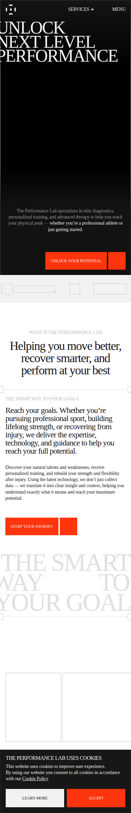

# UI Design System & Master Generation Blueprint: theperformancelab-ca

> **The Performance Lab — Sports Science & Athletic Testing in Toronto** (https://theperformancelab.ca/) — The Performance Lab is a Toronto sports science centre offering 3D motion-capture testing, performance training, and sports therapy — tru...


---

## 1. Executive Visual Persona & Design Archetype

- **Brand Essence & Persona**: **The Performance Lab — Sports Science & Athletic Testing in Toronto** (`https://theperformancelab.ca/`). The Performance Lab is a Toronto sports science centre offering 3D motion-capture testing, performance training, and sports therapy — tru...
- **Visual Archetype**: **High-Contrast Obsidian / Atmospheric Design System (`#000` canvas, `#fff` ink, `#292929` accent)**.
- **Anti-AI-Slop Differentiators**:
  - **Source-Grounded Chromatic Polarity**: Anchors the viewport in `#000` (`var(--color-black)` in `:root`) paired with `#fff` primary typography and `#292929` accents.
  - **Extracted Typographic Hierarchy**: Pairs `display` for display copy (`UNLOCK NEXT LEVEL PERFORMANCE`) with `display Fallback` and `mono`.
  - **Calibrated Spatial Grid & Motion**: Combines `40rem` container bounds (`gap: .5rem`, padding `.625rem`) with `cubic-bezier(.4,0,1,1)` easing and Lenis Smooth Scroll (`data-lenis`).

---

## 2. Spatial Architecture & Modular Grid Mathematics



### Viewport Allocation & Container Geometry
- **Captured Viewport Dimensions**: Desktop `1440×10368px` (`assets/desktop.png`, full-page scroll capture), Mobile `390×2400px` (`assets/mobile.png`, capped at 2400px multi-section capture).
- **Master Container Bounds**: `40rem` extracted from `theperformancelab-ca` stylesheet.
- **Canvas Lateral Padding & Spacing**: `.625rem` lateral canvas padding with `.5rem` grid gap.
- **Border Radius Scale**: `0px` (sharp unrounded corners).

### Responsive Breakpoint Architecture
- **Desktop Layout**: Multi-column CSS Grid / Flexbox layout at `1440px` (`max-width: 40rem`, `gap: .5rem`).
- **Mobile Layout**: Single-column vertical stack at `390px` viewport width with `.625rem` horizontal padding.
- **Extracted CSS Media Queries**: `@media (min-width:40rem)`, `@media (min-width:48rem)`, `@media (min-width:64rem)`, `@media (min-width:80rem)`.

---

## 3. Color System, Materiality & Atmospheric Lighting

### Semantic Palette & Source Grounding
| Semantic Role | Ground-Truth Value | Extracted CSS Source / Selector |
|---|---|---|
| **Primary Canvas Substrate** | `#000` | `var(--color-black)` in `:root` |
| **Primary Typography Ink** | `#fff` | `var(--color-white)` in `:root` |
| **Elevated Surface / Card Substrate** | `#727272` | `var(--color-neutral-grey-01)` in `:root` |
| **Interactive Accent / Highlight** | `#292929` | `var(--color-neutral-grey-03)` in `:root` |
| **Secondary / Muted Copy** | `#0000` | `textarea { background-color: #0000 }` |
| **Structural Hairline Border** | `#ffffff` | `15 { background-color: white }` (`#ffffff`) |

### Sanitized Root CSS Variables (`ui-ux.md` Ground Truth)
| Variable Name | Extracted Value | Semantic Role |
|---|---|---|
| `--font-display-family` | `"display","display Fallback"` | Typography / Scale Token |
| `--font-mono-family` | `"mono","mono Fallback"` | Typography / Scale Token |
| `--font-diatype-family` | `"diatype","diatype Fallback"` | Typography / Scale Token |
| `--font-mono` | `var(--font-mono)` | Typography / Scale Token |
| `--color-black` | `#000` | Canvas / Surface Token |
| `--color-white` | `#fff` | Canvas / Surface Token |
| `--spacing` | `.25rem` | Layout / Spatial Grid Token |
| `--font-weight-normal` | `400` | Typography / Scale Token |
| `--font-weight-medium` | `500` | Typography / Scale Token |
| `--ease-in` | `cubic-bezier(.4,0,1,1)` | Motion / Easing Token |
| `--ease-out` | `cubic-bezier(0,0,.2,1)` | Motion / Easing Token |
| `--ease-in-out` | `cubic-bezier(.4,0,.2,1)` | Motion / Easing Token |
| `--blur-sm` | `8px` | Elevation / Border Token |
| `--default-transition-duration` | `.15s` | Motion / Easing Token |
| `--default-transition-timing-function` | `cubic-bezier(.4,0,.2,1)` | Motion / Easing Token |
| `--default-font-family` | `var(--font-sans)` | Typography / Scale Token |

---

## 4. Typographic Scale & Editorial Hierarchy

### Font Family Stacks
- **Display Typography**: `display`.
- **Primary Body Stack**: `display Fallback`.
- **Technical / Metadata Stack**: `mono`.

### Typographic Scale & Rules (Extracted from Stylesheet & Variables)
- **Hero Display (`H1`)**: CSS variables `--font-display-family: "display","display Fallback"`, `--font-display: var(--font-display)`.
- **Section Heading (`H2`)**: not explicitly declared on tag in static CSS (stylesheet font-size ladder: `1em`, `80%`, `75%`, `.75rem`, `.875rem`).
- **Body Copy**: not explicitly declared on tag in static CSS (stylesheet font-size ladder: `1em`, `80%`, `75%`, `.75rem`, `.875rem`).
- **Metadata & Navigation Labels**: CSS variables `--font-mono-family: "mono","mono Fallback"`, `--font-mono: var(--font-mono)`, `--default-mono-font-family: var(--font-mono)`.

---

## 5. Choreographed Motion & Interaction Physics

### Primary Easing Curves
- **Extracted Timing Functions**: `cubic-bezier(.4,0,1,1)`, `cubic-bezier(0,0,.2,1)`, `cubic-bezier(.4,0,.2,1)`.

### Per-Element Transition & Choreography Rules
- **Selector `layer theme`**: `transition: .15s` extracted from `theperformancelab-ca` stylesheet.
- **Selector `.transition`**: `transition: var(--tw-ease,var(--default-transition-timing-function))` extracted from `theperformancelab-ca` stylesheet.
- **Selector `.transition-\[filter\]`**: `transition: var(--tw-ease,var(--default-transition-timing-function))` extracted from `theperformancelab-ca` stylesheet.
- **Extracted Easing Curve (`cubic-bezier(.4,0,1,1)`)**: Governs interactive state transitions across `<header.fixed>` and `<section.hidden>`.
- **Runtime Interaction Engine**: Integrates Lenis Smooth Scroll (`data-lenis`) with `prefers-reduced-motion: reduce` fallback guards.

---

## 6. Component Wireframe & Structural DOM Map

### Visual Layout Schematic (Grounded in `dom.html` — `1440px` Desktop & `390px` Mobile Reflow)
```
┌────────────────────────────────────────────────────────────────────────┐
│ DESKTOP VIEWPORT (1440px) — The Performance Lab — Sports Science & Ath │
│ ====================================================================== │
│ [ <header.fixed>           | H O M E · W H O W E A R E · B L O G ·  ]  │
│ ---------------------------------------------------------------------- │
│ | HERO STAGE: <section.mx-auto>                                    |   │
│ | H1: UNLOCK NEXT LEVEL PERFORMANCE                                |   │
│ | Substrate: #000       | Ink: #fff       | Accent: #292929        |   │
│ ---------------------------------------------------------------------- │
│ | SHOWCASE GRID (<section.hidden>          ) max-w: 40rem          |   │
│ | +------------------------------+  +------------------------------+ | │
│ | | Helping you move better, rec |  | Reach your goals. Whether yo | | │
│ | +------------------------------+  +------------------------------+ | │
│ ---------------------------------------------------------------------- │
│ | MOBILE VIEWPORT REFLOW (390px) — Single-Column Stack (gap: .5rem ) | │
│ | [<header.fixed>] -> [<section.mx-auto>] -> [<section.hidden>] |      │
│ ---------------------------------------------------------------------- │
│ [ FOOTER (<footer.mx-auto>      ) | https://theperformancelab.ca/      │
└────────────────────────────────────────────────────────────────────────┘
```

### Granular DOM Region Breakdown
1. **Brand Header & Navigation Bar (<header.fixed> — `theperformancelab-ca`)**:
   - Landmark `<header class="fixed inset-x-0">` hosting `The Performance Lab — Sports Science` navigation (`H O M E · W H O W E A R E · B L O G · C O N T A C T`), DOM attributes (`data-precedence="next"`, `data-theme="dark"`, `data-services-open="false"`, `data-scroll-state="false"`), and stylesheet rule `.__className_9dcdb7 { font-family:display,display Fallback }`.
2. **Hero Stage & Focal Lead (<section.mx-auto> — `UNLOCK NEXT LEVEL PERFORMANCE`)**:
   - Landmark `<section class="mx-auto relative">` presenting display lead `UNLOCK NEXT LEVEL PERFORMANCE` and copy excerpt *"B O O K A C O N S U L T A T I O N"* over `#000` canvas and `#fff` ink.
3. **Primary Showcase & Content Grid (<section.hidden> — `Helping you move better, recover s`)**:
   - Landmark `<section class="hidden relative">` rendering section `Helping you move better, recover smarter, and per...` with copy *"Everything your body needs to perform, recover, and last."*, asset references (`desktop.jpg`, `i1.webp`, `i2.webp`, `i3.webp`), and grid rule `.__variable_9dcdb7 { --font-display-family:"display","display Fallback" }`.
4. **Interactive Detail & Feature Matrix (<section.mx-auto> — `Reach your goals. Whether you’re p`)**:
   - Landmark `<section class="mx-auto relative">` framing `Reach your goals. Whether you’re pursuing profess...` and `#1 Sports science centre IN Canada` (*"BOOK A CONSULTATION"*) with `#727272` surface cards, `#292929` accents, and `.__className_ac1fe6 { font-family:mono,mono Fallback;font-weight:400;font-style:normal }`.
5. **Colophon & Global Directory Footer (<footer.mx-auto> — `https://theperformancelab.ca/`)**:
   - Landmark `<footer class="mx-auto flex">` anchoring `The Performance Lab — Sports Sci` footer links (`H O M E · W H O W E A R E · B L O G · C O N T A C T`), copy *"info@myperformancelab.com"*, and `#ffffff` structural dividers.

---

## 7. Master Zero-Shot AI Generation Prompt

```markdown
# Master Zero-Shot Frontend Generation Prompt: theperformancelab-ca (The Performance Lab — Sports Science & Athletic Testing in Toronto)

You are a principal frontend architect and design systems engineer. Build a complete, production-ready web application replicating the exact design system, DOM landmarks, typographic hierarchy, color tokens, and motion physics of `theperformancelab-ca` (**The Performance Lab — Sports Science & Athletic Testing in Toronto** — `https://theperformancelab.ca/`).

### 1. Visual Archetype & Anti-AI-Slop Mandates
- **Archetype**: High-Contrast Obsidian / Atmospheric Design System (`#000` canvas, `#fff` ink, `#292929` accent).
- **Identity & Domain Context**: The Performance Lab is a Toronto sports science centre offering 3D motion-capture testing, performance training, and sports therapy — tru...
- **Primary Substrate**: `#000` (`var(--color-black)` in `:root`), **Primary Ink**: `#fff`, **Accent / Highlight**: `#292929`.
- **Site-Specific Differentiators**:
  - **Source-Grounded Chromatic Polarity**: Anchors the viewport in `#000` (`var(--color-black)` in `:root`) paired with `#fff` primary typography and `#292929` accents.
  - **Extracted Typographic Hierarchy**: Pairs `display` for display copy (`UNLOCK NEXT LEVEL PERFORMANCE`) with `display Fallback` and `mono`.
  - **Calibrated Spatial Grid & Motion**: Combines `40rem` container bounds (`gap: .5rem`, padding `.625rem`) with `cubic-bezier(.4,0,1,1)` easing and Lenis Smooth Scroll (`data-lenis`).

### 2. Ground-Truth CSS Variables (`:root` Token Contract)
Declare and consume these exact custom properties extracted from `theperformancelab-ca` in your global stylesheet:

:root {
  /* The Performance Lab — Sports Science & Athletic Testing in Toronto (theperformancelab-ca) — Ground-Truth Extracted CSS Variables */
  --font-display-family: "display","display Fallback"; /* Typography / Scale Token (theperformancelab-ca) */
  --font-mono-family: "mono","mono Fallback"; /* Typography / Scale Token (theperformancelab-ca) */
  --font-diatype-family: "diatype","diatype Fallback"; /* Typography / Scale Token (theperformancelab-ca) */
  --font-mono: var(--font-mono); /* Typography / Scale Token (theperformancelab-ca) */
  --color-black: #000; /* Canvas / Surface Token (theperformancelab-ca) */
  --color-white: #fff; /* Canvas / Surface Token (theperformancelab-ca) */
  --spacing: .25rem; /* Layout / Spatial Grid Token (theperformancelab-ca) */
  --font-weight-normal: 400; /* Typography / Scale Token (theperformancelab-ca) */
  --font-weight-medium: 500; /* Typography / Scale Token (theperformancelab-ca) */
  --ease-in: cubic-bezier(.4,0,1,1); /* Motion / Easing Token (theperformancelab-ca) */
  --ease-out: cubic-bezier(0,0,.2,1); /* Motion / Easing Token (theperformancelab-ca) */
  --ease-in-out: cubic-bezier(.4,0,.2,1); /* Motion / Easing Token (theperformancelab-ca) */
  --blur-sm: 8px; /* Elevation / Border Token (theperformancelab-ca) */
  --default-transition-duration: .15s; /* Motion / Easing Token (theperformancelab-ca) */
  --default-transition-timing-function: cubic-bezier(.4,0,.2,1); /* Motion / Easing Token (theperformancelab-ca) */
  --default-font-family: var(--font-sans); /* Typography / Scale Token (theperformancelab-ca) */
}

### 3. Semantic Color & Materiality Contract
Map every surface, ink, and border strictly to these source-grounded tokens:
- **Primary Canvas Substrate**: `#000` — grounded in `var(--color-black)` in `:root`
- **Primary Typography Ink**: `#fff` — grounded in `var(--color-white)` in `:root`
- **Elevated Surface / Card Substrate**: `#727272` — grounded in `var(--color-neutral-grey-01)` in `:root`
- **Interactive Accent / Highlight**: `#292929` — grounded in `var(--color-neutral-grey-03)` in `:root`
- **Secondary / Muted Copy**: `#0000` — grounded in `textarea { background-color: #0000 }`
- **Structural Hairline Border**: `#ffffff` — grounded in `15 { background-color: white }` (`#ffffff`)

### 4. Spatial Grid, Container Bounds & Responsive Breakpoints
- **Desktop Viewport Reference**: `1440×10368px` (full-page scroll capture, `1440px` standard desktop width).
- **Mobile Viewport Reference**: `390×2400px` (capped at 2400px multi-section capture, `390px` standard mobile width).
- **Container Max-Width**: `40rem` extracted from `theperformancelab-ca` stylesheet
- **Padding & Gutters**: `.625rem` lateral canvas padding with `.5rem` grid gap
- **Desktop Grid**: Multi-column CSS Grid / Flexbox layout at `1440px` (`max-width: 40rem`, `gap: .5rem`)
- **Mobile Adaptation**: Single-column vertical stack at `390px` viewport width with `.625rem` horizontal padding
- **Media Queries**: `@media (min-width:40rem)`, `@media (min-width:48rem)`, `@media (min-width:64rem)`, `@media (min-width:80rem)`
- **Corner Radii**: `0px` (sharp unrounded corners)

### 5. Typography & Editorial Scale Contract
- **Display Font Stack**: `display`
- **Body Font Stack**: `display Fallback`
- **Monospace / Technical Font Stack**: `mono`
- **H1 Display Rule**: CSS variables `--font-display-family: "display","display Fallback"`, `--font-display: var(--font-display)`
- **H2 Section Rule**: not explicitly declared on tag in static CSS (stylesheet font-size ladder: `1em`, `80%`, `75%`, `.75rem`, `.875rem`)
- **Body Copy Rule**: not explicitly declared on tag in static CSS (stylesheet font-size ladder: `1em`, `80%`, `75%`, `.75rem`, `.875rem`)
- **Metadata & Index Rule**: CSS variables `--font-mono-family: "mono","mono Fallback"`, `--font-mono: var(--font-mono)`, `--default-mono-font-family: var(--font-mono)`

### 6. Component Hierarchy, Verbatim Copy & Real DOM Landmarks
Scaffold `theperformancelab-ca` (`The Performance Lab — Sports Science & Athletic Testing in Toronto`) with these exact structural regions, extracted copy, and CSS rules from `dom.html`:
1. **Brand Header & Navigation Bar (<header.fixed> — `theperformancelab-ca`)**:
   - DOM & Selectors: Landmark `<header class="fixed inset-x-0">` hosting `The Performance Lab — Sports Science` navigation (`H O M E · W H O W E A R E · B L O G · C O N T A C T`), DOM attributes (`data-precedence="next"`, `data-theme="dark"`, `data-services-open="false"`, `data-scroll-state="false"`), and stylesheet rule `.__className_9dcdb7 { font-family:display,display Fallback }`.
   - Responsive Contract: Header `Brand Header & Navigation Bar (<header.fixed> — `theperformancelab-ca`)` (`theperformancelab-ca`) adapts across `@media (min-width:40rem)`, `@media (min-width:48rem)`, `@media (min-width:64rem)`, `@media (min-width:80rem)` with `cubic-bezier(.4,0,1,1)`, `cubic-bezier(0,0,.2,1)`, `cubic-bezier(.4,0,.2,1)` transitions and links `H O M E · W H O W E A R E · B L O G · C O N T A C T`.
2. **Hero Stage & Focal Lead (<section.mx-auto> — `UNLOCK NEXT LEVEL PERFORMANCE`)**:
   - DOM & Selectors: Landmark `<section class="mx-auto relative">` presenting display lead `UNLOCK NEXT LEVEL PERFORMANCE` and copy excerpt *"B O O K A C O N S U L T A T I O N"* over `#000` canvas and `#fff` ink.
   - Responsive Contract: Hero stage (`1440×10368px` desktop / `390×2400px` mobile) sets `#000` background with `#fff` headline `UNLOCK NEXT LEVEL PERFORMANCE`.
3. **Primary Showcase & Content Grid (<section.hidden> — `Helping you move better, recover s`)**:
   - DOM & Selectors: Landmark `<section class="hidden relative">` rendering section `Helping you move better, recover smarter, and per...` with copy *"Everything your body needs to perform, recover, and last."*, asset references (`desktop.jpg`, `i1.webp`, `i2.webp`, `i3.webp`), and grid rule `.__variable_9dcdb7 { --font-display-family:"display","display Fallback" }`.
   - Responsive Contract: Showcase grid `Primary Showcase & Content Grid (<section.hidden> — `Helping you move better, recover s`)` applies Multi-column CSS Grid / Flexbox layout at `1440px` (`max-width: 40rem`, `gap: .5rem`) on desktop and Single-column vertical stack at `390px` viewport width with `.625rem` horizontal padding on mobile.
4. **Interactive Detail & Feature Matrix (<section.mx-auto> — `Reach your goals. Whether you’re p`)**:
   - DOM & Selectors: Landmark `<section class="mx-auto relative">` framing `Reach your goals. Whether you’re pursuing profess...` and `#1 Sports science centre IN Canada` (*"BOOK A CONSULTATION"*) with `#727272` surface cards, `#292929` accents, and `.__className_ac1fe6 { font-family:mono,mono Fallback;font-weight:400;font-style:normal }`.
   - Responsive Contract: Detail module `Interactive Detail & Feature Matrix (<section.mx-auto> — `Reach your goals. Whether you’re p`)` uses `0px` (sharp unrounded corners) radii, `#292929` highlights, and assets (desktop.jpg, i1.webp, i2.webp).
5. **Colophon & Global Directory Footer (<footer.mx-auto> — `https://theperformancelab.ca/`)**:
   - DOM & Selectors: Landmark `<footer class="mx-auto flex">` anchoring `The Performance Lab — Sports Sci` footer links (`H O M E · W H O W E A R E · B L O G · C O N T A C T`), copy *"info@myperformancelab.com"*, and `#ffffff` structural dividers.
   - Responsive Contract: Footer `Colophon & Global Directory Footer (<footer.mx-auto> — `https://theperformancelab.ca/`)` aligns to `40rem` extracted from `theperformancelab-ca` stylesheet with `.625rem` lateral canvas padding with `.5rem` grid gap and attributes (data-precedence="next", data-theme="dark", data-services-open="false").

#### Verbatim DOM Copy Excerpts (`dom.html`)
- Copy Excerpt 1: *"B O O K A C O N S U L T A T I O N"*
- Copy Excerpt 2: *"Everything your body needs to perform, recover, and last."*
- Copy Excerpt 3: *"BOOK A CONSULTATION"*
- Copy Excerpt 4: *"info@myperformancelab.com"*

### 7. Motion, Extracted Stylesheet Rules & Interaction Choreography
- **Primary Easing Functions**: `cubic-bezier(.4,0,1,1)`, `cubic-bezier(0,0,.2,1)`, `cubic-bezier(.4,0,.2,1)`
- **Extracted Stylesheet Rules (`theperformancelab-ca`)**:
- `.__className_9dcdb7 { font-family:display,display Fallback }`
- `.__variable_9dcdb7 { --font-display-family:"display","display Fallback" }`
- `.__className_ac1fe6 { font-family:mono,mono Fallback;font-weight:400;font-style:normal }`
- `.__variable_ac1fe6 { --font-mono-family:"mono","mono Fallback" }`
- `.__className_fdb907 { font-family:diatype,diatype Fallback;font-weight:400;font-style:normal }`
- **Per-Selector Transition Rules**:
- **Selector `layer theme`**: `transition: .15s` extracted from `theperformancelab-ca` stylesheet.
- **Selector `.transition`**: `transition: var(--tw-ease,var(--default-transition-timing-function))` extracted from `theperformancelab-ca` stylesheet.
- **Selector `.transition-\[filter\]`**: `transition: var(--tw-ease,var(--default-transition-timing-function))` extracted from `theperformancelab-ca` stylesheet.
- **Extracted Easing Curve (`cubic-bezier(.4,0,1,1)`)**: Governs interactive state transitions across `<header.fixed>` and `<section.hidden>`.
- **Runtime Interaction Engine**: Integrates Lenis Smooth Scroll (`data-lenis`) with `prefers-reduced-motion: reduce` fallback guards.

### 8. Technical Deliverables
- Implement in Next.js (App Router) with TypeScript and Tailwind CSS consuming the `:root` custom properties defined above for `theperformancelab-ca`.
- Reproduce both the `1440px` desktop architecture and `390px` mobile breakpoint transitions, preserving semantic HTML5 landmarks (`<header>`, `<nav>`, `<main>`, `<section>`, `<footer>`) and `prefers-reduced-motion` accessibility guards.
```
