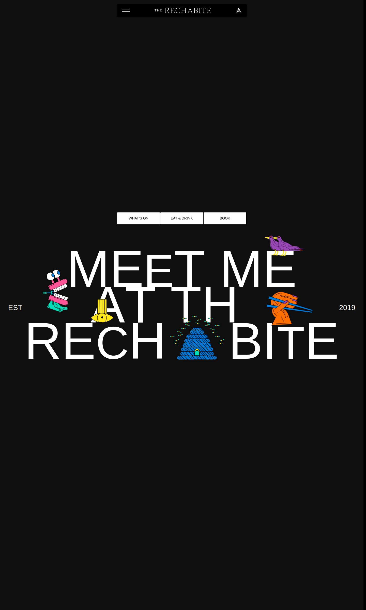
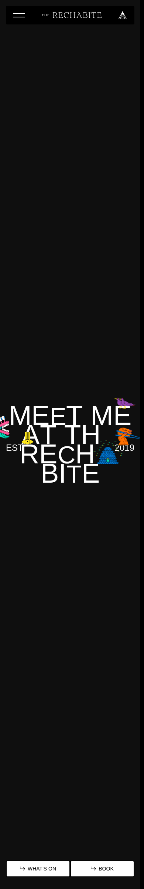

# UI Design System & Master Generation Blueprint: therechabite-com-au

> **The Rechabite • Multi-level Palace of Surprise and Delight** (https://therechabite.com.au/) — M e e t M e A t T h e R e c h a b i t e



---

## 1. Executive Visual Persona & Design Archetype

- **Brand Essence & Persona**: **The Rechabite • Multi-level Palace of Surprise and Delight** (`https://therechabite.com.au/`). M e e t M e A t T h e R e c h a b i t e
- **Visual Archetype**: **High-Contrast Obsidian / Atmospheric Design System (`#000` canvas, `#fff` ink, `#fe2902` accent)**.
- **Anti-AI-Slop Differentiators**:
  - **Source-Grounded Chromatic Polarity**: Anchors the viewport in `#000` (`var(--color-black)` in `:root`) paired with `#fff` primary typography and `#fe2902` accents.
  - **Extracted Typographic Hierarchy**: Pairs `Founders Grotesk Condensed` for display copy (`M e e t M e A t T h e R e c h a b i `) with `Founders Grotesk` and `SFMono-Regular`.
  - **Calibrated Spatial Grid & Motion**: Combines `40rem` container bounds (`gap: var(--spacing)`, padding `var(--spacing)`) with `cubic-bezier(0,0,.2,1)` easing and Lenis Smooth Scroll (`data-lenis`), Three.js / WebGL Canvas Pipeline.

---

## 2. Spatial Architecture & Modular Grid Mathematics



### Viewport Allocation & Container Geometry
- **Captured Viewport Dimensions**: Desktop `1440×2400px` (`assets/desktop.png`, capped at 2400px multi-section capture), Mobile `390×2400px` (`assets/mobile.png`, capped at 2400px multi-section capture).
- **Master Container Bounds**: `40rem` extracted from `therechabite-com-au` stylesheet.
- **Canvas Lateral Padding & Spacing**: `var(--spacing)` lateral canvas padding with `var(--spacing)` grid gap.
- **Border Radius Scale**: `.3125rem`, `.375rem`, `.25rem`, `var(--radius-2xl)`.

### Responsive Breakpoint Architecture
- **Desktop Layout**: Multi-column CSS Grid / Flexbox layout at `1440px` (`max-width: 40rem`, `gap: var(--spacing)`).
- **Mobile Layout**: Single-column vertical stack at `390px` viewport width with `var(--spacing)` horizontal padding.
- **Extracted CSS Media Queries**: `@media (min-width:40rem)`, `@media (min-width:48rem)`, `@media (min-width:64rem)`, `@media (min-width:80rem)`.

---

## 3. Color System, Materiality & Atmospheric Lighting

### Semantic Palette & Source Grounding
| Semantic Role | Ground-Truth Value | Extracted CSS Source / Selector |
|---|---|---|
| **Primary Canvas Substrate** | `#000` | `var(--color-black)` in `:root` |
| **Primary Typography Ink** | `#fff` | `var(--color-white)` in `:root` |
| **Elevated Surface / Card Substrate** | `#0f0f0f` | `var(--color-light-black)` in `:root` |
| **Interactive Accent / Highlight** | `#fe2902` | `var(--color-red-hot)` in `:root` |
| **Secondary / Muted Copy** | `#ff8f5f` | `var(--color-peachy)` in `:root` |
| **Structural Hairline Border** | `#9947b7` | `var(--color-light-purple)` in `:root` |

### Sanitized Root CSS Variables (`ui-ux.md` Ground Truth)
| Variable Name | Extracted Value | Semantic Role |
|---|---|---|
| `--color-gray-200` | `oklch(92.8% .006 264.531)` | Brand / Palette Token |
| `--color-gray-400` | `oklch(70.7% .022 261.325)` | Brand / Palette Token |
| `--color-black` | `#000` | Canvas / Surface Token |
| `--color-white` | `#fff` | Canvas / Surface Token |
| `--spacing` | `.25em` | Layout / Spatial Grid Token |
| `--text-base` | `1rem` | Typography Ink Token |
| `--text-base--line-height` | `calc(1.5 / 1)` | Typography Ink Token |
| `--font-weight-normal` | `400` | Typography / Scale Token |
| `--font-weight-bold` | `700` | Typography / Scale Token |
| `--tracking-tighter` | `-.05em` | Typography / Scale Token |
| `--tracking-normal` | `0em` | Typography / Scale Token |
| `--leading-snug` | `1.375` | Typography / Scale Token |
| `--radius-xs` | `.125rem` | Elevation / Border Token |
| `--radius-sm` | `.25rem` | Elevation / Border Token |
| `--radius-md` | `.375rem` | Elevation / Border Token |
| `--radius-lg` | `.5rem` | Elevation / Border Token |

---

## 4. Typographic Scale & Editorial Hierarchy

### Font Family Stacks
- **Display Typography**: `Founders Grotesk Condensed`.
- **Primary Body Stack**: `Founders Grotesk`.
- **Technical / Metadata Stack**: `SFMono-Regular`.

### Typographic Scale & Rules (Extracted from Stylesheet & Variables)
- **Hero Display (`H1`)**: not explicitly declared on tag in static CSS (stylesheet font-size ladder: `1em`, `80%`, `75%`, `1.25em`, `2.25em`).
- **Section Heading (`H2`)**: rule `h2` (`font-size: max(18px,1.1vw)`, `line-height: 1`, `font-weight: var(--font-we...`).
- **Body Copy**: CSS variables `--text-base: 1rem`, `--text-base--line-height: calc(1.5 / 1)`, `--font-body: "Founders Grotesk", sans-serif`.
- **Metadata & Navigation Labels**: CSS variables `--default-mono-font-family: var(--font-mono)`.

---

## 5. Choreographed Motion & Interaction Physics

### Primary Easing Curves
- **Extracted Timing Functions**: `cubic-bezier(0,0,.2,1)`, `cubic-bezier(.4,0,.2,1)`, `cubic-bezier(.87,0,.13,1)`.

### Per-Element Transition & Choreography Rules
- **Selector `layer theme`**: `transition: .15s` extracted from `therechabite-com-au` stylesheet.
- **Selector `.transition`**: `transition: var(--tw-ease,var(--default-transition-timing-function))` extracted from `therechabite-com-au` stylesheet.
- **Selector `.transition-\[filter\]`**: `transition: var(--tw-ease,var(--default-transition-timing-function))` extracted from `therechabite-com-au` stylesheet.
- **Extracted Easing Curve (`cubic-bezier(0,0,.2,1)`)**: Governs interactive state transitions across `<header.pointer-events-none>` and `<section.relative>`.
- **Runtime Interaction Engine**: Integrates Lenis Smooth Scroll (`data-lenis`), Three.js / WebGL Canvas Pipeline, Barba.js Page Transition Router with `prefers-reduced-motion: reduce` fallback guards.

---

## 6. Component Wireframe & Structural DOM Map

### Visual Layout Schematic (Grounded in `dom.html` — `1440px` Desktop & `390px` Mobile Reflow)
```
┌────────────────────────────────────────────────────────────────────────┐
│ DESKTOP VIEWPORT (1440px) — The Rechabite • Multi-level Palace of Surp │
│ ====================================================================== │
│ [ <header.pointer-events-n | What’s On What’s On · Rechabite Hall · ]  │
│ ---------------------------------------------------------------------- │
│ | HERO STAGE: <section.relative>                                   |   │
│ | H1: M e e t M e A t T h e R e c h a b i t e                      |   │
│ | Substrate: #000       | Ink: #fff       | Accent: #fe2902        |   │
│ ---------------------------------------------------------------------- │
│ | SHOWCASE GRID (<section.relative>        ) max-w: 40rem          |   │
│ | +------------------------------+  +------------------------------+ | │
│ | | WHAT’S ON                    |  | Mike Midnight & Deep Creep ( | | │
│ | +------------------------------+  +------------------------------+ | │
│ ---------------------------------------------------------------------- │
│ | MOBILE VIEWPORT REFLOW (390px) — Single-Column Stack (gap: var(--) | │
│ | [<header.pointer-ev] -> [<section.relative>] -> [<section.relative>] │
│ ---------------------------------------------------------------------- │
│ [ FOOTER (<footer.bg-light-black) | https://therechabite.com.au/       │
└────────────────────────────────────────────────────────────────────────┘
```

### Granular DOM Region Breakdown
1. **Brand Header & Navigation Bar (<header.pointer-events-none> — `therechabite-com-au`)**:
   - Landmark `<header class="pointer-events-none fixed">` hosting `The Rechabite • Multi-level Palace o` navigation (`What’s On What’s On · Rechabite Hall · Hello Rooftop · Double Rainbow · Goodwill Club`), DOM attributes (`data-optimized="1"`, `data-optimized="1"`, `data-optimized="1"`, `data-optimized="1"`), and stylesheet rule `backdrop { box-sizing:border-box;border:0 solid;margin:0;padding:0 }`.
2. **Hero Stage & Focal Lead (<section.relative> — `M e e t M e A t T h e R e c h a b `)**:
   - Landmark `<section class="relative flex">` presenting display lead `M e e t M e A t T h e R e c h a b i t e` and copy excerpt *"What’s On What’s On"* over `#000` canvas and `#fff` ink.
3. **Primary Showcase & Content Grid (<section.relative> — `WHAT’S ON`)**:
   - Landmark `<section class="relative bg-light-black">` rendering section `WHAT’S ON` with copy *"Our Spaces Our Spaces Rechabite Hall Hello Rooftop Double Rainbow"*, asset references (`clarity.js`, `z0jl5zt2hc`, `4457171594343694`, `fbevents.js`), and grid rule `file-selector-button { box-sizing:border-box;border:0 solid;margin:0;padding:0 }`.
4. **Interactive Detail & Feature Matrix (<section.overflow-hidden> — `Mike Midnight & Deep Creep (US)`)**:
   - Landmark `<section class="overflow-hidden text-white">` framing `Mike Midnight & Deep Creep (US)` and `3 YEARS OF SYBER: PERTH` (*"Our Spaces Our Spaces"*) with `#0f0f0f` surface cards, `#fe2902` accents, and `strong { font-weight:bolder }`.
5. **Colophon & Global Directory Footer (<footer.bg-light-black> — `https://therechabite.com.au/`)**:
   - Landmark `<footer class="bg-light-black text-white">` anchoring `The Rechabite • Multi-level Pala` footer links (`What’s On What’s On · Rechabite Hall · Hello Rooftop · Double Rainbow · Goodwill Club`), copy *"Eat and Drink Eat and Drink Hello Rooftop Double Rainbow Gif"*, and `#9947b7` structural dividers.

---

## 7. Master Zero-Shot AI Generation Prompt

```markdown
# Master Zero-Shot Frontend Generation Prompt: therechabite-com-au (The Rechabite • Multi-level Palace of Surprise and Delight)

You are a principal frontend architect and design systems engineer. Build a complete, production-ready web application replicating the exact design system, DOM landmarks, typographic hierarchy, color tokens, and motion physics of `therechabite-com-au` (**The Rechabite • Multi-level Palace of Surprise and Delight** — `https://therechabite.com.au/`).

### 1. Visual Archetype & Anti-AI-Slop Mandates
- **Archetype**: High-Contrast Obsidian / Atmospheric Design System (`#000` canvas, `#fff` ink, `#fe2902` accent).
- **Identity & Domain Context**: M e e t M e A t T h e R e c h a b i t e
- **Primary Substrate**: `#000` (`var(--color-black)` in `:root`), **Primary Ink**: `#fff`, **Accent / Highlight**: `#fe2902`.
- **Site-Specific Differentiators**:
  - **Source-Grounded Chromatic Polarity**: Anchors the viewport in `#000` (`var(--color-black)` in `:root`) paired with `#fff` primary typography and `#fe2902` accents.
  - **Extracted Typographic Hierarchy**: Pairs `Founders Grotesk Condensed` for display copy (`M e e t M e A t T h e R e c h a b i `) with `Founders Grotesk` and `SFMono-Regular`.
  - **Calibrated Spatial Grid & Motion**: Combines `40rem` container bounds (`gap: var(--spacing)`, padding `var(--spacing)`) with `cubic-bezier(0,0,.2,1)` easing and Lenis Smooth Scroll (`data-lenis`), Three.js / WebGL Canvas Pipeline.

### 2. Ground-Truth CSS Variables (`:root` Token Contract)
Declare and consume these exact custom properties extracted from `therechabite-com-au` in your global stylesheet:

:root {
  /* The Rechabite • Multi-level Palace of Surprise and Delight (therechabite-com-au) — Ground-Truth Extracted CSS Variables */
  --color-gray-200: oklch(92.8% .006 264.531); /* Brand / Palette Token (therechabite-com-au) */
  --color-gray-400: oklch(70.7% .022 261.325); /* Brand / Palette Token (therechabite-com-au) */
  --color-black: #000; /* Canvas / Surface Token (therechabite-com-au) */
  --color-white: #fff; /* Canvas / Surface Token (therechabite-com-au) */
  --spacing: .25em; /* Layout / Spatial Grid Token (therechabite-com-au) */
  --text-base: 1rem; /* Typography Ink Token (therechabite-com-au) */
  --text-base--line-height: calc(1.5 / 1); /* Typography Ink Token (therechabite-com-au) */
  --font-weight-normal: 400; /* Typography / Scale Token (therechabite-com-au) */
  --font-weight-bold: 700; /* Typography / Scale Token (therechabite-com-au) */
  --tracking-tighter: -.05em; /* Typography / Scale Token (therechabite-com-au) */
  --tracking-normal: 0em; /* Typography / Scale Token (therechabite-com-au) */
  --leading-snug: 1.375; /* Typography / Scale Token (therechabite-com-au) */
  --radius-xs: .125rem; /* Elevation / Border Token (therechabite-com-au) */
  --radius-sm: .25rem; /* Elevation / Border Token (therechabite-com-au) */
  --radius-md: .375rem; /* Elevation / Border Token (therechabite-com-au) */
  --radius-lg: .5rem; /* Elevation / Border Token (therechabite-com-au) */
}

### 3. Semantic Color & Materiality Contract
Map every surface, ink, and border strictly to these source-grounded tokens:
- **Primary Canvas Substrate**: `#000` — grounded in `var(--color-black)` in `:root`
- **Primary Typography Ink**: `#fff` — grounded in `var(--color-white)` in `:root`
- **Elevated Surface / Card Substrate**: `#0f0f0f` — grounded in `var(--color-light-black)` in `:root`
- **Interactive Accent / Highlight**: `#fe2902` — grounded in `var(--color-red-hot)` in `:root`
- **Secondary / Muted Copy**: `#ff8f5f` — grounded in `var(--color-peachy)` in `:root`
- **Structural Hairline Border**: `#9947b7` — grounded in `var(--color-light-purple)` in `:root`

### 4. Spatial Grid, Container Bounds & Responsive Breakpoints
- **Desktop Viewport Reference**: `1440×2400px` (capped at 2400px multi-section capture, `1440px` standard desktop width).
- **Mobile Viewport Reference**: `390×2400px` (capped at 2400px multi-section capture, `390px` standard mobile width).
- **Container Max-Width**: `40rem` extracted from `therechabite-com-au` stylesheet
- **Padding & Gutters**: `var(--spacing)` lateral canvas padding with `var(--spacing)` grid gap
- **Desktop Grid**: Multi-column CSS Grid / Flexbox layout at `1440px` (`max-width: 40rem`, `gap: var(--spacing)`)
- **Mobile Adaptation**: Single-column vertical stack at `390px` viewport width with `var(--spacing)` horizontal padding
- **Media Queries**: `@media (min-width:40rem)`, `@media (min-width:48rem)`, `@media (min-width:64rem)`, `@media (min-width:80rem)`
- **Corner Radii**: `.3125rem`, `.375rem`, `.25rem`, `var(--radius-2xl)`

### 5. Typography & Editorial Scale Contract
- **Display Font Stack**: `Founders Grotesk Condensed`
- **Body Font Stack**: `Founders Grotesk`
- **Monospace / Technical Font Stack**: `SFMono-Regular`
- **H1 Display Rule**: not explicitly declared on tag in static CSS (stylesheet font-size ladder: `1em`, `80%`, `75%`, `1.25em`, `2.25em`)
- **H2 Section Rule**: rule `h2` (`font-size: max(18px,1.1vw)`, `line-height: 1`, `font-weight: var(--font-we...`)
- **Body Copy Rule**: CSS variables `--text-base: 1rem`, `--text-base--line-height: calc(1.5 / 1)`, `--font-body: "Founders Grotesk", sans-serif`
- **Metadata & Index Rule**: CSS variables `--default-mono-font-family: var(--font-mono)`

### 6. Component Hierarchy, Verbatim Copy & Real DOM Landmarks
Scaffold `therechabite-com-au` (`The Rechabite • Multi-level Palace of Surprise and Delight`) with these exact structural regions, extracted copy, and CSS rules from `dom.html`:
1. **Brand Header & Navigation Bar (<header.pointer-events-none> — `therechabite-com-au`)**:
   - DOM & Selectors: Landmark `<header class="pointer-events-none fixed">` hosting `The Rechabite • Multi-level Palace o` navigation (`What’s On What’s On · Rechabite Hall · Hello Rooftop · Double Rainbow · Goodwill Club`), DOM attributes (`data-optimized="1"`, `data-optimized="1"`, `data-optimized="1"`, `data-optimized="1"`), and stylesheet rule `backdrop { box-sizing:border-box;border:0 solid;margin:0;padding:0 }`.
   - Responsive Contract: Header `Brand Header & Navigation Bar (<header.pointer-events-none> — `therechabite-com-au`)` (`therechabite-com-au`) adapts across `@media (min-width:40rem)`, `@media (min-width:48rem)`, `@media (min-width:64rem)`, `@media (min-width:80rem)` with `cubic-bezier(0,0,.2,1)`, `cubic-bezier(.4,0,.2,1)`, `cubic-bezier(.87,0,.13,1)` transitions and links `What’s On What’s On · Rechabite Hall · Hello Rooftop · Double Rainbow · Goodwill Club`.
2. **Hero Stage & Focal Lead (<section.relative> — `M e e t M e A t T h e R e c h a b `)**:
   - DOM & Selectors: Landmark `<section class="relative flex">` presenting display lead `M e e t M e A t T h e R e c h a b i t e` and copy excerpt *"What’s On What’s On"* over `#000` canvas and `#fff` ink.
   - Responsive Contract: Hero stage (`1440×2400px` desktop / `390×2400px` mobile) sets `#000` background with `#fff` headline `M e e t M e A t T h e R e c h a b i t e`.
3. **Primary Showcase & Content Grid (<section.relative> — `WHAT’S ON`)**:
   - DOM & Selectors: Landmark `<section class="relative bg-light-black">` rendering section `WHAT’S ON` with copy *"Our Spaces Our Spaces Rechabite Hall Hello Rooftop Double Rainbow"*, asset references (`clarity.js`, `z0jl5zt2hc`, `4457171594343694`, `fbevents.js`), and grid rule `file-selector-button { box-sizing:border-box;border:0 solid;margin:0;padding:0 }`.
   - Responsive Contract: Showcase grid `Primary Showcase & Content Grid (<section.relative> — `WHAT’S ON`)` applies Multi-column CSS Grid / Flexbox layout at `1440px` (`max-width: 40rem`, `gap: var(--spacing)`) on desktop and Single-column vertical stack at `390px` viewport width with `var(--spacing)` horizontal padding on mobile.
4. **Interactive Detail & Feature Matrix (<section.overflow-hidden> — `Mike Midnight & Deep Creep (US)`)**:
   - DOM & Selectors: Landmark `<section class="overflow-hidden text-white">` framing `Mike Midnight & Deep Creep (US)` and `3 YEARS OF SYBER: PERTH` (*"Our Spaces Our Spaces"*) with `#0f0f0f` surface cards, `#fe2902` accents, and `strong { font-weight:bolder }`.
   - Responsive Contract: Detail module `Interactive Detail & Feature Matrix (<section.overflow-hidden> — `Mike Midnight & Deep Creep (US)`)` uses `.3125rem`, `.375rem`, `.25rem`, `var(--radius-2xl)` radii, `#fe2902` highlights, and assets (clarity.js, z0jl5zt2hc, 4457171594343694).
5. **Colophon & Global Directory Footer (<footer.bg-light-black> — `https://therechabite.com.au/`)**:
   - DOM & Selectors: Landmark `<footer class="bg-light-black text-white">` anchoring `The Rechabite • Multi-level Pala` footer links (`What’s On What’s On · Rechabite Hall · Hello Rooftop · Double Rainbow · Goodwill Club`), copy *"Eat and Drink Eat and Drink Hello Rooftop Double Rainbow Gif"*, and `#9947b7` structural dividers.
   - Responsive Contract: Footer `Colophon & Global Directory Footer (<footer.bg-light-black> — `https://therechabite.com.au/`)` aligns to `40rem` extracted from `therechabite-com-au` stylesheet with `var(--spacing)` lateral canvas padding with `var(--spacing)` grid gap and attributes (data-optimized="1", data-optimized="1", data-optimized="1").

#### Verbatim DOM Copy Excerpts (`dom.html`)
- Copy Excerpt 1: *"What’s On What’s On"*
- Copy Excerpt 2: *"Our Spaces Our Spaces Rechabite Hall Hello Rooftop Double Rainbow Goodwill Club"*
- Copy Excerpt 3: *"Our Spaces Our Spaces"*
- Copy Excerpt 4: *"Eat and Drink Eat and Drink Hello Rooftop Double Rainbow Gift Cards"*

### 7. Motion, Extracted Stylesheet Rules & Interaction Choreography
- **Primary Easing Functions**: `cubic-bezier(0,0,.2,1)`, `cubic-bezier(.4,0,.2,1)`, `cubic-bezier(.87,0,.13,1)`
- **Extracted Stylesheet Rules (`therechabite-com-au`)**:
- `backdrop { box-sizing:border-box;border:0 solid;margin:0;padding:0 }`
- `file-selector-button { box-sizing:border-box;border:0 solid;margin:0;padding:0 }`
- `strong { font-weight:bolder }`
- `small { font-size:80% }`
- `sup { vertical-align:baseline;font-size:75%;line-height:0;position:relative }`
- **Per-Selector Transition Rules**:
- **Selector `layer theme`**: `transition: .15s` extracted from `therechabite-com-au` stylesheet.
- **Selector `.transition`**: `transition: var(--tw-ease,var(--default-transition-timing-function))` extracted from `therechabite-com-au` stylesheet.
- **Selector `.transition-\[filter\]`**: `transition: var(--tw-ease,var(--default-transition-timing-function))` extracted from `therechabite-com-au` stylesheet.
- **Extracted Easing Curve (`cubic-bezier(0,0,.2,1)`)**: Governs interactive state transitions across `<header.pointer-events-none>` and `<section.relative>`.
- **Runtime Interaction Engine**: Integrates Lenis Smooth Scroll (`data-lenis`), Three.js / WebGL Canvas Pipeline, Barba.js Page Transition Router with `prefers-reduced-motion: reduce` fallback guards.

### 8. Technical Deliverables
- Implement in Next.js (App Router) with TypeScript and Tailwind CSS consuming the `:root` custom properties defined above for `therechabite-com-au`.
- Reproduce both the `1440px` desktop architecture and `390px` mobile breakpoint transitions, preserving semantic HTML5 landmarks (`<header>`, `<nav>`, `<main>`, `<section>`, `<footer>`) and `prefers-reduced-motion` accessibility guards.
```
