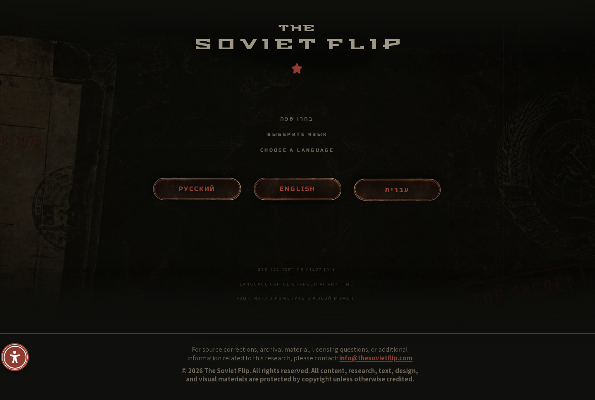
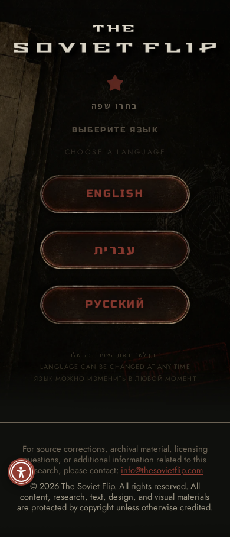

# UI Design System & Master Generation Blueprint: thesovietflip-com

> **The Soviet Flip** (https://thesovietflip.com/) — A visual historical research project about the Cold War, Israel, the USSR, and the rise of modern Palestinian identity, with archival sou...



---

## 1. Executive Visual Persona & Design Archetype

- **Brand Essence & Persona**: **The Soviet Flip** (`https://thesovietflip.com/`). A visual historical research project about the Cold War, Israel, the USSR, and the rise of modern Palestinian identity, with archival sou...
- **Capture Provenance**: Live browser capture (`tier1_fast`, HTTP `200`, captured `2026-11-23`).
- **Visual Archetype**: **High-Contrast Obsidian / Atmospheric Design System (`#0f0f0c` canvas, `#ffffff` ink, `#903c32` accent)**.
- **Anti-AI-Slop Differentiators**:
  - **Live-Computed Chromatic Polarity**: Anchors the viewport in `#0f0f0c` (live computed `body` `background-color` (`computed_styles.json`)) paired with `#ffffff` primary typography and `#903c32` accents.
  - **Grounded Typographic Hierarchy**: Pairs `Assistant` for display copy (`The Soviet Flip`) with `Assistant` and not declared in live computed styles (uses primary stack / `ui-monospace`).
  - **Calibrated Spatial Grid & Motion**: Combines `1440px` container bounds (`gap: 8px`, padding `12px`) with `cubic-bezier(.2,.8,.2,1)` easing.

---

## 2. Spatial Architecture & Modular Grid Mathematics



### Viewport Allocation & Container Geometry
- **Captured Viewport Dimensions**: Desktop `1440×968px` (`assets/desktop.png`, full-page live capture (968px)), Mobile `390×908px` (`assets/mobile.png`, full-page live capture (908px)).
- **Master Container Bounds**: `1440px` (full-bleed `100%` desktop stage measured on `1440px` viewport).
- **Canvas Lateral Padding & Spacing**: `12px` lateral canvas padding with `8px` grid gap.
- **Border Radius Scale**: `50%`, `4px`, `18px`, `28px`.

### Responsive Breakpoint Architecture
- **Desktop Layout**: Multi-column CSS Grid / Flexbox layout at `1440px` (`max-width: 1440px`, `gap: 8px`).
- **Mobile Layout**: Single-column vertical stack at `390px` viewport width with `12px` horizontal padding.
- **Extracted CSS Media Queries**: `@media (prefers-reduced-motion)`, `@media (prefers-reduced-motion:reduce)`, `@media (width<=480px)`, `@media (width<=600px)`.

---

## 3. Color System, Materiality & Atmospheric Lighting

### Semantic Palette & Source Grounding
| Semantic Role | Ground-Truth Value | Extracted Live / CSS Source |
|---|---|---|
| **Primary Canvas Substrate** | `#0f0f0c` | live computed `body` `background-color` (`computed_styles.json`) |
| **Primary Typography Ink** | `#ffffff` | live computed `button` `color` (`computed_styles.json`) |
| **Elevated Surface / Card Substrate** | `#71362d` | live computed `nav` `background-color` (`computed_styles.json`) |
| **Interactive Accent / Highlight** | `#903c32` | live computed `button` `background-color` (`computed_styles.json`) |
| **Secondary / Muted Copy** | `#ebe5d6` | live computed `p` `color` (`computed_styles.json`) |
| **Structural Hairline Border** | `#903c32` | `:checked { border-color: #903c32 }` |

### Sanitized Root CSS Variables (`ui-ux.md` Ground Truth)
| Variable Name | Extracted Value | Semantic Role |
|---|---|---|
| `--ink` | `#0f0f0c` | Typography Ink Token |
| `--paper` | `#ebe5d6` | Canvas / Surface Token |
| `--red` | `#903c32` | Color / Atmospheric Token |
| `--site-cursor` | `url(/cursors/arrow.png),auto` | Design System Custom Token |
| `--link-cursor` | `url(/cursors/magnifier.png),pointer` | Typography Ink Token |
| `--map-heading-font` | `"Russo One",sans-serif` | Typography Ink Token |
| `--map-heading-weight` | `400` | Typography Ink Token |
| `--map-body-font` | `"Jost",sans-serif` | Typography / Scale Token |
| `--drawer-side` | `1` | Design System Custom Token |
| `--drawer-progress` | `0` | Design System Custom Token |
| `--peek` | `0px` | Dimension / Scale Token |
| `--ribbon-tail` | `24px` | Dimension / Scale Token |
| `--bookmark-width` | `88px` | Layout / Spatial Grid Token |
| `--listener-shift` | `18px` | Dimension / Scale Token |
| `--button-size` | `62px` | Layout / Spatial Grid Token |
| `--ring-size` | `55px` | Layout / Spatial Grid Token |

---

## 4. Typographic Scale & Editorial Hierarchy

### Font Family Stacks
- **Display Typography**: `Assistant`.
- **Primary Body Stack**: `Assistant`.
- **Technical / Metadata Stack**: not declared in live computed styles (uses primary stack / `ui-monospace`).

### Typographic Scale & Rules (Live Computed & Stylesheet Grounded)
- **Hero Display (`H1`)**: live computed `h1` (`font-size: 36px`, `line-height: 45px`, `font-weight: 700`).
- **Section Heading (`H2`)**: live computed `h2` (`font-size: 20px`, `line-height: 22px`, `font-weight: 800`); rule `h2` (`font-size: 27px`, `line-height: 1.08`, `font-weight: 800`).
- **Body Copy**: live computed `body` (`font-size: 16px`, `line-height: normal`, `font-weight: 400`); CSS variables `--map-body-font: "Jost",sans-serif`; rule `p` (`line-height: 1.2`).
- **Metadata & Navigation Labels**: live computed `nav/a` (`font-size: 16px`, `line-height: 23.2px`, `font-weight: 400`); rule `small` (`font-size: 12px`, `font-weight: 400`).

---

## 5. Choreographed Motion & Interaction Physics

### Primary Easing Curves
- **Extracted Timing Functions**: `cubic-bezier(.2,.8,.2,1)`, `cubic-bezier(.45,0,.25,1)`.

### Per-Element Transition & Choreography Rules
- **Selector `:after`**: `transition: .01ms!important` extracted from `thesovietflip-com` stylesheet.
- **Selector `.story-map-drawer[data-astro-cid-...`**: `transition: transform .38s cubic-bezier(.2,.8,.2,1)` extracted from `thesovietflip-com` stylesheet.
- **Selector `-drawer[data-astro-cid-ikck2sju]....`**: `transition: .32s` extracted from `thesovietflip-com` stylesheet.
- **Extracted Easing Curve (`cubic-bezier(.2,.8,.2,1)`)**: Governs interactive state transitions across `<header.motion-enabled>` and `<section.reading-block>`.
- **State & Hover Choreography**: Opacity and transform transitions on `<section.reading-view>` and `<section.reading-block>` interactive targets.

---

## 6. Component Wireframe & Structural DOM Map

### Visual Layout Schematic — Desktop (`1440px`, Grounded in `dom.html` & Landmark Bounding Boxes)
```
┌────────────────────────────────────────────────────────────────────────┐
│ DESKTOP VIEWPORT (1440px) — The Soviet Flip                            │
│ ====================================================================== │
│ [ <header.motion-enabled (1440px)     | עברית · English · Русский    ] │
│ ---------------------------------------------------------------------- │
│ | HERO STAGE: <section.reading-view> (w=1440px)                      | │
│ | H1: The Soviet Flip                                                | │
│ | Substrate: #0f0f0c | Ink: #ffffff | Accent: #903c32                | │
│ ---------------------------------------------------------------------- │
│ | SHOWCASE GRID (<section.reading-block>) max-w: 1440px              | │
│ | +------------------------------+  +------------------------------+ | │
│ | | For source corrections, arch |  | info@thesovietflip.com       | | │
│ | +------------------------------+  +------------------------------+ | │
│ ---------------------------------------------------------------------- │
│ | DETAIL MODULE (<section.reading-block:nth) — © 2026 The Soviet Fli | │
│ ---------------------------------------------------------------------- │
│ [ FOOTER (<footer.sf-loader-di) | https://thesovietflip.com/           │
└────────────────────────────────────────────────────────────────────────┘
```

### Visual Layout Schematic — Mobile Reflow (`390px`)
```
┌────────────────────────────────────────────────────────────────────────┐
│ MOBILE VIEWPORT REFLOW (390px) — Single-Column Stack (gap: 8px)        │
│ ====================================================================== │
│ [ HEADER BAR (<header.motion-enabled> ) | Compact Menu (390px)         │
│ ---------------------------------------------------------------------- │
│ | HERO STAGE (<section.reading-view>) — 390px Vertical Lead          | │
│ | H1: The Soviet Flip                                                | │
│ ---------------------------------------------------------------------- │
│ | SHOWCASE STACK (<section.reading-block) — 1-Col Stack              | │
│ | [ Item 1: For source corrections, archival material, licen       ] | │
│ | [ Item 2: info@thesovietflip.com                                 ] | │
│ ---------------------------------------------------------------------- │
│ | DETAIL STACK (<section.reading-block:n) — 1-Col (© 2026 The Soviet ) │
│ ---------------------------------------------------------------------- │
│ [ FOOTER (<footer.sf-loader-di) | Stacked 390px Colophon               │
└────────────────────────────────────────────────────────────────────────┘
```

### Granular DOM Region Breakdown
1. **Brand Header & Navigation Bar (<header.motion-enabled> — `thesovietflip-com`)**:
   - Landmark `<header class="motion-enabled">` (`1440px`) hosting `The Soviet Flip` navigation (`עברית · English · Русский`), DOM attributes (`data-astro-transition-scope="astro-yztbsuuz-1"`, `data-astro-cid-ju4pidww`, `data-a11y-contrast="default"`, `data-a11y-saturation="default"`), and stylesheet rule `root { color-scheme:dark;--ink:0f0f0c;--paper:ebe5d6;--red:903c32 }`.
2. **Hero Stage & Focal Lead (<section.reading-view> — `The Soviet Flip`)**:
   - Landmark `<section class="reading-view">` presenting display lead `The Soviet Flip` and copy excerpt *"For source corrections, archival material, licensing questions, o"* over `#0f0f0c` canvas and `#ffffff` ink.
3. **Primary Showcase & Content Grid (<section.reading-block> — `For source corrections, archival m`)**:
   - Landmark `<section class="reading-block">` rendering section `For source corrections, archival material, licen` with copy *"info@thesovietflip.com"*, asset references (`ae304b70d9495a89f84a.woff2`, `cca183354fd3fefb84fd.woff2`, `2b5199f9f43249f2ad78.webp`, `3118562a4483c1224195.webp`), and grid rule `html { scroll-behavior:smooth;background:var(--ink);-webkit-text-size-adjust:10... }`.
4. **Interactive Detail & Feature Matrix (<section.reading-block:nth(2)> — `info@thesovietflip.com`)**:
   - Landmark `<section class="reading-block">` framing `info@thesovietflip.com` and `© 2026 The Soviet Flip. All rights reserved. All` (*"© 2026 The Soviet Flip. All rights reserved. All content, researc"*) with `#71362d` surface cards, `#903c32` accents, and `body { color:var(--paper);background:var(--ink);margin:0;font-family:Assistant,... }`.
5. **Colophon & Global Directory Footer (<footer.sf-loader-digits> — `https://thesovietflip.com/`)**:
   - Landmark `<footer class="sf-loader-digits">` anchoring `The Soviet Flip` footer links (`עברית · English · Русский`), copy *"S o v i e t F l i p"*, and `#903c32` structural dividers.

---

## 7. Master Zero-Shot AI Generation Prompt

```markdown
# Master Zero-Shot Frontend Generation Prompt: thesovietflip-com (The Soviet Flip)

You are a principal frontend architect and design systems engineer. Build a complete, production-ready web application replicating the exact design system, DOM landmarks, typographic hierarchy, color tokens, and motion physics of `thesovietflip-com` (**The Soviet Flip** — `https://thesovietflip.com/`).

### 1. Visual Archetype & Anti-AI-Slop Mandates
- **Archetype**: High-Contrast Obsidian / Atmospheric Design System (`#0f0f0c` canvas, `#ffffff` ink, `#903c32` accent).
- **Identity & Domain Context**: A visual historical research project about the Cold War, Israel, the USSR, and the rise of modern Palestinian identity, with archival sou...
- **Primary Substrate**: `#0f0f0c` (live computed `body` `background-color` (`computed_styles.json`)), **Primary Ink**: `#ffffff`, **Accent / Highlight**: `#903c32`.
- **Site-Specific Differentiators**:
  - **Live-Computed Chromatic Polarity**: Anchors the viewport in `#0f0f0c` (live computed `body` `background-color` (`computed_styles.json`)) paired with `#ffffff` primary typography and `#903c32` accents.
  - **Grounded Typographic Hierarchy**: Pairs `Assistant` for display copy (`The Soviet Flip`) with `Assistant` and not declared in live computed styles (uses primary stack / `ui-monospace`).
  - **Calibrated Spatial Grid & Motion**: Combines `1440px` container bounds (`gap: 8px`, padding `12px`) with `cubic-bezier(.2,.8,.2,1)` easing.

### 2. Ground-Truth CSS Variables (`:root` Token Contract)
Declare and consume these exact custom properties extracted from `thesovietflip-com` in your global stylesheet:

:root {
  /* The Soviet Flip (thesovietflip-com) — Live-Grounded CSS Variables */
  --ink: #0f0f0c; /* Typography Ink Token (thesovietflip-com) */
  --paper: #ebe5d6; /* Canvas / Surface Token (thesovietflip-com) */
  --red: #903c32; /* Color / Atmospheric Token (thesovietflip-com) */
  --site-cursor: url(/cursors/arrow.png),auto; /* Design System Custom Token (thesovietflip-com) */
  --link-cursor: url(/cursors/magnifier.png),pointer; /* Typography Ink Token (thesovietflip-com) */
  --map-heading-font: "Russo One",sans-serif; /* Typography Ink Token (thesovietflip-com) */
  --map-heading-weight: 400; /* Typography Ink Token (thesovietflip-com) */
  --map-body-font: "Jost",sans-serif; /* Typography / Scale Token (thesovietflip-com) */
  --drawer-side: 1; /* Design System Custom Token (thesovietflip-com) */
  --drawer-progress: 0; /* Design System Custom Token (thesovietflip-com) */
  --peek: 0px; /* Dimension / Scale Token (thesovietflip-com) */
  --ribbon-tail: 24px; /* Dimension / Scale Token (thesovietflip-com) */
  --bookmark-width: 88px; /* Layout / Spatial Grid Token (thesovietflip-com) */
  --listener-shift: 18px; /* Dimension / Scale Token (thesovietflip-com) */
  --button-size: 62px; /* Layout / Spatial Grid Token (thesovietflip-com) */
  --ring-size: 55px; /* Layout / Spatial Grid Token (thesovietflip-com) */
}

### 3. Semantic Color & Materiality Contract
Map every surface, ink, and border strictly to these source-grounded tokens:
- **Primary Canvas Substrate**: `#0f0f0c` — grounded in live computed `body` `background-color` (`computed_styles.json`)
- **Primary Typography Ink**: `#ffffff` — grounded in live computed `button` `color` (`computed_styles.json`)
- **Elevated Surface / Card Substrate**: `#71362d` — grounded in live computed `nav` `background-color` (`computed_styles.json`)
- **Interactive Accent / Highlight**: `#903c32` — grounded in live computed `button` `background-color` (`computed_styles.json`)
- **Secondary / Muted Copy**: `#ebe5d6` — grounded in live computed `p` `color` (`computed_styles.json`)
- **Structural Hairline Border**: `#903c32` — grounded in `:checked { border-color: #903c32 }`

### 4. Spatial Grid, Container Bounds & Responsive Breakpoints
- **Desktop Viewport Reference**: `1440×968px` (full-page live capture (968px), `1440px` standard desktop width).
- **Mobile Viewport Reference**: `390×908px` (full-page live capture (908px), `390px` standard mobile width).
- **Container Max-Width**: `1440px` (full-bleed `100%` desktop stage measured on `1440px` viewport)
- **Padding & Gutters**: `12px` lateral canvas padding with `8px` grid gap
- **Desktop Grid**: Multi-column CSS Grid / Flexbox layout at `1440px` (`max-width: 1440px`, `gap: 8px`)
- **Mobile Adaptation**: Single-column vertical stack at `390px` viewport width with `12px` horizontal padding
- **Media Queries**: `@media (prefers-reduced-motion)`, `@media (prefers-reduced-motion:reduce)`, `@media (width<=480px)`, `@media (width<=600px)`
- **Corner Radii**: `50%`, `4px`, `18px`, `28px`

### 5. Typography & Editorial Scale Contract
- **Display Font Stack**: `Assistant`
- **Body Font Stack**: `Assistant`
- **Monospace / Technical Font Stack**: not declared in live computed styles (uses primary stack / `ui-monospace`)
- **H1 Display Rule**: live computed `h1` (`font-size: 36px`, `line-height: 45px`, `font-weight: 700`)
- **H2 Section Rule**: live computed `h2` (`font-size: 20px`, `line-height: 22px`, `font-weight: 800`); rule `h2` (`font-size: 27px`, `line-height: 1.08`, `font-weight: 800`)
- **Body Copy Rule**: live computed `body` (`font-size: 16px`, `line-height: normal`, `font-weight: 400`); CSS variables `--map-body-font: "Jost",sans-serif`; rule `p` (`line-height: 1.2`)
- **Metadata & Index Rule**: live computed `nav/a` (`font-size: 16px`, `line-height: 23.2px`, `font-weight: 400`); rule `small` (`font-size: 12px`, `font-weight: 400`)

### 6. Component Hierarchy, Verbatim Copy & Real DOM Landmarks
Scaffold `thesovietflip-com` (`The Soviet Flip`) with these exact structural regions, extracted copy, and CSS rules from `dom.html`:
1. **Brand Header & Navigation Bar (<header.motion-enabled> — `thesovietflip-com`)**:
   - DOM & Selectors: Landmark `<header class="motion-enabled">` (`1440px`) hosting `The Soviet Flip` navigation (`עברית · English · Русский`), DOM attributes (`data-astro-transition-scope="astro-yztbsuuz-1"`, `data-astro-cid-ju4pidww`, `data-a11y-contrast="default"`, `data-a11y-saturation="default"`), and stylesheet rule `root { color-scheme:dark;--ink:0f0f0c;--paper:ebe5d6;--red:903c32 }`.
   - Responsive Contract: Header `Brand Header & Navigation Bar (<header.motion-enabled> — `thesovietflip-com`)` (`thesovietflip-com`) adapts across `@media (prefers-reduced-motion)`, `@media (prefers-reduced-motion:reduce)`, `@media (width<=480px)`, `@media (width<=600px)` with `cubic-bezier(.2,.8,.2,1)`, `cubic-bezier(.45,0,.25,1)` transitions and links `עברית · English · Русский`.
2. **Hero Stage & Focal Lead (<section.reading-view> — `The Soviet Flip`)**:
   - DOM & Selectors: Landmark `<section class="reading-view">` presenting display lead `The Soviet Flip` and copy excerpt *"For source corrections, archival material, licensing questions, o"* over `#0f0f0c` canvas and `#ffffff` ink.
   - Responsive Contract: Hero stage (`1440×968px` desktop / `390×908px` mobile) sets `#0f0f0c` background with `#ffffff` headline `The Soviet Flip`.
3. **Primary Showcase & Content Grid (<section.reading-block> — `For source corrections, archival m`)**:
   - DOM & Selectors: Landmark `<section class="reading-block">` rendering section `For source corrections, archival material, licen` with copy *"info@thesovietflip.com"*, asset references (`ae304b70d9495a89f84a.woff2`, `cca183354fd3fefb84fd.woff2`, `2b5199f9f43249f2ad78.webp`, `3118562a4483c1224195.webp`), and grid rule `html { scroll-behavior:smooth;background:var(--ink);-webkit-text-size-adjust:10... }`.
   - Responsive Contract: Showcase grid `Primary Showcase & Content Grid (<section.reading-block> — `For source corrections, archival m`)` applies Multi-column CSS Grid / Flexbox layout at `1440px` (`max-width: 1440px`, `gap: 8px`) on desktop and Single-column vertical stack at `390px` viewport width with `12px` horizontal padding on mobile.
4. **Interactive Detail & Feature Matrix (<section.reading-block:nth(2)> — `info@thesovietflip.com`)**:
   - DOM & Selectors: Landmark `<section class="reading-block">` framing `info@thesovietflip.com` and `© 2026 The Soviet Flip. All rights reserved. All` (*"© 2026 The Soviet Flip. All rights reserved. All content, researc"*) with `#71362d` surface cards, `#903c32` accents, and `body { color:var(--paper);background:var(--ink);margin:0;font-family:Assistant,... }`.
   - Responsive Contract: Detail module `Interactive Detail & Feature Matrix (<section.reading-block:nth(2)> — `info@thesovietflip.com`)` uses `50%`, `4px`, `18px`, `28px` radii, `#903c32` highlights, and assets (ae304b70d9495a89f84a.woff2, cca183354fd3fefb84fd.woff2, 2b5199f9f43249f2ad78.webp).
5. **Colophon & Global Directory Footer (<footer.sf-loader-digits> — `https://thesovietflip.com/`)**:
   - DOM & Selectors: Landmark `<footer class="sf-loader-digits">` anchoring `The Soviet Flip` footer links (`עברית · English · Русский`), copy *"S o v i e t F l i p"*, and `#903c32` structural dividers.
   - Responsive Contract: Footer `Colophon & Global Directory Footer (<footer.sf-loader-digits> — `https://thesovietflip.com/`)` aligns to `1440px` (full-bleed `100%` desktop stage measured on `1440px` viewport) with `12px` lateral canvas padding with `8px` grid gap and attributes (data-astro-transition-scope="astro-yztbsuuz-1", data-astro-cid-ju4pidww, data-a11y-contrast="default").

#### Verbatim DOM Copy Excerpts (`dom.html`)
- Copy Excerpt 1: *"For source corrections, archival material, licensing questions, or additional info..."*
- Copy Excerpt 2: *"info@thesovietflip.com"*
- Copy Excerpt 3: *"© 2026 The Soviet Flip. All rights reserved. All content, research, text, design,..."*
- Copy Excerpt 4: *"S o v i e t F l i p"*

### 7. Motion, Extracted Stylesheet Rules & Interaction Choreography
- **Primary Easing Functions**: `cubic-bezier(.2,.8,.2,1)`, `cubic-bezier(.45,0,.25,1)`
- **Extracted Stylesheet Rules (`thesovietflip-com`)**:
- `root { color-scheme:dark;--ink:0f0f0c;--paper:ebe5d6;--red:903c32 }`
- `html { scroll-behavior:smooth;background:var(--ink);-webkit-text-size-adjust:10... }`
- `body { color:var(--paper);background:var(--ink);margin:0;font-family:Assistant,... }`
- `input { font:inherit }`
- `focus-visible { outline:2px solid var(--paper);outline-offset:6px }`
- **Per-Selector Transition Rules**:
- **Selector `:after`**: `transition: .01ms!important` extracted from `thesovietflip-com` stylesheet.
- **Selector `.story-map-drawer[data-astro-cid-...`**: `transition: transform .38s cubic-bezier(.2,.8,.2,1)` extracted from `thesovietflip-com` stylesheet.
- **Selector `-drawer[data-astro-cid-ikck2sju]....`**: `transition: .32s` extracted from `thesovietflip-com` stylesheet.
- **Extracted Easing Curve (`cubic-bezier(.2,.8,.2,1)`)**: Governs interactive state transitions across `<header.motion-enabled>` and `<section.reading-block>`.
- **State & Hover Choreography**: Opacity and transform transitions on `<section.reading-view>` and `<section.reading-block>` interactive targets.

### 8. Technical Deliverables
- Implement in Next.js (App Router) with TypeScript and Tailwind CSS consuming the `:root` custom properties defined above for `thesovietflip-com`.
- Reproduce both the `1440px` desktop architecture and `390px` mobile breakpoint transitions, preserving semantic HTML5 landmarks (`<header>`, `<nav>`, `<main>`, `<section>`, `<footer>`) and `prefers-reduced-motion` accessibility guards.
```
