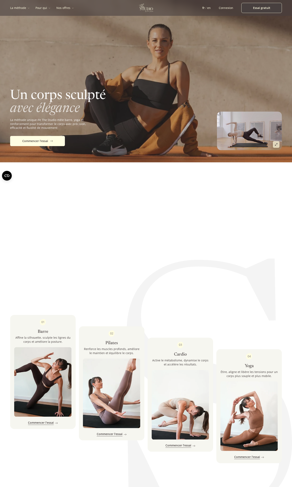
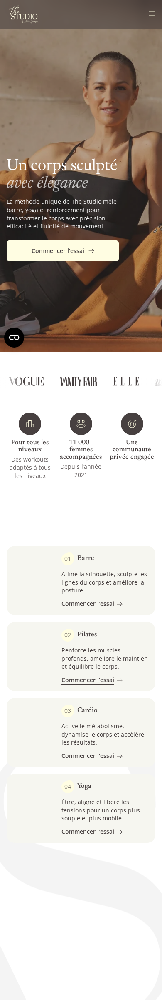

# UI Design System & Master Generation Blueprint: thestudiobyjuliegranger-com

> **The Studio by Julie Granger** (https://thestudiobyjuliegranger.com/) — Une méthode unique alliant barre, yoga et renforcement, développée depuis plus de 12 ans et déjà adoptée par des milliers de femmes à tra...



---

## 1. Executive Visual Persona & Design Archetype

- **Brand Essence & Persona**: **The Studio by Julie Granger** (`https://thestudiobyjuliegranger.com/`). Une méthode unique alliant barre, yoga et renforcement, développée depuis plus de 12 ans et déjà adoptée par des milliers de femmes à tra...
- **Capture Provenance**: Live browser capture (`tier1_fast`, HTTP `200`, captured `2026-11-23`).
- **Visual Archetype**: **Light-Substrate Editorial & Modular Grid System (`#ffffff` canvas, `#474040` ink, `#91befc` accent)**.
- **Anti-AI-Slop Differentiators**:
  - **Live-Computed Chromatic Polarity**: Anchors the viewport in `#ffffff` (live computed `body` `background-color` (`computed_styles.json`)) paired with `#474040` primary typography and `#91befc` accents.
  - **Grounded Typographic Hierarchy**: Pairs `Newsreader Hero` for display copy (`Un corps sculpté avec élégance`) with `Open Sans` and `SFMono-Regular`.
  - **Calibrated Spatial Grid & Motion**: Combines `1440px` container bounds (`gap: 10px`, padding `10px`) with `cubic-bezier(0.625,0.05,0,1)` easing and GSAP Timeline & ScrollTrigger, Three.js / WebGL Canvas Pipeline.

---

## 2. Spatial Architecture & Modular Grid Mathematics



### Viewport Allocation & Container Geometry
- **Captured Viewport Dimensions**: Desktop `1440×2400px` (`assets/desktop.png`, clamped at 2400px live multi-section capture), Mobile `390×2400px` (`assets/mobile.png`, clamped at 2400px live multi-section capture).
- **Master Container Bounds**: `1440px` (non-`@media` desktop container stylesheet rule).
- **Canvas Lateral Padding & Spacing**: `10px` lateral canvas padding with `10px` grid gap.
- **Border Radius Scale**: `8px`, `50%`, `4px`, `999px`.

### Responsive Breakpoint Architecture
- **Desktop Layout**: Multi-column CSS Grid / Flexbox layout at `1440px` (`max-width: 1440px`, `gap: 10px`).
- **Mobile Layout**: Single-column vertical stack at `390px` viewport width with `10px` horizontal padding.
- **Extracted CSS Media Queries**: `@media (min-width:1024px)`, `@media (prefers-reduced-motion:reduce)`, `@media (min-width:768px)`, `@media (min-width:480px)`.

---

## 3. Color System, Materiality & Atmospheric Lighting

### Semantic Palette & Source Grounding
| Semantic Role | Ground-Truth Value | Extracted Live / CSS Source |
|---|---|---|
| **Primary Canvas Substrate** | `#ffffff` | live computed `body` `background-color` (`computed_styles.json`) |
| **Primary Typography Ink** | `#474040` | live computed `main` `color` (`computed_styles.json`) |
| **Elevated Surface / Card Substrate** | `#f6f6f0` | live computed `footer` `background-color` (`computed_styles.json`) |
| **Interactive Accent / Highlight** | `#91befc` | `.hero__retreat-badge { background-color: #91befc }` |
| **Secondary / Muted Copy** | `#665c5a` | `var(--consent-soft-ink)` in `:root` |
| **Structural Hairline Border** | `#e4dfda` | `var(--consent-line)` in `:root` |
| **Variable Token (`--wp-block-synced-color`)** | `#7a00df` | `var(--wp-block-synced-color)` in `:root` |
| **Variable Token (`--wp-editor-canvas-background`)** | `#dddddd` | `var(--wp-editor-canvas-background)` in `:root` |
| **Variable Token (`--wp-admin-theme-color`)** | `#007cba` | `var(--wp-admin-theme-color)` in `:root` |
| **Variable Token (`--wp-admin-theme-color-darker-10`)** | `#006ba1` | `var(--wp-admin-theme-color-darker-10)` in `:root` |
| **Variable Token (`--wp-admin-theme-color-darker-20`)** | `#005a87` | `var(--wp-admin-theme-color-darker-20)` in `:root` |

### Sanitized Root CSS Variables (`ui-ux.md` Ground Truth)
| Variable Name | Extracted Value | Semantic Role |
|---|---|---|
| `--wp-block-synced-color` | `#7a00df` | Brand / Palette Token |
| `--wp-block-synced-color--rgb` | `122,0,223` | Brand / Palette Token |
| `--wp-bound-block-color` | `var(--wp-block-synced-color)` | Brand / Palette Token |
| `--wp-editor-canvas-background` | `#ddd` | Canvas / Surface Token |
| `--wp-admin-theme-color` | `#007cba` | Brand / Palette Token |
| `--wp-admin-theme-color--rgb` | `0,124,186` | Brand / Palette Token |
| `--wp-admin-theme-color-darker-10` | `#006ba1` | Canvas / Surface Token |
| `--wp-admin-theme-color-darker-10--rgb` | `0,107,160.5` | Canvas / Surface Token |
| `--wp-admin-theme-color-darker-20` | `#005a87` | Canvas / Surface Token |
| `--wp-admin-theme-color-darker-20--rgb` | `0,90,135` | Canvas / Surface Token |
| `--wp-admin-border-width-focus` | `2px` | Layout / Spatial Grid Token |
| `--wp-admin--admin-bar--position-offset` | `var(--wp-admin--admin-bar--height,0px)` | Dimension / Scale Token |
| `--site-fixed-header-offset` | `70px` | Layout / Spatial Grid Token |
| `--site-no-hero-top-gap` | `18px` | Layout / Spatial Grid Token |
| `--site-anchor-scroll-gap` | `16px` | Layout / Spatial Grid Token |
| `--reviews-slides-per-view` | `1.2` | Design System Custom Token |

---

## 4. Typographic Scale & Editorial Hierarchy

### Font Family Stacks
- **Display Typography**: `Newsreader Hero`.
- **Primary Body Stack**: `Open Sans`.
- **Technical / Metadata Stack**: `SFMono-Regular`.

### Typographic Scale & Rules (Live Computed & Stylesheet Grounded)
- **Hero Display (`H1`)**: live computed `h1` (`font-size: 64px`, `line-height: 64px`, `font-weight: 400`).
- **Section Heading (`H2`)**: live computed `h2` (`font-size: 42px`, `line-height: 46.2px`, `font-weight: 400`); rule `h2` (`font-size: 26px`, `line-height: 1.1`, `font-weight: 400`).
- **Body Copy**: live computed `body` (`font-size: 14px`, `line-height: 19.6px`, `font-weight: 400`).
- **Metadata & Navigation Labels**: live computed `nav/a` (`font-size: 14px`, `line-height: 19.6px`, `font-weight: 400`).

---

## 5. Choreographed Motion & Interaction Physics

### Primary Easing Curves
- **Extracted Timing Functions**: `cubic-bezier(0.625,0.05,0,1)`, `cubic-bezier(.25,.46,.45,.94)`, `cubic-bezier(.645,.045,.355,1)`.

### Per-Element Transition & Choreography Rules
- **Selector `.instagram__btn`**: `transition: background-color .2s ease` extracted from `thestudiobyjuliegranger-com` stylesheet.
- **Selector `.reviews__swiper.swiper`**: `transition: cubic-bezier(0.625,0.05,0,1)` extracted from `thestudiobyjuliegranger-com` stylesheet.
- **Selector `.reviews__nav-btn`**: `transition: background-color .2s ease,opacity .2s ease` extracted from `thestudiobyjuliegranger-com` stylesheet.
- **Extracted Easing Curve (`cubic-bezier(0.625,0.05,0,1)`)**: Governs interactive state transitions across `<header.mega-nav-header>` and `<section.logos>`.
- **Runtime Interaction Engine**: Integrates GSAP Timeline & ScrollTrigger, Three.js / WebGL Canvas Pipeline, Swiper Touch Carousel Engine, Lottie Vector Animation Player with `prefers-reduced-motion: reduce` fallback guards.

---

## 6. Component Wireframe & Structural DOM Map

### Visual Layout Schematic — Desktop (`1440px`, Grounded in `dom.html` & Landmark Bounding Boxes)
```
┌────────────────────────────────────────────────────────────────────────┐
│ DESKTOP VIEWPORT (1440px) — The Studio by Julie Granger                │
│ ====================================================================== │
│ [ <header.mega-nav-heade (1340x92px)  | Connexion · en · Connexion C ] │
│ ---------------------------------------------------------------------- │
│ | HERO STAGE: <section.hero> (w=1440px)                              | │
│ | H1: Un corps sculpté avec élégance                                 | │
│ | Substrate: #ffffff | Ink: #474040 | Accent: #91befc                | │
│ ---------------------------------------------------------------------- │
│ | SHOWCASE GRID (<section.logos>) max-w: 1440px                      | │
│ | +------------------------------+  +------------------------------+ | │
│ | | Une méthode complète pour sc |  | The Studio by Julie Granger  | | │
│ | +------------------------------+  +------------------------------+ | │
│ ---------------------------------------------------------------------- │
│ | DETAIL MODULE (<section.benefits>) — Si vous vous reconnai         | │
│ ---------------------------------------------------------------------- │
│ [ FOOTER (<footer.site-footer>) | https://thestudiobyjuliegranger.com  │
└────────────────────────────────────────────────────────────────────────┘
```

### Visual Layout Schematic — Mobile Reflow (`390px`)
```
┌────────────────────────────────────────────────────────────────────────┐
│ MOBILE VIEWPORT REFLOW (390px) — Single-Column Stack (gap: 10px)       │
│ ====================================================================== │
│ [ HEADER BAR (<header.mega-nav-header>) | Compact Menu (390px)         │
│ ---------------------------------------------------------------------- │
│ | HERO STAGE (<section.hero>) — 390px Vertical Lead                  | │
│ | H1: Un corps sculpté avec élégance                                 | │
│ ---------------------------------------------------------------------- │
│ | SHOWCASE STACK (<section.logos>) — 1-Col Stack                     | │
│ | [ Item 1: Une méthode complète pour sculpter le corps            ] | │
│ | [ Item 2: The Studio by Julie Granger                            ] | │
│ ---------------------------------------------------------------------- │
│ | DETAIL STACK (<section.benefits>) — 1-Col (Si vous vous recon)     | │
│ ---------------------------------------------------------------------- │
│ [ FOOTER (<footer.site-footer>) | Stacked 390px Colophon               │
└────────────────────────────────────────────────────────────────────────┘
```

### Granular DOM Region Breakdown
1. **Brand Header & Navigation Bar (<header.mega-nav-header> — `thestudiobyjuliegranger-com`)**:
   - Landmark `<header class="mega-nav-header">` (`1340x92px`) hosting `The Studio by Julie Granger` navigation (`Connexion · en · Connexion Connexion · Méthode et Résultats · Corps qui a changé`), DOM attributes (`data-cookieconsent="ignore"`, `data-implementation="wp"`, `data-cbid="22577dd5-f8e6-45b3-bb..."`, `data-culture="FR"`), and stylesheet rule `.banp-request-push-permission-button { margin-right:10px }`.
2. **Hero Stage & Focal Lead (<section.hero> — `Un corps sculpté avec élégance`)**:
   - Landmark `<section class="hero hero--home">` presenting display lead `Un corps sculpté avec élégance` and copy excerpt *"La méthode unique de The Studio mêle barre, yoga et renforcement "* over `#ffffff` canvas and `#474040` ink.
3. **Primary Showcase & Content Grid (<section.logos> — `Une méthode complète pour sculpter`)**:
   - Landmark `<section class="logos">` rendering section `Une méthode complète pour sculpter le corps` with copy *"C o m m e n c e r l ’ e s s a i"*, asset references (`matomo.js`, `gtm.js`, `state.js`, `widgetIcon.min.js`), and grid rule `.banp-ajax-success { display:inline-block;font-size:1.2em;margin:0 10px;vertical-align:middle }`.
4. **Interactive Detail & Feature Matrix (<section.benefits> — `The Studio by Julie Granger`)**:
   - Landmark `<section class="benefits">` framing `The Studio by Julie Granger` and `Si vous vous reconnaissez, The Studio est fait po...` (*"Pour tous les niveaux"*) with `#f6f6f0` surface cards, `#91befc` accents, and `.banp-ajax-error { color:b81c23 }`.
5. **Colophon & Global Directory Footer (<footer.site-footer> — `https://thestudiobyjuliegranger.com/`)**:
   - Landmark `<footer class="site-footer">` anchoring `The Studio by Julie Granger` footer links (`Connexion · en · Connexion Connexion · Méthode et Résultats · Corps qui a changé`), copy *"Des workouts adaptés à tous les niveaux"*, and `#e4dfda` structural dividers.

---

## 7. Master Zero-Shot AI Generation Prompt

```markdown
# Master Zero-Shot Frontend Generation Prompt: thestudiobyjuliegranger-com (The Studio by Julie Granger)

You are a principal frontend architect and design systems engineer. Build a complete, production-ready web application replicating the exact design system, DOM landmarks, typographic hierarchy, color tokens, and motion physics of `thestudiobyjuliegranger-com` (**The Studio by Julie Granger** — `https://thestudiobyjuliegranger.com/`).

### 1. Visual Archetype & Anti-AI-Slop Mandates
- **Archetype**: Light-Substrate Editorial & Modular Grid System (`#ffffff` canvas, `#474040` ink, `#91befc` accent).
- **Identity & Domain Context**: Une méthode unique alliant barre, yoga et renforcement, développée depuis plus de 12 ans et déjà adoptée par des milliers de femmes à tra...
- **Primary Substrate**: `#ffffff` (live computed `body` `background-color` (`computed_styles.json`)), **Primary Ink**: `#474040`, **Accent / Highlight**: `#91befc`.
- **Site-Specific Differentiators**:
  - **Live-Computed Chromatic Polarity**: Anchors the viewport in `#ffffff` (live computed `body` `background-color` (`computed_styles.json`)) paired with `#474040` primary typography and `#91befc` accents.
  - **Grounded Typographic Hierarchy**: Pairs `Newsreader Hero` for display copy (`Un corps sculpté avec élégance`) with `Open Sans` and `SFMono-Regular`.
  - **Calibrated Spatial Grid & Motion**: Combines `1440px` container bounds (`gap: 10px`, padding `10px`) with `cubic-bezier(0.625,0.05,0,1)` easing and GSAP Timeline & ScrollTrigger, Three.js / WebGL Canvas Pipeline.

### 2. Ground-Truth CSS Variables (`:root` Token Contract)
Declare and consume these exact custom properties extracted from `thestudiobyjuliegranger-com` in your global stylesheet:

:root {
  /* The Studio by Julie Granger (thestudiobyjuliegranger-com) — Live-Grounded CSS Variables */
  --wp-block-synced-color: #7a00df; /* Brand / Palette Token (thestudiobyjuliegranger-com) */
  --wp-block-synced-color--rgb: 122,0,223; /* Brand / Palette Token (thestudiobyjuliegranger-com) */
  --wp-bound-block-color: var(--wp-block-synced-color); /* Brand / Palette Token (thestudiobyjuliegranger-com) */
  --wp-editor-canvas-background: #ddd; /* Canvas / Surface Token (thestudiobyjuliegranger-com) */
  --wp-admin-theme-color: #007cba; /* Brand / Palette Token (thestudiobyjuliegranger-com) */
  --wp-admin-theme-color--rgb: 0,124,186; /* Brand / Palette Token (thestudiobyjuliegranger-com) */
  --wp-admin-theme-color-darker-10: #006ba1; /* Canvas / Surface Token (thestudiobyjuliegranger-com) */
  --wp-admin-theme-color-darker-10--rgb: 0,107,160.5; /* Canvas / Surface Token (thestudiobyjuliegranger-com) */
  --wp-admin-theme-color-darker-20: #005a87; /* Canvas / Surface Token (thestudiobyjuliegranger-com) */
  --wp-admin-theme-color-darker-20--rgb: 0,90,135; /* Canvas / Surface Token (thestudiobyjuliegranger-com) */
  --wp-admin-border-width-focus: 2px; /* Layout / Spatial Grid Token (thestudiobyjuliegranger-com) */
  --wp-admin--admin-bar--position-offset: var(--wp-admin--admin-bar--height,0px); /* Dimension / Scale Token (thestudiobyjuliegranger-com) */
  --site-fixed-header-offset: 70px; /* Layout / Spatial Grid Token (thestudiobyjuliegranger-com) */
  --site-no-hero-top-gap: 18px; /* Layout / Spatial Grid Token (thestudiobyjuliegranger-com) */
  --site-anchor-scroll-gap: 16px; /* Layout / Spatial Grid Token (thestudiobyjuliegranger-com) */
  --reviews-slides-per-view: 1.2; /* Design System Custom Token (thestudiobyjuliegranger-com) */
}

### 3. Semantic Color & Materiality Contract
Map every surface, ink, and border strictly to these source-grounded tokens:
- **Primary Canvas Substrate**: `#ffffff` — grounded in live computed `body` `background-color` (`computed_styles.json`)
- **Primary Typography Ink**: `#474040` — grounded in live computed `main` `color` (`computed_styles.json`)
- **Elevated Surface / Card Substrate**: `#f6f6f0` — grounded in live computed `footer` `background-color` (`computed_styles.json`)
- **Interactive Accent / Highlight**: `#91befc` — grounded in `.hero__retreat-badge { background-color: #91befc }`
- **Secondary / Muted Copy**: `#665c5a` — grounded in `var(--consent-soft-ink)` in `:root`
- **Structural Hairline Border**: `#e4dfda` — grounded in `var(--consent-line)` in `:root`
- **Variable Token (`--wp-block-synced-color`)**: `#7a00df` — grounded in `var(--wp-block-synced-color)` in `:root`
- **Variable Token (`--wp-editor-canvas-background`)**: `#dddddd` — grounded in `var(--wp-editor-canvas-background)` in `:root`
- **Variable Token (`--wp-admin-theme-color`)**: `#007cba` — grounded in `var(--wp-admin-theme-color)` in `:root`
- **Variable Token (`--wp-admin-theme-color-darker-10`)**: `#006ba1` — grounded in `var(--wp-admin-theme-color-darker-10)` in `:root`
- **Variable Token (`--wp-admin-theme-color-darker-20`)**: `#005a87` — grounded in `var(--wp-admin-theme-color-darker-20)` in `:root`

### 4. Spatial Grid, Container Bounds & Responsive Breakpoints
- **Desktop Viewport Reference**: `1440×2400px` (clamped at 2400px live multi-section capture, `1440px` standard desktop width).
- **Mobile Viewport Reference**: `390×2400px` (clamped at 2400px live multi-section capture, `390px` standard mobile width).
- **Container Max-Width**: `1440px` (non-`@media` desktop container stylesheet rule)
- **Padding & Gutters**: `10px` lateral canvas padding with `10px` grid gap
- **Desktop Grid**: Multi-column CSS Grid / Flexbox layout at `1440px` (`max-width: 1440px`, `gap: 10px`)
- **Mobile Adaptation**: Single-column vertical stack at `390px` viewport width with `10px` horizontal padding
- **Media Queries**: `@media (min-width:1024px)`, `@media (prefers-reduced-motion:reduce)`, `@media (min-width:768px)`, `@media (min-width:480px)`
- **Corner Radii**: `8px`, `50%`, `4px`, `999px`

### 5. Typography & Editorial Scale Contract
- **Display Font Stack**: `Newsreader Hero`
- **Body Font Stack**: `Open Sans`
- **Monospace / Technical Font Stack**: `SFMono-Regular`
- **H1 Display Rule**: live computed `h1` (`font-size: 64px`, `line-height: 64px`, `font-weight: 400`)
- **H2 Section Rule**: live computed `h2` (`font-size: 42px`, `line-height: 46.2px`, `font-weight: 400`); rule `h2` (`font-size: 26px`, `line-height: 1.1`, `font-weight: 400`)
- **Body Copy Rule**: live computed `body` (`font-size: 14px`, `line-height: 19.6px`, `font-weight: 400`)
- **Metadata & Index Rule**: live computed `nav/a` (`font-size: 14px`, `line-height: 19.6px`, `font-weight: 400`)

### 6. Component Hierarchy, Verbatim Copy & Real DOM Landmarks
Scaffold `thestudiobyjuliegranger-com` (`The Studio by Julie Granger`) with these exact structural regions, extracted copy, and CSS rules from `dom.html`:
1. **Brand Header & Navigation Bar (<header.mega-nav-header> — `thestudiobyjuliegranger-com`)**:
   - DOM & Selectors: Landmark `<header class="mega-nav-header">` (`1340x92px`) hosting `The Studio by Julie Granger` navigation (`Connexion · en · Connexion Connexion · Méthode et Résultats · Corps qui a changé`), DOM attributes (`data-cookieconsent="ignore"`, `data-implementation="wp"`, `data-cbid="22577dd5-f8e6-45b3-bb..."`, `data-culture="FR"`), and stylesheet rule `.banp-request-push-permission-button { margin-right:10px }`.
   - Responsive Contract: Header `Brand Header & Navigation Bar (<header.mega-nav-header> — `thestudiobyjuliegranger-com`)` (`thestudiobyjuliegranger-com`) adapts across `@media (min-width:1024px)`, `@media (prefers-reduced-motion:reduce)`, `@media (min-width:768px)`, `@media (min-width:480px)` with `cubic-bezier(0.625,0.05,0,1)`, `cubic-bezier(.25,.46,.45,.94)`, `cubic-bezier(.645,.045,.355,1)` transitions and links `Connexion · en · Connexion Connexion · Méthode et Résultats · Corps qui a changé`.
2. **Hero Stage & Focal Lead (<section.hero> — `Un corps sculpté avec élégance`)**:
   - DOM & Selectors: Landmark `<section class="hero hero--home">` presenting display lead `Un corps sculpté avec élégance` and copy excerpt *"La méthode unique de The Studio mêle barre, yoga et renforcement "* over `#ffffff` canvas and `#474040` ink.
   - Responsive Contract: Hero stage (`1440×2400px` desktop / `390×2400px` mobile) sets `#ffffff` background with `#474040` headline `Un corps sculpté avec élégance`.
3. **Primary Showcase & Content Grid (<section.logos> — `Une méthode complète pour sculpter`)**:
   - DOM & Selectors: Landmark `<section class="logos">` rendering section `Une méthode complète pour sculpter le corps` with copy *"C o m m e n c e r l ’ e s s a i"*, asset references (`matomo.js`, `gtm.js`, `state.js`, `widgetIcon.min.js`), and grid rule `.banp-ajax-success { display:inline-block;font-size:1.2em;margin:0 10px;vertical-align:middle }`.
   - Responsive Contract: Showcase grid `Primary Showcase & Content Grid (<section.logos> — `Une méthode complète pour sculpter`)` applies Multi-column CSS Grid / Flexbox layout at `1440px` (`max-width: 1440px`, `gap: 10px`) on desktop and Single-column vertical stack at `390px` viewport width with `10px` horizontal padding on mobile.
4. **Interactive Detail & Feature Matrix (<section.benefits> — `The Studio by Julie Granger`)**:
   - DOM & Selectors: Landmark `<section class="benefits">` framing `The Studio by Julie Granger` and `Si vous vous reconnaissez, The Studio est fait po...` (*"Pour tous les niveaux"*) with `#f6f6f0` surface cards, `#91befc` accents, and `.banp-ajax-error { color:b81c23 }`.
   - Responsive Contract: Detail module `Interactive Detail & Feature Matrix (<section.benefits> — `The Studio by Julie Granger`)` uses `8px`, `50%`, `4px`, `999px` radii, `#91befc` highlights, and assets (matomo.js, gtm.js, state.js).
5. **Colophon & Global Directory Footer (<footer.site-footer> — `https://thestudiobyjuliegranger.com/`)**:
   - DOM & Selectors: Landmark `<footer class="site-footer">` anchoring `The Studio by Julie Granger` footer links (`Connexion · en · Connexion Connexion · Méthode et Résultats · Corps qui a changé`), copy *"Des workouts adaptés à tous les niveaux"*, and `#e4dfda` structural dividers.
   - Responsive Contract: Footer `Colophon & Global Directory Footer (<footer.site-footer> — `https://thestudiobyjuliegranger.com/`)` aligns to `1440px` (non-`@media` desktop container stylesheet rule) with `10px` lateral canvas padding with `10px` grid gap and attributes (data-cookieconsent="ignore", data-implementation="wp", data-cbid="22577dd5-f8e6-45b3-bb...").

#### Verbatim DOM Copy Excerpts (`dom.html`)
- Copy Excerpt 1: *"La méthode unique de The Studio mêle barre, yoga et renforcement pour transformer..."*
- Copy Excerpt 2: *"C o m m e n c e r l ’ e s s a i"*
- Copy Excerpt 3: *"Pour tous les niveaux"*
- Copy Excerpt 4: *"Des workouts adaptés à tous les niveaux"*

### 7. Motion, Extracted Stylesheet Rules & Interaction Choreography
- **Primary Easing Functions**: `cubic-bezier(0.625,0.05,0,1)`, `cubic-bezier(.25,.46,.45,.94)`, `cubic-bezier(.645,.045,.355,1)`
- **Extracted Stylesheet Rules (`thestudiobyjuliegranger-com`)**:
- `.banp-request-push-permission-button { margin-right:10px }`
- `.banp-ajax-success { display:inline-block;font-size:1.2em;margin:0 10px;vertical-align:middle }`
- `.banp-ajax-error { color:b81c23 }`
- `.banp-ajax-success:before { content:"\0049";font-family:booking_activities_icons }`
- `.banp-ajax-error:before { content:"\004a";font-family:booking_activities_icons }`
- **Per-Selector Transition Rules**:
- **Selector `.instagram__btn`**: `transition: background-color .2s ease` extracted from `thestudiobyjuliegranger-com` stylesheet.
- **Selector `.reviews__swiper.swiper`**: `transition: cubic-bezier(0.625,0.05,0,1)` extracted from `thestudiobyjuliegranger-com` stylesheet.
- **Selector `.reviews__nav-btn`**: `transition: background-color .2s ease,opacity .2s ease` extracted from `thestudiobyjuliegranger-com` stylesheet.
- **Extracted Easing Curve (`cubic-bezier(0.625,0.05,0,1)`)**: Governs interactive state transitions across `<header.mega-nav-header>` and `<section.logos>`.
- **Runtime Interaction Engine**: Integrates GSAP Timeline & ScrollTrigger, Three.js / WebGL Canvas Pipeline, Swiper Touch Carousel Engine, Lottie Vector Animation Player with `prefers-reduced-motion: reduce` fallback guards.

### 8. Technical Deliverables
- Implement in Next.js (App Router) with TypeScript and Tailwind CSS consuming the `:root` custom properties defined above for `thestudiobyjuliegranger-com`.
- Reproduce both the `1440px` desktop architecture and `390px` mobile breakpoint transitions, preserving semantic HTML5 landmarks (`<header>`, `<nav>`, `<main>`, `<section>`, `<footer>`) and `prefers-reduced-motion` accessibility guards.
```
