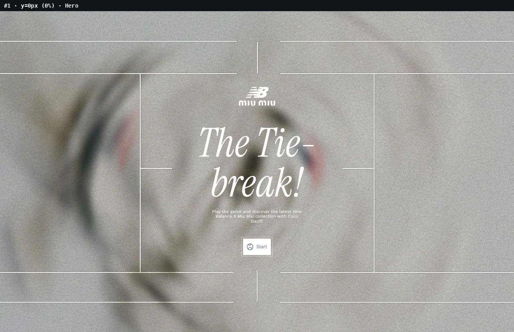
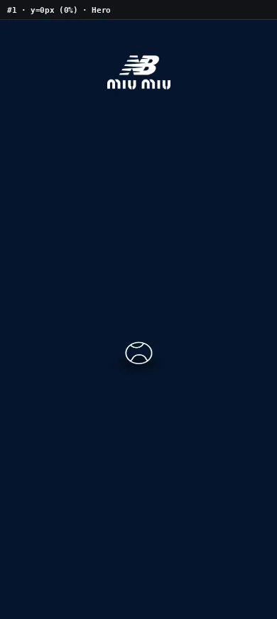

# UI Design System & Master Generation Blueprint: thetiebreak-merci-michel-com

> **The Tie-break!** (https://thetiebreak.merci-michel.com/) — Play the game and discover the latest New Balance X Miu Miu collection with Coco Gauff.





---

## 1. Executive Visual Persona & Design Archetype

- **Brand Essence & Persona**: **The Tie-break!** (`https://thetiebreak.merci-michel.com/`). Play the game and discover the latest New Balance X Miu Miu collection with Coco Gauff.
- **Capture Provenance**: Live browser capture (`tier2_webgl`, HTTP `200`, captured `2026-11-24`).
- **Visual Archetype**: **Light-Gallery WebGL / Canvas Interactive Experience (`#ffffff` / `#fff302`)**.
- **Anti-AI-Slop Differentiators**:
  - **Live-Computed Chromatic Polarity**: Anchors the viewport in `#ffffff` (live computed `html` `background-color` (`computed_styles.json`)) paired with `#000000` primary typography and `#fff302` accents.
  - **Grounded Typographic Hierarchy**: Pairs `Instrument` for display copy (`The Tie-break!`) with `WorkSans`.
  - **Calibrated Spatial Grid & Motion**: Combines `1440px` container bounds (`gap: 0px (flush layout)`, padding `0px`) with `cubic-bezier(.19,1,.22,1)` easing and Three.js / WebGL Canvas Pipeline.

---

## 2. Spatial Architecture & Modular Grid Mathematics

### Viewport Allocation & Container Geometry
- **Captured Journey Filmstrips**: Desktop `1280×828px` (`assets/desktop-journey.webp`, `1` keyframes up to `y=0px` / doc `900px`), Mobile `390×872px` (`assets/mobile-journey.webp`, `1` keyframes).
- **Master Container Bounds**: `1440px` (live computed `main` `max-width`).
- **Canvas Lateral Padding & Spacing**: `0px` lateral canvas padding with `0px (flush layout)` grid gap.
- **Border Radius Scale**: `3.57px`, `50%`.

### Responsive Breakpoint Architecture
- **Desktop Layout**: Multi-column CSS Grid / Flexbox layout at `1440px` (`max-width: 1440px`, `gap: 0px (flush layout)`).
- **Mobile Layout**: Single-column vertical stack at `390px` viewport width with `0px` horizontal padding.
- **Extracted CSS Media Queries**: `@media only screen and (max-width:1080px)and (orientation:portrait)`, `@media (prefers-reduced-motion:reduce)`.

---

## 3. Color System, Materiality & Atmospheric Lighting

### Semantic Palette & Source Grounding
| Semantic Role | Ground-Truth Value | Extracted Live / CSS Source |
|---|---|---|
| **Primary Canvas Substrate** | `#ffffff` | live computed `html` `background-color` (`computed_styles.json`) |
| **Primary Typography Ink** | `#000000` | `::-moz-selection { color: #000000 }` |
| **Elevated Surface / Card Substrate** | `#05152d` | `#preloader .preloader-background { background: #05152d }` |
| **Interactive Accent / Highlight** | `#fff302` | `var(--ui-color-primary-hover)` in `:root` |
| **Secondary / Muted Copy** | `#000000` | secondary opacity step of `::-moz-selection { color: #000000 }` |
| **Structural Hairline Border** | `#000000` | hairline divider derived from secondary opacity step of `::-moz-selection { color: #000000 }` |
| **Variable Token (`--ui-colors`)** | `#142a48` | `var(--ui-colors)` in `:root` |

### Sanitized Root CSS Variables (`ui-ux.md` Ground Truth)
| Variable Name | Extracted Value | Semantic Role |
|---|---|---|
| `--base-text` | `10px` | Typography Ink Token |
| `--padding` | `max(6px, calc(var(--base-text) * .15))` | Layout / Spatial Grid Token |
| `--ui-colors` | `bg-primary:#000 / primary:#fff / blue:#142a48 / primary-hover:#fff302` | Brand / Palette Token |
| `--ui-color-bg-primary` | `#000` | Canvas / Surface Token |
| `--ui-color-primary` | `#fff` | Brand / Palette Token |
| `--ui-color-blue` | `#142a48` | Brand / Palette Token |
| `--ui-color-primary-hover` | `#fff302` | Brand / Palette Token |
| `--miumiu-header` | `1.5em` | Layout / Spatial Grid Token |
| `--ball-size` | `max(35px, 1.8vw)` | Layout / Spatial Grid Token |
| `--bounce-height` | `90px` | Layout / Spatial Grid Token |
| `--floor-height` | `0px` | Layout / Spatial Grid Token |
| `--duration` | `.8s` | Motion / Easing Token |
| `--exit-duration` | `.3s` | Motion / Easing Token |
| `--scrollbar-width` | `0px` | Layout / Spatial Grid Token |
| `--inner-height` | `900px` | Layout / Spatial Grid Token |
| `--vp-height` | `900px` | Layout / Spatial Grid Token |

---

## 4. Typographic Scale & Editorial Hierarchy

### Font Family Stacks
- **Display Typography**: `Instrument`.
- **Primary Body Stack**: `WorkSans`.
- **Technical / Metadata Stack**: not declared in live computed styles (uses primary stack / `ui-monospace`).

### Typographic Scale & Rules (Live Computed & Stylesheet Grounded)
- **Hero Display (`H1`)**: live computed `h1` (`font-size: 112.5px`, `line-height: 112.5px`, `font-weight: 400`).
- **Section Heading (`H2`)**: observed font-size ladder: `112.5px`, `7.5px`, `12px`, `1.4em`, `2.4em`.
- **Body Copy**: live computed `body` (`font-size: 7.5px`, `line-height: 8.25px`, `font-weight: 400`).
- **Metadata & Navigation Labels**: live computed `nav/a` (`font-size: 7.5px`, `line-height: 8.25px`, `font-weight: 400`).

---

## 5. Choreographed Motion & Interaction Physics

### Primary Easing Curves
- **Extracted Timing Functions**: `cubic-bezier(.19,1,.22,1)`, `cubic-bezier(.25,.46,.45,.94)`, `cubic-bezier(.55,.085,.68,.53)`.

### Per-Element Transition & Choreography Rules
- **Selector `.button[data-v-7fa37a60]`**: `transition: .3s border-color cubic-bezier(.19,1,.22,1)` extracted from `thetiebreak-merci-michel-com` stylesheet.
- **Selector `.button__wrapper[data-v-7fa37a60]...`**: `transition: .3s transform cubic-bezier(.19,1,.22,1)` extracted from `thetiebreak-merci-michel-com` stylesheet.
- **Selector `e.enter-active .home__logo[data-v...`**: `transition: opacity 2s` extracted from `thetiebreak-merci-michel-com` stylesheet.
- **Extracted Easing Curve (`cubic-bezier(.19,1,.22,1)`)**: Governs interactive state transitions across `<header.desktop>` and `<section.view-home>`.
- **Runtime Interaction Engine**: Integrates Three.js / WebGL Canvas Pipeline with `prefers-reduced-motion: reduce` fallback guards.
### Measured Runtime Scroll & Interaction Telemetry (`behavioral_journey_v2`)
- **Scroll Driver Mode**: `wheel` (max document height `900px`, deepest scrollY reached `0px` across `1` desktop keyframes).
- **Detected Scroll / Motion Libraries**: `WebGL/Canvas`.

---

## 6. Component Wireframe & Structural DOM Map

### Visual Layout Schematic — Desktop (`1440px`, Grounded in `dom.html` & Landmark Bounding Boxes)
```
┌────────────────────────────────────────────────────────────────────────┐
│ DESKTOP VIEWPORT (1440px) — The Tie-break!                             │
│ ====================================================================== │
│ [ <header.desktop> (1440px)           | Overview · Index · Archive · ] │
│ ---------------------------------------------------------------------- │
│ | HERO STAGE: <section.view> (w=1440px)                              | │
│ | H1: The Tie-break!                                                 | │
│ | Substrate: #ffffff | Ink: #000000 | Accent: #fff302                | │
│ ---------------------------------------------------------------------- │
│ | SHOWCASE GRID (<section.view-home>) max-w: 1440px                  | │
│ | +------------------------------+  +------------------------------+ | │
│ | | Play the game and discover t |  | thetiebreak-merci-michel-com | | │
│ | +------------------------------+  +------------------------------+ | │
│ ---------------------------------------------------------------------- │
│ | DETAIL MODULE (<section.view:nth(2)>) — thetiebreak-merci-mic      | │
│ ---------------------------------------------------------------------- │
│ [ FOOTER (<footer.ui>         ) | https://thetiebreak.merci-michel.co  │
└────────────────────────────────────────────────────────────────────────┘
```

### Visual Layout Schematic — Mobile Reflow (`390px`)
```
┌────────────────────────────────────────────────────────────────────────┐
│ MOBILE VIEWPORT REFLOW (390px) — Single-Column Stack (gap: 0px (flu)   │
│ ====================================================================== │
│ [ HEADER BAR (<header.desktop>        ) | Compact Menu (390px)         │
│ ---------------------------------------------------------------------- │
│ | HERO STAGE (<section.view>) — 390px Vertical Lead                  | │
│ | H1: The Tie-break!                                                 | │
│ ---------------------------------------------------------------------- │
│ | SHOWCASE STACK (<section.view-home>) — 1-Col Stack                 | │
│ | [ Item 1: Play the game and discover the latest New Balanc       ] | │
│ | [ Item 2: thetiebreak-merci-michel-com Interactive Matrix        ] | │
│ ---------------------------------------------------------------------- │
│ | DETAIL STACK (<section.view:nth(2)>) — 1-Col (thetiebreak-merci-)  | │
│ ---------------------------------------------------------------------- │
│ [ FOOTER (<footer.ui>         ) | Stacked 390px Colophon               │
└────────────────────────────────────────────────────────────────────────┘
```

### Granular DOM Region Breakdown
1. **Brand Header & Navigation Bar (<header.desktop> — `thetiebreak-merci-michel-com`)**:
   - Landmark `<header class="desktop">` (`1440px`) hosting `The Tie-break!` navigation (`Overview · Index · Archive · About · Contact`), DOM attributes (`data-active-route="Home"`, `data-v-app`, `data-v-04734283`, `data-v-7fa37a60`), and stylesheet rule `.webgl-canvas { outline:none }`.
2. **Hero Stage & Focal Lead (<section.view> — `The Tie-break!`)**:
   - Landmark `<section class="view view-home">` presenting display lead `The Tie-break!` and copy excerpt *"Play the game and discover the latest New Balance X Miu Miu colle"* over `#ffffff` canvas and `#000000` ink.
3. **Primary Showcase & Content Grid (<section.view-home> — `Play the game and discover the lat`)**:
   - Landmark `<section class="view view-home">` rendering section `Play the game and discover the latest New Balanc` with copy *"The Tie-break!"*, asset references (`utag.js`, `favicon.ico`, `favicon_dark.svg`, `favicon_light.svg`), and grid rule `hover { border-color:transparent }`.
4. **Interactive Detail & Feature Matrix (<section.view:nth(2)> — `thetiebreak-merci-michel-com Inter`)**:
   - Landmark `<section class="view view-home">` framing `thetiebreak-merci-michel-com Interactive Matrix` and `thetiebreak-merci-michel-com Archive & Directory` (*"Play the game and discover the latest New Balanc"*) with `#05152d` surface cards, `#fff302` accents, and `before { transform:scale(1.1) }`.
5. **Colophon & Global Directory Footer (<footer.ui> — `https://thetiebreak.merci-michel.com/`)**:
   - Landmark `<footer class="ui">` anchoring `The Tie-break!` footer links (`Overview · Index · Archive · About · Contact`), copy *"thetiebreak-merci-michel-com Interactive Matrix"*, and `#000000` structural dividers.
### Full Vertical Scroll Sequence (Desktop `1440×900` Keyframes)
- **Step 01** (`y=0px`, `0%`): Active landmark `Hero` · sticky/fixed elements: `1`

---

## 7. Master Zero-Shot AI Generation Prompt

```markdown
# Master Zero-Shot Frontend Generation Prompt: thetiebreak-merci-michel-com (The Tie-break!)

You are a principal frontend architect and design systems engineer. Build a complete, production-ready web application replicating the exact design system, DOM landmarks, typographic hierarchy, color tokens, and motion physics of `thetiebreak-merci-michel-com` (**The Tie-break!** — `https://thetiebreak.merci-michel.com/`).

### 1. Visual Archetype & Anti-AI-Slop Mandates
- **Archetype**: Light-Gallery WebGL / Canvas Interactive Experience (`#ffffff` / `#fff302`).
- **Identity & Domain Context**: Play the game and discover the latest New Balance X Miu Miu collection with Coco Gauff.
- **Primary Substrate**: `#ffffff` (live computed `html` `background-color` (`computed_styles.json`)), **Primary Ink**: `#000000`, **Accent / Highlight**: `#fff302`.
- **Site-Specific Differentiators**:
  - **Live-Computed Chromatic Polarity**: Anchors the viewport in `#ffffff` (live computed `html` `background-color` (`computed_styles.json`)) paired with `#000000` primary typography and `#fff302` accents.
  - **Grounded Typographic Hierarchy**: Pairs `Instrument` for display copy (`The Tie-break!`) with `WorkSans`.
  - **Calibrated Spatial Grid & Motion**: Combines `1440px` container bounds (`gap: 0px (flush layout)`, padding `0px`) with `cubic-bezier(.19,1,.22,1)` easing and Three.js / WebGL Canvas Pipeline.

### 2. Ground-Truth CSS Variables (`:root` Token Contract)
Declare and consume these exact custom properties extracted from `thetiebreak-merci-michel-com` in your global stylesheet:

:root {
  /* The Tie-break! (thetiebreak-merci-michel-com) — Live-Grounded CSS Variables */
  --base-text: 10px; /* Typography Ink Token (thetiebreak-merci-michel-com) */
  --padding: max(6px, calc(var(--base-text) * .15)); /* Layout / Spatial Grid Token (thetiebreak-merci-michel-com) */
  --ui-colors: bg-primary:#000 / primary:#fff / blue:#142a48 / primary-hover:#fff302; /* Brand / Palette Token (thetiebreak-merci-michel-com) */
  --ui-color-bg-primary: #000; /* Canvas / Surface Token (thetiebreak-merci-michel-com) */
  --ui-color-primary: #fff; /* Brand / Palette Token (thetiebreak-merci-michel-com) */
  --ui-color-blue: #142a48; /* Brand / Palette Token (thetiebreak-merci-michel-com) */
  --ui-color-primary-hover: #fff302; /* Brand / Palette Token (thetiebreak-merci-michel-com) */
  --miumiu-header: 1.5em; /* Layout / Spatial Grid Token (thetiebreak-merci-michel-com) */
  --ball-size: max(35px, 1.8vw); /* Layout / Spatial Grid Token (thetiebreak-merci-michel-com) */
  --bounce-height: 90px; /* Layout / Spatial Grid Token (thetiebreak-merci-michel-com) */
  --floor-height: 0px; /* Layout / Spatial Grid Token (thetiebreak-merci-michel-com) */
  --duration: .8s; /* Motion / Easing Token (thetiebreak-merci-michel-com) */
  --exit-duration: .3s; /* Motion / Easing Token (thetiebreak-merci-michel-com) */
  --scrollbar-width: 0px; /* Layout / Spatial Grid Token (thetiebreak-merci-michel-com) */
  --inner-height: 900px; /* Layout / Spatial Grid Token (thetiebreak-merci-michel-com) */
  --vp-height: 900px; /* Layout / Spatial Grid Token (thetiebreak-merci-michel-com) */
}

### 3. Semantic Color & Materiality Contract
Map every surface, ink, and border strictly to these source-grounded tokens:
- **Primary Canvas Substrate**: `#ffffff` — grounded in live computed `html` `background-color` (`computed_styles.json`)
- **Primary Typography Ink**: `#000000` — grounded in `::-moz-selection { color: #000000 }`
- **Elevated Surface / Card Substrate**: `#05152d` — grounded in `#preloader .preloader-background { background: #05152d }`
- **Interactive Accent / Highlight**: `#fff302` — grounded in `var(--ui-color-primary-hover)` in `:root`
- **Secondary / Muted Copy**: `#000000` — grounded in secondary opacity step of `::-moz-selection { color: #000000 }`
- **Structural Hairline Border**: `#000000` — grounded in hairline divider derived from secondary opacity step of `::-moz-selection { color: #000000 }`
- **Variable Token (`--ui-colors`)**: `#142a48` — grounded in `var(--ui-colors)` in `:root`

### 4. Spatial Grid, Container Bounds & Responsive Breakpoints
- **Desktop Viewport Reference**: `1280×828px` (single-viewport 100vh live capture (900px), `1440px` standard desktop width).
- **Mobile Viewport Reference**: `390×872px` (full-page live capture (872px), `390px` standard mobile width).
- **Container Max-Width**: `1440px` (live computed `main` `max-width`)
- **Padding & Gutters**: `0px` lateral canvas padding with `0px (flush layout)` grid gap
- **Desktop Grid**: Multi-column CSS Grid / Flexbox layout at `1440px` (`max-width: 1440px`, `gap: 0px (flush layout)`)
- **Mobile Adaptation**: Single-column vertical stack at `390px` viewport width with `0px` horizontal padding
- **Media Queries**: `@media only screen and (max-width:1080px)and (orientation:portrait)`, `@media (prefers-reduced-motion:reduce)`
- **Corner Radii**: `3.57px`, `50%`

### 5. Typography & Editorial Scale Contract
- **Display Font Stack**: `Instrument`
- **Body Font Stack**: `WorkSans`
- **Monospace / Technical Font Stack**: not declared in live computed styles (uses primary stack / `ui-monospace`)
- **H1 Display Rule**: live computed `h1` (`font-size: 112.5px`, `line-height: 112.5px`, `font-weight: 400`)
- **H2 Section Rule**: observed font-size ladder: `112.5px`, `7.5px`, `12px`, `1.4em`, `2.4em`
- **Body Copy Rule**: live computed `body` (`font-size: 7.5px`, `line-height: 8.25px`, `font-weight: 400`)
- **Metadata & Index Rule**: live computed `nav/a` (`font-size: 7.5px`, `line-height: 8.25px`, `font-weight: 400`)

### 6. Component Hierarchy, Verbatim Copy & Real DOM Landmarks
Scaffold `thetiebreak-merci-michel-com` (`The Tie-break!`) with these exact structural regions, extracted copy, and CSS rules from `dom.html`:
1. **Brand Header & Navigation Bar (<header.desktop> — `thetiebreak-merci-michel-com`)**:
   - DOM & Selectors: Landmark `<header class="desktop">` (`1440px`) hosting `The Tie-break!` navigation (`Overview · Index · Archive · About · Contact`), DOM attributes (`data-active-route="Home"`, `data-v-app`, `data-v-04734283`, `data-v-7fa37a60`), and stylesheet rule `.webgl-canvas { outline:none }`.
   - Responsive Contract: Header `Brand Header & Navigation Bar (<header.desktop> — `thetiebreak-merci-michel-com`)` (`thetiebreak-merci-michel-com`) adapts across `@media only screen and (max-width:1080px)and (orientation:portrait)`, `@media (prefers-reduced-motion:reduce)` with `cubic-bezier(.19,1,.22,1)`, `cubic-bezier(.25,.46,.45,.94)`, `cubic-bezier(.55,.085,.68,.53)` transitions and links `Overview · Index · Archive · About · Contact`.
2. **Hero Stage & Focal Lead (<section.view> — `The Tie-break!`)**:
   - DOM & Selectors: Landmark `<section class="view view-home">` presenting display lead `The Tie-break!` and copy excerpt *"Play the game and discover the latest New Balance X Miu Miu colle"* over `#ffffff` canvas and `#000000` ink.
   - Responsive Contract: Hero stage (`1280×828px` desktop / `390×872px` mobile) sets `#ffffff` background with `#000000` headline `The Tie-break!`.
3. **Primary Showcase & Content Grid (<section.view-home> — `Play the game and discover the lat`)**:
   - DOM & Selectors: Landmark `<section class="view view-home">` rendering section `Play the game and discover the latest New Balanc` with copy *"The Tie-break!"*, asset references (`utag.js`, `favicon.ico`, `favicon_dark.svg`, `favicon_light.svg`), and grid rule `hover { border-color:transparent }`.
   - Responsive Contract: Showcase grid `Primary Showcase & Content Grid (<section.view-home> — `Play the game and discover the lat`)` applies Multi-column CSS Grid / Flexbox layout at `1440px` (`max-width: 1440px`, `gap: 0px (flush layout)`) on desktop and Single-column vertical stack at `390px` viewport width with `0px` horizontal padding on mobile.
4. **Interactive Detail & Feature Matrix (<section.view:nth(2)> — `thetiebreak-merci-michel-com Inter`)**:
   - DOM & Selectors: Landmark `<section class="view view-home">` framing `thetiebreak-merci-michel-com Interactive Matrix` and `thetiebreak-merci-michel-com Archive & Directory` (*"Play the game and discover the latest New Balanc"*) with `#05152d` surface cards, `#fff302` accents, and `before { transform:scale(1.1) }`.
   - Responsive Contract: Detail module `Interactive Detail & Feature Matrix (<section.view:nth(2)> — `thetiebreak-merci-michel-com Inter`)` uses `3.57px`, `50%` radii, `#fff302` highlights, and assets (utag.js, favicon.ico, favicon_dark.svg).
5. **Colophon & Global Directory Footer (<footer.ui> — `https://thetiebreak.merci-michel.com/`)**:
   - DOM & Selectors: Landmark `<footer class="ui">` anchoring `The Tie-break!` footer links (`Overview · Index · Archive · About · Contact`), copy *"thetiebreak-merci-michel-com Interactive Matrix"*, and `#000000` structural dividers.
   - Responsive Contract: Footer `Colophon & Global Directory Footer (<footer.ui> — `https://thetiebreak.merci-michel.com/`)` aligns to `1440px` (live computed `main` `max-width`) with `0px` lateral canvas padding with `0px (flush layout)` grid gap and attributes (data-active-route="Home", data-v-app, data-v-04734283).

#### Verbatim DOM Copy Excerpts (`dom.html`)
- Copy Excerpt 1: *"Play the game and discover the latest New Balance X Miu Miu collection with Coco G..."*

### 7. Motion, Extracted Stylesheet Rules & Interaction Choreography
- **Primary Easing Functions**: `cubic-bezier(.19,1,.22,1)`, `cubic-bezier(.25,.46,.45,.94)`, `cubic-bezier(.55,.085,.68,.53)`
- **Extracted Stylesheet Rules (`thetiebreak-merci-michel-com`)**:
- `.webgl-canvas { outline:none }`
- `hover { border-color:transparent }`
- `before { transform:scale(1.1) }`
- `img { width:1.35em }`
- `svg { width:1.35em;height:auto }`
- **Per-Selector Transition Rules**:
- **Selector `.button[data-v-7fa37a60]`**: `transition: .3s border-color cubic-bezier(.19,1,.22,1)` extracted from `thetiebreak-merci-michel-com` stylesheet.
- **Selector `.button__wrapper[data-v-7fa37a60]...`**: `transition: .3s transform cubic-bezier(.19,1,.22,1)` extracted from `thetiebreak-merci-michel-com` stylesheet.
- **Selector `e.enter-active .home__logo[data-v...`**: `transition: opacity 2s` extracted from `thetiebreak-merci-michel-com` stylesheet.
- **Extracted Easing Curve (`cubic-bezier(.19,1,.22,1)`)**: Governs interactive state transitions across `<header.desktop>` and `<section.view-home>`.
- **Runtime Interaction Engine**: Integrates Three.js / WebGL Canvas Pipeline with `prefers-reduced-motion: reduce` fallback guards.
### 7b. Full-Page Scroll Choreography, Interactive States & Multi-Page Routes
- **Scroll Mechanics**: Implement `wheel` vertical progression up to `900px` across 1 distinct viewport chapters using WebGL/Canvas.
- **Vertical Chapter Sequence**: Hero (0%).

### 8. Technical Deliverables
- Implement in Next.js (App Router) with TypeScript and Tailwind CSS consuming the `:root` custom properties defined above for `thetiebreak-merci-michel-com`.
- Reproduce both the `1440px` desktop architecture and `390px` mobile breakpoint transitions, preserving semantic HTML5 landmarks (`<header>`, `<nav>`, `<main>`, `<section>`, `<footer>`) and `prefers-reduced-motion` accessibility guards.
```
---

## 8. Full-Page Scroll Journey, Interactive States & Subpage Inventory

### Desktop Scroll Keyframes (`1440×900` WebP)
| Step | Scroll Y | Progress | Active Landmark / Section | Sticky/Fixed | Visual Asset |
| :---: | :---: | :---: | :--- | :---: | :--- |
| `#01` | `0px` | `0%` | Hero | `1` | [desktop-step-01.webp](assets/desktop-step-01.webp) |

### Mobile Condensed Keyframes (`390×844` WebP)
| Step | Scroll Y | Progress | Active Landmark | Visual Asset |
| :---: | :---: | :---: | :--- | :--- |
| `#01` | `0px` | `0%` | Hero | [mobile-step-01.webp](assets/mobile-step-01.webp) |

