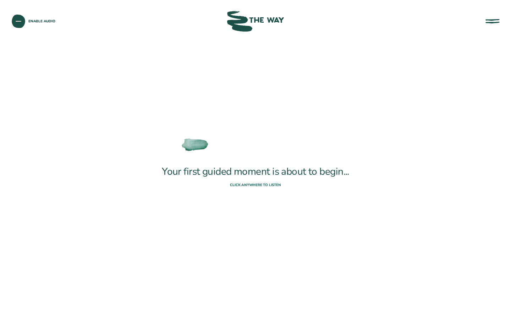
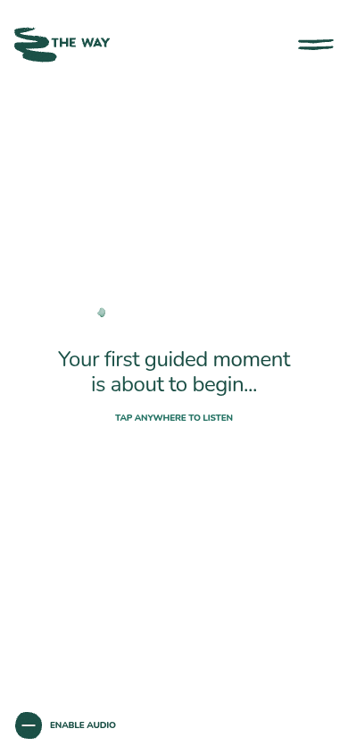

# UI Design System & Master Generation Blueprint: thewayapp-com

> **The Way App - Meditation that lasts a lifetime — The Way** (https://thewayapp.com) — A long-term path of deep meditation training, guided by Zen Master Henry Shukman



---

## 1. Executive Visual Persona & Design Archetype

- **Brand Essence & Persona**: **The Way App - Meditation that lasts a lifetime — The Way** (`https://thewayapp.com`). A long-term path of deep meditation training, guided by Zen Master Henry Shukman
- **Final Redirected URL**: [https://www.thewayapp.com/](https://www.thewayapp.com/)
- **Capture Provenance**: Live browser capture (`tier1_fast`, HTTP `200`, captured `2026-11-23`).
- **Visual Archetype**: **Light-Gallery WebGL / Canvas Interactive Experience (`#ffffff` / `#267768`)**.
- **Anti-AI-Slop Differentiators**:
  - **Live-Computed Chromatic Polarity**: Anchors the viewport in `#ffffff` (live computed `canvas-modal-luma` `background-color` (`computed_styles.json`)) paired with `#000000` primary typography and `#267768` accents.
  - **Grounded Typographic Hierarchy**: Pairs `nunito` for display copy (`The end of your search. The start of`) with `nunito Fallback` and `SF Mono`.
  - **Calibrated Spatial Grid & Motion**: Combines `1200px` container bounds (`gap: 1.5151515152vw`, padding `var(--space-40)`) with `cubic-bezier(0.55,0.055,0.675,0.19)` easing and Three.js / WebGL Canvas Pipeline.

---

## 2. Spatial Architecture & Modular Grid Mathematics



### Viewport Allocation & Container Geometry
- **Captured Viewport Dimensions**: Desktop `1440×900px` (`assets/desktop.png`, single-viewport 100vh live capture (900px)), Mobile `390×844px` (`assets/mobile.png`, single-viewport 100vh live capture (844px)).
- **Master Container Bounds**: `1200px` (non-`@media` desktop container stylesheet rule).
- **Canvas Lateral Padding & Spacing**: `var(--space-40)` lateral canvas padding with `1.5151515152vw` grid gap.
- **Border Radius Scale**: `var(--radius-sm)`, `23px`, `25px`, `var(--radius-full)`.

### Responsive Breakpoint Architecture
- **Desktop Layout**: Multi-column CSS Grid / Flexbox layout at `1440px` (`max-width: 1200px`, `gap: 1.5151515152vw`).
- **Mobile Layout**: Single-column vertical stack at `390px` viewport width with `var(--space-40)` horizontal padding.
- **Extracted CSS Media Queries**: `@media (-webkit-min-device-pixel-ratio:2),(min-resolution:2dppx)`, `@media (prefers-reduced-motion:reduce)`, `@media screen and (min-width:769px)`, `@media screen and (max-width:704px)`.

---

## 3. Color System, Materiality & Atmospheric Lighting

### Semantic Palette & Source Grounding
| Semantic Role | Ground-Truth Value | Extracted Live / CSS Source |
|---|---|---|
| **Primary Canvas Substrate** | `#ffffff` | live computed `canvas-modal-luma` `background-color` (`computed_styles.json`) |
| **Primary Typography Ink** | `#000000` | `.form_consentLabel__oKm0C { color: black }` (`#000000`) |
| **Elevated Surface / Card Substrate** | `#f7ede8` | `.scholarship_amountBadge__jyNhN { background: #f7ede8 }` |
| **Interactive Accent / Highlight** | `#267768` | `.Preloader_cta___rMP3 { color: #267768 }` |
| **Secondary / Muted Copy** | `#7d9792` | `.EndCard_offerPrice__4IHKn { color: #7d9792 }` |
| **Structural Hairline Border** | `#e5e5e5` | `.Accordion_item__siU0V { border-bottom: #e5e5e5 }` |
| **Variable Token (`--color-evergreen-light`)** | `#e8f2f0` | `var(--color-evergreen-light)` in `:root` |
| **Variable Token (`--color-evergreen-default`)** | `#1c5349` | `var(--color-evergreen-default)` in `:root` |
| **Variable Token (`--color-evergreen-dark`)** | `#122e28` | `var(--color-evergreen-dark)` in `:root` |
| **Variable Token (`--color-deepsea-light`)** | `#e6f2f0` | `var(--color-deepsea-light)` in `:root` |
| **Variable Token (`--color-deepsea-dark`)** | `#1a5249` | `var(--color-deepsea-dark)` in `:root` |
| **Variable Token (`--color-terracotta-default`)** | `#c1775b` | `var(--color-terracotta-default)` in `:root` |
| **Variable Token (`--color-terracotta-dark`)** | `#8f5440` | `var(--color-terracotta-dark)` in `:root` |
| **Variable Token (`--color-cloudberry-light`)** | `#fff7f6` | `var(--color-cloudberry-light)` in `:root` |
| **Variable Token (`--color-cloudberry-default`)** | `#ffe9e7` | `var(--color-cloudberry-default)` in `:root` |
| **Variable Token (`--color-cloudberry-dark`)** | `#f5c4bf` | `var(--color-cloudberry-dark)` in `:root` |
| **Variable Token (`--color-sky-light`)** | `#e7f8ff` | `var(--color-sky-light)` in `:root` |
| **Variable Token (`--color-sky-default`)** | `#e8f8ff` | `var(--color-sky-default)` in `:root` |
| **Variable Token (`--color-desert-light`)** | `#f8e1d9` | `var(--color-desert-light)` in `:root` |

### Sanitized Root CSS Variables (`ui-ux.md` Ground Truth)
| Variable Name | Extracted Value | Semantic Role |
|---|---|---|
| `--blur-background` | `blur(12px)` | Canvas / Surface Token |
| `--color-evergreen-light` | `#e8f2f0` | Canvas / Surface Token |
| `--color-evergreen-default` | `#1c5349` | Brand / Palette Token |
| `--color-evergreen-dark` | `#122e28` | Canvas / Surface Token |
| `--color-deepsea-light` | `#e6f2f0` | Canvas / Surface Token |
| `--color-deepsea-default` | `#267768` | Brand / Palette Token |
| `--color-deepsea-dark` | `#1a5249` | Canvas / Surface Token |
| `--color-terracotta-light` | `#f7ede8` | Canvas / Surface Token |
| `--color-terracotta-default` | `#c1775b` | Brand / Palette Token |
| `--color-terracotta-dark` | `#8f5440` | Canvas / Surface Token |
| `--color-cloudberry-light` | `#fff7f6` | Canvas / Surface Token |
| `--color-cloudberry-default` | `#ffe9e7` | Brand / Palette Token |
| `--color-cloudberry-dark` | `#f5c4bf` | Canvas / Surface Token |
| `--color-sky-light` | `#e7f8ff` | Canvas / Surface Token |
| `--color-sky-default` | `#e8f8ff` | Brand / Palette Token |
| `--color-desert-light` | `#f8e1d9` | Canvas / Surface Token |

---

## 4. Typographic Scale & Editorial Hierarchy

### Font Family Stacks
- **Display Typography**: `nunito`.
- **Primary Body Stack**: `nunito Fallback`.
- **Technical / Metadata Stack**: `SF Mono`.

### Typographic Scale & Rules (Live Computed & Stylesheet Grounded)
- **Hero Display (`H1`)**: observed font-size ladder: `100%`, `9.0909090909vw`, `60px`, `120px`, `6.0606060606vw`.
- **Section Heading (`H2`)**: observed font-size ladder: `100%`, `9.0909090909vw`, `60px`, `120px`, `6.0606060606vw`.
- **Body Copy**: rule `p` (`font-size: 18px`).
- **Metadata & Navigation Labels**: observed font-size ladder: `100%`, `9.0909090909vw`, `60px`, `120px`, `6.0606060606vw`.

---

## 5. Choreographed Motion & Interaction Physics

### Primary Easing Curves
- **Extracted Timing Functions**: `cubic-bezier(0.55,0.055,0.675,0.19)`, `cubic-bezier(0.215,0.61,0.355,1)`, `cubic-bezier(0.645,0.045,0.355,1)`.

### Per-Element Transition & Choreography Rules
- **Selector `body:after`**: `transition: opacity .4s ease` extracted from `thewayapp-com` stylesheet.
- **Selector `.Accordion_item__siU0V`**: `transition: background-color .2s ease-in-out` extracted from `thewayapp-com` stylesheet.
- **Selector `.Accordion_triggerIcon__Q6fGf`**: `transition: transform .15s ease` extracted from `thewayapp-com` stylesheet.
- **Extracted Easing Curve (`cubic-bezier(0.55,0.055,0.675,0.19)`)**: Governs interactive state transitions across `<header.Header_header__gtmFw>` and `<article.StaticNarrative_root__V_9OR:nth(2)>`.
- **Runtime Interaction Engine**: Integrates Three.js / WebGL Canvas Pipeline with `prefers-reduced-motion: reduce` fallback guards.

---

## 6. Component Wireframe & Structural DOM Map

### Visual Layout Schematic — Desktop (`1440px`, Grounded in `dom.html` & Landmark Bounding Boxes)
```
┌────────────────────────────────────────────────────────────────────────┐
│ DESKTOP VIEWPORT (1440px) — The Way App - Meditation that lasts a life │
│ ====================================================================== │
│ [ <header.Header_header_ (1440px)     | Overview · Index · Archive · ] │
│ ---------------------------------------------------------------------- │
│ | HERO STAGE: <article.StaticNarrative_root__V_9OR (w=1440px)        | │
│ | H1: The end of your search. The start of your journey.             | │
│ | Substrate: #ffffff | Ink: #000000 | Accent: #267768                | │
│ ---------------------------------------------------------------------- │
│ | SHOWCASE GRID (<article.StaticNarrative_r) max-w: 1200px           | │
│ | +------------------------------+  +------------------------------+ | │
│ | | One way forward              |  | Meet your teacher: Henry Shu | | │
│ | +------------------------------+  +------------------------------+ | │
│ ---------------------------------------------------------------------- │
│ | DETAIL MODULE (<article.StaticNarrative_r) — A path that deepens w | │
│ ---------------------------------------------------------------------- │
│ [ FOOTER (<footer.type-ui-micr) | https://thewayapp.com                │
└────────────────────────────────────────────────────────────────────────┘
```

### Visual Layout Schematic — Mobile Reflow (`390px`)
```
┌────────────────────────────────────────────────────────────────────────┐
│ MOBILE VIEWPORT REFLOW (390px) — Single-Column Stack (gap: 1.515151)   │
│ ====================================================================== │
│ [ HEADER BAR (<header.Header_header__g) | Compact Menu (390px)         │
│ ---------------------------------------------------------------------- │
│ | HERO STAGE (<article.StaticNarrative) — 390px Vertical Lead        | │
│ | H1: The end of your search. The start of your journey.             | │
│ ---------------------------------------------------------------------- │
│ | SHOWCASE STACK (<article.StaticNarrati) — 1-Col Stack              | │
│ | [ Item 1: One way forward                                        ] | │
│ | [ Item 2: Meet your teacher: Henry Shukman                       ] | │
│ ---------------------------------------------------------------------- │
│ | DETAIL STACK (<article.StaticNarrative) — 1-Col (A path that deepen) │
│ ---------------------------------------------------------------------- │
│ [ FOOTER (<footer.type-ui-micr) | Stacked 390px Colophon               │
└────────────────────────────────────────────────────────────────────────┘
```

### Granular DOM Region Breakdown
1. **Brand Header & Navigation Bar (<header.Header_header__gtmFw> — `thewayapp-com`)**:
   - Landmark `<header class="Header_header__gtmFw theme-light">` (`1440px`) hosting `The Way App - Meditation that lasts ` navigation (`Overview · Index · Archive · About · Contact`), DOM attributes (`data-precedence="next"`, `data-precedence="next"`, `data-precedence="next"`, `data-precedence="next"`), and stylesheet rule `root { font-synthesis:none;text-rendering:optimizeLegibility;-webkit-text-size-... }`.
2. **Hero Stage & Focal Lead (<article.StaticNarrative_root__V_9OR> — `The end of your search. The start `)**:
   - Landmark `<article class="StaticNarrative_root__V_9OR">` presenting display lead `The end of your search. The start of your journey.` and copy excerpt *"The end of your search."* over `#ffffff` canvas and `#000000` ink.
3. **Primary Showcase & Content Grid (<article.StaticNarrative_root__V_9OR:nth(2)> — `One way forward`)**:
   - Landmark `<article class="StaticNarrative_root__V_9OR">` rendering section `One way forward` with copy *"The start of your journey."*, asset references (`75aacf3429424351-s.p.woff2`, `df8e05a132a73a9c-s.p.woff2`, `95817d087ee99a00.css`, `6fc6cebf31cdec86.css`), and grid rule `html { overflow-x:hidden;scrollbar-width:thin;scroll-behavior:smooth }`.
4. **Interactive Detail & Feature Matrix (<article.StaticNarrative_root__V_9OR:nth(3)> — `Meet your teacher: Henry Shukman`)**:
   - Landmark `<article class="StaticNarrative_root__V_9OR">` framing `Meet your teacher: Henry Shukman` and `A path that deepens with every step` (*"Most meditation apps give you countless options. The Way offers o"*) with `#f7ede8` surface cards, `#267768` accents, and `video { width:100%;height:auto;-webkit-user-select:none;-moz-user-select:none;us... }`.
5. **Colophon & Global Directory Footer (<footer.type-ui-micro> — `https://thewayapp.com`)**:
   - Landmark `<footer class="type-ui-micro StaticNarrative_attribution__25nmb">` anchoring `The Way App - Meditation that la` footer links (`Overview · Index · Archive · About · Contact`), copy *"I've finally been able to commit to daily meditation after y"*, and `#e5e5e5` structural dividers.

---

## 7. Master Zero-Shot AI Generation Prompt

```markdown
# Master Zero-Shot Frontend Generation Prompt: thewayapp-com (The Way App - Meditation that lasts a lifetime — The Way)

You are a principal frontend architect and design systems engineer. Build a complete, production-ready web application replicating the exact design system, DOM landmarks, typographic hierarchy, color tokens, and motion physics of `thewayapp-com` (**The Way App - Meditation that lasts a lifetime — The Way** — `https://thewayapp.com`).

### 1. Visual Archetype & Anti-AI-Slop Mandates
- **Archetype**: Light-Gallery WebGL / Canvas Interactive Experience (`#ffffff` / `#267768`).
- **Identity & Domain Context**: A long-term path of deep meditation training, guided by Zen Master Henry Shukman
- **Primary Substrate**: `#ffffff` (live computed `canvas-modal-luma` `background-color` (`computed_styles.json`)), **Primary Ink**: `#000000`, **Accent / Highlight**: `#267768`.
- **Site-Specific Differentiators**:
  - **Live-Computed Chromatic Polarity**: Anchors the viewport in `#ffffff` (live computed `canvas-modal-luma` `background-color` (`computed_styles.json`)) paired with `#000000` primary typography and `#267768` accents.
  - **Grounded Typographic Hierarchy**: Pairs `nunito` for display copy (`The end of your search. The start of`) with `nunito Fallback` and `SF Mono`.
  - **Calibrated Spatial Grid & Motion**: Combines `1200px` container bounds (`gap: 1.5151515152vw`, padding `var(--space-40)`) with `cubic-bezier(0.55,0.055,0.675,0.19)` easing and Three.js / WebGL Canvas Pipeline.

### 2. Ground-Truth CSS Variables (`:root` Token Contract)
Declare and consume these exact custom properties extracted from `thewayapp-com` in your global stylesheet:

:root {
  /* The Way App - Meditation that lasts a lifetime — The Way (thewayapp-com) — Live-Grounded CSS Variables */
  --blur-background: blur(12px); /* Canvas / Surface Token (thewayapp-com) */
  --color-evergreen-light: #e8f2f0; /* Canvas / Surface Token (thewayapp-com) */
  --color-evergreen-default: #1c5349; /* Brand / Palette Token (thewayapp-com) */
  --color-evergreen-dark: #122e28; /* Canvas / Surface Token (thewayapp-com) */
  --color-deepsea-light: #e6f2f0; /* Canvas / Surface Token (thewayapp-com) */
  --color-deepsea-default: #267768; /* Brand / Palette Token (thewayapp-com) */
  --color-deepsea-dark: #1a5249; /* Canvas / Surface Token (thewayapp-com) */
  --color-terracotta-light: #f7ede8; /* Canvas / Surface Token (thewayapp-com) */
  --color-terracotta-default: #c1775b; /* Brand / Palette Token (thewayapp-com) */
  --color-terracotta-dark: #8f5440; /* Canvas / Surface Token (thewayapp-com) */
  --color-cloudberry-light: #fff7f6; /* Canvas / Surface Token (thewayapp-com) */
  --color-cloudberry-default: #ffe9e7; /* Brand / Palette Token (thewayapp-com) */
  --color-cloudberry-dark: #f5c4bf; /* Canvas / Surface Token (thewayapp-com) */
  --color-sky-light: #e7f8ff; /* Canvas / Surface Token (thewayapp-com) */
  --color-sky-default: #e8f8ff; /* Brand / Palette Token (thewayapp-com) */
  --color-desert-light: #f8e1d9; /* Canvas / Surface Token (thewayapp-com) */
}

### 3. Semantic Color & Materiality Contract
Map every surface, ink, and border strictly to these source-grounded tokens:
- **Primary Canvas Substrate**: `#ffffff` — grounded in live computed `canvas-modal-luma` `background-color` (`computed_styles.json`)
- **Primary Typography Ink**: `#000000` — grounded in `.form_consentLabel__oKm0C { color: black }` (`#000000`)
- **Elevated Surface / Card Substrate**: `#f7ede8` — grounded in `.scholarship_amountBadge__jyNhN { background: #f7ede8 }`
- **Interactive Accent / Highlight**: `#267768` — grounded in `.Preloader_cta___rMP3 { color: #267768 }`
- **Secondary / Muted Copy**: `#7d9792` — grounded in `.EndCard_offerPrice__4IHKn { color: #7d9792 }`
- **Structural Hairline Border**: `#e5e5e5` — grounded in `.Accordion_item__siU0V { border-bottom: #e5e5e5 }`
- **Variable Token (`--color-evergreen-light`)**: `#e8f2f0` — grounded in `var(--color-evergreen-light)` in `:root`
- **Variable Token (`--color-evergreen-default`)**: `#1c5349` — grounded in `var(--color-evergreen-default)` in `:root`
- **Variable Token (`--color-evergreen-dark`)**: `#122e28` — grounded in `var(--color-evergreen-dark)` in `:root`
- **Variable Token (`--color-deepsea-light`)**: `#e6f2f0` — grounded in `var(--color-deepsea-light)` in `:root`
- **Variable Token (`--color-deepsea-dark`)**: `#1a5249` — grounded in `var(--color-deepsea-dark)` in `:root`
- **Variable Token (`--color-terracotta-default`)**: `#c1775b` — grounded in `var(--color-terracotta-default)` in `:root`
- **Variable Token (`--color-terracotta-dark`)**: `#8f5440` — grounded in `var(--color-terracotta-dark)` in `:root`
- **Variable Token (`--color-cloudberry-light`)**: `#fff7f6` — grounded in `var(--color-cloudberry-light)` in `:root`
- **Variable Token (`--color-cloudberry-default`)**: `#ffe9e7` — grounded in `var(--color-cloudberry-default)` in `:root`
- **Variable Token (`--color-cloudberry-dark`)**: `#f5c4bf` — grounded in `var(--color-cloudberry-dark)` in `:root`
- **Variable Token (`--color-sky-light`)**: `#e7f8ff` — grounded in `var(--color-sky-light)` in `:root`
- **Variable Token (`--color-sky-default`)**: `#e8f8ff` — grounded in `var(--color-sky-default)` in `:root`
- **Variable Token (`--color-desert-light`)**: `#f8e1d9` — grounded in `var(--color-desert-light)` in `:root`

### 4. Spatial Grid, Container Bounds & Responsive Breakpoints
- **Desktop Viewport Reference**: `1440×900px` (single-viewport 100vh live capture (900px), `1440px` standard desktop width).
- **Mobile Viewport Reference**: `390×844px` (single-viewport 100vh live capture (844px), `390px` standard mobile width).
- **Container Max-Width**: `1200px` (non-`@media` desktop container stylesheet rule)
- **Padding & Gutters**: `var(--space-40)` lateral canvas padding with `1.5151515152vw` grid gap
- **Desktop Grid**: Multi-column CSS Grid / Flexbox layout at `1440px` (`max-width: 1200px`, `gap: 1.5151515152vw`)
- **Mobile Adaptation**: Single-column vertical stack at `390px` viewport width with `var(--space-40)` horizontal padding
- **Media Queries**: `@media (-webkit-min-device-pixel-ratio:2),(min-resolution:2dppx)`, `@media (prefers-reduced-motion:reduce)`, `@media screen and (min-width:769px)`, `@media screen and (max-width:704px)`
- **Corner Radii**: `var(--radius-sm)`, `23px`, `25px`, `var(--radius-full)`

### 5. Typography & Editorial Scale Contract
- **Display Font Stack**: `nunito`
- **Body Font Stack**: `nunito Fallback`
- **Monospace / Technical Font Stack**: `SF Mono`
- **H1 Display Rule**: observed font-size ladder: `100%`, `9.0909090909vw`, `60px`, `120px`, `6.0606060606vw`
- **H2 Section Rule**: observed font-size ladder: `100%`, `9.0909090909vw`, `60px`, `120px`, `6.0606060606vw`
- **Body Copy Rule**: rule `p` (`font-size: 18px`)
- **Metadata & Index Rule**: observed font-size ladder: `100%`, `9.0909090909vw`, `60px`, `120px`, `6.0606060606vw`

### 6. Component Hierarchy, Verbatim Copy & Real DOM Landmarks
Scaffold `thewayapp-com` (`The Way App - Meditation that lasts a lifetime — The Way`) with these exact structural regions, extracted copy, and CSS rules from `dom.html`:
1. **Brand Header & Navigation Bar (<header.Header_header__gtmFw> — `thewayapp-com`)**:
   - DOM & Selectors: Landmark `<header class="Header_header__gtmFw theme-light">` (`1440px`) hosting `The Way App - Meditation that lasts ` navigation (`Overview · Index · Archive · About · Contact`), DOM attributes (`data-precedence="next"`, `data-precedence="next"`, `data-precedence="next"`, `data-precedence="next"`), and stylesheet rule `root { font-synthesis:none;text-rendering:optimizeLegibility;-webkit-text-size-... }`.
   - Responsive Contract: Header `Brand Header & Navigation Bar (<header.Header_header__gtmFw> — `thewayapp-com`)` (`thewayapp-com`) adapts across `@media (-webkit-min-device-pixel-ratio:2),(min-resolution:2dppx)`, `@media (prefers-reduced-motion:reduce)`, `@media screen and (min-width:769px)`, `@media screen and (max-width:704px)` with `cubic-bezier(0.55,0.055,0.675,0.19)`, `cubic-bezier(0.215,0.61,0.355,1)`, `cubic-bezier(0.645,0.045,0.355,1)` transitions and links `Overview · Index · Archive · About · Contact`.
2. **Hero Stage & Focal Lead (<article.StaticNarrative_root__V_9OR> — `The end of your search. The start `)**:
   - DOM & Selectors: Landmark `<article class="StaticNarrative_root__V_9OR">` presenting display lead `The end of your search. The start of your journey.` and copy excerpt *"The end of your search."* over `#ffffff` canvas and `#000000` ink.
   - Responsive Contract: Hero stage (`1440×900px` desktop / `390×844px` mobile) sets `#ffffff` background with `#000000` headline `The end of your search. The start of your journey.`.
3. **Primary Showcase & Content Grid (<article.StaticNarrative_root__V_9OR:nth(2)> — `One way forward`)**:
   - DOM & Selectors: Landmark `<article class="StaticNarrative_root__V_9OR">` rendering section `One way forward` with copy *"The start of your journey."*, asset references (`75aacf3429424351-s.p.woff2`, `df8e05a132a73a9c-s.p.woff2`, `95817d087ee99a00.css`, `6fc6cebf31cdec86.css`), and grid rule `html { overflow-x:hidden;scrollbar-width:thin;scroll-behavior:smooth }`.
   - Responsive Contract: Showcase grid `Primary Showcase & Content Grid (<article.StaticNarrative_root__V_9OR:nth(2)> — `One way forward`)` applies Multi-column CSS Grid / Flexbox layout at `1440px` (`max-width: 1200px`, `gap: 1.5151515152vw`) on desktop and Single-column vertical stack at `390px` viewport width with `var(--space-40)` horizontal padding on mobile.
4. **Interactive Detail & Feature Matrix (<article.StaticNarrative_root__V_9OR:nth(3)> — `Meet your teacher: Henry Shukman`)**:
   - DOM & Selectors: Landmark `<article class="StaticNarrative_root__V_9OR">` framing `Meet your teacher: Henry Shukman` and `A path that deepens with every step` (*"Most meditation apps give you countless options. The Way offers o"*) with `#f7ede8` surface cards, `#267768` accents, and `video { width:100%;height:auto;-webkit-user-select:none;-moz-user-select:none;us... }`.
   - Responsive Contract: Detail module `Interactive Detail & Feature Matrix (<article.StaticNarrative_root__V_9OR:nth(3)> — `Meet your teacher: Henry Shukman`)` uses `var(--radius-sm)`, `23px`, `25px`, `var(--radius-full)` radii, `#267768` highlights, and assets (75aacf3429424351-s.p.woff2, df8e05a132a73a9c-s.p.woff2, 95817d087ee99a00.css).
5. **Colophon & Global Directory Footer (<footer.type-ui-micro> — `https://thewayapp.com`)**:
   - DOM & Selectors: Landmark `<footer class="type-ui-micro StaticNarrative_attribution__25nmb">` anchoring `The Way App - Meditation that la` footer links (`Overview · Index · Archive · About · Contact`), copy *"I've finally been able to commit to daily meditation after y"*, and `#e5e5e5` structural dividers.
   - Responsive Contract: Footer `Colophon & Global Directory Footer (<footer.type-ui-micro> — `https://thewayapp.com`)` aligns to `1200px` (non-`@media` desktop container stylesheet rule) with `var(--space-40)` lateral canvas padding with `1.5151515152vw` grid gap and attributes (data-precedence="next", data-precedence="next", data-precedence="next").

#### Verbatim DOM Copy Excerpts (`dom.html`)
- Copy Excerpt 1: *"The end of your search."*
- Copy Excerpt 2: *"The start of your journey."*
- Copy Excerpt 3: *"Most meditation apps give you countless options. The Way offers one single path. N..."*
- Copy Excerpt 4: *"I've finally been able to commit to daily meditation after years of trying. Life c..."*

### 7. Motion, Extracted Stylesheet Rules & Interaction Choreography
- **Primary Easing Functions**: `cubic-bezier(0.55,0.055,0.675,0.19)`, `cubic-bezier(0.215,0.61,0.355,1)`, `cubic-bezier(0.645,0.045,0.355,1)`
- **Extracted Stylesheet Rules (`thewayapp-com`)**:
- `root { font-synthesis:none;text-rendering:optimizeLegibility;-webkit-text-size-... }`
- `html { overflow-x:hidden;scrollbar-width:thin;scroll-behavior:smooth }`
- `video { width:100%;height:auto;-webkit-user-select:none;-moz-user-select:none;us... }`
- `dialog { max-width:none;max-height:none }`
- `.type-ui-small { font-family:var(--font-sans,system-ui,sans-serif);letter-spacing:-.02em }`
- **Per-Selector Transition Rules**:
- **Selector `body:after`**: `transition: opacity .4s ease` extracted from `thewayapp-com` stylesheet.
- **Selector `.Accordion_item__siU0V`**: `transition: background-color .2s ease-in-out` extracted from `thewayapp-com` stylesheet.
- **Selector `.Accordion_triggerIcon__Q6fGf`**: `transition: transform .15s ease` extracted from `thewayapp-com` stylesheet.
- **Extracted Easing Curve (`cubic-bezier(0.55,0.055,0.675,0.19)`)**: Governs interactive state transitions across `<header.Header_header__gtmFw>` and `<article.StaticNarrative_root__V_9OR:nth(2)>`.
- **Runtime Interaction Engine**: Integrates Three.js / WebGL Canvas Pipeline with `prefers-reduced-motion: reduce` fallback guards.

### 8. Technical Deliverables
- Implement in Next.js (App Router) with TypeScript and Tailwind CSS consuming the `:root` custom properties defined above for `thewayapp-com`.
- Reproduce both the `1440px` desktop architecture and `390px` mobile breakpoint transitions, preserving semantic HTML5 landmarks (`<header>`, `<nav>`, `<main>`, `<section>`, `<footer>`) and `prefers-reduced-motion` accessibility guards.
```
