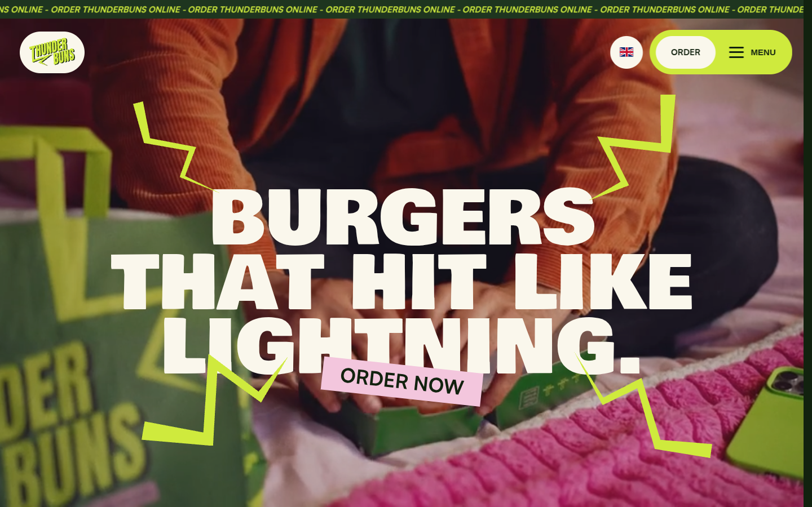
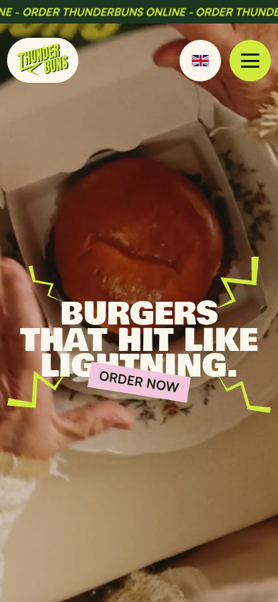

# UI Design System & Master Generation Blueprint: thunder-buns-com

> **Thunderbuns · Smashburgers Delivered** (https://thunder-buns.com/) — The best smash burgers, 100% halal. Delivered across the Netherlands, Belgium and Germany. Order through your usual delivery app.



---

## 1. Executive Visual Persona & Design Archetype

- **Brand Essence & Persona**: **Thunderbuns · Smashburgers Delivered** (`https://thunder-buns.com/`). The best smash burgers, 100% halal. Delivered across the Netherlands, Belgium and Germany. Order through your usual delivery app.
- **Capture Provenance**: Live browser capture (`tier2_webgl`, HTTP `200`, captured `2026-11-23`).
- **Visual Archetype**: **Dark-Substrate WebGL / Canvas Interactive Experience (`#12220f` / `#0000ee`)**.
- **Anti-AI-Slop Differentiators**:
  - **Live-Computed Chromatic Polarity**: Anchors the viewport in `#12220f` (live computed `html` `background-color` (`computed_styles.json`)) paired with `#faf7ec` primary typography and `#0000ee` accents.
  - **Grounded Typographic Hierarchy**: Pairs `Bowlby One` for display copy (`BURGERS THAT HIT LIKE LIGHTNING.`) with `Satoshi` and `Haffer Mono`.
  - **Calibrated Spatial Grid & Motion**: Combines `99.7em` container bounds (`gap: var(--grid-gap)`, padding `20px`) with `cubic-bezier(.625,.05,0,1)` easing and Lenis Smooth Scroll (`data-lenis`), Barba.js Page Transition Router.

---

## 2. Spatial Architecture & Modular Grid Mathematics



### Viewport Allocation & Container Geometry
- **Captured Viewport Dimensions**: Desktop `1440×900px` (`assets/desktop.png`, single-viewport 100vh live capture (900px)), Mobile `390×844px` (`assets/mobile.png`, single-viewport 100vh live capture (844px)).
- **Master Container Bounds**: `99.7em` (non-`@media` desktop container stylesheet rule).
- **Canvas Lateral Padding & Spacing**: `20px` lateral canvas padding with `var(--grid-gap)` grid gap.
- **Border Radius Scale**: `4px`, `12px`, `3px`, `50%`.

### Responsive Breakpoint Architecture
- **Desktop Layout**: Multi-column CSS Grid / Flexbox layout at `1440px` (`max-width: 99.7em`, `gap: var(--grid-gap)`).
- **Mobile Layout**: Single-column vertical stack at `390px` viewport width with `20px` horizontal padding.
- **Extracted CSS Media Queries**: `@media screen`, `@media screen and (-ms-high-contrast:active)`, `@media screen and (-ms-high-contrast:black-on-white)`, `@media screen and (min-width:640px)`.

---

## 3. Color System, Materiality & Atmospheric Lighting

### Semantic Palette & Source Grounding
| Semantic Role | Ground-Truth Value | Extracted Live / CSS Source |
|---|---|---|
| **Primary Canvas Substrate** | `#12220f` | live computed `html` `background-color` (`computed_styles.json`) |
| **Primary Typography Ink** | `#faf7ec` | live computed `h1` `color` (`computed_styles.json`) |
| **Elevated Surface / Card Substrate** | `#1e351f` | live computed `footer` `background-color` (`computed_styles.json`) |
| **Interactive Accent / Highlight** | `#0000ee` | live computed `a` `color` (`computed_styles.json`) |
| **Secondary / Muted Copy** | `#5e6266` | `var(--cc-secondary-color)` in `:root` |
| **Structural Hairline Border** | `#d4dae0` | `var(--cc-btn-secondary-hover-border-color)` in `:root` |
| **Variable Token (`--cc-bg`)** | `#ffffff` | `var(--cc-bg)` in `:root` |
| **Variable Token (`--cc-primary-color`)** | `#2c2f31` | `var(--cc-primary-color)` in `:root` |
| **Variable Token (`--cc-btn-primary-bg`)** | `#30363c` | `var(--cc-btn-primary-bg)` in `:root` |
| **Variable Token (`--cc-btn-primary-hover-bg`)** | `#000000` | `var(--cc-btn-primary-hover-bg)` in `:root` |
| **Variable Token (`--cc-btn-secondary-bg`)** | `#eaeff2` | `var(--cc-btn-secondary-bg)` in `:root` |

### Sanitized Root CSS Variables (`ui-ux.md` Ground Truth)
| Variable Name | Extracted Value | Semantic Role |
|---|---|---|
| `--cc-modal-border-radius` | `.5rem` | Elevation / Border Token |
| `--cc-btn-border-radius` | `.4rem` | Elevation / Border Token |
| `--cc-modal-transition-duration` | `.25s` | Motion / Easing Token |
| `--cc-link-color` | `var(--cc-btn-primary-bg)` | Typography Ink Token |
| `--cc-modal-margin` | `1rem` | Layout / Spatial Grid Token |
| `--cc-z-index` | `2147483647` | Elevation / Border Token |
| `--cc-bg` | `#fff` | Canvas / Surface Token |
| `--cc-primary-color` | `#2c2f31` | Brand / Palette Token |
| `--cc-secondary-color` | `#5e6266` | Brand / Palette Token |
| `--cc-btn-primary-bg` | `#30363c` | Canvas / Surface Token |
| `--cc-btn-primary-color` | `#fff` | Brand / Palette Token |
| `--cc-btn-primary-border-color` | `var(--cc-btn-primary-bg)` | Brand / Palette Token |
| `--cc-btn-primary-hover-bg` | `#000` | Canvas / Surface Token |
| `--cc-btn-primary-hover-color` | `#fff` | Brand / Palette Token |
| `--cc-btn-primary-hover-border-color` | `var(--cc-btn-primary-hover-bg)` | Brand / Palette Token |
| `--cc-btn-secondary-bg` | `#eaeff2` | Canvas / Surface Token |

---

## 4. Typographic Scale & Editorial Hierarchy

### Font Family Stacks
- **Display Typography**: `Bowlby One`.
- **Primary Body Stack**: `Satoshi`.
- **Technical / Metadata Stack**: `Haffer Mono`.

### Typographic Scale & Rules (Live Computed & Stylesheet Grounded)
- **Hero Display (`H1`)**: live computed `h1` (`font-size: 130px`, `line-height: 114.4px`, `font-weight: 700`); rule `h1` (`font-size: min(14.5em,130px)`).
- **Section Heading (`H2`)**: live computed `h2` (`font-size: 50px`, `line-height: 44px`, `font-weight: 700`); rule `h2` (`font-size: 3.3em`, `line-height: .88`).
- **Body Copy**: live computed `body` (`font-size: 10px`, `line-height: normal`, `font-weight: 400`); rule `p` (`font-size: 1.4em`, `line-height: 1.2`).
- **Metadata & Navigation Labels**: live computed `nav/a` (`font-size: 10px`, `line-height: normal`, `font-weight: 400`).

---

## 5. Choreographed Motion & Interaction Physics

### Primary Easing Curves
- **Extracted Timing Functions**: `cubic-bezier(.625,.05,0,1)`, `cubic-bezier(.33,1,.68,1)`, `cubic-bezier(.22,1,.36,1)`.

### Per-Element Transition & Choreography Rules
- **Selector `.mapboxgl-marker`**: `transition: opacity .2s` extracted from `thunder-buns-com` stylesheet.
- **Selector `.mapboxgl-touch-pan-blocker`**: `transition: opacity .75s ease-in-out` extracted from `thunder-buns-com` stylesheet.
- **Selector `.mapboxgl-touch-pan-blocker-show`**: `transition: opacity .1s ease-in-out` extracted from `thunder-buns-com` stylesheet.
- **Extracted Easing Curve (`cubic-bezier(.625,.05,0,1)`)**: Governs interactive state transitions across `<header.lenis>` and `<section.award:nth(2)>`.
- **Runtime Interaction Engine**: Integrates Lenis Smooth Scroll (`data-lenis`), Barba.js Page Transition Router, HTML5 `<canvas>` Interactive Viewport Surface with `prefers-reduced-motion: reduce` fallback guards.

---

## 6. Component Wireframe & Structural DOM Map

### Visual Layout Schematic — Desktop (`1440px`, Grounded in `dom.html` & Landmark Bounding Boxes)
```
┌────────────────────────────────────────────────────────────────────────┐
│ DESKTOP VIEWPORT (1440px) — Thunderbuns · Smashburgers Delivered       │
│ ====================================================================== │
│ [ <header.lenis> (1440x132px)         | English · Nederlands · Deuts ] │
│ ---------------------------------------------------------------------- │
│ | HERO STAGE: <section.award> (w=1425px)                             | │
│ | H1: BURGERS THAT HIT LIKE LIGHTNING.                               | │
│ | Substrate: #12220f | Ink: #faf7ec | Accent: #0000ee                | │
│ ---------------------------------------------------------------------- │
│ | SHOWCASE GRID (<section.award:nth(2)>) max-w: 99.7em               | │
│ | +------------------------------+  +------------------------------+ | │
│ | | Burgers that hit like lightn |  | Who are we? What do we do? W | | │
│ | +------------------------------+  +------------------------------+ | │
│ ---------------------------------------------------------------------- │
│ | DETAIL MODULE (<section.award:nth(3)>) — Winner Thuisbezorgd.n     | │
│ ---------------------------------------------------------------------- │
│ [ FOOTER (<footer.shape>      ) | https://thunder-buns.com/            │
└────────────────────────────────────────────────────────────────────────┘
```

### Visual Layout Schematic — Mobile Reflow (`390px`)
```
┌────────────────────────────────────────────────────────────────────────┐
│ MOBILE VIEWPORT REFLOW (390px) — Single-Column Stack (gap: var(--gr)   │
│ ====================================================================== │
│ [ HEADER BAR (<header.lenis>          ) | Compact Menu (390px)         │
│ ---------------------------------------------------------------------- │
│ | HERO STAGE (<section.award>) — 390px Vertical Lead                 | │
│ | H1: BURGERS THAT HIT LIKE LIGHTNING.                               | │
│ ---------------------------------------------------------------------- │
│ | SHOWCASE STACK (<section.award:nth(2)>) — 1-Col Stack              | │
│ | [ Item 1: Burgers that hit like lightning.                       ] | │
│ | [ Item 2: Who are we? What do we do? Where are we?               ] | │
│ ---------------------------------------------------------------------- │
│ | DETAIL STACK (<section.award:nth(3)>) — 1-Col (Winner Thuisbezorg) | │
│ ---------------------------------------------------------------------- │
│ [ FOOTER (<footer.shape>      ) | Stacked 390px Colophon               │
└────────────────────────────────────────────────────────────────────────┘
```

### Granular DOM Region Breakdown
1. **Brand Header & Navigation Bar (<header.lenis> — `thunder-buns-com`)**:
   - Landmark `<header class="lenis">` (`1440x132px`) hosting `Thunderbuns · Smashburgers Delivered` navigation (`English · Nederlands · Deutsch · Français · Order`), DOM attributes (`data-ga-id="G-DKWN4TYM2V"`, `data-barba="wrapper"`, `data-scrolling-started="false"`, `data-scrolling-direction="up"`), and stylesheet rule `.mapboxgl-canvas { position:absolute;left:0;top:0 }`.
2. **Hero Stage & Focal Lead (<section.award> — `BURGERS THAT HIT LIKE LIGHTNING.`)**:
   - Landmark `<section class="award">` presenting display lead `BURGERS THAT HIT LIKE LIGHTNING.` and copy excerpt *"ORDER THUNDERBUNS ONLINE -"* over `#12220f` canvas and `#faf7ec` ink.
3. **Primary Showcase & Content Grid (<section.award:nth(2)> — `Burgers that hit like lightning.`)**:
   - Landmark `<section class="award">` rendering section `Burgers that hit like lightning.` with copy *"We make smashburgers. Two patties, smashed onto a screaming hot p"*, asset references (`tb-favicon2.png`, `BowlbyOne-Regular.woff2`, `Satoshi-Regular.woff2`, `image.mux.com`), and grid rule `.mapboxgl-map:-webkit-full-screen { width:100%;height:100% }`.
4. **Interactive Detail & Feature Matrix (<section.award:nth(3)> — `Who are we? What do we do? Where a`)**:
   - Landmark `<section class="award">` framing `Who are we? What do we do? Where are we?` and `Winner Thuisbezorgd.nl Award 2025 “Best National...` (*"You'll now find us in 130+ locations across the Netherlands, Belg"*) with `#1e351f` surface cards, `#0000ee` accents, and `.mapboxgl-canary { background-color:salmon }`.
5. **Colophon & Global Directory Footer (<footer.shape> — `https://thunder-buns.com/`)**:
   - Landmark `<footer class="shape">` anchoring `Thunderbuns · Smashburgers Deliv` footer links (`English · Nederlands · Deutsch · Français · Order`), copy *"Thunderbuns Aachen"*, and `#d4dae0` structural dividers.

---

## 7. Master Zero-Shot AI Generation Prompt

```markdown
# Master Zero-Shot Frontend Generation Prompt: thunder-buns-com (Thunderbuns · Smashburgers Delivered)

You are a principal frontend architect and design systems engineer. Build a complete, production-ready web application replicating the exact design system, DOM landmarks, typographic hierarchy, color tokens, and motion physics of `thunder-buns-com` (**Thunderbuns · Smashburgers Delivered** — `https://thunder-buns.com/`).

### 1. Visual Archetype & Anti-AI-Slop Mandates
- **Archetype**: Dark-Substrate WebGL / Canvas Interactive Experience (`#12220f` / `#0000ee`).
- **Identity & Domain Context**: The best smash burgers, 100% halal. Delivered across the Netherlands, Belgium and Germany. Order through your usual delivery app.
- **Primary Substrate**: `#12220f` (live computed `html` `background-color` (`computed_styles.json`)), **Primary Ink**: `#faf7ec`, **Accent / Highlight**: `#0000ee`.
- **Site-Specific Differentiators**:
  - **Live-Computed Chromatic Polarity**: Anchors the viewport in `#12220f` (live computed `html` `background-color` (`computed_styles.json`)) paired with `#faf7ec` primary typography and `#0000ee` accents.
  - **Grounded Typographic Hierarchy**: Pairs `Bowlby One` for display copy (`BURGERS THAT HIT LIKE LIGHTNING.`) with `Satoshi` and `Haffer Mono`.
  - **Calibrated Spatial Grid & Motion**: Combines `99.7em` container bounds (`gap: var(--grid-gap)`, padding `20px`) with `cubic-bezier(.625,.05,0,1)` easing and Lenis Smooth Scroll (`data-lenis`), Barba.js Page Transition Router.

### 2. Ground-Truth CSS Variables (`:root` Token Contract)
Declare and consume these exact custom properties extracted from `thunder-buns-com` in your global stylesheet:

:root {
  /* Thunderbuns · Smashburgers Delivered (thunder-buns-com) — Live-Grounded CSS Variables */
  --cc-modal-border-radius: .5rem; /* Elevation / Border Token (thunder-buns-com) */
  --cc-btn-border-radius: .4rem; /* Elevation / Border Token (thunder-buns-com) */
  --cc-modal-transition-duration: .25s; /* Motion / Easing Token (thunder-buns-com) */
  --cc-link-color: var(--cc-btn-primary-bg); /* Typography Ink Token (thunder-buns-com) */
  --cc-modal-margin: 1rem; /* Layout / Spatial Grid Token (thunder-buns-com) */
  --cc-z-index: 2147483647; /* Elevation / Border Token (thunder-buns-com) */
  --cc-bg: #fff; /* Canvas / Surface Token (thunder-buns-com) */
  --cc-primary-color: #2c2f31; /* Brand / Palette Token (thunder-buns-com) */
  --cc-secondary-color: #5e6266; /* Brand / Palette Token (thunder-buns-com) */
  --cc-btn-primary-bg: #30363c; /* Canvas / Surface Token (thunder-buns-com) */
  --cc-btn-primary-color: #fff; /* Brand / Palette Token (thunder-buns-com) */
  --cc-btn-primary-border-color: var(--cc-btn-primary-bg); /* Brand / Palette Token (thunder-buns-com) */
  --cc-btn-primary-hover-bg: #000; /* Canvas / Surface Token (thunder-buns-com) */
  --cc-btn-primary-hover-color: #fff; /* Brand / Palette Token (thunder-buns-com) */
  --cc-btn-primary-hover-border-color: var(--cc-btn-primary-hover-bg); /* Brand / Palette Token (thunder-buns-com) */
  --cc-btn-secondary-bg: #eaeff2; /* Canvas / Surface Token (thunder-buns-com) */
}

### 3. Semantic Color & Materiality Contract
Map every surface, ink, and border strictly to these source-grounded tokens:
- **Primary Canvas Substrate**: `#12220f` — grounded in live computed `html` `background-color` (`computed_styles.json`)
- **Primary Typography Ink**: `#faf7ec` — grounded in live computed `h1` `color` (`computed_styles.json`)
- **Elevated Surface / Card Substrate**: `#1e351f` — grounded in live computed `footer` `background-color` (`computed_styles.json`)
- **Interactive Accent / Highlight**: `#0000ee` — grounded in live computed `a` `color` (`computed_styles.json`)
- **Secondary / Muted Copy**: `#5e6266` — grounded in `var(--cc-secondary-color)` in `:root`
- **Structural Hairline Border**: `#d4dae0` — grounded in `var(--cc-btn-secondary-hover-border-color)` in `:root`
- **Variable Token (`--cc-bg`)**: `#ffffff` — grounded in `var(--cc-bg)` in `:root`
- **Variable Token (`--cc-primary-color`)**: `#2c2f31` — grounded in `var(--cc-primary-color)` in `:root`
- **Variable Token (`--cc-btn-primary-bg`)**: `#30363c` — grounded in `var(--cc-btn-primary-bg)` in `:root`
- **Variable Token (`--cc-btn-primary-hover-bg`)**: `#000000` — grounded in `var(--cc-btn-primary-hover-bg)` in `:root`
- **Variable Token (`--cc-btn-secondary-bg`)**: `#eaeff2` — grounded in `var(--cc-btn-secondary-bg)` in `:root`

### 4. Spatial Grid, Container Bounds & Responsive Breakpoints
- **Desktop Viewport Reference**: `1440×900px` (single-viewport 100vh live capture (900px), `1440px` standard desktop width).
- **Mobile Viewport Reference**: `390×844px` (single-viewport 100vh live capture (844px), `390px` standard mobile width).
- **Container Max-Width**: `99.7em` (non-`@media` desktop container stylesheet rule)
- **Padding & Gutters**: `20px` lateral canvas padding with `var(--grid-gap)` grid gap
- **Desktop Grid**: Multi-column CSS Grid / Flexbox layout at `1440px` (`max-width: 99.7em`, `gap: var(--grid-gap)`)
- **Mobile Adaptation**: Single-column vertical stack at `390px` viewport width with `20px` horizontal padding
- **Media Queries**: `@media screen`, `@media screen and (-ms-high-contrast:active)`, `@media screen and (-ms-high-contrast:black-on-white)`, `@media screen and (min-width:640px)`
- **Corner Radii**: `4px`, `12px`, `3px`, `50%`

### 5. Typography & Editorial Scale Contract
- **Display Font Stack**: `Bowlby One`
- **Body Font Stack**: `Satoshi`
- **Monospace / Technical Font Stack**: `Haffer Mono`
- **H1 Display Rule**: live computed `h1` (`font-size: 130px`, `line-height: 114.4px`, `font-weight: 700`); rule `h1` (`font-size: min(14.5em,130px)`)
- **H2 Section Rule**: live computed `h2` (`font-size: 50px`, `line-height: 44px`, `font-weight: 700`); rule `h2` (`font-size: 3.3em`, `line-height: .88`)
- **Body Copy Rule**: live computed `body` (`font-size: 10px`, `line-height: normal`, `font-weight: 400`); rule `p` (`font-size: 1.4em`, `line-height: 1.2`)
- **Metadata & Index Rule**: live computed `nav/a` (`font-size: 10px`, `line-height: normal`, `font-weight: 400`)

### 6. Component Hierarchy, Verbatim Copy & Real DOM Landmarks
Scaffold `thunder-buns-com` (`Thunderbuns · Smashburgers Delivered`) with these exact structural regions, extracted copy, and CSS rules from `dom.html`:
1. **Brand Header & Navigation Bar (<header.lenis> — `thunder-buns-com`)**:
   - DOM & Selectors: Landmark `<header class="lenis">` (`1440x132px`) hosting `Thunderbuns · Smashburgers Delivered` navigation (`English · Nederlands · Deutsch · Français · Order`), DOM attributes (`data-ga-id="G-DKWN4TYM2V"`, `data-barba="wrapper"`, `data-scrolling-started="false"`, `data-scrolling-direction="up"`), and stylesheet rule `.mapboxgl-canvas { position:absolute;left:0;top:0 }`.
   - Responsive Contract: Header `Brand Header & Navigation Bar (<header.lenis> — `thunder-buns-com`)` (`thunder-buns-com`) adapts across `@media screen`, `@media screen and (-ms-high-contrast:active)`, `@media screen and (-ms-high-contrast:black-on-white)`, `@media screen and (min-width:640px)` with `cubic-bezier(.625,.05,0,1)`, `cubic-bezier(.33,1,.68,1)`, `cubic-bezier(.22,1,.36,1)` transitions and links `English · Nederlands · Deutsch · Français · Order`.
2. **Hero Stage & Focal Lead (<section.award> — `BURGERS THAT HIT LIKE LIGHTNING.`)**:
   - DOM & Selectors: Landmark `<section class="award">` presenting display lead `BURGERS THAT HIT LIKE LIGHTNING.` and copy excerpt *"ORDER THUNDERBUNS ONLINE -"* over `#12220f` canvas and `#faf7ec` ink.
   - Responsive Contract: Hero stage (`1440×900px` desktop / `390×844px` mobile) sets `#12220f` background with `#faf7ec` headline `BURGERS THAT HIT LIKE LIGHTNING.`.
3. **Primary Showcase & Content Grid (<section.award:nth(2)> — `Burgers that hit like lightning.`)**:
   - DOM & Selectors: Landmark `<section class="award">` rendering section `Burgers that hit like lightning.` with copy *"We make smashburgers. Two patties, smashed onto a screaming hot p"*, asset references (`tb-favicon2.png`, `BowlbyOne-Regular.woff2`, `Satoshi-Regular.woff2`, `image.mux.com`), and grid rule `.mapboxgl-map:-webkit-full-screen { width:100%;height:100% }`.
   - Responsive Contract: Showcase grid `Primary Showcase & Content Grid (<section.award:nth(2)> — `Burgers that hit like lightning.`)` applies Multi-column CSS Grid / Flexbox layout at `1440px` (`max-width: 99.7em`, `gap: var(--grid-gap)`) on desktop and Single-column vertical stack at `390px` viewport width with `20px` horizontal padding on mobile.
4. **Interactive Detail & Feature Matrix (<section.award:nth(3)> — `Who are we? What do we do? Where a`)**:
   - DOM & Selectors: Landmark `<section class="award">` framing `Who are we? What do we do? Where are we?` and `Winner Thuisbezorgd.nl Award 2025 “Best National...` (*"You'll now find us in 130+ locations across the Netherlands, Belg"*) with `#1e351f` surface cards, `#0000ee` accents, and `.mapboxgl-canary { background-color:salmon }`.
   - Responsive Contract: Detail module `Interactive Detail & Feature Matrix (<section.award:nth(3)> — `Who are we? What do we do? Where a`)` uses `4px`, `12px`, `3px`, `50%` radii, `#0000ee` highlights, and assets (tb-favicon2.png, BowlbyOne-Regular.woff2, Satoshi-Regular.woff2).
5. **Colophon & Global Directory Footer (<footer.shape> — `https://thunder-buns.com/`)**:
   - DOM & Selectors: Landmark `<footer class="shape">` anchoring `Thunderbuns · Smashburgers Deliv` footer links (`English · Nederlands · Deutsch · Français · Order`), copy *"Thunderbuns Aachen"*, and `#d4dae0` structural dividers.
   - Responsive Contract: Footer `Colophon & Global Directory Footer (<footer.shape> — `https://thunder-buns.com/`)` aligns to `99.7em` (non-`@media` desktop container stylesheet rule) with `20px` lateral canvas padding with `var(--grid-gap)` grid gap and attributes (data-ga-id="G-DKWN4TYM2V", data-barba="wrapper", data-scrolling-started="false").

#### Verbatim DOM Copy Excerpts (`dom.html`)
- Copy Excerpt 1: *"ORDER THUNDERBUNS ONLINE -"*
- Copy Excerpt 2: *"We make smashburgers. Two patties, smashed onto a screaming hot plate until the ed..."*
- Copy Excerpt 3: *"You'll now find us in 130+ locations across the Netherlands, Belgium and Germany,..."*
- Copy Excerpt 4: *"Thunderbuns Aachen"*

### 7. Motion, Extracted Stylesheet Rules & Interaction Choreography
- **Primary Easing Functions**: `cubic-bezier(.625,.05,0,1)`, `cubic-bezier(.33,1,.68,1)`, `cubic-bezier(.22,1,.36,1)`
- **Extracted Stylesheet Rules (`thunder-buns-com`)**:
- `.mapboxgl-canvas { position:absolute;left:0;top:0 }`
- `.mapboxgl-map:-webkit-full-screen { width:100%;height:100% }`
- `.mapboxgl-canary { background-color:salmon }`
- `ctrl-group button.mapboxgl-ctrl-c... { cursor:grab;-webkit-user-select:none;user-select:none }`
- `oxgl-interactive.mapboxgl-track-p... { cursor:pointer }`
- **Per-Selector Transition Rules**:
- **Selector `.mapboxgl-marker`**: `transition: opacity .2s` extracted from `thunder-buns-com` stylesheet.
- **Selector `.mapboxgl-touch-pan-blocker`**: `transition: opacity .75s ease-in-out` extracted from `thunder-buns-com` stylesheet.
- **Selector `.mapboxgl-touch-pan-blocker-show`**: `transition: opacity .1s ease-in-out` extracted from `thunder-buns-com` stylesheet.
- **Extracted Easing Curve (`cubic-bezier(.625,.05,0,1)`)**: Governs interactive state transitions across `<header.lenis>` and `<section.award:nth(2)>`.
- **Runtime Interaction Engine**: Integrates Lenis Smooth Scroll (`data-lenis`), Barba.js Page Transition Router, HTML5 `<canvas>` Interactive Viewport Surface with `prefers-reduced-motion: reduce` fallback guards.

### 8. Technical Deliverables
- Implement in Next.js (App Router) with TypeScript and Tailwind CSS consuming the `:root` custom properties defined above for `thunder-buns-com`.
- Reproduce both the `1440px` desktop architecture and `390px` mobile breakpoint transitions, preserving semantic HTML5 landmarks (`<header>`, `<nav>`, `<main>`, `<section>`, `<footer>`) and `prefers-reduced-motion` accessibility guards.
```
