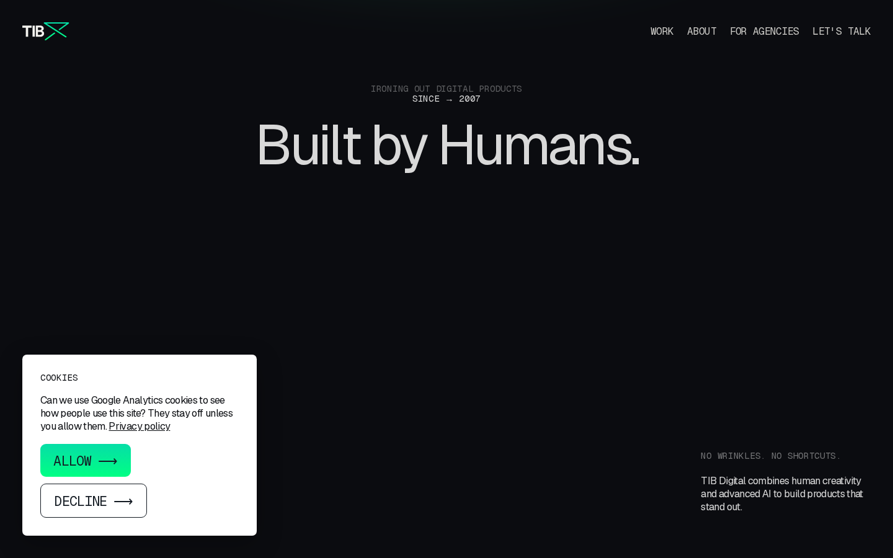
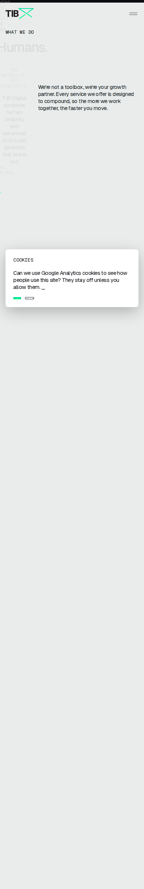

# UI Design System & Master Generation Blueprint: tibdigital-com

> **TIB Digital · Built by humans. Powered by AI.** (https://tibdigital.com) — TIB Digital is an Austin and Hong Kong studio building AI-powered web, mobile and platform software for founders and agencies. Built by h...



---

## 1. Executive Visual Persona & Design Archetype

- **Brand Essence & Persona**: **TIB Digital · Built by humans. Powered by AI.** (`https://tibdigital.com`). TIB Digital is an Austin and Hong Kong studio building AI-powered web, mobile and platform software for founders and agencies. Built by h...
- **Visual Archetype**: **Dark-Substrate WebGL / Canvas Interactive Experience (`#0b0c10` / `#0a0c10`)**.
- **Anti-AI-Slop Differentiators**:
  - **Source-Grounded Chromatic Polarity**: Anchors the viewport in `#0b0c10` (`var(--pl-dark)` in `:root`) paired with `#fff` primary typography and `#0a0c10` accents.
  - **Extracted Typographic Hierarchy**: Pairs `Geist` for display copy (`Built by Humans. Powered by AI. Made`) with `Geist Fallback` and `Geist Mono`.
  - **Calibrated Spatial Grid & Motion**: Combines `40rem` container bounds (`gap: .35rem`, padding `1px`) with `cubic-bezier(.4,0,1,1)` easing and Lenis Smooth Scroll (`data-lenis`), Three.js / WebGL Canvas Pipeline.

---

## 2. Spatial Architecture & Modular Grid Mathematics



### Viewport Allocation & Container Geometry
- **Captured Viewport Dimensions**: Desktop `1440×2400px` (`assets/desktop.png`, capped at 2400px multi-section capture), Mobile `390×2400px` (`assets/mobile.png`, capped at 2400px multi-section capture).
- **Master Container Bounds**: `40rem` extracted from `tibdigital-com` stylesheet.
- **Canvas Lateral Padding & Spacing**: `1px` lateral canvas padding with `.35rem` grid gap.
- **Border Radius Scale**: `.25rem`, `.625rem`, `3rem`, `2147483647px`.

### Responsive Breakpoint Architecture
- **Desktop Layout**: Multi-column CSS Grid / Flexbox layout at `1440px` (`max-width: 40rem`, `gap: .35rem`).
- **Mobile Layout**: Single-column vertical stack at `390px` viewport width with `1px` horizontal padding.
- **Extracted CSS Media Queries**: `@media (prefers-reduced-motion:reduce)`, `@media (min-width:40rem)`, `@media (min-width:48rem)`, `@media (min-width:64rem)`.

---

## 3. Color System, Materiality & Atmospheric Lighting

### Semantic Palette & Source Grounding
| Semantic Role | Ground-Truth Value | Extracted CSS Source / Selector |
|---|---|---|
| **Primary Canvas Substrate** | `#0b0c10` | `var(--pl-dark)` in `:root` |
| **Primary Typography Ink** | `#00ff85` | `var(--pl-green)` in `:root` |
| **Elevated Surface / Card Substrate** | `#e9eceb` | `var(--pl-ink)` in `:root` |
| **Interactive Accent / Highlight** | `#0a0c10` | `var(--color-black)` in `:root` |
| **Secondary / Muted Copy** | `#fff` | `var(--color-white)` in `:root` |
| **Structural Hairline Border** | `#141b23` | `var(--color-rich-black)` in `:root` |

### Sanitized Root CSS Variables (`ui-ux.md` Ground Truth)
| Variable Name | Extracted Value | Semantic Role |
|---|---|---|
| `--pl-dark` | `#0b0c10` | Canvas / Surface Token |
| `--pl-green` | `#00ff85` | Color / Atmospheric Token |
| `--pl-ink` | `#e9eceb` | Typography Ink Token |
| `--font-geist-sans` | `"Geist", "Geist Fallback"` | Typography / Scale Token |
| `--font-geist-mono` | `"Geist Mono", "Geist Mono Fallback"` | Typography / Scale Token |
| `--font-sans` | `var(--font-geist-sans)` | Typography / Scale Token |
| `--font-mono` | `var(--font-geist-mono)` | Typography / Scale Token |
| `--color-black` | `#0a0c10` | Canvas / Surface Token |
| `--color-white` | `#fff` | Canvas / Surface Token |
| `--spacing` | `.25rem` | Layout / Spatial Grid Token |
| `--container-sm` | `24rem` | Layout / Spatial Grid Token |
| `--container-md` | `28rem` | Layout / Spatial Grid Token |
| `--container-xl` | `36rem` | Layout / Spatial Grid Token |
| `--container-3xl` | `48rem` | Layout / Spatial Grid Token |
| `--container-5xl` | `64rem` | Layout / Spatial Grid Token |
| `--container-7xl` | `80rem` | Layout / Spatial Grid Token |

---

## 4. Typographic Scale & Editorial Hierarchy

### Font Family Stacks
- **Display Typography**: `Geist`.
- **Primary Body Stack**: `Geist Fallback`.
- **Technical / Metadata Stack**: `Geist Mono`.

### Typographic Scale & Rules (Extracted from Stylesheet & Variables)
- **Hero Display (`H1`)**: rule `,.h1` (`font-size: 2.5rem`, `line-height: calc(var(--spacing) *...`, `letter-spacing: -.06em`).
- **Section Heading (`H2`)**: CSS variables `--text-2xl: 1.5rem`, `--text-2xl--line-height: calc(2 / 1.5)`; rule `,.h2` (`font-size: 2rem`, `line-height: calc(var(--spacing) * 9)`, `letter-spacing: -.06em`, `font-weight: var(--font-we...`).
- **Body Copy**: CSS variables `--text-base: 1rem`, `--text-base--line-height: calc(1.5 / 1)`; rule `,.paragraph` (`font-size: var(--text-base)`, `line-height: var(--tw-leading,var(...`, `letter-spacing: -.04em`).
- **Metadata & Navigation Labels**: CSS variables `--font-geist-mono: "Geist Mono", "Geist Mono Fallback"`, `--font-mono: var(--font-geist-mono)`, `--text-xs: .75rem`.

---

## 5. Choreographed Motion & Interaction Physics

### Primary Easing Curves
- **Extracted Timing Functions**: `cubic-bezier(.4,0,1,1)`, `cubic-bezier(0,0,.2,1)`, `cubic-bezier(.4,0,.2,1)`.

### Per-Element Transition & Choreography Rules
- **Selector `layer theme`**: `transition: .15s` extracted from `tibdigital-com` stylesheet.
- **Selector `.transition`**: `transition: var(--tw-ease,var(--default-transition-timing-function))` extracted from `tibdigital-com` stylesheet.
- **Selector `.transition-\[width\]`**: `transition: var(--tw-ease,var(--default-transition-timing-function))` extracted from `tibdigital-com` stylesheet.
- **Extracted Easing Curve (`cubic-bezier(.4,0,1,1)`)**: Governs interactive state transitions across `<header.text-light>` and `<section.bg-grey-light>`.
- **Runtime Interaction Engine**: Integrates Lenis Smooth Scroll (`data-lenis`), Three.js / WebGL Canvas Pipeline, Swiper Touch Carousel Engine with `prefers-reduced-motion: reduce` fallback guards.

---

## 6. Component Wireframe & Structural DOM Map

### Visual Layout Schematic (Grounded in `dom.html` — `1440px` Desktop & `390px` Mobile Reflow)
```
┌────────────────────────────────────────────────────────────────────────┐
│ DESKTOP VIEWPORT (1440px) — TIB Digital · Built by humans. Powered by  │
│ ====================================================================== │
│ [ <header.text-light>      | Overview · Index · Archive · About · C ]  │
│ ---------------------------------------------------------------------- │
│ | HERO STAGE: <section.relative>                                   |   │
│ | H1: Built by Humans. Powered by AI. Made for what's n...         |   │
│ | Substrate: #0b0c10    | Ink: #fff       | Accent: #0a0c10        |   │
│ ---------------------------------------------------------------------- │
│ | SHOWCASE GRID (<section.bg-grey-light>   ) max-w: 40rem          |   │
│ | +------------------------------+  +------------------------------+ | │
│ | | First prototype <24 hrs      |  | Design systems that ship     | | │
│ | +------------------------------+  +------------------------------+ | │
│ ---------------------------------------------------------------------- │
│ | MOBILE VIEWPORT REFLOW (390px) — Single-Column Stack (gap: .35rem) | │
│ | [<header.text-light] -> [<section.relative>] -> [<section.bg-grey-l] │
│ ---------------------------------------------------------------------- │
│ [ FOOTER (<footer.text-light>   ) | https://tibdigital.com             │
└────────────────────────────────────────────────────────────────────────┘
```

### Granular DOM Region Breakdown
1. **Brand Header & Navigation Bar (<header.text-light> — `tibdigital-com`)**:
   - Landmark `<header class="text-light fixed">` hosting `TIB Digital · Built by humans. Power` navigation (`Overview · Index · Archive · About · Contact`), DOM attributes (`data-perf-tier="full"`, `data-page-transition-ready="true"`, `data-page-loader-done="true"`, `data-precedence="next"`), and stylesheet rule `root { --pl-dark:0b0c10;--pl-green:00ff85;--pl-ink:e9eceb }`.
2. **Hero Stage & Focal Lead (<section.relative> — `Built by Humans. Powered by AI. Ma`)**:
   - Landmark `<section class="relative w-full">` presenting display lead `Built by Humans. Powered by AI. Made for what's n...` and copy excerpt *"Work ] ) W & % o % & r # # k"* over `#0b0c10` canvas and `#fff` ink.
3. **Primary Showcase & Content Grid (<section.bg-grey-light> — `First prototype <24 hrs`)**:
   - Landmark `<section class="bg-grey-light relative">` rendering section `First prototype <24 hrs` with copy *"] ) W & % o % & r # # k"*, asset references (`07a39a8a4660cc7c-s.p.0r6juujl39pe...`, `605ce01b664af129-s.p.0wgildi0cnwt...`, `24e2077-fs8_m.css`, `235q64u4xcxu9.css`), and grid rule `.pl-glow-mount { pointer-events:none;position:absolute;inset:0 }`.
4. **Interactive Detail & Feature Matrix (<section.bg-grey-light> — `Design systems that ship`)**:
   - Landmark `<section class="bg-grey-light text-rich-black">` framing `Design systems that ship` and `AI agents in production` (*"About · $ A & % b # # o ) ( u € · t"*) with `#e9eceb` surface cards, `#0a0c10` accents, and `.pl-glow { pointer-events:none;width:100%;height:100%;display:block;position:absolu... }`.
5. **Colophon & Global Directory Footer (<footer.text-light> — `https://tibdigital.com`)**:
   - Landmark `<footer class="text-light relative">` anchoring `TIB Digital · Built by humans. P` footer links (`Overview · Index · Archive · About · Contact`), copy *"· $ A & % b # # o ) ( u € · t"*, and `#141b23` structural dividers.

---

## 7. Master Zero-Shot AI Generation Prompt

```markdown
# Master Zero-Shot Frontend Generation Prompt: tibdigital-com (TIB Digital · Built by humans. Powered by AI.)

You are a principal frontend architect and design systems engineer. Build a complete, production-ready web application replicating the exact design system, DOM landmarks, typographic hierarchy, color tokens, and motion physics of `tibdigital-com` (**TIB Digital · Built by humans. Powered by AI.** — `https://tibdigital.com`).

### 1. Visual Archetype & Anti-AI-Slop Mandates
- **Archetype**: Dark-Substrate WebGL / Canvas Interactive Experience (`#0b0c10` / `#0a0c10`).
- **Identity & Domain Context**: TIB Digital is an Austin and Hong Kong studio building AI-powered web, mobile and platform software for founders and agencies. Built by h...
- **Primary Substrate**: `#0b0c10` (`var(--pl-dark)` in `:root`), **Primary Ink**: `#fff`, **Accent / Highlight**: `#0a0c10`.
- **Site-Specific Differentiators**:
  - **Source-Grounded Chromatic Polarity**: Anchors the viewport in `#0b0c10` (`var(--pl-dark)` in `:root`) paired with `#fff` primary typography and `#0a0c10` accents.
  - **Extracted Typographic Hierarchy**: Pairs `Geist` for display copy (`Built by Humans. Powered by AI. Made`) with `Geist Fallback` and `Geist Mono`.
  - **Calibrated Spatial Grid & Motion**: Combines `40rem` container bounds (`gap: .35rem`, padding `1px`) with `cubic-bezier(.4,0,1,1)` easing and Lenis Smooth Scroll (`data-lenis`), Three.js / WebGL Canvas Pipeline.

### 2. Ground-Truth CSS Variables (`:root` Token Contract)
Declare and consume these exact custom properties extracted from `tibdigital-com` in your global stylesheet:

:root {
  /* TIB Digital · Built by humans. Powered by AI. (tibdigital-com) — Ground-Truth Extracted CSS Variables */
  --pl-dark: #0b0c10; /* Canvas / Surface Token (tibdigital-com) */
  --pl-green: #00ff85; /* Color / Atmospheric Token (tibdigital-com) */
  --pl-ink: #e9eceb; /* Typography Ink Token (tibdigital-com) */
  --font-geist-sans: "Geist", "Geist Fallback"; /* Typography / Scale Token (tibdigital-com) */
  --font-geist-mono: "Geist Mono", "Geist Mono Fallback"; /* Typography / Scale Token (tibdigital-com) */
  --font-sans: var(--font-geist-sans); /* Typography / Scale Token (tibdigital-com) */
  --font-mono: var(--font-geist-mono); /* Typography / Scale Token (tibdigital-com) */
  --color-black: #0a0c10; /* Canvas / Surface Token (tibdigital-com) */
  --color-white: #fff; /* Canvas / Surface Token (tibdigital-com) */
  --spacing: .25rem; /* Layout / Spatial Grid Token (tibdigital-com) */
  --container-sm: 24rem; /* Layout / Spatial Grid Token (tibdigital-com) */
  --container-md: 28rem; /* Layout / Spatial Grid Token (tibdigital-com) */
  --container-xl: 36rem; /* Layout / Spatial Grid Token (tibdigital-com) */
  --container-3xl: 48rem; /* Layout / Spatial Grid Token (tibdigital-com) */
  --container-5xl: 64rem; /* Layout / Spatial Grid Token (tibdigital-com) */
  --container-7xl: 80rem; /* Layout / Spatial Grid Token (tibdigital-com) */
}

### 3. Semantic Color & Materiality Contract
Map every surface, ink, and border strictly to these source-grounded tokens:
- **Primary Canvas Substrate**: `#0b0c10` — grounded in `var(--pl-dark)` in `:root`
- **Primary Typography Ink**: `#00ff85` — grounded in `var(--pl-green)` in `:root`
- **Elevated Surface / Card Substrate**: `#e9eceb` — grounded in `var(--pl-ink)` in `:root`
- **Interactive Accent / Highlight**: `#0a0c10` — grounded in `var(--color-black)` in `:root`
- **Secondary / Muted Copy**: `#fff` — grounded in `var(--color-white)` in `:root`
- **Structural Hairline Border**: `#141b23` — grounded in `var(--color-rich-black)` in `:root`

### 4. Spatial Grid, Container Bounds & Responsive Breakpoints
- **Desktop Viewport Reference**: `1440×2400px` (capped at 2400px multi-section capture, `1440px` standard desktop width).
- **Mobile Viewport Reference**: `390×2400px` (capped at 2400px multi-section capture, `390px` standard mobile width).
- **Container Max-Width**: `40rem` extracted from `tibdigital-com` stylesheet
- **Padding & Gutters**: `1px` lateral canvas padding with `.35rem` grid gap
- **Desktop Grid**: Multi-column CSS Grid / Flexbox layout at `1440px` (`max-width: 40rem`, `gap: .35rem`)
- **Mobile Adaptation**: Single-column vertical stack at `390px` viewport width with `1px` horizontal padding
- **Media Queries**: `@media (prefers-reduced-motion:reduce)`, `@media (min-width:40rem)`, `@media (min-width:48rem)`, `@media (min-width:64rem)`
- **Corner Radii**: `.25rem`, `.625rem`, `3rem`, `2147483647px`

### 5. Typography & Editorial Scale Contract
- **Display Font Stack**: `Geist`
- **Body Font Stack**: `Geist Fallback`
- **Monospace / Technical Font Stack**: `Geist Mono`
- **H1 Display Rule**: rule `,.h1` (`font-size: 2.5rem`, `line-height: calc(var(--spacing) *...`, `letter-spacing: -.06em`)
- **H2 Section Rule**: CSS variables `--text-2xl: 1.5rem`, `--text-2xl--line-height: calc(2 / 1.5)`; rule `,.h2` (`font-size: 2rem`, `line-height: calc(var(--spacing) * 9)`, `letter-spacing: -.06em`, `font-weight: var(--font-we...`)
- **Body Copy Rule**: CSS variables `--text-base: 1rem`, `--text-base--line-height: calc(1.5 / 1)`; rule `,.paragraph` (`font-size: var(--text-base)`, `line-height: var(--tw-leading,var(...`, `letter-spacing: -.04em`)
- **Metadata & Index Rule**: CSS variables `--font-geist-mono: "Geist Mono", "Geist Mono Fallback"`, `--font-mono: var(--font-geist-mono)`, `--text-xs: .75rem`

### 6. Component Hierarchy, Verbatim Copy & Real DOM Landmarks
Scaffold `tibdigital-com` (`TIB Digital · Built by humans. Powered by AI.`) with these exact structural regions, extracted copy, and CSS rules from `dom.html`:
1. **Brand Header & Navigation Bar (<header.text-light> — `tibdigital-com`)**:
   - DOM & Selectors: Landmark `<header class="text-light fixed">` hosting `TIB Digital · Built by humans. Power` navigation (`Overview · Index · Archive · About · Contact`), DOM attributes (`data-perf-tier="full"`, `data-page-transition-ready="true"`, `data-page-loader-done="true"`, `data-precedence="next"`), and stylesheet rule `root { --pl-dark:0b0c10;--pl-green:00ff85;--pl-ink:e9eceb }`.
   - Responsive Contract: Header `Brand Header & Navigation Bar (<header.text-light> — `tibdigital-com`)` (`tibdigital-com`) adapts across `@media (prefers-reduced-motion:reduce)`, `@media (min-width:40rem)`, `@media (min-width:48rem)`, `@media (min-width:64rem)` with `cubic-bezier(.4,0,1,1)`, `cubic-bezier(0,0,.2,1)`, `cubic-bezier(.4,0,.2,1)` transitions and links `Overview · Index · Archive · About · Contact`.
2. **Hero Stage & Focal Lead (<section.relative> — `Built by Humans. Powered by AI. Ma`)**:
   - DOM & Selectors: Landmark `<section class="relative w-full">` presenting display lead `Built by Humans. Powered by AI. Made for what's n...` and copy excerpt *"Work ] ) W & % o % & r # # k"* over `#0b0c10` canvas and `#fff` ink.
   - Responsive Contract: Hero stage (`1440×2400px` desktop / `390×2400px` mobile) sets `#0b0c10` background with `#fff` headline `Built by Humans. Powered by AI. Made for what's n...`.
3. **Primary Showcase & Content Grid (<section.bg-grey-light> — `First prototype <24 hrs`)**:
   - DOM & Selectors: Landmark `<section class="bg-grey-light relative">` rendering section `First prototype <24 hrs` with copy *"] ) W & % o % & r # # k"*, asset references (`07a39a8a4660cc7c-s.p.0r6juujl39pe...`, `605ce01b664af129-s.p.0wgildi0cnwt...`, `24e2077-fs8_m.css`, `235q64u4xcxu9.css`), and grid rule `.pl-glow-mount { pointer-events:none;position:absolute;inset:0 }`.
   - Responsive Contract: Showcase grid `Primary Showcase & Content Grid (<section.bg-grey-light> — `First prototype <24 hrs`)` applies Multi-column CSS Grid / Flexbox layout at `1440px` (`max-width: 40rem`, `gap: .35rem`) on desktop and Single-column vertical stack at `390px` viewport width with `1px` horizontal padding on mobile.
4. **Interactive Detail & Feature Matrix (<section.bg-grey-light> — `Design systems that ship`)**:
   - DOM & Selectors: Landmark `<section class="bg-grey-light text-rich-black">` framing `Design systems that ship` and `AI agents in production` (*"About · $ A & % b # # o ) ( u € · t"*) with `#e9eceb` surface cards, `#0a0c10` accents, and `.pl-glow { pointer-events:none;width:100%;height:100%;display:block;position:absolu... }`.
   - Responsive Contract: Detail module `Interactive Detail & Feature Matrix (<section.bg-grey-light> — `Design systems that ship`)` uses `.25rem`, `.625rem`, `3rem`, `2147483647px` radii, `#0a0c10` highlights, and assets (07a39a8a4660cc7c-s.p.0r6juujl39pe..., 605ce01b664af129-s.p.0wgildi0cnwt..., 24e2077-fs8_m.css).
5. **Colophon & Global Directory Footer (<footer.text-light> — `https://tibdigital.com`)**:
   - DOM & Selectors: Landmark `<footer class="text-light relative">` anchoring `TIB Digital · Built by humans. P` footer links (`Overview · Index · Archive · About · Contact`), copy *"· $ A & % b # # o ) ( u € · t"*, and `#141b23` structural dividers.
   - Responsive Contract: Footer `Colophon & Global Directory Footer (<footer.text-light> — `https://tibdigital.com`)` aligns to `40rem` extracted from `tibdigital-com` stylesheet with `1px` lateral canvas padding with `.35rem` grid gap and attributes (data-perf-tier="full", data-page-transition-ready="true", data-page-loader-done="true").

#### Verbatim DOM Copy Excerpts (`dom.html`)
- Copy Excerpt 1: *"Work ] ) W & % o % & r # # k"*
- Copy Excerpt 2: *"] ) W & % o % & r # # k"*
- Copy Excerpt 3: *"About · $ A & % b # # o ) ( u € · t"*
- Copy Excerpt 4: *"· $ A & % b # # o ) ( u € · t"*

### 7. Motion, Extracted Stylesheet Rules & Interaction Choreography
- **Primary Easing Functions**: `cubic-bezier(.4,0,1,1)`, `cubic-bezier(0,0,.2,1)`, `cubic-bezier(.4,0,.2,1)`
- **Extracted Stylesheet Rules (`tibdigital-com`)**:
- `root { --pl-dark:0b0c10;--pl-green:00ff85;--pl-ink:e9eceb }`
- `.pl-glow-mount { pointer-events:none;position:absolute;inset:0 }`
- `.pl-glow { pointer-events:none;width:100%;height:100%;display:block;position:absolu... }`
- `.pl-wordmark { opacity:0;will-change:opacity, transform;line-height:0 }`
- `.pl-logo { transform-origin:50%;will-change:transform;width:clamp(14rem,46vw,29rem)... }`
- **Per-Selector Transition Rules**:
- **Selector `layer theme`**: `transition: .15s` extracted from `tibdigital-com` stylesheet.
- **Selector `.transition`**: `transition: var(--tw-ease,var(--default-transition-timing-function))` extracted from `tibdigital-com` stylesheet.
- **Selector `.transition-\[width\]`**: `transition: var(--tw-ease,var(--default-transition-timing-function))` extracted from `tibdigital-com` stylesheet.
- **Extracted Easing Curve (`cubic-bezier(.4,0,1,1)`)**: Governs interactive state transitions across `<header.text-light>` and `<section.bg-grey-light>`.
- **Runtime Interaction Engine**: Integrates Lenis Smooth Scroll (`data-lenis`), Three.js / WebGL Canvas Pipeline, Swiper Touch Carousel Engine with `prefers-reduced-motion: reduce` fallback guards.

### 8. Technical Deliverables
- Implement in Next.js (App Router) with TypeScript and Tailwind CSS consuming the `:root` custom properties defined above for `tibdigital-com`.
- Reproduce both the `1440px` desktop architecture and `390px` mobile breakpoint transitions, preserving semantic HTML5 landmarks (`<header>`, `<nav>`, `<main>`, `<section>`, `<footer>`) and `prefers-reduced-motion` accessibility guards.
```
