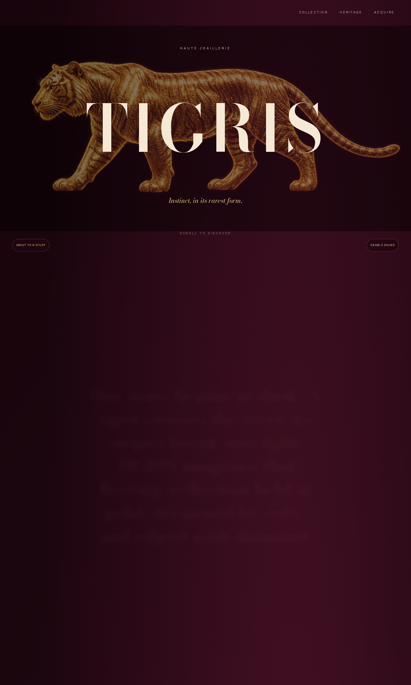
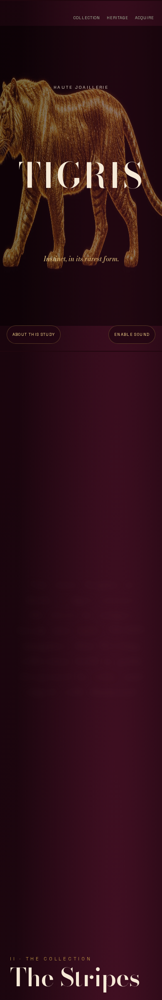

# UI Design System & Master Generation Blueprint: tigris-lorolabs-ai

> **TIGRIS · Instinct, in Its Rarest Form** (https://tigris.lorolabs.ai/) — Maison Tigris. Sculptural high jewellery in gold, rubies and diamonds. Discover the collection and explore a private viewing.



---

## 1. Executive Visual Persona & Design Archetype

- **Brand Essence & Persona**: **TIGRIS · Instinct, in Its Rarest Form** (`https://tigris.lorolabs.ai/`). Maison Tigris. Sculptural high jewellery in gold, rubies and diamonds. Discover the collection and explore a private viewing.
- **Capture Provenance**: Live browser capture (`tier1_fast`, HTTP `200`, captured `2026-11-23`).
- **Visual Archetype**: **Dark-Substrate WebGL / Canvas Interactive Experience (`#20060e` / `#f2d38a`)**.
- **Anti-AI-Slop Differentiators**:
  - **Live-Computed Chromatic Polarity**: Anchors the viewport in `#20060e` (live computed `body` `background-color` (`computed_styles.json`)) paired with `#f5e9d6` primary typography and `#f2d38a` accents.
  - **Grounded Typographic Hierarchy**: Pairs `Bodoni Moda` for display copy (`TIGRIS`) with `Space Grotesk` and not declared in live computed styles (uses primary stack / `ui-monospace`).
  - **Calibrated Spatial Grid & Motion**: Combines `1440px` container bounds (`gap: 41.6px`, padding `57.6px`) with `cubic-bezier(.65,0,.35,1)` easing and Lenis Smooth Scroll (`data-lenis`), Three.js / WebGL Canvas Pipeline.

---

## 2. Spatial Architecture & Modular Grid Mathematics



### Viewport Allocation & Container Geometry
- **Captured Viewport Dimensions**: Desktop `1440×2400px` (`assets/desktop.png`, clamped at 2400px live multi-section capture), Mobile `390×2400px` (`assets/mobile.png`, clamped at 2400px live multi-section capture).
- **Master Container Bounds**: `1440px` (full-bleed `100%` desktop stage measured on `1440px` viewport).
- **Canvas Lateral Padding & Spacing**: `57.6px` lateral canvas padding with `41.6px` grid gap.
- **Border Radius Scale**: `32px`, `50%`, `2px`, `2rem`.

### Responsive Breakpoint Architecture
- **Desktop Layout**: Multi-column CSS Grid / Flexbox layout at `1440px` (`max-width: 1440px`, `gap: 41.6px`).
- **Mobile Layout**: Single-column vertical stack at `390px` viewport width with `57.6px` horizontal padding.
- **Extracted CSS Media Queries**: `@media (max-width:768px)`, `@media (max-width:600px)`, `@media (prefers-reduced-motion:reduce)`, `@media (max-width:767px)`.

---

## 3. Color System, Materiality & Atmospheric Lighting

### Semantic Palette & Source Grounding
| Semantic Role | Ground-Truth Value | Extracted Live / CSS Source |
|---|---|---|
| **Primary Canvas Substrate** | `#20060e` | live computed `body` `background-color` (`computed_styles.json`) |
| **Primary Typography Ink** | `#f5e9d6` | live computed `h1` `color` (`computed_styles.json`) |
| **Elevated Surface / Card Substrate** | `#200610` | live computed `button` `background-color` (`computed_styles.json`) |
| **Interactive Accent / Highlight** | `#f2d38a` | live computed `a` `background-color` (`computed_styles.json`) |
| **Secondary / Muted Copy** | `#c9a24a` | `.product-details dt { color: #c9a24a }` |
| **Structural Hairline Border** | `#3e2219` | `.piece__media { border: #3e2219 }` |
| **Variable Token (`--burgundy`)** | `#4a0e1a` | `var(--burgundy)` in `:root` |
| **Variable Token (`--oxblood`)** | `#24060e` | `var(--oxblood)` in `:root` |
| **Variable Token (`--void`)** | `#120309` | `var(--void)` in `:root` |
| **Variable Token (`--ruby`)** | `#9b1b30` | `var(--ruby)` in `:root` |

### Sanitized Root CSS Variables (`ui-ux.md` Ground Truth)
| Variable Name | Extracted Value | Semantic Role |
|---|---|---|
| `--burgundy` | `#4a0e1a` | Color / Atmospheric Token |
| `--oxblood` | `#24060e` | Color / Atmospheric Token |
| `--void` | `#120309` | Color / Atmospheric Token |
| `--gold` | `#c9a24a` | Color / Atmospheric Token |
| `--gold-hi` | `#f2d38a` | Color / Atmospheric Token |
| `--ruby` | `#9b1b30` | Color / Atmospheric Token |
| `--cream` | `#f5e9d6` | Color / Atmospheric Token |
| `--serif` | `"Bodoni Moda", "Didot", serif` | Typography / Scale Token |
| `--grot` | `"Space Grotesk", system-ui, sans-serif` | Dimension / Scale Token |
| `--tigris-lorolabs--bg` | `#20060e` | Canvas Substrate (from live computed `body` `background-color` (`computed_styles.json`)) |
| `--tigris-lorolabs--ink` | `#f5e9d6` | Primary Typography Ink (computed-derived) |
| `--tigris-lorolabs--surface` | `#200610` | Surface Substrate (computed-derived) |
| `--tigris-lorolabs--accent` | `#f2d38a` | Interactive Accent (computed-derived) |
| `--tigris-lorolabs--muted` | `#c9a24a` | Secondary Ink (computed-derived) |
| `--tigris-lorolabs--border` | `#3e2219` | Structural Border (computed-derived) |
| `--tigris-lorolabs--container` | `1440px` | Container Bound (computed-derived) |

---

## 4. Typographic Scale & Editorial Hierarchy

### Font Family Stacks
- **Display Typography**: `Bodoni Moda`.
- **Primary Body Stack**: `Space Grotesk`.
- **Technical / Metadata Stack**: not declared in live computed styles (uses primary stack / `ui-monospace`).

### Typographic Scale & Rules (Live Computed & Stylesheet Grounded)
- **Hero Display (`H1`)**: live computed `h1` (`font-size: 227.52px`, `line-height: 216.144px`, `font-weight: 600`, `letter-spacing: 7.9632px`).
- **Section Heading (`H2`)**: live computed `h2` (`font-size: 63px`, `line-height: 64.26px`, `font-weight: 600`); rule `.section-title` (`font-size: clamp(2.6rem,7svh,5rem)`).
- **Body Copy**: live computed `body` (`font-size: 16px`, `line-height: normal`, `font-weight: 300`); rule `p` (`font-size: .75rem`, `letter-spacing: .22em`).
- **Metadata & Navigation Labels**: live computed `nav/a` (`font-size: 11.52px`, `line-height: normal`, `font-weight: 300`, `letter-spacing: 3.2256px`).

---

## 5. Choreographed Motion & Interaction Physics

### Primary Easing Curves
- **Extracted Timing Functions**: `cubic-bezier(.65,0,.35,1)`, `cubic-bezier(.22,1,.36,1)`.

### Per-Element Transition & Choreography Rules
- **Selector `.nav__links a:after`**: `transition: transform .45s cubic-bezier(.65,0,.35,1)` extracted from `tigris-lorolabs-ai` stylesheet.
- **Selector `.variants__btn`**: `transition: background .4s ease,color .4s ease,border-color .4s ease` extracted from `tigris-lorolabs-ai` stylesheet.
- **Selector `.card`**: `transition: opacity .5s ease` extracted from `tigris-lorolabs-ai` stylesheet.
- **Extracted Easing Curve (`cubic-bezier(.65,0,.35,1)`)**: Governs interactive state transitions across `<header.nav>` and `<section.manifesto>`.
- **Runtime Interaction Engine**: Integrates Lenis Smooth Scroll (`data-lenis`), Three.js / WebGL Canvas Pipeline with `prefers-reduced-motion: reduce` fallback guards.

---

## 6. Component Wireframe & Structural DOM Map

### Visual Layout Schematic — Desktop (`1440px`, Grounded in `dom.html` & Landmark Bounding Boxes)
```
┌────────────────────────────────────────────────────────────────────────┐
│ DESKTOP VIEWPORT (1440px) — TIGRIS · Instinct, in Its Rarest Form      │
│ ====================================================================== │
│ [ <header.nav> (1440x88px)            | Collection · Heritage · Acqu ] │
│ ---------------------------------------------------------------------- │
│ | HERO STAGE: <section.hero> (w=1440px)                              | │
│ | H1: TIGRIS                                                         | │
│ | Substrate: #20060e | Ink: #f5e9d6 | Accent: #f2d38a                | │
│ ---------------------------------------------------------------------- │
│ | SHOWCASE GRID (<section.manifesto>) max-w: 1440px                  | │
│ | +------------------------------+  +------------------------------+ | │
│ | | A stripe, held in gold.      |  | Power, unbroken.             | | │
│ | +------------------------------+  +------------------------------+ | │
│ ---------------------------------------------------------------------- │
│ | DETAIL MODULE (<section.stripes>) — From Gold to Enamel            | │
│ ---------------------------------------------------------------------- │
│ [ FOOTER (<footer.footer>     ) | https://tigris.lorolabs.ai/          │
└────────────────────────────────────────────────────────────────────────┘
```

### Visual Layout Schematic — Mobile Reflow (`390px`)
```
┌────────────────────────────────────────────────────────────────────────┐
│ MOBILE VIEWPORT REFLOW (390px) — Single-Column Stack (gap: 41.6px)     │
│ ====================================================================== │
│ [ HEADER BAR (<header.nav>            ) | Compact Menu (390px)         │
│ ---------------------------------------------------------------------- │
│ | HERO STAGE (<section.hero>) — 390px Vertical Lead                  | │
│ | H1: TIGRIS                                                         | │
│ ---------------------------------------------------------------------- │
│ | SHOWCASE STACK (<section.manifesto>) — 1-Col Stack                 | │
│ | [ Item 1: A stripe, held in gold.                                ] | │
│ | [ Item 2: Power, unbroken.                                       ] | │
│ ---------------------------------------------------------------------- │
│ | DETAIL STACK (<section.stripes>) — 1-Col (From Gold to Ename)      | │
│ ---------------------------------------------------------------------- │
│ [ FOOTER (<footer.footer>     ) | Stacked 390px Colophon               │
└────────────────────────────────────────────────────────────────────────┘
```

### Granular DOM Region Breakdown
1. **Brand Header & Navigation Bar (<header.nav> — `tigris-lorolabs-ai`)**:
   - Landmark `<header class="nav">` (`1440x88px`) hosting `TIGRIS · Instinct, in Its Rarest For` navigation (`Collection · Heritage · Acquire`), DOM attributes (`data-hover`, `data-variant="gold"`, `data-variant="enamel"`, `data-variant="pave"`), and stylesheet rule `html { scrollbar-width:thin;scrollbar-color:var(--gold) var(--void);background:... }`.
2. **Hero Stage & Focal Lead (<section.hero> — `TIGRIS`)**:
   - Landmark `<section class="hero">` presenting display lead `TIGRIS` and copy excerpt *"Instinct, in its rarest form."* over `#20060e` canvas and `#f5e9d6` ink.
3. **Primary Showcase & Content Grid (<section.manifesto> — `A stripe, held in gold.`)**:
   - Landmark `<section class="manifesto">` rendering section `A stripe, held in gold.` with copy *"Scroll to discover"*, asset references (`manifest.webmanifest`, `icon-192.png`, `bodoni-moda-latin-normal.woff2`, `space-grotesk-latin-normal.woff2`), and grid rule `html.lenis body { height:auto }`.
4. **Interactive Detail & Feature Matrix (<section.stripes> — `Power, unbroken.`)**:
   - Landmark `<section class="stripes">` framing `Power, unbroken.` and `From Gold to Enamel` (*"A stripe, remembered in gold."*) with `#200610` surface cards, `#f2d38a` accents, and `.lenis.lenis-smooth { scroll-behavior:auto!important }`.
5. **Colophon & Global Directory Footer (<footer.footer> — `https://tigris.lorolabs.ai/`)**:
   - Landmark `<footer class="footer">` anchoring `TIGRIS · Instinct, in Its Rarest` footer links (`Collection · Heritage · Acquire`), copy *"Our story begins at dusk. A tiger crosses the river; its str"*, and `#3e2219` structural dividers.

---

## 7. Master Zero-Shot AI Generation Prompt

```markdown
# Master Zero-Shot Frontend Generation Prompt: tigris-lorolabs-ai (TIGRIS · Instinct, in Its Rarest Form)

You are a principal frontend architect and design systems engineer. Build a complete, production-ready web application replicating the exact design system, DOM landmarks, typographic hierarchy, color tokens, and motion physics of `tigris-lorolabs-ai` (**TIGRIS · Instinct, in Its Rarest Form** — `https://tigris.lorolabs.ai/`).

### 1. Visual Archetype & Anti-AI-Slop Mandates
- **Archetype**: Dark-Substrate WebGL / Canvas Interactive Experience (`#20060e` / `#f2d38a`).
- **Identity & Domain Context**: Maison Tigris. Sculptural high jewellery in gold, rubies and diamonds. Discover the collection and explore a private viewing.
- **Primary Substrate**: `#20060e` (live computed `body` `background-color` (`computed_styles.json`)), **Primary Ink**: `#f5e9d6`, **Accent / Highlight**: `#f2d38a`.
- **Site-Specific Differentiators**:
  - **Live-Computed Chromatic Polarity**: Anchors the viewport in `#20060e` (live computed `body` `background-color` (`computed_styles.json`)) paired with `#f5e9d6` primary typography and `#f2d38a` accents.
  - **Grounded Typographic Hierarchy**: Pairs `Bodoni Moda` for display copy (`TIGRIS`) with `Space Grotesk` and not declared in live computed styles (uses primary stack / `ui-monospace`).
  - **Calibrated Spatial Grid & Motion**: Combines `1440px` container bounds (`gap: 41.6px`, padding `57.6px`) with `cubic-bezier(.65,0,.35,1)` easing and Lenis Smooth Scroll (`data-lenis`), Three.js / WebGL Canvas Pipeline.

### 2. Ground-Truth CSS Variables (`:root` Token Contract)
Declare and consume these exact custom properties extracted from `tigris-lorolabs-ai` in your global stylesheet:

:root {
  /* TIGRIS · Instinct, in Its Rarest Form (tigris-lorolabs-ai) — Live-Grounded CSS Variables */
  --burgundy: #4a0e1a; /* Color / Atmospheric Token (tigris-lorolabs-ai) */
  --oxblood: #24060e; /* Color / Atmospheric Token (tigris-lorolabs-ai) */
  --void: #120309; /* Color / Atmospheric Token (tigris-lorolabs-ai) */
  --gold: #c9a24a; /* Color / Atmospheric Token (tigris-lorolabs-ai) */
  --gold-hi: #f2d38a; /* Color / Atmospheric Token (tigris-lorolabs-ai) */
  --ruby: #9b1b30; /* Color / Atmospheric Token (tigris-lorolabs-ai) */
  --cream: #f5e9d6; /* Color / Atmospheric Token (tigris-lorolabs-ai) */
  --serif: "Bodoni Moda", "Didot", serif; /* Typography / Scale Token (tigris-lorolabs-ai) */
  --grot: "Space Grotesk", system-ui, sans-serif; /* Dimension / Scale Token (tigris-lorolabs-ai) */
  --tigris-lorolabs--bg: #20060e; /* Canvas Substrate (from live computed `body` `background-color` (`computed_styles.json`)) (tigris-lorolabs-ai) */
  --tigris-lorolabs--ink: #f5e9d6; /* Primary Typography Ink (computed-derived) (tigris-lorolabs-ai) */
  --tigris-lorolabs--surface: #200610; /* Surface Substrate (computed-derived) (tigris-lorolabs-ai) */
  --tigris-lorolabs--accent: #f2d38a; /* Interactive Accent (computed-derived) (tigris-lorolabs-ai) */
  --tigris-lorolabs--muted: #c9a24a; /* Secondary Ink (computed-derived) (tigris-lorolabs-ai) */
  --tigris-lorolabs--border: #3e2219; /* Structural Border (computed-derived) (tigris-lorolabs-ai) */
  --tigris-lorolabs--container: 1440px; /* Container Bound (computed-derived) (tigris-lorolabs-ai) */
}

### 3. Semantic Color & Materiality Contract
Map every surface, ink, and border strictly to these source-grounded tokens:
- **Primary Canvas Substrate**: `#20060e` — grounded in live computed `body` `background-color` (`computed_styles.json`)
- **Primary Typography Ink**: `#f5e9d6` — grounded in live computed `h1` `color` (`computed_styles.json`)
- **Elevated Surface / Card Substrate**: `#200610` — grounded in live computed `button` `background-color` (`computed_styles.json`)
- **Interactive Accent / Highlight**: `#f2d38a` — grounded in live computed `a` `background-color` (`computed_styles.json`)
- **Secondary / Muted Copy**: `#c9a24a` — grounded in `.product-details dt { color: #c9a24a }`
- **Structural Hairline Border**: `#3e2219` — grounded in `.piece__media { border: #3e2219 }`
- **Variable Token (`--burgundy`)**: `#4a0e1a` — grounded in `var(--burgundy)` in `:root`
- **Variable Token (`--oxblood`)**: `#24060e` — grounded in `var(--oxblood)` in `:root`
- **Variable Token (`--void`)**: `#120309` — grounded in `var(--void)` in `:root`
- **Variable Token (`--ruby`)**: `#9b1b30` — grounded in `var(--ruby)` in `:root`

### 4. Spatial Grid, Container Bounds & Responsive Breakpoints
- **Desktop Viewport Reference**: `1440×2400px` (clamped at 2400px live multi-section capture, `1440px` standard desktop width).
- **Mobile Viewport Reference**: `390×2400px` (clamped at 2400px live multi-section capture, `390px` standard mobile width).
- **Container Max-Width**: `1440px` (full-bleed `100%` desktop stage measured on `1440px` viewport)
- **Padding & Gutters**: `57.6px` lateral canvas padding with `41.6px` grid gap
- **Desktop Grid**: Multi-column CSS Grid / Flexbox layout at `1440px` (`max-width: 1440px`, `gap: 41.6px`)
- **Mobile Adaptation**: Single-column vertical stack at `390px` viewport width with `57.6px` horizontal padding
- **Media Queries**: `@media (max-width:768px)`, `@media (max-width:600px)`, `@media (prefers-reduced-motion:reduce)`, `@media (max-width:767px)`
- **Corner Radii**: `32px`, `50%`, `2px`, `2rem`

### 5. Typography & Editorial Scale Contract
- **Display Font Stack**: `Bodoni Moda`
- **Body Font Stack**: `Space Grotesk`
- **Monospace / Technical Font Stack**: not declared in live computed styles (uses primary stack / `ui-monospace`)
- **H1 Display Rule**: live computed `h1` (`font-size: 227.52px`, `line-height: 216.144px`, `font-weight: 600`, `letter-spacing: 7.9632px`)
- **H2 Section Rule**: live computed `h2` (`font-size: 63px`, `line-height: 64.26px`, `font-weight: 600`); rule `.section-title` (`font-size: clamp(2.6rem,7svh,5rem)`)
- **Body Copy Rule**: live computed `body` (`font-size: 16px`, `line-height: normal`, `font-weight: 300`); rule `p` (`font-size: .75rem`, `letter-spacing: .22em`)
- **Metadata & Index Rule**: live computed `nav/a` (`font-size: 11.52px`, `line-height: normal`, `font-weight: 300`, `letter-spacing: 3.2256px`)

### 6. Component Hierarchy, Verbatim Copy & Real DOM Landmarks
Scaffold `tigris-lorolabs-ai` (`TIGRIS · Instinct, in Its Rarest Form`) with these exact structural regions, extracted copy, and CSS rules from `dom.html`:
1. **Brand Header & Navigation Bar (<header.nav> — `tigris-lorolabs-ai`)**:
   - DOM & Selectors: Landmark `<header class="nav">` (`1440x88px`) hosting `TIGRIS · Instinct, in Its Rarest For` navigation (`Collection · Heritage · Acquire`), DOM attributes (`data-hover`, `data-variant="gold"`, `data-variant="enamel"`, `data-variant="pave"`), and stylesheet rule `html { scrollbar-width:thin;scrollbar-color:var(--gold) var(--void);background:... }`.
   - Responsive Contract: Header `Brand Header & Navigation Bar (<header.nav> — `tigris-lorolabs-ai`)` (`tigris-lorolabs-ai`) adapts across `@media (max-width:768px)`, `@media (max-width:600px)`, `@media (prefers-reduced-motion:reduce)`, `@media (max-width:767px)` with `cubic-bezier(.65,0,.35,1)`, `cubic-bezier(.22,1,.36,1)` transitions and links `Collection · Heritage · Acquire`.
2. **Hero Stage & Focal Lead (<section.hero> — `TIGRIS`)**:
   - DOM & Selectors: Landmark `<section class="hero">` presenting display lead `TIGRIS` and copy excerpt *"Instinct, in its rarest form."* over `#20060e` canvas and `#f5e9d6` ink.
   - Responsive Contract: Hero stage (`1440×2400px` desktop / `390×2400px` mobile) sets `#20060e` background with `#f5e9d6` headline `TIGRIS`.
3. **Primary Showcase & Content Grid (<section.manifesto> — `A stripe, held in gold.`)**:
   - DOM & Selectors: Landmark `<section class="manifesto">` rendering section `A stripe, held in gold.` with copy *"Scroll to discover"*, asset references (`manifest.webmanifest`, `icon-192.png`, `bodoni-moda-latin-normal.woff2`, `space-grotesk-latin-normal.woff2`), and grid rule `html.lenis body { height:auto }`.
   - Responsive Contract: Showcase grid `Primary Showcase & Content Grid (<section.manifesto> — `A stripe, held in gold.`)` applies Multi-column CSS Grid / Flexbox layout at `1440px` (`max-width: 1440px`, `gap: 41.6px`) on desktop and Single-column vertical stack at `390px` viewport width with `57.6px` horizontal padding on mobile.
4. **Interactive Detail & Feature Matrix (<section.stripes> — `Power, unbroken.`)**:
   - DOM & Selectors: Landmark `<section class="stripes">` framing `Power, unbroken.` and `From Gold to Enamel` (*"A stripe, remembered in gold."*) with `#200610` surface cards, `#f2d38a` accents, and `.lenis.lenis-smooth { scroll-behavior:auto!important }`.
   - Responsive Contract: Detail module `Interactive Detail & Feature Matrix (<section.stripes> — `Power, unbroken.`)` uses `32px`, `50%`, `2px`, `2rem` radii, `#f2d38a` highlights, and assets (manifest.webmanifest, icon-192.png, bodoni-moda-latin-normal.woff2).
5. **Colophon & Global Directory Footer (<footer.footer> — `https://tigris.lorolabs.ai/`)**:
   - DOM & Selectors: Landmark `<footer class="footer">` anchoring `TIGRIS · Instinct, in Its Rarest` footer links (`Collection · Heritage · Acquire`), copy *"Our story begins at dusk. A tiger crosses the river; its str"*, and `#3e2219` structural dividers.
   - Responsive Contract: Footer `Colophon & Global Directory Footer (<footer.footer> — `https://tigris.lorolabs.ai/`)` aligns to `1440px` (full-bleed `100%` desktop stage measured on `1440px` viewport) with `57.6px` lateral canvas padding with `41.6px` grid gap and attributes (data-hover, data-variant="gold", data-variant="enamel").

#### Verbatim DOM Copy Excerpts (`dom.html`)
- Copy Excerpt 1: *"Instinct, in its rarest form."*
- Copy Excerpt 2: *"Scroll to discover"*
- Copy Excerpt 3: *"A stripe, remembered in gold."*
- Copy Excerpt 4: *"Our story begins at dusk. A tiger crosses the river; its stripes break into light..."*

### 7. Motion, Extracted Stylesheet Rules & Interaction Choreography
- **Primary Easing Functions**: `cubic-bezier(.65,0,.35,1)`, `cubic-bezier(.22,1,.36,1)`
- **Extracted Stylesheet Rules (`tigris-lorolabs-ai`)**:
- `html { scrollbar-width:thin;scrollbar-color:var(--gold) var(--void);background:... }`
- `html.lenis body { height:auto }`
- `.lenis.lenis-smooth { scroll-behavior:auto!important }`
- `body { background:var(--void);color:var(--cream);font-family:var(--grot);font-w... }`
- `selection { background:var(--gold);color:var(--oxblood) }`
- **Per-Selector Transition Rules**:
- **Selector `.nav__links a:after`**: `transition: transform .45s cubic-bezier(.65,0,.35,1)` extracted from `tigris-lorolabs-ai` stylesheet.
- **Selector `.variants__btn`**: `transition: background .4s ease,color .4s ease,border-color .4s ease` extracted from `tigris-lorolabs-ai` stylesheet.
- **Selector `.card`**: `transition: opacity .5s ease` extracted from `tigris-lorolabs-ai` stylesheet.
- **Extracted Easing Curve (`cubic-bezier(.65,0,.35,1)`)**: Governs interactive state transitions across `<header.nav>` and `<section.manifesto>`.
- **Runtime Interaction Engine**: Integrates Lenis Smooth Scroll (`data-lenis`), Three.js / WebGL Canvas Pipeline with `prefers-reduced-motion: reduce` fallback guards.

### 8. Technical Deliverables
- Implement in Next.js (App Router) with TypeScript and Tailwind CSS consuming the `:root` custom properties defined above for `tigris-lorolabs-ai`.
- Reproduce both the `1440px` desktop architecture and `390px` mobile breakpoint transitions, preserving semantic HTML5 landmarks (`<header>`, `<nav>`, `<main>`, `<section>`, `<footer>`) and `prefers-reduced-motion` accessibility guards.
```
