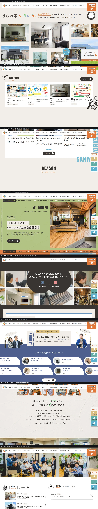
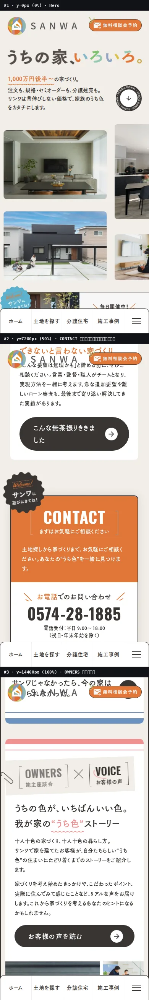

# UI Design System & Master Generation Blueprint: tochi-sanwa-jp

> **岐阜県美濃加茂市でおしゃれな新築一戸建てはサンワ｜ワガママ採用率100%の工務店** (https://tochi-sanwa.jp/) — サンワ（SANWA）は岐阜県美濃加茂市で注文住宅・建売分譲・規格住宅を手がけています。自社土地×自社一貫施工を活かしたコストパフォーマンス◎のおしゃれな住まいをご提案。どんな難しいご要望にも「どうすれば実現できるか」を本気で考えます。





---

## 1. Executive Visual Persona & Design Archetype

- **Brand Essence & Persona**: **岐阜県美濃加茂市でおしゃれな新築一戸建てはサンワ｜ワガママ採用率100%の工務店** (`https://tochi-sanwa.jp/`). サンワ（SANWA）は岐阜県美濃加茂市で注文住宅・建売分譲・規格住宅を手がけています。自社土地×自社一貫施工を活かしたコストパフォーマンス◎のおしゃれな住まいをご提案。どんな難しいご要望にも「どうすれば実現できるか」を本気で考えます。
- **Capture Provenance**: Live browser capture (`tier1_fast`, HTTP `200`, captured `2026-11-24`).
- **Visual Archetype**: **Light-Substrate Editorial & Modular Grid System (`#f2eee9` canvas, `#393533` ink, `#e17738` accent)**.
- **Anti-AI-Slop Differentiators**:
  - **Live-Computed Chromatic Polarity**: Anchors the viewport in `#f2eee9` (live computed `body` `background-color` (`computed_styles.json`)) paired with `#393533` primary typography and `#e17738` accents.
  - **Grounded Typographic Hierarchy**: Uses `TsukuOldGothicStd-B` across display (`岐阜で注文住宅、規格、分譲を手掛ける工務店`) and body copy.
  - **Calibrated Spatial Grid & Motion**: Combines `1600px` container bounds (`gap: 24px`, padding `1.5rem`) with `cubic-bezier(0.175,0.885,0.32,1.275)` easing and GSAP Timeline & ScrollTrigger, Three.js / WebGL Canvas Pipeline.

---

## 2. Spatial Architecture & Modular Grid Mathematics

### Viewport Allocation & Container Geometry
- **Captured Journey Filmstrips**: Desktop `1280×6624px` (`assets/desktop-journey.webp`, `8` keyframes up to `y=14400px` / doc `17137px`), Mobile `390×2616px` (`assets/mobile-journey.webp`, `3` keyframes).
- **Master Container Bounds**: `1600px` (non-`@media` desktop container stylesheet rule).
- **Canvas Lateral Padding & Spacing**: `1.5rem` lateral canvas padding with `24px` grid gap.
- **Border Radius Scale**: `100%`, `var(--leap-project-radius-default)`, `var(--leap-project-radius-none)`, `var(--leap-project-radius-max)`.

### Responsive Breakpoint Architecture
- **Desktop Layout**: Multi-column CSS Grid / Flexbox layout at `1440px` (`max-width: 1600px`, `gap: 24px`).
- **Mobile Layout**: Single-column vertical stack at `390px` viewport width with `1.5rem` horizontal padding.
- **Extracted CSS Media Queries**: `@media (prefers-reduced-motion: reduce)`, `@media screen and (max-width: 767px)`, `@media screen and (min-width: 768px)`, `@media print,screen and (min-width: 768px)`.

---

## 3. Color System, Materiality & Atmospheric Lighting

### Semantic Palette & Source Grounding
| Semantic Role | Ground-Truth Value | Extracted Live / CSS Source |
|---|---|---|
| **Primary Canvas Substrate** | `#f2eee9` | live computed `body` `background-color` (`computed_styles.json`) |
| **Primary Typography Ink** | `#393533` | live computed `h1` `color` (`computed_styles.json`) |
| **Elevated Surface / Card Substrate** | `#5bb2d0` | live computed `hr` `background-color` (`computed_styles.json`) |
| **Interactive Accent / Highlight** | `#e17738` | `var(--clr-primary-default)` in `:root` |
| **Secondary / Muted Copy** | `#5bb2d0` | live computed `hr` `color` (`computed_styles.json`) |
| **Structural Hairline Border** | `#00a0d2` | `.wpcf7 form .wpcf7-response-output { border: #00a0d2 }` |
| **Variable Token (`--leap-project-main`)** | `#0073aa` | `var(--leap-project-main)` in `:root` |
| **Variable Token (`--leap-project-text-primary`)** | `#404044` | `var(--leap-project-text-primary)` in `:root` |
| **Variable Token (`--leap-project-wh`)** | `#ffffff` | `var(--leap-project-wh)` in `:root` |
| **Variable Token (`--leap-project-bg`)** | `#f7f7f4` | `var(--leap-project-bg)` in `:root` |
| **Variable Token (`--leap-project-mono-01`)** | `#f2f2f2` | `var(--leap-project-mono-01)` in `:root` |
| **Variable Token (`--leap-project-mono-02`)** | `#babdc4` | `var(--leap-project-mono-02)` in `:root` |

### Sanitized Root CSS Variables (`ui-ux.md` Ground Truth)
| Variable Name | Extracted Value | Semantic Role |
|---|---|---|
| `--leap-project-main` | `var(--clr-primary-default, #0073aa)` | Color / Atmospheric Token |
| `--leap-project-text-primary` | `var(--clr-text-primary, #404044)` | Typography Ink Token |
| `--leap-project-wh` | `var(--clr-wht, #fff)` | Color / Atmospheric Token |
| `--leap-project-bg` | `var(--clr-bg-01, #F7F7F4)` | Canvas / Surface Token |
| `--leap-project-mono-01` | `var(--clr-mono-01, #F2F2F2)` | Typography / Scale Token |
| `--leap-project-mono-02` | `var(--clr-mono-03, #BABDC4)` | Typography / Scale Token |
| `--leap-project-bold` | `var(--font-weight-bold, 600)` | Design System Custom Token |
| `--leap-project-radius-none` | `0` | Elevation / Border Token |
| `--leap-project-radius-default` | `var(--border-radius-primary, .5rem)` | Elevation / Border Token |
| `--leap-project-radius-max` | `var(--border-radius-max, 100vmax)` | Elevation / Border Token |
| `--fz-pc` | `16` | Elevation / Border Token |
| `--fz-sp` | `14` | Elevation / Border Token |
| `--rem-pc` | `calc(1 / var(--fz-pc) * 1rem)` | Dimension / Scale Token |
| `--rem-sp` | `calc(1 / var(--fz-sp) * 1rem)` | Dimension / Scale Token |
| `--inner-xs` | `720` | Design System Custom Token |
| `--inner-sm` | `960` | Design System Custom Token |

---

## 4. Typographic Scale & Editorial Hierarchy

### Font Family Stacks
- **Display Typography**: `TsukuOldGothicStd-B`.
- **Primary Body Stack**: `TsukuOldGothicStd-B`.
- **Technical / Metadata Stack**: not declared in live computed styles (uses primary stack / `ui-monospace`).

### Typographic Scale & Rules (Live Computed & Stylesheet Grounded)
- **Hero Display (`H1`)**: live computed `h1` (`font-size: 14.1667px`, `line-height: 19.8333px`, `font-weight: 700`, `letter-spacing: 0.425px`); CSS variables `--font-en-display: "Yellowtail", cursive`, `--display-lg: 160`, `--display-lg-sp: 80`.
- **Section Heading (`H2`)**: live computed `h2` (`font-size: 60px`, `line-height: 60px`, `font-weight: 800`, `letter-spacing: 1.8px`).
- **Body Copy**: live computed `body` (`font-size: 14.1667px`, `line-height: 25.5px`, `font-weight: 800`, `letter-spacing: 0.425px`).
- **Metadata & Navigation Labels**: live computed `nav/a` (`font-size: 14.1667px`, `line-height: 25.5px`, `font-weight: 800`, `letter-spacing: 0.425px`); rule `.label` (`font-size: 0.875rem`).

---

## 5. Choreographed Motion & Interaction Physics

### Primary Easing Curves
- **Extracted Timing Functions**: `cubic-bezier(0.175,0.885,0.32,1.275)`.

### Per-Element Transition & Choreography Rules
- **Selector `.swiper-wrapper`**: `transition: var(--swiper-wrapper-transition-timing-function,initial)` extracted from `tochi-sanwa-jp` stylesheet.
- **Selector `.swiper-pagination`**: `transition: .3s opacity` extracted from `tochi-sanwa-jp` stylesheet.
- **Selector `n-bullets-dynamic .swiper-paginat...`**: `transition: .2s transform,.2s top` extracted from `tochi-sanwa-jp` stylesheet.
- **Extracted Easing Curve (`cubic-bezier(0.175,0.885,0.32,1.275)`)**: Governs interactive state transitions across `<header.header>` and `<section.home_event>`.
- **Runtime Interaction Engine**: Integrates GSAP Timeline & ScrollTrigger, Three.js / WebGL Canvas Pipeline, Swiper Touch Carousel Engine with `prefers-reduced-motion: reduce` fallback guards.
### Measured Runtime Scroll & Interaction Telemetry (`behavioral_journey_v2`)
- **Scroll Driver Mode**: `native` (max document height `17137px`, deepest scrollY reached `14400px` across `8` desktop keyframes).
- **Detected Scroll / Motion Libraries**: `GSAP/ScrollTrigger`.
- **Hover Physics (`primary_cta` · `サンワの家づくり`)**: Computed transition `0.4s` / `ease-out` (no static color/transform shift captured at rest).
- **Route Transition Architecture**: First internal navigation (`/works/`) measured as `direct` in `4463ms`.

---

## 6. Component Wireframe & Structural DOM Map

### Visual Layout Schematic — Desktop (`1440px`, Grounded in `dom.html` & Landmark Bounding Boxes)
```
┌────────────────────────────────────────────────────────────────────────┐
│ DESKTOP VIEWPORT (1440px) — 岐阜県美濃加茂市でおしゃれな新築一戸建てはサンワ｜ワガママ採用率100%の工務店   │
│ ====================================================================== │
│ [ <header.header> (1392x68px)         | サンワの家づくり · ローコストができる理由 · 家づく ] │
│ ---------------------------------------------------------------------- │
│ | HERO STAGE: <section.hero> (w=1440px)                              | │
│ | H1: 岐阜で注文住宅、規格、分譲を手掛ける工務店                                          | │
│ | Substrate: #f2eee9 | Ink: #393533 | Accent: #e17738                | │
│ ---------------------------------------------------------------------- │
│ | SHOWCASE GRID (<section.home_event>) max-w: 1600px                 | │
│ | +------------------------------+  +------------------------------+ | │
│ | | EVENT LIST イベント情報            |  | THANKS CAMPAIGN 開催！！         | | │
│ | +------------------------------+  +------------------------------+ | │
│ ---------------------------------------------------------------------- │
│ | DETAIL MODULE (<article.post>) — おうちづくり応援！10000円分ギフトカー             | │
│ ---------------------------------------------------------------------- │
│ [ FOOTER (<footer.footer>     ) | https://tochi-sanwa.jp/              │
└────────────────────────────────────────────────────────────────────────┘
```

### Visual Layout Schematic — Mobile Reflow (`390px`)
```
┌────────────────────────────────────────────────────────────────────────┐
│ MOBILE VIEWPORT REFLOW (390px) — Single-Column Stack (gap: 24px)       │
│ ====================================================================== │
│ [ HEADER BAR (<header.header>         ) | Compact Menu (390px)         │
│ ---------------------------------------------------------------------- │
│ | HERO STAGE (<section.hero>) — 390px Vertical Lead                  | │
│ | H1: 岐阜で注文住宅、規格、分譲を手掛ける工務店                                          | │
│ ---------------------------------------------------------------------- │
│ | SHOWCASE STACK (<section.home_event>) — 1-Col Stack                | │
│ | [ Item 1: EVENT LIST イベント情報                                      ] | │
│ | [ Item 2: THANKS CAMPAIGN 開催！！                                   ] | │
│ ---------------------------------------------------------------------- │
│ | DETAIL STACK (<article.post>) — 1-Col (おうちづくり応援！10000円分ギフ)         | │
│ ---------------------------------------------------------------------- │
│ [ FOOTER (<footer.footer>     ) | Stacked 390px Colophon               │
└────────────────────────────────────────────────────────────────────────┘
```

### Granular DOM Region Breakdown
1. **Brand Header & Navigation Bar (<header.header> — `tochi-sanwa-jp`)**:
   - Landmark `<header class="header">` (`1392x68px`) hosting `岐阜県美濃加茂市でおしゃれな新築一戸建てはサンワ｜ワガママ採用率100%` navigation (`サンワの家づくり · ローコストができる理由 · 家づくりの流れ · コンセプト・約束 · サンワの住宅性能`), DOM attributes (`data-target="tochi-sanwa-jp"`), and stylesheet rule `.wpcf7-back { float:left;margin-top:5px;position:relative;width:70px }`.
2. **Hero Stage & Focal Lead (<section.hero> — `岐阜で注文住宅、規格、分譲を手掛ける工務店`)**:
   - Landmark `<section class="hero scroll_active">` presenting display lead `岐阜で注文住宅、規格、分譲を手掛ける工務店` and copy excerpt *"1,000万円後半〜の家づくり。注文も、規格・セミオーダーも、分譲建売も。"* over `#f2eee9` canvas and `#393533` ink.
3. **Primary Showcase & Content Grid (<section.home_event> — `EVENT LIST イベント情報`)**:
   - Landmark `<section class="home_event section_pdg-sm">` rendering section `EVENT LIST イベント情報` with copy *"1,000万円後半〜 の家づくり。 注文も、規格・セミオーダーも、分譲建売も。"*, asset references (`gtm.js`, `embed`, `styles.css`, `cf7msm.css`), and grid rule `.cf7msm-ro { white-space:pre-wrap }`.
4. **Interactive Detail & Feature Matrix (<article.post> — `THANKS CAMPAIGN 開催！！`)**:
   - Landmark `<article class="post">` framing `THANKS CAMPAIGN 開催！！` and `おうちづくり応援！10000円分ギフトカードがもらえる【予約制】` (*"サンワは背伸びしない価格で、家族のうち色をカタチにします。"*) with `#5bb2d0` surface cards, `#e17738` accents, and `.wpcf7 .hidden-fields-container { display: none; }`.
5. **Colophon & Global Directory Footer (<footer.footer> — `https://tochi-sanwa.jp/`)**:
   - Landmark `<footer class="footer">` anchoring `岐阜県美濃加茂市でおしゃれな新築一戸建てはサンワ｜ワガママ採用率` footer links (`サンワの家づくり · ローコストができる理由 · 家づくりの流れ · コンセプト・約束 · サンワの住宅性能`), copy *"CONCEPT サンワの家づくりのコンセプト"*, and `#00a0d2` structural dividers.
### Full Vertical Scroll Sequence (Desktop `1440×900` Keyframes)
- **Step 01** (`y=0px`, `0%`): Active landmark `岐阜で注文住宅、規格、分譲を手掛ける工務店` · sticky/fixed elements: `1`
- **Step 02** (`y=850px`, `5%`): Active landmark `EVENT LIST イベント情報` · sticky/fixed elements: `1`
- **Step 03** (`y=3400px`, `21%`): Active landmark `岐阜で注文住宅、規格、分譲を手掛ける工務店` · sticky/fixed elements: `2`
- **Step 04** (`y=5950px`, `37%`): Active landmark `岐阜で注文住宅、規格、分譲を手掛ける工務店` · sticky/fixed elements: `2`
- **Step 05** (`y=8500px`, `52%`): Active landmark `知られざる暮らしの舞台裏。 みんなの“うち色”物語を覗いてみよう。` · sticky/fixed elements: `2`
- **Step 06** (`y=11050px`, `68%`): Active landmark `「とことん要望、聞いちゃいました」` · sticky/fixed elements: `2`
- **Step 07** (`y=13600px`, `84%`): Active landmark `岐阜で注文住宅、規格、分譲を手掛ける工務店` · sticky/fixed elements: `2`
- **Step 08** (`y=14400px`, `89%`): Active landmark `岐阜で注文住宅、規格、分譲を手掛ける工務店` · sticky/fixed elements: `2`

### Multi-Page Internal Route Map
- **Listing Route (`/works/`)**: `https://tochi-sanwa.jp/works/` — H1: `施工事例`, scrollHeight `5770px`, transition `direct` (`4463ms`)
- **Detail Route (`/event/campaign/p11509/`)**: `https://tochi-sanwa.jp/event/campaign/p11509/` — H1: `THANKS CAMPAIGN 開催！！ ｜イベント情報｜サンワ（SANWA）`, scrollHeight `3929px`, transition `direct` (`2538ms`)
- **About Route (`/company/`)**: `https://tochi-sanwa.jp/company/` — H1: `会社概要`, scrollHeight `15362px`, transition `direct` (`4298ms`)

---

## 7. Master Zero-Shot AI Generation Prompt

```markdown
# Master Zero-Shot Frontend Generation Prompt: tochi-sanwa-jp (岐阜県美濃加茂市でおしゃれな新築一戸建てはサンワ｜ワガママ採用率100%の工務店)

You are a principal frontend architect and design systems engineer. Build a complete, production-ready web application replicating the exact design system, DOM landmarks, typographic hierarchy, color tokens, and motion physics of `tochi-sanwa-jp` (**岐阜県美濃加茂市でおしゃれな新築一戸建てはサンワ｜ワガママ採用率100%の工務店** — `https://tochi-sanwa.jp/`).

### 1. Visual Archetype & Anti-AI-Slop Mandates
- **Archetype**: Light-Substrate Editorial & Modular Grid System (`#f2eee9` canvas, `#393533` ink, `#e17738` accent).
- **Identity & Domain Context**: サンワ（SANWA）は岐阜県美濃加茂市で注文住宅・建売分譲・規格住宅を手がけています。自社土地×自社一貫施工を活かしたコストパフォーマンス◎のおしゃれな住まいをご提案。どんな難しいご要望にも「どうすれば実現できるか」を本気で考えます。
- **Primary Substrate**: `#f2eee9` (live computed `body` `background-color` (`computed_styles.json`)), **Primary Ink**: `#393533`, **Accent / Highlight**: `#e17738`.
- **Site-Specific Differentiators**:
  - **Live-Computed Chromatic Polarity**: Anchors the viewport in `#f2eee9` (live computed `body` `background-color` (`computed_styles.json`)) paired with `#393533` primary typography and `#e17738` accents.
  - **Grounded Typographic Hierarchy**: Uses `TsukuOldGothicStd-B` across display (`岐阜で注文住宅、規格、分譲を手掛ける工務店`) and body copy.
  - **Calibrated Spatial Grid & Motion**: Combines `1600px` container bounds (`gap: 24px`, padding `1.5rem`) with `cubic-bezier(0.175,0.885,0.32,1.275)` easing and GSAP Timeline & ScrollTrigger, Three.js / WebGL Canvas Pipeline.

### 2. Ground-Truth CSS Variables (`:root` Token Contract)
Declare and consume these exact custom properties extracted from `tochi-sanwa-jp` in your global stylesheet:

:root {
  /* 岐阜県美濃加茂市でおしゃれな新築一戸建てはサンワ｜ワガママ採用率100%の工務店 (tochi-sanwa-jp) — Live-Grounded CSS Variables */
  --leap-project-main: var(--clr-primary-default, #0073aa); /* Color / Atmospheric Token (tochi-sanwa-jp) */
  --leap-project-text-primary: var(--clr-text-primary, #404044); /* Typography Ink Token (tochi-sanwa-jp) */
  --leap-project-wh: var(--clr-wht, #fff); /* Color / Atmospheric Token (tochi-sanwa-jp) */
  --leap-project-bg: var(--clr-bg-01, #F7F7F4); /* Canvas / Surface Token (tochi-sanwa-jp) */
  --leap-project-mono-01: var(--clr-mono-01, #F2F2F2); /* Typography / Scale Token (tochi-sanwa-jp) */
  --leap-project-mono-02: var(--clr-mono-03, #BABDC4); /* Typography / Scale Token (tochi-sanwa-jp) */
  --leap-project-bold: var(--font-weight-bold, 600); /* Design System Custom Token (tochi-sanwa-jp) */
  --leap-project-radius-none: 0; /* Elevation / Border Token (tochi-sanwa-jp) */
  --leap-project-radius-default: var(--border-radius-primary, .5rem); /* Elevation / Border Token (tochi-sanwa-jp) */
  --leap-project-radius-max: var(--border-radius-max, 100vmax); /* Elevation / Border Token (tochi-sanwa-jp) */
  --fz-pc: 16; /* Elevation / Border Token (tochi-sanwa-jp) */
  --fz-sp: 14; /* Elevation / Border Token (tochi-sanwa-jp) */
  --rem-pc: calc(1 / var(--fz-pc) * 1rem); /* Dimension / Scale Token (tochi-sanwa-jp) */
  --rem-sp: calc(1 / var(--fz-sp) * 1rem); /* Dimension / Scale Token (tochi-sanwa-jp) */
  --inner-xs: 720; /* Design System Custom Token (tochi-sanwa-jp) */
  --inner-sm: 960; /* Design System Custom Token (tochi-sanwa-jp) */
}

### 3. Semantic Color & Materiality Contract
Map every surface, ink, and border strictly to these source-grounded tokens:
- **Primary Canvas Substrate**: `#f2eee9` — grounded in live computed `body` `background-color` (`computed_styles.json`)
- **Primary Typography Ink**: `#393533` — grounded in live computed `h1` `color` (`computed_styles.json`)
- **Elevated Surface / Card Substrate**: `#5bb2d0` — grounded in live computed `hr` `background-color` (`computed_styles.json`)
- **Interactive Accent / Highlight**: `#e17738` — grounded in `var(--clr-primary-default)` in `:root`
- **Secondary / Muted Copy**: `#5bb2d0` — grounded in live computed `hr` `color` (`computed_styles.json`)
- **Structural Hairline Border**: `#00a0d2` — grounded in `.wpcf7 form .wpcf7-response-output { border: #00a0d2 }`
- **Variable Token (`--leap-project-main`)**: `#0073aa` — grounded in `var(--leap-project-main)` in `:root`
- **Variable Token (`--leap-project-text-primary`)**: `#404044` — grounded in `var(--leap-project-text-primary)` in `:root`
- **Variable Token (`--leap-project-wh`)**: `#ffffff` — grounded in `var(--leap-project-wh)` in `:root`
- **Variable Token (`--leap-project-bg`)**: `#f7f7f4` — grounded in `var(--leap-project-bg)` in `:root`
- **Variable Token (`--leap-project-mono-01`)**: `#f2f2f2` — grounded in `var(--leap-project-mono-01)` in `:root`
- **Variable Token (`--leap-project-mono-02`)**: `#babdc4` — grounded in `var(--leap-project-mono-02)` in `:root`

### 4. Spatial Grid, Container Bounds & Responsive Breakpoints
- **Desktop Viewport Reference**: `1280×6624px` (multi-frame vertical journey filmstrip (6624px), `1440px` standard desktop width).
- **Mobile Viewport Reference**: `390×2616px` (multi-frame vertical journey filmstrip (2616px), `390px` standard mobile width).
- **Container Max-Width**: `1600px` (non-`@media` desktop container stylesheet rule)
- **Padding & Gutters**: `1.5rem` lateral canvas padding with `24px` grid gap
- **Desktop Grid**: Multi-column CSS Grid / Flexbox layout at `1440px` (`max-width: 1600px`, `gap: 24px`)
- **Mobile Adaptation**: Single-column vertical stack at `390px` viewport width with `1.5rem` horizontal padding
- **Media Queries**: `@media (prefers-reduced-motion: reduce)`, `@media screen and (max-width: 767px)`, `@media screen and (min-width: 768px)`, `@media print,screen and (min-width: 768px)`
- **Corner Radii**: `100%`, `var(--leap-project-radius-default)`, `var(--leap-project-radius-none)`, `var(--leap-project-radius-max)`

### 5. Typography & Editorial Scale Contract
- **Display Font Stack**: `TsukuOldGothicStd-B`
- **Body Font Stack**: `TsukuOldGothicStd-B`
- **Monospace / Technical Font Stack**: not declared in live computed styles (uses primary stack / `ui-monospace`)
- **H1 Display Rule**: live computed `h1` (`font-size: 14.1667px`, `line-height: 19.8333px`, `font-weight: 700`, `letter-spacing: 0.425px`); CSS variables `--font-en-display: "Yellowtail", cursive`, `--display-lg: 160`, `--display-lg-sp: 80`
- **H2 Section Rule**: live computed `h2` (`font-size: 60px`, `line-height: 60px`, `font-weight: 800`, `letter-spacing: 1.8px`)
- **Body Copy Rule**: live computed `body` (`font-size: 14.1667px`, `line-height: 25.5px`, `font-weight: 800`, `letter-spacing: 0.425px`)
- **Metadata & Index Rule**: live computed `nav/a` (`font-size: 14.1667px`, `line-height: 25.5px`, `font-weight: 800`, `letter-spacing: 0.425px`); rule `.label` (`font-size: 0.875rem`)

### 6. Component Hierarchy, Verbatim Copy & Real DOM Landmarks
Scaffold `tochi-sanwa-jp` (`岐阜県美濃加茂市でおしゃれな新築一戸建てはサンワ｜ワガママ採用率100%の工務店`) with these exact structural regions, extracted copy, and CSS rules from `dom.html`:
1. **Brand Header & Navigation Bar (<header.header> — `tochi-sanwa-jp`)**:
   - DOM & Selectors: Landmark `<header class="header">` (`1392x68px`) hosting `岐阜県美濃加茂市でおしゃれな新築一戸建てはサンワ｜ワガママ採用率100%` navigation (`サンワの家づくり · ローコストができる理由 · 家づくりの流れ · コンセプト・約束 · サンワの住宅性能`), DOM attributes (`data-target="tochi-sanwa-jp"`), and stylesheet rule `.wpcf7-back { float:left;margin-top:5px;position:relative;width:70px }`.
   - Responsive Contract: Header `Brand Header & Navigation Bar (<header.header> — `tochi-sanwa-jp`)` (`tochi-sanwa-jp`) adapts across `@media (prefers-reduced-motion: reduce)`, `@media screen and (max-width: 767px)`, `@media screen and (min-width: 768px)`, `@media print,screen and (min-width: 768px)` with `cubic-bezier(0.175,0.885,0.32,1.275)` transitions and links `サンワの家づくり · ローコストができる理由 · 家づくりの流れ · コンセプト・約束 · サンワの住宅性能`.
2. **Hero Stage & Focal Lead (<section.hero> — `岐阜で注文住宅、規格、分譲を手掛ける工務店`)**:
   - DOM & Selectors: Landmark `<section class="hero scroll_active">` presenting display lead `岐阜で注文住宅、規格、分譲を手掛ける工務店` and copy excerpt *"1,000万円後半〜の家づくり。注文も、規格・セミオーダーも、分譲建売も。"* over `#f2eee9` canvas and `#393533` ink.
   - Responsive Contract: Hero stage (`1280×6624px` desktop / `390×2616px` mobile) sets `#f2eee9` background with `#393533` headline `岐阜で注文住宅、規格、分譲を手掛ける工務店`.
3. **Primary Showcase & Content Grid (<section.home_event> — `EVENT LIST イベント情報`)**:
   - DOM & Selectors: Landmark `<section class="home_event section_pdg-sm">` rendering section `EVENT LIST イベント情報` with copy *"1,000万円後半〜 の家づくり。 注文も、規格・セミオーダーも、分譲建売も。"*, asset references (`gtm.js`, `embed`, `styles.css`, `cf7msm.css`), and grid rule `.cf7msm-ro { white-space:pre-wrap }`.
   - Responsive Contract: Showcase grid `Primary Showcase & Content Grid (<section.home_event> — `EVENT LIST イベント情報`)` applies Multi-column CSS Grid / Flexbox layout at `1440px` (`max-width: 1600px`, `gap: 24px`) on desktop and Single-column vertical stack at `390px` viewport width with `1.5rem` horizontal padding on mobile.
4. **Interactive Detail & Feature Matrix (<article.post> — `THANKS CAMPAIGN 開催！！`)**:
   - DOM & Selectors: Landmark `<article class="post">` framing `THANKS CAMPAIGN 開催！！` and `おうちづくり応援！10000円分ギフトカードがもらえる【予約制】` (*"サンワは背伸びしない価格で、家族のうち色をカタチにします。"*) with `#5bb2d0` surface cards, `#e17738` accents, and `.wpcf7 .hidden-fields-container { display: none; }`.
   - Responsive Contract: Detail module `Interactive Detail & Feature Matrix (<article.post> — `THANKS CAMPAIGN 開催！！`)` uses `100%`, `var(--leap-project-radius-default)`, `var(--leap-project-radius-none)`, `var(--leap-project-radius-max)` radii, `#e17738` highlights, and assets (gtm.js, embed, styles.css).
5. **Colophon & Global Directory Footer (<footer.footer> — `https://tochi-sanwa.jp/`)**:
   - DOM & Selectors: Landmark `<footer class="footer">` anchoring `岐阜県美濃加茂市でおしゃれな新築一戸建てはサンワ｜ワガママ採用率` footer links (`サンワの家づくり · ローコストができる理由 · 家づくりの流れ · コンセプト・約束 · サンワの住宅性能`), copy *"CONCEPT サンワの家づくりのコンセプト"*, and `#00a0d2` structural dividers.
   - Responsive Contract: Footer `Colophon & Global Directory Footer (<footer.footer> — `https://tochi-sanwa.jp/`)` aligns to `1600px` (non-`@media` desktop container stylesheet rule) with `1.5rem` lateral canvas padding with `24px` grid gap and attributes (tochi-sanwa-jp).

#### Verbatim DOM Copy Excerpts (`dom.html`)
- Copy Excerpt 1: *"1,000万円後半〜の家づくり。注文も、規格・セミオーダーも、分譲建売も。"*
- Copy Excerpt 2: *"1,000万円後半〜 の家づくり。 注文も、規格・セミオーダーも、分譲建売も。"*
- Copy Excerpt 3: *"サンワは背伸びしない価格で、家族のうち色をカタチにします。"*
- Copy Excerpt 4: *"CONCEPT サンワの家づくりのコンセプト"*

### 7. Motion, Extracted Stylesheet Rules & Interaction Choreography
- **Primary Easing Functions**: `cubic-bezier(0.175,0.885,0.32,1.275)`
- **Extracted Stylesheet Rules (`tochi-sanwa-jp`)**:
- `.wpcf7-back { float:left;margin-top:5px;position:relative;width:70px }`
- `.cf7msm-ro { white-space:pre-wrap }`
- `.wpcf7 .hidden-fields-container { display: none; }`
- `.wpcf7 form .wpcf7-response-output { margin: 2em 0.5em 1em; padding: 0.2em 1em; border: 2px solid 00a0d2; }`
- `form.submitting .wpcf7-response-o... { display: none; }`
- **Per-Selector Transition Rules**:
- **Selector `.swiper-wrapper`**: `transition: var(--swiper-wrapper-transition-timing-function,initial)` extracted from `tochi-sanwa-jp` stylesheet.
- **Selector `.swiper-pagination`**: `transition: .3s opacity` extracted from `tochi-sanwa-jp` stylesheet.
- **Selector `n-bullets-dynamic .swiper-paginat...`**: `transition: .2s transform,.2s top` extracted from `tochi-sanwa-jp` stylesheet.
- **Extracted Easing Curve (`cubic-bezier(0.175,0.885,0.32,1.275)`)**: Governs interactive state transitions across `<header.header>` and `<section.home_event>`.
- **Runtime Interaction Engine**: Integrates GSAP Timeline & ScrollTrigger, Three.js / WebGL Canvas Pipeline, Swiper Touch Carousel Engine with `prefers-reduced-motion: reduce` fallback guards.
### 7b. Full-Page Scroll Choreography, Interactive States & Multi-Page Routes
- **Scroll Mechanics**: Implement `native` vertical progression up to `17137px` across 8 distinct viewport chapters using GSAP/ScrollTrigger.
- **Vertical Chapter Sequence**: 岐阜で注文住宅、規格、分譲を手掛ける工務店 (0%) -> EVENT LIST イベント情報 (5%) -> 岐阜で注文住宅、規格、分譲を手掛ける工務店 (21%) -> 岐阜で注文住宅、規格、分譲を手掛ける工務店 (37%) -> 知られざる暮らしの舞台裏。 みんなの“うち色”物語を覗... (52%) -> 「とことん要望、聞いちゃいました」 (68%) -> 岐阜で注文住宅、規格、分譲を手掛ける工務店 (84%) -> 岐阜で注文住宅、規格、分譲を手掛ける工務店 (89%).
- **Multi-Page Routes**: Scaffold internal routes `/works/` (listing, direct), `/event/campaign/p11509/` (detail, direct), `/company/` (about, direct) sharing the global header/footer shell and design tokens.

### 8. Technical Deliverables
- Implement in Next.js (App Router) with TypeScript and Tailwind CSS consuming the `:root` custom properties defined above for `tochi-sanwa-jp`.
- Reproduce both the `1440px` desktop architecture and `390px` mobile breakpoint transitions, preserving semantic HTML5 landmarks (`<header>`, `<nav>`, `<main>`, `<section>`, `<footer>`) and `prefers-reduced-motion` accessibility guards.
```
---

## 8. Full-Page Scroll Journey, Interactive States & Subpage Inventory

### Desktop Scroll Keyframes (`1440×900` WebP)
| Step | Scroll Y | Progress | Active Landmark / Section | Sticky/Fixed | Visual Asset |
| :---: | :---: | :---: | :--- | :---: | :--- |
| `#01` | `0px` | `0%` | 岐阜で注文住宅、規格、分譲を手掛ける工務店 | `1` | [desktop-step-01.webp](assets/desktop-step-01.webp) |
| `#02` | `850px` | `5%` | EVENT LIST イベント情報 | `1` | [desktop-step-02.webp](assets/desktop-step-02.webp) |
| `#03` | `3400px` | `21%` | 岐阜で注文住宅、規格、分譲を手掛ける工務店 | `2` | [desktop-step-03.webp](assets/desktop-step-03.webp) |
| `#04` | `5950px` | `37%` | 岐阜で注文住宅、規格、分譲を手掛ける工務店 | `2` | [desktop-step-04.webp](assets/desktop-step-04.webp) |
| `#05` | `8500px` | `52%` | 知られざる暮らしの舞台裏。 みんなの“うち色”物語を覗いてみよう。 | `2` | [desktop-step-05.webp](assets/desktop-step-05.webp) |
| `#06` | `11050px` | `68%` | 「とことん要望、聞いちゃいました」 | `2` | [desktop-step-06.webp](assets/desktop-step-06.webp) |
| `#07` | `13600px` | `84%` | 岐阜で注文住宅、規格、分譲を手掛ける工務店 | `2` | [desktop-step-07.webp](assets/desktop-step-07.webp) |
| `#08` | `14400px` | `89%` | 岐阜で注文住宅、規格、分譲を手掛ける工務店 | `2` | [desktop-step-08.webp](assets/desktop-step-08.webp) |

### Mobile Condensed Keyframes (`390×844` WebP)
| Step | Scroll Y | Progress | Active Landmark | Visual Asset |
| :---: | :---: | :---: | :--- | :--- |
| `#01` | `0px` | `0%` | Hero | [mobile-step-01.webp](assets/mobile-step-01.webp) |
| `#02` | `7200px` | `50%` | CONTACT まずはお気軽にご相談ください | [mobile-step-02.webp](assets/mobile-step-02.webp) |
| `#03` | `14400px` | `100%` | OWNERS 施主座談会 | [mobile-step-03.webp](assets/mobile-step-03.webp) |

### Internal Subpage Filmstrips (`1080px` Wide WebP)
| # | Template | Route URL | H1 / Title | Scroll Height | Transition | Filmstrip Asset |
| :-: | :---: | :--- | :--- | :---: | :---: | :--- |
| `1` | `listing` | `https://tochi-sanwa.jp/works/` | 施工事例 | `5770px` | `direct` (`4463ms`) | [subpage-01-works.webp](assets/subpage-01-works.webp) |
| `2` | `detail` | `https://tochi-sanwa.jp/event/campaign/p11509/` | THANKS CAMPAIGN 開催！！ ｜イベント情報｜サンワ（SANWA） | `3929px` | `direct` (`2538ms`) | [subpage-02-event-campaign-p11509.webp](assets/subpage-02-event-campaign-p11509.webp) |
| `3` | `about` | `https://tochi-sanwa.jp/company/` | 会社概要 | `15362px` | `direct` (`4298ms`) | [subpage-03-company.webp](assets/subpage-03-company.webp) |

