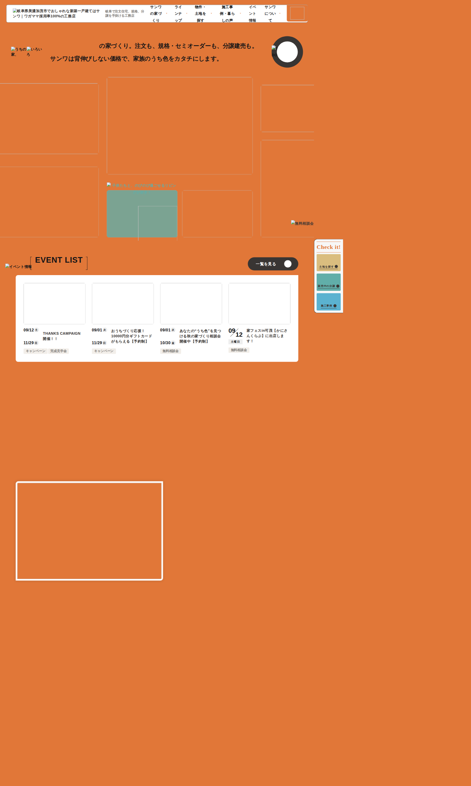
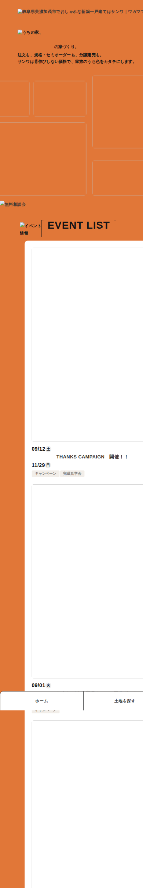

# UI Design System & Master Generation Blueprint: tochi-sanwa-jp

> **岐阜県美濃加茂市でおしゃれな新築一戸建てはサンワ｜ワガママ採用率100%の工務店** (https://tochi-sanwa.jp/) — サンワ（SANWA）は岐阜県美濃加茂市で注文住宅・建売分譲・規格住宅を手がけています。自社土地×自社一貫施工を活かしたコストパフォーマンス◎のおしゃれな住まいをご提案。どんな難しいご要望にも「どうすれば実現できるか」を本気で考えます。



---

## 1. Executive Visual Persona & Design Archetype

- **Brand Essence & Persona**: **岐阜県美濃加茂市でおしゃれな新築一戸建てはサンワ｜ワガママ採用率100%の工務店** (`https://tochi-sanwa.jp/`). サンワ（SANWA）は岐阜県美濃加茂市で注文住宅・建売分譲・規格住宅を手がけています。自社土地×自社一貫施工を活かしたコストパフォーマンス◎のおしゃれな住まいをご提案。どんな難しいご要望にも「どうすれば実現できるか」を本気で考えます。
- **Visual Archetype**: **Light-Substrate Editorial & Modular Grid System (`#E17738` canvas, `#D03030` ink, `#EB3535` accent)**.
- **Anti-AI-Slop Differentiators**:
  - **Source-Grounded Chromatic Polarity**: Anchors the viewport in `#E17738` (`var(--clr-primary-default)` in `:root`) paired with `#D03030` primary typography and `#EB3535` accents.
  - **Extracted Typographic Hierarchy**: Pairs `Lato` for display copy (`岐阜で注文住宅、規格、分譲を手掛ける工務店`) with `Oswald` and not declared in static CSS (uses primary stack / `ui-monospace`).
  - **Calibrated Spatial Grid & Motion**: Combines `767px` container bounds (`gap: 24px`, padding `1.5rem`) with `cubic-bezier(0.175,0.885,0.32,1.275)` easing and GSAP Timeline & ScrollTrigger, Three.js / WebGL Canvas Pipeline.

---

## 2. Spatial Architecture & Modular Grid Mathematics



### Viewport Allocation & Container Geometry
- **Captured Viewport Dimensions**: Desktop `1440×2400px` (`assets/desktop.png`, capped at 2400px multi-section capture), Mobile `390×2400px` (`assets/mobile.png`, capped at 2400px multi-section capture).
- **Master Container Bounds**: `767px` extracted from `tochi-sanwa-jp` stylesheet.
- **Canvas Lateral Padding & Spacing**: `1.5rem` lateral canvas padding with `24px` grid gap.
- **Border Radius Scale**: `var(--leap-project-radius-default)`, `var(--leap-project-radius-none)`, `var(--leap-project-radius-max)`, `100%`.

### Responsive Breakpoint Architecture
- **Desktop Layout**: Multi-column CSS Grid / Flexbox layout at `1440px` (`max-width: 767px`, `gap: 24px`).
- **Mobile Layout**: Single-column vertical stack at `390px` viewport width with `1.5rem` horizontal padding.
- **Extracted CSS Media Queries**: `@media screen and (max-width: 767px)`, `@media screen and (min-width: 768px)`, `@media (prefers-reduced-motion: reduce)`, `@media print,screen and (min-width: 768px)`.

---

## 3. Color System, Materiality & Atmospheric Lighting

### Semantic Palette & Source Grounding
| Semantic Role | Ground-Truth Value | Extracted CSS Source / Selector |
|---|---|---|
| **Primary Canvas Substrate** | `#E17738` | `var(--clr-primary-default)` in `:root` |
| **Primary Typography Ink** | `#B25722` | `var(--clr-primary-dark)` in `:root` |
| **Elevated Surface / Card Substrate** | `#E88E58` | `var(--clr-primary-light)` in `:root` |
| **Interactive Accent / Highlight** | `#EB3535` | `var(--clr-secondary-default)` in `:root` |
| **Secondary / Muted Copy** | `#D03030` | `var(--clr-secondary-dark)` in `:root` |
| **Structural Hairline Border** | `#F25353` | `var(--clr-secondary-light)` in `:root` |
| **Variable Token (`--leap-project-main`)** | `#0073aa` | `var(--leap-project-main)` in `:root` |
| **Variable Token (`--leap-project-text-primary`)** | `#404044` | `var(--leap-project-text-primary)` in `:root` |
| **Variable Token (`--leap-project-wh`)** | `#fff` | `var(--leap-project-wh)` in `:root` |
| **Variable Token (`--leap-project-bg`)** | `#F7F7F4` | `var(--leap-project-bg)` in `:root` |
| **Variable Token (`--leap-project-mono-01`)** | `#F2F2F2` | `var(--leap-project-mono-01)` in `:root` |
| **Variable Token (`--leap-project-mono-02`)** | `#BABDC4` | `var(--leap-project-mono-02)` in `:root` |

### Sanitized Root CSS Variables (`ui-ux.md` Ground Truth)
| Variable Name | Extracted Value | Semantic Role |
|---|---|---|
| `--leap-project-main` | `var(--clr-primary-default, #0073aa)` | Color / Atmospheric Token |
| `--leap-project-text-primary` | `var(--clr-text-primary, #404044)` | Typography Ink Token |
| `--leap-project-wh` | `var(--clr-wht, #fff)` | Color / Atmospheric Token |
| `--leap-project-bg` | `var(--clr-bg-01, #F7F7F4)` | Canvas / Surface Token |
| `--leap-project-mono-01` | `var(--clr-mono-01, #F2F2F2)` | Typography / Scale Token |
| `--leap-project-mono-02` | `var(--clr-mono-03, #BABDC4)` | Typography / Scale Token |
| `--leap-project-bold` | `var(--font-weight-bold, 600)` | Design System Custom Token |
| `--leap-project-radius-none` | `0` | Elevation / Border Token |
| `--leap-project-radius-default` | `var(--border-radius-primary, .5rem)` | Elevation / Border Token |
| `--leap-project-radius-max` | `var(--border-radius-max, 100vmax)` | Elevation / Border Token |
| `--fz-pc` | `16` | Elevation / Border Token |
| `--fz-sp` | `14` | Elevation / Border Token |
| `--rem-pc` | `calc(1 / var(--fz-pc) * 1rem)` | Dimension / Scale Token |
| `--rem-sp` | `calc(1 / var(--fz-sp) * 1rem)` | Dimension / Scale Token |
| `--inner-xs` | `720` | Design System Custom Token |
| `--inner-sm` | `960` | Design System Custom Token |

---

## 4. Typographic Scale & Editorial Hierarchy

### Font Family Stacks
- **Display Typography**: `Lato`.
- **Primary Body Stack**: `Oswald`.
- **Technical / Metadata Stack**: not declared in static CSS (uses primary stack / `ui-monospace`).

### Typographic Scale & Rules (Extracted from Stylesheet & Variables)
- **Hero Display (`H1`)**: CSS variables `--font-en-display: "Yellowtail", cursive`, `--display-lg: 160`, `--display-lg-sp: 80`.
- **Section Heading (`H2`)**: not explicitly declared on tag in static CSS (stylesheet font-size ladder: `clamp(12px, 1rem, 14px)`, `clamp(10px, 0.875rem, 12px)`, `0.875rem`, `1rem`, `1.125rem`).
- **Body Copy**: not explicitly declared on tag in static CSS (stylesheet font-size ladder: `clamp(12px, 1rem, 14px)`, `clamp(10px, 0.875rem, 12px)`, `0.875rem`, `1rem`, `1.125rem`).
- **Metadata & Navigation Labels**: CSS variables `--leap-project-mono-01: var(--clr-mono-01, #F2F2F2)`, `--leap-project-mono-02: var(--clr-mono-03, #BABDC4)`, `--clr-mono-01: #EEEEEE`; rule `.label` (`font-size: 0.875rem`).

---

## 5. Choreographed Motion & Interaction Physics

### Primary Easing Curves
- **Extracted Timing Functions**: `cubic-bezier(0.175,0.885,0.32,1.275)`.

### Per-Element Transition & Choreography Rules
- **Selector `.swiper-wrapper`**: `transition: var(--swiper-wrapper-transition-timing-function,initial)` extracted from `tochi-sanwa-jp` stylesheet.
- **Selector `.swiper-pagination`**: `transition: .3s opacity` extracted from `tochi-sanwa-jp` stylesheet.
- **Selector `n-bullets-dynamic .swiper-paginat...`**: `transition: .2s transform,.2s top` extracted from `tochi-sanwa-jp` stylesheet.
- **Extracted Easing Curve (`cubic-bezier(0.175,0.885,0.32,1.275)`)**: Governs interactive state transitions across `<header.header>` and `<section.home_event>`.
- **Runtime Interaction Engine**: Integrates GSAP Timeline & ScrollTrigger, Three.js / WebGL Canvas Pipeline, Swiper Touch Carousel Engine with `prefers-reduced-motion: reduce` fallback guards.

---

## 6. Component Wireframe & Structural DOM Map

### Visual Layout Schematic (Grounded in `dom.html` — `1440px` Desktop & `390px` Mobile Reflow)
```
┌────────────────────────────────────────────────────────────────────────┐
│ DESKTOP VIEWPORT (1440px) — 岐阜県美濃加茂市でおしゃれな新築一戸建てはサンワ｜ワガママ採用率100%の工務店   │
│ ====================================================================== │
│ [ <header.header>          | サンワの家づくり · ローコストができる理由 · 家づくりの流れ · コンセ ]  │
│ ---------------------------------------------------------------------- │
│ | HERO STAGE: <section.hero>                                       |   │
│ | H1: 岐阜で注文住宅、規格、分譲を手掛ける工務店                                        |   │
│ | Substrate: #E17738    | Ink: #D03030    | Accent: #EB3535        |   │
│ ---------------------------------------------------------------------- │
│ | SHOWCASE GRID (<section.home_event>      ) max-w: 767px          |   │
│ | +------------------------------+  +------------------------------+ | │
│ | | EVENT LIST イベント情報            |  | THANKS CAMPAIGN 開催！！         | | │
│ | +------------------------------+  +------------------------------+ | │
│ ---------------------------------------------------------------------- │
│ | MOBILE VIEWPORT REFLOW (390px) — Single-Column Stack (gap: 24px  ) | │
│ | [<header.header>] -> [<section.hero>] -> [<section.home_even] |      │
│ ---------------------------------------------------------------------- │
│ [ FOOTER (<footer.footer>       ) | https://tochi-sanwa.jp/            │
└────────────────────────────────────────────────────────────────────────┘
```

### Granular DOM Region Breakdown
1. **Brand Header & Navigation Bar (<header.header> — `tochi-sanwa-jp`)**:
   - Landmark `<header class="header">` hosting `岐阜県美濃加茂市でおしゃれな新築一戸建てはサンワ｜ワガママ採用率100%` navigation (`サンワの家づくり · ローコストができる理由 · 家づくりの流れ · コンセプト・約束 · サンワの住宅性能`), DOM attributes (`data-target="tochi-sanwa-jp"`), and stylesheet rule `.wpcf7-back { float:left;margin-top:5px;position:relative;width:70px }`.
2. **Hero Stage & Focal Lead (<section.hero> — `岐阜で注文住宅、規格、分譲を手掛ける工務店`)**:
   - Landmark `<section class="hero scroll_active">` presenting display lead `岐阜で注文住宅、規格、分譲を手掛ける工務店` and copy excerpt *"岐阜で注文住宅、規格、分譲を手掛ける工務店"* over `#E17738` canvas and `#D03030` ink.
3. **Primary Showcase & Content Grid (<section.home_event> — `EVENT LIST イベント情報`)**:
   - Landmark `<section class="home_event section_pdg-sm">` rendering section `EVENT LIST イベント情報` with copy *"サンワの家づくり CONCEPT サンワの家づくり ローコストができる理由 家づくりの流れ コンセプト・約束 サンワの住宅性能"*, asset references (`gtm.js`, `embed`, `styles.css`, `cf7msm.css`), and grid rule `.cf7msm-ro { white-space:pre-wrap }`.
4. **Interactive Detail & Feature Matrix (<article.post> — `THANKS CAMPAIGN 開催！！`)**:
   - Landmark `<article class="post">` framing `THANKS CAMPAIGN 開催！！` and `おうちづくり応援！10000円分ギフトカードがもらえる【予約制】` (*"ラインナップ LINE UP ラインナップ 注文住宅 規格・セミオーダー住宅 建売分譲"*) with `#E88E58` surface cards, `#EB3535` accents, and `.leap_table thead th { background-color: var(--leap-project-main); color: var(--leap-project-wh); }`.
5. **Colophon & Global Directory Footer (<footer.footer> — `https://tochi-sanwa.jp/`)**:
   - Landmark `<footer class="footer">` anchoring `岐阜県美濃加茂市でおしゃれな新築一戸建てはサンワ｜ワガママ採用率` footer links (`サンワの家づくり · ローコストができる理由 · 家づくりの流れ · コンセプト・約束 · サンワの住宅性能`), copy *"物件・土地を探す HOME & LAND 物件・土地を探す 建売分譲を探す 土地を探す 見つける間取り"*, and `#F25353` structural dividers.

---

## 7. Master Zero-Shot AI Generation Prompt

```markdown
# Master Zero-Shot Frontend Generation Prompt: tochi-sanwa-jp (岐阜県美濃加茂市でおしゃれな新築一戸建てはサンワ｜ワガママ採用率100%の工務店)

You are a principal frontend architect and design systems engineer. Build a complete, production-ready web application replicating the exact design system, DOM landmarks, typographic hierarchy, color tokens, and motion physics of `tochi-sanwa-jp` (**岐阜県美濃加茂市でおしゃれな新築一戸建てはサンワ｜ワガママ採用率100%の工務店** — `https://tochi-sanwa.jp/`).

### 1. Visual Archetype & Anti-AI-Slop Mandates
- **Archetype**: Light-Substrate Editorial & Modular Grid System (`#E17738` canvas, `#D03030` ink, `#EB3535` accent).
- **Identity & Domain Context**: サンワ（SANWA）は岐阜県美濃加茂市で注文住宅・建売分譲・規格住宅を手がけています。自社土地×自社一貫施工を活かしたコストパフォーマンス◎のおしゃれな住まいをご提案。どんな難しいご要望にも「どうすれば実現できるか」を本気で考えます。
- **Primary Substrate**: `#E17738` (`var(--clr-primary-default)` in `:root`), **Primary Ink**: `#D03030`, **Accent / Highlight**: `#EB3535`.
- **Site-Specific Differentiators**:
  - **Source-Grounded Chromatic Polarity**: Anchors the viewport in `#E17738` (`var(--clr-primary-default)` in `:root`) paired with `#D03030` primary typography and `#EB3535` accents.
  - **Extracted Typographic Hierarchy**: Pairs `Lato` for display copy (`岐阜で注文住宅、規格、分譲を手掛ける工務店`) with `Oswald` and not declared in static CSS (uses primary stack / `ui-monospace`).
  - **Calibrated Spatial Grid & Motion**: Combines `767px` container bounds (`gap: 24px`, padding `1.5rem`) with `cubic-bezier(0.175,0.885,0.32,1.275)` easing and GSAP Timeline & ScrollTrigger, Three.js / WebGL Canvas Pipeline.

### 2. Ground-Truth CSS Variables (`:root` Token Contract)
Declare and consume these exact custom properties extracted from `tochi-sanwa-jp` in your global stylesheet:

:root {
  /* 岐阜県美濃加茂市でおしゃれな新築一戸建てはサンワ｜ワガママ採用率100%の工務店 (tochi-sanwa-jp) — Ground-Truth Extracted CSS Variables */
  --leap-project-main: var(--clr-primary-default, #0073aa); /* Color / Atmospheric Token (tochi-sanwa-jp) */
  --leap-project-text-primary: var(--clr-text-primary, #404044); /* Typography Ink Token (tochi-sanwa-jp) */
  --leap-project-wh: var(--clr-wht, #fff); /* Color / Atmospheric Token (tochi-sanwa-jp) */
  --leap-project-bg: var(--clr-bg-01, #F7F7F4); /* Canvas / Surface Token (tochi-sanwa-jp) */
  --leap-project-mono-01: var(--clr-mono-01, #F2F2F2); /* Typography / Scale Token (tochi-sanwa-jp) */
  --leap-project-mono-02: var(--clr-mono-03, #BABDC4); /* Typography / Scale Token (tochi-sanwa-jp) */
  --leap-project-bold: var(--font-weight-bold, 600); /* Design System Custom Token (tochi-sanwa-jp) */
  --leap-project-radius-none: 0; /* Elevation / Border Token (tochi-sanwa-jp) */
  --leap-project-radius-default: var(--border-radius-primary, .5rem); /* Elevation / Border Token (tochi-sanwa-jp) */
  --leap-project-radius-max: var(--border-radius-max, 100vmax); /* Elevation / Border Token (tochi-sanwa-jp) */
  --fz-pc: 16; /* Elevation / Border Token (tochi-sanwa-jp) */
  --fz-sp: 14; /* Elevation / Border Token (tochi-sanwa-jp) */
  --rem-pc: calc(1 / var(--fz-pc) * 1rem); /* Dimension / Scale Token (tochi-sanwa-jp) */
  --rem-sp: calc(1 / var(--fz-sp) * 1rem); /* Dimension / Scale Token (tochi-sanwa-jp) */
  --inner-xs: 720; /* Design System Custom Token (tochi-sanwa-jp) */
  --inner-sm: 960; /* Design System Custom Token (tochi-sanwa-jp) */
}

### 3. Semantic Color & Materiality Contract
Map every surface, ink, and border strictly to these source-grounded tokens:
- **Primary Canvas Substrate**: `#E17738` — grounded in `var(--clr-primary-default)` in `:root`
- **Primary Typography Ink**: `#B25722` — grounded in `var(--clr-primary-dark)` in `:root`
- **Elevated Surface / Card Substrate**: `#E88E58` — grounded in `var(--clr-primary-light)` in `:root`
- **Interactive Accent / Highlight**: `#EB3535` — grounded in `var(--clr-secondary-default)` in `:root`
- **Secondary / Muted Copy**: `#D03030` — grounded in `var(--clr-secondary-dark)` in `:root`
- **Structural Hairline Border**: `#F25353` — grounded in `var(--clr-secondary-light)` in `:root`
- **Variable Token (`--leap-project-main`)**: `#0073aa` — grounded in `var(--leap-project-main)` in `:root`
- **Variable Token (`--leap-project-text-primary`)**: `#404044` — grounded in `var(--leap-project-text-primary)` in `:root`
- **Variable Token (`--leap-project-wh`)**: `#fff` — grounded in `var(--leap-project-wh)` in `:root`
- **Variable Token (`--leap-project-bg`)**: `#F7F7F4` — grounded in `var(--leap-project-bg)` in `:root`
- **Variable Token (`--leap-project-mono-01`)**: `#F2F2F2` — grounded in `var(--leap-project-mono-01)` in `:root`
- **Variable Token (`--leap-project-mono-02`)**: `#BABDC4` — grounded in `var(--leap-project-mono-02)` in `:root`

### 4. Spatial Grid, Container Bounds & Responsive Breakpoints
- **Desktop Viewport Reference**: `1440×2400px` (capped at 2400px multi-section capture, `1440px` standard desktop width).
- **Mobile Viewport Reference**: `390×2400px` (capped at 2400px multi-section capture, `390px` standard mobile width).
- **Container Max-Width**: `767px` extracted from `tochi-sanwa-jp` stylesheet
- **Padding & Gutters**: `1.5rem` lateral canvas padding with `24px` grid gap
- **Desktop Grid**: Multi-column CSS Grid / Flexbox layout at `1440px` (`max-width: 767px`, `gap: 24px`)
- **Mobile Adaptation**: Single-column vertical stack at `390px` viewport width with `1.5rem` horizontal padding
- **Media Queries**: `@media screen and (max-width: 767px)`, `@media screen and (min-width: 768px)`, `@media (prefers-reduced-motion: reduce)`, `@media print,screen and (min-width: 768px)`
- **Corner Radii**: `var(--leap-project-radius-default)`, `var(--leap-project-radius-none)`, `var(--leap-project-radius-max)`, `100%`

### 5. Typography & Editorial Scale Contract
- **Display Font Stack**: `Lato`
- **Body Font Stack**: `Oswald`
- **Monospace / Technical Font Stack**: not declared in static CSS (uses primary stack / `ui-monospace`)
- **H1 Display Rule**: CSS variables `--font-en-display: "Yellowtail", cursive`, `--display-lg: 160`, `--display-lg-sp: 80`
- **H2 Section Rule**: not explicitly declared on tag in static CSS (stylesheet font-size ladder: `clamp(12px, 1rem, 14px)`, `clamp(10px, 0.875rem, 12px)`, `0.875rem`, `1rem`, `1.125rem`)
- **Body Copy Rule**: not explicitly declared on tag in static CSS (stylesheet font-size ladder: `clamp(12px, 1rem, 14px)`, `clamp(10px, 0.875rem, 12px)`, `0.875rem`, `1rem`, `1.125rem`)
- **Metadata & Index Rule**: CSS variables `--leap-project-mono-01: var(--clr-mono-01, #F2F2F2)`, `--leap-project-mono-02: var(--clr-mono-03, #BABDC4)`, `--clr-mono-01: #E17738`; rule `.label` (`font-size: 0.875rem`)

### 6. Component Hierarchy, Verbatim Copy & Real DOM Landmarks
Scaffold `tochi-sanwa-jp` (`岐阜県美濃加茂市でおしゃれな新築一戸建てはサンワ｜ワガママ採用率100%の工務店`) with these exact structural regions, extracted copy, and CSS rules from `dom.html`:
1. **Brand Header & Navigation Bar (<header.header> — `tochi-sanwa-jp`)**:
   - DOM & Selectors: Landmark `<header class="header">` hosting `岐阜県美濃加茂市でおしゃれな新築一戸建てはサンワ｜ワガママ採用率100%` navigation (`サンワの家づくり · ローコストができる理由 · 家づくりの流れ · コンセプト・約束 · サンワの住宅性能`), DOM attributes (`data-target="tochi-sanwa-jp"`), and stylesheet rule `.wpcf7-back { float:left;margin-top:5px;position:relative;width:70px }`.
   - Responsive Contract: Header `Brand Header & Navigation Bar (<header.header> — `tochi-sanwa-jp`)` (`tochi-sanwa-jp`) adapts across `@media screen and (max-width: 767px)`, `@media screen and (min-width: 768px)`, `@media (prefers-reduced-motion: reduce)`, `@media print,screen and (min-width: 768px)` with `cubic-bezier(0.175,0.885,0.32,1.275)` transitions and links `サンワの家づくり · ローコストができる理由 · 家づくりの流れ · コンセプト・約束 · サンワの住宅性能`.
2. **Hero Stage & Focal Lead (<section.hero> — `岐阜で注文住宅、規格、分譲を手掛ける工務店`)**:
   - DOM & Selectors: Landmark `<section class="hero scroll_active">` presenting display lead `岐阜で注文住宅、規格、分譲を手掛ける工務店` and copy excerpt *"岐阜で注文住宅、規格、分譲を手掛ける工務店"* over `#E17738` canvas and `#D03030` ink.
   - Responsive Contract: Hero stage (`1440×2400px` desktop / `390×2400px` mobile) sets `#E17738` background with `#D03030` headline `岐阜で注文住宅、規格、分譲を手掛ける工務店`.
3. **Primary Showcase & Content Grid (<section.home_event> — `EVENT LIST イベント情報`)**:
   - DOM & Selectors: Landmark `<section class="home_event section_pdg-sm">` rendering section `EVENT LIST イベント情報` with copy *"サンワの家づくり CONCEPT サンワの家づくり ローコストができる理由 家づくりの流れ コンセプト・約束 サンワの住宅性能"*, asset references (`gtm.js`, `embed`, `styles.css`, `cf7msm.css`), and grid rule `.cf7msm-ro { white-space:pre-wrap }`.
   - Responsive Contract: Showcase grid `Primary Showcase & Content Grid (<section.home_event> — `EVENT LIST イベント情報`)` applies Multi-column CSS Grid / Flexbox layout at `1440px` (`max-width: 767px`, `gap: 24px`) on desktop and Single-column vertical stack at `390px` viewport width with `1.5rem` horizontal padding on mobile.
4. **Interactive Detail & Feature Matrix (<article.post> — `THANKS CAMPAIGN 開催！！`)**:
   - DOM & Selectors: Landmark `<article class="post">` framing `THANKS CAMPAIGN 開催！！` and `おうちづくり応援！10000円分ギフトカードがもらえる【予約制】` (*"ラインナップ LINE UP ラインナップ 注文住宅 規格・セミオーダー住宅 建売分譲"*) with `#E88E58` surface cards, `#EB3535` accents, and `.leap_table thead th { background-color: var(--leap-project-main); color: var(--leap-project-wh); }`.
   - Responsive Contract: Detail module `Interactive Detail & Feature Matrix (<article.post> — `THANKS CAMPAIGN 開催！！`)` uses `var(--leap-project-radius-default)`, `var(--leap-project-radius-none)`, `var(--leap-project-radius-max)`, `100%` radii, `#EB3535` highlights, and assets (gtm.js, embed, styles.css).
5. **Colophon & Global Directory Footer (<footer.footer> — `https://tochi-sanwa.jp/`)**:
   - DOM & Selectors: Landmark `<footer class="footer">` anchoring `岐阜県美濃加茂市でおしゃれな新築一戸建てはサンワ｜ワガママ採用率` footer links (`サンワの家づくり · ローコストができる理由 · 家づくりの流れ · コンセプト・約束 · サンワの住宅性能`), copy *"物件・土地を探す HOME & LAND 物件・土地を探す 建売分譲を探す 土地を探す 見つける間取り"*, and `#F25353` structural dividers.
   - Responsive Contract: Footer `Colophon & Global Directory Footer (<footer.footer> — `https://tochi-sanwa.jp/`)` aligns to `767px` extracted from `tochi-sanwa-jp` stylesheet with `1.5rem` lateral canvas padding with `24px` grid gap and attributes (tochi-sanwa-jp).

#### Verbatim DOM Copy Excerpts (`dom.html`)
- Copy Excerpt 1: *"岐阜で注文住宅、規格、分譲を手掛ける工務店"*
- Copy Excerpt 2: *"サンワの家づくり CONCEPT サンワの家づくり ローコストができる理由 家づくりの流れ コンセプト・約束 サンワの住宅性能"*
- Copy Excerpt 3: *"ラインナップ LINE UP ラインナップ 注文住宅 規格・セミオーダー住宅 建売分譲"*
- Copy Excerpt 4: *"物件・土地を探す HOME & LAND 物件・土地を探す 建売分譲を探す 土地を探す 見つける間取り"*

### 7. Motion, Extracted Stylesheet Rules & Interaction Choreography
- **Primary Easing Functions**: `cubic-bezier(0.175,0.885,0.32,1.275)`
- **Extracted Stylesheet Rules (`tochi-sanwa-jp`)**:
- `.wpcf7-back { float:left;margin-top:5px;position:relative;width:70px }`
- `.cf7msm-ro { white-space:pre-wrap }`
- `.leap_table thead th { background-color: var(--leap-project-main); color: var(--leap-project-wh); }`
- `.leap_table.table-row-1 tbody th { background-color: color-mix(in srgb, var(--leap-project-main) 20%, trans... }`
- `.box--ttl { font-size: max(16px, 1.25rem); line-height: 2.2; }`
- **Per-Selector Transition Rules**:
- **Selector `.swiper-wrapper`**: `transition: var(--swiper-wrapper-transition-timing-function,initial)` extracted from `tochi-sanwa-jp` stylesheet.
- **Selector `.swiper-pagination`**: `transition: .3s opacity` extracted from `tochi-sanwa-jp` stylesheet.
- **Selector `n-bullets-dynamic .swiper-paginat...`**: `transition: .2s transform,.2s top` extracted from `tochi-sanwa-jp` stylesheet.
- **Extracted Easing Curve (`cubic-bezier(0.175,0.885,0.32,1.275)`)**: Governs interactive state transitions across `<header.header>` and `<section.home_event>`.
- **Runtime Interaction Engine**: Integrates GSAP Timeline & ScrollTrigger, Three.js / WebGL Canvas Pipeline, Swiper Touch Carousel Engine with `prefers-reduced-motion: reduce` fallback guards.

### 8. Technical Deliverables
- Implement in Next.js (App Router) with TypeScript and Tailwind CSS consuming the `:root` custom properties defined above for `tochi-sanwa-jp`.
- Reproduce both the `1440px` desktop architecture and `390px` mobile breakpoint transitions, preserving semantic HTML5 landmarks (`<header>`, `<nav>`, `<main>`, `<section>`, `<footer>`) and `prefers-reduced-motion` accessibility guards.
```
