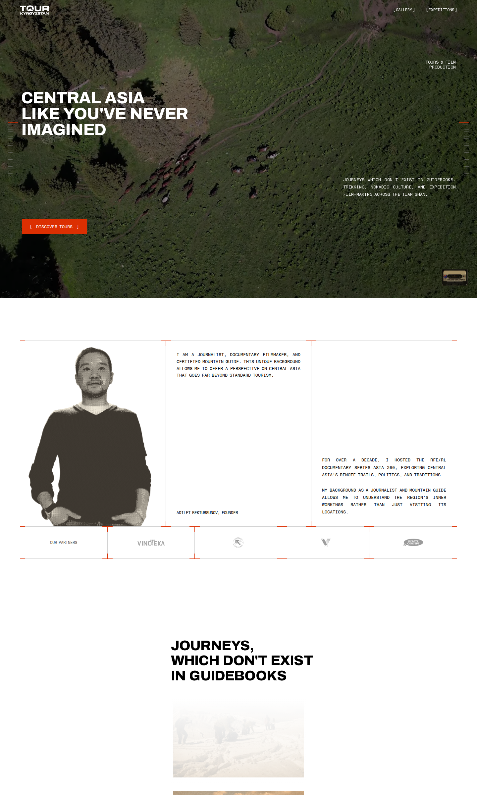
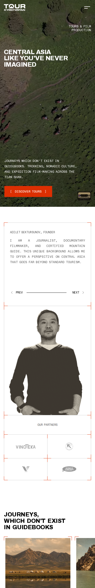

# UI Design System & Master Generation Blueprint: tour-kyrgyzstan-com

> **Tour Kyrgyzstan — Central Asia, unmapped** (https://tour-kyrgyzstan.com/) — Discover authentic Kyrgyzstan tours. Mountain trekking, nomadic culture, and professional video production services.



---

## 1. Executive Visual Persona & Design Archetype

- **Brand Essence & Persona**: **Tour Kyrgyzstan — Central Asia, unmapped** (`https://tour-kyrgyzstan.com/`). Discover authentic Kyrgyzstan tours. Mountain trekking, nomadic culture, and professional video production services.
- **Capture Provenance**: Live browser capture (`tier1_fast`, HTTP `200`, captured `2026-11-23`).
- **Visual Archetype**: **Light-Substrate Editorial & Modular Grid System (`#ffffff` canvas, `#000000` ink, `#dc2f02` accent)**.
- **Anti-AI-Slop Differentiators**:
  - **Live-Computed Chromatic Polarity**: Anchors the viewport in `#ffffff` (live computed `body` `background-color` (`computed_styles.json`)) paired with `#000000` primary typography and `#dc2f02` accents.
  - **Grounded Typographic Hierarchy**: Pairs `Archivo` for display copy (`CENTRAL ASIA LIKE YOU'VE NEVER IMAGI`) with `Fragment Mono` and `Fragment Mono`.
  - **Calibrated Spatial Grid & Motion**: Combines `1400px` container bounds (`gap: 8px`, padding `40px`) with `cubic-bezier(.16,1,.3,1)` easing and Framer Motion Layout Physics.

---

## 2. Spatial Architecture & Modular Grid Mathematics



### Viewport Allocation & Container Geometry
- **Captured Viewport Dimensions**: Desktop `1440×2400px` (`assets/desktop.png`, clamped at 2400px live multi-section capture), Mobile `390×2400px` (`assets/mobile.png`, clamped at 2400px live multi-section capture).
- **Master Container Bounds**: `1400px` (measured widest bounded `<section>` landmark width on `1440px` desktop).
- **Canvas Lateral Padding & Spacing**: `40px` lateral canvas padding with `8px` grid gap.
- **Border Radius Scale**: `0%`, `50%`.

### Responsive Breakpoint Architecture
- **Desktop Layout**: Multi-column CSS Grid / Flexbox layout at `1440px` (`max-width: 1400px`, `gap: 8px`).
- **Mobile Layout**: Single-column vertical stack at `390px` viewport width with `40px` horizontal padding.
- **Extracted CSS Media Queries**: `@media (hover: none), (max-width: 900px)`, `@media (max-width: 900px)`.

---

## 3. Color System, Materiality & Atmospheric Lighting

### Semantic Palette & Source Grounding
| Semantic Role | Ground-Truth Value | Extracted Live / CSS Source |
|---|---|---|
| **Primary Canvas Substrate** | `#ffffff` | live computed `body` `background-color` (`computed_styles.json`) |
| **Primary Typography Ink** | `#000000` | live computed `body` `color` (`computed_styles.json`) |
| **Elevated Surface / Card Substrate** | `#dc2f02` | `.video-feature__watch:hover { background: #dc2f02 }` |
| **Interactive Accent / Highlight** | `#dc2f02` | live computed `button` `color` (`computed_styles.json`) |
| **Secondary / Muted Copy** | `#dc2f02` | `.footer__contacts a:hover { color: #dc2f02 }` |
| **Structural Hairline Border** | `#d1d1d1` | `.founder-grid { border: #d1d1d1 }` |

### Sanitized Root CSS Variables (`ui-ux.md` Ground Truth)
| Variable Name | Extracted Value | Semantic Role |
|---|---|---|
| `--paper` | `#FFFFFF` | Canvas / Surface Token |
| `--ink` | `#000000` | Typography Ink Token |
| `--ink-soft` | `rgba(0,0,0,.65)` | Typography Ink Token |
| `--ink-faint` | `rgba(0,0,0,.45)` | Typography Ink Token |
| `--hero-vh` | `900px` | Layout / Spatial Grid Token |
| `--seg-w` | `30px` | Dimension / Scale Token |
| `--tour-kyrgyzstan--bg` | `#ffffff` | Canvas Substrate (from live computed `body` `background-color` (`computed_styles.json`)) |
| `--tour-kyrgyzstan--ink` | `#000000` | Primary Typography Ink (computed-derived) |
| `--tour-kyrgyzstan--surface` | `#dc2f02` | Surface Substrate (computed-derived) |
| `--tour-kyrgyzstan--accent` | `#dc2f02` | Interactive Accent (computed-derived) |
| `--tour-kyrgyzstan--muted` | `#dc2f02` | Secondary Ink (computed-derived) |
| `--tour-kyrgyzstan--border` | `#d1d1d1` | Structural Border (computed-derived) |
| `--tour-kyrgyzstan--container` | `1400px` | Container Bound (computed-derived) |
| `--tour-kyrgyzstan--gap` | `8px` | Grid Gutter (computed-derived) |
| `--tour-kyrgyzstan--pad` | `40px` | Lateral Padding (computed-derived) |
| `--tour-kyrgyzstan--ease` | `cubic-bezier(.16,1,.3,1)` | Primary Easing Function |

---

## 4. Typographic Scale & Editorial Hierarchy

### Font Family Stacks
- **Display Typography**: `Archivo`.
- **Primary Body Stack**: `Fragment Mono`.
- **Technical / Metadata Stack**: `Fragment Mono`.

### Typographic Scale & Rules (Live Computed & Stylesheet Grounded)
- **Hero Display (`H1`)**: live computed `h1` (`font-size: 48.96px`, `line-height: 47.9808px`, `font-weight: 800`, `letter-spacing: -0.9792px`).
- **Section Heading (`H2`)**: live computed `h2` (`font-size: 42px`, `line-height: 45.36px`, `font-weight: 800`, `letter-spacing: -0.84px`).
- **Body Copy**: live computed `body` (`font-size: 16px`, `line-height: normal`, `font-weight: 400`); rule `body` (`font-weight: 400`).
- **Metadata & Navigation Labels**: live computed `nav/a` (`font-size: 16px`, `line-height: normal`, `font-weight: 400`).

---

## 5. Choreographed Motion & Interaction Physics

### Primary Easing Curves
- **Extracted Timing Functions**: `cubic-bezier(.16,1,.3,1)`, `cubic-bezier(.76,0,.24,1)`.

### Per-Element Transition & Choreography Rules
- **Selector `.nav`**: `transition: color .35s ease, background .2s ease` extracted from `tour-kyrgyzstan-com` stylesheet.
- **Selector `.nav__burger-line`**: `transition: transform .3s ease, top .3s ease, width .3s ease, left .3s ease` extracted from `tour-kyrgyzstan-com` stylesheet.
- **Selector `.nav__mobile-menu`**: `transition: opacity .2s ease, transform .2s ease` extracted from `tour-kyrgyzstan-com` stylesheet.
- **Extracted Easing Curve (`cubic-bezier(.16,1,.3,1)`)**: Governs interactive state transitions across `<nav.nav>` and `<section.section>`.
- **Runtime Interaction Engine**: Integrates Framer Motion Layout Physics with `prefers-reduced-motion: reduce` fallback guards.

---

## 6. Component Wireframe & Structural DOM Map

### Visual Layout Schematic — Desktop (`1440px`, Grounded in `dom.html` & Landmark Bounding Boxes)
```
┌────────────────────────────────────────────────────────────────────────┐
│ DESKTOP VIEWPORT (1440px) — Tour Kyrgyzstan — Central Asia, unmapped   │
│ ====================================================================== │
│ [ <nav.nav> (1400x60px)               | Gallery · Expeditions        ] │
│ ---------------------------------------------------------------------- │
│ | HERO STAGE: <section.hero> (w=1440px)                              | │
│ | H1: CENTRAL ASIA LIKE YOU'VE NEVER IMAGINED                        | │
│ | Substrate: #ffffff | Ink: #000000 | Accent: #dc2f02                | │
│ ---------------------------------------------------------------------- │
│ | SHOWCASE GRID (<section.section>) max-w: 1400px                    | │
│ | +------------------------------+  +------------------------------+ | │
│ | | Central Asia like you've nev |  | K y r g y z s t a n i s h o  | | │
│ | +------------------------------+  +------------------------------+ | │
│ ---------------------------------------------------------------------- │
│ | DETAIL MODULE (<section.section:nth(2)>) — K y r g y z s t a n i   | │
│ ---------------------------------------------------------------------- │
│ [ FOOTER (<footer.footer>     ) | https://tour-kyrgyzstan.com/         │
└────────────────────────────────────────────────────────────────────────┘
```

### Visual Layout Schematic — Mobile Reflow (`390px`)
```
┌────────────────────────────────────────────────────────────────────────┐
│ MOBILE VIEWPORT REFLOW (390px) — Single-Column Stack (gap: 8px)        │
│ ====================================================================== │
│ [ HEADER BAR (<nav.nav>               ) | Compact Menu (390px)         │
│ ---------------------------------------------------------------------- │
│ | HERO STAGE (<section.hero>) — 390px Vertical Lead                  | │
│ | H1: CENTRAL ASIA LIKE YOU'VE NEVER IMAGINED                        | │
│ ---------------------------------------------------------------------- │
│ | SHOWCASE STACK (<section.section>) — 1-Col Stack                   | │
│ | [ Item 1: Central Asia like you've never imagined                ] | │
│ | [ Item 2: K y r g y z s t a n i s h o m e t o u s . W e '        ] | │
│ ---------------------------------------------------------------------- │
│ | DETAIL STACK (<section.section:nth(2)>) — 1-Col (K y r g y z s t a ) │
│ ---------------------------------------------------------------------- │
│ [ FOOTER (<footer.footer>     ) | Stacked 390px Colophon               │
└────────────────────────────────────────────────────────────────────────┘
```

### Granular DOM Region Breakdown
1. **Brand Header & Navigation Bar (<nav.nav> — `tour-kyrgyzstan-com`)**:
   - Landmark `<nav class="nav">` (`1400x60px`) hosting `Tour Kyrgyzstan — Central Asia, unma` navigation (`Gallery · Expeditions`), DOM attributes (`data-line="0"`, `data-line="1"`, `data-index="0"`, `data-index="1"`), and stylesheet rule `root { --paper: FFFFFF; --ink: 000000; --ink-soft: rgba(0,0,0,.65); --ink-faint... }`.
2. **Hero Stage & Focal Lead (<section.hero> — `CENTRAL ASIA LIKE YOU'VE NEVER IMA`)**:
   - Landmark `<section class="hero">` presenting display lead `CENTRAL ASIA LIKE YOU'VE NEVER IMAGINED` and copy excerpt *"JOURNEYS WHICH DON'T EXIST IN GUIDEBOOKS. TREKKING, NOMADIC CULTU"* over `#ffffff` canvas and `#000000` ink.
3. **Primary Showcase & Content Grid (<section.section> — `Central Asia like you've never ima`)**:
   - Landmark `<section class="section">` rendering section `Central Asia like you've never imagined` with copy *"K y r g y z s t a n i s h o m e t o u s . W e ' d l o v e t o s h"*, asset references (`favicon.ico`, `favicon.svg`, `apple-touch-icon.png`, `cassette.webp`), and grid rule `html { scroll-behavior: smooth; overflow-x: hidden; -webkit-text-size-adjust: 1... }`.
4. **Interactive Detail & Feature Matrix (<section.section:nth(2)> — `K y r g y z s t a n i s h o m e t `)**:
   - Landmark `<section class="section">` framing `K y r g y z s t a n i s h o m e t o u s . W e ' ` and `K y r g y z s t a n i s h o m e t o u s .` (*"K y r g y z s t a n i s h o m e t o u s ."*) with `#dc2f02` surface cards, `#dc2f02` accents, and `img { display: block; max-width: 100%; }`.
5. **Colophon & Global Directory Footer (<footer.footer> — `https://tour-kyrgyzstan.com/`)**:
   - Landmark `<footer class="footer section--dark">` anchoring `Tour Kyrgyzstan — Central Asia, ` footer links (`Gallery · Expeditions`), copy *"W e ' d l o v e t o s h o w i t t o y o u ."*, and `#d1d1d1` structural dividers.

---

## 7. Master Zero-Shot AI Generation Prompt

```markdown
# Master Zero-Shot Frontend Generation Prompt: tour-kyrgyzstan-com (Tour Kyrgyzstan — Central Asia, unmapped)

You are a principal frontend architect and design systems engineer. Build a complete, production-ready web application replicating the exact design system, DOM landmarks, typographic hierarchy, color tokens, and motion physics of `tour-kyrgyzstan-com` (**Tour Kyrgyzstan — Central Asia, unmapped** — `https://tour-kyrgyzstan.com/`).

### 1. Visual Archetype & Anti-AI-Slop Mandates
- **Archetype**: Light-Substrate Editorial & Modular Grid System (`#ffffff` canvas, `#000000` ink, `#dc2f02` accent).
- **Identity & Domain Context**: Discover authentic Kyrgyzstan tours. Mountain trekking, nomadic culture, and professional video production services.
- **Primary Substrate**: `#ffffff` (live computed `body` `background-color` (`computed_styles.json`)), **Primary Ink**: `#000000`, **Accent / Highlight**: `#dc2f02`.
- **Site-Specific Differentiators**:
  - **Live-Computed Chromatic Polarity**: Anchors the viewport in `#ffffff` (live computed `body` `background-color` (`computed_styles.json`)) paired with `#000000` primary typography and `#dc2f02` accents.
  - **Grounded Typographic Hierarchy**: Pairs `Archivo` for display copy (`CENTRAL ASIA LIKE YOU'VE NEVER IMAGI`) with `Fragment Mono` and `Fragment Mono`.
  - **Calibrated Spatial Grid & Motion**: Combines `1400px` container bounds (`gap: 8px`, padding `40px`) with `cubic-bezier(.16,1,.3,1)` easing and Framer Motion Layout Physics.

### 2. Ground-Truth CSS Variables (`:root` Token Contract)
Declare and consume these exact custom properties extracted from `tour-kyrgyzstan-com` in your global stylesheet:

:root {
  /* Tour Kyrgyzstan — Central Asia, unmapped (tour-kyrgyzstan-com) — Live-Grounded CSS Variables */
  --paper: #FFFFFF; /* Canvas / Surface Token (tour-kyrgyzstan-com) */
  --ink: #000000; /* Typography Ink Token (tour-kyrgyzstan-com) */
  --ink-soft: rgba(0,0,0,.65); /* Typography Ink Token (tour-kyrgyzstan-com) */
  --ink-faint: rgba(0,0,0,.45); /* Typography Ink Token (tour-kyrgyzstan-com) */
  --hero-vh: 900px; /* Layout / Spatial Grid Token (tour-kyrgyzstan-com) */
  --seg-w: 30px; /* Dimension / Scale Token (tour-kyrgyzstan-com) */
  --tour-kyrgyzstan--bg: #ffffff; /* Canvas Substrate (from live computed `body` `background-color` (`computed_styles.json`)) (tour-kyrgyzstan-com) */
  --tour-kyrgyzstan--ink: #000000; /* Primary Typography Ink (computed-derived) (tour-kyrgyzstan-com) */
  --tour-kyrgyzstan--surface: #dc2f02; /* Surface Substrate (computed-derived) (tour-kyrgyzstan-com) */
  --tour-kyrgyzstan--accent: #dc2f02; /* Interactive Accent (computed-derived) (tour-kyrgyzstan-com) */
  --tour-kyrgyzstan--muted: #dc2f02; /* Secondary Ink (computed-derived) (tour-kyrgyzstan-com) */
  --tour-kyrgyzstan--border: #d1d1d1; /* Structural Border (computed-derived) (tour-kyrgyzstan-com) */
  --tour-kyrgyzstan--container: 1400px; /* Container Bound (computed-derived) (tour-kyrgyzstan-com) */
  --tour-kyrgyzstan--gap: 8px; /* Grid Gutter (computed-derived) (tour-kyrgyzstan-com) */
  --tour-kyrgyzstan--pad: 40px; /* Lateral Padding (computed-derived) (tour-kyrgyzstan-com) */
  --tour-kyrgyzstan--ease: cubic-bezier(.16,1,.3,1); /* Primary Easing Function (tour-kyrgyzstan-com) */
}

### 3. Semantic Color & Materiality Contract
Map every surface, ink, and border strictly to these source-grounded tokens:
- **Primary Canvas Substrate**: `#ffffff` — grounded in live computed `body` `background-color` (`computed_styles.json`)
- **Primary Typography Ink**: `#000000` — grounded in live computed `body` `color` (`computed_styles.json`)
- **Elevated Surface / Card Substrate**: `#dc2f02` — grounded in `.video-feature__watch:hover { background: #dc2f02 }`
- **Interactive Accent / Highlight**: `#dc2f02` — grounded in live computed `button` `color` (`computed_styles.json`)
- **Secondary / Muted Copy**: `#dc2f02` — grounded in `.footer__contacts a:hover { color: #dc2f02 }`
- **Structural Hairline Border**: `#d1d1d1` — grounded in `.founder-grid { border: #d1d1d1 }`

### 4. Spatial Grid, Container Bounds & Responsive Breakpoints
- **Desktop Viewport Reference**: `1440×2400px` (clamped at 2400px live multi-section capture, `1440px` standard desktop width).
- **Mobile Viewport Reference**: `390×2400px` (clamped at 2400px live multi-section capture, `390px` standard mobile width).
- **Container Max-Width**: `1400px` (measured widest bounded `<section>` landmark width on `1440px` desktop)
- **Padding & Gutters**: `40px` lateral canvas padding with `8px` grid gap
- **Desktop Grid**: Multi-column CSS Grid / Flexbox layout at `1440px` (`max-width: 1400px`, `gap: 8px`)
- **Mobile Adaptation**: Single-column vertical stack at `390px` viewport width with `40px` horizontal padding
- **Media Queries**: `@media (hover: none), (max-width: 900px)`, `@media (max-width: 900px)`
- **Corner Radii**: `0%`, `50%`

### 5. Typography & Editorial Scale Contract
- **Display Font Stack**: `Archivo`
- **Body Font Stack**: `Fragment Mono`
- **Monospace / Technical Font Stack**: `Fragment Mono`
- **H1 Display Rule**: live computed `h1` (`font-size: 48.96px`, `line-height: 47.9808px`, `font-weight: 800`, `letter-spacing: -0.9792px`)
- **H2 Section Rule**: live computed `h2` (`font-size: 42px`, `line-height: 45.36px`, `font-weight: 800`, `letter-spacing: -0.84px`)
- **Body Copy Rule**: live computed `body` (`font-size: 16px`, `line-height: normal`, `font-weight: 400`); rule `body` (`font-weight: 400`)
- **Metadata & Index Rule**: live computed `nav/a` (`font-size: 16px`, `line-height: normal`, `font-weight: 400`)

### 6. Component Hierarchy, Verbatim Copy & Real DOM Landmarks
Scaffold `tour-kyrgyzstan-com` (`Tour Kyrgyzstan — Central Asia, unmapped`) with these exact structural regions, extracted copy, and CSS rules from `dom.html`:
1. **Brand Header & Navigation Bar (<nav.nav> — `tour-kyrgyzstan-com`)**:
   - DOM & Selectors: Landmark `<nav class="nav">` (`1400x60px`) hosting `Tour Kyrgyzstan — Central Asia, unma` navigation (`Gallery · Expeditions`), DOM attributes (`data-line="0"`, `data-line="1"`, `data-index="0"`, `data-index="1"`), and stylesheet rule `root { --paper: FFFFFF; --ink: 000000; --ink-soft: rgba(0,0,0,.65); --ink-faint... }`.
   - Responsive Contract: Header `Brand Header & Navigation Bar (<nav.nav> — `tour-kyrgyzstan-com`)` (`tour-kyrgyzstan-com`) adapts across `@media (hover: none), (max-width: 900px)`, `@media (max-width: 900px)` with `cubic-bezier(.16,1,.3,1)`, `cubic-bezier(.76,0,.24,1)` transitions and links `Gallery · Expeditions`.
2. **Hero Stage & Focal Lead (<section.hero> — `CENTRAL ASIA LIKE YOU'VE NEVER IMA`)**:
   - DOM & Selectors: Landmark `<section class="hero">` presenting display lead `CENTRAL ASIA LIKE YOU'VE NEVER IMAGINED` and copy excerpt *"JOURNEYS WHICH DON'T EXIST IN GUIDEBOOKS. TREKKING, NOMADIC CULTU"* over `#ffffff` canvas and `#000000` ink.
   - Responsive Contract: Hero stage (`1440×2400px` desktop / `390×2400px` mobile) sets `#ffffff` background with `#000000` headline `CENTRAL ASIA LIKE YOU'VE NEVER IMAGINED`.
3. **Primary Showcase & Content Grid (<section.section> — `Central Asia like you've never ima`)**:
   - DOM & Selectors: Landmark `<section class="section">` rendering section `Central Asia like you've never imagined` with copy *"K y r g y z s t a n i s h o m e t o u s . W e ' d l o v e t o s h"*, asset references (`favicon.ico`, `favicon.svg`, `apple-touch-icon.png`, `cassette.webp`), and grid rule `html { scroll-behavior: smooth; overflow-x: hidden; -webkit-text-size-adjust: 1... }`.
   - Responsive Contract: Showcase grid `Primary Showcase & Content Grid (<section.section> — `Central Asia like you've never ima`)` applies Multi-column CSS Grid / Flexbox layout at `1440px` (`max-width: 1400px`, `gap: 8px`) on desktop and Single-column vertical stack at `390px` viewport width with `40px` horizontal padding on mobile.
4. **Interactive Detail & Feature Matrix (<section.section:nth(2)> — `K y r g y z s t a n i s h o m e t `)**:
   - DOM & Selectors: Landmark `<section class="section">` framing `K y r g y z s t a n i s h o m e t o u s . W e ' ` and `K y r g y z s t a n i s h o m e t o u s .` (*"K y r g y z s t a n i s h o m e t o u s ."*) with `#dc2f02` surface cards, `#dc2f02` accents, and `img { display: block; max-width: 100%; }`.
   - Responsive Contract: Detail module `Interactive Detail & Feature Matrix (<section.section:nth(2)> — `K y r g y z s t a n i s h o m e t `)` uses `0%`, `50%` radii, `#dc2f02` highlights, and assets (favicon.ico, favicon.svg, apple-touch-icon.png).
5. **Colophon & Global Directory Footer (<footer.footer> — `https://tour-kyrgyzstan.com/`)**:
   - DOM & Selectors: Landmark `<footer class="footer section--dark">` anchoring `Tour Kyrgyzstan — Central Asia, ` footer links (`Gallery · Expeditions`), copy *"W e ' d l o v e t o s h o w i t t o y o u ."*, and `#d1d1d1` structural dividers.
   - Responsive Contract: Footer `Colophon & Global Directory Footer (<footer.footer> — `https://tour-kyrgyzstan.com/`)` aligns to `1400px` (measured widest bounded `<section>` landmark width on `1440px` desktop) with `40px` lateral canvas padding with `8px` grid gap and attributes (data-line="0", data-line="1", data-index="0").

#### Verbatim DOM Copy Excerpts (`dom.html`)
- Copy Excerpt 1: *"JOURNEYS WHICH DON'T EXIST IN GUIDEBOOKS. TREKKING, NOMADIC CULTURE, AND EXPEDITIO..."*
- Copy Excerpt 2: *"K y r g y z s t a n i s h o m e t o u s . W e ' d l o v e t o s h o w i t t o y o u ."*
- Copy Excerpt 3: *"K y r g y z s t a n i s h o m e t o u s ."*
- Copy Excerpt 4: *"W e ' d l o v e t o s h o w i t t o y o u ."*

### 7. Motion, Extracted Stylesheet Rules & Interaction Choreography
- **Primary Easing Functions**: `cubic-bezier(.16,1,.3,1)`, `cubic-bezier(.76,0,.24,1)`
- **Extracted Stylesheet Rules (`tour-kyrgyzstan-com`)**:
- `root { --paper: FFFFFF; --ink: 000000; --ink-soft: rgba(0,0,0,.65); --ink-faint... }`
- `html { scroll-behavior: smooth; overflow-x: hidden; -webkit-text-size-adjust: 1... }`
- `img { display: block; max-width: 100%; }`
- `body.intro-active .nav { display: none; }`
- `.nav__mark img { filter: none; }`
- **Per-Selector Transition Rules**:
- **Selector `.nav`**: `transition: color .35s ease, background .2s ease` extracted from `tour-kyrgyzstan-com` stylesheet.
- **Selector `.nav__burger-line`**: `transition: transform .3s ease, top .3s ease, width .3s ease, left .3s ease` extracted from `tour-kyrgyzstan-com` stylesheet.
- **Selector `.nav__mobile-menu`**: `transition: opacity .2s ease, transform .2s ease` extracted from `tour-kyrgyzstan-com` stylesheet.
- **Extracted Easing Curve (`cubic-bezier(.16,1,.3,1)`)**: Governs interactive state transitions across `<nav.nav>` and `<section.section>`.
- **Runtime Interaction Engine**: Integrates Framer Motion Layout Physics with `prefers-reduced-motion: reduce` fallback guards.

### 8. Technical Deliverables
- Implement in Next.js (App Router) with TypeScript and Tailwind CSS consuming the `:root` custom properties defined above for `tour-kyrgyzstan-com`.
- Reproduce both the `1440px` desktop architecture and `390px` mobile breakpoint transitions, preserving semantic HTML5 landmarks (`<header>`, `<nav>`, `<main>`, `<section>`, `<footer>`) and `prefers-reduced-motion` accessibility guards.
```
