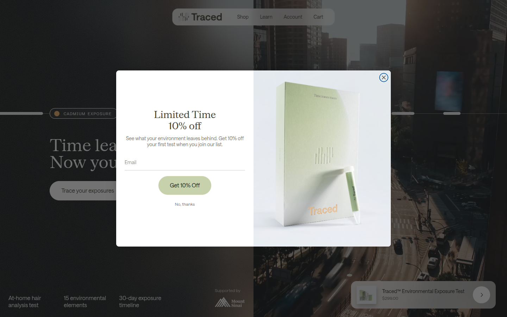
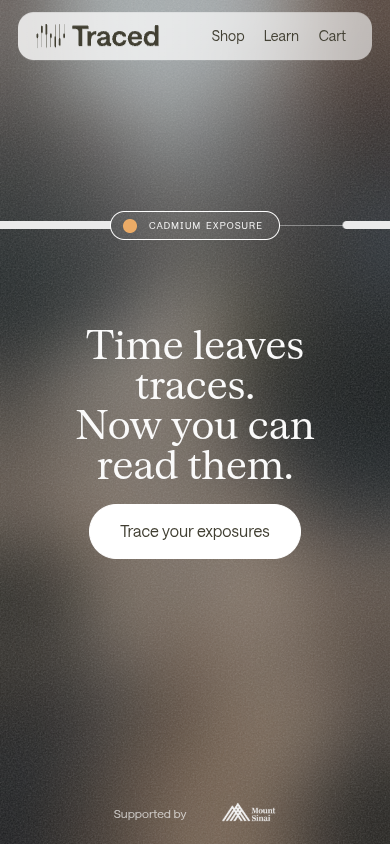

# UI Design System & Master Generation Blueprint: traced-life

> **At-Home Environmental Exposure Test · Traced** (https://traced.life/) — Trace 15 environmental elements from one strand of hair. A personal 30-day timeline, percentile rankings against a global database, and g...



---

## 1. Executive Visual Persona & Design Archetype

- **Brand Essence & Persona**: **At-Home Environmental Exposure Test · Traced** (`https://traced.life/`). Trace 15 environmental elements from one strand of hair. A personal 30-day timeline, percentile rankings against a global database, and g...
- **Capture Provenance**: Live browser capture (`tier2_webgl`, HTTP `200`, captured `2026-11-23`).
- **Visual Archetype**: **High-Contrast Obsidian / Atmospheric Design System (`#615e50` canvas, `#ffffff` ink, `#1990c6` accent)**.
- **Anti-AI-Slop Differentiators**:
  - **Live-Computed Chromatic Polarity**: Anchors the viewport in `#615e50` (live computed `section` `background-color` (`computed_styles.json`)) paired with `#ffffff` primary typography and `#1990c6` accents.
  - **Grounded Typographic Hierarchy**: Pairs `Serrif` for display copy (`Time leaves traces. Now you can read`) with `Saans` and `Saans Semi Mono`.
  - **Calibrated Spatial Grid & Motion**: Combines `96rem` container bounds (`gap: .375rem`, padding `.5rem`) with `cubic-bezier(.4,0,1,1)` easing and Swiper Touch Carousel Engine.

---

## 2. Spatial Architecture & Modular Grid Mathematics



### Viewport Allocation & Container Geometry
- **Captured Viewport Dimensions**: Desktop `1440×900px` (`assets/desktop.png`, single-viewport 100vh live capture (900px)), Mobile `390×844px` (`assets/mobile.png`, single-viewport 100vh live capture (844px)).
- **Master Container Bounds**: `96rem` (non-`@media` desktop container stylesheet rule).
- **Canvas Lateral Padding & Spacing**: `.5rem` lateral canvas padding with `.375rem` grid gap.
- **Border Radius Scale**: `var(--radius-xl)`, `1rem`, `50%`, `var(--radius-full)`.

### Responsive Breakpoint Architecture
- **Desktop Layout**: Multi-column CSS Grid / Flexbox layout at `1440px` (`max-width: 96rem`, `gap: .375rem`).
- **Mobile Layout**: Single-column vertical stack at `390px` viewport width with `.5rem` horizontal padding.
- **Extracted CSS Media Queries**: `@media (prefers-reduced-motion:no-preference)`, `@media (min-width:48rem)`, `@media (min-width:64rem)`, `@media (prefers-reduced-motion:reduce)`.

---

## 3. Color System, Materiality & Atmospheric Lighting

### Semantic Palette & Source Grounding
| Semantic Role | Ground-Truth Value | Extracted Live / CSS Source |
|---|---|---|
| **Primary Canvas Substrate** | `#615e50` | live computed `section` `background-color` (`computed_styles.json`) |
| **Primary Typography Ink** | `#ffffff` | live computed `a` `color` (`computed_styles.json`) |
| **Elevated Surface / Card Substrate** | `#000000` | live computed `a` `background-color` (`computed_styles.json`) |
| **Interactive Accent / Highlight** | `#1990c6` | `.shopify-payment-button__button... { background-color: #1990c6 }` |
| **Secondary / Muted Copy** | `#bdbdbd` | `var(--foreground-disabled)` in `:root` |
| **Structural Hairline Border** | `#e5e5eb` | `var(--oke-border-color)` in `:root` |
| **Variable Token (`--oke-button-backgroundColor`)** | `#f7f7f8` | `var(--oke-button-backgroundColor)` in `:root` |
| **Variable Token (`--oke-button-backgroundColorHover`)** | `#f4f4f6` | `var(--oke-button-backgroundColorHover)` in `:root` |
| **Variable Token (`--oke-button-backgroundColorActive`)** | `#676986` | `var(--oke-button-backgroundColorActive)` in `:root` |
| **Variable Token (`--oke-button-textColor`)** | `#272d45` | `var(--oke-button-textColor)` in `:root` |
| **Variable Token (`--oke-button-borderColor`)** | `#dbdde4` | `var(--oke-button-borderColor)` in `:root` |

### Sanitized Root CSS Variables (`ui-ux.md` Ground Truth)
| Variable Name | Extracted Value | Semantic Role |
|---|---|---|
| `--oke-widget-spaceAbove` | `20px` | Layout / Spatial Grid Token |
| `--oke-widget-spaceBelow` | `20px` | Layout / Spatial Grid Token |
| `--oke-starRating-spaceAbove` | `0` | Layout / Spatial Grid Token |
| `--oke-starRating-spaceBelow` | `0` | Layout / Spatial Grid Token |
| `--oke-button-backgroundColor` | `#f7f7f8` | Canvas / Surface Token |
| `--oke-button-backgroundColorHover` | `#f4f4f6` | Canvas / Surface Token |
| `--oke-button-backgroundColorActive` | `#676986` | Canvas / Surface Token |
| `--oke-button-textColor` | `#272d45` | Typography Ink Token |
| `--oke-button-textColorHover` | `#272d45` | Typography Ink Token |
| `--oke-button-textColorActive` | `#fff` | Typography Ink Token |
| `--oke-button-borderColor` | `#dbdde4` | Brand / Palette Token |
| `--oke-button-borderColorHover` | `#dbdde4` | Brand / Palette Token |
| `--oke-button-borderColorActive` | `#676986` | Brand / Palette Token |
| `--oke-button-borderRadius` | `4px` | Elevation / Border Token |
| `--oke-button-borderWidth` | `1px` | Layout / Spatial Grid Token |
| `--oke-button-fontWeight` | `700` | Typography / Scale Token |

---

## 4. Typographic Scale & Editorial Hierarchy

### Font Family Stacks
- **Display Typography**: `Serrif`.
- **Primary Body Stack**: `Saans`.
- **Technical / Metadata Stack**: `Saans Semi Mono`.

### Typographic Scale & Rules (Live Computed & Stylesheet Grounded)
- **Hero Display (`H1`)**: live computed `h1` (`font-size: 48px`, `line-height: 48px`, `font-weight: 400`); rule `h1` (`font-size: 2.5rem`, `line-height: 100%`).
- **Section Heading (`H2`)**: CSS variables `--text-2xl: 1.5rem`, `--text-2xl--line-height: calc(2 / 1.5)`; rule `h2` (`font-size: 1.5rem`, `line-height: 110%`).
- **Body Copy**: live computed `body` (`font-size: 16px`, `line-height: 24px`, `font-weight: 400`); CSS variables `--text-base: 1rem`, `--text-base--line-height: calc(1.5 / 1)`, `--oke-bodyText-fontWeight: 400`; rule `p` (`font-size: 1rem`, `line-height: 120%`).
- **Metadata & Navigation Labels**: live computed `nav/a` (`font-size: 16px`, `line-height: 24px`, `font-weight: 400`); CSS variables `--oke-text-small: 12px`, `--font-mono: "Saans Semi Mono",monospace`, `--default-mono-font-family: var(--font-mono)`; rule `small` (`font-size: calc(var(--kl-reviews-reviews...`, `font-weight: var(--kl-revi...`).

---

## 5. Choreographed Motion & Interaction Physics

### Primary Easing Curves
- **Extracted Timing Functions**: `cubic-bezier(.4,0,1,1)`, `cubic-bezier(0,0,.2,1)`, `cubic-bezier(.4,0,.2,1)`.

### Per-Element Transition & Choreography Rules
- **Selector `layer theme`**: `transition: .15s` extracted from `traced-life` stylesheet.
- **Selector `dialog::backdrop`**: `transition: opacity .35s` extracted from `traced-life` stylesheet.
- **Selector `.swiper-wrapper`**: `transition: var(--swiper-wrapper-transition-timing-function,initial)` extracted from `traced-life` stylesheet.
- **Extracted Easing Curve (`cubic-bezier(.4,0,1,1)`)**: Governs interactive state transitions across `<header.contents>` and `<section.text-dark-secondary>`.
- **Runtime Interaction Engine**: Integrates Swiper Touch Carousel Engine with `prefers-reduced-motion: reduce` fallback guards.

---

## 6. Component Wireframe & Structural DOM Map

### Visual Layout Schematic — Desktop (`1440px`, Grounded in `dom.html` & Landmark Bounding Boxes)
```
┌────────────────────────────────────────────────────────────────────────┐
│ DESKTOP VIEWPORT (1440px) — At-Home Environmental Exposure Test · Trac │
│ ====================================================================== │
│ [ <header.contents> (1440px)          | Shop · What we test · Report ] │
│ ---------------------------------------------------------------------- │
│ | HERO STAGE: <section.text-light-50> (w=1440px)                     | │
│ | H1: Time leaves traces. Now you can read them.                     | │
│ | Substrate: #615e50 | Ink: #ffffff | Accent: #1990c6                | │
│ ---------------------------------------------------------------------- │
│ | SHOWCASE GRID (<section.text-dark-seconda) max-w: 96rem            | │
│ | +------------------------------+  +------------------------------+ | │
│ | | The difference               |  | How It Works                 | | │
│ | +------------------------------+  +------------------------------+ | │
│ ---------------------------------------------------------------------- │
│ | DETAIL MODULE (<section.bg-light>) — our expertise                 | │
│ ---------------------------------------------------------------------- │
│ [ FOOTER (<footer.contents>   ) | https://traced.life/                 │
└────────────────────────────────────────────────────────────────────────┘
```

### Visual Layout Schematic — Mobile Reflow (`390px`)
```
┌────────────────────────────────────────────────────────────────────────┐
│ MOBILE VIEWPORT REFLOW (390px) — Single-Column Stack (gap: .375rem)    │
│ ====================================================================== │
│ [ HEADER BAR (<header.contents>       ) | Compact Menu (390px)         │
│ ---------------------------------------------------------------------- │
│ | HERO STAGE (<section.text-light-50>) — 390px Vertical Lead         | │
│ | H1: Time leaves traces. Now you can read them.                     | │
│ ---------------------------------------------------------------------- │
│ | SHOWCASE STACK (<section.text-dark-sec) — 1-Col Stack              | │
│ | [ Item 1: The difference                                         ] | │
│ | [ Item 2: How It Works                                           ] | │
│ ---------------------------------------------------------------------- │
│ | DETAIL STACK (<section.bg-light>) — 1-Col (our expertise)          | │
│ ---------------------------------------------------------------------- │
│ [ FOOTER (<footer.contents>   ) | Stacked 390px Colophon               │
└────────────────────────────────────────────────────────────────────────┘
```

### Granular DOM Region Breakdown
1. **Brand Header & Navigation Bar (<header.contents> — `traced-life`)**:
   - Landmark `<header class="contents">` (`1440px`) hosting `At-Home Environmental Exposure Test ` navigation (`Shop · What we test · Report · Science · Our story`), DOM attributes (`data-source-attribution="shopify.exit_intersti..."`, `data-shop-id="70566805578"`, `data-venmo-supported="false"`, `data-environment="production"`), and stylesheet rule `before { border:0 solid;box-sizing:border-box;margin:0;padding:0 }`.
2. **Hero Stage & Focal Lead (<section.text-light-50> — `Time leaves traces. Now you can re`)**:
   - Landmark `<section class="text-light-50 bg-background-4">` presenting display lead `Time leaves traces. Now you can read them.` and copy excerpt *"At-home hair analysis test"* over `#615e50` canvas and `#ffffff` ink.
3. **Primary Showcase & Content Grid (<section.text-dark-secondary> — `The difference`)**:
   - Landmark `<section class="text-dark-secondary w-full">` rendering section `The difference` with copy *"Nickel contaminants"*, asset references (`awin-shopify-integration-code.js`, `loader.js`, `sealsubscriptions.js`, `990232790301153`), and grid rule `webkit-file-upload-button { border:0 solid;box-sizing:border-box;margin:0;padding:0 }`.
4. **Interactive Detail & Feature Matrix (<section.bg-light> — `How It Works`)**:
   - Landmark `<section class="text-dark-secondary bg-light">` framing `How It Works` and `our expertise` (*"15 environmental elements"*) with `#000000` surface cards, `#1990c6` accents, and `file-selector-button { border:0 solid;box-sizing:border-box;margin:0;padding:0 }`.
5. **Colophon & Global Directory Footer (<footer.contents> — `https://traced.life/`)**:
   - Landmark `<footer class="contents">` anchoring `At-Home Environmental Exposure T` footer links (`Shop · What we test · Report · Science · Our story`), copy *"30-day exposure timeline"*, and `#e5e5eb` structural dividers.

---

## 7. Master Zero-Shot AI Generation Prompt

```markdown
# Master Zero-Shot Frontend Generation Prompt: traced-life (At-Home Environmental Exposure Test · Traced)

You are a principal frontend architect and design systems engineer. Build a complete, production-ready web application replicating the exact design system, DOM landmarks, typographic hierarchy, color tokens, and motion physics of `traced-life` (**At-Home Environmental Exposure Test · Traced** — `https://traced.life/`).

### 1. Visual Archetype & Anti-AI-Slop Mandates
- **Archetype**: High-Contrast Obsidian / Atmospheric Design System (`#615e50` canvas, `#ffffff` ink, `#1990c6` accent).
- **Identity & Domain Context**: Trace 15 environmental elements from one strand of hair. A personal 30-day timeline, percentile rankings against a global database, and g...
- **Primary Substrate**: `#615e50` (live computed `section` `background-color` (`computed_styles.json`)), **Primary Ink**: `#ffffff`, **Accent / Highlight**: `#1990c6`.
- **Site-Specific Differentiators**:
  - **Live-Computed Chromatic Polarity**: Anchors the viewport in `#615e50` (live computed `section` `background-color` (`computed_styles.json`)) paired with `#ffffff` primary typography and `#1990c6` accents.
  - **Grounded Typographic Hierarchy**: Pairs `Serrif` for display copy (`Time leaves traces. Now you can read`) with `Saans` and `Saans Semi Mono`.
  - **Calibrated Spatial Grid & Motion**: Combines `96rem` container bounds (`gap: .375rem`, padding `.5rem`) with `cubic-bezier(.4,0,1,1)` easing and Swiper Touch Carousel Engine.

### 2. Ground-Truth CSS Variables (`:root` Token Contract)
Declare and consume these exact custom properties extracted from `traced-life` in your global stylesheet:

:root {
  /* At-Home Environmental Exposure Test · Traced (traced-life) — Live-Grounded CSS Variables */
  --oke-widget-spaceAbove: 20px; /* Layout / Spatial Grid Token (traced-life) */
  --oke-widget-spaceBelow: 20px; /* Layout / Spatial Grid Token (traced-life) */
  --oke-starRating-spaceAbove: 0; /* Layout / Spatial Grid Token (traced-life) */
  --oke-starRating-spaceBelow: 0; /* Layout / Spatial Grid Token (traced-life) */
  --oke-button-backgroundColor: #f7f7f8; /* Canvas / Surface Token (traced-life) */
  --oke-button-backgroundColorHover: #f4f4f6; /* Canvas / Surface Token (traced-life) */
  --oke-button-backgroundColorActive: #676986; /* Canvas / Surface Token (traced-life) */
  --oke-button-textColor: #272d45; /* Typography Ink Token (traced-life) */
  --oke-button-textColorHover: #272d45; /* Typography Ink Token (traced-life) */
  --oke-button-textColorActive: #fff; /* Typography Ink Token (traced-life) */
  --oke-button-borderColor: #dbdde4; /* Brand / Palette Token (traced-life) */
  --oke-button-borderColorHover: #dbdde4; /* Brand / Palette Token (traced-life) */
  --oke-button-borderColorActive: #676986; /* Brand / Palette Token (traced-life) */
  --oke-button-borderRadius: 4px; /* Elevation / Border Token (traced-life) */
  --oke-button-borderWidth: 1px; /* Layout / Spatial Grid Token (traced-life) */
  --oke-button-fontWeight: 700; /* Typography / Scale Token (traced-life) */
}

### 3. Semantic Color & Materiality Contract
Map every surface, ink, and border strictly to these source-grounded tokens:
- **Primary Canvas Substrate**: `#615e50` — grounded in live computed `section` `background-color` (`computed_styles.json`)
- **Primary Typography Ink**: `#ffffff` — grounded in live computed `a` `color` (`computed_styles.json`)
- **Elevated Surface / Card Substrate**: `#000000` — grounded in live computed `a` `background-color` (`computed_styles.json`)
- **Interactive Accent / Highlight**: `#1990c6` — grounded in `.shopify-payment-button__button... { background-color: #1990c6 }`
- **Secondary / Muted Copy**: `#bdbdbd` — grounded in `var(--foreground-disabled)` in `:root`
- **Structural Hairline Border**: `#e5e5eb` — grounded in `var(--oke-border-color)` in `:root`
- **Variable Token (`--oke-button-backgroundColor`)**: `#f7f7f8` — grounded in `var(--oke-button-backgroundColor)` in `:root`
- **Variable Token (`--oke-button-backgroundColorHover`)**: `#f4f4f6` — grounded in `var(--oke-button-backgroundColorHover)` in `:root`
- **Variable Token (`--oke-button-backgroundColorActive`)**: `#676986` — grounded in `var(--oke-button-backgroundColorActive)` in `:root`
- **Variable Token (`--oke-button-textColor`)**: `#272d45` — grounded in `var(--oke-button-textColor)` in `:root`
- **Variable Token (`--oke-button-borderColor`)**: `#dbdde4` — grounded in `var(--oke-button-borderColor)` in `:root`

### 4. Spatial Grid, Container Bounds & Responsive Breakpoints
- **Desktop Viewport Reference**: `1440×900px` (single-viewport 100vh live capture (900px), `1440px` standard desktop width).
- **Mobile Viewport Reference**: `390×844px` (single-viewport 100vh live capture (844px), `390px` standard mobile width).
- **Container Max-Width**: `96rem` (non-`@media` desktop container stylesheet rule)
- **Padding & Gutters**: `.5rem` lateral canvas padding with `.375rem` grid gap
- **Desktop Grid**: Multi-column CSS Grid / Flexbox layout at `1440px` (`max-width: 96rem`, `gap: .375rem`)
- **Mobile Adaptation**: Single-column vertical stack at `390px` viewport width with `.5rem` horizontal padding
- **Media Queries**: `@media (prefers-reduced-motion:no-preference)`, `@media (min-width:48rem)`, `@media (min-width:64rem)`, `@media (prefers-reduced-motion:reduce)`
- **Corner Radii**: `var(--radius-xl)`, `1rem`, `50%`, `var(--radius-full)`

### 5. Typography & Editorial Scale Contract
- **Display Font Stack**: `Serrif`
- **Body Font Stack**: `Saans`
- **Monospace / Technical Font Stack**: `Saans Semi Mono`
- **H1 Display Rule**: live computed `h1` (`font-size: 48px`, `line-height: 48px`, `font-weight: 400`); rule `h1` (`font-size: 2.5rem`, `line-height: 100%`)
- **H2 Section Rule**: CSS variables `--text-2xl: 1.5rem`, `--text-2xl--line-height: calc(2 / 1.5)`; rule `h2` (`font-size: 1.5rem`, `line-height: 110%`)
- **Body Copy Rule**: live computed `body` (`font-size: 16px`, `line-height: 24px`, `font-weight: 400`); CSS variables `--text-base: 1rem`, `--text-base--line-height: calc(1.5 / 1)`, `--oke-bodyText-fontWeight: 400`; rule `p` (`font-size: 1rem`, `line-height: 120%`)
- **Metadata & Index Rule**: live computed `nav/a` (`font-size: 16px`, `line-height: 24px`, `font-weight: 400`); CSS variables `--oke-text-small: 12px`, `--font-mono: "Saans Semi Mono",monospace`, `--default-mono-font-family: var(--font-mono)`; rule `small` (`font-size: calc(var(--kl-reviews-reviews...`, `font-weight: var(--kl-revi...`)

### 6. Component Hierarchy, Verbatim Copy & Real DOM Landmarks
Scaffold `traced-life` (`At-Home Environmental Exposure Test · Traced`) with these exact structural regions, extracted copy, and CSS rules from `dom.html`:
1. **Brand Header & Navigation Bar (<header.contents> — `traced-life`)**:
   - DOM & Selectors: Landmark `<header class="contents">` (`1440px`) hosting `At-Home Environmental Exposure Test ` navigation (`Shop · What we test · Report · Science · Our story`), DOM attributes (`data-source-attribution="shopify.exit_intersti..."`, `data-shop-id="70566805578"`, `data-venmo-supported="false"`, `data-environment="production"`), and stylesheet rule `before { border:0 solid;box-sizing:border-box;margin:0;padding:0 }`.
   - Responsive Contract: Header `Brand Header & Navigation Bar (<header.contents> — `traced-life`)` (`traced-life`) adapts across `@media (prefers-reduced-motion:no-preference)`, `@media (min-width:48rem)`, `@media (min-width:64rem)`, `@media (prefers-reduced-motion:reduce)` with `cubic-bezier(.4,0,1,1)`, `cubic-bezier(0,0,.2,1)`, `cubic-bezier(.4,0,.2,1)` transitions and links `Shop · What we test · Report · Science · Our story`.
2. **Hero Stage & Focal Lead (<section.text-light-50> — `Time leaves traces. Now you can re`)**:
   - DOM & Selectors: Landmark `<section class="text-light-50 bg-background-4">` presenting display lead `Time leaves traces. Now you can read them.` and copy excerpt *"At-home hair analysis test"* over `#615e50` canvas and `#ffffff` ink.
   - Responsive Contract: Hero stage (`1440×900px` desktop / `390×844px` mobile) sets `#615e50` background with `#ffffff` headline `Time leaves traces. Now you can read them.`.
3. **Primary Showcase & Content Grid (<section.text-dark-secondary> — `The difference`)**:
   - DOM & Selectors: Landmark `<section class="text-dark-secondary w-full">` rendering section `The difference` with copy *"Nickel contaminants"*, asset references (`awin-shopify-integration-code.js`, `loader.js`, `sealsubscriptions.js`, `990232790301153`), and grid rule `webkit-file-upload-button { border:0 solid;box-sizing:border-box;margin:0;padding:0 }`.
   - Responsive Contract: Showcase grid `Primary Showcase & Content Grid (<section.text-dark-secondary> — `The difference`)` applies Multi-column CSS Grid / Flexbox layout at `1440px` (`max-width: 96rem`, `gap: .375rem`) on desktop and Single-column vertical stack at `390px` viewport width with `.5rem` horizontal padding on mobile.
4. **Interactive Detail & Feature Matrix (<section.bg-light> — `How It Works`)**:
   - DOM & Selectors: Landmark `<section class="text-dark-secondary bg-light">` framing `How It Works` and `our expertise` (*"15 environmental elements"*) with `#000000` surface cards, `#1990c6` accents, and `file-selector-button { border:0 solid;box-sizing:border-box;margin:0;padding:0 }`.
   - Responsive Contract: Detail module `Interactive Detail & Feature Matrix (<section.bg-light> — `How It Works`)` uses `var(--radius-xl)`, `1rem`, `50%`, `var(--radius-full)` radii, `#1990c6` highlights, and assets (awin-shopify-integration-code.js, loader.js, sealsubscriptions.js).
5. **Colophon & Global Directory Footer (<footer.contents> — `https://traced.life/`)**:
   - DOM & Selectors: Landmark `<footer class="contents">` anchoring `At-Home Environmental Exposure T` footer links (`Shop · What we test · Report · Science · Our story`), copy *"30-day exposure timeline"*, and `#e5e5eb` structural dividers.
   - Responsive Contract: Footer `Colophon & Global Directory Footer (<footer.contents> — `https://traced.life/`)` aligns to `96rem` (non-`@media` desktop container stylesheet rule) with `.5rem` lateral canvas padding with `.375rem` grid gap and attributes (data-source-attribution="shopify.exit_intersti...", data-shop-id="70566805578", data-venmo-supported="false").

#### Verbatim DOM Copy Excerpts (`dom.html`)
- Copy Excerpt 1: *"At-home hair analysis test"*
- Copy Excerpt 2: *"Nickel contaminants"*
- Copy Excerpt 3: *"15 environmental elements"*
- Copy Excerpt 4: *"30-day exposure timeline"*

### 7. Motion, Extracted Stylesheet Rules & Interaction Choreography
- **Primary Easing Functions**: `cubic-bezier(.4,0,1,1)`, `cubic-bezier(0,0,.2,1)`, `cubic-bezier(.4,0,.2,1)`
- **Extracted Stylesheet Rules (`traced-life`)**:
- `before { border:0 solid;box-sizing:border-box;margin:0;padding:0 }`
- `webkit-file-upload-button { border:0 solid;box-sizing:border-box;margin:0;padding:0 }`
- `file-selector-button { border:0 solid;box-sizing:border-box;margin:0;padding:0 }`
- `strong { font-weight:bolder }`
- `small { font-size:80% }`
- **Per-Selector Transition Rules**:
- **Selector `layer theme`**: `transition: .15s` extracted from `traced-life` stylesheet.
- **Selector `dialog::backdrop`**: `transition: opacity .35s` extracted from `traced-life` stylesheet.
- **Selector `.swiper-wrapper`**: `transition: var(--swiper-wrapper-transition-timing-function,initial)` extracted from `traced-life` stylesheet.
- **Extracted Easing Curve (`cubic-bezier(.4,0,1,1)`)**: Governs interactive state transitions across `<header.contents>` and `<section.text-dark-secondary>`.
- **Runtime Interaction Engine**: Integrates Swiper Touch Carousel Engine with `prefers-reduced-motion: reduce` fallback guards.

### 8. Technical Deliverables
- Implement in Next.js (App Router) with TypeScript and Tailwind CSS consuming the `:root` custom properties defined above for `traced-life`.
- Reproduce both the `1440px` desktop architecture and `390px` mobile breakpoint transitions, preserving semantic HTML5 landmarks (`<header>`, `<nav>`, `<main>`, `<section>`, `<footer>`) and `prefers-reduced-motion` accessibility guards.
```
