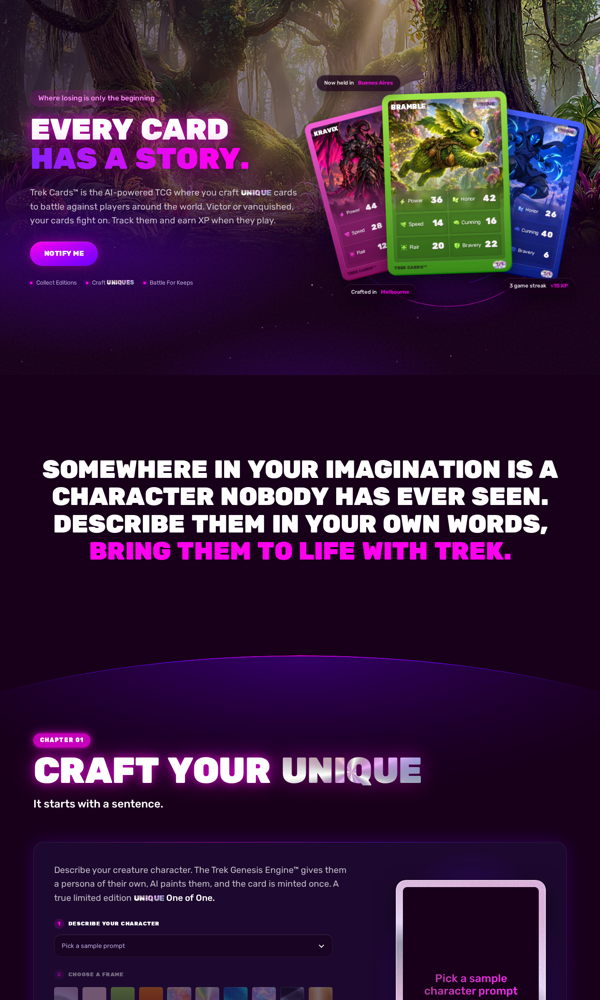
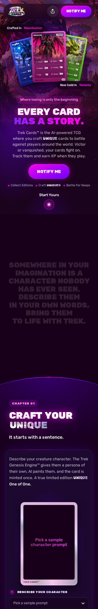

# UI Design System & Master Generation Blueprint: trek-cards

> **Trek Cards - The AI-Powered TCG Where Every Card Has a Story** (https://trek.cards/) — Trek Cards is the AI-powered trading card game (TCG). Craft UNIQUE character cards, battle players worldwide and track your cards around...



---

## 1. Executive Visual Persona & Design Archetype

- **Brand Essence & Persona**: **Trek Cards - The AI-Powered TCG Where Every Card Has a Story** (`https://trek.cards/`). Trek Cards is the AI-powered trading card game (TCG). Craft UNIQUE character cards, battle players worldwide and track your cards around...
- **Capture Provenance**: Live browser capture (`tier1_fast`, HTTP `200`, captured `2026-11-23`).
- **Visual Archetype**: **Dark-Substrate WebGL / Canvas Interactive Experience (`#18001a` / `#ff00ee`)**.
- **Anti-AI-Slop Differentiators**:
  - **Live-Computed Chromatic Polarity**: Anchors the viewport in `#18001a` (live computed `body` `background-color` (`computed_styles.json`)) paired with `#ffffff` primary typography and `#ff00ee` accents.
  - **Grounded Typographic Hierarchy**: Pairs `Rubik One` for display copy (`EVERY CARD HAS A STORY.`) with `Rubik` and not declared in live computed styles (uses primary stack / `ui-monospace`).
  - **Calibrated Spatial Grid & Motion**: Combines `1440px` container bounds (`gap: 30px`, padding `12px`) with `cubic-bezier(.2,.8,.2,1)` easing and Three.js / WebGL Canvas Pipeline.

---

## 2. Spatial Architecture & Modular Grid Mathematics



### Viewport Allocation & Container Geometry
- **Captured Viewport Dimensions**: Desktop `1440×2400px` (`assets/desktop.png`, clamped at 2400px live multi-section capture), Mobile `390×2400px` (`assets/mobile.png`, clamped at 2400px live multi-section capture).
- **Master Container Bounds**: `1440px` (full-bleed `100%` desktop stage measured on `1440px` viewport).
- **Canvas Lateral Padding & Spacing**: `12px` lateral canvas padding with `30px` grid gap.
- **Border Radius Scale**: `50%`, `100px`, `6px`, `24px`.

### Responsive Breakpoint Architecture
- **Desktop Layout**: Multi-column CSS Grid / Flexbox layout at `1440px` (`max-width: 1440px`, `gap: 30px`).
- **Mobile Layout**: Single-column vertical stack at `390px` viewport width with `12px` horizontal padding.
- **Extracted CSS Media Queries**: `@media (max-width: 860px)`, `@media (max-width: 900px)`, `@media (max-width: 1000px)`, `@media (min-width: 821px) and (max-width: 1100px)`.

---

## 3. Color System, Materiality & Atmospheric Lighting

### Semantic Palette & Source Grounding
| Semantic Role | Ground-Truth Value | Extracted Live / CSS Source |
|---|---|---|
| **Primary Canvas Substrate** | `#18001a` | live computed `body` `background-color` (`computed_styles.json`) |
| **Primary Typography Ink** | `#ffffff` | live computed `h1` `color` (`computed_styles.json`) |
| **Elevated Surface / Card Substrate** | `#1a0a2e` | `var(--bg)` in `:root` |
| **Interactive Accent / Highlight** | `#ff00ee` | `.btn--play { background: #ff00ee }` |
| **Secondary / Muted Copy** | `#b6a6d6` | `var(--muted)` in `:root` |
| **Structural Hairline Border** | `#2a142c` | `var(--stroke)` in `:root` (`rgba(255, 255, 255, 0.08)`) |
| **Variable Token (`--surface`)** | `#221041` | `var(--surface)` in `:root` |
| **Variable Token (`--surface-2`)** | `#2e1650` | `var(--surface-2)` in `:root` |
| **Variable Token (`--purple`)** | `#6a00ff` | `var(--purple)` in `:root` |
| **Variable Token (`--lilac`)** | `#b176ff` | `var(--lilac)` in `:root` |
| **Variable Token (`--green`)** | `#68ff8e` | `var(--green)` in `:root` |
| **Variable Token (`--brand`)** | `#7b22ff` | `var(--brand)` in `:root` |
| **Variable Token (`--brand`)** | `#c215f6` | `var(--brand)` in `:root` |

### Sanitized Root CSS Variables (`ui-ux.md` Ground Truth)
| Variable Name | Extracted Value | Semantic Role |
|---|---|---|
| `--ground` | `#18001A` | Color / Atmospheric Token |
| `--bg` | `#1A0A2E` | Canvas / Surface Token |
| `--surface` | `#221041` | Canvas / Surface Token |
| `--surface-2` | `#2E1650` | Canvas / Surface Token |
| `--purple` | `#6A00FF` | Color / Atmospheric Token |
| `--pink` | `#FF00EE` | Typography Ink Token |
| `--lilac` | `#B176FF` | Color / Atmospheric Token |
| `--ink` | `#FFFFFF` | Typography Ink Token |
| `--muted` | `#B6A6D6` | Color / Atmospheric Token |
| `--soft` | `rgba(255, 255, 255, 0.72)` | Color / Atmospheric Token |
| `--stroke` | `rgba(255, 255, 255, 0.08)` | Elevation / Border Token |
| `--green` | `#68FF8E` | Color / Atmospheric Token |
| `--title` | `'Rubik One', 'Rubik', sans-serif` | Design System Custom Token |
| `--body` | `'Rubik', -apple-system, BlinkMacSystemFont, 'Segoe UI', sans-serif` | Dimension / Scale Token |
| `--brand` | `linear-gradient(55deg, #7B22FF 0%, #C215F6 38%, #FF00EE 82%)` | Brand / Palette Token |
| `--ease` | `cubic-bezier(.2, .8, .2, 1)` | Motion / Easing Token |

---

## 4. Typographic Scale & Editorial Hierarchy

### Font Family Stacks
- **Display Typography**: `Rubik One`.
- **Primary Body Stack**: `Rubik`.
- **Technical / Metadata Stack**: not declared in live computed styles (uses primary stack / `ui-monospace`).

### Typographic Scale & Rules (Live Computed & Stylesheet Grounded)
- **Hero Display (`H1`)**: live computed `h1` (`font-size: 72px`, `line-height: 70.56px`, `font-weight: 400`, `letter-spacing: -2.16px`); rule `.title` (`line-height: .98`, `letter-spacing: -0.03em`, `font-weight: 400`).
- **Section Heading (`H2`)**: live computed `h2` (`font-size: 86.4px`, `line-height: 84.672px`, `font-weight: 400`, `letter-spacing: -2.592px`); rule `h2` (`font-size: clamp(38px, 6vw, 92px)`).
- **Body Copy**: live computed `body` (`font-size: 17px`, `line-height: 27.2px`, `font-weight: 400`); CSS variables `--body: 'Rubik', -apple-system, BlinkMacSystemFont, 'Segoe UI', sans-serif`; rule `body` (`font-size: 17px`, `line-height: 1.6`).
- **Metadata & Navigation Labels**: live computed `nav/a` (`font-size: 14.5px`, `line-height: 23.2px`, `font-weight: 500`); rule `small` (`font-size: 11px`).

---

## 5. Choreographed Motion & Interaction Physics

### Primary Easing Curves
- **Extracted Timing Functions**: `cubic-bezier(.2,.8,.2,1)`, `cubic-bezier(.2,.6,.35,1)`, `cubic-bezier(.37,0,.63,1)`.

### Per-Element Transition & Choreography Rules
- **Selector `.cursor-glow`**: `transition: opacity .6s` extracted from `trek-cards` stylesheet.
- **Selector `.btn`**: `transition: transform .25s var(--ease), box-shadow .3s` extracted from `trek-cards` stylesheet.
- **Selector `.btn--glass::after`**: `transition: opacity .4s` extracted from `trek-cards` stylesheet.
- **Extracted Easing Curve (`cubic-bezier(.2,.8,.2,1)`)**: Governs interactive state transitions across `<header.nav>` and `<section.prologue>`.
- **Runtime Interaction Engine**: Integrates Three.js / WebGL Canvas Pipeline with `prefers-reduced-motion: reduce` fallback guards.

---

## 6. Component Wireframe & Structural DOM Map

### Visual Layout Schematic — Desktop (`1440px`, Grounded in `dom.html` & Landmark Bounding Boxes)
```
┌────────────────────────────────────────────────────────────────────────┐
│ DESKTOP VIEWPORT (1440px) — Trek Cards - The AI-Powered TCG Where Ever │
│ ====================================================================== │
│ [ <header.nav> (1120x68px)            | Craft · Battle · Journey · L ] │
│ ---------------------------------------------------------------------- │
│ | HERO STAGE: <section.hero> (w=1440px)                              | │
│ | H1: EVERY CARD HAS A STORY.                                        | │
│ | Substrate: #18001a | Ink: #ffffff | Accent: #ff00ee                | │
│ ---------------------------------------------------------------------- │
│ | SHOWCASE GRID (<section.prologue>) max-w: 1440px                   | │
│ | +------------------------------+  +------------------------------+ | │
│ | | Every card has a story.      |  | Craft your Unique            | | │
│ | +------------------------------+  +------------------------------+ | │
│ ---------------------------------------------------------------------- │
│ | DETAIL MODULE (<section.chapter>) — 1 Describe your chara          | │
│ ---------------------------------------------------------------------- │
│ [ FOOTER (<footer.foot>       ) | https://trek.cards/                  │
└────────────────────────────────────────────────────────────────────────┘
```

### Visual Layout Schematic — Mobile Reflow (`390px`)
```
┌────────────────────────────────────────────────────────────────────────┐
│ MOBILE VIEWPORT REFLOW (390px) — Single-Column Stack (gap: 30px)       │
│ ====================================================================== │
│ [ HEADER BAR (<header.nav>            ) | Compact Menu (390px)         │
│ ---------------------------------------------------------------------- │
│ | HERO STAGE (<section.hero>) — 390px Vertical Lead                  | │
│ | H1: EVERY CARD HAS A STORY.                                        | │
│ ---------------------------------------------------------------------- │
│ | SHOWCASE STACK (<section.prologue>) — 1-Col Stack                  | │
│ | [ Item 1: Every card has a story.                                ] | │
│ | [ Item 2: Craft your Unique                                      ] | │
│ ---------------------------------------------------------------------- │
│ | DETAIL STACK (<section.chapter>) — 1-Col (1 Describe your ch)      | │
│ ---------------------------------------------------------------------- │
│ [ FOOTER (<footer.foot>       ) | Stacked 390px Colophon               │
└────────────────────────────────────────────────────────────────────────┘
```

### Granular DOM Region Breakdown
1. **Brand Header & Navigation Bar (<header.nav> — `trek-cards`)**:
   - Landmark `<header class="nav">` (`1120x68px`) hosting `Trek Cards - The AI-Powered TCG Wher` navigation (`Craft · Battle · Journey · Legacy · Collect`), DOM attributes (`data-notify`, `data-when="prelaunch"`, `data-when="launch"`, `data-key="kravix"`), and stylesheet rule `font-face { font-family: 'Rubik One'; src: url('../fonts/rubik-one.woff') format('wo... }`.
2. **Hero Stage & Focal Lead (<section.hero> — `EVERY CARD HAS A STORY.`)**:
   - Landmark `<section class="hero">` presenting display lead `EVERY CARD HAS A STORY.` and copy excerpt *"Trek Cards™ is the AI-powered TCG where you craft UNIQUE cards to"* over `#18001a` canvas and `#ffffff` ink.
3. **Primary Showcase & Content Grid (<section.prologue> — `Every card has a story.`)**:
   - Landmark `<section class="prologue">` rendering section `Every card has a story.` with copy *"Where losing is only the beginning"*, asset references (`favicon-32x32.png`, `apple-touch-icon.png`, `site.css`, `trek-logo.webp (Trek Cards)`), and grid rule `after { box-sizing: border-box; margin: 0; padding: 0; }`.
4. **Interactive Detail & Feature Matrix (<section.chapter> — `Craft your Unique`)**:
   - Landmark `<section class="chapter ch-craft">` framing `Craft your Unique` and `1 Describe your character` (*"Trek Cards™ is the AI-powered TCG where you craft Unique cards to"*) with `#1a0a2e` surface cards, `#ff00ee` accents, and `html { -webkit-text-size-adjust: 100%; overflow-x: hidden; overflow-x: clip; }`.
5. **Colophon & Global Directory Footer (<footer.foot> — `https://trek.cards/`)**:
   - Landmark `<footer class="foot">` anchoring `Trek Cards - The AI-Powered TCG ` footer links (`Craft · Battle · Journey · Legacy · Collect`), copy *"Download on the App Store"*, and `#2a142c` structural dividers.

---

## 7. Master Zero-Shot AI Generation Prompt

```markdown
# Master Zero-Shot Frontend Generation Prompt: trek-cards (Trek Cards - The AI-Powered TCG Where Every Card Has a Story)

You are a principal frontend architect and design systems engineer. Build a complete, production-ready web application replicating the exact design system, DOM landmarks, typographic hierarchy, color tokens, and motion physics of `trek-cards` (**Trek Cards - The AI-Powered TCG Where Every Card Has a Story** — `https://trek.cards/`).

### 1. Visual Archetype & Anti-AI-Slop Mandates
- **Archetype**: Dark-Substrate WebGL / Canvas Interactive Experience (`#18001a` / `#ff00ee`).
- **Identity & Domain Context**: Trek Cards is the AI-powered trading card game (TCG). Craft UNIQUE character cards, battle players worldwide and track your cards around...
- **Primary Substrate**: `#18001a` (live computed `body` `background-color` (`computed_styles.json`)), **Primary Ink**: `#ffffff`, **Accent / Highlight**: `#ff00ee`.
- **Site-Specific Differentiators**:
  - **Live-Computed Chromatic Polarity**: Anchors the viewport in `#18001a` (live computed `body` `background-color` (`computed_styles.json`)) paired with `#ffffff` primary typography and `#ff00ee` accents.
  - **Grounded Typographic Hierarchy**: Pairs `Rubik One` for display copy (`EVERY CARD HAS A STORY.`) with `Rubik` and not declared in live computed styles (uses primary stack / `ui-monospace`).
  - **Calibrated Spatial Grid & Motion**: Combines `1440px` container bounds (`gap: 30px`, padding `12px`) with `cubic-bezier(.2,.8,.2,1)` easing and Three.js / WebGL Canvas Pipeline.

### 2. Ground-Truth CSS Variables (`:root` Token Contract)
Declare and consume these exact custom properties extracted from `trek-cards` in your global stylesheet:

:root {
  /* Trek Cards - The AI-Powered TCG Where Every Card Has a Story (trek-cards) — Live-Grounded CSS Variables */
  --ground: #18001A; /* Color / Atmospheric Token (trek-cards) */
  --bg: #1A0A2E; /* Canvas / Surface Token (trek-cards) */
  --surface: #221041; /* Canvas / Surface Token (trek-cards) */
  --surface-2: #2E1650; /* Canvas / Surface Token (trek-cards) */
  --purple: #6A00FF; /* Color / Atmospheric Token (trek-cards) */
  --pink: #FF00EE; /* Typography Ink Token (trek-cards) */
  --lilac: #B176FF; /* Color / Atmospheric Token (trek-cards) */
  --ink: #FFFFFF; /* Typography Ink Token (trek-cards) */
  --muted: #B6A6D6; /* Color / Atmospheric Token (trek-cards) */
  --soft: rgba(255, 255, 255, 0.72); /* Color / Atmospheric Token (trek-cards) */
  --stroke: rgba(255, 255, 255, 0.08); /* Elevation / Border Token (trek-cards) */
  --green: #68FF8E; /* Color / Atmospheric Token (trek-cards) */
  --title: 'Rubik One', 'Rubik', sans-serif; /* Design System Custom Token (trek-cards) */
  --body: 'Rubik', -apple-system, BlinkMacSystemFont, 'Segoe UI', sans-serif; /* Dimension / Scale Token (trek-cards) */
  --brand: linear-gradient(55deg, #7B22FF 0%, #C215F6 38%, #FF00EE 82%); /* Brand / Palette Token (trek-cards) */
  --ease: cubic-bezier(.2, .8, .2, 1); /* Motion / Easing Token (trek-cards) */
}

### 3. Semantic Color & Materiality Contract
Map every surface, ink, and border strictly to these source-grounded tokens:
- **Primary Canvas Substrate**: `#18001a` — grounded in live computed `body` `background-color` (`computed_styles.json`)
- **Primary Typography Ink**: `#ffffff` — grounded in live computed `h1` `color` (`computed_styles.json`)
- **Elevated Surface / Card Substrate**: `#1a0a2e` — grounded in `var(--bg)` in `:root`
- **Interactive Accent / Highlight**: `#ff00ee` — grounded in `.btn--play { background: #ff00ee }`
- **Secondary / Muted Copy**: `#b6a6d6` — grounded in `var(--muted)` in `:root`
- **Structural Hairline Border**: `#2a142c` — grounded in `var(--stroke)` in `:root` (`rgba(255, 255, 255, 0.08)`)
- **Variable Token (`--surface`)**: `#221041` — grounded in `var(--surface)` in `:root`
- **Variable Token (`--surface-2`)**: `#2e1650` — grounded in `var(--surface-2)` in `:root`
- **Variable Token (`--purple`)**: `#6a00ff` — grounded in `var(--purple)` in `:root`
- **Variable Token (`--lilac`)**: `#b176ff` — grounded in `var(--lilac)` in `:root`
- **Variable Token (`--green`)**: `#68ff8e` — grounded in `var(--green)` in `:root`
- **Variable Token (`--brand`)**: `#7b22ff` — grounded in `var(--brand)` in `:root`
- **Variable Token (`--brand`)**: `#c215f6` — grounded in `var(--brand)` in `:root`

### 4. Spatial Grid, Container Bounds & Responsive Breakpoints
- **Desktop Viewport Reference**: `1440×2400px` (clamped at 2400px live multi-section capture, `1440px` standard desktop width).
- **Mobile Viewport Reference**: `390×2400px` (clamped at 2400px live multi-section capture, `390px` standard mobile width).
- **Container Max-Width**: `1440px` (full-bleed `100%` desktop stage measured on `1440px` viewport)
- **Padding & Gutters**: `12px` lateral canvas padding with `30px` grid gap
- **Desktop Grid**: Multi-column CSS Grid / Flexbox layout at `1440px` (`max-width: 1440px`, `gap: 30px`)
- **Mobile Adaptation**: Single-column vertical stack at `390px` viewport width with `12px` horizontal padding
- **Media Queries**: `@media (max-width: 860px)`, `@media (max-width: 900px)`, `@media (max-width: 1000px)`, `@media (min-width: 821px) and (max-width: 1100px)`
- **Corner Radii**: `50%`, `100px`, `6px`, `24px`

### 5. Typography & Editorial Scale Contract
- **Display Font Stack**: `Rubik One`
- **Body Font Stack**: `Rubik`
- **Monospace / Technical Font Stack**: not declared in live computed styles (uses primary stack / `ui-monospace`)
- **H1 Display Rule**: live computed `h1` (`font-size: 72px`, `line-height: 70.56px`, `font-weight: 400`, `letter-spacing: -2.16px`); rule `.title` (`line-height: .98`, `letter-spacing: -0.03em`, `font-weight: 400`)
- **H2 Section Rule**: live computed `h2` (`font-size: 86.4px`, `line-height: 84.672px`, `font-weight: 400`, `letter-spacing: -2.592px`); rule `h2` (`font-size: clamp(38px, 6vw, 92px)`)
- **Body Copy Rule**: live computed `body` (`font-size: 17px`, `line-height: 27.2px`, `font-weight: 400`); CSS variables `--body: 'Rubik', -apple-system, BlinkMacSystemFont, 'Segoe UI', sans-serif`; rule `body` (`font-size: 17px`, `line-height: 1.6`)
- **Metadata & Index Rule**: live computed `nav/a` (`font-size: 14.5px`, `line-height: 23.2px`, `font-weight: 500`); rule `small` (`font-size: 11px`)

### 6. Component Hierarchy, Verbatim Copy & Real DOM Landmarks
Scaffold `trek-cards` (`Trek Cards - The AI-Powered TCG Where Every Card Has a Story`) with these exact structural regions, extracted copy, and CSS rules from `dom.html`:
1. **Brand Header & Navigation Bar (<header.nav> — `trek-cards`)**:
   - DOM & Selectors: Landmark `<header class="nav">` (`1120x68px`) hosting `Trek Cards - The AI-Powered TCG Wher` navigation (`Craft · Battle · Journey · Legacy · Collect`), DOM attributes (`data-notify`, `data-when="prelaunch"`, `data-when="launch"`, `data-key="kravix"`), and stylesheet rule `font-face { font-family: 'Rubik One'; src: url('../fonts/rubik-one.woff') format('wo... }`.
   - Responsive Contract: Header `Brand Header & Navigation Bar (<header.nav> — `trek-cards`)` (`trek-cards`) adapts across `@media (max-width: 860px)`, `@media (max-width: 900px)`, `@media (max-width: 1000px)`, `@media (min-width: 821px) and (max-width: 1100px)` with `cubic-bezier(.2,.8,.2,1)`, `cubic-bezier(.2,.6,.35,1)`, `cubic-bezier(.37,0,.63,1)` transitions and links `Craft · Battle · Journey · Legacy · Collect`.
2. **Hero Stage & Focal Lead (<section.hero> — `EVERY CARD HAS A STORY.`)**:
   - DOM & Selectors: Landmark `<section class="hero">` presenting display lead `EVERY CARD HAS A STORY.` and copy excerpt *"Trek Cards™ is the AI-powered TCG where you craft UNIQUE cards to"* over `#18001a` canvas and `#ffffff` ink.
   - Responsive Contract: Hero stage (`1440×2400px` desktop / `390×2400px` mobile) sets `#18001a` background with `#ffffff` headline `EVERY CARD HAS A STORY.`.
3. **Primary Showcase & Content Grid (<section.prologue> — `Every card has a story.`)**:
   - DOM & Selectors: Landmark `<section class="prologue">` rendering section `Every card has a story.` with copy *"Where losing is only the beginning"*, asset references (`favicon-32x32.png`, `apple-touch-icon.png`, `site.css`, `trek-logo.webp (Trek Cards)`), and grid rule `after { box-sizing: border-box; margin: 0; padding: 0; }`.
   - Responsive Contract: Showcase grid `Primary Showcase & Content Grid (<section.prologue> — `Every card has a story.`)` applies Multi-column CSS Grid / Flexbox layout at `1440px` (`max-width: 1440px`, `gap: 30px`) on desktop and Single-column vertical stack at `390px` viewport width with `12px` horizontal padding on mobile.
4. **Interactive Detail & Feature Matrix (<section.chapter> — `Craft your Unique`)**:
   - DOM & Selectors: Landmark `<section class="chapter ch-craft">` framing `Craft your Unique` and `1 Describe your character` (*"Trek Cards™ is the AI-powered TCG where you craft Unique cards to"*) with `#1a0a2e` surface cards, `#ff00ee` accents, and `html { -webkit-text-size-adjust: 100%; overflow-x: hidden; overflow-x: clip; }`.
   - Responsive Contract: Detail module `Interactive Detail & Feature Matrix (<section.chapter> — `Craft your Unique`)` uses `50%`, `100px`, `6px`, `24px` radii, `#ff00ee` highlights, and assets (favicon-32x32.png, apple-touch-icon.png, site.css).
5. **Colophon & Global Directory Footer (<footer.foot> — `https://trek.cards/`)**:
   - DOM & Selectors: Landmark `<footer class="foot">` anchoring `Trek Cards - The AI-Powered TCG ` footer links (`Craft · Battle · Journey · Legacy · Collect`), copy *"Download on the App Store"*, and `#2a142c` structural dividers.
   - Responsive Contract: Footer `Colophon & Global Directory Footer (<footer.foot> — `https://trek.cards/`)` aligns to `1440px` (full-bleed `100%` desktop stage measured on `1440px` viewport) with `12px` lateral canvas padding with `30px` grid gap and attributes (data-notify, data-when="prelaunch", data-when="launch").

#### Verbatim DOM Copy Excerpts (`dom.html`)
- Copy Excerpt 1: *"Trek Cards™ is the AI-powered TCG where you craft UNIQUE cards to battle against p..."*
- Copy Excerpt 2: *"Where losing is only the beginning"*
- Copy Excerpt 3: *"Trek Cards™ is the AI-powered TCG where you craft Unique cards to battle against p..."*
- Copy Excerpt 4: *"Download on the App Store"*

### 7. Motion, Extracted Stylesheet Rules & Interaction Choreography
- **Primary Easing Functions**: `cubic-bezier(.2,.8,.2,1)`, `cubic-bezier(.2,.6,.35,1)`, `cubic-bezier(.37,0,.63,1)`
- **Extracted Stylesheet Rules (`trek-cards`)**:
- `font-face { font-family: 'Rubik One'; src: url('../fonts/rubik-one.woff') format('wo... }`
- `after { box-sizing: border-box; margin: 0; padding: 0; }`
- `html { -webkit-text-size-adjust: 100%; overflow-x: hidden; overflow-x: clip; }`
- `img { max-width: 100%; height: auto; display: block; }`
- `button { font: inherit; color: inherit; background: none; border: 0; cursor: poin... }`
- **Per-Selector Transition Rules**:
- **Selector `.cursor-glow`**: `transition: opacity .6s` extracted from `trek-cards` stylesheet.
- **Selector `.btn`**: `transition: transform .25s var(--ease), box-shadow .3s` extracted from `trek-cards` stylesheet.
- **Selector `.btn--glass::after`**: `transition: opacity .4s` extracted from `trek-cards` stylesheet.
- **Extracted Easing Curve (`cubic-bezier(.2,.8,.2,1)`)**: Governs interactive state transitions across `<header.nav>` and `<section.prologue>`.
- **Runtime Interaction Engine**: Integrates Three.js / WebGL Canvas Pipeline with `prefers-reduced-motion: reduce` fallback guards.

### 8. Technical Deliverables
- Implement in Next.js (App Router) with TypeScript and Tailwind CSS consuming the `:root` custom properties defined above for `trek-cards`.
- Reproduce both the `1440px` desktop architecture and `390px` mobile breakpoint transitions, preserving semantic HTML5 landmarks (`<header>`, `<nav>`, `<main>`, `<section>`, `<footer>`) and `prefers-reduced-motion` accessibility guards.
```
