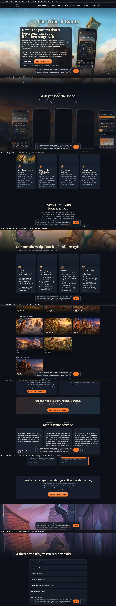
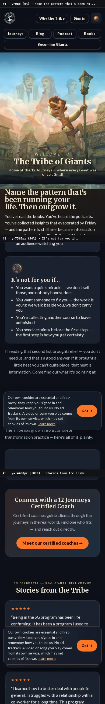

# UI Design System & Master Generation Blueprint: tribeofgiants-com

> **Mindset Coaching & Personal Growth — The Tribe of Giants** (https://tribeofgiants.com/) — Name the pattern that's been running your life — then outgrow it. 12 guided journeys, Rimi your AI guide, the Mirror, and a tribe that wa...





---

## 1. Executive Visual Persona & Design Archetype

- **Brand Essence & Persona**: **Mindset Coaching & Personal Growth — The Tribe of Giants** (`https://tribeofgiants.com/`). Name the pattern that's been running your life — then outgrow it. 12 guided journeys, Rimi your AI guide, the Mirror, and a tribe that wa...
- **Capture Provenance**: Live browser capture (`tier1_fast`, HTTP `200`, captured `2026-11-24`).
- **Visual Archetype**: **High-Contrast Obsidian / Atmospheric Design System (`#0c1018` canvas, `#e9e5db` ink, `#ffa500` accent)**.
- **Anti-AI-Slop Differentiators**:
  - **Live-Computed Chromatic Polarity**: Anchors the viewport in `#0c1018` (live computed `html` `background-color` (`computed_styles.json`)) paired with `#e9e5db` primary typography and `#ffa500` accents.
  - **Grounded Typographic Hierarchy**: Pairs `Merriweather` for display copy (`Name the pattern that's been running`) with `Lato`.
  - **Calibrated Spatial Grid & Motion**: Combines `1000px` container bounds (`gap: 18px`, padding `20px`) with `cubic-bezier(.3,.6,.3,1)` easing and Three.js / WebGL Canvas Pipeline.

---

## 2. Spatial Architecture & Modular Grid Mathematics

### Viewport Allocation & Container Geometry
- **Captured Journey Filmstrips**: Desktop `1280×6624px` (`assets/desktop-journey.webp`, `8` keyframes up to `y=14400px` / doc `16736px`), Mobile `390×2616px` (`assets/mobile-journey.webp`, `3` keyframes).
- **Master Container Bounds**: `1000px` (measured widest bounded `<section>` landmark width on `1440px` desktop).
- **Canvas Lateral Padding & Spacing**: `20px` lateral canvas padding with `18px` grid gap.
- **Border Radius Scale**: `10px`, `16px`, `999px`, `18px`.

### Responsive Breakpoint Architecture
- **Desktop Layout**: Multi-column CSS Grid / Flexbox layout at `1440px` (`max-width: 1000px`, `gap: 18px`).
- **Mobile Layout**: Single-column vertical stack at `390px` viewport width with `20px` horizontal padding.
- **Extracted CSS Media Queries**: `@media (max-width:759px)`, `@media (prefers-reduced-motion:reduce)`, `@media (min-width:760px) and (max-height:780px)`, `@media (min-width:760px)`.

---

## 3. Color System, Materiality & Atmospheric Lighting

### Semantic Palette & Source Grounding
| Semantic Role | Ground-Truth Value | Extracted Live / CSS Source |
|---|---|---|
| **Primary Canvas Substrate** | `#0c1018` | live computed `html` `background-color` (`computed_styles.json`) |
| **Primary Typography Ink** | `#e9e5db` | live computed `main` `color` (`computed_styles.json`) |
| **Elevated Surface / Card Substrate** | `#1a222f` | live computed `footer` `background-color` (`computed_styles.json`) |
| **Interactive Accent / Highlight** | `#ffa500` | `.cf-whole>summary.cf-whole-btn:... { background: orange }` (`#ffa500`) |
| **Secondary / Muted Copy** | `#8a5a1a` | `var(--note-ink)` in `:root` |
| **Structural Hairline Border** | `#c2550f` | `var(--gscp-line)` in `:root` |
| **Variable Token (`--giant-orange`)** | `#fe7624` | `var(--giant-orange)` in `:root` |
| **Variable Token (`--giant-blue`)** | `#42abdb` | `var(--giant-blue)` in `:root` |
| **Variable Token (`--growth-green`)** | `#0b9444` | `var(--growth-green)` in `:root` |
| **Variable Token (`--legacy-peach`)** | `#f89a29` | `var(--legacy-peach)` in `:root` |
| **Variable Token (`--root-brown`)** | `#3b2313` | `var(--root-brown)` in `:root` |
| **Variable Token (`--foundation-black`)** | `#111111` | `var(--foundation-black)` in `:root` |
| **Variable Token (`--potential-white`)** | `#ffffff` | `var(--potential-white)` in `:root` |
| **Variable Token (`--gold`)** | `#f2b25c` | `var(--gold)` in `:root` |
| **Variable Token (`--gold-deep`)** | `#c9a96a` | `var(--gold-deep)` in `:root` |
| **Variable Token (`--eyebrow`)** | `#a8430a` | `var(--eyebrow)` in `:root` |
| **Variable Token (`--bg`)** | `#f5efe3` | `var(--bg)` in `:root` |
| **Variable Token (`--surface`)** | `#fffcf6` | `var(--surface)` in `:root` |
| **Variable Token (`--surface-2`)** | `#f4ede0` | `var(--surface-2)` in `:root` |

### Sanitized Root CSS Variables (`ui-ux.md` Ground Truth)
| Variable Name | Extracted Value | Semantic Role |
|---|---|---|
| `--giant-orange` | `#fe7624` | Color / Atmospheric Token |
| `--giant-blue` | `#42abdb` | Color / Atmospheric Token |
| `--growth-green` | `#0b9444` | Color / Atmospheric Token |
| `--legacy-peach` | `#f89a29` | Color / Atmospheric Token |
| `--root-brown` | `#3b2313` | Color / Atmospheric Token |
| `--foundation-black` | `#111` | Canvas / Surface Token |
| `--potential-white` | `#fff` | Canvas / Surface Token |
| `--font-heading` | `Merriweather, Georgia, serif` | Typography Ink Token |
| `--font-body` | `Lato, system-ui, sans-serif` | Typography / Scale Token |
| `--gold` | `#f2b25c` | Color / Atmospheric Token |
| `--gold-deep` | `#c9a96a` | Color / Atmospheric Token |
| `--eyebrow` | `#a8430a` | Color / Atmospheric Token |
| `--lit` | `#ffffff61` | Color / Atmospheric Token |
| `--bg` | `#f5efe3` | Canvas / Surface Token |
| `--surface` | `#fffcf6` | Canvas / Surface Token |
| `--surface-2` | `#f4ede0` | Canvas / Surface Token |

---

## 4. Typographic Scale & Editorial Hierarchy

### Font Family Stacks
- **Display Typography**: `Merriweather`.
- **Primary Body Stack**: `Lato`.
- **Technical / Metadata Stack**: not declared in live computed styles (uses primary stack / `ui-monospace`).

### Typographic Scale & Rules (Live Computed & Stylesheet Grounded)
- **Hero Display (`H1`)**: live computed `h1` (`font-size: 41px`, `line-height: 42.64px`, `font-weight: 700`, `letter-spacing: -0.574px`); rule `h1` (`font-size: clamp(24px,4vw,32px)`).
- **Section Heading (`H2`)**: live computed `h2` (`font-size: 40px`, `line-height: 43.2px`, `font-weight: 700`, `letter-spacing: -0.32px`); rule `h2` (`font-size: 22px`, `line-height: 1.2`).
- **Body Copy**: live computed `body` (`font-size: 16px`, `line-height: normal`, `font-weight: 400`); CSS variables `--font-body: Lato, system-ui, sans-serif`; rule `p` (`font-size: 14.5px`, `line-height: 1.55`).
- **Metadata & Navigation Labels**: live computed `nav/a` (`font-size: 16px`, `line-height: normal`, `font-weight: 400`); rule `small` (`font-size: 13.5px`, `line-height: 1.45`).

---

## 5. Choreographed Motion & Interaction Physics

### Primary Easing Curves
- **Extracted Timing Functions**: `cubic-bezier(.3,.6,.3,1)`, `cubic-bezier(.2,.8,.2,1)`, `cubic-bezier(.18,1.3,.4,1)`.

### Per-Element Transition & Choreography Rules
- **Selector `.spl.spl-moving .spl-ring`**: `transition: left .28s,top .28s,width .28s,height .28s,border-radius .28s` extracted from `tribeofgiants-com` stylesheet.
- **Selector `media (prefers-reduced-motion:red...`**: `transition: none` extracted from `tribeofgiants-com` stylesheet.
- **Selector `.cf-whole>summary.cf-whole-btn`**: `transition: background .15s,border-color .15s` extracted from `tribeofgiants-com` stylesheet.
- **Extracted Easing Curve (`cubic-bezier(.3,.6,.3,1)`)**: Governs interactive state transitions across `<header.lp-hero-cinema>` and `<section.fbk-section>`.
- **Runtime Interaction Engine**: Integrates Three.js / WebGL Canvas Pipeline with `prefers-reduced-motion: reduce` fallback guards.
### Measured Runtime Scroll & Interaction Telemetry (`behavioral_journey_v2`)
- **Scroll Driver Mode**: `native` (max document height `16736px`, deepest scrollY reached `14400px` across `8` desktop keyframes).
- **Detected Scroll / Motion Libraries**: `WebGL/Canvas`.
- **Hover Physics (`primary_cta` · `Join free →`)**: `transform`: `none` -> `matrix(1, 0, 0, 1, 0, -...` (`transition-duration: 0.12s`, `timing: ease`).
- **Interactive Control Probe (`accordion`)**: Tested `What is the Tribe of Giants?` (diff `1.552`).
- **Theme Toggle Probe (`Switch to light mode`)**: Toggled body background `rgba(0, 0, 0, 0)` -> `rgba(0, 0, 0, 0)` and ink `rgb(233, 229, 219)` -> `rgb(42, 33, 24)`.
- **Route Transition Architecture**: First internal navigation (`/blog`) measured as `SPA` in `1592ms`.

---

## 6. Component Wireframe & Structural DOM Map

### Visual Layout Schematic — Desktop (`1440px`, Grounded in `dom.html` & Landmark Bounding Boxes)
```
┌────────────────────────────────────────────────────────────────────────┐
│ DESKTOP VIEWPORT (1440px) — Mindset Coaching & Personal Growth — The T │
│ ====================================================================== │
│ [ <header.lp-hero-cinema (1440x860px) | Overview · Index · Archive · ] │
│ ---------------------------------------------------------------------- │
│ | HERO STAGE: <section.lp-section> (w=1440px)                        | │
│ | H1: Name the pattern that's been running your life. T...           | │
│ | Substrate: #0c1018 | Ink: #e9e5db | Accent: #ffa500                | │
│ ---------------------------------------------------------------------- │
│ | SHOWCASE GRID (<section.fbk-section>) max-w: 1000px                | │
│ | +------------------------------+  +------------------------------+ | │
│ | | A day inside the Tribe       |  | One honest question          | | │
│ | +------------------------------+  +------------------------------+ | │
│ ---------------------------------------------------------------------- │
│ | DETAIL MODULE (<article.fbk-card>) — Your page, read back          | │
│ ---------------------------------------------------------------------- │
│ [ FOOTER (<footer.site-footer>) | https://tribeofgiants.com/           │
└────────────────────────────────────────────────────────────────────────┘
```

### Visual Layout Schematic — Mobile Reflow (`390px`)
```
┌────────────────────────────────────────────────────────────────────────┐
│ MOBILE VIEWPORT REFLOW (390px) — Single-Column Stack (gap: 18px)       │
│ ====================================================================== │
│ [ HEADER BAR (<header.lp-hero-cinema> ) | Compact Menu (390px)         │
│ ---------------------------------------------------------------------- │
│ | HERO STAGE (<section.lp-section>) — 390px Vertical Lead            | │
│ | H1: Name the pattern that's been running your life. T...           | │
│ ---------------------------------------------------------------------- │
│ | SHOWCASE STACK (<section.fbk-section>) — 1-Col Stack               | │
│ | [ Item 1: A day inside the Tribe                                 ] | │
│ | [ Item 2: One honest question                                    ] | │
│ ---------------------------------------------------------------------- │
│ | DETAIL STACK (<article.fbk-card>) — 1-Col (Your page, read ba)     | │
│ ---------------------------------------------------------------------- │
│ [ FOOTER (<footer.site-footer>) | Stacked 390px Colophon               │
└────────────────────────────────────────────────────────────────────────┘
```

### Granular DOM Region Breakdown
1. **Brand Header & Navigation Bar (<header.lp-hero-cinema> — `tribeofgiants-com`)**:
   - Landmark `<header class="lp-hero-cinema">` (`1440x860px`) hosting `Mindset Coaching & Personal Growth —` navigation (`Overview · Index · Archive · About · Contact`), DOM attributes (`data-si="1"`, `data-theme="dark"`, `data-precedence="next"`, `data-precedence="next"`), and stylesheet rule `ther_2c35139b-module__HfawKa__cla... { font-family:Merriweather,Merriweather Fallback;font-style:normal }`.
2. **Hero Stage & Focal Lead (<section.lp-section> — `Name the pattern that's been runni`)**:
   - Landmark `<section class="lp-section ins">` presenting display lead `Name the pattern that's been running your life. T...` and copy excerpt *"The Tribe of Giants"* over `#0c1018` canvas and `#e9e5db` ink.
3. **Primary Showcase & Content Grid (<section.fbk-section> — `A day inside the Tribe`)**:
   - Landmark `<section class="lp-section fbk-section">` rendering section `A day inside the Tribe` with copy *"Home of the 12 Journeys — where every Giant was once a Small"*, asset references (`248e1dc0efc99276-s.p.0dq1pb0w2tem...`, `345c85a432359eed-s.p.24jxsbewvqxg...`, `8e451580e5e95631-s.p.0ic9f6t6i9np...`, `9be384ea93fe3f49-s.p.0oq27de-d8s-...`), and grid rule `ather_2c35139b-module__HfawKa__va... { --font-heading:"Merriweather", "Merriweather Fallback" }`.
4. **Interactive Detail & Feature Matrix (<article.fbk-card> — `One honest question`)**:
   - Landmark `<article class="fbk-card">` framing `One honest question` and `Your page, read back` (*"You've read the books. You've heard the podcasts. You've collecte"*) with `#1a222f` surface cards, `#ffa500` accents, and `lato_f12e19e3-module__zjPV4q__cla... { font-family:Lato,Lato Fallback;font-style:normal }`.
5. **Colophon & Global Directory Footer (<footer.site-footer> — `https://tribeofgiants.com/`)**:
   - Landmark `<footer class="site-footer">` anchoring `Mindset Coaching & Personal Grow` footer links (`Overview · Index · Archive · About · Contact`), copy *"Join free, for life. Your seat in the Tribe, Journey 1 and t"*, and `#c2550f` structural dividers.
### Full Vertical Scroll Sequence (Desktop `1440×900` Keyframes)
- **Step 01** (`y=0px`, `0%`): Active landmark `Name the pattern that's been running your life. T...` · sticky/fixed elements: `2`
- **Step 02** (`y=850px`, `5%`): Active landmark `A day inside the Tribe` · sticky/fixed elements: `1`
- **Step 03** (`y=3400px`, `21%`): Active landmark `Reach the self you keep postponing` · sticky/fixed elements: `1`
- **Step 04** (`y=5950px`, `38%`): Active landmark `One membership. Four kinds of strength.` · sticky/fixed elements: `1`
- **Step 05** (`y=8500px`, `54%`): Active landmark `Shoots · Grow toward the light` · sticky/fixed elements: `1`
- **Step 06** (`y=11050px`, `70%`): Active landmark `Connect with a 12 Journeys Certified Coach` · sticky/fixed elements: `1`
- **Step 07** (`y=13600px`, `86%`): Active landmark `Coaches & therapists — bring your clients on the...` · sticky/fixed elements: `1`
- **Step 08** (`y=14400px`, `91%`): Active landmark `Asked honestly, answered honestly` · sticky/fixed elements: `1`

### Multi-Page Internal Route Map
- **Listing Route (`/blog`)**: `https://tribeofgiants.com/blog` — H1: `The Tribe of Giants Blog`, scrollHeight `19820px`, transition `SPA` (`1592ms`)
- **Detail Route (`/books/the-giants-and-the-smalls`)**: `https://tribeofgiants.com/books/the-giants-and-the-smalls` — H1: `The Giants and the Smalls`, scrollHeight `5114px`, transition `direct` (`1759ms`)
- **About Route (`/about`)**: `https://tribeofgiants.com/about` — H1: `You are not here by accident. You are here to rem...`, scrollHeight `5154px`, transition `direct` (`1517ms`)

---

## 7. Master Zero-Shot AI Generation Prompt

```markdown
# Master Zero-Shot Frontend Generation Prompt: tribeofgiants-com (Mindset Coaching & Personal Growth — The Tribe of Giants)

You are a principal frontend architect and design systems engineer. Build a complete, production-ready web application replicating the exact design system, DOM landmarks, typographic hierarchy, color tokens, and motion physics of `tribeofgiants-com` (**Mindset Coaching & Personal Growth — The Tribe of Giants** — `https://tribeofgiants.com/`).

### 1. Visual Archetype & Anti-AI-Slop Mandates
- **Archetype**: High-Contrast Obsidian / Atmospheric Design System (`#0c1018` canvas, `#e9e5db` ink, `#ffa500` accent).
- **Identity & Domain Context**: Name the pattern that's been running your life — then outgrow it. 12 guided journeys, Rimi your AI guide, the Mirror, and a tribe that wa...
- **Primary Substrate**: `#0c1018` (live computed `html` `background-color` (`computed_styles.json`)), **Primary Ink**: `#e9e5db`, **Accent / Highlight**: `#ffa500`.
- **Site-Specific Differentiators**:
  - **Live-Computed Chromatic Polarity**: Anchors the viewport in `#0c1018` (live computed `html` `background-color` (`computed_styles.json`)) paired with `#e9e5db` primary typography and `#ffa500` accents.
  - **Grounded Typographic Hierarchy**: Pairs `Merriweather` for display copy (`Name the pattern that's been running`) with `Lato`.
  - **Calibrated Spatial Grid & Motion**: Combines `1000px` container bounds (`gap: 18px`, padding `20px`) with `cubic-bezier(.3,.6,.3,1)` easing and Three.js / WebGL Canvas Pipeline.

### 2. Ground-Truth CSS Variables (`:root` Token Contract)
Declare and consume these exact custom properties extracted from `tribeofgiants-com` in your global stylesheet:

:root {
  /* Mindset Coaching & Personal Growth — The Tribe of Giants (tribeofgiants-com) — Live-Grounded CSS Variables */
  --giant-orange: #fe7624; /* Color / Atmospheric Token (tribeofgiants-com) */
  --giant-blue: #42abdb; /* Color / Atmospheric Token (tribeofgiants-com) */
  --growth-green: #0b9444; /* Color / Atmospheric Token (tribeofgiants-com) */
  --legacy-peach: #f89a29; /* Color / Atmospheric Token (tribeofgiants-com) */
  --root-brown: #3b2313; /* Color / Atmospheric Token (tribeofgiants-com) */
  --foundation-black: #111; /* Canvas / Surface Token (tribeofgiants-com) */
  --potential-white: #fff; /* Canvas / Surface Token (tribeofgiants-com) */
  --font-heading: Merriweather, Georgia, serif; /* Typography Ink Token (tribeofgiants-com) */
  --font-body: Lato, system-ui, sans-serif; /* Typography / Scale Token (tribeofgiants-com) */
  --gold: #f2b25c; /* Color / Atmospheric Token (tribeofgiants-com) */
  --gold-deep: #c9a96a; /* Color / Atmospheric Token (tribeofgiants-com) */
  --eyebrow: #a8430a; /* Color / Atmospheric Token (tribeofgiants-com) */
  --lit: #ffffff61; /* Color / Atmospheric Token (tribeofgiants-com) */
  --bg: #f5efe3; /* Canvas / Surface Token (tribeofgiants-com) */
  --surface: #fffcf6; /* Canvas / Surface Token (tribeofgiants-com) */
  --surface-2: #f4ede0; /* Canvas / Surface Token (tribeofgiants-com) */
}

### 3. Semantic Color & Materiality Contract
Map every surface, ink, and border strictly to these source-grounded tokens:
- **Primary Canvas Substrate**: `#0c1018` — grounded in live computed `html` `background-color` (`computed_styles.json`)
- **Primary Typography Ink**: `#e9e5db` — grounded in live computed `main` `color` (`computed_styles.json`)
- **Elevated Surface / Card Substrate**: `#1a222f` — grounded in live computed `footer` `background-color` (`computed_styles.json`)
- **Interactive Accent / Highlight**: `#ffa500` — grounded in `.cf-whole>summary.cf-whole-btn:... { background: orange }` (`#ffa500`)
- **Secondary / Muted Copy**: `#8a5a1a` — grounded in `var(--note-ink)` in `:root`
- **Structural Hairline Border**: `#c2550f` — grounded in `var(--gscp-line)` in `:root`
- **Variable Token (`--giant-orange`)**: `#fe7624` — grounded in `var(--giant-orange)` in `:root`
- **Variable Token (`--giant-blue`)**: `#42abdb` — grounded in `var(--giant-blue)` in `:root`
- **Variable Token (`--growth-green`)**: `#0b9444` — grounded in `var(--growth-green)` in `:root`
- **Variable Token (`--legacy-peach`)**: `#f89a29` — grounded in `var(--legacy-peach)` in `:root`
- **Variable Token (`--root-brown`)**: `#3b2313` — grounded in `var(--root-brown)` in `:root`
- **Variable Token (`--foundation-black`)**: `#111111` — grounded in `var(--foundation-black)` in `:root`
- **Variable Token (`--potential-white`)**: `#ffffff` — grounded in `var(--potential-white)` in `:root`
- **Variable Token (`--gold`)**: `#f2b25c` — grounded in `var(--gold)` in `:root`
- **Variable Token (`--gold-deep`)**: `#c9a96a` — grounded in `var(--gold-deep)` in `:root`
- **Variable Token (`--eyebrow`)**: `#a8430a` — grounded in `var(--eyebrow)` in `:root`
- **Variable Token (`--bg`)**: `#f5efe3` — grounded in `var(--bg)` in `:root`
- **Variable Token (`--surface`)**: `#fffcf6` — grounded in `var(--surface)` in `:root`
- **Variable Token (`--surface-2`)**: `#f4ede0` — grounded in `var(--surface-2)` in `:root`

### 4. Spatial Grid, Container Bounds & Responsive Breakpoints
- **Desktop Viewport Reference**: `1280×6624px` (multi-frame vertical journey filmstrip (6624px), `1440px` standard desktop width).
- **Mobile Viewport Reference**: `390×2616px` (multi-frame vertical journey filmstrip (2616px), `390px` standard mobile width).
- **Container Max-Width**: `1000px` (measured widest bounded `<section>` landmark width on `1440px` desktop)
- **Padding & Gutters**: `20px` lateral canvas padding with `18px` grid gap
- **Desktop Grid**: Multi-column CSS Grid / Flexbox layout at `1440px` (`max-width: 1000px`, `gap: 18px`)
- **Mobile Adaptation**: Single-column vertical stack at `390px` viewport width with `20px` horizontal padding
- **Media Queries**: `@media (max-width:759px)`, `@media (prefers-reduced-motion:reduce)`, `@media (min-width:760px) and (max-height:780px)`, `@media (min-width:760px)`
- **Corner Radii**: `10px`, `16px`, `999px`, `18px`

### 5. Typography & Editorial Scale Contract
- **Display Font Stack**: `Merriweather`
- **Body Font Stack**: `Lato`
- **Monospace / Technical Font Stack**: not declared in live computed styles (uses primary stack / `ui-monospace`)
- **H1 Display Rule**: live computed `h1` (`font-size: 41px`, `line-height: 42.64px`, `font-weight: 700`, `letter-spacing: -0.574px`); rule `h1` (`font-size: clamp(24px,4vw,32px)`)
- **H2 Section Rule**: live computed `h2` (`font-size: 40px`, `line-height: 43.2px`, `font-weight: 700`, `letter-spacing: -0.32px`); rule `h2` (`font-size: 22px`, `line-height: 1.2`)
- **Body Copy Rule**: live computed `body` (`font-size: 16px`, `line-height: normal`, `font-weight: 400`); CSS variables `--font-body: Lato, system-ui, sans-serif`; rule `p` (`font-size: 14.5px`, `line-height: 1.55`)
- **Metadata & Index Rule**: live computed `nav/a` (`font-size: 16px`, `line-height: normal`, `font-weight: 400`); rule `small` (`font-size: 13.5px`, `line-height: 1.45`)

### 6. Component Hierarchy, Verbatim Copy & Real DOM Landmarks
Scaffold `tribeofgiants-com` (`Mindset Coaching & Personal Growth — The Tribe of Giants`) with these exact structural regions, extracted copy, and CSS rules from `dom.html`:
1. **Brand Header & Navigation Bar (<header.lp-hero-cinema> — `tribeofgiants-com`)**:
   - DOM & Selectors: Landmark `<header class="lp-hero-cinema">` (`1440x860px`) hosting `Mindset Coaching & Personal Growth —` navigation (`Overview · Index · Archive · About · Contact`), DOM attributes (`data-si="1"`, `data-theme="dark"`, `data-precedence="next"`, `data-precedence="next"`), and stylesheet rule `ther_2c35139b-module__HfawKa__cla... { font-family:Merriweather,Merriweather Fallback;font-style:normal }`.
   - Responsive Contract: Header `Brand Header & Navigation Bar (<header.lp-hero-cinema> — `tribeofgiants-com`)` (`tribeofgiants-com`) adapts across `@media (max-width:759px)`, `@media (prefers-reduced-motion:reduce)`, `@media (min-width:760px) and (max-height:780px)`, `@media (min-width:760px)` with `cubic-bezier(.3,.6,.3,1)`, `cubic-bezier(.2,.8,.2,1)`, `cubic-bezier(.18,1.3,.4,1)` transitions and links `Overview · Index · Archive · About · Contact`.
2. **Hero Stage & Focal Lead (<section.lp-section> — `Name the pattern that's been runni`)**:
   - DOM & Selectors: Landmark `<section class="lp-section ins">` presenting display lead `Name the pattern that's been running your life. T...` and copy excerpt *"The Tribe of Giants"* over `#0c1018` canvas and `#e9e5db` ink.
   - Responsive Contract: Hero stage (`1280×6624px` desktop / `390×2616px` mobile) sets `#0c1018` background with `#e9e5db` headline `Name the pattern that's been running your life. T...`.
3. **Primary Showcase & Content Grid (<section.fbk-section> — `A day inside the Tribe`)**:
   - DOM & Selectors: Landmark `<section class="lp-section fbk-section">` rendering section `A day inside the Tribe` with copy *"Home of the 12 Journeys — where every Giant was once a Small"*, asset references (`248e1dc0efc99276-s.p.0dq1pb0w2tem...`, `345c85a432359eed-s.p.24jxsbewvqxg...`, `8e451580e5e95631-s.p.0ic9f6t6i9np...`, `9be384ea93fe3f49-s.p.0oq27de-d8s-...`), and grid rule `ather_2c35139b-module__HfawKa__va... { --font-heading:"Merriweather", "Merriweather Fallback" }`.
   - Responsive Contract: Showcase grid `Primary Showcase & Content Grid (<section.fbk-section> — `A day inside the Tribe`)` applies Multi-column CSS Grid / Flexbox layout at `1440px` (`max-width: 1000px`, `gap: 18px`) on desktop and Single-column vertical stack at `390px` viewport width with `20px` horizontal padding on mobile.
4. **Interactive Detail & Feature Matrix (<article.fbk-card> — `One honest question`)**:
   - DOM & Selectors: Landmark `<article class="fbk-card">` framing `One honest question` and `Your page, read back` (*"You've read the books. You've heard the podcasts. You've collecte"*) with `#1a222f` surface cards, `#ffa500` accents, and `lato_f12e19e3-module__zjPV4q__cla... { font-family:Lato,Lato Fallback;font-style:normal }`.
   - Responsive Contract: Detail module `Interactive Detail & Feature Matrix (<article.fbk-card> — `One honest question`)` uses `10px`, `16px`, `999px`, `18px` radii, `#ffa500` highlights, and assets (248e1dc0efc99276-s.p.0dq1pb0w2tem..., 345c85a432359eed-s.p.24jxsbewvqxg..., 8e451580e5e95631-s.p.0ic9f6t6i9np...).
5. **Colophon & Global Directory Footer (<footer.site-footer> — `https://tribeofgiants.com/`)**:
   - DOM & Selectors: Landmark `<footer class="site-footer">` anchoring `Mindset Coaching & Personal Grow` footer links (`Overview · Index · Archive · About · Contact`), copy *"Join free, for life. Your seat in the Tribe, Journey 1 and t"*, and `#c2550f` structural dividers.
   - Responsive Contract: Footer `Colophon & Global Directory Footer (<footer.site-footer> — `https://tribeofgiants.com/`)` aligns to `1000px` (measured widest bounded `<section>` landmark width on `1440px` desktop) with `20px` lateral canvas padding with `18px` grid gap and attributes (data-si="1", data-theme="dark", data-precedence="next").

#### Verbatim DOM Copy Excerpts (`dom.html`)
- Copy Excerpt 1: *"The Tribe of Giants"*
- Copy Excerpt 2: *"Home of the 12 Journeys — where every Giant was once a Small"*
- Copy Excerpt 3: *"You've read the books. You've heard the podcasts. You've collected insights that e..."*
- Copy Excerpt 4: *"Join free, for life. Your seat in the Tribe, Journey 1 and the daily Giant Quest a..."*

### 7. Motion, Extracted Stylesheet Rules & Interaction Choreography
- **Primary Easing Functions**: `cubic-bezier(.3,.6,.3,1)`, `cubic-bezier(.2,.8,.2,1)`, `cubic-bezier(.18,1.3,.4,1)`
- **Extracted Stylesheet Rules (`tribeofgiants-com`)**:
- `ther_2c35139b-module__HfawKa__cla... { font-family:Merriweather,Merriweather Fallback;font-style:normal }`
- `ather_2c35139b-module__HfawKa__va... { --font-heading:"Merriweather", "Merriweather Fallback" }`
- `lato_f12e19e3-module__zjPV4q__cla... { font-family:Lato,Lato Fallback;font-style:normal }`
- `.lato_f12e19e3-module__zjPV4q__va... { --font-body:"Lato", "Lato Fallback" }`
- `veat_67c642ca-module__LIiTRG__cla... { font-family:Caveat,Caveat Fallback;font-style:normal }`
- **Per-Selector Transition Rules**:
- **Selector `.spl.spl-moving .spl-ring`**: `transition: left .28s,top .28s,width .28s,height .28s,border-radius .28s` extracted from `tribeofgiants-com` stylesheet.
- **Selector `media (prefers-reduced-motion:red...`**: `transition: none` extracted from `tribeofgiants-com` stylesheet.
- **Selector `.cf-whole>summary.cf-whole-btn`**: `transition: background .15s,border-color .15s` extracted from `tribeofgiants-com` stylesheet.
- **Extracted Easing Curve (`cubic-bezier(.3,.6,.3,1)`)**: Governs interactive state transitions across `<header.lp-hero-cinema>` and `<section.fbk-section>`.
- **Runtime Interaction Engine**: Integrates Three.js / WebGL Canvas Pipeline with `prefers-reduced-motion: reduce` fallback guards.
### 7b. Full-Page Scroll Choreography, Interactive States & Multi-Page Routes
- **Scroll Mechanics**: Implement `native` vertical progression up to `16736px` across 8 distinct viewport chapters using WebGL/Canvas.
- **Vertical Chapter Sequence**: Name the pattern that's bee... (0%) -> A day inside the Tribe (5%) -> Reach the self you keep pos... (21%) -> One membership. Four kinds... (38%) -> Shoots · Grow toward the light (54%) -> Connect with a 12 Journeys... (70%) -> Coaches & therapists — brin... (86%) -> Asked honestly, answered ho... (91%).
- **Hover Micro-Interaction (`primary_cta`)**: Animate `transform` with `0.12s ease`.
- **Multi-Page Routes**: Scaffold internal routes `/blog` (listing, SPA), `/books/the-giants-and-the-smalls` (detail, direct), `/about` (about, direct) sharing the global header/footer shell and design tokens.

### 8. Technical Deliverables
- Implement in Next.js (App Router) with TypeScript and Tailwind CSS consuming the `:root` custom properties defined above for `tribeofgiants-com`.
- Reproduce both the `1440px` desktop architecture and `390px` mobile breakpoint transitions, preserving semantic HTML5 landmarks (`<header>`, `<nav>`, `<main>`, `<section>`, `<footer>`) and `prefers-reduced-motion` accessibility guards.
```
---

## 8. Full-Page Scroll Journey, Interactive States & Subpage Inventory

### Desktop Scroll Keyframes (`1440×900` WebP)
| Step | Scroll Y | Progress | Active Landmark / Section | Sticky/Fixed | Visual Asset |
| :---: | :---: | :---: | :--- | :---: | :--- |
| `#01` | `0px` | `0%` | Name the pattern that's been running your lif... | `2` | [desktop-step-01.webp](assets/desktop-step-01.webp) |
| `#02` | `850px` | `5%` | A day inside the Tribe | `1` | [desktop-step-02.webp](assets/desktop-step-02.webp) |
| `#03` | `3400px` | `21%` | Reach the self you keep postponing | `1` | [desktop-step-03.webp](assets/desktop-step-03.webp) |
| `#04` | `5950px` | `38%` | One membership. Four kinds of strength. | `1` | [desktop-step-04.webp](assets/desktop-step-04.webp) |
| `#05` | `8500px` | `54%` | Shoots · Grow toward the light | `1` | [desktop-step-05.webp](assets/desktop-step-05.webp) |
| `#06` | `11050px` | `70%` | Connect with a 12 Journeys Certified Coach | `1` | [desktop-step-06.webp](assets/desktop-step-06.webp) |
| `#07` | `13600px` | `86%` | Coaches & therapists — bring your clients on... | `1` | [desktop-step-07.webp](assets/desktop-step-07.webp) |
| `#08` | `14400px` | `91%` | Asked honestly, answered honestly | `1` | [desktop-step-08.webp](assets/desktop-step-08.webp) |

### Mobile Condensed Keyframes (`390×844` WebP)
| Step | Scroll Y | Progress | Active Landmark | Visual Asset |
| :---: | :---: | :---: | :--- | :--- |
| `#01` | `0px` | `0%` | Name the pattern that's been running your... | [mobile-step-01.webp](assets/mobile-step-01.webp) |
| `#02` | `7565px` | `50%` | It's not for you if… | [mobile-step-02.webp](assets/mobile-step-02.webp) |
| `#03` | `14400px` | `100%` | Stories from the Tribe | [mobile-step-03.webp](assets/mobile-step-03.webp) |

### Internal Subpage Filmstrips (`1080px` Wide WebP)
| # | Template | Route URL | H1 / Title | Scroll Height | Transition | Filmstrip Asset |
| :-: | :---: | :--- | :--- | :---: | :---: | :--- |
| `1` | `listing` | `https://tribeofgiants.com/blog` | The Tribe of Giants Blog | `19820px` | `SPA` (`1592ms`) | [subpage-01-blog.webp](assets/subpage-01-blog.webp) |
| `2` | `detail` | `https://tribeofgiants.com/books/the-giants-and-the-smalls` | The Giants and the Smalls | `5114px` | `direct` (`1759ms`) | [subpage-02-books-the-giants-and-the-smalls.webp](assets/subpage-02-books-the-giants-and-the-smalls.webp) |
| `3` | `about` | `https://tribeofgiants.com/about` | You are not here by accident. You are... | `5154px` | `direct` (`1517ms`) | [subpage-03-about.webp](assets/subpage-03-about.webp) |

