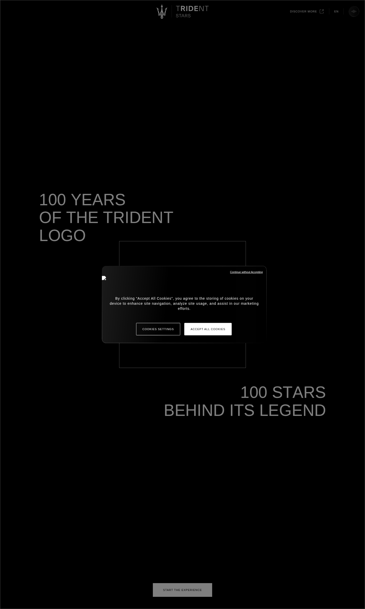
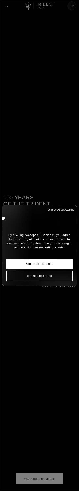

# UI Design System & Master Generation Blueprint: tridentstars-maserati-com_en

> **Discover Maserati’s Trident Constellation in the Sky** (https://tridentstars.maserati.com/en/) — A real constellation of stars created to celebrate 100 years of vision, performance and iconic design.



---

## 1. Executive Visual Persona & Design Archetype

- **Brand Essence & Persona**: **Discover Maserati’s Trident Constellation in the Sky** (`https://tridentstars.maserati.com/en/`). A real constellation of stars created to celebrate 100 years of vision, performance and iconic design.
- **Visual Archetype**: **Dark-Substrate WebGL / Canvas Interactive Experience (`#000` / `#2d2d2d`)**.
- **Anti-AI-Slop Differentiators**:
  - **Source-Grounded Chromatic Polarity**: Anchors the viewport in `#000` (`var(--color-black)` in `:root`) paired with `#fff` primary typography and `#2d2d2d` accents.
  - **Extracted Typographic Hierarchy**: Pairs `TWK Everett` for display copy (`100 YEARS OF THE TRIDENT LOGO 1 0 0 `) with `Roboto Mono` and `Roboto Mono`.
  - **Calibrated Spatial Grid & Motion**: Combines `27.5rem` container bounds (`gap: 1rem`, padding `1rem`) with `cubic-bezier(.16,1,.3,1)` easing and Lenis Smooth Scroll (`data-lenis`), Three.js / WebGL Canvas Pipeline.

---

## 2. Spatial Architecture & Modular Grid Mathematics



### Viewport Allocation & Container Geometry
- **Captured Viewport Dimensions**: Desktop `1440×2400px` (`assets/desktop.png`, capped at 2400px multi-section capture), Mobile `390×2400px` (`assets/mobile.png`, capped at 2400px multi-section capture).
- **Master Container Bounds**: `27.5rem` extracted from `tridentstars-maserati-com_en` stylesheet.
- **Canvas Lateral Padding & Spacing**: `1rem` lateral canvas padding with `1rem` grid gap.
- **Border Radius Scale**: `var(--radius-2xl)`, `var(--radius-xl)`, `64px`, `9999px`.

### Responsive Breakpoint Architecture
- **Desktop Layout**: Multi-column CSS Grid / Flexbox layout at `1440px` (`max-width: 27.5rem`, `gap: 1rem`).
- **Mobile Layout**: Single-column vertical stack at `390px` viewport width with `1rem` horizontal padding.
- **Extracted CSS Media Queries**: `@media (min-width:27.5rem)`, `@media (min-width:40rem)`, `@media (min-width:51.25rem)`, `@media (min-width:64rem)`.

---

## 3. Color System, Materiality & Atmospheric Lighting

### Semantic Palette & Source Grounding
| Semantic Role | Ground-Truth Value | Extracted CSS Source / Selector |
|---|---|---|
| **Primary Canvas Substrate** | `#000` | `var(--color-black)` in `:root` |
| **Primary Typography Ink** | `#fff` | `var(--color-white)` in `:root` |
| **Elevated Surface / Card Substrate** | `#ffc845` | `var(--color-accent-yellow)` in `:root` |
| **Interactive Accent / Highlight** | `#2d2d2d` | `var(--tl-border-color)` in `:root` |
| **Secondary / Muted Copy** | `#f5f5f5` | `var(--scrollbar-track)` in `:root` |
| **Structural Hairline Border** | `#ddd` | `var(--scrollbar-thumb)` in `:root` |

### Sanitized Root CSS Variables (`ui-ux.md` Ground Truth)
| Variable Name | Extracted Value | Semantic Role |
|---|---|---|
| `--spin` | `0deg` | Design System Custom Token |
| `--color-black` | `#000` | Canvas / Surface Token |
| `--color-white` | `#fff` | Canvas / Surface Token |
| `--spacing` | `.25rem` | Layout / Spatial Grid Token |
| `--container-xl` | `36rem` | Layout / Spatial Grid Token |
| `--container-3xl` | `48rem` | Layout / Spatial Grid Token |
| `--text-sm` | `.875rem` | Typography Ink Token |
| `--text-sm--line-height` | `1.42857` | Typography Ink Token |
| `--text-xl` | `1.25rem` | Typography Ink Token |
| `--text-xl--line-height` | `1.4` | Typography Ink Token |
| `--text-2xl` | `1.5rem` | Typography Ink Token |
| `--text-2xl--line-height` | `1.33333` | Typography Ink Token |
| `--font-weight-medium` | `500` | Typography / Scale Token |
| `--leading-tight` | `1.25` | Typography / Scale Token |
| `--radius-lg` | `16px` | Elevation / Border Token |
| `--radius-xl` | `.75rem` | Elevation / Border Token |

---

## 4. Typographic Scale & Editorial Hierarchy

### Font Family Stacks
- **Display Typography**: `TWK Everett`.
- **Primary Body Stack**: `Roboto Mono`.
- **Technical / Metadata Stack**: `Roboto Mono`.

### Typographic Scale & Rules (Extracted from Stylesheet & Variables)
- **Hero Display (`H1`)**: rule `h1` (`font-size: 1.5rem`, `line-height: 1.2`).
- **Section Heading (`H2`)**: CSS variables `--text-2xl: 1.5rem`, `--text-2xl--line-height: 1.33333`; rule `h2` (`font-size: 1.5rem`, `line-height: 1.25`).
- **Body Copy**: rule `p` (`font-size: .75em`).
- **Metadata & Navigation Labels**: CSS variables `--text-sm: .875rem`, `--text-sm--line-height: 1.42857`, `--default-mono-font-family: var(--font-mono)`.

---

## 5. Choreographed Motion & Interaction Physics

### Primary Easing Curves
- **Extracted Timing Functions**: `cubic-bezier(.16,1,.3,1)`, `cubic-bezier(.4,0,1,1)`, `cubic-bezier(0,0,.2,1)`.

### Per-Element Transition & Choreography Rules
- **Selector `data-v-af84c496] .external-link-i...`**: `transition: translate .3s` extracted from `tridentstars-maserati-com_en` stylesheet.
- **Selector `.lang-item__text[data-v-4dbb95f7]...`**: `transition: opacity .3s` extracted from `tridentstars-maserati-com_en` stylesheet.
- **Selector `.audio-icon__wave[data-v-d15909b9]`**: `transition: opacity .22s,transform .22s` extracted from `tridentstars-maserati-com_en` stylesheet.
- **Extracted Easing Curve (`cubic-bezier(.16,1,.3,1)`)**: Governs interactive state transitions across `<header.absolute>` and `<section.ot-hide>`.
- **Runtime Interaction Engine**: Integrates Lenis Smooth Scroll (`data-lenis`), Three.js / WebGL Canvas Pipeline with `prefers-reduced-motion: reduce` fallback guards.

---

## 6. Component Wireframe & Structural DOM Map

### Visual Layout Schematic (Grounded in `dom.html` — `1440px` Desktop & `390px` Mobile Reflow)
```
┌────────────────────────────────────────────────────────────────────────┐
│ DESKTOP VIEWPORT (1440px) — Discover Maserati’s Trident Constellation  │
│ ====================================================================== │
│ [ <header.absolute>        | the manifesto · discover more          ]  │
│ ---------------------------------------------------------------------- │
│ | HERO STAGE: <section.ot-sdk-row>                                 |   │
│ | H1: 100 YEARS OF THE TRIDENT LOGO 1 0 0 Y E A R S O F...         |   │
│ | Substrate: #000       | Ink: #fff       | Accent: #2d2d2d        |   │
│ ---------------------------------------------------------------------- │
│ | SHOWCASE GRID (<section.ot-hide>         ) max-w: 27.5rem        |   │
│ | +------------------------------+  +------------------------------+ | │
│ | | Privacy Preference Center    |  | Manage Consent Preferences   | | │
│ | +------------------------------+  +------------------------------+ | │
│ ---------------------------------------------------------------------- │
│ | MOBILE VIEWPORT REFLOW (390px) — Single-Column Stack (gap: 1rem  ) | │
│ | [<header.absolute>] -> [<section.ot-sdk-ro] -> [<section.ot-hide>] | │
│ ---------------------------------------------------------------------- │
│ [ FOOTER (<footer.z-header>     ) | https://tridentstars.maserati.com/ │
└────────────────────────────────────────────────────────────────────────┘
```

### Granular DOM Region Breakdown
1. **Brand Header & Navigation Bar (<header.absolute> — `tridentstars-maserati-com_en`)**:
   - Landmark `<header class="absolute top-0">` hosting `Discover Maserati’s Trident Constell` navigation (`the manifesto · discover more`), DOM attributes (`data-domain-script="81be852f-f22f-496a-87..."`, `data-document-language="true"`, `data-hid="adobe-launch"`, `data-hid="adobe-data-layer"`), and stylesheet rule `.external-link-icon__arrow { transition:translate .3s }`.
2. **Hero Stage & Focal Lead (<section.ot-sdk-row> — `100 YEARS OF THE TRIDENT LOGO 1 0 `)**:
   - Landmark `<section class="ot-sdk-row ot-cat-grp">` presenting display lead `100 YEARS OF THE TRIDENT LOGO 1 0 0 Y E A R S O F...` and copy excerpt *"100 YEARS OF THE TRIDENT LOGO 1 0 0 Y E A R S O F T H E T R I D E"* over `#000` canvas and `#fff` ink.
3. **Primary Showcase & Content Grid (<section.ot-hide> — `Privacy Preference Center`)**:
   - Landmark `<section class="ot-hide ot-hosts-ui">` rendering section `Privacy Preference Center` with copy *"100 YEARS OF THE TRIDENT LOGO"*, asset references (`entry.Btz3ffrH.css`, `default.CffeYOeI.css`, `MoleculesExternalLink.BgGEM1Uz.css`, `MoleculesPopup.CyDrrBxz.css`), and grid rule `hover .external-link-icon__arrow { translate:2px -2px }`.
4. **Interactive Detail & Feature Matrix (<section.left-0> — `Manage Consent Preferences`)**:
   - Landmark `<section class="left-0">` framing `Manage Consent Preferences` and `Cookie List` (*"1 0 0 Y E A R S O F T H E T R I D E N T L O G O"*) with `#ffc845` surface cards, `#2d2d2d` accents, and `after { outline:1px solid var(--color-secondary-white);outline-offset:2px }`.
5. **Colophon & Global Directory Footer (<footer.z-header> — `https://tridentstars.maserati.com/en/`)**:
   - Landmark `<footer class="z-header">` anchoring `Discover Maserati’s Trident Cons` footer links (`the manifesto · discover more`), copy *"100 STARS BEHIND ITS LEGEND 1 0 0 S T A R S B E H I N D I T "*, and `#ddd` structural dividers.

---

## 7. Master Zero-Shot AI Generation Prompt

```markdown
# Master Zero-Shot Frontend Generation Prompt: tridentstars-maserati-com_en (Discover Maserati’s Trident Constellation in the Sky)

You are a principal frontend architect and design systems engineer. Build a complete, production-ready web application replicating the exact design system, DOM landmarks, typographic hierarchy, color tokens, and motion physics of `tridentstars-maserati-com_en` (**Discover Maserati’s Trident Constellation in the Sky** — `https://tridentstars.maserati.com/en/`).

### 1. Visual Archetype & Anti-AI-Slop Mandates
- **Archetype**: Dark-Substrate WebGL / Canvas Interactive Experience (`#000` / `#2d2d2d`).
- **Identity & Domain Context**: A real constellation of stars created to celebrate 100 years of vision, performance and iconic design.
- **Primary Substrate**: `#000` (`var(--color-black)` in `:root`), **Primary Ink**: `#fff`, **Accent / Highlight**: `#2d2d2d`.
- **Site-Specific Differentiators**:
  - **Source-Grounded Chromatic Polarity**: Anchors the viewport in `#000` (`var(--color-black)` in `:root`) paired with `#fff` primary typography and `#2d2d2d` accents.
  - **Extracted Typographic Hierarchy**: Pairs `TWK Everett` for display copy (`100 YEARS OF THE TRIDENT LOGO 1 0 0 `) with `Roboto Mono` and `Roboto Mono`.
  - **Calibrated Spatial Grid & Motion**: Combines `27.5rem` container bounds (`gap: 1rem`, padding `1rem`) with `cubic-bezier(.16,1,.3,1)` easing and Lenis Smooth Scroll (`data-lenis`), Three.js / WebGL Canvas Pipeline.

### 2. Ground-Truth CSS Variables (`:root` Token Contract)
Declare and consume these exact custom properties extracted from `tridentstars-maserati-com_en` in your global stylesheet:

:root {
  /* Discover Maserati’s Trident Constellation in the Sky (tridentstars-maserati-com_en) — Ground-Truth Extracted CSS Variables */
  --spin: 0deg; /* Design System Custom Token (tridentstars-maserati-com_en) */
  --color-black: #000; /* Canvas / Surface Token (tridentstars-maserati-com_en) */
  --color-white: #fff; /* Canvas / Surface Token (tridentstars-maserati-com_en) */
  --spacing: .25rem; /* Layout / Spatial Grid Token (tridentstars-maserati-com_en) */
  --container-xl: 36rem; /* Layout / Spatial Grid Token (tridentstars-maserati-com_en) */
  --container-3xl: 48rem; /* Layout / Spatial Grid Token (tridentstars-maserati-com_en) */
  --text-sm: .875rem; /* Typography Ink Token (tridentstars-maserati-com_en) */
  --text-sm--line-height: 1.42857; /* Typography Ink Token (tridentstars-maserati-com_en) */
  --text-xl: 1.25rem; /* Typography Ink Token (tridentstars-maserati-com_en) */
  --text-xl--line-height: 1.4; /* Typography Ink Token (tridentstars-maserati-com_en) */
  --text-2xl: 1.5rem; /* Typography Ink Token (tridentstars-maserati-com_en) */
  --text-2xl--line-height: 1.33333; /* Typography Ink Token (tridentstars-maserati-com_en) */
  --font-weight-medium: 500; /* Typography / Scale Token (tridentstars-maserati-com_en) */
  --leading-tight: 1.25; /* Typography / Scale Token (tridentstars-maserati-com_en) */
  --radius-lg: 16px; /* Elevation / Border Token (tridentstars-maserati-com_en) */
  --radius-xl: .75rem; /* Elevation / Border Token (tridentstars-maserati-com_en) */
}

### 3. Semantic Color & Materiality Contract
Map every surface, ink, and border strictly to these source-grounded tokens:
- **Primary Canvas Substrate**: `#000` — grounded in `var(--color-black)` in `:root`
- **Primary Typography Ink**: `#fff` — grounded in `var(--color-white)` in `:root`
- **Elevated Surface / Card Substrate**: `#ffc845` — grounded in `var(--color-accent-yellow)` in `:root`
- **Interactive Accent / Highlight**: `#2d2d2d` — grounded in `var(--tl-border-color)` in `:root`
- **Secondary / Muted Copy**: `#f5f5f5` — grounded in `var(--scrollbar-track)` in `:root`
- **Structural Hairline Border**: `#ddd` — grounded in `var(--scrollbar-thumb)` in `:root`

### 4. Spatial Grid, Container Bounds & Responsive Breakpoints
- **Desktop Viewport Reference**: `1440×2400px` (capped at 2400px multi-section capture, `1440px` standard desktop width).
- **Mobile Viewport Reference**: `390×2400px` (capped at 2400px multi-section capture, `390px` standard mobile width).
- **Container Max-Width**: `27.5rem` extracted from `tridentstars-maserati-com_en` stylesheet
- **Padding & Gutters**: `1rem` lateral canvas padding with `1rem` grid gap
- **Desktop Grid**: Multi-column CSS Grid / Flexbox layout at `1440px` (`max-width: 27.5rem`, `gap: 1rem`)
- **Mobile Adaptation**: Single-column vertical stack at `390px` viewport width with `1rem` horizontal padding
- **Media Queries**: `@media (min-width:27.5rem)`, `@media (min-width:40rem)`, `@media (min-width:51.25rem)`, `@media (min-width:64rem)`
- **Corner Radii**: `var(--radius-2xl)`, `var(--radius-xl)`, `64px`, `9999px`

### 5. Typography & Editorial Scale Contract
- **Display Font Stack**: `TWK Everett`
- **Body Font Stack**: `Roboto Mono`
- **Monospace / Technical Font Stack**: `Roboto Mono`
- **H1 Display Rule**: rule `h1` (`font-size: 1.5rem`, `line-height: 1.2`)
- **H2 Section Rule**: CSS variables `--text-2xl: 1.5rem`, `--text-2xl--line-height: 1.33333`; rule `h2` (`font-size: 1.5rem`, `line-height: 1.25`)
- **Body Copy Rule**: rule `p` (`font-size: .75em`)
- **Metadata & Index Rule**: CSS variables `--text-sm: .875rem`, `--text-sm--line-height: 1.42857`, `--default-mono-font-family: var(--font-mono)`

### 6. Component Hierarchy, Verbatim Copy & Real DOM Landmarks
Scaffold `tridentstars-maserati-com_en` (`Discover Maserati’s Trident Constellation in the Sky`) with these exact structural regions, extracted copy, and CSS rules from `dom.html`:
1. **Brand Header & Navigation Bar (<header.absolute> — `tridentstars-maserati-com_en`)**:
   - DOM & Selectors: Landmark `<header class="absolute top-0">` hosting `Discover Maserati’s Trident Constell` navigation (`the manifesto · discover more`), DOM attributes (`data-domain-script="81be852f-f22f-496a-87..."`, `data-document-language="true"`, `data-hid="adobe-launch"`, `data-hid="adobe-data-layer"`), and stylesheet rule `.external-link-icon__arrow { transition:translate .3s }`.
   - Responsive Contract: Header `Brand Header & Navigation Bar (<header.absolute> — `tridentstars-maserati-com_en`)` (`tridentstars-maserati-com_en`) adapts across `@media (min-width:27.5rem)`, `@media (min-width:40rem)`, `@media (min-width:51.25rem)`, `@media (min-width:64rem)` with `cubic-bezier(.16,1,.3,1)`, `cubic-bezier(.4,0,1,1)`, `cubic-bezier(0,0,.2,1)` transitions and links `the manifesto · discover more`.
2. **Hero Stage & Focal Lead (<section.ot-sdk-row> — `100 YEARS OF THE TRIDENT LOGO 1 0 `)**:
   - DOM & Selectors: Landmark `<section class="ot-sdk-row ot-cat-grp">` presenting display lead `100 YEARS OF THE TRIDENT LOGO 1 0 0 Y E A R S O F...` and copy excerpt *"100 YEARS OF THE TRIDENT LOGO 1 0 0 Y E A R S O F T H E T R I D E"* over `#000` canvas and `#fff` ink.
   - Responsive Contract: Hero stage (`1440×2400px` desktop / `390×2400px` mobile) sets `#000` background with `#fff` headline `100 YEARS OF THE TRIDENT LOGO 1 0 0 Y E A R S O F...`.
3. **Primary Showcase & Content Grid (<section.ot-hide> — `Privacy Preference Center`)**:
   - DOM & Selectors: Landmark `<section class="ot-hide ot-hosts-ui">` rendering section `Privacy Preference Center` with copy *"100 YEARS OF THE TRIDENT LOGO"*, asset references (`entry.Btz3ffrH.css`, `default.CffeYOeI.css`, `MoleculesExternalLink.BgGEM1Uz.css`, `MoleculesPopup.CyDrrBxz.css`), and grid rule `hover .external-link-icon__arrow { translate:2px -2px }`.
   - Responsive Contract: Showcase grid `Primary Showcase & Content Grid (<section.ot-hide> — `Privacy Preference Center`)` applies Multi-column CSS Grid / Flexbox layout at `1440px` (`max-width: 27.5rem`, `gap: 1rem`) on desktop and Single-column vertical stack at `390px` viewport width with `1rem` horizontal padding on mobile.
4. **Interactive Detail & Feature Matrix (<section.left-0> — `Manage Consent Preferences`)**:
   - DOM & Selectors: Landmark `<section class="left-0">` framing `Manage Consent Preferences` and `Cookie List` (*"1 0 0 Y E A R S O F T H E T R I D E N T L O G O"*) with `#ffc845` surface cards, `#2d2d2d` accents, and `after { outline:1px solid var(--color-secondary-white);outline-offset:2px }`.
   - Responsive Contract: Detail module `Interactive Detail & Feature Matrix (<section.left-0> — `Manage Consent Preferences`)` uses `var(--radius-2xl)`, `var(--radius-xl)`, `64px`, `9999px` radii, `#2d2d2d` highlights, and assets (entry.Btz3ffrH.css, default.CffeYOeI.css, MoleculesExternalLink.BgGEM1Uz.css).
5. **Colophon & Global Directory Footer (<footer.z-header> — `https://tridentstars.maserati.com/en/`)**:
   - DOM & Selectors: Landmark `<footer class="z-header">` anchoring `Discover Maserati’s Trident Cons` footer links (`the manifesto · discover more`), copy *"100 STARS BEHIND ITS LEGEND 1 0 0 S T A R S B E H I N D I T "*, and `#ddd` structural dividers.
   - Responsive Contract: Footer `Colophon & Global Directory Footer (<footer.z-header> — `https://tridentstars.maserati.com/en/`)` aligns to `27.5rem` extracted from `tridentstars-maserati-com_en` stylesheet with `1rem` lateral canvas padding with `1rem` grid gap and attributes (data-domain-script="81be852f-f22f-496a-87...", data-document-language="true", data-hid="adobe-launch").

#### Verbatim DOM Copy Excerpts (`dom.html`)
- Copy Excerpt 1: *"100 YEARS OF THE TRIDENT LOGO 1 0 0 Y E A R S O F T H E T R I D E N T L O G O"*
- Copy Excerpt 2: *"100 YEARS OF THE TRIDENT LOGO"*
- Copy Excerpt 3: *"1 0 0 Y E A R S O F T H E T R I D E N T L O G O"*
- Copy Excerpt 4: *"100 STARS BEHIND ITS LEGEND 1 0 0 S T A R S B E H I N D I T S L E G E N D"*

### 7. Motion, Extracted Stylesheet Rules & Interaction Choreography
- **Primary Easing Functions**: `cubic-bezier(.16,1,.3,1)`, `cubic-bezier(.4,0,1,1)`, `cubic-bezier(0,0,.2,1)`
- **Extracted Stylesheet Rules (`tridentstars-maserati-com_en`)**:
- `.external-link-icon__arrow { transition:translate .3s }`
- `hover .external-link-icon__arrow { translate:2px -2px }`
- `after { outline:1px solid var(--color-secondary-white);outline-offset:2px }`
- `first-child { animation:.56s linear -.22s infinite audio-eq-1-d15909b9 }`
- `before { box-sizing:border-box;border:0 solid;margin:0;padding:0 }`
- **Per-Selector Transition Rules**:
- **Selector `data-v-af84c496] .external-link-i...`**: `transition: translate .3s` extracted from `tridentstars-maserati-com_en` stylesheet.
- **Selector `.lang-item__text[data-v-4dbb95f7]...`**: `transition: opacity .3s` extracted from `tridentstars-maserati-com_en` stylesheet.
- **Selector `.audio-icon__wave[data-v-d15909b9]`**: `transition: opacity .22s,transform .22s` extracted from `tridentstars-maserati-com_en` stylesheet.
- **Extracted Easing Curve (`cubic-bezier(.16,1,.3,1)`)**: Governs interactive state transitions across `<header.absolute>` and `<section.ot-hide>`.
- **Runtime Interaction Engine**: Integrates Lenis Smooth Scroll (`data-lenis`), Three.js / WebGL Canvas Pipeline with `prefers-reduced-motion: reduce` fallback guards.

### 8. Technical Deliverables
- Implement in Next.js (App Router) with TypeScript and Tailwind CSS consuming the `:root` custom properties defined above for `tridentstars-maserati-com_en`.
- Reproduce both the `1440px` desktop architecture and `390px` mobile breakpoint transitions, preserving semantic HTML5 landmarks (`<header>`, `<nav>`, `<main>`, `<section>`, `<footer>`) and `prefers-reduced-motion` accessibility guards.
```
