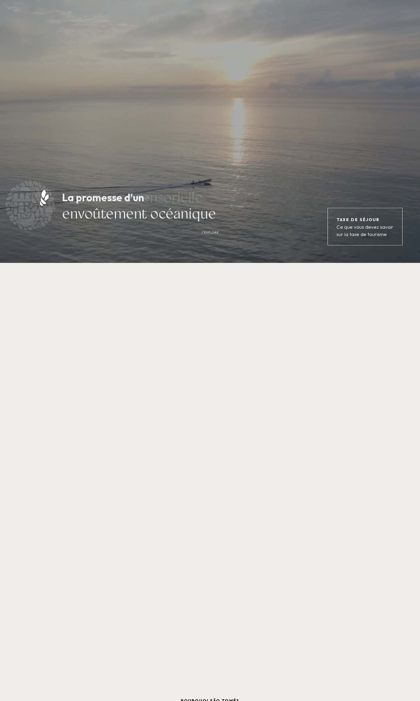
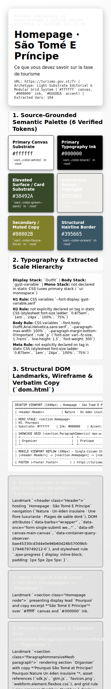

# UI Design System & Master Generation Blueprint: turismo-gov-st_fr

> **Homepage · São Tomé E Príncipe** (https://turismo.gov.st/fr) — Ce que vous devez savoir sur la taxe de tourisme



---

## 1. Executive Visual Persona & Design Archetype

- **Brand Essence & Persona**: **Homepage · São Tomé E Príncipe** (`https://turismo.gov.st/fr`). Ce que vous devez savoir sur la taxe de tourisme
- **Visual Archetype**: **Light-Substrate Editorial & Modular Grid System (`#ffffff` canvas, `#000000` ink, `#EEEDEA` accent)**.
- **Anti-AI-Slop Differentiators**:
  - **Source-Grounded Chromatic Polarity**: Anchors the viewport in `#ffffff` (`var(--color-white)` in `:root`) paired with `#000000` primary typography and `#EEEDEA` accents.
  - **Extracted Typographic Hierarchy**: Pairs `Outfit` for display copy (`Pourquoi`) with `gyst-variable` and not declared in static CSS (uses primary stack / `ui-monospace`).
  - **Calibrated Spatial Grid & Motion**: Combines `600px` container bounds (`gap: 1rem`, padding `1px`) with `cubic-bezier(.4,0,.2,1)` easing and Lenis Smooth Scroll (`data-lenis`), GSAP Timeline & ScrollTrigger.

---

## 2. Spatial Architecture & Modular Grid Mathematics



### Viewport Allocation & Container Geometry
- **Captured Viewport Dimensions**: Desktop `1440×2400px` (`assets/desktop.png`, capped at 2400px multi-section capture), Mobile `390×2400px` (`assets/mobile.png`, capped at 2400px multi-section capture).
- **Master Container Bounds**: `600px` extracted from `turismo-gov-st_fr` stylesheet.
- **Canvas Lateral Padding & Spacing**: `1px` lateral canvas padding with `1rem` grid gap.
- **Border Radius Scale**: `7px`, `50%`, `2px`, `4px`.

### Responsive Breakpoint Architecture
- **Desktop Layout**: Multi-column CSS Grid / Flexbox layout at `1440px` (`max-width: 600px`, `gap: 1rem`).
- **Mobile Layout**: Single-column vertical stack at `390px` viewport width with `1px` horizontal padding.
- **Extracted CSS Media Queries**: `@media screen and (max-width: 600px)`, `@media (min-width: 768px)`, `@media screen and (max-width:700px)`, `@media (min-width:480px)`.

---

## 3. Color System, Materiality & Atmospheric Lighting

### Semantic Palette & Source Grounding
| Semantic Role | Ground-Truth Value | Extracted CSS Source / Selector |
|---|---|---|
| **Primary Canvas Substrate** | `#ffffff` | `var(--color-white)` in `:root` |
| **Primary Typography Ink** | `#000000` | `var(--color-black)` in `:root` |
| **Elevated Surface / Card Substrate** | `#38492A` | `var(--color-green--dark)` in `:root` |
| **Interactive Accent / Highlight** | `#EEEDEA` | `var(--color-beige)` in `:root` |
| **Secondary / Muted Copy** | `#80802B` | `var(--color-fauna-flora)` in `:root` |
| **Structural Hairline Border** | `#395665` | `var(--color-ocean)` in `:root` |

### Sanitized Root CSS Variables (`ui-ux.md` Ground Truth)
| Variable Name | Extracted Value | Semantic Role |
|---|---|---|
| `--color-white` | `#ffffff` | Canvas / Surface Token |
| `--color-white--30` | `rgba(255, 255, 255, 0.3)` | Canvas / Surface Token |
| `--color-white--00` | `rgba(255, 255, 255, 0)` | Canvas / Surface Token |
| `--color-white--15` | `rgba(255, 255, 255, 0.15)` | Canvas / Surface Token |
| `--color-white--08` | `rgba(255, 255, 255, 0.08)` | Canvas / Surface Token |
| `--color-black` | `#000000` | Canvas / Surface Token |
| `--color-black--05` | `rgba(0, 0, 0, 0.05)` | Canvas / Surface Token |
| `--color-black--08` | `rgba(0, 0, 0, 0.08)` | Canvas / Surface Token |
| `--color-black--15` | `rgba(0, 0, 0, 0.15)` | Canvas / Surface Token |
| `--color-black--00` | `rgba(0, 0, 0, 0)` | Canvas / Surface Token |
| `--color-black--10` | `rgba(0, 0, 0, 0.1)` | Canvas / Surface Token |
| `--color-black--30` | `rgba(0, 0, 0, 0.3)` | Canvas / Surface Token |
| `--color-black--50` | `rgba(0, 0, 0, 0.5)` | Canvas / Surface Token |
| `--color-black--70` | `rgba(0, 0, 0, 0.7)` | Canvas / Surface Token |
| `--color-green--dark` | `#38492A` | Canvas / Surface Token |
| `--color-green--dark--30` | `rgba(56, 73, 42, 0.3)` | Canvas / Surface Token |

---

## 4. Typographic Scale & Editorial Hierarchy

### Font Family Stacks
- **Display Typography**: `Outfit`.
- **Primary Body Stack**: `gyst-variable`.
- **Technical / Metadata Stack**: not declared in static CSS (uses primary stack / `ui-monospace`).

### Typographic Scale & Rules (Extracted from Stylesheet & Variables)
- **Hero Display (`H1`)**: CSS variables `--font-display: gyst-variable,serif`.
- **Section Heading (`H2`)**: not explicitly declared on tag in static CSS (stylesheet font-size ladder: `0.875em`, `1em`, `24px`, `100%`, `75%`).
- **Body Copy**: CSS variables `--font-body: Outfit,Arial,Helvetica,sans-serif`, `--paragraph-max-width: 100%`, `--paragraph-margin-bottom: 0!important`; rule `p` (`font-size: var(--fz-size, 1.7rem)`, `line-height: 1.5`, `font-weight: 300`).
- **Metadata & Navigation Labels**: not explicitly declared on tag in static CSS (stylesheet font-size ladder: `0.875em`, `1em`, `24px`, `100%`, `75%`).

---

## 5. Choreographed Motion & Interaction Physics

### Primary Easing Curves
- **Extracted Timing Functions**: `cubic-bezier(.4,0,.2,1)`, `cubic-bezier(.16,1.08,.38,.98)`, `cubic-bezier(.4,.64,.68,1)`.

### Per-Element Transition & Choreography Rules
- **Selector `.plyr`**: `transition: -webkit-box-shadow .3s` extracted from `turismo-gov-st_fr` stylesheet.
- **Selector `.plyr__captions`**: `transition: -webkit-transform .4s ease-in-out` extracted from `turismo-gov-st_fr` stylesheet.
- **Selector `.plyr__control`**: `transition: .3s` extracted from `turismo-gov-st_fr` stylesheet.
- **Extracted Easing Curve (`cubic-bezier(.4,0,.2,1)`)**: Governs interactive state transitions across `<header.Header>` and `<section.ParagraphImmersiveMesh>`.
- **Runtime Interaction Engine**: Integrates Lenis Smooth Scroll (`data-lenis`), GSAP Timeline & ScrollTrigger, Swiper Touch Carousel Engine, Barba.js Page Transition Router with `prefers-reduced-motion: reduce` fallback guards.

---

## 6. Component Wireframe & Structural DOM Map

### Visual Layout Schematic (Grounded in `dom.html` — `1440px` Desktop & `390px` Mobile Reflow)
```
┌────────────────────────────────────────────────────────────────────────┐
│ DESKTOP VIEWPORT (1440px) — Homepage · São Tomé E Príncipe             │
│ ====================================================================== │
│ [ <header.Header>          | Nature · Un éden insulaire · Une flore ]  │
│ ---------------------------------------------------------------------- │
│ | HERO STAGE: <section.Homepage>                                   |   │
│ | H1: Pourquoi                                                     |   │
│ | Substrate: #ffffff    | Ink: #000000    | Accent: #EEEDEA        |   │
│ ---------------------------------------------------------------------- │
│ | SHOWCASE GRID (<section.ParagraphImmersiv) max-w: 600px          |   │
│ | +------------------------------+  +------------------------------+ | │
│ | | Organiser                    |  | Pratique                     | | │
│ | +------------------------------+  +------------------------------+ | │
│ ---------------------------------------------------------------------- │
│ | MOBILE VIEWPORT REFLOW (390px) — Single-Column Stack (gap: 1rem  ) | │
│ | [<header.Header>] -> [<section.Homepage>] -> [<section.Paragraph] |  │
│ ---------------------------------------------------------------------- │
│ [ FOOTER (<footer.footer>       ) | https://turismo.gov.st/fr          │
└────────────────────────────────────────────────────────────────────────┘
```

### Granular DOM Region Breakdown
1. **Brand Header & Navigation Bar (<header.Header> — `turismo-gov-st_fr`)**:
   - Landmark `<header class="Header">` hosting `Homepage · São Tomé E Príncipe` navigation (`Nature · Un éden insulaire · Une flore luxuriante · Plages de sable doré`), DOM attributes (`data-barba="wrapper"`, `data-once="form-single-submit we..."`, `data-off-canvas-main-canvas`, `data-container-query-observer-bae45330cd3d4e0e96b60d26b57009b5-1794679749212-0`), and stylesheet rule `.ajax-progress { display: inline-block; padding: 1px 5px 2px 5px; }`.
2. **Hero Stage & Focal Lead (<section.Homepage> — `Pourquoi`)**:
   - Landmark `<section class="Homepage node">` presenting display lead `Pourquoi` and copy excerpt *"São Tomé E Príncipe"* over `#ffffff` canvas and `#000000` ink.
3. **Primary Showcase & Content Grid (<section.ParagraphImmersiveMesh> — `Organiser`)**:
   - Landmark `<section class="ParagraphImmersiveMesh paragraph">` rendering section `Organiser` with copy *"Pourquoi São Tomé et Príncipe? Pourquoi Nature Un éden insulaire "*, asset references (`sdk.js`, `gtm.js`, `favicon.png`, `webform.element.flexbox.css`), and grid rule `.ajax-progress-throbber .throbber { display: inline; padding: 1px 6px 2px; background: transparent url(../th... }`.
4. **Interactive Detail & Feature Matrix (<section.ParagraphVerticalSlider> — `Pratique`)**:
   - Landmark `<section class="ParagraphVerticalSlider paragraph">` framing `Pratique` and `Pied de page` (*"Pourquoi São Tomé et Príncipe?"*) with `#38492A` surface cards, `#EEEDEA` accents, and `.ajax-progress-throbber .message { display: inline; padding: 1px 5px 2px; }`.
5. **Colophon & Global Directory Footer (<footer.footer> — `https://turismo.gov.st/fr`)**:
   - Landmark `<footer class="footer">` anchoring `Homepage · São Tomé E Príncipe` footer links (`Nature · Un éden insulaire · Une flore luxuriante · Plages de sable doré`), copy *"Nature Un éden insulaire Une flore exceptionnelle Une flore "*, and `#395665` structural dividers.

---

## 7. Master Zero-Shot AI Generation Prompt

```markdown
# Master Zero-Shot Frontend Generation Prompt: turismo-gov-st_fr (Homepage · São Tomé E Príncipe)

You are a principal frontend architect and design systems engineer. Build a complete, production-ready web application replicating the exact design system, DOM landmarks, typographic hierarchy, color tokens, and motion physics of `turismo-gov-st_fr` (**Homepage · São Tomé E Príncipe** — `https://turismo.gov.st/fr`).

### 1. Visual Archetype & Anti-AI-Slop Mandates
- **Archetype**: Light-Substrate Editorial & Modular Grid System (`#ffffff` canvas, `#000000` ink, `#EEEDEA` accent).
- **Identity & Domain Context**: Ce que vous devez savoir sur la taxe de tourisme
- **Primary Substrate**: `#ffffff` (`var(--color-white)` in `:root`), **Primary Ink**: `#000000`, **Accent / Highlight**: `#EEEDEA`.
- **Site-Specific Differentiators**:
  - **Source-Grounded Chromatic Polarity**: Anchors the viewport in `#ffffff` (`var(--color-white)` in `:root`) paired with `#000000` primary typography and `#EEEDEA` accents.
  - **Extracted Typographic Hierarchy**: Pairs `Outfit` for display copy (`Pourquoi`) with `gyst-variable` and not declared in static CSS (uses primary stack / `ui-monospace`).
  - **Calibrated Spatial Grid & Motion**: Combines `600px` container bounds (`gap: 1rem`, padding `1px`) with `cubic-bezier(.4,0,.2,1)` easing and Lenis Smooth Scroll (`data-lenis`), GSAP Timeline & ScrollTrigger.

### 2. Ground-Truth CSS Variables (`:root` Token Contract)
Declare and consume these exact custom properties extracted from `turismo-gov-st_fr` in your global stylesheet:

:root {
  /* Homepage · São Tomé E Príncipe (turismo-gov-st_fr) — Ground-Truth Extracted CSS Variables */
  --color-white: #ffffff; /* Canvas / Surface Token (turismo-gov-st_fr) */
  --color-white--30: rgba(255, 255, 255, 0.3); /* Canvas / Surface Token (turismo-gov-st_fr) */
  --color-white--00: rgba(255, 255, 255, 0); /* Canvas / Surface Token (turismo-gov-st_fr) */
  --color-white--15: rgba(255, 255, 255, 0.15); /* Canvas / Surface Token (turismo-gov-st_fr) */
  --color-white--08: rgba(255, 255, 255, 0.08); /* Canvas / Surface Token (turismo-gov-st_fr) */
  --color-black: #000000; /* Canvas / Surface Token (turismo-gov-st_fr) */
  --color-black--05: rgba(0, 0, 0, 0.05); /* Canvas / Surface Token (turismo-gov-st_fr) */
  --color-black--08: rgba(0, 0, 0, 0.08); /* Canvas / Surface Token (turismo-gov-st_fr) */
  --color-black--15: rgba(0, 0, 0, 0.15); /* Canvas / Surface Token (turismo-gov-st_fr) */
  --color-black--00: rgba(0, 0, 0, 0); /* Canvas / Surface Token (turismo-gov-st_fr) */
  --color-black--10: rgba(0, 0, 0, 0.1); /* Canvas / Surface Token (turismo-gov-st_fr) */
  --color-black--30: rgba(0, 0, 0, 0.3); /* Canvas / Surface Token (turismo-gov-st_fr) */
  --color-black--50: rgba(0, 0, 0, 0.5); /* Canvas / Surface Token (turismo-gov-st_fr) */
  --color-black--70: rgba(0, 0, 0, 0.7); /* Canvas / Surface Token (turismo-gov-st_fr) */
  --color-green--dark: #38492A; /* Canvas / Surface Token (turismo-gov-st_fr) */
  --color-green--dark--30: rgba(56, 73, 42, 0.3); /* Canvas / Surface Token (turismo-gov-st_fr) */
}

### 3. Semantic Color & Materiality Contract
Map every surface, ink, and border strictly to these source-grounded tokens:
- **Primary Canvas Substrate**: `#ffffff` — grounded in `var(--color-white)` in `:root`
- **Primary Typography Ink**: `#000000` — grounded in `var(--color-black)` in `:root`
- **Elevated Surface / Card Substrate**: `#38492A` — grounded in `var(--color-green--dark)` in `:root`
- **Interactive Accent / Highlight**: `#EEEDEA` — grounded in `var(--color-beige)` in `:root`
- **Secondary / Muted Copy**: `#80802B` — grounded in `var(--color-fauna-flora)` in `:root`
- **Structural Hairline Border**: `#395665` — grounded in `var(--color-ocean)` in `:root`

### 4. Spatial Grid, Container Bounds & Responsive Breakpoints
- **Desktop Viewport Reference**: `1440×2400px` (capped at 2400px multi-section capture, `1440px` standard desktop width).
- **Mobile Viewport Reference**: `390×2400px` (capped at 2400px multi-section capture, `390px` standard mobile width).
- **Container Max-Width**: `600px` extracted from `turismo-gov-st_fr` stylesheet
- **Padding & Gutters**: `1px` lateral canvas padding with `1rem` grid gap
- **Desktop Grid**: Multi-column CSS Grid / Flexbox layout at `1440px` (`max-width: 600px`, `gap: 1rem`)
- **Mobile Adaptation**: Single-column vertical stack at `390px` viewport width with `1px` horizontal padding
- **Media Queries**: `@media screen and (max-width: 600px)`, `@media (min-width: 768px)`, `@media screen and (max-width:700px)`, `@media (min-width:480px)`
- **Corner Radii**: `7px`, `50%`, `2px`, `4px`

### 5. Typography & Editorial Scale Contract
- **Display Font Stack**: `Outfit`
- **Body Font Stack**: `gyst-variable`
- **Monospace / Technical Font Stack**: not declared in static CSS (uses primary stack / `ui-monospace`)
- **H1 Display Rule**: CSS variables `--font-display: gyst-variable,serif`
- **H2 Section Rule**: not explicitly declared on tag in static CSS (stylesheet font-size ladder: `0.875em`, `1em`, `24px`, `100%`, `75%`)
- **Body Copy Rule**: CSS variables `--font-body: Outfit,Arial,Helvetica,sans-serif`, `--paragraph-max-width: 100%`, `--paragraph-margin-bottom: 0!important`; rule `p` (`font-size: var(--fz-size, 1.7rem)`, `line-height: 1.5`, `font-weight: 300`)
- **Metadata & Index Rule**: not explicitly declared on tag in static CSS (stylesheet font-size ladder: `0.875em`, `1em`, `24px`, `100%`, `75%`)

### 6. Component Hierarchy, Verbatim Copy & Real DOM Landmarks
Scaffold `turismo-gov-st_fr` (`Homepage · São Tomé E Príncipe`) with these exact structural regions, extracted copy, and CSS rules from `dom.html`:
1. **Brand Header & Navigation Bar (<header.Header> — `turismo-gov-st_fr`)**:
   - DOM & Selectors: Landmark `<header class="Header">` hosting `Homepage · São Tomé E Príncipe` navigation (`Nature · Un éden insulaire · Une flore luxuriante · Plages de sable doré`), DOM attributes (`data-barba="wrapper"`, `data-once="form-single-submit we..."`, `data-off-canvas-main-canvas`, `data-container-query-observer-bae45330cd3d4e0e96b60d26b57009b5-1794679749212-0`), and stylesheet rule `.ajax-progress { display: inline-block; padding: 1px 5px 2px 5px; }`.
   - Responsive Contract: Header `Brand Header & Navigation Bar (<header.Header> — `turismo-gov-st_fr`)` (`turismo-gov-st_fr`) adapts across `@media screen and (max-width: 600px)`, `@media (min-width: 768px)`, `@media screen and (max-width:700px)`, `@media (min-width:480px)` with `cubic-bezier(.4,0,.2,1)`, `cubic-bezier(.16,1.08,.38,.98)`, `cubic-bezier(.4,.64,.68,1)` transitions and links `Nature · Un éden insulaire · Une flore luxuriante · Plages de sable doré`.
2. **Hero Stage & Focal Lead (<section.Homepage> — `Pourquoi`)**:
   - DOM & Selectors: Landmark `<section class="Homepage node">` presenting display lead `Pourquoi` and copy excerpt *"São Tomé E Príncipe"* over `#ffffff` canvas and `#000000` ink.
   - Responsive Contract: Hero stage (`1440×2400px` desktop / `390×2400px` mobile) sets `#ffffff` background with `#000000` headline `Pourquoi`.
3. **Primary Showcase & Content Grid (<section.ParagraphImmersiveMesh> — `Organiser`)**:
   - DOM & Selectors: Landmark `<section class="ParagraphImmersiveMesh paragraph">` rendering section `Organiser` with copy *"Pourquoi São Tomé et Príncipe? Pourquoi Nature Un éden insulaire "*, asset references (`sdk.js`, `gtm.js`, `favicon.png`, `webform.element.flexbox.css`), and grid rule `.ajax-progress-throbber .throbber { display: inline; padding: 1px 6px 2px; background: transparent url(../th... }`.
   - Responsive Contract: Showcase grid `Primary Showcase & Content Grid (<section.ParagraphImmersiveMesh> — `Organiser`)` applies Multi-column CSS Grid / Flexbox layout at `1440px` (`max-width: 600px`, `gap: 1rem`) on desktop and Single-column vertical stack at `390px` viewport width with `1px` horizontal padding on mobile.
4. **Interactive Detail & Feature Matrix (<section.ParagraphVerticalSlider> — `Pratique`)**:
   - DOM & Selectors: Landmark `<section class="ParagraphVerticalSlider paragraph">` framing `Pratique` and `Pied de page` (*"Pourquoi São Tomé et Príncipe?"*) with `#38492A` surface cards, `#EEEDEA` accents, and `.ajax-progress-throbber .message { display: inline; padding: 1px 5px 2px; }`.
   - Responsive Contract: Detail module `Interactive Detail & Feature Matrix (<section.ParagraphVerticalSlider> — `Pratique`)` uses `7px`, `50%`, `2px`, `4px` radii, `#EEEDEA` highlights, and assets (sdk.js, gtm.js, favicon.png).
5. **Colophon & Global Directory Footer (<footer.footer> — `https://turismo.gov.st/fr`)**:
   - DOM & Selectors: Landmark `<footer class="footer">` anchoring `Homepage · São Tomé E Príncipe` footer links (`Nature · Un éden insulaire · Une flore luxuriante · Plages de sable doré`), copy *"Nature Un éden insulaire Une flore exceptionnelle Une flore "*, and `#395665` structural dividers.
   - Responsive Contract: Footer `Colophon & Global Directory Footer (<footer.footer> — `https://turismo.gov.st/fr`)` aligns to `600px` extracted from `turismo-gov-st_fr` stylesheet with `1px` lateral canvas padding with `1rem` grid gap and attributes (data-barba="wrapper", data-once="form-single-submit we...", data-off-canvas-main-canvas).

#### Verbatim DOM Copy Excerpts (`dom.html`)
- Copy Excerpt 1: *"São Tomé E Príncipe"*
- Copy Excerpt 2: *"Pourquoi São Tomé et Príncipe? Pourquoi Nature Un éden insulaire Une flore excepti..."*
- Copy Excerpt 3: *"Pourquoi São Tomé et Príncipe?"*
- Copy Excerpt 4: *"Nature Un éden insulaire Une flore exceptionnelle Une flore luxuriante Un trésor b..."*

### 7. Motion, Extracted Stylesheet Rules & Interaction Choreography
- **Primary Easing Functions**: `cubic-bezier(.4,0,.2,1)`, `cubic-bezier(.16,1.08,.38,.98)`, `cubic-bezier(.4,.64,.68,1)`
- **Extracted Stylesheet Rules (`turismo-gov-st_fr`)**:
- `.ajax-progress { display: inline-block; padding: 1px 5px 2px 5px; }`
- `.ajax-progress-throbber .throbber { display: inline; padding: 1px 6px 2px; background: transparent url(../th... }`
- `.ajax-progress-throbber .message { display: inline; padding: 1px 5px 2px; }`
- `tr .ajax-progress-throbber .throbber { margin: 0 2px; }`
- `.ajax-progress-bar { width: 16em; }`
- **Per-Selector Transition Rules**:
- **Selector `.plyr`**: `transition: -webkit-box-shadow .3s` extracted from `turismo-gov-st_fr` stylesheet.
- **Selector `.plyr__captions`**: `transition: -webkit-transform .4s ease-in-out` extracted from `turismo-gov-st_fr` stylesheet.
- **Selector `.plyr__control`**: `transition: .3s` extracted from `turismo-gov-st_fr` stylesheet.
- **Extracted Easing Curve (`cubic-bezier(.4,0,.2,1)`)**: Governs interactive state transitions across `<header.Header>` and `<section.ParagraphImmersiveMesh>`.
- **Runtime Interaction Engine**: Integrates Lenis Smooth Scroll (`data-lenis`), GSAP Timeline & ScrollTrigger, Swiper Touch Carousel Engine, Barba.js Page Transition Router with `prefers-reduced-motion: reduce` fallback guards.

### 8. Technical Deliverables
- Implement in Next.js (App Router) with TypeScript and Tailwind CSS consuming the `:root` custom properties defined above for `turismo-gov-st_fr`.
- Reproduce both the `1440px` desktop architecture and `390px` mobile breakpoint transitions, preserving semantic HTML5 landmarks (`<header>`, `<nav>`, `<main>`, `<section>`, `<footer>`) and `prefers-reduced-motion` accessibility guards.
```
