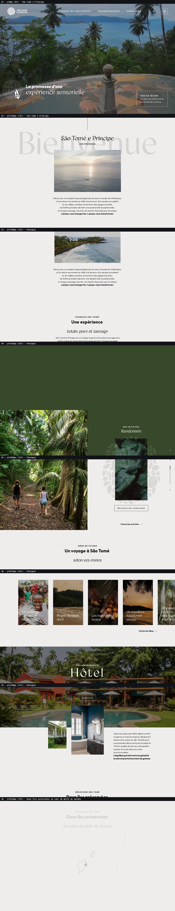
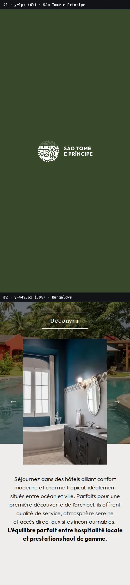

# UI Design System & Master Generation Blueprint: turismo-gov-st_fr

> **Homepage · São Tomé E Príncipe** (https://turismo.gov.st/fr) — Ce que vous devez savoir sur la taxe de tourisme





---

## 1. Executive Visual Persona & Design Archetype

- **Brand Essence & Persona**: **Homepage · São Tomé E Príncipe** (`https://turismo.gov.st/fr`). Ce que vous devez savoir sur la taxe de tourisme
- **Capture Provenance**: Live browser capture (`tier1_fast`, HTTP `200`, captured `2026-11-24`).
- **Visual Archetype**: **Light-Substrate Editorial & Modular Grid System (`#eeedea` canvas, `#000000` ink, `#008000` accent)**.
- **Anti-AI-Slop Differentiators**:
  - **Live-Computed Chromatic Polarity**: Anchors the viewport in `#eeedea` (live computed `body` `background-color` (`computed_styles.json`)) paired with `#000000` primary typography and `#008000` accents.
  - **Grounded Typographic Hierarchy**: Pairs `gyst-variable` for display copy (`São Tomé e Príncipe`) with `Outfit`.
  - **Calibrated Spatial Grid & Motion**: Combines `84.2rem` container bounds (`gap: 1rem`, padding `60px`) with `cubic-bezier(.4,0,.2,1)` easing and Lenis Smooth Scroll (`data-lenis`), GSAP Timeline & ScrollTrigger.

---

## 2. Spatial Architecture & Modular Grid Mathematics

### Viewport Allocation & Container Geometry
- **Captured Journey Filmstrips**: Desktop `1280×6624px` (`assets/desktop-journey.webp`, `8` keyframes up to `y=7650px` / doc `10549px`), Mobile `390×1744px` (`assets/mobile-journey.webp`, `2` keyframes).
- **Master Container Bounds**: `84.2rem` (non-`@media` desktop container stylesheet rule).
- **Canvas Lateral Padding & Spacing**: `60px` lateral canvas padding with `1rem` grid gap.
- **Border Radius Scale**: `7px`, `50%`, `2px`, `4px`.

### Responsive Breakpoint Architecture
- **Desktop Layout**: Multi-column CSS Grid / Flexbox layout at `1440px` (`max-width: 84.2rem`, `gap: 1rem`).
- **Mobile Layout**: Single-column vertical stack at `390px` viewport width with `60px` horizontal padding.
- **Extracted CSS Media Queries**: `@media (min-width: 768px)`, `@media screen and (max-width: 600px)`, `@media screen and (max-width:700px)`, `@media (min-width:480px)`.

---

## 3. Color System, Materiality & Atmospheric Lighting

### Semantic Palette & Source Grounding
| Semantic Role | Ground-Truth Value | Extracted Live / CSS Source |
|---|---|---|
| **Primary Canvas Substrate** | `#eeedea` | live computed `body` `background-color` (`computed_styles.json`) |
| **Primary Typography Ink** | `#000000` | live computed `h1` `color` (`computed_styles.json`) |
| **Elevated Surface / Card Substrate** | `#ffffff` | `.progress__track { background-color: #ffffff }` |
| **Interactive Accent / Highlight** | `#008000` | `.button--primary--dark { color: green }` (`#008000`) |
| **Secondary / Muted Copy** | `#ffffff` | live computed `p` `color` (`computed_styles.json`) |
| **Structural Hairline Border** | `#bbbbbb` | `.webform-readonly textarea { border-color: #bbbbbb }` |
| **Variable Token (`--color-green--dark`)** | `#38492a` | `var(--color-green--dark)` in `:root` |

### Sanitized Root CSS Variables (`ui-ux.md` Ground Truth)
| Variable Name | Extracted Value | Semantic Role |
|---|---|---|
| `--color-white` | `#ffffff` | Canvas / Surface Token |
| `--color-white--30` | `rgba(255, 255, 255, 0.3)` | Canvas / Surface Token |
| `--color-white--00` | `rgba(255, 255, 255, 0)` | Canvas / Surface Token |
| `--color-white--15` | `rgba(255, 255, 255, 0.15)` | Canvas / Surface Token |
| `--color-white--08` | `rgba(255, 255, 255, 0.08)` | Canvas / Surface Token |
| `--color-black` | `#000000` | Canvas / Surface Token |
| `--color-black--05` | `rgba(0, 0, 0, 0.05)` | Canvas / Surface Token |
| `--color-black--08` | `rgba(0, 0, 0, 0.08)` | Canvas / Surface Token |
| `--color-black--15` | `rgba(0, 0, 0, 0.15)` | Canvas / Surface Token |
| `--color-black--00` | `rgba(0, 0, 0, 0)` | Canvas / Surface Token |
| `--color-black--10` | `rgba(0, 0, 0, 0.1)` | Canvas / Surface Token |
| `--color-black--30` | `rgba(0, 0, 0, 0.3)` | Canvas / Surface Token |
| `--color-black--50` | `rgba(0, 0, 0, 0.5)` | Canvas / Surface Token |
| `--color-black--70` | `rgba(0, 0, 0, 0.7)` | Canvas / Surface Token |
| `--color-green--dark` | `#38492A` | Canvas / Surface Token |
| `--color-green--dark--30` | `rgba(56, 73, 42, 0.3)` | Canvas / Surface Token |

---

## 4. Typographic Scale & Editorial Hierarchy

### Font Family Stacks
- **Display Typography**: `gyst-variable`.
- **Primary Body Stack**: `Outfit`.
- **Technical / Metadata Stack**: not declared in live computed styles (uses primary stack / `ui-monospace`).

### Typographic Scale & Rules (Live Computed & Stylesheet Grounded)
- **Hero Display (`H1`)**: live computed `h1` (`font-size: 50px`, `line-height: 55px`, `font-weight: 400`, `letter-spacing: 0.5px`); CSS variables `--font-display: gyst-variable,serif`.
- **Section Heading (`H2`)**: live computed `h2` (`font-size: 35px`, `line-height: 38.5px`, `font-weight: 400`, `letter-spacing: 0.35px`).
- **Body Copy**: live computed `body` (`font-size: 16px`, `line-height: normal`, `font-weight: 400`); CSS variables `--font-body: Outfit,Arial,Helvetica,sans-serif`, `--paragraph-max-width: 100%`, `--paragraph-margin-bottom: 0`; rule `p` (`font-size: var(--fz-size, 1.7rem)`, `line-height: 1.5`, `font-weight: 300`).
- **Metadata & Navigation Labels**: live computed `nav/a` (`font-size: 17px`, `line-height: 25.5px`, `font-weight: 300`).

---

## 5. Choreographed Motion & Interaction Physics

### Primary Easing Curves
- **Extracted Timing Functions**: `cubic-bezier(.4,0,.2,1)`, `cubic-bezier(.16,1.08,.38,.98)`, `cubic-bezier(.4,.64,.68,1)`.

### Per-Element Transition & Choreography Rules
- **Selector `.plyr`**: `transition: -webkit-box-shadow .3s` extracted from `turismo-gov-st_fr` stylesheet.
- **Selector `.plyr__captions`**: `transition: -webkit-transform .4s ease-in-out` extracted from `turismo-gov-st_fr` stylesheet.
- **Selector `.plyr__control`**: `transition: .3s` extracted from `turismo-gov-st_fr` stylesheet.
- **Extracted Easing Curve (`cubic-bezier(.4,0,.2,1)`)**: Governs interactive state transitions across `<header.Header>` and `<section.ParagraphImmersiveMesh>`.
- **Runtime Interaction Engine**: Integrates Lenis Smooth Scroll (`data-lenis`), GSAP Timeline & ScrollTrigger, Swiper Touch Carousel Engine, Barba.js Page Transition Router with `prefers-reduced-motion: reduce` fallback guards.
### Measured Runtime Scroll & Interaction Telemetry (`behavioral_journey_v2`)
- **Scroll Driver Mode**: `native` (max document height `10549px`, deepest scrollY reached `7650px` across `8` desktop keyframes).
- **Detected Scroll / Motion Libraries**: `Lenis`, `GSAP/ScrollTrigger`.
- **Route Transition Architecture**: First internal navigation (`/fr/pourquoi-sao-tome-et-principe/lexperience-sensorielle`) measured as `direct` in `7725ms`.

---

## 6. Component Wireframe & Structural DOM Map

### Visual Layout Schematic — Desktop (`1440px`, Grounded in `dom.html` & Landmark Bounding Boxes)
```
┌────────────────────────────────────────────────────────────────────────┐
│ DESKTOP VIEWPORT (1440px) — Homepage · São Tomé E Príncipe             │
│ ====================================================================== │
│ [ <header.Header> (1440x120px)        | Nature · Un éden insulaire · ] │
│ ---------------------------------------------------------------------- │
│ | HERO STAGE: <section.Homepage> (w=1440px)                          | │
│ | H1: São Tomé e Príncipe                                            | │
│ | Substrate: #eeedea | Ink: #000000 | Accent: #008000                | │
│ ---------------------------------------------------------------------- │
│ | SHOWCASE GRID (<section.ParagraphImmersiv) max-w: 84.2rem          | │
│ | +------------------------------+  +------------------------------+ | │
│ | | Pourquoi São Tomé?           |  | Une expérience totale, pure  | | │
│ | +------------------------------+  +------------------------------+ | │
│ ---------------------------------------------------------------------- │
│ | DETAIL MODULE (<section.ParagraphVertical) — Nos activités         | │
│ ---------------------------------------------------------------------- │
│ [ FOOTER (<footer.footer>     ) | https://turismo.gov.st/fr            │
└────────────────────────────────────────────────────────────────────────┘
```

### Visual Layout Schematic — Mobile Reflow (`390px`)
```
┌────────────────────────────────────────────────────────────────────────┐
│ MOBILE VIEWPORT REFLOW (390px) — Single-Column Stack (gap: 1rem)       │
│ ====================================================================== │
│ [ HEADER BAR (<header.Header>         ) | Compact Menu (390px)         │
│ ---------------------------------------------------------------------- │
│ | HERO STAGE (<section.Homepage>) — 390px Vertical Lead              | │
│ | H1: São Tomé e Príncipe                                            | │
│ ---------------------------------------------------------------------- │
│ | SHOWCASE STACK (<section.ParagraphImme) — 1-Col Stack              | │
│ | [ Item 1: Pourquoi São Tomé?                                     ] | │
│ | [ Item 2: Une expérience totale, pure et sauvage                 ] | │
│ ---------------------------------------------------------------------- │
│ | DETAIL STACK (<section.ParagraphVertic) — 1-Col (Nos activités)    | │
│ ---------------------------------------------------------------------- │
│ [ FOOTER (<footer.footer>     ) | Stacked 390px Colophon               │
└────────────────────────────────────────────────────────────────────────┘
```

### Granular DOM Region Breakdown
1. **Brand Header & Navigation Bar (<header.Header> — `turismo-gov-st_fr`)**:
   - Landmark `<header class="Header">` (`1440x120px`) hosting `Homepage · São Tomé E Príncipe` navigation (`Nature · Un éden insulaire · Une flore luxuriante · Plages de sable doré · Croyances`), DOM attributes (`data-barba="wrapper"`, `data-once="form-single-submit we..."`, `data-off-canvas-main-canvas`, `data-container-query-observer-bae45330cd3d4e0e96b60d26b57009b5-1795453191897-0`), and stylesheet rule `.webform-flexbox { display: flex; margin: 1em -0.5em; }`.
2. **Hero Stage & Focal Lead (<section.Homepage> — `São Tomé e Príncipe`)**:
   - Landmark `<section class="Homepage node">` presenting display lead `São Tomé e Príncipe` and copy excerpt *"Ce que vous devez savoir sur la taxe de tourisme"* over `#eeedea` canvas and `#000000` ink.
3. **Primary Showcase & Content Grid (<section.ParagraphImmersiveMesh> — `Pourquoi São Tomé?`)**:
   - Landmark `<section class="ParagraphImmersiveMesh paragraph">` rendering section `Pourquoi São Tomé?` with copy *"expérience sensorielle"*, asset references (`sdk.js`, `gtm.js`, `favicon.png`, `webform.element.flexbox.css`), and grid rule `.webform-flexbox .webform-flexbox { margin: 1em 0; }`.
4. **Interactive Detail & Feature Matrix (<section.ParagraphVerticalSlider> — `Une expérience totale, pure et sau`)**:
   - Landmark `<section class="ParagraphVerticalSlider paragraph">` framing `Une expérience totale, pure et sauvage` and `Nos activités` (*"envoûtement océanique"*) with `#ffffff` surface cards, `#008000` accents, and `.webform-flexbox--justify-flex-start { justify-content: flex-start; }`.
5. **Colophon & Global Directory Footer (<footer.footer> — `https://turismo.gov.st/fr`)**:
   - Landmark `<footer class="footer">` anchoring `Homepage · São Tomé E Príncipe` footer links (`Nature · Un éden insulaire · Une flore luxuriante · Plages de sable doré · Croyances`), copy *"immersion culturelle"*, and `#bbbbbb` structural dividers.
### Full Vertical Scroll Sequence (Desktop `1440×900` Keyframes)
- **Step 01** (`y=0px`, `0%`): Active landmark `São Tomé e Príncipe` · sticky/fixed elements: `2`
- **Step 02** (`y=1350px`, `14%`): Active landmark `São Tomé e Príncipe` · sticky/fixed elements: `1`
- **Step 03** (`y=1700px`, `18%`): Active landmark `Pourquoi` · sticky/fixed elements: `1`
- **Step 04** (`y=2550px`, `26%`): Active landmark `Pourquoi` · sticky/fixed elements: `1`
- **Step 05** (`y=3400px`, `35%`): Active landmark `Pourquoi` · sticky/fixed elements: `1`
- **Step 06** (`y=4250px`, `44%`): Active landmark `Pourquoi` · sticky/fixed elements: `1`
- **Step 07** (`y=5100px`, `53%`): Active landmark `Pourquoi` · sticky/fixed elements: `1`
- **Step 08** (`y=7650px`, `79%`): Active landmark `Deux îles préservées au cœur du golfe de Guinée` · sticky/fixed elements: `1`

### Multi-Page Internal Route Map
- **Detail Route (`/fr/pourquoi-sao-tome-et-principe/lexperience-sensorielle`)**: `https://turismo.gov.st/fr/pourquoi-sao-tome-et-principe/lexperience-sensorielle` — H1: `L’expérience sensorielle`, scrollHeight `16668px`, transition `direct` (`7725ms`)
- **Detail Route (`/fr/pourquoi-sao-tome-et-principe/lexploration-originelle`)**: `https://turismo.gov.st/fr/pourquoi-sao-tome-et-principe/lexploration-originelle` — H1: `L’exploration originelle`, scrollHeight `16668px`, transition `direct` (`4035ms`)
- **Detail Route (`/fr/decouvrez-sao-tome-et-principe`)**: `https://turismo.gov.st/fr/decouvrez-sao-tome-et-principe` — H1: `Découvrez Sao Tome et Principe`, scrollHeight `3706px`, transition `direct` (`4355ms`)

---

## 7. Master Zero-Shot AI Generation Prompt

```markdown
# Master Zero-Shot Frontend Generation Prompt: turismo-gov-st_fr (Homepage · São Tomé E Príncipe)

You are a principal frontend architect and design systems engineer. Build a complete, production-ready web application replicating the exact design system, DOM landmarks, typographic hierarchy, color tokens, and motion physics of `turismo-gov-st_fr` (**Homepage · São Tomé E Príncipe** — `https://turismo.gov.st/fr`).

### 1. Visual Archetype & Anti-AI-Slop Mandates
- **Archetype**: Light-Substrate Editorial & Modular Grid System (`#eeedea` canvas, `#000000` ink, `#008000` accent).
- **Identity & Domain Context**: Ce que vous devez savoir sur la taxe de tourisme
- **Primary Substrate**: `#eeedea` (live computed `body` `background-color` (`computed_styles.json`)), **Primary Ink**: `#000000`, **Accent / Highlight**: `#008000`.
- **Site-Specific Differentiators**:
  - **Live-Computed Chromatic Polarity**: Anchors the viewport in `#eeedea` (live computed `body` `background-color` (`computed_styles.json`)) paired with `#000000` primary typography and `#008000` accents.
  - **Grounded Typographic Hierarchy**: Pairs `gyst-variable` for display copy (`São Tomé e Príncipe`) with `Outfit`.
  - **Calibrated Spatial Grid & Motion**: Combines `84.2rem` container bounds (`gap: 1rem`, padding `60px`) with `cubic-bezier(.4,0,.2,1)` easing and Lenis Smooth Scroll (`data-lenis`), GSAP Timeline & ScrollTrigger.

### 2. Ground-Truth CSS Variables (`:root` Token Contract)
Declare and consume these exact custom properties extracted from `turismo-gov-st_fr` in your global stylesheet:

:root {
  /* Homepage · São Tomé E Príncipe (turismo-gov-st_fr) — Live-Grounded CSS Variables */
  --color-white: #ffffff; /* Canvas / Surface Token (turismo-gov-st_fr) */
  --color-white--30: rgba(255, 255, 255, 0.3); /* Canvas / Surface Token (turismo-gov-st_fr) */
  --color-white--00: rgba(255, 255, 255, 0); /* Canvas / Surface Token (turismo-gov-st_fr) */
  --color-white--15: rgba(255, 255, 255, 0.15); /* Canvas / Surface Token (turismo-gov-st_fr) */
  --color-white--08: rgba(255, 255, 255, 0.08); /* Canvas / Surface Token (turismo-gov-st_fr) */
  --color-black: #000000; /* Canvas / Surface Token (turismo-gov-st_fr) */
  --color-black--05: rgba(0, 0, 0, 0.05); /* Canvas / Surface Token (turismo-gov-st_fr) */
  --color-black--08: rgba(0, 0, 0, 0.08); /* Canvas / Surface Token (turismo-gov-st_fr) */
  --color-black--15: rgba(0, 0, 0, 0.15); /* Canvas / Surface Token (turismo-gov-st_fr) */
  --color-black--00: rgba(0, 0, 0, 0); /* Canvas / Surface Token (turismo-gov-st_fr) */
  --color-black--10: rgba(0, 0, 0, 0.1); /* Canvas / Surface Token (turismo-gov-st_fr) */
  --color-black--30: rgba(0, 0, 0, 0.3); /* Canvas / Surface Token (turismo-gov-st_fr) */
  --color-black--50: rgba(0, 0, 0, 0.5); /* Canvas / Surface Token (turismo-gov-st_fr) */
  --color-black--70: rgba(0, 0, 0, 0.7); /* Canvas / Surface Token (turismo-gov-st_fr) */
  --color-green--dark: #38492A; /* Canvas / Surface Token (turismo-gov-st_fr) */
  --color-green--dark--30: rgba(56, 73, 42, 0.3); /* Canvas / Surface Token (turismo-gov-st_fr) */
}

### 3. Semantic Color & Materiality Contract
Map every surface, ink, and border strictly to these source-grounded tokens:
- **Primary Canvas Substrate**: `#eeedea` — grounded in live computed `body` `background-color` (`computed_styles.json`)
- **Primary Typography Ink**: `#000000` — grounded in live computed `h1` `color` (`computed_styles.json`)
- **Elevated Surface / Card Substrate**: `#ffffff` — grounded in `.progress__track { background-color: #ffffff }`
- **Interactive Accent / Highlight**: `#008000` — grounded in `.button--primary--dark { color: green }` (`#008000`)
- **Secondary / Muted Copy**: `#ffffff` — grounded in live computed `p` `color` (`computed_styles.json`)
- **Structural Hairline Border**: `#bbbbbb` — grounded in `.webform-readonly textarea { border-color: #bbbbbb }`
- **Variable Token (`--color-green--dark`)**: `#38492a` — grounded in `var(--color-green--dark)` in `:root`

### 4. Spatial Grid, Container Bounds & Responsive Breakpoints
- **Desktop Viewport Reference**: `1280×6624px` (multi-frame vertical journey filmstrip (6624px), `1440px` standard desktop width).
- **Mobile Viewport Reference**: `390×1744px` (full-page live capture (1744px), `390px` standard mobile width).
- **Container Max-Width**: `84.2rem` (non-`@media` desktop container stylesheet rule)
- **Padding & Gutters**: `60px` lateral canvas padding with `1rem` grid gap
- **Desktop Grid**: Multi-column CSS Grid / Flexbox layout at `1440px` (`max-width: 84.2rem`, `gap: 1rem`)
- **Mobile Adaptation**: Single-column vertical stack at `390px` viewport width with `60px` horizontal padding
- **Media Queries**: `@media (min-width: 768px)`, `@media screen and (max-width: 600px)`, `@media screen and (max-width:700px)`, `@media (min-width:480px)`
- **Corner Radii**: `7px`, `50%`, `2px`, `4px`

### 5. Typography & Editorial Scale Contract
- **Display Font Stack**: `gyst-variable`
- **Body Font Stack**: `Outfit`
- **Monospace / Technical Font Stack**: not declared in live computed styles (uses primary stack / `ui-monospace`)
- **H1 Display Rule**: live computed `h1` (`font-size: 50px`, `line-height: 55px`, `font-weight: 400`, `letter-spacing: 0.5px`); CSS variables `--font-display: gyst-variable,serif`
- **H2 Section Rule**: live computed `h2` (`font-size: 35px`, `line-height: 38.5px`, `font-weight: 400`, `letter-spacing: 0.35px`)
- **Body Copy Rule**: live computed `body` (`font-size: 16px`, `line-height: normal`, `font-weight: 400`); CSS variables `--font-body: Outfit,Arial,Helvetica,sans-serif`, `--paragraph-max-width: 100%`, `--paragraph-margin-bottom: 0`; rule `p` (`font-size: var(--fz-size, 1.7rem)`, `line-height: 1.5`, `font-weight: 300`)
- **Metadata & Index Rule**: live computed `nav/a` (`font-size: 17px`, `line-height: 25.5px`, `font-weight: 300`)

### 6. Component Hierarchy, Verbatim Copy & Real DOM Landmarks
Scaffold `turismo-gov-st_fr` (`Homepage · São Tomé E Príncipe`) with these exact structural regions, extracted copy, and CSS rules from `dom.html`:
1. **Brand Header & Navigation Bar (<header.Header> — `turismo-gov-st_fr`)**:
   - DOM & Selectors: Landmark `<header class="Header">` (`1440x120px`) hosting `Homepage · São Tomé E Príncipe` navigation (`Nature · Un éden insulaire · Une flore luxuriante · Plages de sable doré · Croyances`), DOM attributes (`data-barba="wrapper"`, `data-once="form-single-submit we..."`, `data-off-canvas-main-canvas`, `data-container-query-observer-bae45330cd3d4e0e96b60d26b57009b5-1795453191897-0`), and stylesheet rule `.webform-flexbox { display: flex; margin: 1em -0.5em; }`.
   - Responsive Contract: Header `Brand Header & Navigation Bar (<header.Header> — `turismo-gov-st_fr`)` (`turismo-gov-st_fr`) adapts across `@media (min-width: 768px)`, `@media screen and (max-width: 600px)`, `@media screen and (max-width:700px)`, `@media (min-width:480px)` with `cubic-bezier(.4,0,.2,1)`, `cubic-bezier(.16,1.08,.38,.98)`, `cubic-bezier(.4,.64,.68,1)` transitions and links `Nature · Un éden insulaire · Une flore luxuriante · Plages de sable doré · Croyances`.
2. **Hero Stage & Focal Lead (<section.Homepage> — `São Tomé e Príncipe`)**:
   - DOM & Selectors: Landmark `<section class="Homepage node">` presenting display lead `São Tomé e Príncipe` and copy excerpt *"Ce que vous devez savoir sur la taxe de tourisme"* over `#eeedea` canvas and `#000000` ink.
   - Responsive Contract: Hero stage (`1280×6624px` desktop / `390×1744px` mobile) sets `#eeedea` background with `#000000` headline `São Tomé e Príncipe`.
3. **Primary Showcase & Content Grid (<section.ParagraphImmersiveMesh> — `Pourquoi São Tomé?`)**:
   - DOM & Selectors: Landmark `<section class="ParagraphImmersiveMesh paragraph">` rendering section `Pourquoi São Tomé?` with copy *"expérience sensorielle"*, asset references (`sdk.js`, `gtm.js`, `favicon.png`, `webform.element.flexbox.css`), and grid rule `.webform-flexbox .webform-flexbox { margin: 1em 0; }`.
   - Responsive Contract: Showcase grid `Primary Showcase & Content Grid (<section.ParagraphImmersiveMesh> — `Pourquoi São Tomé?`)` applies Multi-column CSS Grid / Flexbox layout at `1440px` (`max-width: 84.2rem`, `gap: 1rem`) on desktop and Single-column vertical stack at `390px` viewport width with `60px` horizontal padding on mobile.
4. **Interactive Detail & Feature Matrix (<section.ParagraphVerticalSlider> — `Une expérience totale, pure et sau`)**:
   - DOM & Selectors: Landmark `<section class="ParagraphVerticalSlider paragraph">` framing `Une expérience totale, pure et sauvage` and `Nos activités` (*"envoûtement océanique"*) with `#ffffff` surface cards, `#008000` accents, and `.webform-flexbox--justify-flex-start { justify-content: flex-start; }`.
   - Responsive Contract: Detail module `Interactive Detail & Feature Matrix (<section.ParagraphVerticalSlider> — `Une expérience totale, pure et sau`)` uses `7px`, `50%`, `2px`, `4px` radii, `#008000` highlights, and assets (sdk.js, gtm.js, favicon.png).
5. **Colophon & Global Directory Footer (<footer.footer> — `https://turismo.gov.st/fr`)**:
   - DOM & Selectors: Landmark `<footer class="footer">` anchoring `Homepage · São Tomé E Príncipe` footer links (`Nature · Un éden insulaire · Une flore luxuriante · Plages de sable doré · Croyances`), copy *"immersion culturelle"*, and `#bbbbbb` structural dividers.
   - Responsive Contract: Footer `Colophon & Global Directory Footer (<footer.footer> — `https://turismo.gov.st/fr`)` aligns to `84.2rem` (non-`@media` desktop container stylesheet rule) with `60px` lateral canvas padding with `1rem` grid gap and attributes (data-barba="wrapper", data-once="form-single-submit we...", data-off-canvas-main-canvas).

#### Verbatim DOM Copy Excerpts (`dom.html`)
- Copy Excerpt 1: *"Ce que vous devez savoir sur la taxe de tourisme"*
- Copy Excerpt 2: *"expérience sensorielle"*
- Copy Excerpt 3: *"envoûtement océanique"*
- Copy Excerpt 4: *"immersion culturelle"*

### 7. Motion, Extracted Stylesheet Rules & Interaction Choreography
- **Primary Easing Functions**: `cubic-bezier(.4,0,.2,1)`, `cubic-bezier(.16,1.08,.38,.98)`, `cubic-bezier(.4,.64,.68,1)`
- **Extracted Stylesheet Rules (`turismo-gov-st_fr`)**:
- `.webform-flexbox { display: flex; margin: 1em -0.5em; }`
- `.webform-flexbox .webform-flexbox { margin: 1em 0; }`
- `.webform-flexbox--justify-flex-start { justify-content: flex-start; }`
- `.webform-flexbox--justify-flex-end { justify-content: flex-end; }`
- `.webform-flexbox--justify-center { justify-content: center; }`
- **Per-Selector Transition Rules**:
- **Selector `.plyr`**: `transition: -webkit-box-shadow .3s` extracted from `turismo-gov-st_fr` stylesheet.
- **Selector `.plyr__captions`**: `transition: -webkit-transform .4s ease-in-out` extracted from `turismo-gov-st_fr` stylesheet.
- **Selector `.plyr__control`**: `transition: .3s` extracted from `turismo-gov-st_fr` stylesheet.
- **Extracted Easing Curve (`cubic-bezier(.4,0,.2,1)`)**: Governs interactive state transitions across `<header.Header>` and `<section.ParagraphImmersiveMesh>`.
- **Runtime Interaction Engine**: Integrates Lenis Smooth Scroll (`data-lenis`), GSAP Timeline & ScrollTrigger, Swiper Touch Carousel Engine, Barba.js Page Transition Router with `prefers-reduced-motion: reduce` fallback guards.
### 7b. Full-Page Scroll Choreography, Interactive States & Multi-Page Routes
- **Scroll Mechanics**: Implement `native` vertical progression up to `10549px` across 8 distinct viewport chapters using Lenis, GSAP/ScrollTrigger.
- **Vertical Chapter Sequence**: São Tomé e Príncipe (0%) -> São Tomé e Príncipe (14%) -> Pourquoi (18%) -> Pourquoi (26%) -> Pourquoi (35%) -> Pourquoi (44%) -> Pourquoi (53%) -> Deux îles préservées au cœu... (79%).
- **Multi-Page Routes**: Scaffold internal routes `/fr/pourquoi-sao-tome-et-principe/lexperience-sensorielle` (detail, direct), `/fr/pourquoi-sao-tome-et-principe/lexploration-originelle` (detail, direct), `/fr/decouvrez-sao-tome-et-principe` (detail, direct) sharing the global header/footer shell and design tokens.

### 8. Technical Deliverables
- Implement in Next.js (App Router) with TypeScript and Tailwind CSS consuming the `:root` custom properties defined above for `turismo-gov-st_fr`.
- Reproduce both the `1440px` desktop architecture and `390px` mobile breakpoint transitions, preserving semantic HTML5 landmarks (`<header>`, `<nav>`, `<main>`, `<section>`, `<footer>`) and `prefers-reduced-motion` accessibility guards.
```
---

## 8. Full-Page Scroll Journey, Interactive States & Subpage Inventory

### Desktop Scroll Keyframes (`1440×900` WebP)
| Step | Scroll Y | Progress | Active Landmark / Section | Sticky/Fixed | Visual Asset |
| :---: | :---: | :---: | :--- | :---: | :--- |
| `#01` | `0px` | `0%` | São Tomé e Príncipe | `2` | [desktop-step-01.webp](assets/desktop-step-01.webp) |
| `#02` | `1350px` | `14%` | São Tomé e Príncipe | `1` | [desktop-step-02.webp](assets/desktop-step-02.webp) |
| `#03` | `1700px` | `18%` | Pourquoi | `1` | [desktop-step-03.webp](assets/desktop-step-03.webp) |
| `#04` | `2550px` | `26%` | Pourquoi | `1` | [desktop-step-04.webp](assets/desktop-step-04.webp) |
| `#05` | `3400px` | `35%` | Pourquoi | `1` | [desktop-step-05.webp](assets/desktop-step-05.webp) |
| `#06` | `4250px` | `44%` | Pourquoi | `1` | [desktop-step-06.webp](assets/desktop-step-06.webp) |
| `#07` | `5100px` | `53%` | Pourquoi | `1` | [desktop-step-07.webp](assets/desktop-step-07.webp) |
| `#08` | `7650px` | `79%` | Deux îles préservées au cœur du golfe de Guinée | `1` | [desktop-step-08.webp](assets/desktop-step-08.webp) |

### Mobile Condensed Keyframes (`390×844` WebP)
| Step | Scroll Y | Progress | Active Landmark | Visual Asset |
| :---: | :---: | :---: | :--- | :--- |
| `#01` | `1px` | `0%` | São Tomé e Príncipe | [mobile-step-01.webp](assets/mobile-step-01.webp) |
| `#02` | `4495px` | `50%` | Bungalows | [mobile-step-02.webp](assets/mobile-step-02.webp) |

### Internal Subpage Filmstrips (`1080px` Wide WebP)
| # | Template | Route URL | H1 / Title | Scroll Height | Transition | Filmstrip Asset |
| :-: | :---: | :--- | :--- | :---: | :---: | :--- |
| `1` | `detail` | `https://turismo.gov.st/fr/pourquoi-sao-tome-et-principe/lexperience-sensorielle` | L’expérience sensorielle | `16668px` | `direct` (`7725ms`) | [subpage-01-fr-pourquoi-sao-tome-et-principe-lex.webp](assets/subpage-01-fr-pourquoi-sao-tome-et-principe-lex.webp) |
| `2` | `detail` | `https://turismo.gov.st/fr/pourquoi-sao-tome-et-principe/lexploration-originelle` | L’exploration originelle | `16668px` | `direct` (`4035ms`) | [subpage-02-fr-pourquoi-sao-tome-et-principe-lex.webp](assets/subpage-02-fr-pourquoi-sao-tome-et-principe-lex.webp) |
| `3` | `detail` | `https://turismo.gov.st/fr/decouvrez-sao-tome-et-principe` | Découvrez Sao Tome et Principe | `3706px` | `direct` (`4355ms`) | [subpage-03-fr-decouvrez-sao-tome-et-principe.webp](assets/subpage-03-fr-decouvrez-sao-tome-et-principe.webp) |

