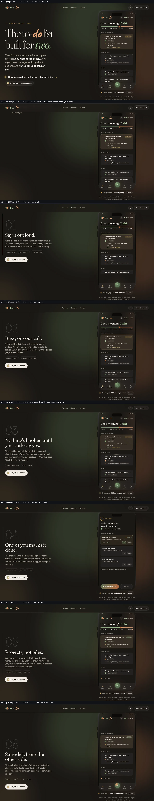
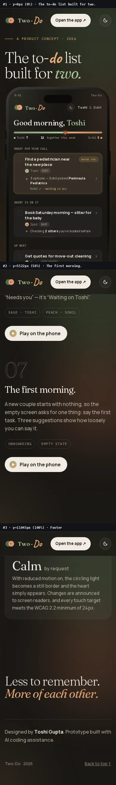

# UI Design System & Master Generation Blueprint: twodo-design

> **Two-Do** (https://twodo.design) — Two-Do case study: a voice-first, shared to-do app for couples, where an AI agent does the legwork and nothing happens until you both agree.





---

## 1. Executive Visual Persona & Design Archetype

- **Brand Essence & Persona**: **Two-Do** (`https://twodo.design`). Two-Do case study: a voice-first, shared to-do app for couples, where an AI agent does the legwork and nothing happens until you both agree.
- **Capture Provenance**: Live browser capture (`tier1_fast`, HTTP `200`, captured `2026-11-24`).
- **Visual Archetype**: **High-Contrast Obsidian / Atmospheric Design System (`#1b1815` canvas, `#f1ece3` ink, `#b8842a` accent)**.
- **Anti-AI-Slop Differentiators**:
  - **Live-Computed Chromatic Polarity**: Anchors the viewport in `#1b1815` (live computed `body` `background-color` (`computed_styles.json`)) paired with `#f1ece3` primary typography and `#b8842a` accents.
  - **Grounded Typographic Hierarchy**: Pairs `Fraunces` for display copy (`The to-do list built for two.`) with `Manrope` and `IBM Plex Mono`.
  - **Calibrated Spatial Grid & Motion**: Combines `1440px` container bounds (`gap: 22px`, padding `48px`) with `cubic-bezier(.2,.7,.2,1)` easing and Three.js / WebGL Canvas Pipeline.

---

## 2. Spatial Architecture & Modular Grid Mathematics

### Viewport Allocation & Container Geometry
- **Captured Journey Filmstrips**: Desktop `1280×6624px` (`assets/desktop-journey.webp`, `8` keyframes up to `y=6100px` / doc `10990px`), Mobile `390×2616px` (`assets/mobile-journey.webp`, `3` keyframes).
- **Master Container Bounds**: `1440px` (full-bleed `100%` desktop stage measured on `1440px` viewport).
- **Canvas Lateral Padding & Spacing**: `48px` lateral canvas padding with `22px` grid gap.
- **Border Radius Scale**: `50%`, `10px`, `6px`, `999px`.

### Responsive Breakpoint Architecture
- **Desktop Layout**: Multi-column CSS Grid / Flexbox layout at `1440px` (`max-width: 1440px`, `gap: 22px`).
- **Mobile Layout**: Single-column vertical stack at `390px` viewport width with `48px` horizontal padding.
- **Extracted CSS Media Queries**: `@media (prefers-reduced-motion: reduce)`, `@media (max-width: 359px)`, `@media (max-width: 900px)`, `@media (min-width: 721px)`.

---

## 3. Color System, Materiality & Atmospheric Lighting

### Semantic Palette & Source Grounding
| Semantic Role | Ground-Truth Value | Extracted Live / CSS Source |
|---|---|---|
| **Primary Canvas Substrate** | `#1b1815` | live computed `body` `background-color` (`computed_styles.json`) |
| **Primary Typography Ink** | `#f1ece3` | live computed `h1` `color` (`computed_styles.json`) |
| **Elevated Surface / Card Substrate** | `#0b0a09` | `.island { background: #0b0a09 }` |
| **Interactive Accent / Highlight** | `#b8842a` | `var(--glow)` in `:root` |
| **Secondary / Muted Copy** | `#6e685a` | `var(--ink-faint)` in `:root` |
| **Structural Hairline Border** | `#1c1915` | `var(--border)` in `:root` (`rgba(33, 29, 24, 0.12)`) |
| **Variable Token (`--bg`)** | `#f6f2e9` | `var(--bg)` in `:root` |
| **Variable Token (`--bg-deep`)** | `#efe9dc` | `var(--bg-deep)` in `:root` |
| **Variable Token (`--ink`)** | `#211d18` | `var(--ink)` in `:root` |
| **Variable Token (`--ink-soft`)** | `#57524a` | `var(--ink-soft)` in `:root` |
| **Variable Token (`--sage`)** | `#5c6e4e` | `var(--sage)` in `:root` |
| **Variable Token (`--peach`)** | `#c97a4a` | `var(--peach)` in `:root` |
| **Variable Token (`--sage-text`)** | `#4e6042` | `var(--sage-text)` in `:root` |
| **Variable Token (`--peach-text`)** | `#98552c` | `var(--peach-text)` in `:root` |
| **Variable Token (`--glow-text`)** | `#7f590f` | `var(--glow-text)` in `:root` |
| **Variable Token (`--heart`)** | `#c1633c` | `var(--heart)` in `:root` |

### Sanitized Root CSS Variables (`ui-ux.md` Ground Truth)
| Variable Name | Extracted Value | Semantic Role |
|---|---|---|
| `--bg` | `#f6f2e9` | Canvas / Surface Token |
| `--bg-deep` | `#efe9dc` | Canvas / Surface Token |
| `--surface` | `rgba(33, 29, 24, 0.04)` | Canvas / Surface Token |
| `--border` | `rgba(33, 29, 24, 0.12)` | Elevation / Border Token |
| `--border-soft` | `rgba(33, 29, 24, 0.07)` | Elevation / Border Token |
| `--ink` | `#211d18` | Typography Ink Token |
| `--ink-soft` | `#57524a` | Typography Ink Token |
| `--ink-faint` | `#6e685a` | Typography Ink Token |
| `--sage` | `#5c6e4e` | Color / Atmospheric Token |
| `--peach` | `#c97a4a` | Color / Atmospheric Token |
| `--glow` | `#b8842a` | Color / Atmospheric Token |
| `--sage-text` | `#4e6042` | Typography Ink Token |
| `--peach-text` | `#98552c` | Typography Ink Token |
| `--glow-text` | `#7f590f` | Typography Ink Token |
| `--heart` | `#c1633c` | Color / Atmospheric Token |
| `--orb-a` | `rgba(140, 171, 123, 0.34)` | Color / Atmospheric Token |

---

## 4. Typographic Scale & Editorial Hierarchy

### Font Family Stacks
- **Display Typography**: `Fraunces`.
- **Primary Body Stack**: `Manrope`.
- **Technical / Metadata Stack**: `IBM Plex Mono`.

### Typographic Scale & Rules (Live Computed & Stylesheet Grounded)
- **Hero Display (`H1`)**: live computed `h1` (`font-size: 105.6px`, `line-height: 100.32px`, `font-weight: 300`, `letter-spacing: -3.696px`); rule `h1` (`font-size: clamp(3.2rem, 7.4vw, 6.6rem)`, `line-height: 0.95`, `letter-spacing: -0.035em`, `font-weight: 300`).
- **Section Heading (`H2`)**: live computed `h2` (`font-size: 57.6px`, `line-height: 60.48px`, `font-weight: 380`, `letter-spacing: -1.152px`); rule `h2` (`font-size: clamp(2.2rem, 4vw, 3.6rem)`).
- **Body Copy**: live computed `body` (`font-size: 17px`, `line-height: 27.2px`, `font-weight: 400`); rule `body` (`font-size: 17px`, `line-height: 1.6`).
- **Metadata & Navigation Labels**: live computed `nav/a` (`font-size: 13.76px`, `line-height: 22.016px`, `font-weight: 600`); rule `.mono` (`font-size: 0.72rem`, `letter-spacing: 0.12em`).

---

## 5. Choreographed Motion & Interaction Physics

### Primary Easing Curves
- **Extracted Timing Functions**: `cubic-bezier(.2,.7,.2,1)`, `cubic-bezier(.3,.7,.3,1.4)`, `cubic-bezier(.3,.6,.3,1)`.

### Per-Element Transition & Choreography Rules
- **Selector `body`**: `transition: background 0.35s ease, color 0.35s ease` extracted from `twodo-design` stylesheet.
- **Selector `.bar`**: `transition: background 0.3s, border-color 0.3s` extracted from `twodo-design` stylesheet.
- **Selector `.bar-link`**: `transition: background 0.2s` extracted from `twodo-design` stylesheet.
- **Extracted Easing Curve (`cubic-bezier(.2,.7,.2,1)`)**: Governs interactive state transitions across `<header.bar>` and `<section.idea>`.
- **Runtime Interaction Engine**: Integrates Three.js / WebGL Canvas Pipeline with `prefers-reduced-motion: reduce` fallback guards.
### Measured Runtime Scroll & Interaction Telemetry (`behavioral_journey_v2`)
- **Scroll Driver Mode**: `wheel` (max document height `10990px`, deepest scrollY reached `6100px` across `8` desktop keyframes).
- **Detected Scroll / Motion Libraries**: Native browser scroll / standard CSS transitions.
- **Hover Physics (`primary_cta` · `Two - Do`)**: Computed transition `0s` / `ease` (no static color/transform shift captured at rest).
- **Theme Toggle Probe**: Detected `Switch light or dark` (no body background diff).
- **Route Transition Architecture**: First internal navigation (`/app`) measured as `direct` in `772ms`.

---

## 6. Component Wireframe & Structural DOM Map

### Visual Layout Schematic — Desktop (`1440px`, Grounded in `dom.html` & Landmark Bounding Boxes)
```
┌────────────────────────────────────────────────────────────────────────┐
│ DESKTOP VIEWPORT (1440px) — Two-Do                                     │
│ ====================================================================== │
│ [ <header.bar> (1440x79px)            | The idea · Moments · System  ] │
│ ---------------------------------------------------------------------- │
│ | HERO STAGE: <section.hero> (w=1440px)                              | │
│ | H1: The to-do list built for two.                                  | │
│ | Substrate: #1b1815 | Ink: #f1ece3 | Accent: #b8842a                | │
│ ---------------------------------------------------------------------- │
│ | SHOWCASE GRID (<section.idea>) max-w: 1440px                       | │
│ | +------------------------------+  +------------------------------+ | │
│ | | The to- do list built for tw |  | A product concept · 2026     | | │
│ | +------------------------------+  +------------------------------+ | │
│ ---------------------------------------------------------------------- │
│ | DETAIL MODULE (<section.grain>) — Two-Do is a shared ho            | │
│ ---------------------------------------------------------------------- │
│ [ FOOTER (<footer.credits>    ) | https://twodo.design                 │
└────────────────────────────────────────────────────────────────────────┘
```

### Visual Layout Schematic — Mobile Reflow (`390px`)
```
┌────────────────────────────────────────────────────────────────────────┐
│ MOBILE VIEWPORT REFLOW (390px) — Single-Column Stack (gap: 22px)       │
│ ====================================================================== │
│ [ HEADER BAR (<header.bar>            ) | Compact Menu (390px)         │
│ ---------------------------------------------------------------------- │
│ | HERO STAGE (<section.hero>) — 390px Vertical Lead                  | │
│ | H1: The to-do list built for two.                                  | │
│ ---------------------------------------------------------------------- │
│ | SHOWCASE STACK (<section.idea>) — 1-Col Stack                      | │
│ | [ Item 1: The to- do list built for two.                         ] | │
│ | [ Item 2: A product concept · 2026                               ] | │
│ ---------------------------------------------------------------------- │
│ | DETAIL STACK (<section.grain>) — 1-Col (Two-Do is a shared)        | │
│ ---------------------------------------------------------------------- │
│ [ FOOTER (<footer.credits>    ) | Stacked 390px Colophon               │
└────────────────────────────────────────────────────────────────────────┘
```

### Granular DOM Region Breakdown
1. **Brand Header & Navigation Bar (<header.bar> — `twodo-design`)**:
   - Landmark `<header class="bar">` (`1440x79px`) hosting `Two-Do` navigation (`The idea · Moments · System`), DOM attributes (`data-theme="dark"`, `data-action="capture"`, `data-arg="checkup"`, `data-title="Say it out loud"`), and stylesheet rule `html { scroll-behavior: smooth; overflow-x: clip; }`.
2. **Hero Stage & Focal Lead (<section.hero> — `The to-do list built for two.`)**:
   - Landmark `<section class="hero">` presenting display lead `The to-do list built for two.` and copy excerpt *"A PRODUCT CONCEPT · 2026"* over `#1b1815` canvas and `#f1ece3` ink.
3. **Primary Showcase & Content Grid (<section.idea> — `The to- do list built for two.`)**:
   - Landmark `<section class="idea">` rendering section `The to- do list built for two.` with copy *"A product concept · 2026"*, asset references (`favicon.svg`, `apple-touch-icon.png`, `fonts.googleapis.com`, `fonts.gstatic.com`), and grid rule `h3 { font-family: "Fraunces", Georgia, serif; font-weight: 380; letter-spacin... }`.
4. **Interactive Detail & Feature Matrix (<section.grain> — `A product concept · 2026`)**:
   - Landmark `<section class="grain">` framing `A product concept · 2026` and `Two-Do is a shared home for a couple's projects.` (*"Two-Do is a shared home for a couple's projects. Say what needs d"*) with `#0b0a09` surface cards, `#b8842a` accents, and `button { font-family: inherit; }`.
5. **Colophon & Global Directory Footer (<footer.credits> — `https://twodo.design`)**:
   - Landmark `<footer class="credits">` anchoring `Two-Do` footer links (`The idea · Moments · System`), copy *"The phone on the right is live — tap anything"*, and `#1c1915` structural dividers.
### Full Vertical Scroll Sequence (Desktop `1440×900` Keyframes)
- **Step 01** (`y=0px`, `0%`): Active landmark `The to-do list built for two.` · sticky/fixed elements: `4`
- **Step 02** (`y=1600px`, `16%`): Active landmark `Motion means busy. Stillness means it's your call.` · sticky/fixed elements: `4`
- **Step 03** (`y=2350px`, `23%`): Active landmark `Say it out loud.` · sticky/fixed elements: `4`
- **Step 04** (`y=3100px`, `31%`): Active landmark `Busy, or your call.` · sticky/fixed elements: `4`
- **Step 05** (`y=3850px`, `38%`): Active landmark `Nothing's booked until you both say yes.` · sticky/fixed elements: `4`
- **Step 06** (`y=4600px`, `46%`): Active landmark `One of you marks it done.` · sticky/fixed elements: `4`
- **Step 07** (`y=5350px`, `53%`): Active landmark `Projects, not piles.` · sticky/fixed elements: `4`
- **Step 08** (`y=6100px`, `60%`): Active landmark `Same list, from the other side.` · sticky/fixed elements: `4`

### Multi-Page Internal Route Map
- **Other Route (`/app`)**: `https://twodo.design/app` — H1: `Good morning, Toshi`, scrollHeight `900px`, transition `direct` (`772ms`)

---

## 7. Master Zero-Shot AI Generation Prompt

```markdown
# Master Zero-Shot Frontend Generation Prompt: twodo-design (Two-Do)

You are a principal frontend architect and design systems engineer. Build a complete, production-ready web application replicating the exact design system, DOM landmarks, typographic hierarchy, color tokens, and motion physics of `twodo-design` (**Two-Do** — `https://twodo.design`).

### 1. Visual Archetype & Anti-AI-Slop Mandates
- **Archetype**: High-Contrast Obsidian / Atmospheric Design System (`#1b1815` canvas, `#f1ece3` ink, `#b8842a` accent).
- **Identity & Domain Context**: Two-Do case study: a voice-first, shared to-do app for couples, where an AI agent does the legwork and nothing happens until you both agree.
- **Primary Substrate**: `#1b1815` (live computed `body` `background-color` (`computed_styles.json`)), **Primary Ink**: `#f1ece3`, **Accent / Highlight**: `#b8842a`.
- **Site-Specific Differentiators**:
  - **Live-Computed Chromatic Polarity**: Anchors the viewport in `#1b1815` (live computed `body` `background-color` (`computed_styles.json`)) paired with `#f1ece3` primary typography and `#b8842a` accents.
  - **Grounded Typographic Hierarchy**: Pairs `Fraunces` for display copy (`The to-do list built for two.`) with `Manrope` and `IBM Plex Mono`.
  - **Calibrated Spatial Grid & Motion**: Combines `1440px` container bounds (`gap: 22px`, padding `48px`) with `cubic-bezier(.2,.7,.2,1)` easing and Three.js / WebGL Canvas Pipeline.

### 2. Ground-Truth CSS Variables (`:root` Token Contract)
Declare and consume these exact custom properties extracted from `twodo-design` in your global stylesheet:

:root {
  /* Two-Do (twodo-design) — Live-Grounded CSS Variables */
  --bg: #f6f2e9; /* Canvas / Surface Token (twodo-design) */
  --bg-deep: #efe9dc; /* Canvas / Surface Token (twodo-design) */
  --surface: rgba(33, 29, 24, 0.04); /* Canvas / Surface Token (twodo-design) */
  --border: rgba(33, 29, 24, 0.12); /* Elevation / Border Token (twodo-design) */
  --border-soft: rgba(33, 29, 24, 0.07); /* Elevation / Border Token (twodo-design) */
  --ink: #211d18; /* Typography Ink Token (twodo-design) */
  --ink-soft: #57524a; /* Typography Ink Token (twodo-design) */
  --ink-faint: #6e685a; /* Typography Ink Token (twodo-design) */
  --sage: #5c6e4e; /* Color / Atmospheric Token (twodo-design) */
  --peach: #c97a4a; /* Color / Atmospheric Token (twodo-design) */
  --glow: #b8842a; /* Color / Atmospheric Token (twodo-design) */
  --sage-text: #4e6042; /* Typography Ink Token (twodo-design) */
  --peach-text: #98552c; /* Typography Ink Token (twodo-design) */
  --glow-text: #7f590f; /* Typography Ink Token (twodo-design) */
  --heart: #c1633c; /* Color / Atmospheric Token (twodo-design) */
  --orb-a: rgba(140, 171, 123, 0.34); /* Color / Atmospheric Token (twodo-design) */
}

### 3. Semantic Color & Materiality Contract
Map every surface, ink, and border strictly to these source-grounded tokens:
- **Primary Canvas Substrate**: `#1b1815` — grounded in live computed `body` `background-color` (`computed_styles.json`)
- **Primary Typography Ink**: `#f1ece3` — grounded in live computed `h1` `color` (`computed_styles.json`)
- **Elevated Surface / Card Substrate**: `#0b0a09` — grounded in `.island { background: #0b0a09 }`
- **Interactive Accent / Highlight**: `#b8842a` — grounded in `var(--glow)` in `:root`
- **Secondary / Muted Copy**: `#6e685a` — grounded in `var(--ink-faint)` in `:root`
- **Structural Hairline Border**: `#1c1915` — grounded in `var(--border)` in `:root` (`rgba(33, 29, 24, 0.12)`)
- **Variable Token (`--bg`)**: `#f6f2e9` — grounded in `var(--bg)` in `:root`
- **Variable Token (`--bg-deep`)**: `#efe9dc` — grounded in `var(--bg-deep)` in `:root`
- **Variable Token (`--ink`)**: `#211d18` — grounded in `var(--ink)` in `:root`
- **Variable Token (`--ink-soft`)**: `#57524a` — grounded in `var(--ink-soft)` in `:root`
- **Variable Token (`--sage`)**: `#5c6e4e` — grounded in `var(--sage)` in `:root`
- **Variable Token (`--peach`)**: `#c97a4a` — grounded in `var(--peach)` in `:root`
- **Variable Token (`--sage-text`)**: `#4e6042` — grounded in `var(--sage-text)` in `:root`
- **Variable Token (`--peach-text`)**: `#98552c` — grounded in `var(--peach-text)` in `:root`
- **Variable Token (`--glow-text`)**: `#7f590f` — grounded in `var(--glow-text)` in `:root`
- **Variable Token (`--heart`)**: `#c1633c` — grounded in `var(--heart)` in `:root`

### 4. Spatial Grid, Container Bounds & Responsive Breakpoints
- **Desktop Viewport Reference**: `1280×6624px` (multi-frame vertical journey filmstrip (6624px), `1440px` standard desktop width).
- **Mobile Viewport Reference**: `390×2616px` (multi-frame vertical journey filmstrip (2616px), `390px` standard mobile width).
- **Container Max-Width**: `1440px` (full-bleed `100%` desktop stage measured on `1440px` viewport)
- **Padding & Gutters**: `48px` lateral canvas padding with `22px` grid gap
- **Desktop Grid**: Multi-column CSS Grid / Flexbox layout at `1440px` (`max-width: 1440px`, `gap: 22px`)
- **Mobile Adaptation**: Single-column vertical stack at `390px` viewport width with `48px` horizontal padding
- **Media Queries**: `@media (prefers-reduced-motion: reduce)`, `@media (max-width: 359px)`, `@media (max-width: 900px)`, `@media (min-width: 721px)`
- **Corner Radii**: `50%`, `10px`, `6px`, `999px`

### 5. Typography & Editorial Scale Contract
- **Display Font Stack**: `Fraunces`
- **Body Font Stack**: `Manrope`
- **Monospace / Technical Font Stack**: `IBM Plex Mono`
- **H1 Display Rule**: live computed `h1` (`font-size: 105.6px`, `line-height: 100.32px`, `font-weight: 300`, `letter-spacing: -3.696px`); rule `h1` (`font-size: clamp(3.2rem, 7.4vw, 6.6rem)`, `line-height: 0.95`, `letter-spacing: -0.035em`, `font-weight: 300`)
- **H2 Section Rule**: live computed `h2` (`font-size: 57.6px`, `line-height: 60.48px`, `font-weight: 380`, `letter-spacing: -1.152px`); rule `h2` (`font-size: clamp(2.2rem, 4vw, 3.6rem)`)
- **Body Copy Rule**: live computed `body` (`font-size: 17px`, `line-height: 27.2px`, `font-weight: 400`); rule `body` (`font-size: 17px`, `line-height: 1.6`)
- **Metadata & Index Rule**: live computed `nav/a` (`font-size: 13.76px`, `line-height: 22.016px`, `font-weight: 600`); rule `.mono` (`font-size: 0.72rem`, `letter-spacing: 0.12em`)

### 6. Component Hierarchy, Verbatim Copy & Real DOM Landmarks
Scaffold `twodo-design` (`Two-Do`) with these exact structural regions, extracted copy, and CSS rules from `dom.html`:
1. **Brand Header & Navigation Bar (<header.bar> — `twodo-design`)**:
   - DOM & Selectors: Landmark `<header class="bar">` (`1440x79px`) hosting `Two-Do` navigation (`The idea · Moments · System`), DOM attributes (`data-theme="dark"`, `data-action="capture"`, `data-arg="checkup"`, `data-title="Say it out loud"`), and stylesheet rule `html { scroll-behavior: smooth; overflow-x: clip; }`.
   - Responsive Contract: Header `Brand Header & Navigation Bar (<header.bar> — `twodo-design`)` (`twodo-design`) adapts across `@media (prefers-reduced-motion: reduce)`, `@media (max-width: 359px)`, `@media (max-width: 900px)`, `@media (min-width: 721px)` with `cubic-bezier(.2,.7,.2,1)`, `cubic-bezier(.3,.7,.3,1.4)`, `cubic-bezier(.3,.6,.3,1)` transitions and links `The idea · Moments · System`.
2. **Hero Stage & Focal Lead (<section.hero> — `The to-do list built for two.`)**:
   - DOM & Selectors: Landmark `<section class="hero">` presenting display lead `The to-do list built for two.` and copy excerpt *"A PRODUCT CONCEPT · 2026"* over `#1b1815` canvas and `#f1ece3` ink.
   - Responsive Contract: Hero stage (`1280×6624px` desktop / `390×2616px` mobile) sets `#1b1815` background with `#f1ece3` headline `The to-do list built for two.`.
3. **Primary Showcase & Content Grid (<section.idea> — `The to- do list built for two.`)**:
   - DOM & Selectors: Landmark `<section class="idea">` rendering section `The to- do list built for two.` with copy *"A product concept · 2026"*, asset references (`favicon.svg`, `apple-touch-icon.png`, `fonts.googleapis.com`, `fonts.gstatic.com`), and grid rule `h3 { font-family: "Fraunces", Georgia, serif; font-weight: 380; letter-spacin... }`.
   - Responsive Contract: Showcase grid `Primary Showcase & Content Grid (<section.idea> — `The to- do list built for two.`)` applies Multi-column CSS Grid / Flexbox layout at `1440px` (`max-width: 1440px`, `gap: 22px`) on desktop and Single-column vertical stack at `390px` viewport width with `48px` horizontal padding on mobile.
4. **Interactive Detail & Feature Matrix (<section.grain> — `A product concept · 2026`)**:
   - DOM & Selectors: Landmark `<section class="grain">` framing `A product concept · 2026` and `Two-Do is a shared home for a couple's projects.` (*"Two-Do is a shared home for a couple's projects. Say what needs d"*) with `#0b0a09` surface cards, `#b8842a` accents, and `button { font-family: inherit; }`.
   - Responsive Contract: Detail module `Interactive Detail & Feature Matrix (<section.grain> — `A product concept · 2026`)` uses `50%`, `10px`, `6px`, `999px` radii, `#b8842a` highlights, and assets (favicon.svg, apple-touch-icon.png, fonts.googleapis.com).
5. **Colophon & Global Directory Footer (<footer.credits> — `https://twodo.design`)**:
   - DOM & Selectors: Landmark `<footer class="credits">` anchoring `Two-Do` footer links (`The idea · Moments · System`), copy *"The phone on the right is live — tap anything"*, and `#1c1915` structural dividers.
   - Responsive Contract: Footer `Colophon & Global Directory Footer (<footer.credits> — `https://twodo.design`)` aligns to `1440px` (full-bleed `100%` desktop stage measured on `1440px` viewport) with `48px` lateral canvas padding with `22px` grid gap and attributes (data-theme="dark", data-action="capture", data-arg="checkup").

#### Verbatim DOM Copy Excerpts (`dom.html`)
- Copy Excerpt 1: *"A PRODUCT CONCEPT · 2026"*
- Copy Excerpt 2: *"A product concept · 2026"*
- Copy Excerpt 3: *"Two-Do is a shared home for a couple's projects. Say what needs doing. An AI agent..."*
- Copy Excerpt 4: *"The phone on the right is live — tap anything"*

### 7. Motion, Extracted Stylesheet Rules & Interaction Choreography
- **Primary Easing Functions**: `cubic-bezier(.2,.7,.2,1)`, `cubic-bezier(.3,.7,.3,1.4)`, `cubic-bezier(.3,.6,.3,1)`
- **Extracted Stylesheet Rules (`twodo-design`)**:
- `html { scroll-behavior: smooth; overflow-x: clip; }`
- `h3 { font-family: "Fraunces", Georgia, serif; font-weight: 380; letter-spacin... }`
- `button { font-family: inherit; }`
- `.skip:focus { top: 16px; }`
- `focus-visible { outline: 2px solid var(--glow); outline-offset: 3px; border-radius: 6px; }`
- **Per-Selector Transition Rules**:
- **Selector `body`**: `transition: background 0.35s ease, color 0.35s ease` extracted from `twodo-design` stylesheet.
- **Selector `.bar`**: `transition: background 0.3s, border-color 0.3s` extracted from `twodo-design` stylesheet.
- **Selector `.bar-link`**: `transition: background 0.2s` extracted from `twodo-design` stylesheet.
- **Extracted Easing Curve (`cubic-bezier(.2,.7,.2,1)`)**: Governs interactive state transitions across `<header.bar>` and `<section.idea>`.
- **Runtime Interaction Engine**: Integrates Three.js / WebGL Canvas Pipeline with `prefers-reduced-motion: reduce` fallback guards.
### 7b. Full-Page Scroll Choreography, Interactive States & Multi-Page Routes
- **Scroll Mechanics**: Implement `wheel` vertical progression up to `10990px` across 8 distinct viewport chapters.
- **Vertical Chapter Sequence**: The to-do list built for two. (0%) -> Motion means busy. Stillnes... (16%) -> Say it out loud. (23%) -> Busy, or your call. (31%) -> Nothing's booked until you... (38%) -> One of you marks it done. (46%) -> Projects, not piles. (53%) -> Same list, from the other s... (60%).
- **Multi-Page Routes**: Scaffold internal routes `/app` (other, direct) sharing the global header/footer shell and design tokens.

### 8. Technical Deliverables
- Implement in Next.js (App Router) with TypeScript and Tailwind CSS consuming the `:root` custom properties defined above for `twodo-design`.
- Reproduce both the `1440px` desktop architecture and `390px` mobile breakpoint transitions, preserving semantic HTML5 landmarks (`<header>`, `<nav>`, `<main>`, `<section>`, `<footer>`) and `prefers-reduced-motion` accessibility guards.
```
---

## 8. Full-Page Scroll Journey, Interactive States & Subpage Inventory

### Desktop Scroll Keyframes (`1440×900` WebP)
| Step | Scroll Y | Progress | Active Landmark / Section | Sticky/Fixed | Visual Asset |
| :---: | :---: | :---: | :--- | :---: | :--- |
| `#01` | `0px` | `0%` | The to-do list built for two. | `4` | [desktop-step-01.webp](assets/desktop-step-01.webp) |
| `#02` | `1600px` | `16%` | Motion means busy. Stillness means it's your... | `4` | [desktop-step-02.webp](assets/desktop-step-02.webp) |
| `#03` | `2350px` | `23%` | Say it out loud. | `4` | [desktop-step-03.webp](assets/desktop-step-03.webp) |
| `#04` | `3100px` | `31%` | Busy, or your call. | `4` | [desktop-step-04.webp](assets/desktop-step-04.webp) |
| `#05` | `3850px` | `38%` | Nothing's booked until you both say yes. | `4` | [desktop-step-05.webp](assets/desktop-step-05.webp) |
| `#06` | `4600px` | `46%` | One of you marks it done. | `4` | [desktop-step-06.webp](assets/desktop-step-06.webp) |
| `#07` | `5350px` | `53%` | Projects, not piles. | `4` | [desktop-step-07.webp](assets/desktop-step-07.webp) |
| `#08` | `6100px` | `60%` | Same list, from the other side. | `4` | [desktop-step-08.webp](assets/desktop-step-08.webp) |

### Mobile Condensed Keyframes (`390×844` WebP)
| Step | Scroll Y | Progress | Active Landmark | Visual Asset |
| :---: | :---: | :---: | :--- | :--- |
| `#01` | `0px` | `0%` | The to-do list built for two. | [mobile-step-01.webp](assets/mobile-step-01.webp) |
| `#02` | `5522px` | `50%` | The first morning. | [mobile-step-02.webp](assets/mobile-step-02.webp) |
| `#03` | `11045px` | `100%` | Footer | [mobile-step-03.webp](assets/mobile-step-03.webp) |

### Internal Subpage Filmstrips (`1080px` Wide WebP)
| # | Template | Route URL | H1 / Title | Scroll Height | Transition | Filmstrip Asset |
| :-: | :---: | :--- | :--- | :---: | :---: | :--- |
| `1` | `other` | `https://twodo.design/app` | Good morning, Toshi | `900px` | `direct` (`772ms`) | [subpage-01-app.webp](assets/subpage-01-app.webp) |

