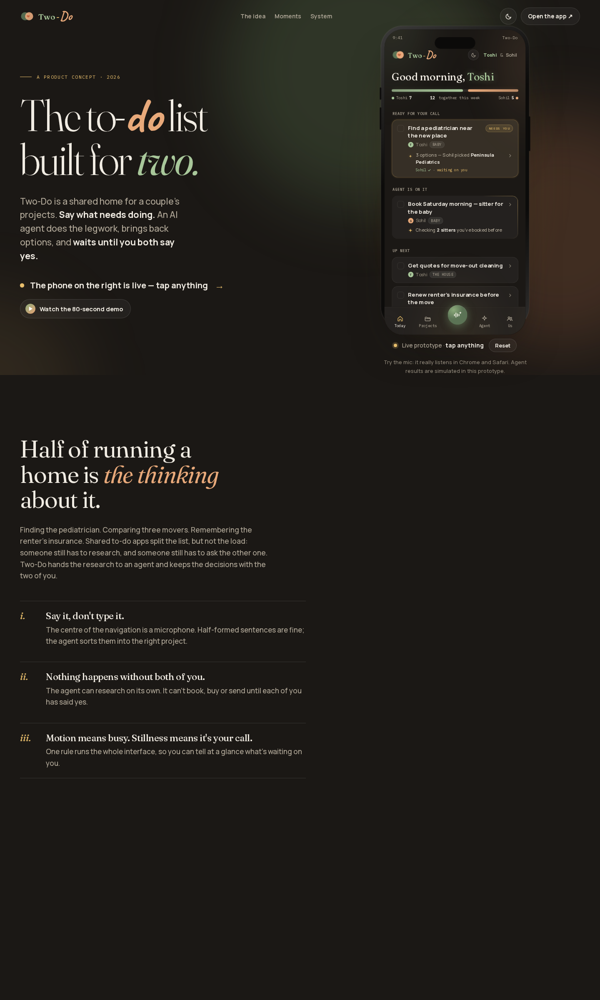
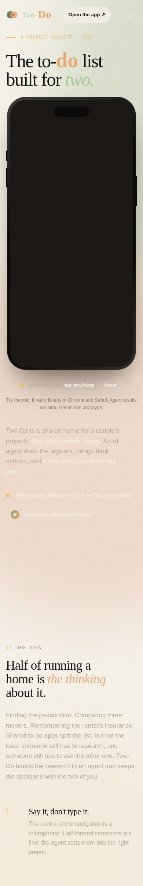

# UI Design System & Master Generation Blueprint: twodo-design

> **Two-Do** (https://twodo.design) — Two-Do case study: a voice-first, shared to-do app for couples, where an AI agent does the legwork and nothing happens until you both agree.



---

## 1. Executive Visual Persona & Design Archetype

- **Brand Essence & Persona**: **Two-Do** (`https://twodo.design`). Two-Do case study: a voice-first, shared to-do app for couples, where an AI agent does the legwork and nothing happens until you both agree.
- **Visual Archetype**: **Light-Substrate Editorial & Modular Grid System (`#f6f2e9` canvas, `#211d18` ink, `#57524a` accent)**.
- **Anti-AI-Slop Differentiators**:
  - **Source-Grounded Chromatic Polarity**: Anchors the viewport in `#f6f2e9` (`var(--bg)` in `:root`) paired with `#211d18` primary typography and `#57524a` accents.
  - **Extracted Typographic Hierarchy**: Pairs `Caveat` for display copy (`The to- do list built for two.`) with `Fraunces` and `IBM Plex Mono`.
  - **Calibrated Spatial Grid & Motion**: Combines `359px` container bounds (`gap: 10px`, padding `10px`) with `cubic-bezier(.2,.7,.2,1)` easing and Three.js / WebGL Canvas Pipeline.

---

## 2. Spatial Architecture & Modular Grid Mathematics



### Viewport Allocation & Container Geometry
- **Captured Viewport Dimensions**: Desktop `1440×10990px` (`assets/desktop.png`, full-page scroll capture), Mobile `390×2400px` (`assets/mobile.png`, capped at 2400px multi-section capture).
- **Master Container Bounds**: `359px` extracted from `twodo-design` stylesheet.
- **Canvas Lateral Padding & Spacing**: `10px` lateral canvas padding with `10px` grid gap.
- **Border Radius Scale**: `10px`, `6px`, `50%`, `999px`.

### Responsive Breakpoint Architecture
- **Desktop Layout**: Multi-column CSS Grid / Flexbox layout at `1440px` (`max-width: 359px`, `gap: 10px`).
- **Mobile Layout**: Single-column vertical stack at `390px` viewport width with `10px` horizontal padding.
- **Extracted CSS Media Queries**: `@media (prefers-reduced-motion: reduce)`, `@media (max-width: 359px)`, `@media (max-width: 900px)`, `@media (min-width: 721px)`.

---

## 3. Color System, Materiality & Atmospheric Lighting

### Semantic Palette & Source Grounding
| Semantic Role | Ground-Truth Value | Extracted CSS Source / Selector |
|---|---|---|
| **Primary Canvas Substrate** | `#f6f2e9` | `var(--bg)` in `:root` |
| **Primary Typography Ink** | `#efe9dc` | `var(--bg-deep)` in `:root` |
| **Elevated Surface / Card Substrate** | `#211d18` | `var(--ink)` in `:root` |
| **Interactive Accent / Highlight** | `#57524a` | `var(--ink-soft)` in `:root` |
| **Secondary / Muted Copy** | `#6e685a` | `var(--ink-faint)` in `:root` |
| **Structural Hairline Border** | `#5c6e4e` | `var(--sage)` in `:root` |
| **Variable Token (`--peach`)** | `#c97a4a` | `var(--peach)` in `:root` |
| **Variable Token (`--glow`)** | `#b8842a` | `var(--glow)` in `:root` |
| **Variable Token (`--sage-text`)** | `#4e6042` | `var(--sage-text)` in `:root` |
| **Variable Token (`--peach-text`)** | `#98552c` | `var(--peach-text)` in `:root` |
| **Variable Token (`--glow-text`)** | `#7f590f` | `var(--glow-text)` in `:root` |
| **Variable Token (`--heart`)** | `#c1633c` | `var(--heart)` in `:root` |

### Sanitized Root CSS Variables (`ui-ux.md` Ground Truth)
| Variable Name | Extracted Value | Semantic Role |
|---|---|---|
| `--bg` | `#f6f2e9` | Canvas / Surface Token |
| `--bg-deep` | `#efe9dc` | Canvas / Surface Token |
| `--surface` | `rgba(33, 29, 24, 0.04)` | Canvas / Surface Token |
| `--border` | `rgba(33, 29, 24, 0.12)` | Elevation / Border Token |
| `--border-soft` | `rgba(33, 29, 24, 0.07)` | Elevation / Border Token |
| `--ink` | `#211d18` | Typography Ink Token |
| `--ink-soft` | `#57524a` | Typography Ink Token |
| `--ink-faint` | `#6e685a` | Typography Ink Token |
| `--sage` | `#5c6e4e` | Color / Atmospheric Token |
| `--peach` | `#c97a4a` | Color / Atmospheric Token |
| `--glow` | `#b8842a` | Color / Atmospheric Token |
| `--sage-text` | `#4e6042` | Typography Ink Token |
| `--peach-text` | `#98552c` | Typography Ink Token |
| `--glow-text` | `#7f590f` | Typography Ink Token |
| `--heart` | `#c1633c` | Color / Atmospheric Token |
| `--orb-a` | `rgba(140, 171, 123, 0.34)` | Color / Atmospheric Token |

---

## 4. Typographic Scale & Editorial Hierarchy

### Font Family Stacks
- **Display Typography**: `Caveat`.
- **Primary Body Stack**: `Fraunces`.
- **Technical / Metadata Stack**: `IBM Plex Mono`.

### Typographic Scale & Rules (Extracted from Stylesheet & Variables)
- **Hero Display (`H1`)**: rule `h1` (`font-size: clamp(3.2rem, 7.4vw, 6.6rem)`, `line-height: 0.95`, `letter-spacing: -0.035em`, `font-weight: 300`).
- **Section Heading (`H2`)**: rule `h2` (`font-size: clamp(2.2rem, 4vw, 3.6rem)`).
- **Body Copy**: rule `body` (`font-size: 17px`, `line-height: 1.6`).
- **Metadata & Navigation Labels**: rule `.mono` (`font-size: 0.72rem`, `letter-spacing: 0.12em`).

---

## 5. Choreographed Motion & Interaction Physics

### Primary Easing Curves
- **Extracted Timing Functions**: `cubic-bezier(.2,.7,.2,1)`, `cubic-bezier(.3,.7,.3,1.4)`, `cubic-bezier(.3,.6,.3,1)`.

### Per-Element Transition & Choreography Rules
- **Selector `body`**: `transition: background 0.35s ease, color 0.35s ease` extracted from `twodo-design` stylesheet.
- **Selector `.bar`**: `transition: background 0.3s, border-color 0.3s` extracted from `twodo-design` stylesheet.
- **Selector `.bar-link`**: `transition: background 0.2s` extracted from `twodo-design` stylesheet.
- **Extracted Easing Curve (`cubic-bezier(.2,.7,.2,1)`)**: Governs interactive state transitions across `<header.bar>` and `<section.idea>`.
- **Runtime Interaction Engine**: Integrates Three.js / WebGL Canvas Pipeline with `prefers-reduced-motion: reduce` fallback guards.

---

## 6. Component Wireframe & Structural DOM Map

### Visual Layout Schematic (Grounded in `dom.html` — `1440px` Desktop & `390px` Mobile Reflow)
```
┌────────────────────────────────────────────────────────────────────────┐
│ DESKTOP VIEWPORT (1440px) — Two-Do                                     │
│ ====================================================================== │
│ [ <header.bar>             | The idea · Moments · System            ]  │
│ ---------------------------------------------------------------------- │
│ | HERO STAGE: <section.hero>                                       |   │
│ | H1: The to- do list built for two.                               |   │
│ | Substrate: #f6f2e9    | Ink: #211d18    | Accent: #57524a        |   │
│ ---------------------------------------------------------------------- │
│ | SHOWCASE GRID (<section.idea>            ) max-w: 359px          |   │
│ | +------------------------------+  +------------------------------+ | │
│ | | Half of running a home is th |  | Say it, don't type it.       | | │
│ | +------------------------------+  +------------------------------+ | │
│ ---------------------------------------------------------------------- │
│ | MOBILE VIEWPORT REFLOW (390px) — Single-Column Stack (gap: 10px  ) | │
│ | [<header.bar>] -> [<section.hero>] -> [<section.idea>] |             │
│ ---------------------------------------------------------------------- │
│ [ FOOTER (<footer.credits>      ) | https://twodo.design               │
└────────────────────────────────────────────────────────────────────────┘
```

### Granular DOM Region Breakdown
1. **Brand Header & Navigation Bar (<header.bar> — `twodo-design`)**:
   - Landmark `<header class="bar">` hosting `Two-Do` navigation (`The idea · Moments · System`), DOM attributes (`data-theme="dark"`, `data-action="capture"`, `data-arg="checkup"`, `data-title="Say it out loud"`), and stylesheet rule `html { scroll-behavior: smooth; overflow-x: clip; }`.
2. **Hero Stage & Focal Lead (<section.hero> — `The to- do list built for two.`)**:
   - Landmark `<section class="hero">` presenting display lead `The to- do list built for two.` and copy excerpt *"Open the app Open app ↗"* over `#f6f2e9` canvas and `#211d18` ink.
3. **Primary Showcase & Content Grid (<section.idea> — `Half of running a home is the thin`)**:
   - Landmark `<section class="idea">` rendering section `Half of running a home is the thinking about it.` with copy *"A product concept · 2026"*, asset references (`favicon.svg`, `apple-touch-icon.png`, `fonts.googleapis.com`, `fonts.gstatic.com`), and grid rule `h3 { font-family: "Fraunces", Georgia, serif; font-weight: 380; letter-spacin... }`.
4. **Interactive Detail & Feature Matrix (<section.grain> — `Say it, don't type it.`)**:
   - Landmark `<section class="grain">` framing `Say it, don't type it.` and `Nothing happens without both of you.` (*"Two-Do is a shared home for a couple's projects. Say what needs d"*) with `#211d18` surface cards, `#57524a` accents, and `button { font-family: inherit; }`.
5. **Colophon & Global Directory Footer (<footer.credits> — `https://twodo.design`)**:
   - Landmark `<footer class="credits">` anchoring `Two-Do` footer links (`The idea · Moments · System`), copy *"The phone on the right is live — tap anything"*, and `#5c6e4e` structural dividers.

---

## 7. Master Zero-Shot AI Generation Prompt

```markdown
# Master Zero-Shot Frontend Generation Prompt: twodo-design (Two-Do)

You are a principal frontend architect and design systems engineer. Build a complete, production-ready web application replicating the exact design system, DOM landmarks, typographic hierarchy, color tokens, and motion physics of `twodo-design` (**Two-Do** — `https://twodo.design`).

### 1. Visual Archetype & Anti-AI-Slop Mandates
- **Archetype**: Light-Substrate Editorial & Modular Grid System (`#f6f2e9` canvas, `#211d18` ink, `#57524a` accent).
- **Identity & Domain Context**: Two-Do case study: a voice-first, shared to-do app for couples, where an AI agent does the legwork and nothing happens until you both agree.
- **Primary Substrate**: `#f6f2e9` (`var(--bg)` in `:root`), **Primary Ink**: `#211d18`, **Accent / Highlight**: `#57524a`.
- **Site-Specific Differentiators**:
  - **Source-Grounded Chromatic Polarity**: Anchors the viewport in `#f6f2e9` (`var(--bg)` in `:root`) paired with `#211d18` primary typography and `#57524a` accents.
  - **Extracted Typographic Hierarchy**: Pairs `Caveat` for display copy (`The to- do list built for two.`) with `Fraunces` and `IBM Plex Mono`.
  - **Calibrated Spatial Grid & Motion**: Combines `359px` container bounds (`gap: 10px`, padding `10px`) with `cubic-bezier(.2,.7,.2,1)` easing and Three.js / WebGL Canvas Pipeline.

### 2. Ground-Truth CSS Variables (`:root` Token Contract)
Declare and consume these exact custom properties extracted from `twodo-design` in your global stylesheet:

:root {
  /* Two-Do (twodo-design) — Ground-Truth Extracted CSS Variables */
  --bg: #f6f2e9; /* Canvas / Surface Token (twodo-design) */
  --bg-deep: #efe9dc; /* Canvas / Surface Token (twodo-design) */
  --surface: rgba(33, 29, 24, 0.04); /* Canvas / Surface Token (twodo-design) */
  --border: rgba(33, 29, 24, 0.12); /* Elevation / Border Token (twodo-design) */
  --border-soft: rgba(33, 29, 24, 0.07); /* Elevation / Border Token (twodo-design) */
  --ink: #211d18; /* Typography Ink Token (twodo-design) */
  --ink-soft: #57524a; /* Typography Ink Token (twodo-design) */
  --ink-faint: #6e685a; /* Typography Ink Token (twodo-design) */
  --sage: #5c6e4e; /* Color / Atmospheric Token (twodo-design) */
  --peach: #c97a4a; /* Color / Atmospheric Token (twodo-design) */
  --glow: #b8842a; /* Color / Atmospheric Token (twodo-design) */
  --sage-text: #4e6042; /* Typography Ink Token (twodo-design) */
  --peach-text: #98552c; /* Typography Ink Token (twodo-design) */
  --glow-text: #7f590f; /* Typography Ink Token (twodo-design) */
  --heart: #c1633c; /* Color / Atmospheric Token (twodo-design) */
  --orb-a: rgba(140, 171, 123, 0.34); /* Color / Atmospheric Token (twodo-design) */
}

### 3. Semantic Color & Materiality Contract
Map every surface, ink, and border strictly to these source-grounded tokens:
- **Primary Canvas Substrate**: `#f6f2e9` — grounded in `var(--bg)` in `:root`
- **Primary Typography Ink**: `#efe9dc` — grounded in `var(--bg-deep)` in `:root`
- **Elevated Surface / Card Substrate**: `#211d18` — grounded in `var(--ink)` in `:root`
- **Interactive Accent / Highlight**: `#57524a` — grounded in `var(--ink-soft)` in `:root`
- **Secondary / Muted Copy**: `#6e685a` — grounded in `var(--ink-faint)` in `:root`
- **Structural Hairline Border**: `#5c6e4e` — grounded in `var(--sage)` in `:root`
- **Variable Token (`--peach`)**: `#c97a4a` — grounded in `var(--peach)` in `:root`
- **Variable Token (`--glow`)**: `#b8842a` — grounded in `var(--glow)` in `:root`
- **Variable Token (`--sage-text`)**: `#4e6042` — grounded in `var(--sage-text)` in `:root`
- **Variable Token (`--peach-text`)**: `#98552c` — grounded in `var(--peach-text)` in `:root`
- **Variable Token (`--glow-text`)**: `#7f590f` — grounded in `var(--glow-text)` in `:root`
- **Variable Token (`--heart`)**: `#c1633c` — grounded in `var(--heart)` in `:root`

### 4. Spatial Grid, Container Bounds & Responsive Breakpoints
- **Desktop Viewport Reference**: `1440×10990px` (full-page scroll capture, `1440px` standard desktop width).
- **Mobile Viewport Reference**: `390×2400px` (capped at 2400px multi-section capture, `390px` standard mobile width).
- **Container Max-Width**: `359px` extracted from `twodo-design` stylesheet
- **Padding & Gutters**: `10px` lateral canvas padding with `10px` grid gap
- **Desktop Grid**: Multi-column CSS Grid / Flexbox layout at `1440px` (`max-width: 359px`, `gap: 10px`)
- **Mobile Adaptation**: Single-column vertical stack at `390px` viewport width with `10px` horizontal padding
- **Media Queries**: `@media (prefers-reduced-motion: reduce)`, `@media (max-width: 359px)`, `@media (max-width: 900px)`, `@media (min-width: 721px)`
- **Corner Radii**: `10px`, `6px`, `50%`, `999px`

### 5. Typography & Editorial Scale Contract
- **Display Font Stack**: `Caveat`
- **Body Font Stack**: `Fraunces`
- **Monospace / Technical Font Stack**: `IBM Plex Mono`
- **H1 Display Rule**: rule `h1` (`font-size: clamp(3.2rem, 7.4vw, 6.6rem)`, `line-height: 0.95`, `letter-spacing: -0.035em`, `font-weight: 300`)
- **H2 Section Rule**: rule `h2` (`font-size: clamp(2.2rem, 4vw, 3.6rem)`)
- **Body Copy Rule**: rule `body` (`font-size: 17px`, `line-height: 1.6`)
- **Metadata & Index Rule**: rule `.mono` (`font-size: 0.72rem`, `letter-spacing: 0.12em`)

### 6. Component Hierarchy, Verbatim Copy & Real DOM Landmarks
Scaffold `twodo-design` (`Two-Do`) with these exact structural regions, extracted copy, and CSS rules from `dom.html`:
1. **Brand Header & Navigation Bar (<header.bar> — `twodo-design`)**:
   - DOM & Selectors: Landmark `<header class="bar">` hosting `Two-Do` navigation (`The idea · Moments · System`), DOM attributes (`data-theme="dark"`, `data-action="capture"`, `data-arg="checkup"`, `data-title="Say it out loud"`), and stylesheet rule `html { scroll-behavior: smooth; overflow-x: clip; }`.
   - Responsive Contract: Header `Brand Header & Navigation Bar (<header.bar> — `twodo-design`)` (`twodo-design`) adapts across `@media (prefers-reduced-motion: reduce)`, `@media (max-width: 359px)`, `@media (max-width: 900px)`, `@media (min-width: 721px)` with `cubic-bezier(.2,.7,.2,1)`, `cubic-bezier(.3,.7,.3,1.4)`, `cubic-bezier(.3,.6,.3,1)` transitions and links `The idea · Moments · System`.
2. **Hero Stage & Focal Lead (<section.hero> — `The to- do list built for two.`)**:
   - DOM & Selectors: Landmark `<section class="hero">` presenting display lead `The to- do list built for two.` and copy excerpt *"Open the app Open app ↗"* over `#f6f2e9` canvas and `#211d18` ink.
   - Responsive Contract: Hero stage (`1440×10990px` desktop / `390×2400px` mobile) sets `#f6f2e9` background with `#211d18` headline `The to- do list built for two.`.
3. **Primary Showcase & Content Grid (<section.idea> — `Half of running a home is the thin`)**:
   - DOM & Selectors: Landmark `<section class="idea">` rendering section `Half of running a home is the thinking about it.` with copy *"A product concept · 2026"*, asset references (`favicon.svg`, `apple-touch-icon.png`, `fonts.googleapis.com`, `fonts.gstatic.com`), and grid rule `h3 { font-family: "Fraunces", Georgia, serif; font-weight: 380; letter-spacin... }`.
   - Responsive Contract: Showcase grid `Primary Showcase & Content Grid (<section.idea> — `Half of running a home is the thin`)` applies Multi-column CSS Grid / Flexbox layout at `1440px` (`max-width: 359px`, `gap: 10px`) on desktop and Single-column vertical stack at `390px` viewport width with `10px` horizontal padding on mobile.
4. **Interactive Detail & Feature Matrix (<section.grain> — `Say it, don't type it.`)**:
   - DOM & Selectors: Landmark `<section class="grain">` framing `Say it, don't type it.` and `Nothing happens without both of you.` (*"Two-Do is a shared home for a couple's projects. Say what needs d"*) with `#211d18` surface cards, `#57524a` accents, and `button { font-family: inherit; }`.
   - Responsive Contract: Detail module `Interactive Detail & Feature Matrix (<section.grain> — `Say it, don't type it.`)` uses `10px`, `6px`, `50%`, `999px` radii, `#57524a` highlights, and assets (favicon.svg, apple-touch-icon.png, fonts.googleapis.com).
5. **Colophon & Global Directory Footer (<footer.credits> — `https://twodo.design`)**:
   - DOM & Selectors: Landmark `<footer class="credits">` anchoring `Two-Do` footer links (`The idea · Moments · System`), copy *"The phone on the right is live — tap anything"*, and `#5c6e4e` structural dividers.
   - Responsive Contract: Footer `Colophon & Global Directory Footer (<footer.credits> — `https://twodo.design`)` aligns to `359px` extracted from `twodo-design` stylesheet with `10px` lateral canvas padding with `10px` grid gap and attributes (data-theme="dark", data-action="capture", data-arg="checkup").

#### Verbatim DOM Copy Excerpts (`dom.html`)
- Copy Excerpt 1: *"Open the app Open app ↗"*
- Copy Excerpt 2: *"A product concept · 2026"*
- Copy Excerpt 3: *"Two-Do is a shared home for a couple's projects. Say what needs doing. An AI agent..."*
- Copy Excerpt 4: *"The phone on the right is live — tap anything"*

### 7. Motion, Extracted Stylesheet Rules & Interaction Choreography
- **Primary Easing Functions**: `cubic-bezier(.2,.7,.2,1)`, `cubic-bezier(.3,.7,.3,1.4)`, `cubic-bezier(.3,.6,.3,1)`
- **Extracted Stylesheet Rules (`twodo-design`)**:
- `html { scroll-behavior: smooth; overflow-x: clip; }`
- `h3 { font-family: "Fraunces", Georgia, serif; font-weight: 380; letter-spacin... }`
- `button { font-family: inherit; }`
- `.skip:focus { top: 16px; }`
- `focus-visible { outline: 2px solid var(--glow); outline-offset: 3px; border-radius: 6px; }`
- **Per-Selector Transition Rules**:
- **Selector `body`**: `transition: background 0.35s ease, color 0.35s ease` extracted from `twodo-design` stylesheet.
- **Selector `.bar`**: `transition: background 0.3s, border-color 0.3s` extracted from `twodo-design` stylesheet.
- **Selector `.bar-link`**: `transition: background 0.2s` extracted from `twodo-design` stylesheet.
- **Extracted Easing Curve (`cubic-bezier(.2,.7,.2,1)`)**: Governs interactive state transitions across `<header.bar>` and `<section.idea>`.
- **Runtime Interaction Engine**: Integrates Three.js / WebGL Canvas Pipeline with `prefers-reduced-motion: reduce` fallback guards.

### 8. Technical Deliverables
- Implement in Next.js (App Router) with TypeScript and Tailwind CSS consuming the `:root` custom properties defined above for `twodo-design`.
- Reproduce both the `1440px` desktop architecture and `390px` mobile breakpoint transitions, preserving semantic HTML5 landmarks (`<header>`, `<nav>`, `<main>`, `<section>`, `<footer>`) and `prefers-reduced-motion` accessibility guards.
```
