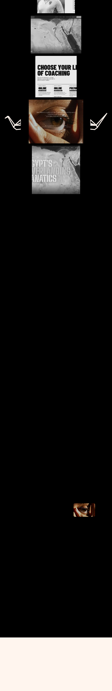

# UI Design System & Master Generation Blueprint: twohalves-co

> **Two Halves — design & development studio, Cairo** (https://twohalves.co/) — We design and build websites people remember — motion, 3D and stories — for brands in Egypt and everywhere.


---

## 1. Executive Visual Persona & Design Archetype

- **Brand Essence & Persona**: **Two Halves — design & development studio, Cairo** (`https://twohalves.co/`). We design and build websites people remember — motion, 3D and stories — for brands in Egypt and everywhere.
- **Capture Provenance**: Live browser capture (`tier1_fast`, HTTP `200`, captured `2026-11-23`).
- **Visual Archetype**: **Dark-Substrate WebGL / Canvas Interactive Experience (`#000000` / `#161616`)**.
- **Anti-AI-Slop Differentiators**:
  - **Live-Computed Chromatic Polarity**: Anchors the viewport in `#000000` (live computed `meta-theme-color` `background-color` (`computed_styles.json`)) paired with `#ffffff` primary typography and `#161616` accents.
  - **Grounded Typographic Hierarchy**: Pairs `Cutive Mono` for display copy (`You build it Physically, Two Halves `) with `Cutive Mono Fallback` and `Cutive Mono`.
  - **Calibrated Spatial Grid & Motion**: Combines `1440px` container bounds (`gap: 12px`, padding `var(--pad)`) with `cubic-bezier(.22,1,.36,1)` easing and Lenis Smooth Scroll (`data-lenis`), Three.js / WebGL Canvas Pipeline.

---

## 2. Spatial Architecture & Modular Grid Mathematics



### Viewport Allocation & Container Geometry
- **Captured Viewport Dimensions**: Desktop `1440×900px` (`assets/desktop.png`, single-viewport 100vh live capture (900px)), Mobile `390×2400px` (`assets/mobile.png`, clamped at 2400px live multi-section capture).
- **Master Container Bounds**: `1440px` (full-bleed `100%` viewport stage).
- **Canvas Lateral Padding & Spacing**: `var(--pad)` lateral canvas padding with `12px` grid gap.
- **Border Radius Scale**: `4px`, `999px`, `50%`, `24px`.

### Responsive Breakpoint Architecture
- **Desktop Layout**: Multi-column CSS Grid / Flexbox layout at `1440px` (`max-width: 1440px`, `gap: 12px`).
- **Mobile Layout**: Single-column vertical stack at `390px` viewport width with `var(--pad)` horizontal padding.
- **Extracted CSS Media Queries**: `@media (max-width:760px)`, `@media (max-width:860px)`, `@media (max-width:1100px)`, `@media (max-width:640px)`.

---

## 3. Color System, Materiality & Atmospheric Lighting

### Semantic Palette & Source Grounding
| Semantic Role | Ground-Truth Value | Extracted Live / CSS Source |
|---|---|---|
| **Primary Canvas Substrate** | `#000000` | live computed `meta-theme-color` `background-color` (`computed_styles.json`) |
| **Primary Typography Ink** | `#ffffff` | `.cs-tag { color: #ffffff }` |
| **Elevated Surface / Card Substrate** | `#1c1b1a` | `.wk-link { background: #1c1b1a }` |
| **Interactive Accent / Highlight** | `#161616` | `var(--ink-3)` in `:root` |
| **Secondary / Muted Copy** | `#161616` | `var(--ink-3)` in `:root` |
| **Structural Hairline Border** | `#292726` | `var(--line)` in `:root` (`fff5ee29`) |
| **Variable Token (`--paper`)** | `#fff5ee` | `var(--paper)` in `:root` |
| **Variable Token (`--paper-2`)** | `#f2e9e2` | `var(--paper-2)` in `:root` |
| **Variable Token (`--mute`)** | `#9a9a9a` | `var(--mute)` in `:root` |
| **Variable Token (`--mute-2`)** | `#6e6e6e` | `var(--mute-2)` in `:root` |
| **Variable Token (`--crease`)** | `#8c8c8c` | `var(--crease)` in `:root` |

### Sanitized Root CSS Variables (`ui-ux.md` Ground Truth)
| Variable Name | Extracted Value | Semantic Role |
|---|---|---|
| `--font-display-src` | `"Cutive Mono", "Cutive Mono Fallback"` | Typography / Scale Token |
| `--font-body-src` | `"aileron", "aileron Fallback"` | Typography / Scale Token |
| `--font-header-src` | `"voice", "voice Fallback"` | Typography / Scale Token |
| `--ink` | `#000` | Typography Ink Token |
| `--ink-2` | `#000` | Typography Ink Token |
| `--ink-3` | `#161616` | Typography Ink Token |
| `--paper` | `#fff5ee` | Canvas / Surface Token |
| `--paper-2` | `#f2e9e2` | Canvas / Surface Token |
| `--white` | `#fff5ee` | Canvas / Surface Token |
| `--mute` | `#9a9a9a` | Color / Atmospheric Token |
| `--mute-2` | `#6e6e6e` | Color / Atmospheric Token |
| `--crease` | `#8c8c8c` | Motion / Easing Token |
| `--fill` | `#fff5ee` | Color / Atmospheric Token |
| `--on-fill` | `#000` | Color / Atmospheric Token |
| `--seam` | `#8c8c8c` | Color / Atmospheric Token |
| `--line` | `#fff5ee29` | Color / Atmospheric Token |

---

## 4. Typographic Scale & Editorial Hierarchy

### Font Family Stacks
- **Display Typography**: `Cutive Mono`.
- **Primary Body Stack**: `Cutive Mono Fallback`.
- **Technical / Metadata Stack**: `Cutive Mono`.

### Typographic Scale & Rules (Live Computed & Stylesheet Grounded)
- **Hero Display (`H1`)**: CSS variables `--font-display-src: "Cutive Mono", "Cutive Mono Fallback"`.
- **Section Heading (`H2`)**: observed font-size ladder: `15px`, `13px`, `13.9px`, `.9em`, `12.5px`.
- **Body Copy**: CSS variables `--font-body-src: "aileron", "aileron Fallback"`; rule `p` (`font-size: clamp(20px,1.9vw,30px)`, `line-height: 1.3`).
- **Metadata & Navigation Labels**: rule `small` (`font-size: .55em`, `font-weight: 400`).

---

## 5. Choreographed Motion & Interaction Physics

### Primary Easing Curves
- **Extracted Timing Functions**: `cubic-bezier(.22,1,.36,1)`.

### Per-Element Transition & Choreography Rules
- **Selector `.btn`**: `transition: background-color .35s var(--ease), color .35s var(--ease), tra...` extracted from `twohalves-co` stylesheet.
- **Selector `.btn .arrow`**: `transition: transform .5s var(--ease)` extracted from `twohalves-co` stylesheet.
- **Selector `.rv`**: `transition: opacity .7s var(--ease)` extracted from `twohalves-co` stylesheet.
- **Extracted Easing Curve (`cubic-bezier(.22,1,.36,1)`)**: Governs interactive state transitions across `<header.nav>` and `<section.st>`.
- **Runtime Interaction Engine**: Integrates Lenis Smooth Scroll (`data-lenis`), Three.js / WebGL Canvas Pipeline with `prefers-reduced-motion: reduce` fallback guards.

---

## 6. Component Wireframe & Structural DOM Map

### Visual Layout Schematic — Desktop (`1440px`, Grounded in `dom.html` & Landmark Bounding Boxes)
```
┌────────────────────────────────────────────────────────────────────────┐
│ DESKTOP VIEWPORT (1440px) — Two Halves — design & development studio,  │
│ ====================================================================== │
│ [ <header.nav> (1440px)               | Work · Services · Studio · C ] │
│ ---------------------------------------------------------------------- │
│ | HERO STAGE: <section.hero> (w=1440px)                              | │
│ | H1: You build it Physically, Two Halves — websites de...           | │
│ | Substrate: #000000 | Ink: #ffffff | Accent: #161616                | │
│ ---------------------------------------------------------------------- │
│ | SHOWCASE GRID (<section.st>) max-w: 1440px                         | │
│ | +------------------------------+  +------------------------------+ | │
│ | | Work that moves.             |  | What we make.                | | │
│ | +------------------------------+  +------------------------------+ | │
│ ---------------------------------------------------------------------- │
│ | DETAIL MODULE (<section.wk>) — Websites that move                  | │
│ ---------------------------------------------------------------------- │
│ [ FOOTER (<footer.foot>       ) | https://twohalves.co/                │
└────────────────────────────────────────────────────────────────────────┘
```

### Visual Layout Schematic — Mobile Reflow (`390px`)
```
┌────────────────────────────────────────────────────────────────────────┐
│ MOBILE VIEWPORT REFLOW (390px) — Single-Column Stack (gap: 12px)       │
│ ====================================================================== │
│ [ HEADER BAR (<header.nav>            ) | Compact Menu (390px)         │
│ ---------------------------------------------------------------------- │
│ | HERO STAGE (<section.hero>) — 390px Vertical Lead                  | │
│ | H1: You build it Physically, Two Halves — websites de...           | │
│ ---------------------------------------------------------------------- │
│ | SHOWCASE STACK (<section.st>) — 1-Col Stack                        | │
│ | [ Item 1: Work that moves.                                       ] | │
│ | [ Item 2: What we make.                                          ] | │
│ ---------------------------------------------------------------------- │
│ | DETAIL STACK (<section.wk>) — 1-Col (Websites that move)           | │
│ ---------------------------------------------------------------------- │
│ [ FOOTER (<footer.foot>       ) | Stacked 390px Colophon               │
└────────────────────────────────────────────────────────────────────────┘
```

### Granular DOM Region Breakdown
1. **Brand Header & Navigation Bar (<header.nav> — `twohalves-co`)**:
   - Landmark `<header class="nav">` (`1440px`) hosting `Two Halves — design & development st` navigation (`Work · Services · Studio · Contact`), DOM attributes (`data-precedence="next"`, `data-tone="split"`, `data-hide="0"`, `data-side="a"`), and stylesheet rule `.oFPQLq_className { font-family:Cutive Mono,Cutive Mono Fallback;font-style:normal;font-weig... }`.
2. **Hero Stage & Focal Lead (<section.hero> — `You build it Physically, Two Halve`)**:
   - Landmark `<section class="hero">` presenting display lead `You build it Physically, Two Halves — websites de...` and copy excerpt *"Click a cube to open it, or hold it to turn it Scroll for the wor"* over `#000000` canvas and `#ffffff` ink.
3. **Primary Showcase & Content Grid (<section.st> — `Work that moves.`)**:
   - Landmark `<section class="st">` rendering section `Work that moves.` with copy *"Click a cube to open it, or hold it to turn it"*, asset references (`512857af647c3544-s.p.25m0iq9x76hr...`, `aileron_latin_400_normal-s.p.1kb3...`, `aileron_latin_700_normal-s.p.1x-w...`, `2tzoz6ksak9sc.css`), and grid rule `.oFPQLq_variable { --font-display-src:"Cutive Mono", "Cutive Mono Fallback" }`.
4. **Interactive Detail & Feature Matrix (<section.wk> — `What we make.`)**:
   - Landmark `<section class="wk">` framing `What we make.` and `Websites that move` (*"Scroll for the work ↓"*) with `#1c1b1a` surface cards, `#161616` accents, and `.n4YeuW_className { font-family:aileron,aileron Fallback }`.
5. **Colophon & Global Directory Footer (<footer.foot> — `https://twohalves.co/`)**:
   - Landmark `<footer class="foot">` anchoring `Two Halves — design & developmen` footer links (`Work · Services · Studio · Contact`), copy *"You build it Physically, Two Halves — websites designed & bu"*, and `#292726` structural dividers.

---

## 7. Master Zero-Shot AI Generation Prompt

```markdown
# Master Zero-Shot Frontend Generation Prompt: twohalves-co (Two Halves — design & development studio, Cairo)

You are a principal frontend architect and design systems engineer. Build a complete, production-ready web application replicating the exact design system, DOM landmarks, typographic hierarchy, color tokens, and motion physics of `twohalves-co` (**Two Halves — design & development studio, Cairo** — `https://twohalves.co/`).

### 1. Visual Archetype & Anti-AI-Slop Mandates
- **Archetype**: Dark-Substrate WebGL / Canvas Interactive Experience (`#000000` / `#161616`).
- **Identity & Domain Context**: We design and build websites people remember — motion, 3D and stories — for brands in Egypt and everywhere.
- **Primary Substrate**: `#000000` (live computed `meta-theme-color` `background-color` (`computed_styles.json`)), **Primary Ink**: `#ffffff`, **Accent / Highlight**: `#161616`.
- **Site-Specific Differentiators**:
  - **Live-Computed Chromatic Polarity**: Anchors the viewport in `#000000` (live computed `meta-theme-color` `background-color` (`computed_styles.json`)) paired with `#ffffff` primary typography and `#161616` accents.
  - **Grounded Typographic Hierarchy**: Pairs `Cutive Mono` for display copy (`You build it Physically, Two Halves `) with `Cutive Mono Fallback` and `Cutive Mono`.
  - **Calibrated Spatial Grid & Motion**: Combines `1440px` container bounds (`gap: 12px`, padding `var(--pad)`) with `cubic-bezier(.22,1,.36,1)` easing and Lenis Smooth Scroll (`data-lenis`), Three.js / WebGL Canvas Pipeline.

### 2. Ground-Truth CSS Variables (`:root` Token Contract)
Declare and consume these exact custom properties extracted from `twohalves-co` in your global stylesheet:

:root {
  /* Two Halves — design & development studio, Cairo (twohalves-co) — Live-Grounded CSS Variables */
  --font-display-src: "Cutive Mono", "Cutive Mono Fallback"; /* Typography / Scale Token (twohalves-co) */
  --font-body-src: "aileron", "aileron Fallback"; /* Typography / Scale Token (twohalves-co) */
  --font-header-src: "voice", "voice Fallback"; /* Typography / Scale Token (twohalves-co) */
  --ink: #000; /* Typography Ink Token (twohalves-co) */
  --ink-2: #000; /* Typography Ink Token (twohalves-co) */
  --ink-3: #161616; /* Typography Ink Token (twohalves-co) */
  --paper: #fff5ee; /* Canvas / Surface Token (twohalves-co) */
  --paper-2: #f2e9e2; /* Canvas / Surface Token (twohalves-co) */
  --white: #fff5ee; /* Canvas / Surface Token (twohalves-co) */
  --mute: #9a9a9a; /* Color / Atmospheric Token (twohalves-co) */
  --mute-2: #6e6e6e; /* Color / Atmospheric Token (twohalves-co) */
  --crease: #8c8c8c; /* Motion / Easing Token (twohalves-co) */
  --fill: #fff5ee; /* Color / Atmospheric Token (twohalves-co) */
  --on-fill: #000; /* Color / Atmospheric Token (twohalves-co) */
  --seam: #8c8c8c; /* Color / Atmospheric Token (twohalves-co) */
  --line: #fff5ee29; /* Color / Atmospheric Token (twohalves-co) */
}

### 3. Semantic Color & Materiality Contract
Map every surface, ink, and border strictly to these source-grounded tokens:
- **Primary Canvas Substrate**: `#000000` — grounded in live computed `meta-theme-color` `background-color` (`computed_styles.json`)
- **Primary Typography Ink**: `#ffffff` — grounded in `.cs-tag { color: #ffffff }`
- **Elevated Surface / Card Substrate**: `#1c1b1a` — grounded in `.wk-link { background: #1c1b1a }`
- **Interactive Accent / Highlight**: `#161616` — grounded in `var(--ink-3)` in `:root`
- **Secondary / Muted Copy**: `#161616` — grounded in `var(--ink-3)` in `:root`
- **Structural Hairline Border**: `#292726` — grounded in `var(--line)` in `:root` (`fff5ee29`)
- **Variable Token (`--paper`)**: `#fff5ee` — grounded in `var(--paper)` in `:root`
- **Variable Token (`--paper-2`)**: `#f2e9e2` — grounded in `var(--paper-2)` in `:root`
- **Variable Token (`--mute`)**: `#9a9a9a` — grounded in `var(--mute)` in `:root`
- **Variable Token (`--mute-2`)**: `#6e6e6e` — grounded in `var(--mute-2)` in `:root`
- **Variable Token (`--crease`)**: `#8c8c8c` — grounded in `var(--crease)` in `:root`

### 4. Spatial Grid, Container Bounds & Responsive Breakpoints
- **Desktop Viewport Reference**: `1440×900px` (single-viewport 100vh live capture (900px), `1440px` standard desktop width).
- **Mobile Viewport Reference**: `390×2400px` (clamped at 2400px live multi-section capture, `390px` standard mobile width).
- **Container Max-Width**: `1440px` (full-bleed `100%` viewport stage)
- **Padding & Gutters**: `var(--pad)` lateral canvas padding with `12px` grid gap
- **Desktop Grid**: Multi-column CSS Grid / Flexbox layout at `1440px` (`max-width: 1440px`, `gap: 12px`)
- **Mobile Adaptation**: Single-column vertical stack at `390px` viewport width with `var(--pad)` horizontal padding
- **Media Queries**: `@media (max-width:760px)`, `@media (max-width:860px)`, `@media (max-width:1100px)`, `@media (max-width:640px)`
- **Corner Radii**: `4px`, `999px`, `50%`, `24px`

### 5. Typography & Editorial Scale Contract
- **Display Font Stack**: `Cutive Mono`
- **Body Font Stack**: `Cutive Mono Fallback`
- **Monospace / Technical Font Stack**: `Cutive Mono`
- **H1 Display Rule**: CSS variables `--font-display-src: "Cutive Mono", "Cutive Mono Fallback"`
- **H2 Section Rule**: observed font-size ladder: `15px`, `13px`, `13.9px`, `.9em`, `12.5px`
- **Body Copy Rule**: CSS variables `--font-body-src: "aileron", "aileron Fallback"`; rule `p` (`font-size: clamp(20px,1.9vw,30px)`, `line-height: 1.3`)
- **Metadata & Index Rule**: rule `small` (`font-size: .55em`, `font-weight: 400`)

### 6. Component Hierarchy, Verbatim Copy & Real DOM Landmarks
Scaffold `twohalves-co` (`Two Halves — design & development studio, Cairo`) with these exact structural regions, extracted copy, and CSS rules from `dom.html`:
1. **Brand Header & Navigation Bar (<header.nav> — `twohalves-co`)**:
   - DOM & Selectors: Landmark `<header class="nav">` (`1440px`) hosting `Two Halves — design & development st` navigation (`Work · Services · Studio · Contact`), DOM attributes (`data-precedence="next"`, `data-tone="split"`, `data-hide="0"`, `data-side="a"`), and stylesheet rule `.oFPQLq_className { font-family:Cutive Mono,Cutive Mono Fallback;font-style:normal;font-weig... }`.
   - Responsive Contract: Header `Brand Header & Navigation Bar (<header.nav> — `twohalves-co`)` (`twohalves-co`) adapts across `@media (max-width:760px)`, `@media (max-width:860px)`, `@media (max-width:1100px)`, `@media (max-width:640px)` with `cubic-bezier(.22,1,.36,1)` transitions and links `Work · Services · Studio · Contact`.
2. **Hero Stage & Focal Lead (<section.hero> — `You build it Physically, Two Halve`)**:
   - DOM & Selectors: Landmark `<section class="hero">` presenting display lead `You build it Physically, Two Halves — websites de...` and copy excerpt *"Click a cube to open it, or hold it to turn it Scroll for the wor"* over `#000000` canvas and `#ffffff` ink.
   - Responsive Contract: Hero stage (`1440×900px` desktop / `390×2400px` mobile) sets `#000000` background with `#ffffff` headline `You build it Physically, Two Halves — websites de...`.
3. **Primary Showcase & Content Grid (<section.st> — `Work that moves.`)**:
   - DOM & Selectors: Landmark `<section class="st">` rendering section `Work that moves.` with copy *"Click a cube to open it, or hold it to turn it"*, asset references (`512857af647c3544-s.p.25m0iq9x76hr...`, `aileron_latin_400_normal-s.p.1kb3...`, `aileron_latin_700_normal-s.p.1x-w...`, `2tzoz6ksak9sc.css`), and grid rule `.oFPQLq_variable { --font-display-src:"Cutive Mono", "Cutive Mono Fallback" }`.
   - Responsive Contract: Showcase grid `Primary Showcase & Content Grid (<section.st> — `Work that moves.`)` applies Multi-column CSS Grid / Flexbox layout at `1440px` (`max-width: 1440px`, `gap: 12px`) on desktop and Single-column vertical stack at `390px` viewport width with `var(--pad)` horizontal padding on mobile.
4. **Interactive Detail & Feature Matrix (<section.wk> — `What we make.`)**:
   - DOM & Selectors: Landmark `<section class="wk">` framing `What we make.` and `Websites that move` (*"Scroll for the work ↓"*) with `#1c1b1a` surface cards, `#161616` accents, and `.n4YeuW_className { font-family:aileron,aileron Fallback }`.
   - Responsive Contract: Detail module `Interactive Detail & Feature Matrix (<section.wk> — `What we make.`)` uses `4px`, `999px`, `50%`, `24px` radii, `#161616` highlights, and assets (512857af647c3544-s.p.25m0iq9x76hr..., aileron_latin_400_normal-s.p.1kb3..., aileron_latin_700_normal-s.p.1x-w...).
5. **Colophon & Global Directory Footer (<footer.foot> — `https://twohalves.co/`)**:
   - DOM & Selectors: Landmark `<footer class="foot">` anchoring `Two Halves — design & developmen` footer links (`Work · Services · Studio · Contact`), copy *"You build it Physically, Two Halves — websites designed & bu"*, and `#292726` structural dividers.
   - Responsive Contract: Footer `Colophon & Global Directory Footer (<footer.foot> — `https://twohalves.co/`)` aligns to `1440px` (full-bleed `100%` viewport stage) with `var(--pad)` lateral canvas padding with `12px` grid gap and attributes (data-precedence="next", data-tone="split", data-hide="0").

#### Verbatim DOM Copy Excerpts (`dom.html`)
- Copy Excerpt 1: *"Click a cube to open it, or hold it to turn it Scroll for the work ↓"*
- Copy Excerpt 2: *"Click a cube to open it, or hold it to turn it"*
- Copy Excerpt 3: *"Scroll for the work ↓"*
- Copy Excerpt 4: *"You build it Physically, Two Halves — websites designed & built for your brand"*

### 7. Motion, Extracted Stylesheet Rules & Interaction Choreography
- **Primary Easing Functions**: `cubic-bezier(.22,1,.36,1)`
- **Extracted Stylesheet Rules (`twohalves-co`)**:
- `.oFPQLq_className { font-family:Cutive Mono,Cutive Mono Fallback;font-style:normal;font-weig... }`
- `.oFPQLq_variable { --font-display-src:"Cutive Mono", "Cutive Mono Fallback" }`
- `.n4YeuW_className { font-family:aileron,aileron Fallback }`
- `.n4YeuW_variable { --font-body-src:"aileron", "aileron Fallback" }`
- `.CamKtW_className { font-family:voice,voice Fallback }`
- **Per-Selector Transition Rules**:
- **Selector `.btn`**: `transition: background-color .35s var(--ease), color .35s var(--ease), tra...` extracted from `twohalves-co` stylesheet.
- **Selector `.btn .arrow`**: `transition: transform .5s var(--ease)` extracted from `twohalves-co` stylesheet.
- **Selector `.rv`**: `transition: opacity .7s var(--ease)` extracted from `twohalves-co` stylesheet.
- **Extracted Easing Curve (`cubic-bezier(.22,1,.36,1)`)**: Governs interactive state transitions across `<header.nav>` and `<section.st>`.
- **Runtime Interaction Engine**: Integrates Lenis Smooth Scroll (`data-lenis`), Three.js / WebGL Canvas Pipeline with `prefers-reduced-motion: reduce` fallback guards.

### 8. Technical Deliverables
- Implement in Next.js (App Router) with TypeScript and Tailwind CSS consuming the `:root` custom properties defined above for `twohalves-co`.
- Reproduce both the `1440px` desktop architecture and `390px` mobile breakpoint transitions, preserving semantic HTML5 landmarks (`<header>`, `<nav>`, `<main>`, `<section>`, `<footer>`) and `prefers-reduced-motion` accessibility guards.
```
