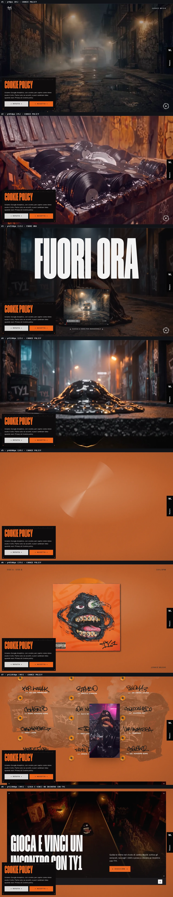
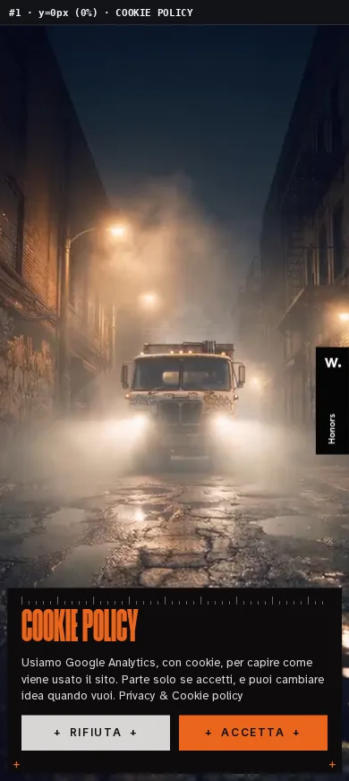

# UI Design System & Master Generation Blueprint: ty1official-com

> **TY1 — DJ & Producer** (https://ty1official.com) — TY1, tra i DJ e producer più influenti della scena Hip Hop italiana. Prossimi live, ultime uscite, riconoscimenti e booking.





---

## 1. Executive Visual Persona & Design Archetype

- **Brand Essence & Persona**: **TY1 — DJ & Producer** (`https://ty1official.com`). TY1, tra i DJ e producer più influenti della scena Hip Hop italiana. Prossimi live, ultime uscite, riconoscimenti e booking.
- **Capture Provenance**: Live browser capture (`tier1_fast`, HTTP `200`, captured `2026-11-24`).
- **Visual Archetype**: **Dark-Substrate WebGL / Canvas Interactive Experience (`#181618` / `#ec651d`)**.
- **Anti-AI-Slop Differentiators**:
  - **Live-Computed Chromatic Polarity**: Anchors the viewport in `#181618` (live computed `html` `background-color` (`computed_styles.json`)) paired with `#f5f5f5` primary typography and `#ec651d` accents.
  - **Grounded Typographic Hierarchy**: Uses `Atkinson Hyperlegible` across display (`TY1 — DJ & Producer, Junkie Musik`) and body copy.
  - **Calibrated Spatial Grid & Motion**: Combines `1440px` container bounds (`gap: 10px`, padding `57.6px`) with `cubic-bezier(.22,1,.36,1)` easing and Lenis Smooth Scroll (`data-lenis`), HTML5 `<canvas>` Interactive Viewport Surface.

---

## 2. Spatial Architecture & Modular Grid Mathematics

### Viewport Allocation & Container Geometry
- **Captured Journey Filmstrips**: Desktop `1280×6624px` (`assets/desktop-journey.webp`, `8` keyframes up to `y=11900px` / doc `25000px`), Mobile `390×872px` (`assets/mobile-journey.webp`, `1` keyframes).
- **Master Container Bounds**: `1440px` (full-bleed `100%` desktop stage measured on `1440px` viewport).
- **Canvas Lateral Padding & Spacing**: `57.6px` lateral canvas padding with `10px` grid gap.
- **Border Radius Scale**: `50%`, `var(--radius)`, `6px`, `2px`.

### Responsive Breakpoint Architecture
- **Desktop Layout**: Multi-column CSS Grid / Flexbox layout at `1440px` (`max-width: 1440px`, `gap: 10px`).
- **Mobile Layout**: Single-column vertical stack at `390px` viewport width with `57.6px` horizontal padding.
- **Extracted CSS Media Queries**: `@media (max-width: 767px)`, `@media (prefers-reduced-motion: reduce)`, `@media (max-width: 640px)`, `@media (hover: none) and (orientation: landscape) and (max-heigh...`.

---

## 3. Color System, Materiality & Atmospheric Lighting

### Semantic Palette & Source Grounding
| Semantic Role | Ground-Truth Value | Extracted Live / CSS Source |
|---|---|---|
| **Primary Canvas Substrate** | `#181618` | live computed `html` `background-color` (`computed_styles.json`) |
| **Primary Typography Ink** | `#f5f5f5` | live computed `h2` `color` (`computed_styles.json`) |
| **Elevated Surface / Card Substrate** | `#0d0b0c` | `.consenso__carta { background: #0d0b0c }` |
| **Interactive Accent / Highlight** | `#ec651d` | `.consenso__testo a:hover { color: #ec651d }` |
| **Secondary / Muted Copy** | `#d7d6d5` | live computed `p` `color` (`computed_styles.json`) |
| **Structural Hairline Border** | `#333132` | `var(--line)` in `:root` (`rgba(215, 214, 213, .14)`) |

### Sanitized Root CSS Variables (`ui-ux.md` Ground Truth)
| Variable Name | Extracted Value | Semantic Role |
|---|---|---|
| `--font-display` | `"Thunder", "Anton", "Arial Narrow", system-ui, sans-serif` | Typography / Scale Token |
| `--font-ui` | `"Inter", system-ui, -apple-system, "Segoe UI", sans-serif` | Typography / Scale Token |
| `--font-decorative` | `"Nebulon", "Oswald", "Arial Narrow", sans-serif` | Typography / Scale Token |
| `--font-body` | `"Atkinson Hyperlegible", system-ui, -apple-system, "Segoe UI", sans-serif` | Typography / Scale Token |
| `--step-hero` | `clamp(4rem, 48vw, 550px)` | Dimension / Scale Token |
| `--step-giant` | `clamp(3.5rem, 17vw, 16rem)` | Dimension / Scale Token |
| `--step-h1` | `clamp(2.4rem, 8vw, 6.5rem)` | Typography / Scale Token |
| `--step-h2` | `clamp(1.9rem, 5vw, 3.75rem)` | Typography / Scale Token |
| `--step-h3` | `clamp(1.75rem, .9rem + 3.6vw, 2.8125rem)` | Typography / Scale Token |
| `--step-h5` | `clamp(1rem, .86rem + .6vw, 1.25rem)` | Dimension / Scale Token |
| `--step-body` | `clamp(1rem, 1.05vw, 1.2rem)` | Dimension / Scale Token |
| `--step-small` | `clamp(.78rem, .95vw, .95rem)` | Dimension / Scale Token |
| `--space-3xs` | `clamp(.25rem, .24rem + .05vw, .3125rem)` | Layout / Spatial Grid Token |
| `--space-2xs` | `clamp(.5rem, .47rem + .15vw, .625rem)` | Layout / Spatial Grid Token |
| `--space-xs` | `clamp(.75rem, .7rem + .24vw, .9375rem)` | Layout / Spatial Grid Token |
| `--space-s` | `clamp(1rem, .93rem + .33vw, 1.25rem)` | Layout / Spatial Grid Token |

---

## 4. Typographic Scale & Editorial Hierarchy

### Font Family Stacks
- **Display Typography**: `Atkinson Hyperlegible`.
- **Primary Body Stack**: `Atkinson Hyperlegible`.
- **Technical / Metadata Stack**: not declared in live computed styles (uses primary stack / `ui-monospace`).

### Typographic Scale & Rules (Live Computed & Stylesheet Grounded)
- **Hero Display (`H1`)**: live computed `h1` (`font-size: 32px`, `line-height: 48px`, `font-weight: 700`); CSS variables `--font-display: "Thunder", "Anton", "Arial Narrow", system-ui, sans-serif`, `--step-h1: clamp(2.4rem, 8vw, 6.5rem)`.
- **Section Heading (`H2`)**: live computed `h2` (`font-size: 480px`, `line-height: 393.6px`, `font-weight: 900`); CSS variables `--step-h2: clamp(1.9rem, 5vw, 3.75rem)`.
- **Body Copy**: live computed `body` (`font-size: 16px`, `line-height: 24px`, `font-weight: 400`); CSS variables `--font-body: "Atkinson Hyperlegible", system-ui, -apple-system, "Segoe UI", sans-serif`, `--step-body: clamp(1rem, 1.05vw, 1.2rem)`.
- **Metadata & Navigation Labels**: live computed `nav/a` (`font-size: 16px`, `line-height: 24px`, `font-weight: 400`); CSS variables `--step-small: clamp(.78rem, .95vw, .95rem)`; rule `small` (`font-size: clamp(0.62rem, 2.2vw, 0.9rem)`, `letter-spacing: 0.5em`, `font-weight: 600`).

---

## 5. Choreographed Motion & Interaction Physics

### Primary Easing Curves
- **Extracted Timing Functions**: `cubic-bezier(.22,1,.36,1)`, `cubic-bezier(.65,0,.35,1)`, `cubic-bezier(.16,1,.3,1)`.

### Per-Element Transition & Choreography Rules
- **Selector `.consenso__tasto:before`**: `transition: clip-path .3s steps(3,jump-start)` extracted from `ty1official-com` stylesheet.
- **Selector `.consenso__tasto:before`**: `transition: none` extracted from `ty1official-com` stylesheet.
- **Selector `.cta`**: `transition: background var(--dur) var(--ease-out),color var(--dur) var(--e...` extracted from `ty1official-com` stylesheet.
- **Extracted Easing Curve (`cubic-bezier(.22,1,.36,1)`)**: Governs interactive state transitions across `<header.testata>` and `<section.trasf>`.
- **Runtime Interaction Engine**: Integrates Lenis Smooth Scroll (`data-lenis`), HTML5 `<canvas>` Interactive Viewport Surface with `prefers-reduced-motion: reduce` fallback guards.
### Measured Runtime Scroll & Interaction Telemetry (`behavioral_journey_v2`)
- **Scroll Driver Mode**: `native` (max document height `25000px`, deepest scrollY reached `11900px` across `8` desktop keyframes).
- **Detected Scroll / Motion Libraries**: `Lenis`, `GSAP/ScrollTrigger`, `WebGL/Canvas`.
- **Interactive Control Probe (`accordion` · `Regolamento`)**: Triggered visual diff `55.743` (attr ` -> `, captured in `assets/state-interactive.webp`).

---

## 6. Component Wireframe & Structural DOM Map

### Visual Layout Schematic — Desktop (`1440px`, Grounded in `dom.html` & Landmark Bounding Boxes)
```
┌────────────────────────────────────────────────────────────────────────┐
│ DESKTOP VIEWPORT (1440px) — TY1 — DJ & Producer                        │
│ ====================================================================== │
│ [ <header.testata> (1440x76px)        | A p p l e M u s i c · D e e  ] │
│ ---------------------------------------------------------------------- │
│ | HERO STAGE: <section.intro> (w=1440px)                             | │
│ | H1: TY1 — DJ & Producer, Junkie Musik                              | │
│ | Substrate: #181618 | Ink: #f5f5f5 | Accent: #ec651d                | │
│ ---------------------------------------------------------------------- │
│ | SHOWCASE GRID (<section.trasf>) max-w: 1440px                      | │
│ | +------------------------------+  +------------------------------+ | │
│ | | Il vinile di Junkie Musik    |  | G i o c a e v i n c i u n i  | | │
│ | +------------------------------+  +------------------------------+ | │
│ ---------------------------------------------------------------------- │
│ | DETAIL MODULE (<section.section>) — Regolamento — Junkie           | │
│ ---------------------------------------------------------------------- │
│ [ FOOTER (<footer.footer>     ) | https://ty1official.com              │
└────────────────────────────────────────────────────────────────────────┘
```

### Visual Layout Schematic — Mobile Reflow (`390px`)
```
┌────────────────────────────────────────────────────────────────────────┐
│ MOBILE VIEWPORT REFLOW (390px) — Single-Column Stack (gap: 10px)       │
│ ====================================================================== │
│ [ HEADER BAR (<header.testata>        ) | Compact Menu (390px)         │
│ ---------------------------------------------------------------------- │
│ | HERO STAGE (<section.intro>) — 390px Vertical Lead                 | │
│ | H1: TY1 — DJ & Producer, Junkie Musik                              | │
│ ---------------------------------------------------------------------- │
│ | SHOWCASE STACK (<section.trasf>) — 1-Col Stack                     | │
│ | [ Item 1: Il vinile di Junkie Musik                              ] | │
│ | [ Item 2: G i o c a e v i n c i u n i n c o n t r o c o n T...   ] | │
│ ---------------------------------------------------------------------- │
│ | DETAIL STACK (<section.section>) — 1-Col (Regolamento — Junk)      | │
│ ---------------------------------------------------------------------- │
│ [ FOOTER (<footer.footer>     ) | Stacked 390px Colophon               │
└────────────────────────────────────────────────────────────────────────┘
```

### Granular DOM Region Breakdown
1. **Brand Header & Navigation Bar (<header.testata> — `ty1official-com`)**:
   - Landmark `<header class="testata">` (`1440x76px`) hosting `TY1 — DJ & Producer` navigation (`A p p l e M u s i c · D e e z e r · S o u n d C l o u d · S p o t i f y`), DOM attributes (`data-world="artist"`, `data-suono`, `data-testata`, `data-fit="0.98"`), and stylesheet rule `property --sfondo-t { syntax: "<number>"; inherits: true; initial-value: 1; }`.
2. **Hero Stage & Focal Lead (<section.intro> — `TY1 — DJ & Producer, Junkie Musik`)**:
   - Landmark `<section class="intro vscroll">` presenting display lead `TY1 — DJ & Producer, Junkie Musik` and copy excerpt *"Clicca il video per ingrandirlo"* over `#181618` canvas and `#f5f5f5` ink.
3. **Primary Showcase & Content Grid (<section.trasf> — `Il vinile di Junkie Musik`)**:
   - Landmark `<section class="trasf vscroll">` rendering section `Il vinile di Junkie Musik` with copy *"S i d e A · S i d e B"*, asset references (`favicon.ico`, `favicon.svg`, `apple-touch-icon.png`, `fonts.googleapis.com`), and grid rule `font-face { font-family:Thunder;src:local("Thunder");font-weight:700;font-style:norm... }`.
4. **Interactive Detail & Feature Matrix (<section.section> — `G i o c a e v i n c i u n i n c o `)**:
   - Landmark `<section class="section vinile">` framing `G i o c a e v i n c i u n i n c o n t r o c o n T...` and `Regolamento — Junkie Run` (*"J u n k i e M u s i k"*) with `#0d0b0c` surface cards, `#ec651d` accents, and `.consenso__piu { position:absolute;bottom:4px;font:400 14px/1 Inter,system-ui,sans-serif;... }`.
5. **Colophon & Global Directory Footer (<footer.footer> — `https://ty1official.com`)**:
   - Landmark `<footer class="footer">` anchoring `TY1 — DJ & Producer` footer links (`A p p l e M u s i c · D e e z e r · S o u n d C l o u d · S p o t i f y`), copy *"G i o c a e v i n c i u n"*, and `#333132` structural dividers.
### Full Vertical Scroll Sequence (Desktop `1440×900` Keyframes)
- **Step 01** (`y=0px`, `0%`): Active landmark `COOKIE POLICY` · sticky/fixed elements: `3`
- **Step 02** (`y=850px`, `4%`): Active landmark `COOKIE POLICY` · sticky/fixed elements: `3`
- **Step 03** (`y=2550px`, `11%`): Active landmark `FUORI ORA` · sticky/fixed elements: `3`
- **Step 04** (`y=5100px`, `21%`): Active landmark `COOKIE POLICY` · sticky/fixed elements: `2`
- **Step 05** (`y=6800px`, `28%`): Active landmark `COOKIE POLICY` · sticky/fixed elements: `2`
- **Step 06** (`y=8500px`, `35%`): Active landmark `COOKIE POLICY` · sticky/fixed elements: `2`
- **Step 07** (`y=11050px`, `46%`): Active landmark `COOKIE POLICY` · sticky/fixed elements: `1`
- **Step 08** (`y=11900px`, `49%`): Active landmark `GIOCA E VINCI UN INCONTRO CON TY1` · sticky/fixed elements: `1`

---

## 7. Master Zero-Shot AI Generation Prompt

```markdown
# Master Zero-Shot Frontend Generation Prompt: ty1official-com (TY1 — DJ & Producer)

You are a principal frontend architect and design systems engineer. Build a complete, production-ready web application replicating the exact design system, DOM landmarks, typographic hierarchy, color tokens, and motion physics of `ty1official-com` (**TY1 — DJ & Producer** — `https://ty1official.com`).

### 1. Visual Archetype & Anti-AI-Slop Mandates
- **Archetype**: Dark-Substrate WebGL / Canvas Interactive Experience (`#181618` / `#ec651d`).
- **Identity & Domain Context**: TY1, tra i DJ e producer più influenti della scena Hip Hop italiana. Prossimi live, ultime uscite, riconoscimenti e booking.
- **Primary Substrate**: `#181618` (live computed `html` `background-color` (`computed_styles.json`)), **Primary Ink**: `#f5f5f5`, **Accent / Highlight**: `#ec651d`.
- **Site-Specific Differentiators**:
  - **Live-Computed Chromatic Polarity**: Anchors the viewport in `#181618` (live computed `html` `background-color` (`computed_styles.json`)) paired with `#f5f5f5` primary typography and `#ec651d` accents.
  - **Grounded Typographic Hierarchy**: Uses `Atkinson Hyperlegible` across display (`TY1 — DJ & Producer, Junkie Musik`) and body copy.
  - **Calibrated Spatial Grid & Motion**: Combines `1440px` container bounds (`gap: 10px`, padding `57.6px`) with `cubic-bezier(.22,1,.36,1)` easing and Lenis Smooth Scroll (`data-lenis`), HTML5 `<canvas>` Interactive Viewport Surface.

### 2. Ground-Truth CSS Variables (`:root` Token Contract)
Declare and consume these exact custom properties extracted from `ty1official-com` in your global stylesheet:

:root {
  /* TY1 — DJ & Producer (ty1official-com) — Live-Grounded CSS Variables */
  --font-display: "Thunder", "Anton", "Arial Narrow", system-ui, sans-serif; /* Typography / Scale Token (ty1official-com) */
  --font-ui: "Inter", system-ui, -apple-system, "Segoe UI", sans-serif; /* Typography / Scale Token (ty1official-com) */
  --font-decorative: "Nebulon", "Oswald", "Arial Narrow", sans-serif; /* Typography / Scale Token (ty1official-com) */
  --font-body: "Atkinson Hyperlegible", system-ui, -apple-system, "Segoe UI", sans-serif; /* Typography / Scale Token (ty1official-com) */
  --step-hero: clamp(4rem, 48vw, 550px); /* Dimension / Scale Token (ty1official-com) */
  --step-giant: clamp(3.5rem, 17vw, 16rem); /* Dimension / Scale Token (ty1official-com) */
  --step-h1: clamp(2.4rem, 8vw, 6.5rem); /* Typography / Scale Token (ty1official-com) */
  --step-h2: clamp(1.9rem, 5vw, 3.75rem); /* Typography / Scale Token (ty1official-com) */
  --step-h3: clamp(1.75rem, .9rem + 3.6vw, 2.8125rem); /* Typography / Scale Token (ty1official-com) */
  --step-h5: clamp(1rem, .86rem + .6vw, 1.25rem); /* Dimension / Scale Token (ty1official-com) */
  --step-body: clamp(1rem, 1.05vw, 1.2rem); /* Dimension / Scale Token (ty1official-com) */
  --step-small: clamp(.78rem, .95vw, .95rem); /* Dimension / Scale Token (ty1official-com) */
  --space-3xs: clamp(.25rem, .24rem + .05vw, .3125rem); /* Layout / Spatial Grid Token (ty1official-com) */
  --space-2xs: clamp(.5rem, .47rem + .15vw, .625rem); /* Layout / Spatial Grid Token (ty1official-com) */
  --space-xs: clamp(.75rem, .7rem + .24vw, .9375rem); /* Layout / Spatial Grid Token (ty1official-com) */
  --space-s: clamp(1rem, .93rem + .33vw, 1.25rem); /* Layout / Spatial Grid Token (ty1official-com) */
}

### 3. Semantic Color & Materiality Contract
Map every surface, ink, and border strictly to these source-grounded tokens:
- **Primary Canvas Substrate**: `#181618` — grounded in live computed `html` `background-color` (`computed_styles.json`)
- **Primary Typography Ink**: `#f5f5f5` — grounded in live computed `h2` `color` (`computed_styles.json`)
- **Elevated Surface / Card Substrate**: `#0d0b0c` — grounded in `.consenso__carta { background: #0d0b0c }`
- **Interactive Accent / Highlight**: `#ec651d` — grounded in `.consenso__testo a:hover { color: #ec651d }`
- **Secondary / Muted Copy**: `#d7d6d5` — grounded in live computed `p` `color` (`computed_styles.json`)
- **Structural Hairline Border**: `#333132` — grounded in `var(--line)` in `:root` (`rgba(215, 214, 213, .14)`)

### 4. Spatial Grid, Container Bounds & Responsive Breakpoints
- **Desktop Viewport Reference**: `1280×6624px` (multi-frame vertical journey filmstrip (6624px), `1440px` standard desktop width).
- **Mobile Viewport Reference**: `390×872px` (full-page live capture (872px), `390px` standard mobile width).
- **Container Max-Width**: `1440px` (full-bleed `100%` desktop stage measured on `1440px` viewport)
- **Padding & Gutters**: `57.6px` lateral canvas padding with `10px` grid gap
- **Desktop Grid**: Multi-column CSS Grid / Flexbox layout at `1440px` (`max-width: 1440px`, `gap: 10px`)
- **Mobile Adaptation**: Single-column vertical stack at `390px` viewport width with `57.6px` horizontal padding
- **Media Queries**: `@media (max-width: 767px)`, `@media (prefers-reduced-motion: reduce)`, `@media (max-width: 640px)`, `@media (hover: none) and (orientation: landscape) and (max-heigh...`
- **Corner Radii**: `50%`, `var(--radius)`, `6px`, `2px`

### 5. Typography & Editorial Scale Contract
- **Display Font Stack**: `Atkinson Hyperlegible`
- **Body Font Stack**: `Atkinson Hyperlegible`
- **Monospace / Technical Font Stack**: not declared in live computed styles (uses primary stack / `ui-monospace`)
- **H1 Display Rule**: live computed `h1` (`font-size: 32px`, `line-height: 48px`, `font-weight: 700`); CSS variables `--font-display: "Thunder", "Anton", "Arial Narrow", system-ui, sans-serif`, `--step-h1: clamp(2.4rem, 8vw, 6.5rem)`
- **H2 Section Rule**: live computed `h2` (`font-size: 480px`, `line-height: 393.6px`, `font-weight: 900`); CSS variables `--step-h2: clamp(1.9rem, 5vw, 3.75rem)`
- **Body Copy Rule**: live computed `body` (`font-size: 16px`, `line-height: 24px`, `font-weight: 400`); CSS variables `--font-body: "Atkinson Hyperlegible", system-ui, -apple-system, "Segoe UI", sans-serif`, `--step-body: clamp(1rem, 1.05vw, 1.2rem)`
- **Metadata & Index Rule**: live computed `nav/a` (`font-size: 16px`, `line-height: 24px`, `font-weight: 400`); CSS variables `--step-small: clamp(.78rem, .95vw, .95rem)`; rule `small` (`font-size: clamp(0.62rem, 2.2vw, 0.9rem)`, `letter-spacing: 0.5em`, `font-weight: 600`)

### 6. Component Hierarchy, Verbatim Copy & Real DOM Landmarks
Scaffold `ty1official-com` (`TY1 — DJ & Producer`) with these exact structural regions, extracted copy, and CSS rules from `dom.html`:
1. **Brand Header & Navigation Bar (<header.testata> — `ty1official-com`)**:
   - DOM & Selectors: Landmark `<header class="testata">` (`1440x76px`) hosting `TY1 — DJ & Producer` navigation (`A p p l e M u s i c · D e e z e r · S o u n d C l o u d · S p o t i f y`), DOM attributes (`data-world="artist"`, `data-suono`, `data-testata`, `data-fit="0.98"`), and stylesheet rule `property --sfondo-t { syntax: "<number>"; inherits: true; initial-value: 1; }`.
   - Responsive Contract: Header `Brand Header & Navigation Bar (<header.testata> — `ty1official-com`)` (`ty1official-com`) adapts across `@media (max-width: 767px)`, `@media (prefers-reduced-motion: reduce)`, `@media (max-width: 640px)`, `@media (hover: none) and (orientation: landscape) and (max-heigh...` with `cubic-bezier(.22,1,.36,1)`, `cubic-bezier(.65,0,.35,1)`, `cubic-bezier(.16,1,.3,1)` transitions and links `A p p l e M u s i c · D e e z e r · S o u n d C l o u d · S p o t i f y`.
2. **Hero Stage & Focal Lead (<section.intro> — `TY1 — DJ & Producer, Junkie Musik`)**:
   - DOM & Selectors: Landmark `<section class="intro vscroll">` presenting display lead `TY1 — DJ & Producer, Junkie Musik` and copy excerpt *"Clicca il video per ingrandirlo"* over `#181618` canvas and `#f5f5f5` ink.
   - Responsive Contract: Hero stage (`1280×6624px` desktop / `390×872px` mobile) sets `#181618` background with `#f5f5f5` headline `TY1 — DJ & Producer, Junkie Musik`.
3. **Primary Showcase & Content Grid (<section.trasf> — `Il vinile di Junkie Musik`)**:
   - DOM & Selectors: Landmark `<section class="trasf vscroll">` rendering section `Il vinile di Junkie Musik` with copy *"S i d e A · S i d e B"*, asset references (`favicon.ico`, `favicon.svg`, `apple-touch-icon.png`, `fonts.googleapis.com`), and grid rule `font-face { font-family:Thunder;src:local("Thunder");font-weight:700;font-style:norm... }`.
   - Responsive Contract: Showcase grid `Primary Showcase & Content Grid (<section.trasf> — `Il vinile di Junkie Musik`)` applies Multi-column CSS Grid / Flexbox layout at `1440px` (`max-width: 1440px`, `gap: 10px`) on desktop and Single-column vertical stack at `390px` viewport width with `57.6px` horizontal padding on mobile.
4. **Interactive Detail & Feature Matrix (<section.section> — `G i o c a e v i n c i u n i n c o `)**:
   - DOM & Selectors: Landmark `<section class="section vinile">` framing `G i o c a e v i n c i u n i n c o n t r o c o n T...` and `Regolamento — Junkie Run` (*"J u n k i e M u s i k"*) with `#0d0b0c` surface cards, `#ec651d` accents, and `.consenso__piu { position:absolute;bottom:4px;font:400 14px/1 Inter,system-ui,sans-serif;... }`.
   - Responsive Contract: Detail module `Interactive Detail & Feature Matrix (<section.section> — `G i o c a e v i n c i u n i n c o `)` uses `50%`, `var(--radius)`, `6px`, `2px` radii, `#ec651d` highlights, and assets (favicon.ico, favicon.svg, apple-touch-icon.png).
5. **Colophon & Global Directory Footer (<footer.footer> — `https://ty1official.com`)**:
   - DOM & Selectors: Landmark `<footer class="footer">` anchoring `TY1 — DJ & Producer` footer links (`A p p l e M u s i c · D e e z e r · S o u n d C l o u d · S p o t i f y`), copy *"G i o c a e v i n c i u n"*, and `#333132` structural dividers.
   - Responsive Contract: Footer `Colophon & Global Directory Footer (<footer.footer> — `https://ty1official.com`)` aligns to `1440px` (full-bleed `100%` desktop stage measured on `1440px` viewport) with `57.6px` lateral canvas padding with `10px` grid gap and attributes (data-world="artist", data-suono, data-testata).

#### Verbatim DOM Copy Excerpts (`dom.html`)
- Copy Excerpt 1: *"Clicca il video per ingrandirlo"*
- Copy Excerpt 2: *"S i d e A · S i d e B"*
- Copy Excerpt 3: *"J u n k i e M u s i k"*
- Copy Excerpt 4: *"G i o c a e v i n c i u n"*

### 7. Motion, Extracted Stylesheet Rules & Interaction Choreography
- **Primary Easing Functions**: `cubic-bezier(.22,1,.36,1)`, `cubic-bezier(.65,0,.35,1)`, `cubic-bezier(.16,1,.3,1)`
- **Extracted Stylesheet Rules (`ty1official-com`)**:
- `property --sfondo-t { syntax: "<number>"; inherits: true; initial-value: 1; }`
- `font-face { font-family:Thunder;src:local("Thunder");font-weight:700;font-style:norm... }`
- `.consenso__piu { position:absolute;bottom:4px;font:400 14px/1 Inter,system-ui,sans-serif;... }`
- `.consenso__testo { margin:14px 0 18px;font-family:Atkinson Hyperlegible,system-ui,sans-seri... }`
- `.consenso__testo a { color:inherit;text-underline-offset:.2em }`
- **Per-Selector Transition Rules**:
- **Selector `.consenso__tasto:before`**: `transition: clip-path .3s steps(3,jump-start)` extracted from `ty1official-com` stylesheet.
- **Selector `.consenso__tasto:before`**: `transition: none` extracted from `ty1official-com` stylesheet.
- **Selector `.cta`**: `transition: background var(--dur) var(--ease-out),color var(--dur) var(--e...` extracted from `ty1official-com` stylesheet.
- **Extracted Easing Curve (`cubic-bezier(.22,1,.36,1)`)**: Governs interactive state transitions across `<header.testata>` and `<section.trasf>`.
- **Runtime Interaction Engine**: Integrates Lenis Smooth Scroll (`data-lenis`), HTML5 `<canvas>` Interactive Viewport Surface with `prefers-reduced-motion: reduce` fallback guards.
### 7b. Full-Page Scroll Choreography, Interactive States & Multi-Page Routes
- **Scroll Mechanics**: Implement `native` vertical progression up to `25000px` across 8 distinct viewport chapters using Lenis, GSAP/ScrollTrigger, WebGL/Canvas.
- **Vertical Chapter Sequence**: COOKIE POLICY (0%) -> COOKIE POLICY (4%) -> FUORI ORA (11%) -> COOKIE POLICY (21%) -> COOKIE POLICY (28%) -> COOKIE POLICY (35%) -> COOKIE POLICY (46%) -> GIOCA E VINCI UN INCONTRO C... (49%).

### 8. Technical Deliverables
- Implement in Next.js (App Router) with TypeScript and Tailwind CSS consuming the `:root` custom properties defined above for `ty1official-com`.
- Reproduce both the `1440px` desktop architecture and `390px` mobile breakpoint transitions, preserving semantic HTML5 landmarks (`<header>`, `<nav>`, `<main>`, `<section>`, `<footer>`) and `prefers-reduced-motion` accessibility guards.
```
---

## 8. Full-Page Scroll Journey, Interactive States & Subpage Inventory

### Desktop Scroll Keyframes (`1440×900` WebP)
| Step | Scroll Y | Progress | Active Landmark / Section | Sticky/Fixed | Visual Asset |
| :---: | :---: | :---: | :--- | :---: | :--- |
| `#01` | `0px` | `0%` | COOKIE POLICY | `3` | [desktop-step-01.webp](assets/desktop-step-01.webp) |
| `#02` | `850px` | `4%` | COOKIE POLICY | `3` | [desktop-step-02.webp](assets/desktop-step-02.webp) |
| `#03` | `2550px` | `11%` | FUORI ORA | `3` | [desktop-step-03.webp](assets/desktop-step-03.webp) |
| `#04` | `5100px` | `21%` | COOKIE POLICY | `2` | [desktop-step-04.webp](assets/desktop-step-04.webp) |
| `#05` | `6800px` | `28%` | COOKIE POLICY | `2` | [desktop-step-05.webp](assets/desktop-step-05.webp) |
| `#06` | `8500px` | `35%` | COOKIE POLICY | `2` | [desktop-step-06.webp](assets/desktop-step-06.webp) |
| `#07` | `11050px` | `46%` | COOKIE POLICY | `1` | [desktop-step-07.webp](assets/desktop-step-07.webp) |
| `#08` | `11900px` | `49%` | GIOCA E VINCI UN INCONTRO CON TY1 | `1` | [desktop-step-08.webp](assets/desktop-step-08.webp) |

### Mobile Condensed Keyframes (`390×844` WebP)
| Step | Scroll Y | Progress | Active Landmark | Visual Asset |
| :---: | :---: | :---: | :--- | :--- |
| `#01` | `0px` | `0%` | COOKIE POLICY | [mobile-step-01.webp](assets/mobile-step-01.webp) |

### Interactive UI State Captures (`1440×900` WebP)
| State Type | Trigger / Observation | Visual Asset |
| :--- | :--- | :--- |
| `interactive_control` | Control `accordion` (`Regolamento`, diff `55.743`) | [state-interactive.webp](assets/state-interactive.webp) |

