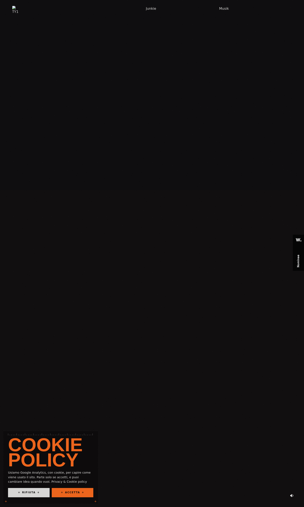
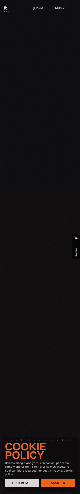

# UI Design System & Master Generation Blueprint: ty1official-com

> **TY1 — DJ & Producer** (https://ty1official.com) — TY1, tra i DJ e producer più influenti della scena Hip Hop italiana. Prossimi live, ultime uscite, riconoscimenti e booking.



---

## 1. Executive Visual Persona & Design Archetype

- **Brand Essence & Persona**: **TY1 — DJ & Producer** (`https://ty1official.com`). TY1, tra i DJ e producer più influenti della scena Hip Hop italiana. Prossimi live, ultime uscite, riconoscimenti e booking.
- **Visual Archetype**: **Dark-Substrate WebGL / Canvas Interactive Experience (`#0d0b0c` / `#c14e12`)**.
- **Anti-AI-Slop Differentiators**:
  - **Source-Grounded Chromatic Polarity**: Anchors the viewport in `#0d0b0c` (`var(--c-black)` in `:root`) paired with `#d7d6d5` primary typography and `#c14e12` accents.
  - **Extracted Typographic Hierarchy**: Pairs `Humane` for display copy (`TY1 — DJ & Producer, Junkie Musik`) with `Thunder` and not declared in static CSS (uses primary stack / `ui-monospace`).
  - **Calibrated Spatial Grid & Motion**: Combines `767px` container bounds (`gap: 10px`, padding `16px`) with `cubic-bezier(.22,1,.36,1)` easing and Lenis Smooth Scroll (`data-lenis`), HTML5 `<canvas>` Interactive Viewport Surface.

---

## 2. Spatial Architecture & Modular Grid Mathematics



### Viewport Allocation & Container Geometry
- **Captured Viewport Dimensions**: Desktop `1440×2400px` (`assets/desktop.png`, capped at 2400px multi-section capture), Mobile `390×2400px` (`assets/mobile.png`, capped at 2400px multi-section capture).
- **Master Container Bounds**: `767px` extracted from `ty1official-com` stylesheet.
- **Canvas Lateral Padding & Spacing**: `16px` lateral canvas padding with `10px` grid gap.
- **Border Radius Scale**: `var(--radius)`, `6px`, `50%`, `2px`.

### Responsive Breakpoint Architecture
- **Desktop Layout**: Multi-column CSS Grid / Flexbox layout at `1440px` (`max-width: 767px`, `gap: 10px`).
- **Mobile Layout**: Single-column vertical stack at `390px` viewport width with `16px` horizontal padding.
- **Extracted CSS Media Queries**: `@media (max-width: 767px)`, `@media (prefers-reduced-motion: reduce)`, `@media (max-width: 640px)`, `@media (hover: none) and (orientation: landscape) and (max-heigh...`.

---

## 3. Color System, Materiality & Atmospheric Lighting

### Semantic Palette & Source Grounding
| Semantic Role | Ground-Truth Value | Extracted CSS Source / Selector |
|---|---|---|
| **Primary Canvas Substrate** | `#0d0b0c` | `var(--c-black)` in `:root` |
| **Primary Typography Ink** | `#ec651d` | `var(--c-orange)` in `:root` |
| **Elevated Surface / Card Substrate** | `#d7d6d5` | `var(--c-white)` in `:root` |
| **Interactive Accent / Highlight** | `#c14e12` | `var(--c-orange-deep)` in `:root` |
| **Secondary / Muted Copy** | `#ff7d33` | `var(--c-orange-bright)` in `:root` |
| **Structural Hairline Border** | `#1a1617` | `var(--c-ink)` in `:root` |

### Sanitized Root CSS Variables (`ui-ux.md` Ground Truth)
| Variable Name | Extracted Value | Semantic Role |
|---|---|---|
| `--font-display` | `"Thunder", "Anton", "Arial Narrow", system-ui, sans-serif` | Typography / Scale Token |
| `--font-ui` | `"Inter", system-ui, -apple-system, "Segoe UI", sans-serif` | Typography / Scale Token |
| `--font-decorative` | `"Nebulon", "Oswald", "Arial Narrow", sans-serif` | Typography / Scale Token |
| `--font-body` | `"Atkinson Hyperlegible", system-ui, -apple-system, "Segoe UI", sans-serif` | Typography / Scale Token |
| `--step-hero` | `clamp(4rem, 48vw, 550px)` | Dimension / Scale Token |
| `--step-giant` | `clamp(3.5rem, 17vw, 16rem)` | Dimension / Scale Token |
| `--step-h1` | `clamp(2.4rem, 8vw, 6.5rem)` | Typography / Scale Token |
| `--step-h2` | `clamp(1.9rem, 5vw, 3.75rem)` | Typography / Scale Token |
| `--step-h3` | `clamp(1.75rem, .9rem + 3.6vw, 2.8125rem)` | Typography / Scale Token |
| `--step-h5` | `clamp(1rem, .86rem + .6vw, 1.25rem)` | Dimension / Scale Token |
| `--step-body` | `clamp(1rem, 1.05vw, 1.2rem)` | Dimension / Scale Token |
| `--step-small` | `clamp(.78rem, .95vw, .95rem)` | Dimension / Scale Token |
| `--space-3xs` | `clamp(.25rem, .24rem + .05vw, .3125rem)` | Layout / Spatial Grid Token |
| `--space-2xs` | `clamp(.5rem, .47rem + .15vw, .625rem)` | Layout / Spatial Grid Token |
| `--space-xs` | `clamp(.75rem, .7rem + .24vw, .9375rem)` | Layout / Spatial Grid Token |
| `--space-s` | `clamp(1rem, .93rem + .33vw, 1.25rem)` | Layout / Spatial Grid Token |

---

## 4. Typographic Scale & Editorial Hierarchy

### Font Family Stacks
- **Display Typography**: `Humane`.
- **Primary Body Stack**: `Thunder`.
- **Technical / Metadata Stack**: not declared in static CSS (uses primary stack / `ui-monospace`).

### Typographic Scale & Rules (Extracted from Stylesheet & Variables)
- **Hero Display (`H1`)**: CSS variables `--font-display: "Thunder", "Anton", "Arial Narrow", system-ui, sans-serif`, `--step-h1: clamp(2.4rem, 8vw, 6.5rem)`.
- **Section Heading (`H2`)**: CSS variables `--step-h2: clamp(1.9rem, 5vw, 3.75rem)`.
- **Body Copy**: CSS variables `--font-body: "Atkinson Hyperlegible", system-ui, -apple-system, "Segoe UI", sans-serif`, `--step-body: clamp(1rem, 1.05vw, 1.2rem)`.
- **Metadata & Navigation Labels**: CSS variables `--step-small: clamp(.78rem, .95vw, .95rem)`; rule `small` (`font-size: clamp(0.62rem, 2.2vw, 0.9rem)`, `letter-spacing: 0.5em`, `font-weight: 600`).

---

## 5. Choreographed Motion & Interaction Physics

### Primary Easing Curves
- **Extracted Timing Functions**: `cubic-bezier(.22,1,.36,1)`, `cubic-bezier(.65,0,.35,1)`, `cubic-bezier(.16,1,.3,1)`.

### Per-Element Transition & Choreography Rules
- **Selector `.consenso__tasto:before`**: `transition: clip-path .3s steps(3,jump-start)` extracted from `ty1official-com` stylesheet.
- **Selector `.consenso__tasto:before`**: `transition: none` extracted from `ty1official-com` stylesheet.
- **Selector `.cta`**: `transition: background var(--dur) var(--ease-out),color var(--dur) var(--e...` extracted from `ty1official-com` stylesheet.
- **Extracted Easing Curve (`cubic-bezier(.22,1,.36,1)`)**: Governs interactive state transitions across `<header.testata>` and `<section.trasf>`.
- **Runtime Interaction Engine**: Integrates Lenis Smooth Scroll (`data-lenis`), HTML5 `<canvas>` Interactive Viewport Surface with `prefers-reduced-motion: reduce` fallback guards.

---

## 6. Component Wireframe & Structural DOM Map

### Visual Layout Schematic (Grounded in `dom.html` — `1440px` Desktop & `390px` Mobile Reflow)
```
┌────────────────────────────────────────────────────────────────────────┐
│ DESKTOP VIEWPORT (1440px) — TY1 — DJ & Producer                        │
│ ====================================================================== │
│ [ <header.testata>         | A p p l e M u s i c · D e e z e r · S  ]  │
│ ---------------------------------------------------------------------- │
│ | HERO STAGE: <section.intro>                                      |   │
│ | H1: TY1 — DJ & Producer, Junkie Musik                            |   │
│ | Substrate: #0d0b0c    | Ink: #d7d6d5    | Accent: #c14e12        |   │
│ ---------------------------------------------------------------------- │
│ | SHOWCASE GRID (<section.trasf>           ) max-w: 767px          |   │
│ | +------------------------------+  +------------------------------+ | │
│ | | Fuori ora                    |  | Il vinile di Junkie Musik    | | │
│ | +------------------------------+  +------------------------------+ | │
│ ---------------------------------------------------------------------- │
│ | MOBILE VIEWPORT REFLOW (390px) — Single-Column Stack (gap: 10px  ) | │
│ | [<header.testata>] -> [<section.intro>] -> [<section.trasf>] |       │
│ ---------------------------------------------------------------------- │
│ [ FOOTER (<footer.footer>       ) | https://ty1official.com            │
└────────────────────────────────────────────────────────────────────────┘
```

### Granular DOM Region Breakdown
1. **Brand Header & Navigation Bar (<header.testata> — `ty1official-com`)**:
   - Landmark `<header class="testata">` hosting `TY1 — DJ & Producer` navigation (`A p p l e M u s i c · D e e z e r · S o u n d C l o u d · S p o t i f y`), DOM attributes (`data-world="artist"`, `data-suono`, `data-testata`, `data-fit="0.98"`), and stylesheet rule `property --sfondo-t { syntax: "<number>"; inherits: true; initial-value: 1; }`.
2. **Hero Stage & Focal Lead (<section.intro> — `TY1 — DJ & Producer, Junkie Musik`)**:
   - Landmark `<section class="intro vscroll">` presenting display lead `TY1 — DJ & Producer, Junkie Musik` and copy excerpt *"J u n k i e M u s i k"* over `#0d0b0c` canvas and `#d7d6d5` ink.
3. **Primary Showcase & Content Grid (<section.trasf> — `Fuori ora`)**:
   - Landmark `<section class="trasf vscroll">` rendering section `Fuori ora` with copy *"Clicca il video per ingrandirlo"*, asset references (`favicon.ico`, `favicon.svg`, `apple-touch-icon.png`, `fonts.googleapis.com`), and grid rule `font-face { font-family:Thunder;src:local("Thunder");font-weight:700;font-style:norm... }`.
4. **Interactive Detail & Feature Matrix (<section.section> — `Il vinile di Junkie Musik`)**:
   - Landmark `<section class="section vinile">` framing `Il vinile di Junkie Musik` and `G i o c a e v i n c i u n i n c o n t r o c o n T...` (*"S i d e A · S i d e B"*) with `#d7d6d5` surface cards, `#c14e12` accents, and `.consenso__piu { position:absolute;bottom:4px;font:400 14px/1 Inter,system-ui,sans-serif;... }`.
5. **Colophon & Global Directory Footer (<footer.footer> — `https://ty1official.com`)**:
   - Landmark `<footer class="footer">` anchoring `TY1 — DJ & Producer` footer links (`A p p l e M u s i c · D e e z e r · S o u n d C l o u d · S p o t i f y`), copy *"G i o c a e v i n c i u n"*, and `#1a1617` structural dividers.

---

## 7. Master Zero-Shot AI Generation Prompt

```markdown
# Master Zero-Shot Frontend Generation Prompt: ty1official-com (TY1 — DJ & Producer)

You are a principal frontend architect and design systems engineer. Build a complete, production-ready web application replicating the exact design system, DOM landmarks, typographic hierarchy, color tokens, and motion physics of `ty1official-com` (**TY1 — DJ & Producer** — `https://ty1official.com`).

### 1. Visual Archetype & Anti-AI-Slop Mandates
- **Archetype**: Dark-Substrate WebGL / Canvas Interactive Experience (`#0d0b0c` / `#c14e12`).
- **Identity & Domain Context**: TY1, tra i DJ e producer più influenti della scena Hip Hop italiana. Prossimi live, ultime uscite, riconoscimenti e booking.
- **Primary Substrate**: `#0d0b0c` (`var(--c-black)` in `:root`), **Primary Ink**: `#d7d6d5`, **Accent / Highlight**: `#c14e12`.
- **Site-Specific Differentiators**:
  - **Source-Grounded Chromatic Polarity**: Anchors the viewport in `#0d0b0c` (`var(--c-black)` in `:root`) paired with `#d7d6d5` primary typography and `#c14e12` accents.
  - **Extracted Typographic Hierarchy**: Pairs `Humane` for display copy (`TY1 — DJ & Producer, Junkie Musik`) with `Thunder` and not declared in static CSS (uses primary stack / `ui-monospace`).
  - **Calibrated Spatial Grid & Motion**: Combines `767px` container bounds (`gap: 10px`, padding `16px`) with `cubic-bezier(.22,1,.36,1)` easing and Lenis Smooth Scroll (`data-lenis`), HTML5 `<canvas>` Interactive Viewport Surface.

### 2. Ground-Truth CSS Variables (`:root` Token Contract)
Declare and consume these exact custom properties extracted from `ty1official-com` in your global stylesheet:

:root {
  /* TY1 — DJ & Producer (ty1official-com) — Ground-Truth Extracted CSS Variables */
  --font-display: "Thunder", "Anton", "Arial Narrow", system-ui, sans-serif; /* Typography / Scale Token (ty1official-com) */
  --font-ui: "Inter", system-ui, -apple-system, "Segoe UI", sans-serif; /* Typography / Scale Token (ty1official-com) */
  --font-decorative: "Nebulon", "Oswald", "Arial Narrow", sans-serif; /* Typography / Scale Token (ty1official-com) */
  --font-body: "Atkinson Hyperlegible", system-ui, -apple-system, "Segoe UI", sans-serif; /* Typography / Scale Token (ty1official-com) */
  --step-hero: clamp(4rem, 48vw, 550px); /* Dimension / Scale Token (ty1official-com) */
  --step-giant: clamp(3.5rem, 17vw, 16rem); /* Dimension / Scale Token (ty1official-com) */
  --step-h1: clamp(2.4rem, 8vw, 6.5rem); /* Typography / Scale Token (ty1official-com) */
  --step-h2: clamp(1.9rem, 5vw, 3.75rem); /* Typography / Scale Token (ty1official-com) */
  --step-h3: clamp(1.75rem, .9rem + 3.6vw, 2.8125rem); /* Typography / Scale Token (ty1official-com) */
  --step-h5: clamp(1rem, .86rem + .6vw, 1.25rem); /* Dimension / Scale Token (ty1official-com) */
  --step-body: clamp(1rem, 1.05vw, 1.2rem); /* Dimension / Scale Token (ty1official-com) */
  --step-small: clamp(.78rem, .95vw, .95rem); /* Dimension / Scale Token (ty1official-com) */
  --space-3xs: clamp(.25rem, .24rem + .05vw, .3125rem); /* Layout / Spatial Grid Token (ty1official-com) */
  --space-2xs: clamp(.5rem, .47rem + .15vw, .625rem); /* Layout / Spatial Grid Token (ty1official-com) */
  --space-xs: clamp(.75rem, .7rem + .24vw, .9375rem); /* Layout / Spatial Grid Token (ty1official-com) */
  --space-s: clamp(1rem, .93rem + .33vw, 1.25rem); /* Layout / Spatial Grid Token (ty1official-com) */
}

### 3. Semantic Color & Materiality Contract
Map every surface, ink, and border strictly to these source-grounded tokens:
- **Primary Canvas Substrate**: `#0d0b0c` — grounded in `var(--c-black)` in `:root`
- **Primary Typography Ink**: `#ec651d` — grounded in `var(--c-orange)` in `:root`
- **Elevated Surface / Card Substrate**: `#d7d6d5` — grounded in `var(--c-white)` in `:root`
- **Interactive Accent / Highlight**: `#c14e12` — grounded in `var(--c-orange-deep)` in `:root`
- **Secondary / Muted Copy**: `#ff7d33` — grounded in `var(--c-orange-bright)` in `:root`
- **Structural Hairline Border**: `#1a1617` — grounded in `var(--c-ink)` in `:root`

### 4. Spatial Grid, Container Bounds & Responsive Breakpoints
- **Desktop Viewport Reference**: `1440×2400px` (capped at 2400px multi-section capture, `1440px` standard desktop width).
- **Mobile Viewport Reference**: `390×2400px` (capped at 2400px multi-section capture, `390px` standard mobile width).
- **Container Max-Width**: `767px` extracted from `ty1official-com` stylesheet
- **Padding & Gutters**: `16px` lateral canvas padding with `10px` grid gap
- **Desktop Grid**: Multi-column CSS Grid / Flexbox layout at `1440px` (`max-width: 767px`, `gap: 10px`)
- **Mobile Adaptation**: Single-column vertical stack at `390px` viewport width with `16px` horizontal padding
- **Media Queries**: `@media (max-width: 767px)`, `@media (prefers-reduced-motion: reduce)`, `@media (max-width: 640px)`, `@media (hover: none) and (orientation: landscape) and (max-heigh...`
- **Corner Radii**: `var(--radius)`, `6px`, `50%`, `2px`

### 5. Typography & Editorial Scale Contract
- **Display Font Stack**: `Humane`
- **Body Font Stack**: `Thunder`
- **Monospace / Technical Font Stack**: not declared in static CSS (uses primary stack / `ui-monospace`)
- **H1 Display Rule**: CSS variables `--font-display: "Thunder", "Anton", "Arial Narrow", system-ui, sans-serif`, `--step-h1: clamp(2.4rem, 8vw, 6.5rem)`
- **H2 Section Rule**: CSS variables `--step-h2: clamp(1.9rem, 5vw, 3.75rem)`
- **Body Copy Rule**: CSS variables `--font-body: "Atkinson Hyperlegible", system-ui, -apple-system, "Segoe UI", sans-serif`, `--step-body: clamp(1rem, 1.05vw, 1.2rem)`
- **Metadata & Index Rule**: CSS variables `--step-small: clamp(.78rem, .95vw, .95rem)`; rule `small` (`font-size: clamp(0.62rem, 2.2vw, 0.9rem)`, `letter-spacing: 0.5em`, `font-weight: 600`)

### 6. Component Hierarchy, Verbatim Copy & Real DOM Landmarks
Scaffold `ty1official-com` (`TY1 — DJ & Producer`) with these exact structural regions, extracted copy, and CSS rules from `dom.html`:
1. **Brand Header & Navigation Bar (<header.testata> — `ty1official-com`)**:
   - DOM & Selectors: Landmark `<header class="testata">` hosting `TY1 — DJ & Producer` navigation (`A p p l e M u s i c · D e e z e r · S o u n d C l o u d · S p o t i f y`), DOM attributes (`data-world="artist"`, `data-suono`, `data-testata`, `data-fit="0.98"`), and stylesheet rule `property --sfondo-t { syntax: "<number>"; inherits: true; initial-value: 1; }`.
   - Responsive Contract: Header `Brand Header & Navigation Bar (<header.testata> — `ty1official-com`)` (`ty1official-com`) adapts across `@media (max-width: 767px)`, `@media (prefers-reduced-motion: reduce)`, `@media (max-width: 640px)`, `@media (hover: none) and (orientation: landscape) and (max-heigh...` with `cubic-bezier(.22,1,.36,1)`, `cubic-bezier(.65,0,.35,1)`, `cubic-bezier(.16,1,.3,1)` transitions and links `A p p l e M u s i c · D e e z e r · S o u n d C l o u d · S p o t i f y`.
2. **Hero Stage & Focal Lead (<section.intro> — `TY1 — DJ & Producer, Junkie Musik`)**:
   - DOM & Selectors: Landmark `<section class="intro vscroll">` presenting display lead `TY1 — DJ & Producer, Junkie Musik` and copy excerpt *"J u n k i e M u s i k"* over `#0d0b0c` canvas and `#d7d6d5` ink.
   - Responsive Contract: Hero stage (`1440×2400px` desktop / `390×2400px` mobile) sets `#0d0b0c` background with `#d7d6d5` headline `TY1 — DJ & Producer, Junkie Musik`.
3. **Primary Showcase & Content Grid (<section.trasf> — `Fuori ora`)**:
   - DOM & Selectors: Landmark `<section class="trasf vscroll">` rendering section `Fuori ora` with copy *"Clicca il video per ingrandirlo"*, asset references (`favicon.ico`, `favicon.svg`, `apple-touch-icon.png`, `fonts.googleapis.com`), and grid rule `font-face { font-family:Thunder;src:local("Thunder");font-weight:700;font-style:norm... }`.
   - Responsive Contract: Showcase grid `Primary Showcase & Content Grid (<section.trasf> — `Fuori ora`)` applies Multi-column CSS Grid / Flexbox layout at `1440px` (`max-width: 767px`, `gap: 10px`) on desktop and Single-column vertical stack at `390px` viewport width with `16px` horizontal padding on mobile.
4. **Interactive Detail & Feature Matrix (<section.section> — `Il vinile di Junkie Musik`)**:
   - DOM & Selectors: Landmark `<section class="section vinile">` framing `Il vinile di Junkie Musik` and `G i o c a e v i n c i u n i n c o n t r o c o n T...` (*"S i d e A · S i d e B"*) with `#d7d6d5` surface cards, `#c14e12` accents, and `.consenso__piu { position:absolute;bottom:4px;font:400 14px/1 Inter,system-ui,sans-serif;... }`.
   - Responsive Contract: Detail module `Interactive Detail & Feature Matrix (<section.section> — `Il vinile di Junkie Musik`)` uses `var(--radius)`, `6px`, `50%`, `2px` radii, `#c14e12` highlights, and assets (favicon.ico, favicon.svg, apple-touch-icon.png).
5. **Colophon & Global Directory Footer (<footer.footer> — `https://ty1official.com`)**:
   - DOM & Selectors: Landmark `<footer class="footer">` anchoring `TY1 — DJ & Producer` footer links (`A p p l e M u s i c · D e e z e r · S o u n d C l o u d · S p o t i f y`), copy *"G i o c a e v i n c i u n"*, and `#1a1617` structural dividers.
   - Responsive Contract: Footer `Colophon & Global Directory Footer (<footer.footer> — `https://ty1official.com`)` aligns to `767px` extracted from `ty1official-com` stylesheet with `16px` lateral canvas padding with `10px` grid gap and attributes (data-world="artist", data-suono, data-testata).

#### Verbatim DOM Copy Excerpts (`dom.html`)
- Copy Excerpt 1: *"J u n k i e M u s i k"*
- Copy Excerpt 2: *"Clicca il video per ingrandirlo"*
- Copy Excerpt 3: *"S i d e A · S i d e B"*
- Copy Excerpt 4: *"G i o c a e v i n c i u n"*

### 7. Motion, Extracted Stylesheet Rules & Interaction Choreography
- **Primary Easing Functions**: `cubic-bezier(.22,1,.36,1)`, `cubic-bezier(.65,0,.35,1)`, `cubic-bezier(.16,1,.3,1)`
- **Extracted Stylesheet Rules (`ty1official-com`)**:
- `property --sfondo-t { syntax: "<number>"; inherits: true; initial-value: 1; }`
- `font-face { font-family:Thunder;src:local("Thunder");font-weight:700;font-style:norm... }`
- `.consenso__piu { position:absolute;bottom:4px;font:400 14px/1 Inter,system-ui,sans-serif;... }`
- `.consenso__testo { margin:14px 0 18px;font-family:Atkinson Hyperlegible,system-ui,sans-seri... }`
- `.consenso__testo a { color:inherit;text-underline-offset:.2em }`
- **Per-Selector Transition Rules**:
- **Selector `.consenso__tasto:before`**: `transition: clip-path .3s steps(3,jump-start)` extracted from `ty1official-com` stylesheet.
- **Selector `.consenso__tasto:before`**: `transition: none` extracted from `ty1official-com` stylesheet.
- **Selector `.cta`**: `transition: background var(--dur) var(--ease-out),color var(--dur) var(--e...` extracted from `ty1official-com` stylesheet.
- **Extracted Easing Curve (`cubic-bezier(.22,1,.36,1)`)**: Governs interactive state transitions across `<header.testata>` and `<section.trasf>`.
- **Runtime Interaction Engine**: Integrates Lenis Smooth Scroll (`data-lenis`), HTML5 `<canvas>` Interactive Viewport Surface with `prefers-reduced-motion: reduce` fallback guards.

### 8. Technical Deliverables
- Implement in Next.js (App Router) with TypeScript and Tailwind CSS consuming the `:root` custom properties defined above for `ty1official-com`.
- Reproduce both the `1440px` desktop architecture and `390px` mobile breakpoint transitions, preserving semantic HTML5 landmarks (`<header>`, `<nav>`, `<main>`, `<section>`, `<footer>`) and `prefers-reduced-motion` accessibility guards.
```
