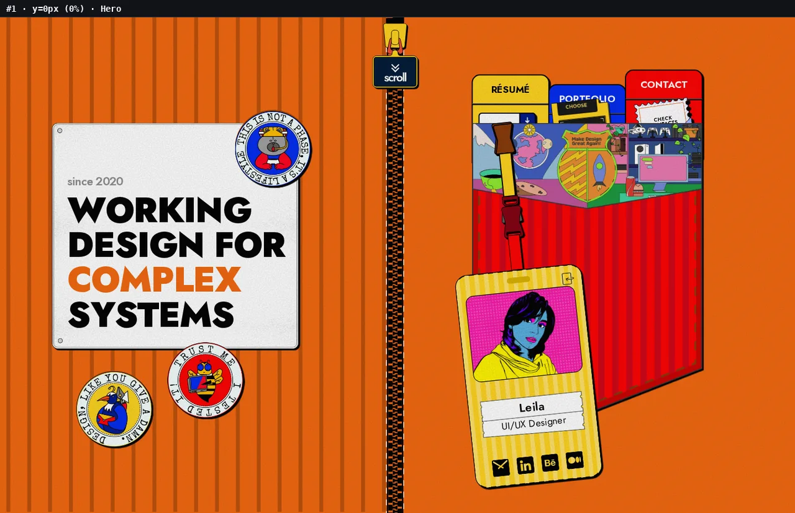
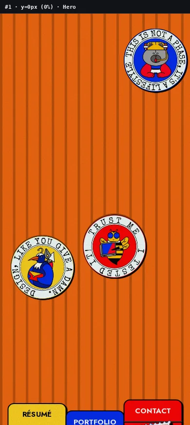

# UI Design System & Master Generation Blueprint: uimaven-art

> **uimaven.art** (https://uimaven.art) — UI/UX design portfolio of Leila Abbassova.





---

## 1. Executive Visual Persona & Design Archetype

- **Brand Essence & Persona**: **uimaven.art** (`https://uimaven.art`). UI/UX design portfolio of Leila Abbassova.
- **Capture Provenance**: Live browser capture (`tier1_fast`, HTTP `200`, captured `2026-11-24`).
- **Visual Archetype**: **Light-Gallery WebGL / Canvas Interactive Experience (`#f3670e` / `#fe0000`)**.
- **Anti-AI-Slop Differentiators**:
  - **Live-Computed Chromatic Polarity**: Anchors the viewport in `#f3670e` (live computed `body` `background-color` (`computed_styles.json`)) paired with `#000000` primary typography and `#fe0000` accents.
  - **Grounded Typographic Hierarchy**: Uses `Jost` across display (`uimaven.art`) and body copy, paired with `SFMono-Regular` for monospace/code.
  - **Calibrated Spatial Grid & Motion**: Combines `96rem` container bounds (`gap: 2.63px`, padding `2px`) with `cubic-bezier(.4,0,1,1)` easing and HTML5 `<canvas>` Interactive Viewport Surface.

---

## 2. Spatial Architecture & Modular Grid Mathematics

### Viewport Allocation & Container Geometry
- **Captured Journey Filmstrips**: Desktop `1280×828px` (`assets/desktop-journey.webp`, `1` keyframes up to `y=0px` / doc `900px`), Mobile `390×872px` (`assets/mobile-journey.webp`, `1` keyframes).
- **Master Container Bounds**: `96rem` (non-`@media` desktop container stylesheet rule).
- **Canvas Lateral Padding & Spacing**: `2px` lateral canvas padding with `2.63px` grid gap.
- **Border Radius Scale**: `.25rem`, `1px`, `2px`, `3.5px`.

### Responsive Breakpoint Architecture
- **Desktop Layout**: Multi-column CSS Grid / Flexbox layout at `1440px` (`max-width: 96rem`, `gap: 2.63px`).
- **Mobile Layout**: Single-column vertical stack at `390px` viewport width with `2px` horizontal padding.
- **Extracted CSS Media Queries**: `@media (min-width:40rem)`, `@media (min-width:48rem)`, `@media (min-width:64rem)`, `@media (min-width:80rem)`.

---

## 3. Color System, Materiality & Atmospheric Lighting

### Semantic Palette & Source Grounding
| Semantic Role | Ground-Truth Value | Extracted Live / CSS Source |
|---|---|---|
| **Primary Canvas Substrate** | `#f3670e` | live computed `body` `background-color` (`computed_styles.json`) |
| **Primary Typography Ink** | `#000000` | live computed `main` `color` (`computed_styles.json`) |
| **Elevated Surface / Card Substrate** | `#4a4a4a` | `.bg-neutral-900 { background-color: #4a4a4a }` |
| **Interactive Accent / Highlight** | `#fe0000` | `var(--color-red-accent)` in `:root` |
| **Secondary / Muted Copy** | `#002af0` | `var(--color-secondary-300)` in `:root` |
| **Structural Hairline Border** | `#000000` | `var(--color-border-dark)` in `:root` |
| **Variable Token (`--color-red-100`)** | `#fb3748` | `var(--color-red-100)` in `:root` |
| **Variable Token (`--color-red-500`)** | `#fb2c36` | `var(--color-red-500)` in `:root` |
| **Variable Token (`--color-red-800`)** | `#9f0712` | `var(--color-red-800)` in `:root` |
| **Variable Token (`--color-yellow-100`)** | `#ffdb43` | `var(--color-yellow-100)` in `:root` |
| **Variable Token (`--color-yellow-200`)** | `#dfb400` | `var(--color-yellow-200)` in `:root` |
| **Variable Token (`--color-yellow-500`)** | `#edb200` | `var(--color-yellow-500)` in `:root` |
| **Variable Token (`--color-green-200`)** | `#1fc16b` | `var(--color-green-200)` in `:root` |
| **Variable Token (`--color-neutral-100`)** | `#ffffff` | `var(--color-neutral-100)` in `:root` |
| **Variable Token (`--color-neutral-200`)** | `#e8e8e8` | `var(--color-neutral-200)` in `:root` |
| **Variable Token (`--color-neutral-300`)** | `#d2d2d2` | `var(--color-neutral-300)` in `:root` |

### Sanitized Root CSS Variables (`ui-ux.md` Ground Truth)
| Variable Name | Extracted Value | Semantic Role |
|---|---|---|
| `--site-header-h` | `60px` | Layout / Spatial Grid Token |
| `--font-jost` | `"Jost","Jost Fallback"` | Typography / Scale Token |
| `--type-weight` | `initial` | Typography / Scale Token |
| `--color-red-100` | `#fb3748` | Brand / Palette Token |
| `--color-red-500` | `#fb2c36` | Brand / Palette Token |
| `--color-red-800` | `#9f0712` | Brand / Palette Token |
| `--color-yellow-100` | `#ffdb43` | Brand / Palette Token |
| `--color-yellow-200` | `#dfb400` | Brand / Palette Token |
| `--color-yellow-500` | `#edb200` | Brand / Palette Token |
| `--color-green-200` | `#1fc16b` | Brand / Palette Token |
| `--color-neutral-100` | `#fff` | Brand / Palette Token |
| `--color-neutral-200` | `#e8e8e8` | Brand / Palette Token |
| `--color-neutral-300` | `#d2d2d2` | Brand / Palette Token |
| `--color-black` | `#000` | Canvas / Surface Token |
| `--color-white` | `#fff` | Canvas / Surface Token |
| `--spacing` | `.25rem` | Layout / Spatial Grid Token |

---

## 4. Typographic Scale & Editorial Hierarchy

### Font Family Stacks
- **Display Typography**: `Jost`.
- **Primary Body Stack**: `Jost`.
- **Technical / Metadata Stack**: `SFMono-Regular`.

### Typographic Scale & Rules (Live Computed & Stylesheet Grounded)
- **Hero Display (`H1`)**: CSS variables `--text-display: 64px`, `--text-display--line-height: .95`, `--text-display-phone: 40px`.
- **Section Heading (`H2`)**: observed font-size ladder: `16px`, `1em`, `80%`, `75%`, `var(--text-heading)`.
- **Body Copy**: live computed `body` (`font-size: 16px`, `line-height: 24px`, `font-weight: 400`); CSS variables `--text-base: 1rem`, `--text-base--line-height: calc(1.5/1)`, `--text-body: 16px`.
- **Metadata & Navigation Labels**: CSS variables `--text-xs: .75rem`, `--text-xs--line-height: calc(1/.75)`, `--text-sm: .875rem`.

---

## 5. Choreographed Motion & Interaction Physics

### Primary Easing Curves
- **Extracted Timing Functions**: `cubic-bezier(.4,0,1,1)`, `cubic-bezier(0,0,.2,1)`, `cubic-bezier(.4,0,.2,1)`.

### Per-Element Transition & Choreography Rules
- **Selector `layer theme`**: `transition: .15s` extracted from `uimaven-art` stylesheet.
- **Selector `.transition`**: `transition: var(--tw-ease,var(--default-transition-timing-function))` extracted from `uimaven-art` stylesheet.
- **Selector `translate\]`**: `transition: var(--tw-ease,var(--default-transition-timing-function))` extracted from `uimaven-art` stylesheet.
- **Extracted Easing Curve (`cubic-bezier(.4,0,1,1)`)**: Governs interactive state transitions across `<header.shrink-0>` and `<main.bg-primary-300>`.
- **Runtime Interaction Engine**: Integrates HTML5 `<canvas>` Interactive Viewport Surface with `prefers-reduced-motion: reduce` fallback guards.
### Measured Runtime Scroll & Interaction Telemetry (`behavioral_journey_v2`)
- **Scroll Driver Mode**: `wheel` (max document height `900px`, deepest scrollY reached `0px` across `1` desktop keyframes).
- **Detected Scroll / Motion Libraries**: `WebGL/Canvas`.

---

## 6. Component Wireframe & Structural DOM Map

### Visual Layout Schematic — Desktop (`1440px`, Grounded in `dom.html` & Landmark Bounding Boxes)
```
┌────────────────────────────────────────────────────────────────────────┐
│ DESKTOP VIEWPORT (1440px) — uimaven.art                                │
│ ====================================================================== │
│ [ <header.shrink-0> (1440x0px)        | Overview · Index · Archive · ] │
│ ---------------------------------------------------------------------- │
│ | HERO STAGE: <main.mobile-stripes> (w=1440px)                       | │
│ | H1: uimaven.art                                                    | │
│ | Substrate: #f3670e | Ink: #000000 | Accent: #fe0000                | │
│ ---------------------------------------------------------------------- │
│ | SHOWCASE GRID (<main.bg-primary-300>) max-w: 96rem                 | │
│ | +------------------------------+  +------------------------------+ | │
│ | | Featured Work & Interactive  |  | Technical Architecture & Nar | | │
│ | +------------------------------+  +------------------------------+ | │
│ ---------------------------------------------------------------------- │
│ | DETAIL MODULE (<main.mobile-stripes:nth(2) — Global Directory & Co | │
│ ---------------------------------------------------------------------- │
│ [ FOOTER (<footer.bg-primary-3) | https://uimaven.art                  │
└────────────────────────────────────────────────────────────────────────┘
```

### Visual Layout Schematic — Mobile Reflow (`390px`)
```
┌────────────────────────────────────────────────────────────────────────┐
│ MOBILE VIEWPORT REFLOW (390px) — Single-Column Stack (gap: 2.63px)     │
│ ====================================================================== │
│ [ HEADER BAR (<header.shrink-0>       ) | Compact Menu (390px)         │
│ ---------------------------------------------------------------------- │
│ | HERO STAGE (<main.mobile-stripes>) — 390px Vertical Lead           | │
│ | H1: uimaven.art                                                    | │
│ ---------------------------------------------------------------------- │
│ | SHOWCASE STACK (<main.bg-primary-300>) — 1-Col Stack               | │
│ | [ Item 1: Featured Work & Interactive Showcase                   ] | │
│ | [ Item 2: Technical Architecture & Narrative                     ] | │
│ ---------------------------------------------------------------------- │
│ | DETAIL STACK (<main.mobile-stripes:nth) — 1-Col (Global Directory &) │
│ ---------------------------------------------------------------------- │
│ [ FOOTER (<footer.bg-primary-3) | Stacked 390px Colophon               │
└────────────────────────────────────────────────────────────────────────┘
```

### Granular DOM Region Breakdown
1. **Brand Header & Navigation Bar (<header.shrink-0> — `uimaven-art`)**:
   - Landmark `<header class="shrink-0 relative">` (`1440x0px`) hosting `uimaven.art` navigation (`Overview · Index · Archive · About · Contact`), DOM attributes (`data-precedence="next"`, `data-home`), and stylesheet rule `jost_bd43172b-module__QzW_JW__cla... { font-family:Jost,Jost Fallback;font-style:normal }`.
2. **Hero Stage & Focal Lead (<main.mobile-stripes> — `uimaven.art`)**:
   - Landmark `<main class="mobile-stripes bg-primary-300">` presenting display lead `uimaven.art` and copy excerpt *"UI/UX design portfolio of Leila Abbassova."* over `#f3670e` canvas and `#000000` ink.
3. **Primary Showcase & Content Grid (<main.bg-primary-300> — `Featured Work & Interactive Showca`)**:
   - Landmark `<main class="mobile-stripes bg-primary-300">` rendering section `Featured Work & Interactive Showcase` with copy *"uimaven.art"*, asset references (`81cef6a21128489e-s.p.6cf41120.woff2`, `d7f27077a988d3d1.css`, `e48a17b7f69aeb46.js`, `2677990b2b1206f6.js`), and grid rule `.jost_bd43172b-module__QzW_JW__va... { --font-jost:"Jost","Jost Fallback" }`.
4. **Interactive Detail & Feature Matrix (<main.mobile-stripes:nth(2)> — `Technical Architecture & Narrative`)**:
   - Landmark `<main class="mobile-stripes bg-primary-300">` framing `Technical Architecture & Narrative` and `Global Directory & Contact` (*"Featured Work & Interactive Showcase"*) with `#4a4a4a` surface cards, `#fe0000` accents, and `backdrop { box-sizing:border-box;border:0 solid;margin:0;padding:0 }`.
5. **Colophon & Global Directory Footer (<footer.bg-primary-300> — `https://uimaven.art`)**:
   - Landmark `<footer class="bg-primary-300">` anchoring `uimaven.art` footer links (`Overview · Index · Archive · About · Contact`), copy *"Technical Architecture & Narrative"*, and `#000000` structural dividers.
### Full Vertical Scroll Sequence (Desktop `1440×900` Keyframes)
- **Step 01** (`y=0px`, `0%`): Active landmark `Hero` · sticky/fixed elements: `0`

---

## 7. Master Zero-Shot AI Generation Prompt

```markdown
# Master Zero-Shot Frontend Generation Prompt: uimaven-art (uimaven.art)

You are a principal frontend architect and design systems engineer. Build a complete, production-ready web application replicating the exact design system, DOM landmarks, typographic hierarchy, color tokens, and motion physics of `uimaven-art` (**uimaven.art** — `https://uimaven.art`).

### 1. Visual Archetype & Anti-AI-Slop Mandates
- **Archetype**: Light-Gallery WebGL / Canvas Interactive Experience (`#f3670e` / `#fe0000`).
- **Identity & Domain Context**: UI/UX design portfolio of Leila Abbassova.
- **Primary Substrate**: `#f3670e` (live computed `body` `background-color` (`computed_styles.json`)), **Primary Ink**: `#000000`, **Accent / Highlight**: `#fe0000`.
- **Site-Specific Differentiators**:
  - **Live-Computed Chromatic Polarity**: Anchors the viewport in `#f3670e` (live computed `body` `background-color` (`computed_styles.json`)) paired with `#000000` primary typography and `#fe0000` accents.
  - **Grounded Typographic Hierarchy**: Uses `Jost` across display (`uimaven.art`) and body copy, paired with `SFMono-Regular` for monospace/code.
  - **Calibrated Spatial Grid & Motion**: Combines `96rem` container bounds (`gap: 2.63px`, padding `2px`) with `cubic-bezier(.4,0,1,1)` easing and HTML5 `<canvas>` Interactive Viewport Surface.

### 2. Ground-Truth CSS Variables (`:root` Token Contract)
Declare and consume these exact custom properties extracted from `uimaven-art` in your global stylesheet:

:root {
  /* uimaven.art (uimaven-art) — Live-Grounded CSS Variables */
  --site-header-h: 60px; /* Layout / Spatial Grid Token (uimaven-art) */
  --font-jost: "Jost","Jost Fallback"; /* Typography / Scale Token (uimaven-art) */
  --type-weight: initial; /* Typography / Scale Token (uimaven-art) */
  --color-red-100: #fb3748; /* Brand / Palette Token (uimaven-art) */
  --color-red-500: #fb2c36; /* Brand / Palette Token (uimaven-art) */
  --color-red-800: #9f0712; /* Brand / Palette Token (uimaven-art) */
  --color-yellow-100: #ffdb43; /* Brand / Palette Token (uimaven-art) */
  --color-yellow-200: #dfb400; /* Brand / Palette Token (uimaven-art) */
  --color-yellow-500: #edb200; /* Brand / Palette Token (uimaven-art) */
  --color-green-200: #1fc16b; /* Brand / Palette Token (uimaven-art) */
  --color-neutral-100: #fff; /* Brand / Palette Token (uimaven-art) */
  --color-neutral-200: #e8e8e8; /* Brand / Palette Token (uimaven-art) */
  --color-neutral-300: #d2d2d2; /* Brand / Palette Token (uimaven-art) */
  --color-black: #000; /* Canvas / Surface Token (uimaven-art) */
  --color-white: #fff; /* Canvas / Surface Token (uimaven-art) */
  --spacing: .25rem; /* Layout / Spatial Grid Token (uimaven-art) */
}

### 3. Semantic Color & Materiality Contract
Map every surface, ink, and border strictly to these source-grounded tokens:
- **Primary Canvas Substrate**: `#f3670e` — grounded in live computed `body` `background-color` (`computed_styles.json`)
- **Primary Typography Ink**: `#000000` — grounded in live computed `main` `color` (`computed_styles.json`)
- **Elevated Surface / Card Substrate**: `#4a4a4a` — grounded in `.bg-neutral-900 { background-color: #4a4a4a }`
- **Interactive Accent / Highlight**: `#fe0000` — grounded in `var(--color-red-accent)` in `:root`
- **Secondary / Muted Copy**: `#002af0` — grounded in `var(--color-secondary-300)` in `:root`
- **Structural Hairline Border**: `#000000` — grounded in `var(--color-border-dark)` in `:root`
- **Variable Token (`--color-red-100`)**: `#fb3748` — grounded in `var(--color-red-100)` in `:root`
- **Variable Token (`--color-red-500`)**: `#fb2c36` — grounded in `var(--color-red-500)` in `:root`
- **Variable Token (`--color-red-800`)**: `#9f0712` — grounded in `var(--color-red-800)` in `:root`
- **Variable Token (`--color-yellow-100`)**: `#ffdb43` — grounded in `var(--color-yellow-100)` in `:root`
- **Variable Token (`--color-yellow-200`)**: `#dfb400` — grounded in `var(--color-yellow-200)` in `:root`
- **Variable Token (`--color-yellow-500`)**: `#edb200` — grounded in `var(--color-yellow-500)` in `:root`
- **Variable Token (`--color-green-200`)**: `#1fc16b` — grounded in `var(--color-green-200)` in `:root`
- **Variable Token (`--color-neutral-100`)**: `#ffffff` — grounded in `var(--color-neutral-100)` in `:root`
- **Variable Token (`--color-neutral-200`)**: `#e8e8e8` — grounded in `var(--color-neutral-200)` in `:root`
- **Variable Token (`--color-neutral-300`)**: `#d2d2d2` — grounded in `var(--color-neutral-300)` in `:root`

### 4. Spatial Grid, Container Bounds & Responsive Breakpoints
- **Desktop Viewport Reference**: `1280×828px` (single-viewport 100vh live capture (900px), `1440px` standard desktop width).
- **Mobile Viewport Reference**: `390×872px` (full-page live capture (872px), `390px` standard mobile width).
- **Container Max-Width**: `96rem` (non-`@media` desktop container stylesheet rule)
- **Padding & Gutters**: `2px` lateral canvas padding with `2.63px` grid gap
- **Desktop Grid**: Multi-column CSS Grid / Flexbox layout at `1440px` (`max-width: 96rem`, `gap: 2.63px`)
- **Mobile Adaptation**: Single-column vertical stack at `390px` viewport width with `2px` horizontal padding
- **Media Queries**: `@media (min-width:40rem)`, `@media (min-width:48rem)`, `@media (min-width:64rem)`, `@media (min-width:80rem)`
- **Corner Radii**: `.25rem`, `1px`, `2px`, `3.5px`

### 5. Typography & Editorial Scale Contract
- **Display Font Stack**: `Jost`
- **Body Font Stack**: `Jost`
- **Monospace / Technical Font Stack**: `SFMono-Regular`
- **H1 Display Rule**: CSS variables `--text-display: 64px`, `--text-display--line-height: .95`, `--text-display-phone: 40px`
- **H2 Section Rule**: observed font-size ladder: `16px`, `1em`, `80%`, `75%`, `var(--text-heading)`
- **Body Copy Rule**: live computed `body` (`font-size: 16px`, `line-height: 24px`, `font-weight: 400`); CSS variables `--text-base: 1rem`, `--text-base--line-height: calc(1.5/1)`, `--text-body: 16px`
- **Metadata & Index Rule**: CSS variables `--text-xs: .75rem`, `--text-xs--line-height: calc(1/.75)`, `--text-sm: .875rem`

### 6. Component Hierarchy, Verbatim Copy & Real DOM Landmarks
Scaffold `uimaven-art` (`uimaven.art`) with these exact structural regions, extracted copy, and CSS rules from `dom.html`:
1. **Brand Header & Navigation Bar (<header.shrink-0> — `uimaven-art`)**:
   - DOM & Selectors: Landmark `<header class="shrink-0 relative">` (`1440x0px`) hosting `uimaven.art` navigation (`Overview · Index · Archive · About · Contact`), DOM attributes (`data-precedence="next"`, `data-home`), and stylesheet rule `jost_bd43172b-module__QzW_JW__cla... { font-family:Jost,Jost Fallback;font-style:normal }`.
   - Responsive Contract: Header `Brand Header & Navigation Bar (<header.shrink-0> — `uimaven-art`)` (`uimaven-art`) adapts across `@media (min-width:40rem)`, `@media (min-width:48rem)`, `@media (min-width:64rem)`, `@media (min-width:80rem)` with `cubic-bezier(.4,0,1,1)`, `cubic-bezier(0,0,.2,1)`, `cubic-bezier(.4,0,.2,1)` transitions and links `Overview · Index · Archive · About · Contact`.
2. **Hero Stage & Focal Lead (<main.mobile-stripes> — `uimaven.art`)**:
   - DOM & Selectors: Landmark `<main class="mobile-stripes bg-primary-300">` presenting display lead `uimaven.art` and copy excerpt *"UI/UX design portfolio of Leila Abbassova."* over `#f3670e` canvas and `#000000` ink.
   - Responsive Contract: Hero stage (`1280×828px` desktop / `390×872px` mobile) sets `#f3670e` background with `#000000` headline `uimaven.art`.
3. **Primary Showcase & Content Grid (<main.bg-primary-300> — `Featured Work & Interactive Showca`)**:
   - DOM & Selectors: Landmark `<main class="mobile-stripes bg-primary-300">` rendering section `Featured Work & Interactive Showcase` with copy *"uimaven.art"*, asset references (`81cef6a21128489e-s.p.6cf41120.woff2`, `d7f27077a988d3d1.css`, `e48a17b7f69aeb46.js`, `2677990b2b1206f6.js`), and grid rule `.jost_bd43172b-module__QzW_JW__va... { --font-jost:"Jost","Jost Fallback" }`.
   - Responsive Contract: Showcase grid `Primary Showcase & Content Grid (<main.bg-primary-300> — `Featured Work & Interactive Showca`)` applies Multi-column CSS Grid / Flexbox layout at `1440px` (`max-width: 96rem`, `gap: 2.63px`) on desktop and Single-column vertical stack at `390px` viewport width with `2px` horizontal padding on mobile.
4. **Interactive Detail & Feature Matrix (<main.mobile-stripes:nth(2)> — `Technical Architecture & Narrative`)**:
   - DOM & Selectors: Landmark `<main class="mobile-stripes bg-primary-300">` framing `Technical Architecture & Narrative` and `Global Directory & Contact` (*"Featured Work & Interactive Showcase"*) with `#4a4a4a` surface cards, `#fe0000` accents, and `backdrop { box-sizing:border-box;border:0 solid;margin:0;padding:0 }`.
   - Responsive Contract: Detail module `Interactive Detail & Feature Matrix (<main.mobile-stripes:nth(2)> — `Technical Architecture & Narrative`)` uses `.25rem`, `1px`, `2px`, `3.5px` radii, `#fe0000` highlights, and assets (81cef6a21128489e-s.p.6cf41120.woff2, d7f27077a988d3d1.css, e48a17b7f69aeb46.js).
5. **Colophon & Global Directory Footer (<footer.bg-primary-300> — `https://uimaven.art`)**:
   - DOM & Selectors: Landmark `<footer class="bg-primary-300">` anchoring `uimaven.art` footer links (`Overview · Index · Archive · About · Contact`), copy *"Technical Architecture & Narrative"*, and `#000000` structural dividers.
   - Responsive Contract: Footer `Colophon & Global Directory Footer (<footer.bg-primary-300> — `https://uimaven.art`)` aligns to `96rem` (non-`@media` desktop container stylesheet rule) with `2px` lateral canvas padding with `2.63px` grid gap and attributes (data-precedence="next", data-home).

#### Verbatim DOM Copy Excerpts (`dom.html`)
- Lead Copy: *"UI/UX design portfolio of Leila Abbassova."*

### 7. Motion, Extracted Stylesheet Rules & Interaction Choreography
- **Primary Easing Functions**: `cubic-bezier(.4,0,1,1)`, `cubic-bezier(0,0,.2,1)`, `cubic-bezier(.4,0,.2,1)`
- **Extracted Stylesheet Rules (`uimaven-art`)**:
- `jost_bd43172b-module__QzW_JW__cla... { font-family:Jost,Jost Fallback;font-style:normal }`
- `.jost_bd43172b-module__QzW_JW__va... { --font-jost:"Jost","Jost Fallback" }`
- `backdrop { box-sizing:border-box;border:0 solid;margin:0;padding:0 }`
- `file-selector-button { box-sizing:border-box;border:0 solid;margin:0;padding:0 }`
- `strong { font-weight:bolder }`
- **Per-Selector Transition Rules**:
- **Selector `layer theme`**: `transition: .15s` extracted from `uimaven-art` stylesheet.
- **Selector `.transition`**: `transition: var(--tw-ease,var(--default-transition-timing-function))` extracted from `uimaven-art` stylesheet.
- **Selector `translate\]`**: `transition: var(--tw-ease,var(--default-transition-timing-function))` extracted from `uimaven-art` stylesheet.
- **Extracted Easing Curve (`cubic-bezier(.4,0,1,1)`)**: Governs interactive state transitions across `<header.shrink-0>` and `<main.bg-primary-300>`.
- **Runtime Interaction Engine**: Integrates HTML5 `<canvas>` Interactive Viewport Surface with `prefers-reduced-motion: reduce` fallback guards.
### 7b. Full-Page Scroll Choreography, Interactive States & Multi-Page Routes
- **Scroll Mechanics**: Implement `wheel` vertical progression up to `900px` across 1 distinct viewport chapters using WebGL/Canvas.
- **Vertical Chapter Sequence**: Hero (0%).

### 8. Technical Deliverables
- Implement in Next.js (App Router) with TypeScript and Tailwind CSS consuming the `:root` custom properties defined above for `uimaven-art`.
- Reproduce both the `1440px` desktop architecture and `390px` mobile breakpoint transitions, preserving semantic HTML5 landmarks (`<header>`, `<nav>`, `<main>`, `<section>`, `<footer>`) and `prefers-reduced-motion` accessibility guards.
```
---

## 8. Full-Page Scroll Journey, Interactive States & Subpage Inventory

### Desktop Scroll Keyframes (`1440×900` WebP)
| Step | Scroll Y | Progress | Active Landmark / Section | Sticky/Fixed | Visual Asset |
| :---: | :---: | :---: | :--- | :---: | :--- |
| `#01` | `0px` | `0%` | Hero | `0` | [desktop-step-01.webp](assets/desktop-step-01.webp) |

### Mobile Condensed Keyframes (`390×844` WebP)
| Step | Scroll Y | Progress | Active Landmark | Visual Asset |
| :---: | :---: | :---: | :--- | :--- |
| `#01` | `0px` | `0%` | Hero | [mobile-step-01.webp](assets/mobile-step-01.webp) |

