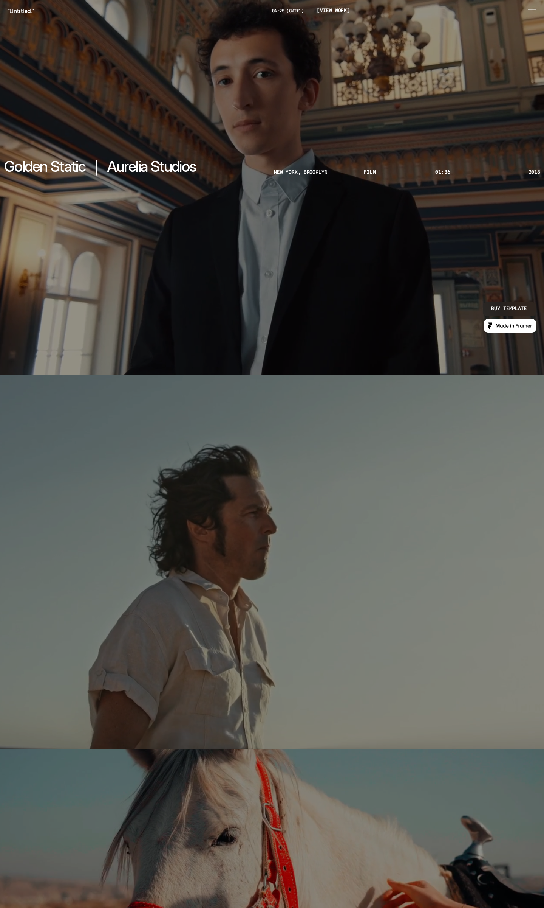
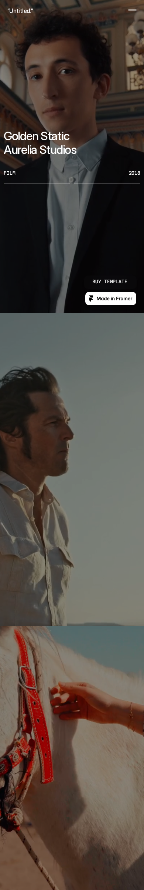

# UI Design System & Master Generation Blueprint: untitledfilm-framer-website

> **“Untitled.”** (https://untitledfilm.framer.website/) — Discover our premium Framer template built for filmmakers and filmmaking agencies specializing in narrative and commercial production. Ci...



---

## 1. Executive Visual Persona & Design Archetype

- **Brand Essence & Persona**: **“Untitled.”** (`https://untitledfilm.framer.website/`). Discover our premium Framer template built for filmmakers and filmmaking agencies specializing in narrative and commercial production. Ci...
- **Capture Provenance**: Live browser capture (`tier1_fast`, HTTP `200`, captured `2026-11-23`).
- **Visual Archetype**: **High-Contrast Obsidian / Atmospheric Design System (`#000000` canvas, `#ffffff` ink, `#0000ee` accent)**.
- **Anti-AI-Slop Differentiators**:
  - **Live-Computed Chromatic Polarity**: Anchors the viewport in `#000000` (live computed `body` `background-color` (`computed_styles.json`)) paired with `#ffffff` primary typography and `#0000ee` accents.
  - **Grounded Typographic Hierarchy**: Pairs `Inter Display` for display copy (`Golden Static`) with `Inter Display Placeholder` and `Spline Sans Mono`.
  - **Calibrated Spatial Grid & Motion**: Combines `1440px` container bounds (`gap: 10px`, padding `20px`) with `cubic-bezier(0.25,0.1,0.25,1)` easing and Lenis Smooth Scroll (`data-lenis`), Framer Motion Layout Physics.

---

## 2. Spatial Architecture & Modular Grid Mathematics



### Viewport Allocation & Container Geometry
- **Captured Viewport Dimensions**: Desktop `1440×2400px` (`assets/desktop.png`, clamped at 2400px live multi-section capture), Mobile `390×2400px` (`assets/mobile.png`, clamped at 2400px live multi-section capture).
- **Master Container Bounds**: `1440px` (full-bleed `100%` desktop stage measured on `1440px` viewport).
- **Canvas Lateral Padding & Spacing**: `20px` lateral canvas padding with `10px` grid gap.
- **Border Radius Scale**: `10px`, `8px`, `15px`.

### Responsive Breakpoint Architecture
- **Desktop Layout**: Multi-column CSS Grid / Flexbox layout at `1440px` (`max-width: 1440px`, `gap: 10px`).
- **Mobile Layout**: Single-column vertical stack at `390px` viewport width with `20px` horizontal padding.
- **Extracted CSS Media Queries**: `@media (max-width:809.98px)`, `@media (min-width:810px) and (max-width:1199.98px)`, `@media (max-width:1199px) and (min-width:810px)`, `@media (max-width:809px) and (min-width:0)`.

---

## 3. Color System, Materiality & Atmospheric Lighting

### Semantic Palette & Source Grounding
| Semantic Role | Ground-Truth Value | Extracted Live / CSS Source |
|---|---|---|
| **Primary Canvas Substrate** | `#000000` | live computed `body` `background-color` (`computed_styles.json`) |
| **Primary Typography Ink** | `#ffffff` | live computed `h1` `color` (`computed_styles.json`) |
| **Elevated Surface / Card Substrate** | `#ffffff` | `::selection { background: #ffffff }` |
| **Interactive Accent / Highlight** | `#0000ee` | live computed `a` `color` (`computed_styles.json`) |
| **Secondary / Muted Copy** | `#0000ee` | live computed `a` `color` (`computed_styles.json`) |
| **Structural Hairline Border** | `#0000ee` | hairline divider derived from live computed `a` `color` (`computed_styles.json`) |
| **Variable Token (`--token-728d667e-192a-43c3-9c63-5896e9b6b9a2`)** | `#aeaca8` | `var(--token-728d667e-192a-43c3-9c63-5896e9b6b9a2)` in `:root` |
| **Variable Token (`--token-e53dc5d9-c7b0-4885-9cc3-75b0357dc9f7`)** | `#0a0a0a` | `var(--token-e53dc5d9-c7b0-4885-9cc3-75b0357dc9f7)` in `:root` |
| **Variable Token (`--token-caf9a657-a30e-4472-b3ca-0fba92ef6291`)** | `#363636` | `var(--token-caf9a657-a30e-4472-b3ca-0fba92ef6291)` in `:root` |
| **Variable Token (`--token-00d06dfa-06ca-485d-b1a0-c62c60933780`)** | `#c4c4c2` | `var(--token-00d06dfa-06ca-485d-b1a0-c62c60933780)` in `:root` |

### Sanitized Root CSS Variables (`ui-ux.md` Ground Truth)
| Variable Name | Extracted Value | Semantic Role |
|---|---|---|
| `--token-9130abfd-2b2e-4652-8967-849c63d0f658` | `#fff` | Color / Atmospheric Token |
| `--token-50ec6c5c-a89d-4939-ab4e-f53ebea8cf63` | `#000` | Color / Atmospheric Token |
| `--token-728d667e-192a-43c3-9c63-5896e9b6b9a2` | `#aeaca8` | Color / Atmospheric Token |
| `--token-e53dc5d9-c7b0-4885-9cc3-75b0357dc9f7` | `#0a0a0a` | Color / Atmospheric Token |
| `--token-1000dd73-bde8-4ac7-9fb1-7ba3d170cea9` | `gray` | Design System Custom Token |
| `--token-d794ee9b-e334-4cd0-a7c7-9ca9d4ce2167` | `#fff` | Color / Atmospheric Token |
| `--token-caf9a657-a30e-4472-b3ca-0fba92ef6291` | `#363636` | Color / Atmospheric Token |
| `--token-00d06dfa-06ca-485d-b1a0-c62c60933780` | `#c4c4c2` | Color / Atmospheric Token |
| `--token-2fafc004-c4d0-4774-b2d3-bca8581a8919` | `#fff` | Color / Atmospheric Token |
| `--token-a78d294f-f3c7-4a88-b97e-670acf5e369f` | `#000` | Color / Atmospheric Token |
| `--token-df0587c7-0e65-43e2-ae9e-b0d3bc25eb50` | `#000` | Color / Atmospheric Token |
| `--token-9daa5760-deab-45ca-8dbb-ce92ef3fc8c3` | `#aeaca8` | Color / Atmospheric Token |
| `--token-3003b0e1-8475-4880-85ef-e6c8af07bd77` | `#000` | Color / Atmospheric Token |
| `--token-1d9a6d9c-dbe2-415a-b7b4-8369c22dbbed` | `#fff` | Color / Atmospheric Token |
| `--infinity` | `infinity` | Design System Custom Token |
| `--text-decoration-skip-ink` | `var(--framer-text-decoration-skip-ink)` | Typography Ink Token |

---

## 4. Typographic Scale & Editorial Hierarchy

### Font Family Stacks
- **Display Typography**: `Inter Display`.
- **Primary Body Stack**: `Inter Display Placeholder`.
- **Technical / Metadata Stack**: `Spline Sans Mono`.

### Typographic Scale & Rules (Live Computed & Stylesheet Grounded)
- **Hero Display (`H1`)**: live computed `h1` (`font-size: 40px`, `line-height: 46px`, `font-weight: 500`, `letter-spacing: -1.6px`); rule `h1` (`font-size: 32px`, `line-height: 115%`, `letter-spacing: -.04em`, `font-weight: 500`).
- **Section Heading (`H2`)**: observed font-size ladder: `40px`, `12px`, `16px`, `var(--font-size)`, `var(--framer-font-size)`.
- **Body Copy**: live computed `body` (`font-size: 12px`, `line-height: normal`, `font-weight: 400`); rule `p` (`font-size: 13px`, `line-height: 1.2em`, `letter-spacing: -.01em`, `font-weight: 500`).
- **Metadata & Navigation Labels**: live computed `nav/a` (`font-size: 12px`, `line-height: normal`, `font-weight: 400`); CSS variables `--letter-spacing: var(--framer-letter-spacing)`.

---

## 5. Choreographed Motion & Interaction Physics

### Primary Easing Curves
- **Extracted Timing Functions**: `cubic-bezier(0.25,0.1,0.25,1)`.

### Per-Element Transition & Choreography Rules
- **Selector `#__framer-editorbar-label`**: `transition: opacity 0.4s ease-out` extracted from `untitledfilm-framer-website` stylesheet.
- **Selector `.lenis.lenis-autoToggle`**: `transition: 1ms` extracted from `untitledfilm-framer-website` stylesheet.
- **Standard CSS Easing (`cubic-bezier(0.25,0.1,0.25,1)`)**: Default timing curve (no custom `cubic-bezier()` declared in captured CSS).
- **Runtime Interaction Engine**: Integrates Lenis Smooth Scroll (`data-lenis`), Framer Motion Layout Physics with `prefers-reduced-motion: reduce` fallback guards.

---

## 6. Component Wireframe & Structural DOM Map

### Visual Layout Schematic — Desktop (`1440px`, Grounded in `dom.html` & Landmark Bounding Boxes)
```
┌────────────────────────────────────────────────────────────────────────┐
│ DESKTOP VIEWPORT (1440px) — “Untitled.”                                │
│ ====================================================================== │
│ [ <nav.framer-yk3ex1> (1440x59px)     | “Untitled.” · [view work]    ] │
│ ---------------------------------------------------------------------- │
│ | HERO STAGE: <section.framer-1czbuyf> (w=1440px)                    | │
│ | H1: Golden Static                                                  | │
│ | Substrate: #000000 | Ink: #ffffff | Accent: #0000ee                | │
│ ---------------------------------------------------------------------- │
│ | SHOWCASE GRID (<section.framer-qdz5y>) max-w: 1440px               | │
│ | +------------------------------+  +------------------------------+ | │
│ | | Aurelia Studios              |  | Ultraviolet Bloom            | | │
│ | +------------------------------+  +------------------------------+ | │
│ ---------------------------------------------------------------------- │
│ | DETAIL MODULE (<section.framer-qt7BG>) — Lumora Lab                | │
│ ---------------------------------------------------------------------- │
│ [ FOOTER (<footer.framer-yk3ex) | https://untitledfilm.framer.website  │
└────────────────────────────────────────────────────────────────────────┘
```

### Visual Layout Schematic — Mobile Reflow (`390px`)
```
┌────────────────────────────────────────────────────────────────────────┐
│ MOBILE VIEWPORT REFLOW (390px) — Single-Column Stack (gap: 10px)       │
│ ====================================================================== │
│ [ HEADER BAR (<nav.framer-yk3ex1>     ) | Compact Menu (390px)         │
│ ---------------------------------------------------------------------- │
│ | HERO STAGE (<section.framer-1czbuyf>) — 390px Vertical Lead        | │
│ | H1: Golden Static                                                  | │
│ ---------------------------------------------------------------------- │
│ | SHOWCASE STACK (<section.framer-qdz5y>) — 1-Col Stack              | │
│ | [ Item 1: Aurelia Studios                                        ] | │
│ | [ Item 2: Ultraviolet Bloom                                      ] | │
│ ---------------------------------------------------------------------- │
│ | DETAIL STACK (<section.framer-qt7BG>) — 1-Col (Lumora Lab)         | │
│ ---------------------------------------------------------------------- │
│ [ FOOTER (<footer.framer-yk3ex) | Stacked 390px Colophon               │
└────────────────────────────────────────────────────────────────────────┘
```

### Granular DOM Region Breakdown
1. **Brand Header & Navigation Bar (<nav.framer-yk3ex1> — `untitledfilm-framer-website`)**:
   - Landmark `<nav class="framer-yk3ex1">` (`1440x59px`) hosting `“Untitled.”` navigation (`“Untitled.” · [view work]`), DOM attributes (`data-redirect-timezone="1"`, `data-framer-font-css`, `data-framer-css-ssr-minified`, `data-framer-components="framer-lib-cursors-ho..."`), and stylesheet rule `main { box-sizing:border-box;margin:0;padding:0 }`.
2. **Hero Stage & Focal Lead (<section.framer-1czbuyf> — `Golden Static`)**:
   - Landmark `<section class="framer-1czbuyf">` presenting display lead `Golden Static` and copy excerpt *"New York, Brooklyn"* over `#000000` canvas and `#ffffff` ink.
3. **Primary Showcase & Content Grid (<section.framer-qdz5y> — `Aurelia Studios`)**:
   - Landmark `<section class="framer-qdz5y framer-qt7BG">` rendering section `Aurelia Studios` with copy *"California, Big Sur"*, asset references (`fvHWptZ6qmlvCKfCMpUD3xRGR0.png`, `e3TdWqBmA0UQeUI4Q2TUBUkHWw.png`, `fonts.gstatic.com`, `hls.min.js`), and grid rule `root { -webkit-font-smoothing:antialiased;-moz-osx-font-smoothing:grayscale }`.
4. **Interactive Detail & Feature Matrix (<section.framer-qt7BG> — `Ultraviolet Bloom`)**:
   - Landmark `<section class="framer-qdz5y framer-qt7BG">` framing `Ultraviolet Bloom` and `Lumora Lab` (*"hello@untitled.com"*) with `#ffffff` surface cards, `#0000ee` accents, and `button { font-family:sans-serif;font-size:12px }`.
5. **Colophon & Global Directory Footer (<footer.framer-yk3ex1> — `https://untitledfilm.framer.website/`)**:
   - Landmark `<footer class="framer-yk3ex1">` anchoring `“Untitled.”` footer links (`“Untitled.” · [view work]`), copy *"®2026 All Rights Reserved · “Untitled.”"*, and `#0000ee` structural dividers.

---

## 7. Master Zero-Shot AI Generation Prompt

```markdown
# Master Zero-Shot Frontend Generation Prompt: untitledfilm-framer-website (“Untitled.”)

You are a principal frontend architect and design systems engineer. Build a complete, production-ready web application replicating the exact design system, DOM landmarks, typographic hierarchy, color tokens, and motion physics of `untitledfilm-framer-website` (**“Untitled.”** — `https://untitledfilm.framer.website/`).

### 1. Visual Archetype & Anti-AI-Slop Mandates
- **Archetype**: High-Contrast Obsidian / Atmospheric Design System (`#000000` canvas, `#ffffff` ink, `#0000ee` accent).
- **Identity & Domain Context**: Discover our premium Framer template built for filmmakers and filmmaking agencies specializing in narrative and commercial production. Ci...
- **Primary Substrate**: `#000000` (live computed `body` `background-color` (`computed_styles.json`)), **Primary Ink**: `#ffffff`, **Accent / Highlight**: `#0000ee`.
- **Site-Specific Differentiators**:
  - **Live-Computed Chromatic Polarity**: Anchors the viewport in `#000000` (live computed `body` `background-color` (`computed_styles.json`)) paired with `#ffffff` primary typography and `#0000ee` accents.
  - **Grounded Typographic Hierarchy**: Pairs `Inter Display` for display copy (`Golden Static`) with `Inter Display Placeholder` and `Spline Sans Mono`.
  - **Calibrated Spatial Grid & Motion**: Combines `1440px` container bounds (`gap: 10px`, padding `20px`) with `cubic-bezier(0.25,0.1,0.25,1)` easing and Lenis Smooth Scroll (`data-lenis`), Framer Motion Layout Physics.

### 2. Ground-Truth CSS Variables (`:root` Token Contract)
Declare and consume these exact custom properties extracted from `untitledfilm-framer-website` in your global stylesheet:

:root {
  /* “Untitled.” (untitledfilm-framer-website) — Live-Grounded CSS Variables */
  --token-9130abfd-2b2e-4652-8967-849c63d0f658: #fff; /* Color / Atmospheric Token (untitledfilm-framer-website) */
  --token-50ec6c5c-a89d-4939-ab4e-f53ebea8cf63: #000; /* Color / Atmospheric Token (untitledfilm-framer-website) */
  --token-728d667e-192a-43c3-9c63-5896e9b6b9a2: #aeaca8; /* Color / Atmospheric Token (untitledfilm-framer-website) */
  --token-e53dc5d9-c7b0-4885-9cc3-75b0357dc9f7: #0a0a0a; /* Color / Atmospheric Token (untitledfilm-framer-website) */
  --token-1000dd73-bde8-4ac7-9fb1-7ba3d170cea9: gray; /* Design System Custom Token (untitledfilm-framer-website) */
  --token-d794ee9b-e334-4cd0-a7c7-9ca9d4ce2167: #fff; /* Color / Atmospheric Token (untitledfilm-framer-website) */
  --token-caf9a657-a30e-4472-b3ca-0fba92ef6291: #363636; /* Color / Atmospheric Token (untitledfilm-framer-website) */
  --token-00d06dfa-06ca-485d-b1a0-c62c60933780: #c4c4c2; /* Color / Atmospheric Token (untitledfilm-framer-website) */
  --token-2fafc004-c4d0-4774-b2d3-bca8581a8919: #fff; /* Color / Atmospheric Token (untitledfilm-framer-website) */
  --token-a78d294f-f3c7-4a88-b97e-670acf5e369f: #000; /* Color / Atmospheric Token (untitledfilm-framer-website) */
  --token-df0587c7-0e65-43e2-ae9e-b0d3bc25eb50: #000; /* Color / Atmospheric Token (untitledfilm-framer-website) */
  --token-9daa5760-deab-45ca-8dbb-ce92ef3fc8c3: #aeaca8; /* Color / Atmospheric Token (untitledfilm-framer-website) */
  --token-3003b0e1-8475-4880-85ef-e6c8af07bd77: #000; /* Color / Atmospheric Token (untitledfilm-framer-website) */
  --token-1d9a6d9c-dbe2-415a-b7b4-8369c22dbbed: #fff; /* Color / Atmospheric Token (untitledfilm-framer-website) */
  --infinity: infinity; /* Design System Custom Token (untitledfilm-framer-website) */
  --text-decoration-skip-ink: var(--framer-text-decoration-skip-ink); /* Typography Ink Token (untitledfilm-framer-website) */
}

### 3. Semantic Color & Materiality Contract
Map every surface, ink, and border strictly to these source-grounded tokens:
- **Primary Canvas Substrate**: `#000000` — grounded in live computed `body` `background-color` (`computed_styles.json`)
- **Primary Typography Ink**: `#ffffff` — grounded in live computed `h1` `color` (`computed_styles.json`)
- **Elevated Surface / Card Substrate**: `#ffffff` — grounded in `::selection { background: #ffffff }`
- **Interactive Accent / Highlight**: `#0000ee` — grounded in live computed `a` `color` (`computed_styles.json`)
- **Secondary / Muted Copy**: `#0000ee` — grounded in live computed `a` `color` (`computed_styles.json`)
- **Structural Hairline Border**: `#0000ee` — grounded in hairline divider derived from live computed `a` `color` (`computed_styles.json`)
- **Variable Token (`--token-728d667e-192a-43c3-9c63-5896e9b6b9a2`)**: `#aeaca8` — grounded in `var(--token-728d667e-192a-43c3-9c63-5896e9b6b9a2)` in `:root`
- **Variable Token (`--token-e53dc5d9-c7b0-4885-9cc3-75b0357dc9f7`)**: `#0a0a0a` — grounded in `var(--token-e53dc5d9-c7b0-4885-9cc3-75b0357dc9f7)` in `:root`
- **Variable Token (`--token-caf9a657-a30e-4472-b3ca-0fba92ef6291`)**: `#363636` — grounded in `var(--token-caf9a657-a30e-4472-b3ca-0fba92ef6291)` in `:root`
- **Variable Token (`--token-00d06dfa-06ca-485d-b1a0-c62c60933780`)**: `#c4c4c2` — grounded in `var(--token-00d06dfa-06ca-485d-b1a0-c62c60933780)` in `:root`

### 4. Spatial Grid, Container Bounds & Responsive Breakpoints
- **Desktop Viewport Reference**: `1440×2400px` (clamped at 2400px live multi-section capture, `1440px` standard desktop width).
- **Mobile Viewport Reference**: `390×2400px` (clamped at 2400px live multi-section capture, `390px` standard mobile width).
- **Container Max-Width**: `1440px` (full-bleed `100%` desktop stage measured on `1440px` viewport)
- **Padding & Gutters**: `20px` lateral canvas padding with `10px` grid gap
- **Desktop Grid**: Multi-column CSS Grid / Flexbox layout at `1440px` (`max-width: 1440px`, `gap: 10px`)
- **Mobile Adaptation**: Single-column vertical stack at `390px` viewport width with `20px` horizontal padding
- **Media Queries**: `@media (max-width:809.98px)`, `@media (min-width:810px) and (max-width:1199.98px)`, `@media (max-width:1199px) and (min-width:810px)`, `@media (max-width:809px) and (min-width:0)`
- **Corner Radii**: `10px`, `8px`, `15px`

### 5. Typography & Editorial Scale Contract
- **Display Font Stack**: `Inter Display`
- **Body Font Stack**: `Inter Display Placeholder`
- **Monospace / Technical Font Stack**: `Spline Sans Mono`
- **H1 Display Rule**: live computed `h1` (`font-size: 40px`, `line-height: 46px`, `font-weight: 500`, `letter-spacing: -1.6px`); rule `h1` (`font-size: 32px`, `line-height: 115%`, `letter-spacing: -.04em`, `font-weight: 500`)
- **H2 Section Rule**: observed font-size ladder: `40px`, `12px`, `16px`, `var(--font-size)`, `var(--framer-font-size)`
- **Body Copy Rule**: live computed `body` (`font-size: 12px`, `line-height: normal`, `font-weight: 400`); rule `p` (`font-size: 13px`, `line-height: 1.2em`, `letter-spacing: -.01em`, `font-weight: 500`)
- **Metadata & Index Rule**: live computed `nav/a` (`font-size: 12px`, `line-height: normal`, `font-weight: 400`); CSS variables `--letter-spacing: var(--framer-letter-spacing)`

### 6. Component Hierarchy, Verbatim Copy & Real DOM Landmarks
Scaffold `untitledfilm-framer-website` (`“Untitled.”`) with these exact structural regions, extracted copy, and CSS rules from `dom.html`:
1. **Brand Header & Navigation Bar (<nav.framer-yk3ex1> — `untitledfilm-framer-website`)**:
   - DOM & Selectors: Landmark `<nav class="framer-yk3ex1">` (`1440x59px`) hosting `“Untitled.”` navigation (`“Untitled.” · [view work]`), DOM attributes (`data-redirect-timezone="1"`, `data-framer-font-css`, `data-framer-css-ssr-minified`, `data-framer-components="framer-lib-cursors-ho..."`), and stylesheet rule `main { box-sizing:border-box;margin:0;padding:0 }`.
   - Responsive Contract: Header `Brand Header & Navigation Bar (<nav.framer-yk3ex1> — `untitledfilm-framer-website`)` (`untitledfilm-framer-website`) adapts across `@media (max-width:809.98px)`, `@media (min-width:810px) and (max-width:1199.98px)`, `@media (max-width:1199px) and (min-width:810px)`, `@media (max-width:809px) and (min-width:0)` with `cubic-bezier(0.25,0.1,0.25,1)` transitions and links `“Untitled.” · [view work]`.
2. **Hero Stage & Focal Lead (<section.framer-1czbuyf> — `Golden Static`)**:
   - DOM & Selectors: Landmark `<section class="framer-1czbuyf">` presenting display lead `Golden Static` and copy excerpt *"New York, Brooklyn"* over `#000000` canvas and `#ffffff` ink.
   - Responsive Contract: Hero stage (`1440×2400px` desktop / `390×2400px` mobile) sets `#000000` background with `#ffffff` headline `Golden Static`.
3. **Primary Showcase & Content Grid (<section.framer-qdz5y> — `Aurelia Studios`)**:
   - DOM & Selectors: Landmark `<section class="framer-qdz5y framer-qt7BG">` rendering section `Aurelia Studios` with copy *"California, Big Sur"*, asset references (`fvHWptZ6qmlvCKfCMpUD3xRGR0.png`, `e3TdWqBmA0UQeUI4Q2TUBUkHWw.png`, `fonts.gstatic.com`, `hls.min.js`), and grid rule `root { -webkit-font-smoothing:antialiased;-moz-osx-font-smoothing:grayscale }`.
   - Responsive Contract: Showcase grid `Primary Showcase & Content Grid (<section.framer-qdz5y> — `Aurelia Studios`)` applies Multi-column CSS Grid / Flexbox layout at `1440px` (`max-width: 1440px`, `gap: 10px`) on desktop and Single-column vertical stack at `390px` viewport width with `20px` horizontal padding on mobile.
4. **Interactive Detail & Feature Matrix (<section.framer-qt7BG> — `Ultraviolet Bloom`)**:
   - DOM & Selectors: Landmark `<section class="framer-qdz5y framer-qt7BG">` framing `Ultraviolet Bloom` and `Lumora Lab` (*"hello@untitled.com"*) with `#ffffff` surface cards, `#0000ee` accents, and `button { font-family:sans-serif;font-size:12px }`.
   - Responsive Contract: Detail module `Interactive Detail & Feature Matrix (<section.framer-qt7BG> — `Ultraviolet Bloom`)` uses `10px`, `8px`, `15px` radii, `#0000ee` highlights, and assets (fvHWptZ6qmlvCKfCMpUD3xRGR0.png, e3TdWqBmA0UQeUI4Q2TUBUkHWw.png, fonts.gstatic.com).
5. **Colophon & Global Directory Footer (<footer.framer-yk3ex1> — `https://untitledfilm.framer.website/`)**:
   - DOM & Selectors: Landmark `<footer class="framer-yk3ex1">` anchoring `“Untitled.”` footer links (`“Untitled.” · [view work]`), copy *"®2026 All Rights Reserved · “Untitled.”"*, and `#0000ee` structural dividers.
   - Responsive Contract: Footer `Colophon & Global Directory Footer (<footer.framer-yk3ex1> — `https://untitledfilm.framer.website/`)` aligns to `1440px` (full-bleed `100%` desktop stage measured on `1440px` viewport) with `20px` lateral canvas padding with `10px` grid gap and attributes (data-redirect-timezone="1", data-framer-font-css, data-framer-css-ssr-minified).

#### Verbatim DOM Copy Excerpts (`dom.html`)
- Copy Excerpt 1: *"New York, Brooklyn"*
- Copy Excerpt 2: *"California, Big Sur"*
- Copy Excerpt 3: *"hello@untitled.com"*
- Copy Excerpt 4: *"®2026 All Rights Reserved · “Untitled.”"*

### 7. Motion, Extracted Stylesheet Rules & Interaction Choreography
- **Primary Easing Functions**: `cubic-bezier(0.25,0.1,0.25,1)`
- **Extracted Stylesheet Rules (`untitledfilm-framer-website`)**:
- `main { box-sizing:border-box;margin:0;padding:0 }`
- `root { -webkit-font-smoothing:antialiased;-moz-osx-font-smoothing:grayscale }`
- `button { font-family:sans-serif;font-size:12px }`
- `__framer-badge-container { --infinity:infinity }`
- `body { --framer-will-change-override:transform }`
- **Per-Selector Transition Rules**:
- **Selector `#__framer-editorbar-label`**: `transition: opacity 0.4s ease-out` extracted from `untitledfilm-framer-website` stylesheet.
- **Selector `.lenis.lenis-autoToggle`**: `transition: 1ms` extracted from `untitledfilm-framer-website` stylesheet.
- **Standard CSS Easing (`cubic-bezier(0.25,0.1,0.25,1)`)**: Default timing curve (no custom `cubic-bezier()` declared in captured CSS).
- **Runtime Interaction Engine**: Integrates Lenis Smooth Scroll (`data-lenis`), Framer Motion Layout Physics with `prefers-reduced-motion: reduce` fallback guards.

### 8. Technical Deliverables
- Implement in Next.js (App Router) with TypeScript and Tailwind CSS consuming the `:root` custom properties defined above for `untitledfilm-framer-website`.
- Reproduce both the `1440px` desktop architecture and `390px` mobile breakpoint transitions, preserving semantic HTML5 landmarks (`<header>`, `<nav>`, `<main>`, `<section>`, `<footer>`) and `prefers-reduced-motion` accessibility guards.
```
