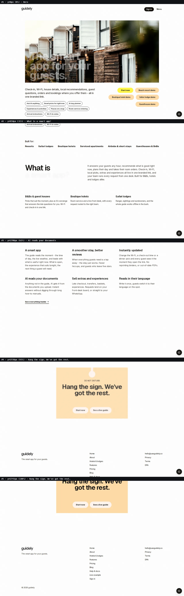
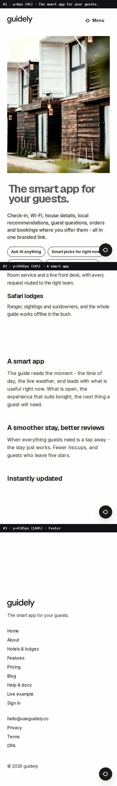

# UI Design System & Master Generation Blueprint: useguidely-co

> **guidely - the hospitality of the future** (https://useguidely.co/) — A smart guest app that answers questions any hour, recommends what is good right now, plans the day and takes room orders, all from one l...





---

## 1. Executive Visual Persona & Design Archetype

- **Brand Essence & Persona**: **guidely - the hospitality of the future** (`https://useguidely.co/`). A smart guest app that answers questions any hour, recommends what is good right now, plans the day and takes room orders, all from one l...
- **Capture Provenance**: Live browser capture (`tier1_fast`, HTTP `200`, captured `2026-11-24`).
- **Visual Archetype**: **Light-Substrate Editorial & Modular Grid System (`#ffffff` canvas, `#14110d` ink, `#9b7b4d` accent)**.
- **Anti-AI-Slop Differentiators**:
  - **Live-Computed Chromatic Polarity**: Anchors the viewport in `#ffffff` (live computed `body` `background-color` (`computed_styles.json`)) paired with `#14110d` primary typography and `#9b7b4d` accents.
  - **Grounded Typographic Hierarchy**: Pairs `Geist` for display copy (`The smart app for your guests.`) with `Inter` and `SFMono-Regular`.
  - **Calibrated Spatial Grid & Motion**: Combines `1120px` container bounds (`gap: 10px normal`, padding `24px`) with `cubic-bezier(0,0,.2,1)` easing.

---

## 2. Spatial Architecture & Modular Grid Mathematics

### Viewport Allocation & Container Geometry
- **Captured Journey Filmstrips**: Desktop `1280×4140px` (`assets/desktop-journey.webp`, `5` keyframes up to `y=2743px` / doc `3643px`), Mobile `390×2616px` (`assets/mobile-journey.webp`, `3` keyframes).
- **Master Container Bounds**: `1120px` (measured widest bounded `<section>` landmark width on `1440px` desktop).
- **Canvas Lateral Padding & Spacing**: `24px` lateral canvas padding with `10px normal` grid gap.
- **Border Radius Scale**: `9999px`, `.25rem`, `1rem`, `1.5rem`.

### Responsive Breakpoint Architecture
- **Desktop Layout**: Multi-column CSS Grid / Flexbox layout at `1440px` (`max-width: 1120px`, `gap: 10px normal`).
- **Mobile Layout**: Single-column vertical stack at `390px` viewport width with `24px` horizontal padding.
- **Extracted CSS Media Queries**: `@media (min-width:640px)`, `@media (min-width:768px)`, `@media (min-width:1024px)`, `@media (min-width:1280px)`.

---

## 3. Color System, Materiality & Atmospheric Lighting

### Semantic Palette & Source Grounding
| Semantic Role | Ground-Truth Value | Extracted Live / CSS Source |
|---|---|---|
| **Primary Canvas Substrate** | `#ffffff` | live computed `body` `background-color` (`computed_styles.json`) |
| **Primary Typography Ink** | `#14110d` | live computed `h2` `color` (`computed_styles.json`) |
| **Elevated Surface / Card Substrate** | `#f4d5c2` | `.flood-cover { background: #f4d5c2 }` |
| **Interactive Accent / Highlight** | `#9b7b4d` | `var(--accent)` in `:root` |
| **Secondary / Muted Copy** | `#6f6f6f` | `var(--muted)` in `:root` |
| **Structural Hairline Border** | `#ebebeb` | `var(--line)` in `:root` (`rgba(0,0,0,.08)`) |
| **Variable Token (`--brand`)** | `#1f1d1a` | `var(--brand)` in `:root` |
| **Variable Token (`--ink`)** | `#222222` | `var(--ink)` in `:root` |

### Sanitized Root CSS Variables (`ui-ux.md` Ground Truth)
| Variable Name | Extracted Value | Semantic Role |
|---|---|---|
| `--brand` | `#1f1d1a` | Brand / Palette Token |
| `--accent` | `#9b7b4d` | Brand / Palette Token |
| `--surface` | `#fff` | Canvas / Surface Token |
| `--ink` | `#222` | Typography Ink Token |
| `--muted` | `#6f6f6f` | Color / Atmospheric Token |
| `--line` | `rgba(0,0,0,.08)` | Color / Atmospheric Token |
| `--font-display` | `Georgia,"Times New Roman",serif` | Typography / Scale Token |
| `--vintage-filter` | `sepia(0.24) saturate(1.1) contrast(1.04) brightness(1.02)` | Design System Custom Token |
| `--hop` | `center 42%` | Dimension / Scale Token |
| `--font-name` | `system-ui,-apple-system,BlinkMacSystemFont,"Segoe UI",sans-serif` | Typography / Scale Token |
| `--font-body` | `system-ui,-apple-system,BlinkMacSystemFont,"Segoe UI",sans-serif` | Typography / Scale Token |
| `--font-mono` | `ui-monospace,SFMono-Regular,Menlo,monospace` | Typography / Scale Token |
| `--hero-ready` | `0` | Design System Custom Token |
| `--reveal-delay` | `0ms` | Motion / Easing Token |
| `--useguidely-co-bg` | `#ffffff` | Canvas Substrate (from live computed `body` `background-color` (`computed_styles.json`)) |
| `--useguidely-co-ink` | `#14110d` | Primary Typography Ink (computed-derived) |

---

## 4. Typographic Scale & Editorial Hierarchy

### Font Family Stacks
- **Display Typography**: `Geist`.
- **Primary Body Stack**: `Inter`.
- **Technical / Metadata Stack**: `SFMono-Regular`.

### Typographic Scale & Rules (Live Computed & Stylesheet Grounded)
- **Hero Display (`H1`)**: live computed `h1` (`font-size: 87.84px`, `line-height: 74.664px`, `font-weight: 700`, `letter-spacing: -3.9528px`); CSS variables `--font-display: Georgia,"Times New Roman",serif`.
- **Section Heading (`H2`)**: live computed `h2` (`font-size: 60px`, `line-height: 55.2px`, `font-weight: 600`, `letter-spacing: -2.1px`).
- **Body Copy**: live computed `body` (`font-size: 16px`, `line-height: 24px`, `font-weight: 400`); CSS variables `--font-body: system-ui,-apple-system,BlinkMacSystemFont,"Segoe UI",sans-serif`.
- **Metadata & Navigation Labels**: live computed `nav/a` (`font-size: 14px`, `line-height: 20px`, `font-weight: 400`); CSS variables `--font-mono: ui-monospace,SFMono-Regular,Menlo,monospace`.

---

## 5. Choreographed Motion & Interaction Physics

### Primary Easing Curves
- **Extracted Timing Functions**: `cubic-bezier(0,0,.2,1)`, `cubic-bezier(.4,0,.6,1)`, `cubic-bezier(.4,0,.2,1)`.

### Per-Element Transition & Choreography Rules
- **Selector `.transition`**: `transition: cubic-bezier(0,0,.2,1)` extracted from `useguidely-co` stylesheet.
- **Selector `.transition-\[padding\]`**: `transition: cubic-bezier(0,0,.2,1)` extracted from `useguidely-co` stylesheet.
- **Selector `.transition-\[width\]`**: `transition: cubic-bezier(0,0,.2,1)` extracted from `useguidely-co` stylesheet.
- **Extracted Easing Curve (`cubic-bezier(0,0,.2,1)`)**: Governs interactive state transitions across `<header.max-w-6xl>` and `<section.mt-12>`.
- **State & Hover Choreography**: Opacity and transform transitions on `<section.hero-sec>` and `<section.mt-12>` interactive targets.
### Measured Runtime Scroll & Interaction Telemetry (`behavioral_journey_v2`)
- **Scroll Driver Mode**: `native` (max document height `3643px`, deepest scrollY reached `2743px` across `5` desktop keyframes).
- **Detected Scroll / Motion Libraries**: Native browser scroll / standard CSS transitions.
- **Nav / Drawer Probe (`Menu`)**: Triggered visual change (pixel diff `124.429`, captured in `assets/state-nav.webp`); revealed links: Home Start here, About Our story, Hotels & lodges Built..., Features What's inside, Pricing $9 per key, Blog Field notes.
- **Hover Physics (`primary_cta` · `Sign in`)**: Computed transition `0s` / `ease` (no static color/transform shift captured at rest).
- **Route Transition Architecture**: First internal navigation (`/features`) measured as `direct` in `779ms`.

---

## 6. Component Wireframe & Structural DOM Map

### Visual Layout Schematic — Desktop (`1440px`, Grounded in `dom.html` & Landmark Bounding Boxes)
```
┌────────────────────────────────────────────────────────────────────────┐
│ DESKTOP VIEWPORT (1440px) — guidely - the hospitality of the future    │
│ ====================================================================== │
│ [ <header.max-w-6xl> (1152x80px)      | Home · About · Hotels & lodg ] │
│ ---------------------------------------------------------------------- │
│ | HERO STAGE: <section.hero-sec> (w=1440px)                          | │
│ | H1: The smart app for your guests.                                 | │
│ | Substrate: #ffffff | Ink: #14110d | Accent: #9b7b4d                | │
│ ---------------------------------------------------------------------- │
│ | SHOWCASE GRID (<section.mt-12>) max-w: 1120px                      | │
│ | +------------------------------+  +------------------------------+ | │
│ | | Check-in, Wi-Fi, house detai |  | Smart picks for right now    | | │
│ | +------------------------------+  +------------------------------+ | │
│ ---------------------------------------------------------------------- │
│ | DETAIL MODULE (<section.mx-auto>) — Experiences & activit          | │
│ ---------------------------------------------------------------------- │
│ [ FOOTER (<footer.mt-16>      ) | https://useguidely.co/               │
└────────────────────────────────────────────────────────────────────────┘
```

### Visual Layout Schematic — Mobile Reflow (`390px`)
```
┌────────────────────────────────────────────────────────────────────────┐
│ MOBILE VIEWPORT REFLOW (390px) — Single-Column Stack (gap: 10px nor)   │
│ ====================================================================== │
│ [ HEADER BAR (<header.max-w-6xl>      ) | Compact Menu (390px)         │
│ ---------------------------------------------------------------------- │
│ | HERO STAGE (<section.hero-sec>) — 390px Vertical Lead              | │
│ | H1: The smart app for your guests.                                 | │
│ ---------------------------------------------------------------------- │
│ | SHOWCASE STACK (<section.mt-12>) — 1-Col Stack                     | │
│ | [ Item 1: Check-in, Wi-Fi, house details, local recommenda       ] | │
│ | [ Item 2: Smart picks for right now                              ] | │
│ ---------------------------------------------------------------------- │
│ | DETAIL STACK (<section.mx-auto>) — 1-Col (Experiences & acti)      | │
│ ---------------------------------------------------------------------- │
│ [ FOOTER (<footer.mt-16>      ) | Stacked 390px Colophon               │
└────────────────────────────────────────────────────────────────────────┘
```

### Granular DOM Region Breakdown
1. **Brand Header & Navigation Bar (<header.max-w-6xl> — `useguidely-co`)**:
   - Landmark `<header class="max-w-6xl py-5">` (`1152x80px`) hosting `guidely - the hospitality of the fut` navigation (`Home · About · Hotels & lodges · Features · Pricing`), DOM attributes (`data-precedence="next"`, `data-foldout-prefetch`, `data-spark="true"`, `data-reveal="stagger"`), and stylesheet rule `before { box-sizing:border-box;border:0 solid e5e7eb }`.
2. **Hero Stage & Focal Lead (<section.hero-sec> — `The smart app for your guests.`)**:
   - Landmark `<section class="hero-sec pt-3">` presenting display lead `The smart app for your guests.` and copy excerpt *"Check-in, Wi-Fi, house details, local recommendations, guest ques"* over `#ffffff` canvas and `#14110d` ink.
3. **Primary Showcase & Content Grid (<section.mt-12> — `Check-in, Wi-Fi, house details, lo`)**:
   - Landmark `<section class="mt-12">` rendering section `Check-in, Wi-Fi, house details, local recommenda` with copy *"Smart picks for right now"*, asset references (`logo.png`, `hero-cover-19.jpg`, `001c094435c96c6a.css`, `webpack-61e7ac9f112b97ad.js`), and grid rule `body { margin:0;line-height:inherit }`.
4. **Interactive Detail & Feature Matrix (<section.mx-auto> — `Smart picks for right now`)**:
   - Landmark `<section class="mx-auto px-6">` framing `Smart picks for right now` and `Experiences & activities` (*"Experiences & activities"*) with `#f4d5c2` surface cards, `#9b7b4d` accents, and `strong { font-weight:bolder }`.
5. **Colophon & Global Directory Footer (<footer.mt-16> — `https://useguidely.co/`)**:
   - Landmark `<footer class="mt-16">` anchoring `guidely - the hospitality of the` footer links (`Home · About · Hotels & lodges · Features · Pricing`), copy *"Room service ordering"*, and `#ebebeb` structural dividers.
### Full Vertical Scroll Sequence (Desktop `1440×900` Keyframes)
- **Step 01** (`y=0px`, `0%`): Active landmark `Hero` · sticky/fixed elements: `2`
- **Step 02** (`y=850px`, `31%`): Active landmark `What is a smart app?` · sticky/fixed elements: `2`
- **Step 03** (`y=1700px`, `62%`): Active landmark `AI reads your documents` · sticky/fixed elements: `2`
- **Step 04** (`y=2550px`, `93%`): Active landmark `Hang the sign. We've got the rest.` · sticky/fixed elements: `2`
- **Step 05** (`y=2743px`, `100%`): Active landmark `Hang the sign. We've got the rest.` · sticky/fixed elements: `2`

### Multi-Page Internal Route Map
- **Listing Route (`/features`)**: `https://useguidely.co/features` — H1: `Features · guidely`, scrollHeight `3802px`, transition `direct` (`779ms`)
- **About Route (`/about`)**: `https://useguidely.co/about` — H1: `A guest app and a front desk.`, scrollHeight `3515px`, transition `direct` (`1281ms`)
- **Listing Route (`/pricing`)**: `https://useguidely.co/pricing` — H1: `Pricing that scales with you.`, scrollHeight `3461px`, transition `direct` (`369ms`)

---

## 7. Master Zero-Shot AI Generation Prompt

```markdown
# Master Zero-Shot Frontend Generation Prompt: useguidely-co (guidely - the hospitality of the future)

You are a principal frontend architect and design systems engineer. Build a complete, production-ready web application replicating the exact design system, DOM landmarks, typographic hierarchy, color tokens, and motion physics of `useguidely-co` (**guidely - the hospitality of the future** — `https://useguidely.co/`).

### 1. Visual Archetype & Anti-AI-Slop Mandates
- **Archetype**: Light-Substrate Editorial & Modular Grid System (`#ffffff` canvas, `#14110d` ink, `#9b7b4d` accent).
- **Identity & Domain Context**: A smart guest app that answers questions any hour, recommends what is good right now, plans the day and takes room orders, all from one l...
- **Primary Substrate**: `#ffffff` (live computed `body` `background-color` (`computed_styles.json`)), **Primary Ink**: `#14110d`, **Accent / Highlight**: `#9b7b4d`.
- **Site-Specific Differentiators**:
  - **Live-Computed Chromatic Polarity**: Anchors the viewport in `#ffffff` (live computed `body` `background-color` (`computed_styles.json`)) paired with `#14110d` primary typography and `#9b7b4d` accents.
  - **Grounded Typographic Hierarchy**: Pairs `Geist` for display copy (`The smart app for your guests.`) with `Inter` and `SFMono-Regular`.
  - **Calibrated Spatial Grid & Motion**: Combines `1120px` container bounds (`gap: 10px normal`, padding `24px`) with `cubic-bezier(0,0,.2,1)` easing.

### 2. Ground-Truth CSS Variables (`:root` Token Contract)
Declare and consume these exact custom properties extracted from `useguidely-co` in your global stylesheet:

:root {
  /* guidely - the hospitality of the future (useguidely-co) — Live-Grounded CSS Variables */
  --brand: #1f1d1a; /* Brand / Palette Token (useguidely-co) */
  --accent: #9b7b4d; /* Brand / Palette Token (useguidely-co) */
  --surface: #fff; /* Canvas / Surface Token (useguidely-co) */
  --ink: #222; /* Typography Ink Token (useguidely-co) */
  --muted: #6f6f6f; /* Color / Atmospheric Token (useguidely-co) */
  --line: rgba(0,0,0,.08); /* Color / Atmospheric Token (useguidely-co) */
  --font-display: Georgia,"Times New Roman",serif; /* Typography / Scale Token (useguidely-co) */
  --vintage-filter: sepia(0.24) saturate(1.1) contrast(1.04) brightness(1.02); /* Design System Custom Token (useguidely-co) */
  --hop: center 42%; /* Dimension / Scale Token (useguidely-co) */
  --font-name: system-ui,-apple-system,BlinkMacSystemFont,"Segoe UI",sans-serif; /* Typography / Scale Token (useguidely-co) */
  --font-body: system-ui,-apple-system,BlinkMacSystemFont,"Segoe UI",sans-serif; /* Typography / Scale Token (useguidely-co) */
  --font-mono: ui-monospace,SFMono-Regular,Menlo,monospace; /* Typography / Scale Token (useguidely-co) */
  --hero-ready: 0; /* Design System Custom Token (useguidely-co) */
  --reveal-delay: 0ms; /* Motion / Easing Token (useguidely-co) */
  --useguidely-co-bg: #ffffff; /* Canvas Substrate (from live computed `body` `background-color` (`computed_styles.json`)) (useguidely-co) */
  --useguidely-co-ink: #14110d; /* Primary Typography Ink (computed-derived) (useguidely-co) */
}

### 3. Semantic Color & Materiality Contract
Map every surface, ink, and border strictly to these source-grounded tokens:
- **Primary Canvas Substrate**: `#ffffff` — grounded in live computed `body` `background-color` (`computed_styles.json`)
- **Primary Typography Ink**: `#14110d` — grounded in live computed `h2` `color` (`computed_styles.json`)
- **Elevated Surface / Card Substrate**: `#f4d5c2` — grounded in `.flood-cover { background: #f4d5c2 }`
- **Interactive Accent / Highlight**: `#9b7b4d` — grounded in `var(--accent)` in `:root`
- **Secondary / Muted Copy**: `#6f6f6f` — grounded in `var(--muted)` in `:root`
- **Structural Hairline Border**: `#ebebeb` — grounded in `var(--line)` in `:root` (`rgba(0,0,0,.08)`)
- **Variable Token (`--brand`)**: `#1f1d1a` — grounded in `var(--brand)` in `:root`
- **Variable Token (`--ink`)**: `#222222` — grounded in `var(--ink)` in `:root`

### 4. Spatial Grid, Container Bounds & Responsive Breakpoints
- **Desktop Viewport Reference**: `1280×4140px` (multi-frame vertical journey filmstrip (4140px), `1440px` standard desktop width).
- **Mobile Viewport Reference**: `390×2616px` (multi-frame vertical journey filmstrip (2616px), `390px` standard mobile width).
- **Container Max-Width**: `1120px` (measured widest bounded `<section>` landmark width on `1440px` desktop)
- **Padding & Gutters**: `24px` lateral canvas padding with `10px normal` grid gap
- **Desktop Grid**: Multi-column CSS Grid / Flexbox layout at `1440px` (`max-width: 1120px`, `gap: 10px normal`)
- **Mobile Adaptation**: Single-column vertical stack at `390px` viewport width with `24px` horizontal padding
- **Media Queries**: `@media (min-width:640px)`, `@media (min-width:768px)`, `@media (min-width:1024px)`, `@media (min-width:1280px)`
- **Corner Radii**: `9999px`, `.25rem`, `1rem`, `1.5rem`

### 5. Typography & Editorial Scale Contract
- **Display Font Stack**: `Geist`
- **Body Font Stack**: `Inter`
- **Monospace / Technical Font Stack**: `SFMono-Regular`
- **H1 Display Rule**: live computed `h1` (`font-size: 87.84px`, `line-height: 74.664px`, `font-weight: 700`, `letter-spacing: -3.9528px`); CSS variables `--font-display: Georgia,"Times New Roman",serif`
- **H2 Section Rule**: live computed `h2` (`font-size: 60px`, `line-height: 55.2px`, `font-weight: 600`, `letter-spacing: -2.1px`)
- **Body Copy Rule**: live computed `body` (`font-size: 16px`, `line-height: 24px`, `font-weight: 400`); CSS variables `--font-body: system-ui,-apple-system,BlinkMacSystemFont,"Segoe UI",sans-serif`
- **Metadata & Index Rule**: live computed `nav/a` (`font-size: 14px`, `line-height: 20px`, `font-weight: 400`); CSS variables `--font-mono: ui-monospace,SFMono-Regular,Menlo,monospace`

### 6. Component Hierarchy, Verbatim Copy & Real DOM Landmarks
Scaffold `useguidely-co` (`guidely - the hospitality of the future`) with these exact structural regions, extracted copy, and CSS rules from `dom.html`:
1. **Brand Header & Navigation Bar (<header.max-w-6xl> — `useguidely-co`)**:
   - DOM & Selectors: Landmark `<header class="max-w-6xl py-5">` (`1152x80px`) hosting `guidely - the hospitality of the fut` navigation (`Home · About · Hotels & lodges · Features · Pricing`), DOM attributes (`data-precedence="next"`, `data-foldout-prefetch`, `data-spark="true"`, `data-reveal="stagger"`), and stylesheet rule `before { box-sizing:border-box;border:0 solid e5e7eb }`.
   - Responsive Contract: Header `Brand Header & Navigation Bar (<header.max-w-6xl> — `useguidely-co`)` (`useguidely-co`) adapts across `@media (min-width:640px)`, `@media (min-width:768px)`, `@media (min-width:1024px)`, `@media (min-width:1280px)` with `cubic-bezier(0,0,.2,1)`, `cubic-bezier(.4,0,.6,1)`, `cubic-bezier(.4,0,.2,1)` transitions and links `Home · About · Hotels & lodges · Features · Pricing`.
2. **Hero Stage & Focal Lead (<section.hero-sec> — `The smart app for your guests.`)**:
   - DOM & Selectors: Landmark `<section class="hero-sec pt-3">` presenting display lead `The smart app for your guests.` and copy excerpt *"Check-in, Wi-Fi, house details, local recommendations, guest ques"* over `#ffffff` canvas and `#14110d` ink.
   - Responsive Contract: Hero stage (`1280×4140px` desktop / `390×2616px` mobile) sets `#ffffff` background with `#14110d` headline `The smart app for your guests.`.
3. **Primary Showcase & Content Grid (<section.mt-12> — `Check-in, Wi-Fi, house details, lo`)**:
   - DOM & Selectors: Landmark `<section class="mt-12">` rendering section `Check-in, Wi-Fi, house details, local recommenda` with copy *"Smart picks for right now"*, asset references (`logo.png`, `hero-cover-19.jpg`, `001c094435c96c6a.css`, `webpack-61e7ac9f112b97ad.js`), and grid rule `body { margin:0;line-height:inherit }`.
   - Responsive Contract: Showcase grid `Primary Showcase & Content Grid (<section.mt-12> — `Check-in, Wi-Fi, house details, lo`)` applies Multi-column CSS Grid / Flexbox layout at `1440px` (`max-width: 1120px`, `gap: 10px normal`) on desktop and Single-column vertical stack at `390px` viewport width with `24px` horizontal padding on mobile.
4. **Interactive Detail & Feature Matrix (<section.mx-auto> — `Smart picks for right now`)**:
   - DOM & Selectors: Landmark `<section class="mx-auto px-6">` framing `Smart picks for right now` and `Experiences & activities` (*"Experiences & activities"*) with `#f4d5c2` surface cards, `#9b7b4d` accents, and `strong { font-weight:bolder }`.
   - Responsive Contract: Detail module `Interactive Detail & Feature Matrix (<section.mx-auto> — `Smart picks for right now`)` uses `9999px`, `.25rem`, `1rem`, `1.5rem` radii, `#9b7b4d` highlights, and assets (logo.png, hero-cover-19.jpg, 001c094435c96c6a.css).
5. **Colophon & Global Directory Footer (<footer.mt-16> — `https://useguidely.co/`)**:
   - DOM & Selectors: Landmark `<footer class="mt-16">` anchoring `guidely - the hospitality of the` footer links (`Home · About · Hotels & lodges · Features · Pricing`), copy *"Room service ordering"*, and `#ebebeb` structural dividers.
   - Responsive Contract: Footer `Colophon & Global Directory Footer (<footer.mt-16> — `https://useguidely.co/`)` aligns to `1120px` (measured widest bounded `<section>` landmark width on `1440px` desktop) with `24px` lateral canvas padding with `10px normal` grid gap and attributes (data-precedence="next", data-foldout-prefetch, data-spark="true").

#### Verbatim DOM Copy Excerpts (`dom.html`)
- Copy Excerpt 1: *"Check-in, Wi-Fi, house details, local recommendations, guest questions, orders and..."*
- Copy Excerpt 2: *"Smart picks for right now"*
- Copy Excerpt 3: *"Experiences & activities"*
- Copy Excerpt 4: *"Room service ordering"*

### 7. Motion, Extracted Stylesheet Rules & Interaction Choreography
- **Primary Easing Functions**: `cubic-bezier(0,0,.2,1)`, `cubic-bezier(.4,0,.6,1)`, `cubic-bezier(.4,0,.2,1)`
- **Extracted Stylesheet Rules (`useguidely-co`)**:
- `before { box-sizing:border-box;border:0 solid e5e7eb }`
- `body { margin:0;line-height:inherit }`
- `strong { font-weight:bolder }`
- `small { font-size:80% }`
- `sup { font-size:75%;line-height:0;position:relative;vertical-align:baseline }`
- **Per-Selector Transition Rules**:
- **Selector `.transition`**: `transition: cubic-bezier(0,0,.2,1)` extracted from `useguidely-co` stylesheet.
- **Selector `.transition-\[padding\]`**: `transition: cubic-bezier(0,0,.2,1)` extracted from `useguidely-co` stylesheet.
- **Selector `.transition-\[width\]`**: `transition: cubic-bezier(0,0,.2,1)` extracted from `useguidely-co` stylesheet.
- **Extracted Easing Curve (`cubic-bezier(0,0,.2,1)`)**: Governs interactive state transitions across `<header.max-w-6xl>` and `<section.mt-12>`.
- **State & Hover Choreography**: Opacity and transform transitions on `<section.hero-sec>` and `<section.mt-12>` interactive targets.
### 7b. Full-Page Scroll Choreography, Interactive States & Multi-Page Routes
- **Scroll Mechanics**: Implement `native` vertical progression up to `3643px` across 5 distinct viewport chapters.
- **Vertical Chapter Sequence**: Hero (0%) -> What is a smart app? (31%) -> AI reads your documents (62%) -> Hang the sign. We've got th... (93%) -> Hang the sign. We've got th... (100%).
- **Navigation Drawer / Menu State**: Replicate interactive menu toggle (`Menu`) with Escape-to-close keyboard handling.
- **Multi-Page Routes**: Scaffold internal routes `/features` (listing, direct), `/about` (about, direct), `/pricing` (listing, direct) sharing the global header/footer shell and design tokens.

### 8. Technical Deliverables
- Implement in Next.js (App Router) with TypeScript and Tailwind CSS consuming the `:root` custom properties defined above for `useguidely-co`.
- Reproduce both the `1440px` desktop architecture and `390px` mobile breakpoint transitions, preserving semantic HTML5 landmarks (`<header>`, `<nav>`, `<main>`, `<section>`, `<footer>`) and `prefers-reduced-motion` accessibility guards.
```
---

## 8. Full-Page Scroll Journey, Interactive States & Subpage Inventory

### Desktop Scroll Keyframes (`1440×900` WebP)
| Step | Scroll Y | Progress | Active Landmark / Section | Sticky/Fixed | Visual Asset |
| :---: | :---: | :---: | :--- | :---: | :--- |
| `#01` | `0px` | `0%` | Hero | `2` | [desktop-step-01.webp](assets/desktop-step-01.webp) |
| `#02` | `850px` | `31%` | What is a smart app? | `2` | [desktop-step-02.webp](assets/desktop-step-02.webp) |
| `#03` | `1700px` | `62%` | AI reads your documents | `2` | [desktop-step-03.webp](assets/desktop-step-03.webp) |
| `#04` | `2550px` | `93%` | Hang the sign. We've got the rest. | `2` | [desktop-step-04.webp](assets/desktop-step-04.webp) |
| `#05` | `2743px` | `100%` | Hang the sign. We've got the rest. | `2` | [desktop-step-05.webp](assets/desktop-step-05.webp) |

### Mobile Condensed Keyframes (`390×844` WebP)
| Step | Scroll Y | Progress | Active Landmark | Visual Asset |
| :---: | :---: | :---: | :--- | :--- |
| `#01` | `0px` | `0%` | The smart app for your guests. | [mobile-step-01.webp](assets/mobile-step-01.webp) |
| `#02` | `2092px` | `50%` | A smart app | [mobile-step-02.webp](assets/mobile-step-02.webp) |
| `#03` | `4185px` | `100%` | Footer | [mobile-step-03.webp](assets/mobile-step-03.webp) |

### Interactive UI State Captures (`1440×900` WebP)
| State Type | Trigger / Observation | Visual Asset |
| :--- | :--- | :--- |
| `nav_menu` | Nav/Menu opened (`Menu`, diff `124.429`) | [state-nav.webp](assets/state-nav.webp) |

### Internal Subpage Filmstrips (`1080px` Wide WebP)
| # | Template | Route URL | H1 / Title | Scroll Height | Transition | Filmstrip Asset |
| :-: | :---: | :--- | :--- | :---: | :---: | :--- |
| `1` | `listing` | `https://useguidely.co/features` | Features · guidely | `3802px` | `direct` (`779ms`) | [subpage-01-features.webp](assets/subpage-01-features.webp) |
| `2` | `about` | `https://useguidely.co/about` | A guest app and a front desk. | `3515px` | `direct` (`1281ms`) | [subpage-02-about.webp](assets/subpage-02-about.webp) |
| `3` | `listing` | `https://useguidely.co/pricing` | Pricing that scales with you. | `3461px` | `direct` (`369ms`) | [subpage-03-pricing.webp](assets/subpage-03-pricing.webp) |

