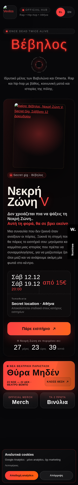

# UI Design System & Master Generation Blueprint: v4vevilos-gr

> **Βέβηλος • Once dead twice alive** (https://v4vevilos.gr) — Επίσημο hub του Βέβηλου • μουσική, live, δισκογραφία & σύνδεσμοι σε ένα σημείο.


---

## 1. Executive Visual Persona & Design Archetype

- **Brand Essence & Persona**: **Βέβηλος • Once dead twice alive** (`https://v4vevilos.gr`). Επίσημο hub του Βέβηλου • μουσική, live, δισκογραφία & σύνδεσμοι σε ένα σημείο.
- **Visual Archetype**: **Dark-Substrate WebGL / Canvas Interactive Experience (`#050507` / `#ffffff`)**.
- **Anti-AI-Slop Differentiators**:
  - **Source-Grounded Chromatic Polarity**: Anchors the viewport in `#050507` (`var(--bg)` in `:root`) paired with `#ffffff` primary typography and `#ffffff` accents.
  - **Extracted Typographic Hierarchy**: Pairs `Advent Pro` for display copy (`Βέβηλος Β έ β η λ ο ς`) with `Bebas Neue` and `Fira Sans Extra Condensed`.
  - **Calibrated Spatial Grid & Motion**: Combines `var(--container)` container bounds (`gap: 22px`, padding `24px`) with `cubic-bezier(.76,0,.24,1)` easing and HTML5 `<canvas>` Interactive Viewport Surface.

---

## 2. Spatial Architecture & Modular Grid Mathematics



### Viewport Allocation & Container Geometry
- **Captured Viewport Dimensions**: Desktop `1440×2400px` (`assets/desktop.png`, capped at 2400px multi-section capture), Mobile `390×2400px` (`assets/mobile.png`, capped at 2400px multi-section capture).
- **Master Container Bounds**: `var(--container)` extracted from `v4vevilos-gr` stylesheet.
- **Canvas Lateral Padding & Spacing**: `24px` lateral canvas padding with `22px` grid gap.
- **Border Radius Scale**: `999px`, `50%`, `18px`, `16px`.

### Responsive Breakpoint Architecture
- **Desktop Layout**: Multi-column CSS Grid / Flexbox layout at `1440px` (`max-width: var(--container)`, `gap: 22px`).
- **Mobile Layout**: Single-column vertical stack at `390px` viewport width with `24px` horizontal padding.
- **Extracted CSS Media Queries**: `@media (prefers-reduced-motion:reduce)`, `@media (max-width:1100px)`, `@media (max-width:900px)`, `@media (max-width:640px)`.

---

## 3. Color System, Materiality & Atmospheric Lighting

### Semantic Palette & Source Grounding
| Semantic Role | Ground-Truth Value | Extracted CSS Source / Selector |
|---|---|---|
| **Primary Canvas Substrate** | `#050507` | `var(--bg)` in `:root` |
| **Primary Typography Ink** | `#ff3e3e` | `var(--accent)` in `:root` |
| **Elevated Surface / Card Substrate** | `#ff6a00` | `var(--accent-fire)` in `:root` |
| **Interactive Accent / Highlight** | `#ffffff` | `var(--text)` in `:root` |
| **Secondary / Muted Copy** | `#050506` | `var(--pl-bg)` in `:root` |
| **Structural Hairline Border** | `#060405` | `var(--gig-bg)` in `:root` |

### Sanitized Root CSS Variables (`ui-ux.md` Ground Truth)
| Variable Name | Extracted Value | Semantic Role |
|---|---|---|
| `--bg` | `#050507` | Canvas / Surface Token |
| `--bg-soft` | `rgba(255,255,255,.02)` | Canvas / Surface Token |
| `--card-bg` | `rgba(255,255,255,.035)` | Canvas / Surface Token |
| `--card-bg-strong` | `rgba(255,255,255,.05)` | Canvas / Surface Token |
| `--border` | `rgba(255,255,255,.09)` | Elevation / Border Token |
| `--border-strong` | `rgba(255,62,62,.22)` | Elevation / Border Token |
| `--accent` | `#ff3e3e` | Brand / Palette Token |
| `--accent-fire` | `#ff6a00` | Brand / Palette Token |
| `--text` | `#ffffff` | Typography Ink Token |
| `--text-muted` | `rgba(255,255,255,.68)` | Typography Ink Token |
| `--text-soft` | `rgba(255,255,255,.45)` | Typography Ink Token |
| `--glass` | `blur(18px) saturate(155%)` | Dimension / Scale Token |
| `--radius-xl` | `32px` | Elevation / Border Token |
| `--radius-lg` | `22px` | Elevation / Border Token |
| `--radius-md` | `16px` | Elevation / Border Token |
| `--font-display` | `"Bebas Neue", "Fira Sans Extra Condensed", "Arial Narrow", sans-serif` | Typography / Scale Token |

---

## 4. Typographic Scale & Editorial Hierarchy

### Font Family Stacks
- **Display Typography**: `Advent Pro`.
- **Primary Body Stack**: `Bebas Neue`.
- **Technical / Metadata Stack**: `Fira Sans Extra Condensed`.

### Typographic Scale & Rules (Extracted from Stylesheet & Variables)
- **Hero Display (`H1`)**: CSS variables `--font-display: "Bebas Neue", "Fira Sans Extra Condensed", "Arial Narrow", sans-serif`.
- **Section Heading (`H2`)**: not explicitly declared on tag in static CSS (stylesheet font-size ladder: `.72rem`, `1.05rem`, `.78rem`, `clamp(2rem,4vw,2.6rem)`, `.9rem`).
- **Body Copy**: CSS variables `--font-body: "Advent Pro", sans-serif`; rule `p` (`font-size: .98rem`).
- **Metadata & Navigation Labels**: rule `small` (`font-size: .55em`, `font-weight: 500`).

---

## 5. Choreographed Motion & Interaction Physics

### Primary Easing Curves
- **Extracted Timing Functions**: `cubic-bezier(.76,0,.24,1)`, `cubic-bezier(.2,.8,.2,1)`, `cubic-bezier(.45,0,.2,1)`.

### Per-Element Transition & Choreography Rules
- **Selector `.pl-gate i`**: `transition: transform 1.1s cubic-bezier(.76,0,.24,1)` extracted from `v4vevilos-gr` stylesheet.
- **Selector `.pl-core`**: `transition: opacity .35s ease,transform .6s cubic-bezier(.76,0,.24,1),filt...` extracted from `v4vevilos-gr` stylesheet.
- **Selector `.pl-mark img`**: `transition: filter .5s ease,transform .5s cubic-bezier(.76,0,.24,1)` extracted from `v4vevilos-gr` stylesheet.
- **Extracted Easing Curve (`cubic-bezier(.76,0,.24,1)`)**: Governs interactive state transitions across `<header.topbar>` and `<section.hero>`.
- **Runtime Interaction Engine**: Integrates HTML5 `<canvas>` Interactive Viewport Surface with `prefers-reduced-motion: reduce` fallback guards.

---

## 6. Component Wireframe & Structural DOM Map

### Visual Layout Schematic (Grounded in `dom.html` — `1440px` Desktop & `390px` Mobile Reflow)
```
┌────────────────────────────────────────────────────────────────────────┐
│ DESKTOP VIEWPORT (1440px) — Βέβηλος • Once dead twice alive            │
│ ====================================================================== │
│ [ <header.topbar>          | EL · EN                                ]  │
│ ---------------------------------------------------------------------- │
│ | HERO STAGE: <section.vv-consent>                                 |   │
│ | H1: Βέβηλος Β έ β η λ ο ς                                        |   │
│ | Substrate: #050507    | Ink: #ffffff    | Accent: #ffffff        |   │
│ ---------------------------------------------------------------------- │
│ | SHOWCASE GRID (<section.hero>            ) max-w: var(--containe |   │
│ | +------------------------------+  +------------------------------+ | │
│ | | Νεκρή Ζώνη V                 |  | Η επόμενη σελίδα γράφεται κα | | │
│ | +------------------------------+  +------------------------------+ | │
│ ---------------------------------------------------------------------- │
│ | MOBILE VIEWPORT REFLOW (390px) — Single-Column Stack (gap: 22px  ) | │
│ | [<header.topbar>] -> [<section.vv-consen] -> [<section.hero>] |      │
│ ---------------------------------------------------------------------- │
│ [ FOOTER (<footer.vv-consent>   ) | https://v4vevilos.gr               │
└────────────────────────────────────────────────────────────────────────┘
```

### Granular DOM Region Breakdown
1. **Brand Header & Navigation Bar (<header.topbar> — `v4vevilos-gr`)**:
   - Landmark `<header class="topbar reveal">` hosting `Βέβηλος • Once dead twice alive` navigation (`EL · EN`), DOM attributes (`data-ga-id="G-KS1TX8NEVW"`, `data-consent="granted"`, `data-consent="denied"`, `data-zap="Βέβηλος·Vevilos·V4"`), and stylesheet rule `html { scroll-behavior:smooth }`.
2. **Hero Stage & Focal Lead (<section.vv-consent> — `Βέβηλος Β έ β η λ ο ς`)**:
   - Landmark `<section class="vv-consent">` presenting display lead `Βέβηλος Β έ β η λ ο ς` and copy excerpt *"Μετάβαση στο περιεχόμενο"* over `#050507` canvas and `#ffffff` ink.
3. **Primary Showcase & Content Grid (<section.hero> — `Νεκρή Ζώνη V`)**:
   - Landmark `<section class="hero">` rendering section `Νεκρή Ζώνη V` with copy *"Google Analytics · μόνο analytics, όχι marketing"*, asset references (`favicon.ico`, `apple-touch-icon.png`, `advent-pro-100-700-greek.woff2`, `advent-pro-100-700-latin.woff2`), and grid rule `body { overflow-x:clip }`.
4. **Interactive Detail & Feature Matrix (<section.gig-banner> — `Η επόμενη σελίδα γράφεται και από `)**:
   - Landmark `<section class="gig-banner hero-gig">` framing `Η επόμενη σελίδα γράφεται και από σένα.` and `The Manifesto` (*"Χρησιμοποιούμε το Google Analytics για να καταλάβουμε πώς χρησιμο"*) with `#ff6a00` surface cards, `#ffffff` accents, and `img { max-width:100%;display:block }`.
5. **Colophon & Global Directory Footer (<footer.vv-consent> — `https://v4vevilos.gr`)**:
   - Landmark `<footer class="vv-consent">` anchoring `Βέβηλος • Once dead twice alive` footer links (`EL · EN`), copy *"Once dead Twice alive"*, and `#060405` structural dividers.

---

## 7. Master Zero-Shot AI Generation Prompt

```markdown
# Master Zero-Shot Frontend Generation Prompt: v4vevilos-gr (Βέβηλος • Once dead twice alive)

You are a principal frontend architect and design systems engineer. Build a complete, production-ready web application replicating the exact design system, DOM landmarks, typographic hierarchy, color tokens, and motion physics of `v4vevilos-gr` (**Βέβηλος • Once dead twice alive** — `https://v4vevilos.gr`).

### 1. Visual Archetype & Anti-AI-Slop Mandates
- **Archetype**: Dark-Substrate WebGL / Canvas Interactive Experience (`#050507` / `#ffffff`).
- **Identity & Domain Context**: Επίσημο hub του Βέβηλου • μουσική, live, δισκογραφία & σύνδεσμοι σε ένα σημείο.
- **Primary Substrate**: `#050507` (`var(--bg)` in `:root`), **Primary Ink**: `#ffffff`, **Accent / Highlight**: `#ffffff`.
- **Site-Specific Differentiators**:
  - **Source-Grounded Chromatic Polarity**: Anchors the viewport in `#050507` (`var(--bg)` in `:root`) paired with `#ffffff` primary typography and `#ffffff` accents.
  - **Extracted Typographic Hierarchy**: Pairs `Advent Pro` for display copy (`Βέβηλος Β έ β η λ ο ς`) with `Bebas Neue` and `Fira Sans Extra Condensed`.
  - **Calibrated Spatial Grid & Motion**: Combines `var(--container)` container bounds (`gap: 22px`, padding `24px`) with `cubic-bezier(.76,0,.24,1)` easing and HTML5 `<canvas>` Interactive Viewport Surface.

### 2. Ground-Truth CSS Variables (`:root` Token Contract)
Declare and consume these exact custom properties extracted from `v4vevilos-gr` in your global stylesheet:

:root {
  /* Βέβηλος • Once dead twice alive (v4vevilos-gr) — Ground-Truth Extracted CSS Variables */
  --bg: #050507; /* Canvas / Surface Token (v4vevilos-gr) */
  --bg-soft: rgba(255,255,255,.02); /* Canvas / Surface Token (v4vevilos-gr) */
  --card-bg: rgba(255,255,255,.035); /* Canvas / Surface Token (v4vevilos-gr) */
  --card-bg-strong: rgba(255,255,255,.05); /* Canvas / Surface Token (v4vevilos-gr) */
  --border: rgba(255,255,255,.09); /* Elevation / Border Token (v4vevilos-gr) */
  --border-strong: rgba(255,62,62,.22); /* Elevation / Border Token (v4vevilos-gr) */
  --accent: #ff3e3e; /* Brand / Palette Token (v4vevilos-gr) */
  --accent-fire: #ff6a00; /* Brand / Palette Token (v4vevilos-gr) */
  --text: #ffffff; /* Typography Ink Token (v4vevilos-gr) */
  --text-muted: rgba(255,255,255,.68); /* Typography Ink Token (v4vevilos-gr) */
  --text-soft: rgba(255,255,255,.45); /* Typography Ink Token (v4vevilos-gr) */
  --glass: blur(18px) saturate(155%); /* Dimension / Scale Token (v4vevilos-gr) */
  --radius-xl: 32px; /* Elevation / Border Token (v4vevilos-gr) */
  --radius-lg: 22px; /* Elevation / Border Token (v4vevilos-gr) */
  --radius-md: 16px; /* Elevation / Border Token (v4vevilos-gr) */
  --font-display: "Bebas Neue", "Fira Sans Extra Condensed", "Arial Narrow", sans-serif; /* Typography / Scale Token (v4vevilos-gr) */
}

### 3. Semantic Color & Materiality Contract
Map every surface, ink, and border strictly to these source-grounded tokens:
- **Primary Canvas Substrate**: `#050507` — grounded in `var(--bg)` in `:root`
- **Primary Typography Ink**: `#ff3e3e` — grounded in `var(--accent)` in `:root`
- **Elevated Surface / Card Substrate**: `#ff6a00` — grounded in `var(--accent-fire)` in `:root`
- **Interactive Accent / Highlight**: `#ffffff` — grounded in `var(--text)` in `:root`
- **Secondary / Muted Copy**: `#050506` — grounded in `var(--pl-bg)` in `:root`
- **Structural Hairline Border**: `#060405` — grounded in `var(--gig-bg)` in `:root`

### 4. Spatial Grid, Container Bounds & Responsive Breakpoints
- **Desktop Viewport Reference**: `1440×2400px` (capped at 2400px multi-section capture, `1440px` standard desktop width).
- **Mobile Viewport Reference**: `390×2400px` (capped at 2400px multi-section capture, `390px` standard mobile width).
- **Container Max-Width**: `var(--container)` extracted from `v4vevilos-gr` stylesheet
- **Padding & Gutters**: `24px` lateral canvas padding with `22px` grid gap
- **Desktop Grid**: Multi-column CSS Grid / Flexbox layout at `1440px` (`max-width: var(--container)`, `gap: 22px`)
- **Mobile Adaptation**: Single-column vertical stack at `390px` viewport width with `24px` horizontal padding
- **Media Queries**: `@media (prefers-reduced-motion:reduce)`, `@media (max-width:1100px)`, `@media (max-width:900px)`, `@media (max-width:640px)`
- **Corner Radii**: `999px`, `50%`, `18px`, `16px`

### 5. Typography & Editorial Scale Contract
- **Display Font Stack**: `Advent Pro`
- **Body Font Stack**: `Bebas Neue`
- **Monospace / Technical Font Stack**: `Fira Sans Extra Condensed`
- **H1 Display Rule**: CSS variables `--font-display: "Bebas Neue", "Fira Sans Extra Condensed", "Arial Narrow", sans-serif`
- **H2 Section Rule**: not explicitly declared on tag in static CSS (stylesheet font-size ladder: `.72rem`, `1.05rem`, `.78rem`, `clamp(2rem,4vw,2.6rem)`, `.9rem`)
- **Body Copy Rule**: CSS variables `--font-body: "Advent Pro", sans-serif`; rule `p` (`font-size: .98rem`)
- **Metadata & Index Rule**: rule `small` (`font-size: .55em`, `font-weight: 500`)

### 6. Component Hierarchy, Verbatim Copy & Real DOM Landmarks
Scaffold `v4vevilos-gr` (`Βέβηλος • Once dead twice alive`) with these exact structural regions, extracted copy, and CSS rules from `dom.html`:
1. **Brand Header & Navigation Bar (<header.topbar> — `v4vevilos-gr`)**:
   - DOM & Selectors: Landmark `<header class="topbar reveal">` hosting `Βέβηλος • Once dead twice alive` navigation (`EL · EN`), DOM attributes (`data-ga-id="G-KS1TX8NEVW"`, `data-consent="granted"`, `data-consent="denied"`, `data-zap="Βέβηλος·Vevilos·V4"`), and stylesheet rule `html { scroll-behavior:smooth }`.
   - Responsive Contract: Header `Brand Header & Navigation Bar (<header.topbar> — `v4vevilos-gr`)` (`v4vevilos-gr`) adapts across `@media (prefers-reduced-motion:reduce)`, `@media (max-width:1100px)`, `@media (max-width:900px)`, `@media (max-width:640px)` with `cubic-bezier(.76,0,.24,1)`, `cubic-bezier(.2,.8,.2,1)`, `cubic-bezier(.45,0,.2,1)` transitions and links `EL · EN`.
2. **Hero Stage & Focal Lead (<section.vv-consent> — `Βέβηλος Β έ β η λ ο ς`)**:
   - DOM & Selectors: Landmark `<section class="vv-consent">` presenting display lead `Βέβηλος Β έ β η λ ο ς` and copy excerpt *"Μετάβαση στο περιεχόμενο"* over `#050507` canvas and `#ffffff` ink.
   - Responsive Contract: Hero stage (`1440×2400px` desktop / `390×2400px` mobile) sets `#050507` background with `#ffffff` headline `Βέβηλος Β έ β η λ ο ς`.
3. **Primary Showcase & Content Grid (<section.hero> — `Νεκρή Ζώνη V`)**:
   - DOM & Selectors: Landmark `<section class="hero">` rendering section `Νεκρή Ζώνη V` with copy *"Google Analytics · μόνο analytics, όχι marketing"*, asset references (`favicon.ico`, `apple-touch-icon.png`, `advent-pro-100-700-greek.woff2`, `advent-pro-100-700-latin.woff2`), and grid rule `body { overflow-x:clip }`.
   - Responsive Contract: Showcase grid `Primary Showcase & Content Grid (<section.hero> — `Νεκρή Ζώνη V`)` applies Multi-column CSS Grid / Flexbox layout at `1440px` (`max-width: var(--container)`, `gap: 22px`) on desktop and Single-column vertical stack at `390px` viewport width with `24px` horizontal padding on mobile.
4. **Interactive Detail & Feature Matrix (<section.gig-banner> — `Η επόμενη σελίδα γράφεται και από `)**:
   - DOM & Selectors: Landmark `<section class="gig-banner hero-gig">` framing `Η επόμενη σελίδα γράφεται και από σένα.` and `The Manifesto` (*"Χρησιμοποιούμε το Google Analytics για να καταλάβουμε πώς χρησιμο"*) with `#ff6a00` surface cards, `#ffffff` accents, and `img { max-width:100%;display:block }`.
   - Responsive Contract: Detail module `Interactive Detail & Feature Matrix (<section.gig-banner> — `Η επόμενη σελίδα γράφεται και από `)` uses `999px`, `50%`, `18px`, `16px` radii, `#ffffff` highlights, and assets (favicon.ico, apple-touch-icon.png, advent-pro-100-700-greek.woff2).
5. **Colophon & Global Directory Footer (<footer.vv-consent> — `https://v4vevilos.gr`)**:
   - DOM & Selectors: Landmark `<footer class="vv-consent">` anchoring `Βέβηλος • Once dead twice alive` footer links (`EL · EN`), copy *"Once dead Twice alive"*, and `#060405` structural dividers.
   - Responsive Contract: Footer `Colophon & Global Directory Footer (<footer.vv-consent> — `https://v4vevilos.gr`)` aligns to `var(--container)` extracted from `v4vevilos-gr` stylesheet with `24px` lateral canvas padding with `22px` grid gap and attributes (data-ga-id="G-KS1TX8NEVW", data-consent="granted", data-consent="denied").

#### Verbatim DOM Copy Excerpts (`dom.html`)
- Copy Excerpt 1: *"Μετάβαση στο περιεχόμενο"*
- Copy Excerpt 2: *"Google Analytics · μόνο analytics, όχι marketing"*
- Copy Excerpt 3: *"Χρησιμοποιούμε το Google Analytics για να καταλάβουμε πώς χρησιμοποιείται το site...."*
- Copy Excerpt 4: *"Once dead Twice alive"*

### 7. Motion, Extracted Stylesheet Rules & Interaction Choreography
- **Primary Easing Functions**: `cubic-bezier(.76,0,.24,1)`, `cubic-bezier(.2,.8,.2,1)`, `cubic-bezier(.45,0,.2,1)`
- **Extracted Stylesheet Rules (`v4vevilos-gr`)**:
- `html { scroll-behavior:smooth }`
- `body { overflow-x:clip }`
- `img { max-width:100%;display:block }`
- `focus-visible { outline:2px solid var(--accent);outline-offset:3px }`
- `webkit-scrollbar-track { background:09090b }`
- **Per-Selector Transition Rules**:
- **Selector `.pl-gate i`**: `transition: transform 1.1s cubic-bezier(.76,0,.24,1)` extracted from `v4vevilos-gr` stylesheet.
- **Selector `.pl-core`**: `transition: opacity .35s ease,transform .6s cubic-bezier(.76,0,.24,1),filt...` extracted from `v4vevilos-gr` stylesheet.
- **Selector `.pl-mark img`**: `transition: filter .5s ease,transform .5s cubic-bezier(.76,0,.24,1)` extracted from `v4vevilos-gr` stylesheet.
- **Extracted Easing Curve (`cubic-bezier(.76,0,.24,1)`)**: Governs interactive state transitions across `<header.topbar>` and `<section.hero>`.
- **Runtime Interaction Engine**: Integrates HTML5 `<canvas>` Interactive Viewport Surface with `prefers-reduced-motion: reduce` fallback guards.

### 8. Technical Deliverables
- Implement in Next.js (App Router) with TypeScript and Tailwind CSS consuming the `:root` custom properties defined above for `v4vevilos-gr`.
- Reproduce both the `1440px` desktop architecture and `390px` mobile breakpoint transitions, preserving semantic HTML5 landmarks (`<header>`, `<nav>`, `<main>`, `<section>`, `<footer>`) and `prefers-reduced-motion` accessibility guards.
```
