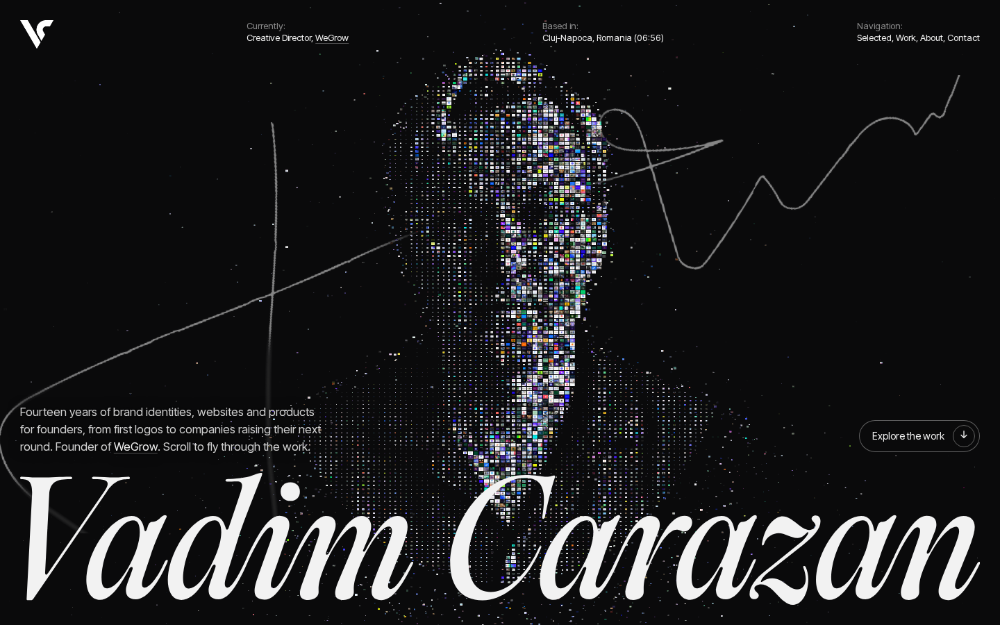
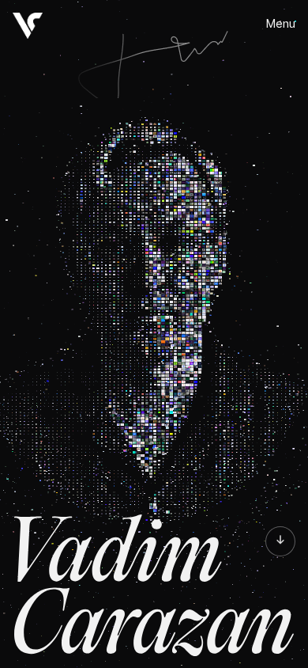

# UI Design System & Master Generation Blueprint: vadimcarazan-com

> **Vadim Carazan, Creative Director** (https://vadimcarazan.com/) — Vadim Carazan, creative director and founder of WeGrow. Fourteen years of brand identities, websites and products for founders.



---

## 1. Executive Visual Persona & Design Archetype

- **Brand Essence & Persona**: **Vadim Carazan, Creative Director** (`https://vadimcarazan.com/`). Vadim Carazan, creative director and founder of WeGrow. Fourteen years of brand identities, websites and products for founders.
- **Capture Provenance**: Live browser capture (`tier1_fast`, HTTP `200`, captured `2026-11-23`).
- **Visual Archetype**: **Dark-Substrate WebGL / Canvas Interactive Experience (`#0a0a0b` / `#000000`)**.
- **Anti-AI-Slop Differentiators**:
  - **Live-Computed Chromatic Polarity**: Anchors the viewport in `#0a0a0b` (live computed `body` `background-color` (`computed_styles.json`)) paired with `#f2f2f2` primary typography and `#000000` accents.
  - **Grounded Typographic Hierarchy**: Pairs `Editorial Old Italic` for display copy (`Vadim Carazan, Creative Director`) with `Inter Tight` and not declared in live computed styles (uses primary stack / `ui-monospace`).
  - **Calibrated Spatial Grid & Motion**: Combines `1382px` container bounds (`gap: 24px`, padding `6px`) with `cubic-bezier(0.22,1,0.36,1)` easing and Three.js / WebGL Canvas Pipeline.

---

## 2. Spatial Architecture & Modular Grid Mathematics



### Viewport Allocation & Container Geometry
- **Captured Viewport Dimensions**: Desktop `1440×900px` (`assets/desktop.png`, single-viewport 100vh live capture (900px)), Mobile `390×844px` (`assets/mobile.png`, single-viewport 100vh live capture (844px)).
- **Master Container Bounds**: `1382px` (measured widest bounded `<section>` landmark width on `1440px` desktop).
- **Canvas Lateral Padding & Spacing**: `6px` lateral canvas padding with `24px` grid gap.
- **Border Radius Scale**: `999px`, `50%`, `22px`, `12px`.

### Responsive Breakpoint Architecture
- **Desktop Layout**: Multi-column CSS Grid / Flexbox layout at `1440px` (`max-width: 1382px`, `gap: 24px`).
- **Mobile Layout**: Single-column vertical stack at `390px` viewport width with `6px` horizontal padding.
- **Extracted CSS Media Queries**: `@media (max-width: 860px)`, `@media (prefers-reduced-motion: reduce)`, `@media (max-width:600px)`.

---

## 3. Color System, Materiality & Atmospheric Lighting

### Semantic Palette & Source Grounding
| Semantic Role | Ground-Truth Value | Extracted Live / CSS Source |
|---|---|---|
| **Primary Canvas Substrate** | `#0a0a0b` | live computed `body` `background-color` (`computed_styles.json`) |
| **Primary Typography Ink** | `#f2f2f2` | live computed `h1` `color` (`computed_styles.json`) |
| **Elevated Surface / Card Substrate** | `#000000` | `.menu-btn i::after { background: #000000 }` |
| **Interactive Accent / Highlight** | `#000000` | `.link { color: #000000 }` |
| **Secondary / Muted Copy** | `#ff9b92` | `.c-err { color: #ff9b92 }` |
| **Structural Hairline Border** | `#272728` | `var(--line)` in `:root` (`rgba(255, 255, 255, 0.12)`) |

### Sanitized Root CSS Variables (`ui-ux.md` Ground Truth)
| Variable Name | Extracted Value | Semantic Role |
|---|---|---|
| `--bg` | `#0a0a0b` | Canvas / Surface Token |
| `--ink` | `#f2f2f2` | Typography Ink Token |
| `--mute` | `rgba(242, 242, 242, 0.55)` | Color / Atmospheric Token |
| `--line` | `rgba(255, 255, 255, 0.12)` | Color / Atmospheric Token |
| `--serif` | `"Editorial Old Italic", "Instrument Serif", "Times New Roman", serif` | Typography / Scale Token |
| `--sans` | `"Inter Tight", "Inter", -apple-system, "Helvetica Neue", Arial, sans-serif` | Typography / Scale Token |
| `--pad` | `clamp(16px, 2vw, 32px)` | Layout / Spatial Grid Token |
| `--box-open` | `clamp(460px, 42vw, 780px)` | Dimension / Scale Token |
| `--ease` | `cubic-bezier(0.22, 1, 0.36, 1)` | Motion / Easing Token |
| `--bp` | `28px` | Dimension / Scale Token |
| `--hx` | `748.8px` | Dimension / Scale Token |
| `--hy` | `196.0px` | Dimension / Scale Token |
| `--hrx` | `203.9px` | Dimension / Scale Token |
| `--hry` | `272.8px` | Dimension / Scale Token |
| `--vadimcarazan-com-bg` | `#0a0a0b` | Canvas Substrate (from live computed `body` `background-color` (`computed_styles.json`)) |
| `--vadimcarazan-com-ink` | `#f2f2f2` | Primary Typography Ink (computed-derived) |

---

## 4. Typographic Scale & Editorial Hierarchy

### Font Family Stacks
- **Display Typography**: `Editorial Old Italic`.
- **Primary Body Stack**: `Inter Tight`.
- **Technical / Metadata Stack**: not declared in live computed styles (uses primary stack / `ui-monospace`).

### Typographic Scale & Rules (Live Computed & Stylesheet Grounded)
- **Hero Display (`H1`)**: live computed `h1` (`font-size: 0px`, `line-height: 0px`, `font-weight: 400`).
- **Section Heading (`H2`)**: live computed `h2` (`font-size: 33.12px`, `line-height: 35.7696px`, `font-weight: 400`, `letter-spacing: -0.4968px`); rule `h2` (`font-size: clamp(32px, 3vw, 46px)`, `line-height: 1.02`, `letter-spacing: -0.01em`, `font-weight: 400`).
- **Body Copy**: live computed `body` (`font-size: 16px`, `line-height: 24px`, `font-weight: 400`); rule `.body` (`font-size: 15px`, `line-height: 1.6`).
- **Metadata & Navigation Labels**: live computed `nav/a` (`font-size: 16px`, `line-height: 24px`, `font-weight: 400`); rule `.label` (`font-size: 12px`).

---

## 5. Choreographed Motion & Interaction Physics

### Primary Easing Curves
- **Extracted Timing Functions**: `cubic-bezier(0.22,1,0.36,1)`, `cubic-bezier(.22,1,.36,1)`.

### Per-Element Transition & Choreography Rules
- **Selector `.col-nav a`**: `transition: background-size 0.35s var(--ease)` extracted from `vadimcarazan-com` stylesheet.
- **Selector `.hero`**: `transition: opacity 0.6s ease, transform 0.9s var(--ease)` extracted from `vadimcarazan-com` stylesheet.
- **Selector `.start`**: `transition: border-color 0.3s ease, background 0.3s ease` extracted from `vadimcarazan-com` stylesheet.
- **Extracted Easing Curve (`cubic-bezier(0.22,1,0.36,1)`)**: Governs interactive state transitions across `<header.topbar>` and `<section.view>`.
- **Runtime Interaction Engine**: Integrates Three.js / WebGL Canvas Pipeline with `prefers-reduced-motion: reduce` fallback guards.

---

## 6. Component Wireframe & Structural DOM Map

### Visual Layout Schematic — Desktop (`1440px`, Grounded in `dom.html` & Landmark Bounding Boxes)
```
┌────────────────────────────────────────────────────────────────────────┐
│ DESKTOP VIEWPORT (1440px) — Vadim Carazan, Creative Director           │
│ ====================================================================== │
│ [ <header.topbar> (1382x41px)         | Overview · Index · Archive · ] │
│ ---------------------------------------------------------------------- │
│ | HERO STAGE: <section.hero> (w=1440px)                              | │
│ | H1: Vadim Carazan, Creative Director                               | │
│ | Substrate: #0a0a0b | Ink: #f2f2f2 | Accent: #000000                | │
│ ---------------------------------------------------------------------- │
│ | SHOWCASE GRID (<section.view>) max-w: 1382px                       | │
│ | +------------------------------+  +------------------------------+ | │
│ | | Featured Work & Interactive  |  | Technical Architecture & Nar | | │
│ | +------------------------------+  +------------------------------+ | │
│ ---------------------------------------------------------------------- │
│ | DETAIL MODULE (<section.v-selected>) — Global Directory & Co       | │
│ ---------------------------------------------------------------------- │
│ [ FOOTER (<footer.logo>       ) | https://vadimcarazan.com/            │
└────────────────────────────────────────────────────────────────────────┘
```

### Visual Layout Schematic — Mobile Reflow (`390px`)
```
┌────────────────────────────────────────────────────────────────────────┐
│ MOBILE VIEWPORT REFLOW (390px) — Single-Column Stack (gap: 24px)       │
│ ====================================================================== │
│ [ HEADER BAR (<header.topbar>         ) | Compact Menu (390px)         │
│ ---------------------------------------------------------------------- │
│ | HERO STAGE (<section.hero>) — 390px Vertical Lead                  | │
│ | H1: Vadim Carazan, Creative Director                               | │
│ ---------------------------------------------------------------------- │
│ | SHOWCASE STACK (<section.view>) — 1-Col Stack                      | │
│ | [ Item 1: Featured Work & Interactive Showcase                   ] | │
│ | [ Item 2: Technical Architecture & Narrative                     ] | │
│ ---------------------------------------------------------------------- │
│ | DETAIL STACK (<section.v-selected>) — 1-Col (Global Directory &)   | │
│ ---------------------------------------------------------------------- │
│ [ FOOTER (<footer.logo>       ) | Stacked 390px Colophon               │
└────────────────────────────────────────────────────────────────────────┘
```

### Granular DOM Region Breakdown
1. **Brand Header & Navigation Bar (<header.topbar> — `vadimcarazan-com`)**:
   - Landmark `<header class="topbar">` (`1382x41px`) hosting `Vadim Carazan, Creative Director` navigation (`Overview · Index · Archive · About · Contact`), DOM attributes (`data-engine="three.js r169"`, `data-go="about"`, `data-go="about"`, `data-go="selected"`), and stylesheet rule `c.hot { cursor: pointer; }`.
2. **Hero Stage & Focal Lead (<section.hero> — `Vadim Carazan, Creative Director`)**:
   - Landmark `<section class="hero">` presenting display lead `Vadim Carazan, Creative Director` and copy excerpt *"Fourteen years of brand identities, websites and products for fou"* over `#0a0a0b` canvas and `#f2f2f2` ink.
3. **Primary Showcase & Content Grid (<section.view> — `Featured Work & Interactive Showca`)**:
   - Landmark `<section class="view v-project">` rendering section `Featured Work & Interactive Showcase` with copy *"Creative Director, WeGrow"*, asset references (`clarity.js`, `ywzmdkawk4`, `track.js`, `favicon.ico`), and grid rule `button { font: inherit; color: inherit; background: none; border: 0; padding: 0;... }`.
4. **Interactive Detail & Feature Matrix (<section.v-selected> — `Technical Architecture & Narrative`)**:
   - Landmark `<section class="view v-selected">` framing `Technical Architecture & Narrative` and `Global Directory & Contact` (*"Cluj-Napoca, Romania ( 06:56 )"*) with `#000000` surface cards, `#000000` accents, and `.logo { width: 48px; height: auto; display: block; }`.
5. **Colophon & Global Directory Footer (<footer.logo> — `https://vadimcarazan.com/`)**:
   - Landmark `<footer class="logo">` anchoring `Vadim Carazan, Creative Director` footer links (`Overview · Index · Archive · About · Contact`), copy *"Selected , Work , About , Contact"*, and `#272728` structural dividers.

---

## 7. Master Zero-Shot AI Generation Prompt

```markdown
# Master Zero-Shot Frontend Generation Prompt: vadimcarazan-com (Vadim Carazan, Creative Director)

You are a principal frontend architect and design systems engineer. Build a complete, production-ready web application replicating the exact design system, DOM landmarks, typographic hierarchy, color tokens, and motion physics of `vadimcarazan-com` (**Vadim Carazan, Creative Director** — `https://vadimcarazan.com/`).

### 1. Visual Archetype & Anti-AI-Slop Mandates
- **Archetype**: Dark-Substrate WebGL / Canvas Interactive Experience (`#0a0a0b` / `#000000`).
- **Identity & Domain Context**: Vadim Carazan, creative director and founder of WeGrow. Fourteen years of brand identities, websites and products for founders.
- **Primary Substrate**: `#0a0a0b` (live computed `body` `background-color` (`computed_styles.json`)), **Primary Ink**: `#f2f2f2`, **Accent / Highlight**: `#000000`.
- **Site-Specific Differentiators**:
  - **Live-Computed Chromatic Polarity**: Anchors the viewport in `#0a0a0b` (live computed `body` `background-color` (`computed_styles.json`)) paired with `#f2f2f2` primary typography and `#000000` accents.
  - **Grounded Typographic Hierarchy**: Pairs `Editorial Old Italic` for display copy (`Vadim Carazan, Creative Director`) with `Inter Tight` and not declared in live computed styles (uses primary stack / `ui-monospace`).
  - **Calibrated Spatial Grid & Motion**: Combines `1382px` container bounds (`gap: 24px`, padding `6px`) with `cubic-bezier(0.22,1,0.36,1)` easing and Three.js / WebGL Canvas Pipeline.

### 2. Ground-Truth CSS Variables (`:root` Token Contract)
Declare and consume these exact custom properties extracted from `vadimcarazan-com` in your global stylesheet:

:root {
  /* Vadim Carazan, Creative Director (vadimcarazan-com) — Live-Grounded CSS Variables */
  --bg: #0a0a0b; /* Canvas / Surface Token (vadimcarazan-com) */
  --ink: #f2f2f2; /* Typography Ink Token (vadimcarazan-com) */
  --mute: rgba(242, 242, 242, 0.55); /* Color / Atmospheric Token (vadimcarazan-com) */
  --line: rgba(255, 255, 255, 0.12); /* Color / Atmospheric Token (vadimcarazan-com) */
  --serif: "Editorial Old Italic", "Instrument Serif", "Times New Roman", serif; /* Typography / Scale Token (vadimcarazan-com) */
  --sans: "Inter Tight", "Inter", -apple-system, "Helvetica Neue", Arial, sans-serif; /* Typography / Scale Token (vadimcarazan-com) */
  --pad: clamp(16px, 2vw, 32px); /* Layout / Spatial Grid Token (vadimcarazan-com) */
  --box-open: clamp(460px, 42vw, 780px); /* Dimension / Scale Token (vadimcarazan-com) */
  --ease: cubic-bezier(0.22, 1, 0.36, 1); /* Motion / Easing Token (vadimcarazan-com) */
  --bp: 28px; /* Dimension / Scale Token (vadimcarazan-com) */
  --hx: 748.8px; /* Dimension / Scale Token (vadimcarazan-com) */
  --hy: 196.0px; /* Dimension / Scale Token (vadimcarazan-com) */
  --hrx: 203.9px; /* Dimension / Scale Token (vadimcarazan-com) */
  --hry: 272.8px; /* Dimension / Scale Token (vadimcarazan-com) */
  --vadimcarazan-com-bg: #0a0a0b; /* Canvas Substrate (from live computed `body` `background-color` (`computed_styles.json`)) (vadimcarazan-com) */
  --vadimcarazan-com-ink: #f2f2f2; /* Primary Typography Ink (computed-derived) (vadimcarazan-com) */
}

### 3. Semantic Color & Materiality Contract
Map every surface, ink, and border strictly to these source-grounded tokens:
- **Primary Canvas Substrate**: `#0a0a0b` — grounded in live computed `body` `background-color` (`computed_styles.json`)
- **Primary Typography Ink**: `#f2f2f2` — grounded in live computed `h1` `color` (`computed_styles.json`)
- **Elevated Surface / Card Substrate**: `#000000` — grounded in `.menu-btn i::after { background: #000000 }`
- **Interactive Accent / Highlight**: `#000000` — grounded in `.link { color: #000000 }`
- **Secondary / Muted Copy**: `#ff9b92` — grounded in `.c-err { color: #ff9b92 }`
- **Structural Hairline Border**: `#272728` — grounded in `var(--line)` in `:root` (`rgba(255, 255, 255, 0.12)`)

### 4. Spatial Grid, Container Bounds & Responsive Breakpoints
- **Desktop Viewport Reference**: `1440×900px` (single-viewport 100vh live capture (900px), `1440px` standard desktop width).
- **Mobile Viewport Reference**: `390×844px` (single-viewport 100vh live capture (844px), `390px` standard mobile width).
- **Container Max-Width**: `1382px` (measured widest bounded `<section>` landmark width on `1440px` desktop)
- **Padding & Gutters**: `6px` lateral canvas padding with `24px` grid gap
- **Desktop Grid**: Multi-column CSS Grid / Flexbox layout at `1440px` (`max-width: 1382px`, `gap: 24px`)
- **Mobile Adaptation**: Single-column vertical stack at `390px` viewport width with `6px` horizontal padding
- **Media Queries**: `@media (max-width: 860px)`, `@media (prefers-reduced-motion: reduce)`, `@media (max-width:600px)`
- **Corner Radii**: `999px`, `50%`, `22px`, `12px`

### 5. Typography & Editorial Scale Contract
- **Display Font Stack**: `Editorial Old Italic`
- **Body Font Stack**: `Inter Tight`
- **Monospace / Technical Font Stack**: not declared in live computed styles (uses primary stack / `ui-monospace`)
- **H1 Display Rule**: live computed `h1` (`font-size: 0px`, `line-height: 0px`, `font-weight: 400`)
- **H2 Section Rule**: live computed `h2` (`font-size: 33.12px`, `line-height: 35.7696px`, `font-weight: 400`, `letter-spacing: -0.4968px`); rule `h2` (`font-size: clamp(32px, 3vw, 46px)`, `line-height: 1.02`, `letter-spacing: -0.01em`, `font-weight: 400`)
- **Body Copy Rule**: live computed `body` (`font-size: 16px`, `line-height: 24px`, `font-weight: 400`); rule `.body` (`font-size: 15px`, `line-height: 1.6`)
- **Metadata & Index Rule**: live computed `nav/a` (`font-size: 16px`, `line-height: 24px`, `font-weight: 400`); rule `.label` (`font-size: 12px`)

### 6. Component Hierarchy, Verbatim Copy & Real DOM Landmarks
Scaffold `vadimcarazan-com` (`Vadim Carazan, Creative Director`) with these exact structural regions, extracted copy, and CSS rules from `dom.html`:
1. **Brand Header & Navigation Bar (<header.topbar> — `vadimcarazan-com`)**:
   - DOM & Selectors: Landmark `<header class="topbar">` (`1382x41px`) hosting `Vadim Carazan, Creative Director` navigation (`Overview · Index · Archive · About · Contact`), DOM attributes (`data-engine="three.js r169"`, `data-go="about"`, `data-go="about"`, `data-go="selected"`), and stylesheet rule `c.hot { cursor: pointer; }`.
   - Responsive Contract: Header `Brand Header & Navigation Bar (<header.topbar> — `vadimcarazan-com`)` (`vadimcarazan-com`) adapts across `@media (max-width: 860px)`, `@media (prefers-reduced-motion: reduce)`, `@media (max-width:600px)` with `cubic-bezier(0.22,1,0.36,1)`, `cubic-bezier(.22,1,.36,1)` transitions and links `Overview · Index · Archive · About · Contact`.
2. **Hero Stage & Focal Lead (<section.hero> — `Vadim Carazan, Creative Director`)**:
   - DOM & Selectors: Landmark `<section class="hero">` presenting display lead `Vadim Carazan, Creative Director` and copy excerpt *"Fourteen years of brand identities, websites and products for fou"* over `#0a0a0b` canvas and `#f2f2f2` ink.
   - Responsive Contract: Hero stage (`1440×900px` desktop / `390×844px` mobile) sets `#0a0a0b` background with `#f2f2f2` headline `Vadim Carazan, Creative Director`.
3. **Primary Showcase & Content Grid (<section.view> — `Featured Work & Interactive Showca`)**:
   - DOM & Selectors: Landmark `<section class="view v-project">` rendering section `Featured Work & Interactive Showcase` with copy *"Creative Director, WeGrow"*, asset references (`clarity.js`, `ywzmdkawk4`, `track.js`, `favicon.ico`), and grid rule `button { font: inherit; color: inherit; background: none; border: 0; padding: 0;... }`.
   - Responsive Contract: Showcase grid `Primary Showcase & Content Grid (<section.view> — `Featured Work & Interactive Showca`)` applies Multi-column CSS Grid / Flexbox layout at `1440px` (`max-width: 1382px`, `gap: 24px`) on desktop and Single-column vertical stack at `390px` viewport width with `6px` horizontal padding on mobile.
4. **Interactive Detail & Feature Matrix (<section.v-selected> — `Technical Architecture & Narrative`)**:
   - DOM & Selectors: Landmark `<section class="view v-selected">` framing `Technical Architecture & Narrative` and `Global Directory & Contact` (*"Cluj-Napoca, Romania ( 06:56 )"*) with `#000000` surface cards, `#000000` accents, and `.logo { width: 48px; height: auto; display: block; }`.
   - Responsive Contract: Detail module `Interactive Detail & Feature Matrix (<section.v-selected> — `Technical Architecture & Narrative`)` uses `999px`, `50%`, `22px`, `12px` radii, `#000000` highlights, and assets (clarity.js, ywzmdkawk4, track.js).
5. **Colophon & Global Directory Footer (<footer.logo> — `https://vadimcarazan.com/`)**:
   - DOM & Selectors: Landmark `<footer class="logo">` anchoring `Vadim Carazan, Creative Director` footer links (`Overview · Index · Archive · About · Contact`), copy *"Selected , Work , About , Contact"*, and `#272728` structural dividers.
   - Responsive Contract: Footer `Colophon & Global Directory Footer (<footer.logo> — `https://vadimcarazan.com/`)` aligns to `1382px` (measured widest bounded `<section>` landmark width on `1440px` desktop) with `6px` lateral canvas padding with `24px` grid gap and attributes (data-engine="three.js r169", data-go="about", data-go="about").

#### Verbatim DOM Copy Excerpts (`dom.html`)
- Copy Excerpt 1: *"Fourteen years of brand identities, websites and products for founders, from first..."*
- Copy Excerpt 2: *"Creative Director, WeGrow"*
- Copy Excerpt 3: *"Cluj-Napoca, Romania ( 06:56 )"*
- Copy Excerpt 4: *"Selected , Work , About , Contact"*

### 7. Motion, Extracted Stylesheet Rules & Interaction Choreography
- **Primary Easing Functions**: `cubic-bezier(0.22,1,0.36,1)`, `cubic-bezier(.22,1,.36,1)`
- **Extracted Stylesheet Rules (`vadimcarazan-com`)**:
- `c.hot { cursor: pointer; }`
- `button { font: inherit; color: inherit; background: none; border: 0; padding: 0;... }`
- `.logo { width: 48px; height: auto; display: block; }`
- `.mark { display: block; line-height: 0; }`
- `.col { display: flex; flex-direction: column; }`
- **Per-Selector Transition Rules**:
- **Selector `.col-nav a`**: `transition: background-size 0.35s var(--ease)` extracted from `vadimcarazan-com` stylesheet.
- **Selector `.hero`**: `transition: opacity 0.6s ease, transform 0.9s var(--ease)` extracted from `vadimcarazan-com` stylesheet.
- **Selector `.start`**: `transition: border-color 0.3s ease, background 0.3s ease` extracted from `vadimcarazan-com` stylesheet.
- **Extracted Easing Curve (`cubic-bezier(0.22,1,0.36,1)`)**: Governs interactive state transitions across `<header.topbar>` and `<section.view>`.
- **Runtime Interaction Engine**: Integrates Three.js / WebGL Canvas Pipeline with `prefers-reduced-motion: reduce` fallback guards.

### 8. Technical Deliverables
- Implement in Next.js (App Router) with TypeScript and Tailwind CSS consuming the `:root` custom properties defined above for `vadimcarazan-com`.
- Reproduce both the `1440px` desktop architecture and `390px` mobile breakpoint transitions, preserving semantic HTML5 landmarks (`<header>`, `<nav>`, `<main>`, `<section>`, `<footer>`) and `prefers-reduced-motion` accessibility guards.
```
