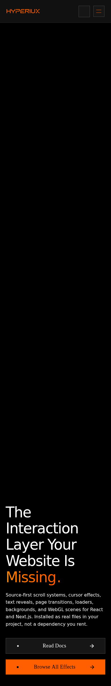

# UI Design System & Master Generation Blueprint: vault-hyperiux-com

> **Hyperiux Vault - React & Next.js Interaction Effects.** (https://vault.hyperiux.com) — Start with 70+ free source-first effects. Upgrade to Pro for 180+ effects.


---

## 1. Executive Visual Persona & Design Archetype

- **Brand Essence & Persona**: **Hyperiux Vault - React & Next.js Interaction Effects.** (`https://vault.hyperiux.com`). Start with 70+ free source-first effects. Upgrade to Pro for 180+ effects.
- **Visual Archetype**: **Dark-Substrate WebGL / Canvas Interactive Experience (`#000` / `#1d1d1d`)**.
- **Anti-AI-Slop Differentiators**:
  - **Source-Grounded Chromatic Polarity**: Anchors the viewport in `#000` (`var(--color-black)` in `:root`) paired with `#fff` primary typography and `#1d1d1d` accents.
  - **Extracted Typographic Hierarchy**: Pairs `aeonikPro` for display copy (`The Interaction Layer Your Website I`) with `aeonikPro Fallback` and `IBM Plex Mono`.
  - **Calibrated Spatial Grid & Motion**: Combines `720px` container bounds (`gap: 1rem`, padding `3rem`) with `cubic-bezier(.4,0,1,1)` easing and Lenis Smooth Scroll (`data-lenis`), GSAP Timeline & ScrollTrigger.

---

## 2. Spatial Architecture & Modular Grid Mathematics



### Viewport Allocation & Container Geometry
- **Captured Viewport Dimensions**: Desktop `1440×13176px` (`assets/desktop.png`, full-page scroll capture), Mobile `390×2400px` (`assets/mobile.png`, capped at 2400px multi-section capture).
- **Master Container Bounds**: `720px` extracted from `vault-hyperiux-com` stylesheet.
- **Canvas Lateral Padding & Spacing**: `3rem` lateral canvas padding with `1rem` grid gap.
- **Border Radius Scale**: `50%`, `9999px`, `.25rem`, `9px`.

### Responsive Breakpoint Architecture
- **Desktop Layout**: Multi-column CSS Grid / Flexbox layout at `1440px` (`max-width: 720px`, `gap: 1rem`).
- **Mobile Layout**: Single-column vertical stack at `390px` viewport width with `3rem` horizontal padding.
- **Extracted CSS Media Queries**: `@media (min-width:640px)`, `@media (max-width:960px)`, `@media (max-width:720px)`, `@media (max-width:767px)`.

---

## 3. Color System, Materiality & Atmospheric Lighting

### Semantic Palette & Source Grounding
| Semantic Role | Ground-Truth Value | Extracted CSS Source / Selector |
|---|---|---|
| **Primary Canvas Substrate** | `#000` | `var(--color-black)` in `:root` |
| **Primary Typography Ink** | `#fff` | `var(--color-white)` in `:root` |
| **Elevated Surface / Card Substrate** | `#272727` | `var(--blog-border-color)` in `:root` |
| **Interactive Accent / Highlight** | `#1d1d1d` | `var(--blog-bg-subtle)` in `:root` |
| **Secondary / Muted Copy** | `#6f6f6f` | `var(--btn-pre)` in `:root` |
| **Structural Hairline Border** | `#000c` | `var(--docs-table-header-bg)` in `:root` |

### Sanitized Root CSS Variables (`ui-ux.md` Ground Truth)
| Variable Name | Extracted Value | Semantic Role |
|---|---|---|
| `--font-aeonik` | `"aeonikPro","aeonikPro Fallback"` | Typography / Scale Token |
| `--font-avenir` | `"avenirNext","avenirNext Fallback"` | Typography / Scale Token |
| `--font-plex-mono` | `"IBM Plex Mono","IBM Plex Mono Fallback"` | Typography / Scale Token |
| `--g-shift` | `0px` | Dimension / Scale Token |
| `--beam-angle` | `0deg` | Design System Custom Token |
| `--color-red-400` | `oklch(70.4% .191 22.216)` | Brand / Palette Token |
| `--color-red-500` | `oklch(63.7% .237 25.331)` | Brand / Palette Token |
| `--color-orange-500` | `oklch(70.5% .213 47.604)` | Brand / Palette Token |
| `--color-amber-300` | `oklch(87.9% .169 91.605)` | Brand / Palette Token |
| `--color-amber-500` | `oklch(76.9% .188 70.08)` | Brand / Palette Token |
| `--color-yellow-400` | `oklch(85.2% .199 91.936)` | Brand / Palette Token |
| `--color-green-400` | `oklch(79.2% .209 151.711)` | Brand / Palette Token |
| `--color-green-500` | `oklch(72.3% .219 149.579)` | Brand / Palette Token |
| `--color-emerald-400` | `oklch(76.5% .177 163.223)` | Brand / Palette Token |
| `--color-gray-50` | `oklch(98.5% .002 247.839)` | Brand / Palette Token |
| `--color-gray-200` | `oklch(92.8% .006 264.531)` | Brand / Palette Token |

---

## 4. Typographic Scale & Editorial Hierarchy

### Font Family Stacks
- **Display Typography**: `aeonikPro`.
- **Primary Body Stack**: `aeonikPro Fallback`.
- **Technical / Metadata Stack**: `IBM Plex Mono`.

### Typographic Scale & Rules (Extracted from Stylesheet & Variables)
- **Hero Display (`H1`)**: CSS variables `--text-4xl: 2.25rem`, `--text-4xl--line-height: calc(2.5 / 2.25)`, `--text-5xl: 3rem`; rule `h1` (`font-size: 2.5rem`, `line-height: 1.2`, `letter-spacing: -.025em`, `font-weight: 700`).
- **Section Heading (`H2`)**: CSS variables `--text-2xl: 1.5rem`, `--text-2xl--line-height: calc(2 / 1.5)`, `--text-3xl: 1.875rem`; rule `h2` (`font-size: 1.75rem`, `line-height: 1.3`, `font-weight: 700`).
- **Body Copy**: CSS variables `--text-base: 1rem`, `--text-base--line-height: calc(1.5 / 1)`, `--docs-body: #3a3a3a`.
- **Metadata & Navigation Labels**: CSS variables `--font-plex-mono: "IBM Plex Mono","IBM Plex Mono Fallback"`, `--text-xs: .75rem`, `--text-xs--line-height: calc(1 / .75)`.

---

## 5. Choreographed Motion & Interaction Physics

### Primary Easing Curves
- **Extracted Timing Functions**: `cubic-bezier(.4,0,1,1)`, `cubic-bezier(0,0,.2,1)`, `cubic-bezier(.4,0,.2,1)`.

### Per-Element Transition & Choreography Rules
- **Selector `layer theme`**: `transition: .15s` extracted from `vault-hyperiux-com` stylesheet.
- **Selector `.codeblock) *)`**: `transition: opacity .15s` extracted from `vault-hyperiux-com` stylesheet.
- **Selector `.blog-tag`**: `transition: background-color .15s` extracted from `vault-hyperiux-com` stylesheet.
- **Extracted Easing Curve (`cubic-bezier(.4,0,1,1)`)**: Governs interactive state transitions across `<nav.flex>` and `<section.section-x>`.
- **Runtime Interaction Engine**: Integrates Lenis Smooth Scroll (`data-lenis`), GSAP Timeline & ScrollTrigger, Three.js / WebGL Canvas Pipeline, Swiper Touch Carousel Engine with `prefers-reduced-motion: reduce` fallback guards.

---

## 6. Component Wireframe & Structural DOM Map

### Visual Layout Schematic (Grounded in `dom.html` — `1440px` Desktop & `390px` Mobile Reflow)
```
┌────────────────────────────────────────────────────────────────────────┐
│ DESKTOP VIEWPORT (1440px) — Hyperiux Vault - React & Next.js Interacti │
│ ====================================================================== │
│ [ <nav.flex>               | Docs D o c s Docs · Blog B l o g Blog  ]  │
│ ---------------------------------------------------------------------- │
│ | HERO STAGE: <section.relative>                                   |   │
│ | H1: The Interaction Layer Your Website Is Missing .              |   │
│ | Substrate: #000       | Ink: #fff       | Accent: #1d1d1d        |   │
│ ---------------------------------------------------------------------- │
│ | SHOWCASE GRID (<section.section-x>       ) max-w: 720px          |   │
│ | +------------------------------+  +------------------------------+ | │
│ | | Built for Teams Where the Fr |  | Every moment, already built. | | │
│ | +------------------------------+  +------------------------------+ | │
│ ---------------------------------------------------------------------- │
│ | MOBILE VIEWPORT REFLOW (390px) — Single-Column Stack (gap: 1rem  ) | │
│ | [<nav.flex>] -> [<section.relative>] -> [<section.section-x] |       │
│ ---------------------------------------------------------------------- │
│ [ FOOTER (<footer.relative>     ) | https://vault.hyperiux.com         │
└────────────────────────────────────────────────────────────────────────┘
```

### Granular DOM Region Breakdown
1. **Brand Header & Navigation Bar (<nav.flex> — `vault-hyperiux-com`)**:
   - Landmark `<nav class="flex items-center">` hosting `Hyperiux Vault - React & Next.js Int` navigation (`Docs D o c s Docs · Blog B l o g Blog`), DOM attributes (`data-sidebar="expanded"`, `data-precedence="next"`, `data-precedence="next"`, `data-precedence="next"`), and stylesheet rule `.__className_94f36e { font-family:aeonikPro,aeonikPro Fallback }`.
2. **Hero Stage & Focal Lead (<section.relative> — `The Interaction Layer Your Website`)**:
   - Landmark `<section class="relative z-10">` presenting display lead `The Interaction Layer Your Website Is Missing .` and copy excerpt *"This website uses cookies. Learn More"* over `#000` canvas and `#fff` ink.
3. **Primary Showcase & Content Grid (<section.section-x> — `Built for Teams Where the Frontend`)**:
   - Landmark `<section class="section-x relative">` rendering section `Built for Teams Where the Frontend is the Brand.` with copy *"Effects E f f e c t s Effects"*, asset references (`homepage-hero.webp`, `656d53d6ca76b151.css`, `a3fd77dbb258dcd6.css`, `ee41bfcc83e4e14b.css`), and grid rule `.__variable_94f36e { --font-aeonik:"aeonikPro","aeonikPro Fallback" }`.
4. **Interactive Detail & Feature Matrix (<article.flex> — `Every moment, already built.`)**:
   - Landmark `<article class="flex flex-col">` framing `Every moment, already built.` and `One command. Real files.` (*"Templates T e m p l a t e s Templates"*) with `#272727` surface cards, `#1d1d1d` accents, and `.__className_91351b { font-family:avenirNext,avenirNext Fallback }`.
5. **Colophon & Global Directory Footer (<footer.relative> — `https://vault.hyperiux.com`)**:
   - Landmark `<footer class="relative z-200">` anchoring `Hyperiux Vault - React & Next.js` footer links (`Docs D o c s Docs · Blog B l o g Blog`), copy *"Pricing P r i c i n g Pricing"*, and `#000c` structural dividers.

---

## 7. Master Zero-Shot AI Generation Prompt

```markdown
# Master Zero-Shot Frontend Generation Prompt: vault-hyperiux-com (Hyperiux Vault - React & Next.js Interaction Effects.)

You are a principal frontend architect and design systems engineer. Build a complete, production-ready web application replicating the exact design system, DOM landmarks, typographic hierarchy, color tokens, and motion physics of `vault-hyperiux-com` (**Hyperiux Vault - React & Next.js Interaction Effects.** — `https://vault.hyperiux.com`).

### 1. Visual Archetype & Anti-AI-Slop Mandates
- **Archetype**: Dark-Substrate WebGL / Canvas Interactive Experience (`#000` / `#1d1d1d`).
- **Identity & Domain Context**: Start with 70+ free source-first effects. Upgrade to Pro for 180+ effects.
- **Primary Substrate**: `#000` (`var(--color-black)` in `:root`), **Primary Ink**: `#fff`, **Accent / Highlight**: `#1d1d1d`.
- **Site-Specific Differentiators**:
  - **Source-Grounded Chromatic Polarity**: Anchors the viewport in `#000` (`var(--color-black)` in `:root`) paired with `#fff` primary typography and `#1d1d1d` accents.
  - **Extracted Typographic Hierarchy**: Pairs `aeonikPro` for display copy (`The Interaction Layer Your Website I`) with `aeonikPro Fallback` and `IBM Plex Mono`.
  - **Calibrated Spatial Grid & Motion**: Combines `720px` container bounds (`gap: 1rem`, padding `3rem`) with `cubic-bezier(.4,0,1,1)` easing and Lenis Smooth Scroll (`data-lenis`), GSAP Timeline & ScrollTrigger.

### 2. Ground-Truth CSS Variables (`:root` Token Contract)
Declare and consume these exact custom properties extracted from `vault-hyperiux-com` in your global stylesheet:

:root {
  /* Hyperiux Vault - React & Next.js Interaction Effects. (vault-hyperiux-com) — Ground-Truth Extracted CSS Variables */
  --font-aeonik: "aeonikPro","aeonikPro Fallback"; /* Typography / Scale Token (vault-hyperiux-com) */
  --font-avenir: "avenirNext","avenirNext Fallback"; /* Typography / Scale Token (vault-hyperiux-com) */
  --font-plex-mono: "IBM Plex Mono","IBM Plex Mono Fallback"; /* Typography / Scale Token (vault-hyperiux-com) */
  --g-shift: 0px; /* Dimension / Scale Token (vault-hyperiux-com) */
  --beam-angle: 0deg; /* Design System Custom Token (vault-hyperiux-com) */
  --color-red-400: oklch(70.4% .191 22.216); /* Brand / Palette Token (vault-hyperiux-com) */
  --color-red-500: oklch(63.7% .237 25.331); /* Brand / Palette Token (vault-hyperiux-com) */
  --color-orange-500: oklch(70.5% .213 47.604); /* Brand / Palette Token (vault-hyperiux-com) */
  --color-amber-300: oklch(87.9% .169 91.605); /* Brand / Palette Token (vault-hyperiux-com) */
  --color-amber-500: oklch(76.9% .188 70.08); /* Brand / Palette Token (vault-hyperiux-com) */
  --color-yellow-400: oklch(85.2% .199 91.936); /* Brand / Palette Token (vault-hyperiux-com) */
  --color-green-400: oklch(79.2% .209 151.711); /* Brand / Palette Token (vault-hyperiux-com) */
  --color-green-500: oklch(72.3% .219 149.579); /* Brand / Palette Token (vault-hyperiux-com) */
  --color-emerald-400: oklch(76.5% .177 163.223); /* Brand / Palette Token (vault-hyperiux-com) */
  --color-gray-50: oklch(98.5% .002 247.839); /* Brand / Palette Token (vault-hyperiux-com) */
  --color-gray-200: oklch(92.8% .006 264.531); /* Brand / Palette Token (vault-hyperiux-com) */
}

### 3. Semantic Color & Materiality Contract
Map every surface, ink, and border strictly to these source-grounded tokens:
- **Primary Canvas Substrate**: `#000` — grounded in `var(--color-black)` in `:root`
- **Primary Typography Ink**: `#fff` — grounded in `var(--color-white)` in `:root`
- **Elevated Surface / Card Substrate**: `#272727` — grounded in `var(--blog-border-color)` in `:root`
- **Interactive Accent / Highlight**: `#1d1d1d` — grounded in `var(--blog-bg-subtle)` in `:root`
- **Secondary / Muted Copy**: `#6f6f6f` — grounded in `var(--btn-pre)` in `:root`
- **Structural Hairline Border**: `#000c` — grounded in `var(--docs-table-header-bg)` in `:root`

### 4. Spatial Grid, Container Bounds & Responsive Breakpoints
- **Desktop Viewport Reference**: `1440×13176px` (full-page scroll capture, `1440px` standard desktop width).
- **Mobile Viewport Reference**: `390×2400px` (capped at 2400px multi-section capture, `390px` standard mobile width).
- **Container Max-Width**: `720px` extracted from `vault-hyperiux-com` stylesheet
- **Padding & Gutters**: `3rem` lateral canvas padding with `1rem` grid gap
- **Desktop Grid**: Multi-column CSS Grid / Flexbox layout at `1440px` (`max-width: 720px`, `gap: 1rem`)
- **Mobile Adaptation**: Single-column vertical stack at `390px` viewport width with `3rem` horizontal padding
- **Media Queries**: `@media (min-width:640px)`, `@media (max-width:960px)`, `@media (max-width:720px)`, `@media (max-width:767px)`
- **Corner Radii**: `50%`, `9999px`, `.25rem`, `9px`

### 5. Typography & Editorial Scale Contract
- **Display Font Stack**: `aeonikPro`
- **Body Font Stack**: `aeonikPro Fallback`
- **Monospace / Technical Font Stack**: `IBM Plex Mono`
- **H1 Display Rule**: CSS variables `--text-4xl: 2.25rem`, `--text-4xl--line-height: calc(2.5 / 2.25)`, `--text-5xl: 3rem`; rule `h1` (`font-size: 2.5rem`, `line-height: 1.2`, `letter-spacing: -.025em`, `font-weight: 700`)
- **H2 Section Rule**: CSS variables `--text-2xl: 1.5rem`, `--text-2xl--line-height: calc(2 / 1.5)`, `--text-3xl: 1.875rem`; rule `h2` (`font-size: 1.75rem`, `line-height: 1.3`, `font-weight: 700`)
- **Body Copy Rule**: CSS variables `--text-base: 1rem`, `--text-base--line-height: calc(1.5 / 1)`, `--docs-body: #000`
- **Metadata & Index Rule**: CSS variables `--font-plex-mono: "IBM Plex Mono","IBM Plex Mono Fallback"`, `--text-xs: .75rem`, `--text-xs--line-height: calc(1 / .75)`

### 6. Component Hierarchy, Verbatim Copy & Real DOM Landmarks
Scaffold `vault-hyperiux-com` (`Hyperiux Vault - React & Next.js Interaction Effects.`) with these exact structural regions, extracted copy, and CSS rules from `dom.html`:
1. **Brand Header & Navigation Bar (<nav.flex> — `vault-hyperiux-com`)**:
   - DOM & Selectors: Landmark `<nav class="flex items-center">` hosting `Hyperiux Vault - React & Next.js Int` navigation (`Docs D o c s Docs · Blog B l o g Blog`), DOM attributes (`data-sidebar="expanded"`, `data-precedence="next"`, `data-precedence="next"`, `data-precedence="next"`), and stylesheet rule `.__className_94f36e { font-family:aeonikPro,aeonikPro Fallback }`.
   - Responsive Contract: Header `Brand Header & Navigation Bar (<nav.flex> — `vault-hyperiux-com`)` (`vault-hyperiux-com`) adapts across `@media (min-width:640px)`, `@media (max-width:960px)`, `@media (max-width:720px)`, `@media (max-width:767px)` with `cubic-bezier(.4,0,1,1)`, `cubic-bezier(0,0,.2,1)`, `cubic-bezier(.4,0,.2,1)` transitions and links `Docs D o c s Docs · Blog B l o g Blog`.
2. **Hero Stage & Focal Lead (<section.relative> — `The Interaction Layer Your Website`)**:
   - DOM & Selectors: Landmark `<section class="relative z-10">` presenting display lead `The Interaction Layer Your Website Is Missing .` and copy excerpt *"This website uses cookies. Learn More"* over `#000` canvas and `#fff` ink.
   - Responsive Contract: Hero stage (`1440×13176px` desktop / `390×2400px` mobile) sets `#000` background with `#fff` headline `The Interaction Layer Your Website Is Missing .`.
3. **Primary Showcase & Content Grid (<section.section-x> — `Built for Teams Where the Frontend`)**:
   - DOM & Selectors: Landmark `<section class="section-x relative">` rendering section `Built for Teams Where the Frontend is the Brand.` with copy *"Effects E f f e c t s Effects"*, asset references (`homepage-hero.webp`, `656d53d6ca76b151.css`, `a3fd77dbb258dcd6.css`, `ee41bfcc83e4e14b.css`), and grid rule `.__variable_94f36e { --font-aeonik:"aeonikPro","aeonikPro Fallback" }`.
   - Responsive Contract: Showcase grid `Primary Showcase & Content Grid (<section.section-x> — `Built for Teams Where the Frontend`)` applies Multi-column CSS Grid / Flexbox layout at `1440px` (`max-width: 720px`, `gap: 1rem`) on desktop and Single-column vertical stack at `390px` viewport width with `3rem` horizontal padding on mobile.
4. **Interactive Detail & Feature Matrix (<article.flex> — `Every moment, already built.`)**:
   - DOM & Selectors: Landmark `<article class="flex flex-col">` framing `Every moment, already built.` and `One command. Real files.` (*"Templates T e m p l a t e s Templates"*) with `#272727` surface cards, `#1d1d1d` accents, and `.__className_91351b { font-family:avenirNext,avenirNext Fallback }`.
   - Responsive Contract: Detail module `Interactive Detail & Feature Matrix (<article.flex> — `Every moment, already built.`)` uses `50%`, `9999px`, `.25rem`, `9px` radii, `#1d1d1d` highlights, and assets (homepage-hero.webp, 656d53d6ca76b151.css, a3fd77dbb258dcd6.css).
5. **Colophon & Global Directory Footer (<footer.relative> — `https://vault.hyperiux.com`)**:
   - DOM & Selectors: Landmark `<footer class="relative z-200">` anchoring `Hyperiux Vault - React & Next.js` footer links (`Docs D o c s Docs · Blog B l o g Blog`), copy *"Pricing P r i c i n g Pricing"*, and `#000c` structural dividers.
   - Responsive Contract: Footer `Colophon & Global Directory Footer (<footer.relative> — `https://vault.hyperiux.com`)` aligns to `720px` extracted from `vault-hyperiux-com` stylesheet with `3rem` lateral canvas padding with `1rem` grid gap and attributes (data-sidebar="expanded", data-precedence="next", data-precedence="next").

#### Verbatim DOM Copy Excerpts (`dom.html`)
- Copy Excerpt 1: *"This website uses cookies. Learn More"*
- Copy Excerpt 2: *"Effects E f f e c t s Effects"*
- Copy Excerpt 3: *"Templates T e m p l a t e s Templates"*
- Copy Excerpt 4: *"Pricing P r i c i n g Pricing"*

### 7. Motion, Extracted Stylesheet Rules & Interaction Choreography
- **Primary Easing Functions**: `cubic-bezier(.4,0,1,1)`, `cubic-bezier(0,0,.2,1)`, `cubic-bezier(.4,0,.2,1)`
- **Extracted Stylesheet Rules (`vault-hyperiux-com`)**:
- `.__className_94f36e { font-family:aeonikPro,aeonikPro Fallback }`
- `.__variable_94f36e { --font-aeonik:"aeonikPro","aeonikPro Fallback" }`
- `.__className_91351b { font-family:avenirNext,avenirNext Fallback }`
- `.__variable_91351b { --font-avenir:"avenirNext","avenirNext Fallback" }`
- `.__className_5f0935 { font-family:IBM Plex Mono,IBM Plex Mono Fallback;font-style:normal }`
- **Per-Selector Transition Rules**:
- **Selector `layer theme`**: `transition: .15s` extracted from `vault-hyperiux-com` stylesheet.
- **Selector `.codeblock) *)`**: `transition: opacity .15s` extracted from `vault-hyperiux-com` stylesheet.
- **Selector `.blog-tag`**: `transition: background-color .15s` extracted from `vault-hyperiux-com` stylesheet.
- **Extracted Easing Curve (`cubic-bezier(.4,0,1,1)`)**: Governs interactive state transitions across `<nav.flex>` and `<section.section-x>`.
- **Runtime Interaction Engine**: Integrates Lenis Smooth Scroll (`data-lenis`), GSAP Timeline & ScrollTrigger, Three.js / WebGL Canvas Pipeline, Swiper Touch Carousel Engine with `prefers-reduced-motion: reduce` fallback guards.

### 8. Technical Deliverables
- Implement in Next.js (App Router) with TypeScript and Tailwind CSS consuming the `:root` custom properties defined above for `vault-hyperiux-com`.
- Reproduce both the `1440px` desktop architecture and `390px` mobile breakpoint transitions, preserving semantic HTML5 landmarks (`<header>`, `<nav>`, `<main>`, `<section>`, `<footer>`) and `prefers-reduced-motion` accessibility guards.
```
