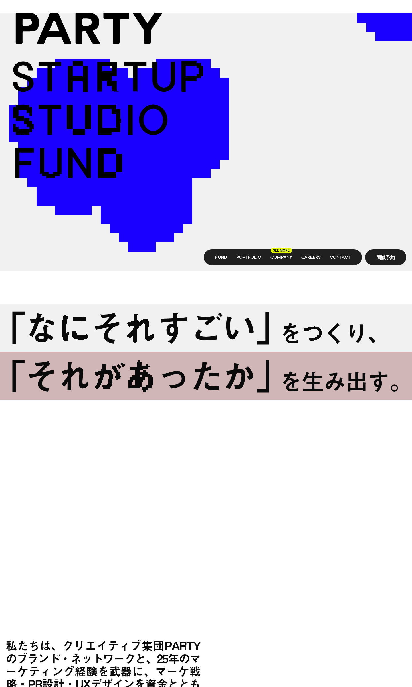
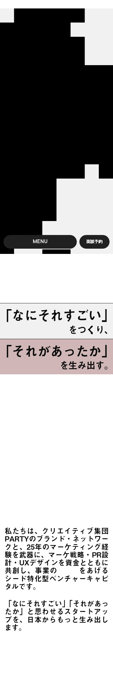

# UI Design System & Master Generation Blueprint: vc-prty-jp

> **PARTY STARTUP STUDIO FUND** (https://vc.prty.jp/) — 起業家とともに「未来の体験」をつくる創業・シード特化型VC



---

## 1. Executive Visual Persona & Design Archetype

- **Brand Essence & Persona**: **PARTY STARTUP STUDIO FUND** (`https://vc.prty.jp/`). 起業家とともに「未来の体験」をつくる創業・シード特化型VC
- **Visual Archetype**: **Dark-Substrate WebGL / Canvas Interactive Experience (`#000` / `#171717`)**.
- **Anti-AI-Slop Differentiators**:
  - **Source-Grounded Chromatic Polarity**: Anchors the viewport in `#000` (`var(--color-black)` in `:root`) paired with `#fff` primary typography and `#171717` accents.
  - **Extracted Typographic Hierarchy**: Pairs `Inter` for display copy (`PARTY STARTUP STUDIO FUND`) with `Inter Fallback` and `SFMono-Regular`.
  - **Calibrated Spatial Grid & Motion**: Combines `60%` container bounds (`gap: 0px (flush layout)`, padding `0px`) with `cubic-bezier(.4,0,1,1)` easing and Three.js / WebGL Canvas Pipeline.

---

## 2. Spatial Architecture & Modular Grid Mathematics



### Viewport Allocation & Container Geometry
- **Captured Viewport Dimensions**: Desktop `1440×2400px` (`assets/desktop.png`, capped at 2400px multi-section capture), Mobile `390×2400px` (`assets/mobile.png`, capped at 2400px multi-section capture).
- **Master Container Bounds**: `60%` extracted from `vc-prty-jp` stylesheet.
- **Canvas Lateral Padding & Spacing**: `0px` lateral canvas padding with `0px (flush layout)` grid gap.
- **Border Radius Scale**: `2px`, `4px`, `200px`, `var(--radius)`.

### Responsive Breakpoint Architecture
- **Desktop Layout**: Multi-column CSS Grid / Flexbox layout at `1440px` (`max-width: 60%`, `gap: 0px (flush layout)`).
- **Mobile Layout**: Single-column vertical stack at `390px` viewport width with `0px` horizontal padding.
- **Extracted CSS Media Queries**: `@media (min-width:768px)`, `@media (min-width:48rem)`.

---

## 3. Color System, Materiality & Atmospheric Lighting

### Semantic Palette & Source Grounding
| Semantic Role | Ground-Truth Value | Extracted CSS Source / Selector |
|---|---|---|
| **Primary Canvas Substrate** | `#000` | `var(--color-black)` in `:root` |
| **Primary Typography Ink** | `#fff` | `var(--color-white)` in `:root` |
| **Elevated Surface / Card Substrate** | `#0a0a0a` | `var(--foreground)` in `:root` |
| **Interactive Accent / Highlight** | `#171717` | `var(--primary)` in `:root` |
| **Secondary / Muted Copy** | `#fafafa` | `var(--primary-foreground)` in `:root` |
| **Structural Hairline Border** | `#f5f5f5` | `var(--secondary)` in `:root` |

### Sanitized Root CSS Variables (`ui-ux.md` Ground Truth)
| Variable Name | Extracted Value | Semantic Role |
|---|---|---|
| `--font-inter` | `"Inter", "Inter Fallback"` | Typography / Scale Token |
| `--font-sans` | `var(--font-inter)` | Typography / Scale Token |
| `--color-black` | `#000` | Canvas / Surface Token |
| `--color-white` | `#fff` | Canvas / Surface Token |
| `--spacing` | `.25rem` | Layout / Spatial Grid Token |
| `--text-xs` | `.75rem` | Typography Ink Token |
| `--text-xs--line-height` | `calc(1 / .75)` | Typography Ink Token |
| `--text-sm` | `.875rem` | Typography Ink Token |
| `--text-sm--line-height` | `calc(1.25 / .875)` | Typography Ink Token |
| `--text-base` | `1rem` | Typography Ink Token |
| `--text-base--line-height` | `calc(1.5 / 1)` | Typography Ink Token |
| `--font-weight-normal` | `400` | Typography / Scale Token |
| `--font-weight-medium` | `500` | Typography / Scale Token |
| `--font-weight-semibold` | `600` | Typography / Scale Token |
| `--font-weight-bold` | `700` | Typography / Scale Token |
| `--tracking-wide` | `.025em` | Typography / Scale Token |

---

## 4. Typographic Scale & Editorial Hierarchy

### Font Family Stacks
- **Display Typography**: `Inter`.
- **Primary Body Stack**: `Inter Fallback`.
- **Technical / Metadata Stack**: `SFMono-Regular`.

### Typographic Scale & Rules (Extracted from Stylesheet & Variables)
- **Hero Display (`H1`)**: not explicitly declared on tag in static CSS (stylesheet font-size ladder: `1em`, `80%`, `75%`, `var(--text-base)`, `var(--text-sm)`).
- **Section Heading (`H2`)**: not explicitly declared on tag in static CSS (stylesheet font-size ladder: `1em`, `80%`, `75%`, `var(--text-base)`, `var(--text-sm)`).
- **Body Copy**: CSS variables `--text-base: 1rem`, `--text-base--line-height: calc(1.5 / 1)`.
- **Metadata & Navigation Labels**: CSS variables `--text-xs: .75rem`, `--text-xs--line-height: calc(1 / .75)`, `--text-sm: .875rem`.

---

## 5. Choreographed Motion & Interaction Physics

### Primary Easing Curves
- **Extracted Timing Functions**: `cubic-bezier(.4,0,1,1)`, `cubic-bezier(0,0,.2,1)`, `cubic-bezier(.4,0,.2,1)`.

### Per-Element Transition & Choreography Rules
- **Selector `layer theme`**: `transition: .15s` extracted from `vc-prty-jp` stylesheet.
- **Selector `.transition`**: `transition: var(--tw-ease,var(--default-transition-timing-function))` extracted from `vc-prty-jp` stylesheet.
- **Selector `opacity\]`**: `transition: var(--tw-ease,var(--default-transition-timing-function))` extracted from `vc-prty-jp` stylesheet.
- **Extracted Easing Curve (`cubic-bezier(.4,0,1,1)`)**: Governs interactive state transitions across `<nav.fixed>` and `<section.relative>`.
- **Runtime Interaction Engine**: Integrates Three.js / WebGL Canvas Pipeline with `prefers-reduced-motion: reduce` fallback guards.

---

## 6. Component Wireframe & Structural DOM Map

### Visual Layout Schematic (Grounded in `dom.html` — `1440px` Desktop & `390px` Mobile Reflow)
```
┌────────────────────────────────────────────────────────────────────────┐
│ DESKTOP VIEWPORT (1440px) — PARTY STARTUP STUDIO FUND                  │
│ ====================================================================== │
│ [ <nav.fixed>              | FUND · PORTFOLIO · COMPANY · CAREERS · ]  │
│ ---------------------------------------------------------------------- │
│ | HERO STAGE: <section.absolute>                                   |   │
│ | H1: PARTY STARTUP STUDIO FUND                                    |   │
│ | Substrate: #000       | Ink: #fff       | Accent: #171717        |   │
│ ---------------------------------------------------------------------- │
│ | SHOWCASE GRID (<section.relative>        ) max-w: 60%            |   │
│ | +------------------------------+  +------------------------------+ | │
│ | | Featured Work & Interactive  |  | Technical Architecture & Nar | | │
│ | +------------------------------+  +------------------------------+ | │
│ ---------------------------------------------------------------------- │
│ | MOBILE VIEWPORT REFLOW (390px) — Single-Column Stack (gap: 0px (f) | │
│ | [<nav.fixed>] -> [<section.absolute>] -> [<section.relative>] |      │
│ ---------------------------------------------------------------------- │
│ [ FOOTER (<footer.relative>     ) | https://vc.prty.jp/                │
└────────────────────────────────────────────────────────────────────────┘
```

### Granular DOM Region Breakdown
1. **Brand Header & Navigation Bar (<nav.fixed> — `vc-prty-jp`)**:
   - Landmark `<nav class="fixed left-0">` hosting `PARTY STARTUP STUDIO FUND` navigation (`FUND · PORTFOLIO · COMPANY · CAREERS · CONTACT`), DOM attributes (`data-precedence="next"`, `data-engine="three.js r184"`, `data-section="hero"`, `data-capture-hide`), and stylesheet rule `nter_fe8b9d92-module__LINzvG__cla... { font-family:Inter,Inter Fallback;font-style:normal }`.
2. **Hero Stage & Focal Lead (<section.absolute> — `PARTY STARTUP STUDIO FUND`)**:
   - Landmark `<section class="absolute">` presenting display lead `PARTY STARTUP STUDIO FUND` and copy excerpt *"©PARTY STARTUP STUDIO FUND"* over `#000` canvas and `#fff` ink.
3. **Primary Showcase & Content Grid (<section.relative> — `Featured Work & Interactive Showca`)**:
   - Landmark `<section class="relative overflow-hidden">` rendering section `Featured Work & Interactive Showcase` with copy *"( PRIVACY POLICY )"*, asset references (`83afe278b6a6bb3c-s.p.0q-301v4kxxn...`, `02utwymhem5xp.css`, `0hkdb982chs.y.js`, `090~fvud_dp_4.js`), and grid rule `inter_fe8b9d92-module__LINzvG__va... { --font-inter:"Inter", "Inter Fallback" }`.
4. **Interactive Detail & Feature Matrix (<section.h-lvh> — `Technical Architecture & Narrative`)**:
   - Landmark `<section class="h-lvh">` framing `Technical Architecture & Narrative` and `Global Directory & Contact` (*"PORTFOLIO SEE MORE"*) with `#0a0a0a` surface cards, `#171717` accents, and `backdrop { box-sizing:border-box;border:0 solid;margin:0;padding:0 }`.
5. **Colophon & Global Directory Footer (<footer.relative> — `https://vc.prty.jp/`)**:
   - Landmark `<footer class="relative border-t">` anchoring `PARTY STARTUP STUDIO FUND` footer links (`FUND · PORTFOLIO · COMPANY · CAREERS · CONTACT`), copy *"Technical Architecture & Narrative"*, and `#f5f5f5` structural dividers.

---

## 7. Master Zero-Shot AI Generation Prompt

```markdown
# Master Zero-Shot Frontend Generation Prompt: vc-prty-jp (PARTY STARTUP STUDIO FUND)

You are a principal frontend architect and design systems engineer. Build a complete, production-ready web application replicating the exact design system, DOM landmarks, typographic hierarchy, color tokens, and motion physics of `vc-prty-jp` (**PARTY STARTUP STUDIO FUND** — `https://vc.prty.jp/`).

### 1. Visual Archetype & Anti-AI-Slop Mandates
- **Archetype**: Dark-Substrate WebGL / Canvas Interactive Experience (`#000` / `#171717`).
- **Identity & Domain Context**: 起業家とともに「未来の体験」をつくる創業・シード特化型VC
- **Primary Substrate**: `#000` (`var(--color-black)` in `:root`), **Primary Ink**: `#fff`, **Accent / Highlight**: `#171717`.
- **Site-Specific Differentiators**:
  - **Source-Grounded Chromatic Polarity**: Anchors the viewport in `#000` (`var(--color-black)` in `:root`) paired with `#fff` primary typography and `#171717` accents.
  - **Extracted Typographic Hierarchy**: Pairs `Inter` for display copy (`PARTY STARTUP STUDIO FUND`) with `Inter Fallback` and `SFMono-Regular`.
  - **Calibrated Spatial Grid & Motion**: Combines `60%` container bounds (`gap: 0px (flush layout)`, padding `0px`) with `cubic-bezier(.4,0,1,1)` easing and Three.js / WebGL Canvas Pipeline.

### 2. Ground-Truth CSS Variables (`:root` Token Contract)
Declare and consume these exact custom properties extracted from `vc-prty-jp` in your global stylesheet:

:root {
  /* PARTY STARTUP STUDIO FUND (vc-prty-jp) — Ground-Truth Extracted CSS Variables */
  --font-inter: "Inter", "Inter Fallback"; /* Typography / Scale Token (vc-prty-jp) */
  --font-sans: var(--font-inter); /* Typography / Scale Token (vc-prty-jp) */
  --color-black: #000; /* Canvas / Surface Token (vc-prty-jp) */
  --color-white: #fff; /* Canvas / Surface Token (vc-prty-jp) */
  --spacing: .25rem; /* Layout / Spatial Grid Token (vc-prty-jp) */
  --text-xs: .75rem; /* Typography Ink Token (vc-prty-jp) */
  --text-xs--line-height: calc(1 / .75); /* Typography Ink Token (vc-prty-jp) */
  --text-sm: .875rem; /* Typography Ink Token (vc-prty-jp) */
  --text-sm--line-height: calc(1.25 / .875); /* Typography Ink Token (vc-prty-jp) */
  --text-base: 1rem; /* Typography Ink Token (vc-prty-jp) */
  --text-base--line-height: calc(1.5 / 1); /* Typography Ink Token (vc-prty-jp) */
  --font-weight-normal: 400; /* Typography / Scale Token (vc-prty-jp) */
  --font-weight-medium: 500; /* Typography / Scale Token (vc-prty-jp) */
  --font-weight-semibold: 600; /* Typography / Scale Token (vc-prty-jp) */
  --font-weight-bold: 700; /* Typography / Scale Token (vc-prty-jp) */
  --tracking-wide: .025em; /* Typography / Scale Token (vc-prty-jp) */
}

### 3. Semantic Color & Materiality Contract
Map every surface, ink, and border strictly to these source-grounded tokens:
- **Primary Canvas Substrate**: `#000` — grounded in `var(--color-black)` in `:root`
- **Primary Typography Ink**: `#fff` — grounded in `var(--color-white)` in `:root`
- **Elevated Surface / Card Substrate**: `#0a0a0a` — grounded in `var(--foreground)` in `:root`
- **Interactive Accent / Highlight**: `#171717` — grounded in `var(--primary)` in `:root`
- **Secondary / Muted Copy**: `#fafafa` — grounded in `var(--primary-foreground)` in `:root`
- **Structural Hairline Border**: `#f5f5f5` — grounded in `var(--secondary)` in `:root`

### 4. Spatial Grid, Container Bounds & Responsive Breakpoints
- **Desktop Viewport Reference**: `1440×2400px` (capped at 2400px multi-section capture, `1440px` standard desktop width).
- **Mobile Viewport Reference**: `390×2400px` (capped at 2400px multi-section capture, `390px` standard mobile width).
- **Container Max-Width**: `60%` extracted from `vc-prty-jp` stylesheet
- **Padding & Gutters**: `0px` lateral canvas padding with `0px (flush layout)` grid gap
- **Desktop Grid**: Multi-column CSS Grid / Flexbox layout at `1440px` (`max-width: 60%`, `gap: 0px (flush layout)`)
- **Mobile Adaptation**: Single-column vertical stack at `390px` viewport width with `0px` horizontal padding
- **Media Queries**: `@media (min-width:768px)`, `@media (min-width:48rem)`
- **Corner Radii**: `2px`, `4px`, `200px`, `var(--radius)`

### 5. Typography & Editorial Scale Contract
- **Display Font Stack**: `Inter`
- **Body Font Stack**: `Inter Fallback`
- **Monospace / Technical Font Stack**: `SFMono-Regular`
- **H1 Display Rule**: not explicitly declared on tag in static CSS (stylesheet font-size ladder: `1em`, `80%`, `75%`, `var(--text-base)`, `var(--text-sm)`)
- **H2 Section Rule**: not explicitly declared on tag in static CSS (stylesheet font-size ladder: `1em`, `80%`, `75%`, `var(--text-base)`, `var(--text-sm)`)
- **Body Copy Rule**: CSS variables `--text-base: 1rem`, `--text-base--line-height: calc(1.5 / 1)`
- **Metadata & Index Rule**: CSS variables `--text-xs: .75rem`, `--text-xs--line-height: calc(1 / .75)`, `--text-sm: .875rem`

### 6. Component Hierarchy, Verbatim Copy & Real DOM Landmarks
Scaffold `vc-prty-jp` (`PARTY STARTUP STUDIO FUND`) with these exact structural regions, extracted copy, and CSS rules from `dom.html`:
1. **Brand Header & Navigation Bar (<nav.fixed> — `vc-prty-jp`)**:
   - DOM & Selectors: Landmark `<nav class="fixed left-0">` hosting `PARTY STARTUP STUDIO FUND` navigation (`FUND · PORTFOLIO · COMPANY · CAREERS · CONTACT`), DOM attributes (`data-precedence="next"`, `data-engine="three.js r184"`, `data-section="hero"`, `data-capture-hide`), and stylesheet rule `nter_fe8b9d92-module__LINzvG__cla... { font-family:Inter,Inter Fallback;font-style:normal }`.
   - Responsive Contract: Header `Brand Header & Navigation Bar (<nav.fixed> — `vc-prty-jp`)` (`vc-prty-jp`) adapts across `@media (min-width:768px)`, `@media (min-width:48rem)` with `cubic-bezier(.4,0,1,1)`, `cubic-bezier(0,0,.2,1)`, `cubic-bezier(.4,0,.2,1)` transitions and links `FUND · PORTFOLIO · COMPANY · CAREERS · CONTACT`.
2. **Hero Stage & Focal Lead (<section.absolute> — `PARTY STARTUP STUDIO FUND`)**:
   - DOM & Selectors: Landmark `<section class="absolute">` presenting display lead `PARTY STARTUP STUDIO FUND` and copy excerpt *"©PARTY STARTUP STUDIO FUND"* over `#000` canvas and `#fff` ink.
   - Responsive Contract: Hero stage (`1440×2400px` desktop / `390×2400px` mobile) sets `#000` background with `#fff` headline `PARTY STARTUP STUDIO FUND`.
3. **Primary Showcase & Content Grid (<section.relative> — `Featured Work & Interactive Showca`)**:
   - DOM & Selectors: Landmark `<section class="relative overflow-hidden">` rendering section `Featured Work & Interactive Showcase` with copy *"( PRIVACY POLICY )"*, asset references (`83afe278b6a6bb3c-s.p.0q-301v4kxxn...`, `02utwymhem5xp.css`, `0hkdb982chs.y.js`, `090~fvud_dp_4.js`), and grid rule `inter_fe8b9d92-module__LINzvG__va... { --font-inter:"Inter", "Inter Fallback" }`.
   - Responsive Contract: Showcase grid `Primary Showcase & Content Grid (<section.relative> — `Featured Work & Interactive Showca`)` applies Multi-column CSS Grid / Flexbox layout at `1440px` (`max-width: 60%`, `gap: 0px (flush layout)`) on desktop and Single-column vertical stack at `390px` viewport width with `0px` horizontal padding on mobile.
4. **Interactive Detail & Feature Matrix (<section.h-lvh> — `Technical Architecture & Narrative`)**:
   - DOM & Selectors: Landmark `<section class="h-lvh">` framing `Technical Architecture & Narrative` and `Global Directory & Contact` (*"PORTFOLIO SEE MORE"*) with `#0a0a0a` surface cards, `#171717` accents, and `backdrop { box-sizing:border-box;border:0 solid;margin:0;padding:0 }`.
   - Responsive Contract: Detail module `Interactive Detail & Feature Matrix (<section.h-lvh> — `Technical Architecture & Narrative`)` uses `2px`, `4px`, `200px`, `var(--radius)` radii, `#171717` highlights, and assets (83afe278b6a6bb3c-s.p.0q-301v4kxxn..., 02utwymhem5xp.css, 0hkdb982chs.y.js).
5. **Colophon & Global Directory Footer (<footer.relative> — `https://vc.prty.jp/`)**:
   - DOM & Selectors: Landmark `<footer class="relative border-t">` anchoring `PARTY STARTUP STUDIO FUND` footer links (`FUND · PORTFOLIO · COMPANY · CAREERS · CONTACT`), copy *"Technical Architecture & Narrative"*, and `#f5f5f5` structural dividers.
   - Responsive Contract: Footer `Colophon & Global Directory Footer (<footer.relative> — `https://vc.prty.jp/`)` aligns to `60%` extracted from `vc-prty-jp` stylesheet with `0px` lateral canvas padding with `0px (flush layout)` grid gap and attributes (data-precedence="next", data-engine="three.js r184", data-section="hero").

#### Verbatim DOM Copy Excerpts (`dom.html`)
- Copy Excerpt 1: *"©PARTY STARTUP STUDIO FUND"*
- Copy Excerpt 2: *"( PRIVACY POLICY )"*
- Copy Excerpt 3: *"PORTFOLIO SEE MORE"*

### 7. Motion, Extracted Stylesheet Rules & Interaction Choreography
- **Primary Easing Functions**: `cubic-bezier(.4,0,1,1)`, `cubic-bezier(0,0,.2,1)`, `cubic-bezier(.4,0,.2,1)`
- **Extracted Stylesheet Rules (`vc-prty-jp`)**:
- `nter_fe8b9d92-module__LINzvG__cla... { font-family:Inter,Inter Fallback;font-style:normal }`
- `inter_fe8b9d92-module__LINzvG__va... { --font-inter:"Inter", "Inter Fallback" }`
- `backdrop { box-sizing:border-box;border:0 solid;margin:0;padding:0 }`
- `file-selector-button { box-sizing:border-box;border:0 solid;margin:0;padding:0 }`
- `strong { font-weight:bolder }`
- **Per-Selector Transition Rules**:
- **Selector `layer theme`**: `transition: .15s` extracted from `vc-prty-jp` stylesheet.
- **Selector `.transition`**: `transition: var(--tw-ease,var(--default-transition-timing-function))` extracted from `vc-prty-jp` stylesheet.
- **Selector `opacity\]`**: `transition: var(--tw-ease,var(--default-transition-timing-function))` extracted from `vc-prty-jp` stylesheet.
- **Extracted Easing Curve (`cubic-bezier(.4,0,1,1)`)**: Governs interactive state transitions across `<nav.fixed>` and `<section.relative>`.
- **Runtime Interaction Engine**: Integrates Three.js / WebGL Canvas Pipeline with `prefers-reduced-motion: reduce` fallback guards.

### 8. Technical Deliverables
- Implement in Next.js (App Router) with TypeScript and Tailwind CSS consuming the `:root` custom properties defined above for `vc-prty-jp`.
- Reproduce both the `1440px` desktop architecture and `390px` mobile breakpoint transitions, preserving semantic HTML5 landmarks (`<header>`, `<nav>`, `<main>`, `<section>`, `<footer>`) and `prefers-reduced-motion` accessibility guards.
```
