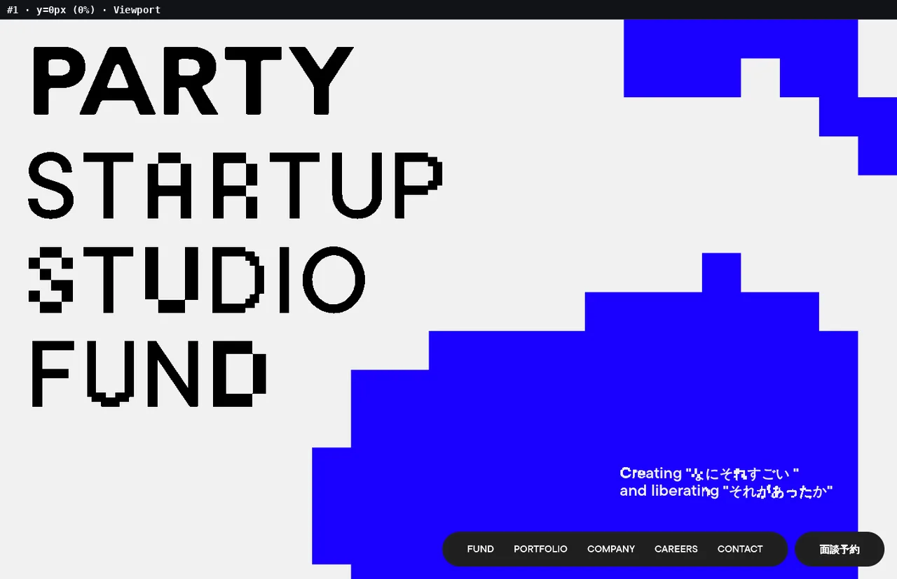
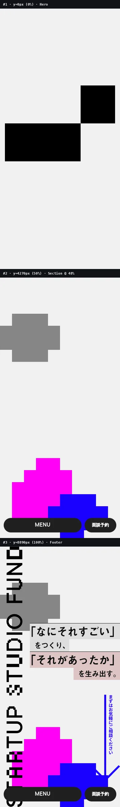

# UI Design System & Master Generation Blueprint: vc-prty-jp

> **PARTY STARTUP STUDIO FUND** (https://vc.prty.jp/) — 起業家とともに「未来の体験」をつくる創業・シード特化型VC





---

## 1. Executive Visual Persona & Design Archetype

- **Brand Essence & Persona**: **PARTY STARTUP STUDIO FUND** (`https://vc.prty.jp/`). 起業家とともに「未来の体験」をつくる創業・シード特化型VC
- **Capture Provenance**: Live browser capture (`tier2_webgl`, HTTP `200`, captured `2026-11-24`).
- **Visual Archetype**: **Light-Gallery WebGL / Canvas Interactive Experience (`#ffffff` / `#202020`)**.
- **Anti-AI-Slop Differentiators**:
  - **Live-Computed Chromatic Polarity**: Anchors the viewport in `#ffffff` (live computed `browser-default` `background-color` (`computed_styles.json`)) paired with `#000000` primary typography and `#202020` accents.
  - **Grounded Typographic Hierarchy**: Uses `Inter` across display (`PARTY STARTUP STUDIO FUND`) and body copy, paired with `SFMono-Regular` for monospace/code.
  - **Calibrated Spatial Grid & Motion**: Combines `1440px` container bounds (`gap: 11px`, padding `0px`) with `cubic-bezier(.4,0,1,1)` easing and Three.js / WebGL Canvas Pipeline.

---

## 2. Spatial Architecture & Modular Grid Mathematics

### Viewport Allocation & Container Geometry
- **Captured Journey Filmstrips**: Desktop `1280×828px` (`assets/desktop-journey.webp`, `1` keyframes up to `y=0px` / doc `900px`), Mobile `390×2616px` (`assets/mobile-journey.webp`, `3` keyframes).
- **Master Container Bounds**: `1440px` (full-bleed `100%` desktop stage measured on `1440px` viewport).
- **Canvas Lateral Padding & Spacing**: `0px` lateral canvas padding with `11px` grid gap.
- **Border Radius Scale**: `3.35544e+07px`, `2px`, `4px`, `200px`.

### Responsive Breakpoint Architecture
- **Desktop Layout**: Multi-column CSS Grid / Flexbox layout at `1440px` (`max-width: 1440px`, `gap: 11px`).
- **Mobile Layout**: Single-column vertical stack at `390px` viewport width with `0px` horizontal padding.
- **Extracted CSS Media Queries**: `@media (min-width:768px)`, `@media (min-width:48rem)`.

---

## 3. Color System, Materiality & Atmospheric Lighting

### Semantic Palette & Source Grounding
| Semantic Role | Ground-Truth Value | Extracted Live / CSS Source |
|---|---|---|
| **Primary Canvas Substrate** | `#ffffff` | live computed `browser-default` `background-color` (`computed_styles.json`) |
| **Primary Typography Ink** | `#000000` | `.text-black { color: black }` (`#000000`) |
| **Elevated Surface / Card Substrate** | `#f1f1f1` | `:focus { background-color: #f1f1f1 }` |
| **Interactive Accent / Highlight** | `#202020` | live computed `button` `background-color` (`computed_styles.json`) |
| **Secondary / Muted Copy** | `#737373` | `var(--muted-foreground)` in `:root` |
| **Structural Hairline Border** | `#e5e5e5` | `var(--border)` in `:root` |
| **Variable Token (`--foreground`)** | `#0a0a0a` | `var(--foreground)` in `:root` |
| **Variable Token (`--primary`)** | `#171717` | `var(--primary)` in `:root` |
| **Variable Token (`--primary-foreground`)** | `#fafafa` | `var(--primary-foreground)` in `:root` |
| **Variable Token (`--secondary`)** | `#f5f5f5` | `var(--secondary)` in `:root` |
| **Variable Token (`--destructive`)** | `#e40014` | `var(--destructive)` in `:root` |

### Sanitized Root CSS Variables (`ui-ux.md` Ground Truth)
| Variable Name | Extracted Value | Semantic Role |
|---|---|---|
| `--vw` | `calc(100vw / 393)` | Layout / Spatial Grid Token |
| `--background` | `#fff` | Canvas / Surface Token |
| `--foreground` | `#0a0a0a` | Typography Ink Token |
| `--card` | `#fff` | Color / Atmospheric Token |
| `--card-foreground` | `#0a0a0a` | Typography Ink Token |
| `--popover` | `#fff` | Color / Atmospheric Token |
| `--popover-foreground` | `#0a0a0a` | Typography Ink Token |
| `--primary` | `#171717` | Brand / Palette Token |
| `--primary-foreground` | `#fafafa` | Typography Ink Token |
| `--secondary` | `#f5f5f5` | Brand / Palette Token |
| `--secondary-foreground` | `#171717` | Typography Ink Token |
| `--muted` | `#f5f5f5` | Color / Atmospheric Token |
| `--muted-foreground` | `#737373` | Typography Ink Token |
| `--accent` | `#f5f5f5` | Brand / Palette Token |
| `--accent-foreground` | `#171717` | Typography Ink Token |
| `--destructive` | `#e40014` | Color / Atmospheric Token |

---

## 4. Typographic Scale & Editorial Hierarchy

### Font Family Stacks
- **Display Typography**: `Inter`.
- **Primary Body Stack**: `Inter`.
- **Technical / Metadata Stack**: `SFMono-Regular`.

### Typographic Scale & Rules (Live Computed & Stylesheet Grounded)
- **Hero Display (`H1`)**: observed font-size ladder: `16px`, `12px`, `18px`, `1em`, `80%`.
- **Section Heading (`H2`)**: observed font-size ladder: `16px`, `12px`, `18px`, `1em`, `80%`.
- **Body Copy**: live computed `body` (`font-size: 16px`, `line-height: 24px`, `font-weight: 400`); CSS variables `--text-base: 1rem`, `--text-base--line-height: calc(1.5 / 1)`.
- **Metadata & Navigation Labels**: live computed `nav/a` (`font-size: 16px`, `line-height: 24px`, `font-weight: 400`); CSS variables `--text-xs: .75rem`, `--text-xs--line-height: calc(1 / .75)`, `--text-sm: .875rem`.

---

## 5. Choreographed Motion & Interaction Physics

### Primary Easing Curves
- **Extracted Timing Functions**: `cubic-bezier(.4,0,1,1)`, `cubic-bezier(0,0,.2,1)`, `cubic-bezier(.4,0,.2,1)`.

### Per-Element Transition & Choreography Rules
- **Selector `layer theme`**: `transition: .15s` extracted from `vc-prty-jp` stylesheet.
- **Selector `.transition`**: `transition: var(--tw-ease,var(--default-transition-timing-function))` extracted from `vc-prty-jp` stylesheet.
- **Selector `opacity\]`**: `transition: var(--tw-ease,var(--default-transition-timing-function))` extracted from `vc-prty-jp` stylesheet.
- **Extracted Easing Curve (`cubic-bezier(.4,0,1,1)`)**: Governs interactive state transitions across `<nav.left-0>` and `<section.h-dvh>`.
- **Runtime Interaction Engine**: Integrates Three.js / WebGL Canvas Pipeline with `prefers-reduced-motion: reduce` fallback guards.
### Measured Runtime Scroll & Interaction Telemetry (`behavioral_journey_v2`)
- **Scroll Driver Mode**: `wheel` (max document height `900px`, deepest scrollY reached `0px` across `1` desktop keyframes).
- **Detected Scroll / Motion Libraries**: `WebGL/Canvas`.

---

## 6. Component Wireframe & Structural DOM Map

### Visual Layout Schematic — Desktop (`1440px`, Grounded in `dom.html` & Landmark Bounding Boxes)
```
┌────────────────────────────────────────────────────────────────────────┐
│ DESKTOP VIEWPORT (1440px) — PARTY STARTUP STUDIO FUND                  │
│ ====================================================================== │
│ [ <nav.left-0> (710x56px)             | FUND · PORTFOLIO · COMPANY · ] │
│ ---------------------------------------------------------------------- │
│ | HERO STAGE: <section.absolute> (w=1440px)                          | │
│ | H1: PARTY STARTUP STUDIO FUND                                      | │
│ | Substrate: #ffffff | Ink: #000000 | Accent: #202020                | │
│ ---------------------------------------------------------------------- │
│ | SHOWCASE GRID (<section.h-dvh>) max-w: 1440px                      | │
│ | +------------------------------+  +------------------------------+ | │
│ | | Featured Work & Interactive  |  | Technical Architecture & Nar | | │
│ | +------------------------------+  +------------------------------+ | │
│ ---------------------------------------------------------------------- │
│ | DETAIL MODULE (<section.h-lvh>) — Global Directory & Co            | │
│ ---------------------------------------------------------------------- │
│ [ FOOTER (<footer.border-black) | https://vc.prty.jp/                  │
└────────────────────────────────────────────────────────────────────────┘
```

### Visual Layout Schematic — Mobile Reflow (`390px`)
```
┌────────────────────────────────────────────────────────────────────────┐
│ MOBILE VIEWPORT REFLOW (390px) — Single-Column Stack (gap: 11px)       │
│ ====================================================================== │
│ [ HEADER BAR (<nav.left-0>            ) | Compact Menu (390px)         │
│ ---------------------------------------------------------------------- │
│ | HERO STAGE (<section.absolute>) — 390px Vertical Lead              | │
│ | H1: PARTY STARTUP STUDIO FUND                                      | │
│ ---------------------------------------------------------------------- │
│ | SHOWCASE STACK (<section.h-dvh>) — 1-Col Stack                     | │
│ | [ Item 1: Featured Work & Interactive Showcase                   ] | │
│ | [ Item 2: Technical Architecture & Narrative                     ] | │
│ ---------------------------------------------------------------------- │
│ | DETAIL STACK (<section.h-lvh>) — 1-Col (Global Directory &)        | │
│ ---------------------------------------------------------------------- │
│ [ FOOTER (<footer.border-black) | Stacked 390px Colophon               │
└────────────────────────────────────────────────────────────────────────┘
```

### Granular DOM Region Breakdown
1. **Brand Header & Navigation Bar (<nav.left-0> — `vc-prty-jp`)**:
   - Landmark `<nav class="left-0 right-0">` (`710x56px`) hosting `PARTY STARTUP STUDIO FUND` navigation (`FUND · PORTFOLIO · COMPANY · CAREERS · CONTACT`), DOM attributes (`data-precedence="next"`, `data-engine="three.js r184"`, `data-section="hero"`, `data-capture-hide`), and stylesheet rule `nter_fe8b9d92-module__LINzvG__cla... { font-family:Inter,Inter Fallback;font-style:normal }`.
2. **Hero Stage & Focal Lead (<section.absolute> — `PARTY STARTUP STUDIO FUND`)**:
   - Landmark `<section class="absolute">` presenting display lead `PARTY STARTUP STUDIO FUND` and copy excerpt *"©PARTY STARTUP STUDIO FUND"* over `#ffffff` canvas and `#000000` ink.
3. **Primary Showcase & Content Grid (<section.h-dvh> — `Featured Work & Interactive Showca`)**:
   - Landmark `<section class="h-dvh snap-start">` rendering section `Featured Work & Interactive Showcase` with copy *"( PRIVACY POLICY )"*, asset references (`83afe278b6a6bb3c-s.p.0q-301v4kxxn...`, `02utwymhem5xp.css`, `0hkdb982chs.y.js`, `090~fvud_dp_4.js`), and grid rule `inter_fe8b9d92-module__LINzvG__va... { --font-inter:"Inter", "Inter Fallback" }`.
4. **Interactive Detail & Feature Matrix (<section.h-lvh> — `Technical Architecture & Narrative`)**:
   - Landmark `<section class="h-lvh">` framing `Technical Architecture & Narrative` and `Global Directory & Contact` (*"PORTFOLIO SEE MORE"*) with `#f1f1f1` surface cards, `#202020` accents, and `backdrop { box-sizing:border-box;border:0 solid;margin:0;padding:0 }`.
5. **Colophon & Global Directory Footer (<footer.border-black> — `https://vc.prty.jp/`)**:
   - Landmark `<footer class="border-black relative">` anchoring `PARTY STARTUP STUDIO FUND` footer links (`FUND · PORTFOLIO · COMPANY · CAREERS · CONTACT`), copy *"Technical Architecture & Narrative"*, and `#e5e5e5` structural dividers.
### Full Vertical Scroll Sequence (Desktop `1440×900` Keyframes)
- **Step 01** (`y=0px`, `0%`): Active landmark `Viewport` · sticky/fixed elements: `0`

---

## 7. Master Zero-Shot AI Generation Prompt

```markdown
# Master Zero-Shot Frontend Generation Prompt: vc-prty-jp (PARTY STARTUP STUDIO FUND)

You are a principal frontend architect and design systems engineer. Build a complete, production-ready web application replicating the exact design system, DOM landmarks, typographic hierarchy, color tokens, and motion physics of `vc-prty-jp` (**PARTY STARTUP STUDIO FUND** — `https://vc.prty.jp/`).

### 1. Visual Archetype & Anti-AI-Slop Mandates
- **Archetype**: Light-Gallery WebGL / Canvas Interactive Experience (`#ffffff` / `#202020`).
- **Identity & Domain Context**: 起業家とともに「未来の体験」をつくる創業・シード特化型VC
- **Primary Substrate**: `#ffffff` (live computed `browser-default` `background-color` (`computed_styles.json`)), **Primary Ink**: `#000000`, **Accent / Highlight**: `#202020`.
- **Site-Specific Differentiators**:
  - **Live-Computed Chromatic Polarity**: Anchors the viewport in `#ffffff` (live computed `browser-default` `background-color` (`computed_styles.json`)) paired with `#000000` primary typography and `#202020` accents.
  - **Grounded Typographic Hierarchy**: Uses `Inter` across display (`PARTY STARTUP STUDIO FUND`) and body copy, paired with `SFMono-Regular` for monospace/code.
  - **Calibrated Spatial Grid & Motion**: Combines `1440px` container bounds (`gap: 11px`, padding `0px`) with `cubic-bezier(.4,0,1,1)` easing and Three.js / WebGL Canvas Pipeline.

### 2. Ground-Truth CSS Variables (`:root` Token Contract)
Declare and consume these exact custom properties extracted from `vc-prty-jp` in your global stylesheet:

:root {
  /* PARTY STARTUP STUDIO FUND (vc-prty-jp) — Live-Grounded CSS Variables */
  --vw: calc(100vw / 393); /* Layout / Spatial Grid Token (vc-prty-jp) */
  --background: #fff; /* Canvas / Surface Token (vc-prty-jp) */
  --foreground: #0a0a0a; /* Typography Ink Token (vc-prty-jp) */
  --card: #fff; /* Color / Atmospheric Token (vc-prty-jp) */
  --card-foreground: #0a0a0a; /* Typography Ink Token (vc-prty-jp) */
  --popover: #fff; /* Color / Atmospheric Token (vc-prty-jp) */
  --popover-foreground: #0a0a0a; /* Typography Ink Token (vc-prty-jp) */
  --primary: #171717; /* Brand / Palette Token (vc-prty-jp) */
  --primary-foreground: #fafafa; /* Typography Ink Token (vc-prty-jp) */
  --secondary: #f5f5f5; /* Brand / Palette Token (vc-prty-jp) */
  --secondary-foreground: #171717; /* Typography Ink Token (vc-prty-jp) */
  --muted: #f5f5f5; /* Color / Atmospheric Token (vc-prty-jp) */
  --muted-foreground: #737373; /* Typography Ink Token (vc-prty-jp) */
  --accent: #f5f5f5; /* Brand / Palette Token (vc-prty-jp) */
  --accent-foreground: #171717; /* Typography Ink Token (vc-prty-jp) */
  --destructive: #e40014; /* Color / Atmospheric Token (vc-prty-jp) */
}

### 3. Semantic Color & Materiality Contract
Map every surface, ink, and border strictly to these source-grounded tokens:
- **Primary Canvas Substrate**: `#ffffff` — grounded in live computed `browser-default` `background-color` (`computed_styles.json`)
- **Primary Typography Ink**: `#000000` — grounded in `.text-black { color: black }` (`#000000`)
- **Elevated Surface / Card Substrate**: `#f1f1f1` — grounded in `:focus { background-color: #f1f1f1 }`
- **Interactive Accent / Highlight**: `#202020` — grounded in live computed `button` `background-color` (`computed_styles.json`)
- **Secondary / Muted Copy**: `#737373` — grounded in `var(--muted-foreground)` in `:root`
- **Structural Hairline Border**: `#e5e5e5` — grounded in `var(--border)` in `:root`
- **Variable Token (`--foreground`)**: `#0a0a0a` — grounded in `var(--foreground)` in `:root`
- **Variable Token (`--primary`)**: `#171717` — grounded in `var(--primary)` in `:root`
- **Variable Token (`--primary-foreground`)**: `#fafafa` — grounded in `var(--primary-foreground)` in `:root`
- **Variable Token (`--secondary`)**: `#f5f5f5` — grounded in `var(--secondary)` in `:root`
- **Variable Token (`--destructive`)**: `#e40014` — grounded in `var(--destructive)` in `:root`

### 4. Spatial Grid, Container Bounds & Responsive Breakpoints
- **Desktop Viewport Reference**: `1280×828px` (single-viewport 100vh live capture (900px), `1440px` standard desktop width).
- **Mobile Viewport Reference**: `390×2616px` (multi-frame vertical journey filmstrip (2616px), `390px` standard mobile width).
- **Container Max-Width**: `1440px` (full-bleed `100%` desktop stage measured on `1440px` viewport)
- **Padding & Gutters**: `0px` lateral canvas padding with `11px` grid gap
- **Desktop Grid**: Multi-column CSS Grid / Flexbox layout at `1440px` (`max-width: 1440px`, `gap: 11px`)
- **Mobile Adaptation**: Single-column vertical stack at `390px` viewport width with `0px` horizontal padding
- **Media Queries**: `@media (min-width:768px)`, `@media (min-width:48rem)`
- **Corner Radii**: `3.35544e+07px`, `2px`, `4px`, `200px`

### 5. Typography & Editorial Scale Contract
- **Display Font Stack**: `Inter`
- **Body Font Stack**: `Inter`
- **Monospace / Technical Font Stack**: `SFMono-Regular`
- **H1 Display Rule**: observed font-size ladder: `16px`, `12px`, `18px`, `1em`, `80%`
- **H2 Section Rule**: observed font-size ladder: `16px`, `12px`, `18px`, `1em`, `80%`
- **Body Copy Rule**: live computed `body` (`font-size: 16px`, `line-height: 24px`, `font-weight: 400`); CSS variables `--text-base: 1rem`, `--text-base--line-height: calc(1.5 / 1)`
- **Metadata & Index Rule**: live computed `nav/a` (`font-size: 16px`, `line-height: 24px`, `font-weight: 400`); CSS variables `--text-xs: .75rem`, `--text-xs--line-height: calc(1 / .75)`, `--text-sm: .875rem`

### 6. Component Hierarchy, Verbatim Copy & Real DOM Landmarks
Scaffold `vc-prty-jp` (`PARTY STARTUP STUDIO FUND`) with these exact structural regions, extracted copy, and CSS rules from `dom.html`:
1. **Brand Header & Navigation Bar (<nav.left-0> — `vc-prty-jp`)**:
   - DOM & Selectors: Landmark `<nav class="left-0 right-0">` (`710x56px`) hosting `PARTY STARTUP STUDIO FUND` navigation (`FUND · PORTFOLIO · COMPANY · CAREERS · CONTACT`), DOM attributes (`data-precedence="next"`, `data-engine="three.js r184"`, `data-section="hero"`, `data-capture-hide`), and stylesheet rule `nter_fe8b9d92-module__LINzvG__cla... { font-family:Inter,Inter Fallback;font-style:normal }`.
   - Responsive Contract: Header `Brand Header & Navigation Bar (<nav.left-0> — `vc-prty-jp`)` (`vc-prty-jp`) adapts across `@media (min-width:768px)`, `@media (min-width:48rem)` with `cubic-bezier(.4,0,1,1)`, `cubic-bezier(0,0,.2,1)`, `cubic-bezier(.4,0,.2,1)` transitions and links `FUND · PORTFOLIO · COMPANY · CAREERS · CONTACT`.
2. **Hero Stage & Focal Lead (<section.absolute> — `PARTY STARTUP STUDIO FUND`)**:
   - DOM & Selectors: Landmark `<section class="absolute">` presenting display lead `PARTY STARTUP STUDIO FUND` and copy excerpt *"©PARTY STARTUP STUDIO FUND"* over `#ffffff` canvas and `#000000` ink.
   - Responsive Contract: Hero stage (`1280×828px` desktop / `390×2616px` mobile) sets `#ffffff` background with `#000000` headline `PARTY STARTUP STUDIO FUND`.
3. **Primary Showcase & Content Grid (<section.h-dvh> — `Featured Work & Interactive Showca`)**:
   - DOM & Selectors: Landmark `<section class="h-dvh snap-start">` rendering section `Featured Work & Interactive Showcase` with copy *"( PRIVACY POLICY )"*, asset references (`83afe278b6a6bb3c-s.p.0q-301v4kxxn...`, `02utwymhem5xp.css`, `0hkdb982chs.y.js`, `090~fvud_dp_4.js`), and grid rule `inter_fe8b9d92-module__LINzvG__va... { --font-inter:"Inter", "Inter Fallback" }`.
   - Responsive Contract: Showcase grid `Primary Showcase & Content Grid (<section.h-dvh> — `Featured Work & Interactive Showca`)` applies Multi-column CSS Grid / Flexbox layout at `1440px` (`max-width: 1440px`, `gap: 11px`) on desktop and Single-column vertical stack at `390px` viewport width with `0px` horizontal padding on mobile.
4. **Interactive Detail & Feature Matrix (<section.h-lvh> — `Technical Architecture & Narrative`)**:
   - DOM & Selectors: Landmark `<section class="h-lvh">` framing `Technical Architecture & Narrative` and `Global Directory & Contact` (*"PORTFOLIO SEE MORE"*) with `#f1f1f1` surface cards, `#202020` accents, and `backdrop { box-sizing:border-box;border:0 solid;margin:0;padding:0 }`.
   - Responsive Contract: Detail module `Interactive Detail & Feature Matrix (<section.h-lvh> — `Technical Architecture & Narrative`)` uses `3.35544e+07px`, `2px`, `4px`, `200px` radii, `#202020` highlights, and assets (83afe278b6a6bb3c-s.p.0q-301v4kxxn..., 02utwymhem5xp.css, 0hkdb982chs.y.js).
5. **Colophon & Global Directory Footer (<footer.border-black> — `https://vc.prty.jp/`)**:
   - DOM & Selectors: Landmark `<footer class="border-black relative">` anchoring `PARTY STARTUP STUDIO FUND` footer links (`FUND · PORTFOLIO · COMPANY · CAREERS · CONTACT`), copy *"Technical Architecture & Narrative"*, and `#e5e5e5` structural dividers.
   - Responsive Contract: Footer `Colophon & Global Directory Footer (<footer.border-black> — `https://vc.prty.jp/`)` aligns to `1440px` (full-bleed `100%` desktop stage measured on `1440px` viewport) with `0px` lateral canvas padding with `11px` grid gap and attributes (data-precedence="next", data-engine="three.js r184", data-section="hero").

#### Verbatim DOM Copy Excerpts (`dom.html`)
- Copy Excerpt 1: *"©PARTY STARTUP STUDIO FUND"*
- Copy Excerpt 2: *"( PRIVACY POLICY )"*
- Copy Excerpt 3: *"PORTFOLIO SEE MORE"*

### 7. Motion, Extracted Stylesheet Rules & Interaction Choreography
- **Primary Easing Functions**: `cubic-bezier(.4,0,1,1)`, `cubic-bezier(0,0,.2,1)`, `cubic-bezier(.4,0,.2,1)`
- **Extracted Stylesheet Rules (`vc-prty-jp`)**:
- `nter_fe8b9d92-module__LINzvG__cla... { font-family:Inter,Inter Fallback;font-style:normal }`
- `inter_fe8b9d92-module__LINzvG__va... { --font-inter:"Inter", "Inter Fallback" }`
- `backdrop { box-sizing:border-box;border:0 solid;margin:0;padding:0 }`
- `file-selector-button { box-sizing:border-box;border:0 solid;margin:0;padding:0 }`
- `strong { font-weight:bolder }`
- **Per-Selector Transition Rules**:
- **Selector `layer theme`**: `transition: .15s` extracted from `vc-prty-jp` stylesheet.
- **Selector `.transition`**: `transition: var(--tw-ease,var(--default-transition-timing-function))` extracted from `vc-prty-jp` stylesheet.
- **Selector `opacity\]`**: `transition: var(--tw-ease,var(--default-transition-timing-function))` extracted from `vc-prty-jp` stylesheet.
- **Extracted Easing Curve (`cubic-bezier(.4,0,1,1)`)**: Governs interactive state transitions across `<nav.left-0>` and `<section.h-dvh>`.
- **Runtime Interaction Engine**: Integrates Three.js / WebGL Canvas Pipeline with `prefers-reduced-motion: reduce` fallback guards.
### 7b. Full-Page Scroll Choreography, Interactive States & Multi-Page Routes
- **Scroll Mechanics**: Implement `wheel` vertical progression up to `900px` across 1 distinct viewport chapters using WebGL/Canvas.
- **Vertical Chapter Sequence**: Viewport (0%).

### 8. Technical Deliverables
- Implement in Next.js (App Router) with TypeScript and Tailwind CSS consuming the `:root` custom properties defined above for `vc-prty-jp`.
- Reproduce both the `1440px` desktop architecture and `390px` mobile breakpoint transitions, preserving semantic HTML5 landmarks (`<header>`, `<nav>`, `<main>`, `<section>`, `<footer>`) and `prefers-reduced-motion` accessibility guards.
```
---

## 8. Full-Page Scroll Journey, Interactive States & Subpage Inventory

### Desktop Scroll Keyframes (`1440×900` WebP)
| Step | Scroll Y | Progress | Active Landmark / Section | Sticky/Fixed | Visual Asset |
| :---: | :---: | :---: | :--- | :---: | :--- |
| `#01` | `0px` | `0%` | Viewport | `0` | [desktop-step-01.webp](assets/desktop-step-01.webp) |

### Mobile Condensed Keyframes (`390×844` WebP)
| Step | Scroll Y | Progress | Active Landmark | Visual Asset |
| :---: | :---: | :---: | :--- | :--- |
| `#01` | `0px` | `0%` | Hero | [mobile-step-01.webp](assets/mobile-step-01.webp) |
| `#02` | `4270px` | `50%` | Section @ 48% | [mobile-step-02.webp](assets/mobile-step-02.webp) |
| `#03` | `8890px` | `100%` | Footer | [mobile-step-03.webp](assets/mobile-step-03.webp) |

