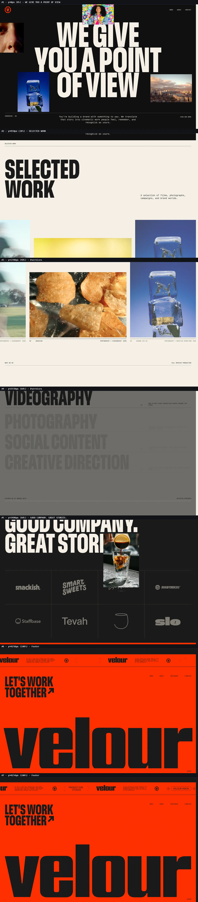
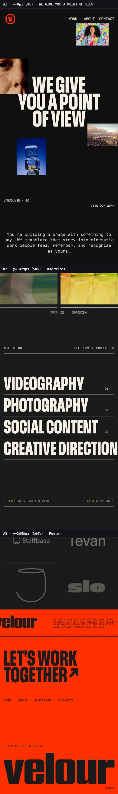

# UI Design System & Master Generation Blueprint: velourproductions-com

> **Velour Productions · Vancouver Video & Photography** (https://velourproductions.com/) — Velour Productions is a Vancouver production studio creating cinematic video, photography, social content and creative direction for brands.





---

## 1. Executive Visual Persona & Design Archetype

- **Brand Essence & Persona**: **Velour Productions · Vancouver Video & Photography** (`https://velourproductions.com/`). Velour Productions is a Vancouver production studio creating cinematic video, photography, social content and creative direction for brands.
- **Capture Provenance**: Live browser capture (`tier1_fast`, HTTP `200`, captured `2026-11-24`).
- **Visual Archetype**: **Light-Substrate Editorial & Modular Grid System (`#f4f0e5` canvas, `#1a1a1a` ink, `#ff0000` accent)**.
- **Anti-AI-Slop Differentiators**:
  - **Live-Computed Chromatic Polarity**: Anchors the viewport in `#f4f0e5` (live computed `body` `background-color` (`computed_styles.json`)) paired with `#1a1a1a` primary typography and `#ff0000` accents.
  - **Grounded Typographic Hierarchy**: Pairs `Velour Display` for display copy (`WE GIVE YOU A POINT OF VIEW`) with `Velour Mono` and `Velour Mono`.
  - **Calibrated Spatial Grid & Motion**: Combines `120rem` container bounds (`gap: 46.8px`, padding `34.56px`) with `cubic-bezier(.76,0,.24,1)` easing and Three.js / WebGL Canvas Pipeline.

---

## 2. Spatial Architecture & Modular Grid Mathematics

### Viewport Allocation & Container Geometry
- **Captured Journey Filmstrips**: Desktop `1280×5796px` (`assets/desktop-journey.webp`, `7` keyframes up to `y=4254px` / doc `5154px`), Mobile `390×2616px` (`assets/mobile-journey.webp`, `3` keyframes).
- **Master Container Bounds**: `120rem` (non-`@media` desktop container stylesheet rule).
- **Canvas Lateral Padding & Spacing**: `34.56px` lateral canvas padding with `46.8px` grid gap.
- **Border Radius Scale**: `999px`, `50%`.

### Responsive Breakpoint Architecture
- **Desktop Layout**: Multi-column CSS Grid / Flexbox layout at `1440px` (`max-width: 120rem`, `gap: 46.8px`).
- **Mobile Layout**: Single-column vertical stack at `390px` viewport width with `34.56px` horizontal padding.
- **Extracted CSS Media Queries**: `@media (max-width:800px)`, `@media (max-width:520px)`, `@media (max-width:760px),(hover:none)`, `@media (prefers-reduced-motion:reduce)`.

---

## 3. Color System, Materiality & Atmospheric Lighting

### Semantic Palette & Source Grounding
| Semantic Role | Ground-Truth Value | Extracted Live / CSS Source |
|---|---|---|
| **Primary Canvas Substrate** | `#f4f0e5` | live computed `body` `background-color` (`computed_styles.json`) |
| **Primary Typography Ink** | `#1a1a1a` | live computed `h2` `color` (`computed_styles.json`) |
| **Elevated Surface / Card Substrate** | `#e4e0d6` | `.about-profile__portrait { background: #e4e0d6 }` |
| **Interactive Accent / Highlight** | `#ff0000` | `.brand-opening__work-link:focus... { color: red }` (`#ff0000`) |
| **Secondary / Muted Copy** | `#202020` | `var(--color-ink-soft)` in `:root` |
| **Structural Hairline Border** | `#7c7b76` | `.section-kicker { border-bottom: #7c7b76 }` |
| **Variable Token (`--color-red`)** | `#fe2f00` | `var(--color-red)` in `:root` |
| **Variable Token (`--color-blue`)** | `#3a70e6` | `var(--color-blue)` in `:root` |
| **Variable Token (`--color-taupe`)** | `#a59b87` | `var(--color-taupe)` in `:root` |

### Sanitized Root CSS Variables (`ui-ux.md` Ground Truth)
| Variable Name | Extracted Value | Semantic Role |
|---|---|---|
| `--color-red` | `#fe2f00` | Brand / Palette Token |
| `--color-blue` | `#3a70e6` | Brand / Palette Token |
| `--color-paper` | `#f4f0e5` | Canvas / Surface Token |
| `--color-ink` | `#1a1a1a` | Typography Ink Token |
| `--color-ink-soft` | `#202020` | Typography Ink Token |
| `--color-taupe` | `#a59b87` | Brand / Palette Token |
| `--font-display` | `"Velour Display", "Arial Narrow", "Helvetica Neue", sans-serif` | Typography / Scale Token |
| `--font-mono` | `"Velour Mono", "Courier New", monospace` | Typography / Scale Token |
| `--type-meta` | `clamp(.625rem, .72vw, .6875rem)` | Typography / Scale Token |
| `--type-small` | `clamp(.75rem, .9vw, .8125rem)` | Typography / Scale Token |
| `--type-body` | `clamp(.875rem, 1.2vw, 1rem)` | Typography / Scale Token |
| `--leading-body` | `1.3` | Typography / Scale Token |
| `--type-display-caption` | `clamp(1.25rem, 1.55vw, 1.75rem)` | Typography / Scale Token |
| `--type-work-filter` | `clamp(1.875rem, 3.6vw, 3.5rem)` | Typography / Scale Token |
| `--type-display-xs` | `clamp(2.25rem, 3vw, 3rem)` | Typography / Scale Token |
| `--type-display-sm` | `clamp(2.75rem, 6.4vw, 6.5rem)` | Typography / Scale Token |

---

## 4. Typographic Scale & Editorial Hierarchy

### Font Family Stacks
- **Display Typography**: `Velour Display`.
- **Primary Body Stack**: `Velour Mono`.
- **Technical / Metadata Stack**: `Velour Mono`.

### Typographic Scale & Rules (Live Computed & Stylesheet Grounded)
- **Hero Display (`H1`)**: live computed `h1` (`font-size: 252px`, `line-height: 181.44px`, `font-weight: 900`); CSS variables `--font-display: "Velour Display", "Arial Narrow", "Helvetica Neue", sans-serif`, `--type-display-caption: clamp(1.25rem, 1.55vw, 1.75rem)`, `--type-display-xs: clamp(2.25rem, 3vw, 3rem)`; rule `h1` (`font-size: var(--type-photo-booth-headline)`, `line-height: .78`, `letter-spacing: 0`, `font-weight: 900`).
- **Section Heading (`H2`)**: live computed `h2` (`font-size: 194.4px`, `line-height: 149.688px`, `font-weight: 900`); rule `h2` (`font-size: var(--type-display-lg)`, `line-height: .77`, `font-weight: 900`).
- **Body Copy**: live computed `body` (`font-size: 16px`, `line-height: normal`, `font-weight: 400`); CSS variables `--type-body: clamp(.875rem, 1.2vw, 1rem)`, `--leading-body: 1.3`; rule `p` (`font-size: var(--type-body)`, `line-height: var(--leading-body)`, `font-weight: 300`).
- **Metadata & Navigation Labels**: live computed `nav/a` (`font-size: 10.368px`, `line-height: normal`, `font-weight: 400`); CSS variables `--font-mono: "Velour Mono", "Courier New", monospace`, `--type-meta: clamp(.625rem, .72vw, .6875rem)`, `--type-small: clamp(.75rem, .9vw, .8125rem)`.

---

## 5. Choreographed Motion & Interaction Physics

### Primary Easing Curves
- **Extracted Timing Functions**: `cubic-bezier(.76,0,.24,1)`, `cubic-bezier(.22,1,.36,1)`, `cubic-bezier(.23,1,.32,1)`.

### Per-Element Transition & Choreography Rules
- **Selector `.site-header`**: `transition: opacity .6s var(--ease-settle), transform .22s var(--ease-settle)` extracted from `velourproductions-com` stylesheet.
- **Selector `.site-header__mark-layer--ring-pr...`**: `transition: opacity .16s var(--ease-response)` extracted from `velourproductions-com` stylesheet.
- **Selector `data-opening-bypassed=true])>.sit...`**: `transition: none` extracted from `velourproductions-com` stylesheet.
- **Extracted Easing Curve (`cubic-bezier(.76,0,.24,1)`)**: Governs interactive state transitions across `<header.site-header>` and `<section.work>`.
- **Runtime Interaction Engine**: Integrates Three.js / WebGL Canvas Pipeline with `prefers-reduced-motion: reduce` fallback guards.
### Measured Runtime Scroll & Interaction Telemetry (`behavioral_journey_v2`)
- **Scroll Driver Mode**: `native` (max document height `5154px`, deepest scrollY reached `4254px` across `7` desktop keyframes).
- **Detected Scroll / Motion Libraries**: Native browser scroll / standard CSS transitions.
- **Route Transition Architecture**: First internal navigation (`/our-work/smartsweets`) measured as `SPA` in `2806ms`.

---

## 6. Component Wireframe & Structural DOM Map

### Visual Layout Schematic — Desktop (`1440px`, Grounded in `dom.html` & Landmark Bounding Boxes)
```
┌────────────────────────────────────────────────────────────────────────┐
│ DESKTOP VIEWPORT (1440px) — Velour Productions · Vancouver Video & Pho │
│ ====================================================================== │
│ [ <header.site-header> (1425x78px)    | Work · About · Instagram · L ] │
│ ---------------------------------------------------------------------- │
│ | HERO STAGE: <section.brand-opening> (w=1425px)                     | │
│ | H1: WE GIVE YOU A POINT OF VIEW                                    | │
│ | Substrate: #f4f0e5 | Ink: #1a1a1a | Accent: #ff0000                | │
│ ---------------------------------------------------------------------- │
│ | SHOWCASE GRID (<section.work>) max-w: 120rem                       | │
│ | +------------------------------+  +------------------------------+ | │
│ | | We give you a point of view  |  | Selected Work                | | │
│ | +------------------------------+  +------------------------------+ | │
│ ---------------------------------------------------------------------- │
│ | DETAIL MODULE (<section.services>) — Good company. Great s         | │
│ ---------------------------------------------------------------------- │
│ [ FOOTER (<footer.site-footer>) | https://velourproductions.com/       │
└────────────────────────────────────────────────────────────────────────┘
```

### Visual Layout Schematic — Mobile Reflow (`390px`)
```
┌────────────────────────────────────────────────────────────────────────┐
│ MOBILE VIEWPORT REFLOW (390px) — Single-Column Stack (gap: 46.8px)     │
│ ====================================================================== │
│ [ HEADER BAR (<header.site-header>    ) | Compact Menu (390px)         │
│ ---------------------------------------------------------------------- │
│ | HERO STAGE (<section.brand-opening>) — 390px Vertical Lead         | │
│ | H1: WE GIVE YOU A POINT OF VIEW                                    | │
│ ---------------------------------------------------------------------- │
│ | SHOWCASE STACK (<section.work>) — 1-Col Stack                      | │
│ | [ Item 1: We give you a point of view                            ] | │
│ | [ Item 2: Selected Work                                          ] | │
│ ---------------------------------------------------------------------- │
│ | DETAIL STACK (<section.services>) — 1-Col (Good company. Grea)     | │
│ ---------------------------------------------------------------------- │
│ [ FOOTER (<footer.site-footer>) | Stacked 390px Colophon               │
└────────────────────────────────────────────────────────────────────────┘
```

### Granular DOM Region Breakdown
1. **Brand Header & Navigation Bar (<header.site-header> — `velourproductions-com`)**:
   - Landmark `<header class="site-header">` (`1425x78px`) hosting `Velour Productions · Vancouver Video` navigation (`Work · About · Instagram · LinkedIn`), DOM attributes (`data-velour-hero-opening-seen="true"`, `data-home-theme="paper"`, `data-velour-hero-phase="ready"`, `data-precedence="next"`), and stylesheet rule `after { box-sizing:border-box }`.
2. **Hero Stage & Focal Lead (<section.brand-opening> — `WE GIVE YOU A POINT OF VIEW`)**:
   - Landmark `<section class="brand-opening">` presenting display lead `WE GIVE YOU A POINT OF VIEW` and copy excerpt *"You’re building a brand with something to say. We translate that "* over `#f4f0e5` canvas and `#1a1a1a` ink.
3. **Primary Showcase & Content Grid (<section.work> — `We give you a point of view`)**:
   - Landmark `<section class="work filmstrip">` rendering section `We give you a point of view` with copy *"A selection of films, photographs, campaigns, and brand worlds."*, asset references (`loading-bracket-left.svg`, `loading-dots.svg`, `loading-bracket-right.svg`, `0035rp4bt3s1g.css`), and grid rule `smooth-content { min-height:100% }`.
4. **Interactive Detail & Feature Matrix (<section.services> — `Selected Work`)**:
   - Landmark `<section class="services">` framing `Selected Work` and `Good company. Great stories.` (*"View project 01 Rugby Bricks Photography + Videography 2026"*) with `#e4e0d6` surface cards, `#ff0000` accents, and `smooth-wrapper { overflow-x:clip }`.
5. **Colophon & Global Directory Footer (<footer.site-footer> — `https://velourproductions.com/`)**:
   - Landmark `<footer class="site-footer">` anchoring `Velour Productions · Vancouver V` footer links (`Work · About · Instagram · LinkedIn`), copy *"Photography + Videography"*, and `#7c7b76` structural dividers.
### Full Vertical Scroll Sequence (Desktop `1440×900` Keyframes)
- **Step 01** (`y=0px`, `0%`): Active landmark `WE GIVE YOU A POINT OF VIEW` · sticky/fixed elements: `3`
- **Step 02** (`y=850px`, `20%`): Active landmark `SELECTED WORK` · sticky/fixed elements: `2`
- **Step 03** (`y=1700px`, `40%`): Active landmark `#services` · sticky/fixed elements: `2`
- **Step 04** (`y=2550px`, `60%`): Active landmark `#services` · sticky/fixed elements: `2`
- **Step 05** (`y=3400px`, `80%`): Active landmark `GOOD COMPANY. GREAT STORIES.` · sticky/fixed elements: `2`
- **Step 06** (`y=4250px`, `100%`): Active landmark `Footer` · sticky/fixed elements: `2`
- **Step 07** (`y=4254px`, `100%`): Active landmark `Footer` · sticky/fixed elements: `2`

### Multi-Page Internal Route Map
- **Detail Route (`/our-work/smartsweets`)**: `https://velourproductions.com/our-work/smartsweets` — H1: `SMARTSWEETS`, scrollHeight `8558px`, transition `SPA` (`2806ms`)
- **About Route (`/about-us`)**: `https://velourproductions.com/about-us` — H1: `ABOUT`, scrollHeight `5198px`, transition `direct` (`1186ms`)
- **Detail Route (`/our-work/rugby-bricks`)**: `https://velourproductions.com/our-work/rugby-bricks` — H1: `RUGBY BRICKS`, scrollHeight `8512px`, transition `direct` (`616ms`)

---

## 7. Master Zero-Shot AI Generation Prompt

```markdown
# Master Zero-Shot Frontend Generation Prompt: velourproductions-com (Velour Productions · Vancouver Video & Photography)

You are a principal frontend architect and design systems engineer. Build a complete, production-ready web application replicating the exact design system, DOM landmarks, typographic hierarchy, color tokens, and motion physics of `velourproductions-com` (**Velour Productions · Vancouver Video & Photography** — `https://velourproductions.com/`).

### 1. Visual Archetype & Anti-AI-Slop Mandates
- **Archetype**: Light-Substrate Editorial & Modular Grid System (`#f4f0e5` canvas, `#1a1a1a` ink, `#ff0000` accent).
- **Identity & Domain Context**: Velour Productions is a Vancouver production studio creating cinematic video, photography, social content and creative direction for brands.
- **Primary Substrate**: `#f4f0e5` (live computed `body` `background-color` (`computed_styles.json`)), **Primary Ink**: `#1a1a1a`, **Accent / Highlight**: `#ff0000`.
- **Site-Specific Differentiators**:
  - **Live-Computed Chromatic Polarity**: Anchors the viewport in `#f4f0e5` (live computed `body` `background-color` (`computed_styles.json`)) paired with `#1a1a1a` primary typography and `#ff0000` accents.
  - **Grounded Typographic Hierarchy**: Pairs `Velour Display` for display copy (`WE GIVE YOU A POINT OF VIEW`) with `Velour Mono` and `Velour Mono`.
  - **Calibrated Spatial Grid & Motion**: Combines `120rem` container bounds (`gap: 46.8px`, padding `34.56px`) with `cubic-bezier(.76,0,.24,1)` easing and Three.js / WebGL Canvas Pipeline.

### 2. Ground-Truth CSS Variables (`:root` Token Contract)
Declare and consume these exact custom properties extracted from `velourproductions-com` in your global stylesheet:

:root {
  /* Velour Productions · Vancouver Video & Photography (velourproductions-com) — Live-Grounded CSS Variables */
  --color-red: #fe2f00; /* Brand / Palette Token (velourproductions-com) */
  --color-blue: #3a70e6; /* Brand / Palette Token (velourproductions-com) */
  --color-paper: #f4f0e5; /* Canvas / Surface Token (velourproductions-com) */
  --color-ink: #1a1a1a; /* Typography Ink Token (velourproductions-com) */
  --color-ink-soft: #202020; /* Typography Ink Token (velourproductions-com) */
  --color-taupe: #a59b87; /* Brand / Palette Token (velourproductions-com) */
  --font-display: "Velour Display", "Arial Narrow", "Helvetica Neue", sans-serif; /* Typography / Scale Token (velourproductions-com) */
  --font-mono: "Velour Mono", "Courier New", monospace; /* Typography / Scale Token (velourproductions-com) */
  --type-meta: clamp(.625rem, .72vw, .6875rem); /* Typography / Scale Token (velourproductions-com) */
  --type-small: clamp(.75rem, .9vw, .8125rem); /* Typography / Scale Token (velourproductions-com) */
  --type-body: clamp(.875rem, 1.2vw, 1rem); /* Typography / Scale Token (velourproductions-com) */
  --leading-body: 1.3; /* Typography / Scale Token (velourproductions-com) */
  --type-display-caption: clamp(1.25rem, 1.55vw, 1.75rem); /* Typography / Scale Token (velourproductions-com) */
  --type-work-filter: clamp(1.875rem, 3.6vw, 3.5rem); /* Typography / Scale Token (velourproductions-com) */
  --type-display-xs: clamp(2.25rem, 3vw, 3rem); /* Typography / Scale Token (velourproductions-com) */
  --type-display-sm: clamp(2.75rem, 6.4vw, 6.5rem); /* Typography / Scale Token (velourproductions-com) */
}

### 3. Semantic Color & Materiality Contract
Map every surface, ink, and border strictly to these source-grounded tokens:
- **Primary Canvas Substrate**: `#f4f0e5` — grounded in live computed `body` `background-color` (`computed_styles.json`)
- **Primary Typography Ink**: `#1a1a1a` — grounded in live computed `h2` `color` (`computed_styles.json`)
- **Elevated Surface / Card Substrate**: `#e4e0d6` — grounded in `.about-profile__portrait { background: #e4e0d6 }`
- **Interactive Accent / Highlight**: `#ff0000` — grounded in `.brand-opening__work-link:focus... { color: red }` (`#ff0000`)
- **Secondary / Muted Copy**: `#202020` — grounded in `var(--color-ink-soft)` in `:root`
- **Structural Hairline Border**: `#7c7b76` — grounded in `.section-kicker { border-bottom: #7c7b76 }`
- **Variable Token (`--color-red`)**: `#fe2f00` — grounded in `var(--color-red)` in `:root`
- **Variable Token (`--color-blue`)**: `#3a70e6` — grounded in `var(--color-blue)` in `:root`
- **Variable Token (`--color-taupe`)**: `#a59b87` — grounded in `var(--color-taupe)` in `:root`

### 4. Spatial Grid, Container Bounds & Responsive Breakpoints
- **Desktop Viewport Reference**: `1280×5796px` (multi-frame vertical journey filmstrip (5796px), `1440px` standard desktop width).
- **Mobile Viewport Reference**: `390×2616px` (multi-frame vertical journey filmstrip (2616px), `390px` standard mobile width).
- **Container Max-Width**: `120rem` (non-`@media` desktop container stylesheet rule)
- **Padding & Gutters**: `34.56px` lateral canvas padding with `46.8px` grid gap
- **Desktop Grid**: Multi-column CSS Grid / Flexbox layout at `1440px` (`max-width: 120rem`, `gap: 46.8px`)
- **Mobile Adaptation**: Single-column vertical stack at `390px` viewport width with `34.56px` horizontal padding
- **Media Queries**: `@media (max-width:800px)`, `@media (max-width:520px)`, `@media (max-width:760px),(hover:none)`, `@media (prefers-reduced-motion:reduce)`
- **Corner Radii**: `999px`, `50%`

### 5. Typography & Editorial Scale Contract
- **Display Font Stack**: `Velour Display`
- **Body Font Stack**: `Velour Mono`
- **Monospace / Technical Font Stack**: `Velour Mono`
- **H1 Display Rule**: live computed `h1` (`font-size: 252px`, `line-height: 181.44px`, `font-weight: 900`); CSS variables `--font-display: "Velour Display", "Arial Narrow", "Helvetica Neue", sans-serif`, `--type-display-caption: clamp(1.25rem, 1.55vw, 1.75rem)`, `--type-display-xs: clamp(2.25rem, 3vw, 3rem)`; rule `h1` (`font-size: var(--type-photo-booth-headline)`, `line-height: .78`, `letter-spacing: 0`, `font-weight: 900`)
- **H2 Section Rule**: live computed `h2` (`font-size: 194.4px`, `line-height: 149.688px`, `font-weight: 900`); rule `h2` (`font-size: var(--type-display-lg)`, `line-height: .77`, `font-weight: 900`)
- **Body Copy Rule**: live computed `body` (`font-size: 16px`, `line-height: normal`, `font-weight: 400`); CSS variables `--type-body: clamp(.875rem, 1.2vw, 1rem)`, `--leading-body: 1.3`; rule `p` (`font-size: var(--type-body)`, `line-height: var(--leading-body)`, `font-weight: 300`)
- **Metadata & Index Rule**: live computed `nav/a` (`font-size: 10.368px`, `line-height: normal`, `font-weight: 400`); CSS variables `--font-mono: "Velour Mono", "Courier New", monospace`, `--type-meta: clamp(.625rem, .72vw, .6875rem)`, `--type-small: clamp(.75rem, .9vw, .8125rem)`

### 6. Component Hierarchy, Verbatim Copy & Real DOM Landmarks
Scaffold `velourproductions-com` (`Velour Productions · Vancouver Video & Photography`) with these exact structural regions, extracted copy, and CSS rules from `dom.html`:
1. **Brand Header & Navigation Bar (<header.site-header> — `velourproductions-com`)**:
   - DOM & Selectors: Landmark `<header class="site-header">` (`1425x78px`) hosting `Velour Productions · Vancouver Video` navigation (`Work · About · Instagram · LinkedIn`), DOM attributes (`data-velour-hero-opening-seen="true"`, `data-home-theme="paper"`, `data-velour-hero-phase="ready"`, `data-precedence="next"`), and stylesheet rule `after { box-sizing:border-box }`.
   - Responsive Contract: Header `Brand Header & Navigation Bar (<header.site-header> — `velourproductions-com`)` (`velourproductions-com`) adapts across `@media (max-width:800px)`, `@media (max-width:520px)`, `@media (max-width:760px),(hover:none)`, `@media (prefers-reduced-motion:reduce)` with `cubic-bezier(.76,0,.24,1)`, `cubic-bezier(.22,1,.36,1)`, `cubic-bezier(.23,1,.32,1)` transitions and links `Work · About · Instagram · LinkedIn`.
2. **Hero Stage & Focal Lead (<section.brand-opening> — `WE GIVE YOU A POINT OF VIEW`)**:
   - DOM & Selectors: Landmark `<section class="brand-opening">` presenting display lead `WE GIVE YOU A POINT OF VIEW` and copy excerpt *"You’re building a brand with something to say. We translate that "* over `#f4f0e5` canvas and `#1a1a1a` ink.
   - Responsive Contract: Hero stage (`1280×5796px` desktop / `390×2616px` mobile) sets `#f4f0e5` background with `#1a1a1a` headline `WE GIVE YOU A POINT OF VIEW`.
3. **Primary Showcase & Content Grid (<section.work> — `We give you a point of view`)**:
   - DOM & Selectors: Landmark `<section class="work filmstrip">` rendering section `We give you a point of view` with copy *"A selection of films, photographs, campaigns, and brand worlds."*, asset references (`loading-bracket-left.svg`, `loading-dots.svg`, `loading-bracket-right.svg`, `0035rp4bt3s1g.css`), and grid rule `smooth-content { min-height:100% }`.
   - Responsive Contract: Showcase grid `Primary Showcase & Content Grid (<section.work> — `We give you a point of view`)` applies Multi-column CSS Grid / Flexbox layout at `1440px` (`max-width: 120rem`, `gap: 46.8px`) on desktop and Single-column vertical stack at `390px` viewport width with `34.56px` horizontal padding on mobile.
4. **Interactive Detail & Feature Matrix (<section.services> — `Selected Work`)**:
   - DOM & Selectors: Landmark `<section class="services">` framing `Selected Work` and `Good company. Great stories.` (*"View project 01 Rugby Bricks Photography + Videography 2026"*) with `#e4e0d6` surface cards, `#ff0000` accents, and `smooth-wrapper { overflow-x:clip }`.
   - Responsive Contract: Detail module `Interactive Detail & Feature Matrix (<section.services> — `Selected Work`)` uses `999px`, `50%` radii, `#ff0000` highlights, and assets (loading-bracket-left.svg, loading-dots.svg, loading-bracket-right.svg).
5. **Colophon & Global Directory Footer (<footer.site-footer> — `https://velourproductions.com/`)**:
   - DOM & Selectors: Landmark `<footer class="site-footer">` anchoring `Velour Productions · Vancouver V` footer links (`Work · About · Instagram · LinkedIn`), copy *"Photography + Videography"*, and `#7c7b76` structural dividers.
   - Responsive Contract: Footer `Colophon & Global Directory Footer (<footer.site-footer> — `https://velourproductions.com/`)` aligns to `120rem` (non-`@media` desktop container stylesheet rule) with `34.56px` lateral canvas padding with `46.8px` grid gap and attributes (data-velour-hero-opening-seen="true", data-home-theme="paper", data-velour-hero-phase="ready").

#### Verbatim DOM Copy Excerpts (`dom.html`)
- Copy Excerpt 1: *"You’re building a brand with something to say. We translate that story into cinema..."*
- Copy Excerpt 2: *"A selection of films, photographs, campaigns, and brand worlds."*
- Copy Excerpt 3: *"View project 01 Rugby Bricks Photography + Videography 2026"*
- Copy Excerpt 4: *"Photography + Videography"*

### 7. Motion, Extracted Stylesheet Rules & Interaction Choreography
- **Primary Easing Functions**: `cubic-bezier(.76,0,.24,1)`, `cubic-bezier(.22,1,.36,1)`, `cubic-bezier(.23,1,.32,1)`
- **Extracted Stylesheet Rules (`velourproductions-com`)**:
- `after { box-sizing:border-box }`
- `smooth-content { min-height:100% }`
- `smooth-wrapper { overflow-x:clip }`
- `.project-transition-backdrop { background:var(--color-paper) }`
- `.project-transition-surface { z-index:9999;pointer-events:none;visibility:hidden;transform-origin:0 0;... }`
- **Per-Selector Transition Rules**:
- **Selector `.site-header`**: `transition: opacity .6s var(--ease-settle), transform .22s var(--ease-settle)` extracted from `velourproductions-com` stylesheet.
- **Selector `.site-header__mark-layer--ring-pr...`**: `transition: opacity .16s var(--ease-response)` extracted from `velourproductions-com` stylesheet.
- **Selector `data-opening-bypassed=true])>.sit...`**: `transition: none` extracted from `velourproductions-com` stylesheet.
- **Extracted Easing Curve (`cubic-bezier(.76,0,.24,1)`)**: Governs interactive state transitions across `<header.site-header>` and `<section.work>`.
- **Runtime Interaction Engine**: Integrates Three.js / WebGL Canvas Pipeline with `prefers-reduced-motion: reduce` fallback guards.
### 7b. Full-Page Scroll Choreography, Interactive States & Multi-Page Routes
- **Scroll Mechanics**: Implement `native` vertical progression up to `5154px` across 7 distinct viewport chapters.
- **Vertical Chapter Sequence**: WE GIVE YOU A POINT OF VIEW (0%) -> SELECTED WORK (20%) -> #services (40%) -> #services (60%) -> GOOD COMPANY. GREAT STORIES. (80%) -> Footer (100%) -> Footer (100%).
- **Multi-Page Routes**: Scaffold internal routes `/our-work/smartsweets` (detail, SPA), `/about-us` (about, direct), `/our-work/rugby-bricks` (detail, direct) sharing the global header/footer shell and design tokens.

### 8. Technical Deliverables
- Implement in Next.js (App Router) with TypeScript and Tailwind CSS consuming the `:root` custom properties defined above for `velourproductions-com`.
- Reproduce both the `1440px` desktop architecture and `390px` mobile breakpoint transitions, preserving semantic HTML5 landmarks (`<header>`, `<nav>`, `<main>`, `<section>`, `<footer>`) and `prefers-reduced-motion` accessibility guards.
```
---

## 8. Full-Page Scroll Journey, Interactive States & Subpage Inventory

### Desktop Scroll Keyframes (`1440×900` WebP)
| Step | Scroll Y | Progress | Active Landmark / Section | Sticky/Fixed | Visual Asset |
| :---: | :---: | :---: | :--- | :---: | :--- |
| `#01` | `0px` | `0%` | WE GIVE YOU A POINT OF VIEW | `3` | [desktop-step-01.webp](assets/desktop-step-01.webp) |
| `#02` | `850px` | `20%` | SELECTED WORK | `2` | [desktop-step-02.webp](assets/desktop-step-02.webp) |
| `#03` | `1700px` | `40%` | #services | `2` | [desktop-step-03.webp](assets/desktop-step-03.webp) |
| `#04` | `2550px` | `60%` | #services | `2` | [desktop-step-04.webp](assets/desktop-step-04.webp) |
| `#05` | `3400px` | `80%` | GOOD COMPANY. GREAT STORIES. | `2` | [desktop-step-05.webp](assets/desktop-step-05.webp) |
| `#06` | `4250px` | `100%` | Footer | `2` | [desktop-step-06.webp](assets/desktop-step-06.webp) |
| `#07` | `4254px` | `100%` | Footer | `2` | [desktop-step-07.webp](assets/desktop-step-07.webp) |

### Mobile Condensed Keyframes (`390×844` WebP)
| Step | Scroll Y | Progress | Active Landmark | Visual Asset |
| :---: | :---: | :---: | :--- | :--- |
| `#01` | `0px` | `0%` | WE GIVE YOU A POINT OF VIEW | [mobile-step-01.webp](assets/mobile-step-01.webp) |
| `#02` | `1429px` | `50%` | #services | [mobile-step-02.webp](assets/mobile-step-02.webp) |
| `#03` | `2858px` | `100%` | Footer | [mobile-step-03.webp](assets/mobile-step-03.webp) |

### Internal Subpage Filmstrips (`1080px` Wide WebP)
| # | Template | Route URL | H1 / Title | Scroll Height | Transition | Filmstrip Asset |
| :-: | :---: | :--- | :--- | :---: | :---: | :--- |
| `1` | `detail` | `https://velourproductions.com/our-work/smartsweets` | SMARTSWEETS | `8558px` | `SPA` (`2806ms`) | [subpage-01-our-work-smartsweets.webp](assets/subpage-01-our-work-smartsweets.webp) |
| `2` | `about` | `https://velourproductions.com/about-us` | ABOUT | `5198px` | `direct` (`1186ms`) | [subpage-02-about-us.webp](assets/subpage-02-about-us.webp) |
| `3` | `detail` | `https://velourproductions.com/our-work/rugby-bricks` | RUGBY BRICKS | `8512px` | `direct` (`616ms`) | [subpage-03-our-work-rugby-bricks.webp](assets/subpage-03-our-work-rugby-bricks.webp) |

