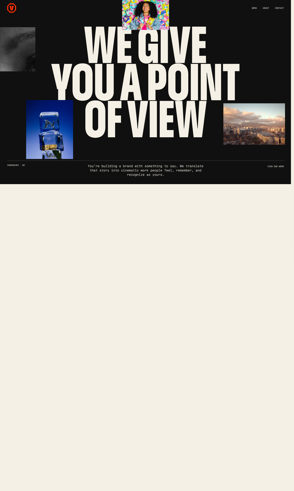
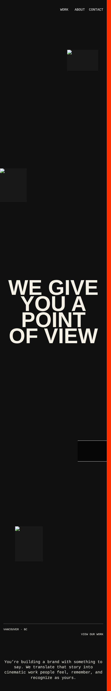

# UI Design System & Master Generation Blueprint: velourproductions-com

> **Velour Productions · Vancouver Video & Photography** (https://velourproductions.com/) — Velour Productions is a Vancouver production studio creating cinematic video, photography, social content and creative direction for brands.



---

## 1. Executive Visual Persona & Design Archetype

- **Brand Essence & Persona**: **Velour Productions · Vancouver Video & Photography** (`https://velourproductions.com/`). Velour Productions is a Vancouver production studio creating cinematic video, photography, social content and creative direction for brands.
- **Visual Archetype**: **High-Contrast Obsidian / Atmospheric Design System (`#fe2f00` canvas, `#f4f0e5` ink, `#1a1a1a` accent)**.
- **Anti-AI-Slop Differentiators**:
  - **Source-Grounded Chromatic Polarity**: Anchors the viewport in `#fe2f00` (`var(--color-red)` in `:root`) paired with `#f4f0e5` primary typography and `#1a1a1a` accents.
  - **Extracted Typographic Hierarchy**: Pairs `Velour Display` for display copy (`We give you a point of view`) with `Velour Mono` and `Velour Mono`.
  - **Calibrated Spatial Grid & Motion**: Combines `800px` container bounds (`gap: 2rem`, padding `1rem`) with `cubic-bezier(.76,0,.24,1)` easing and Three.js / WebGL Canvas Pipeline.

---

## 2. Spatial Architecture & Modular Grid Mathematics



### Viewport Allocation & Container Geometry
- **Captured Viewport Dimensions**: Desktop `1440×5154px` (`assets/desktop.png`, full-page scroll capture), Mobile `390×2400px` (`assets/mobile.png`, capped at 2400px multi-section capture).
- **Master Container Bounds**: `800px` extracted from `velourproductions-com` stylesheet.
- **Canvas Lateral Padding & Spacing**: `1rem` lateral canvas padding with `2rem` grid gap.
- **Border Radius Scale**: `999px`, `50%`.

### Responsive Breakpoint Architecture
- **Desktop Layout**: Multi-column CSS Grid / Flexbox layout at `1440px` (`max-width: 800px`, `gap: 2rem`).
- **Mobile Layout**: Single-column vertical stack at `390px` viewport width with `1rem` horizontal padding.
- **Extracted CSS Media Queries**: `@media (max-width:800px)`, `@media (max-width:520px)`, `@media (max-width:760px),(hover:none)`, `@media (prefers-reduced-motion:reduce)`.

---

## 3. Color System, Materiality & Atmospheric Lighting

### Semantic Palette & Source Grounding
| Semantic Role | Ground-Truth Value | Extracted CSS Source / Selector |
|---|---|---|
| **Primary Canvas Substrate** | `#fe2f00` | `var(--color-red)` in `:root` |
| **Primary Typography Ink** | `#3a70e6` | `var(--color-blue)` in `:root` |
| **Elevated Surface / Card Substrate** | `#f4f0e5` | `var(--color-paper)` in `:root` |
| **Interactive Accent / Highlight** | `#1a1a1a` | `var(--color-ink)` in `:root` |
| **Secondary / Muted Copy** | `#202020` | `var(--color-ink-soft)` in `:root` |
| **Structural Hairline Border** | `#a59b87` | `var(--color-taupe)` in `:root` |

### Sanitized Root CSS Variables (`ui-ux.md` Ground Truth)
| Variable Name | Extracted Value | Semantic Role |
|---|---|---|
| `--color-red` | `#fe2f00` | Brand / Palette Token |
| `--color-blue` | `#3a70e6` | Brand / Palette Token |
| `--color-paper` | `#f4f0e5` | Canvas / Surface Token |
| `--color-ink` | `#1a1a1a` | Typography Ink Token |
| `--color-ink-soft` | `#202020` | Typography Ink Token |
| `--color-taupe` | `#a59b87` | Brand / Palette Token |
| `--font-display` | `"Velour Display", "Arial Narrow", "Helvetica Neue", sans-serif` | Typography / Scale Token |
| `--font-mono` | `"Velour Mono", "Courier New", monospace` | Typography / Scale Token |
| `--type-meta` | `clamp(.625rem, .72vw, .6875rem)` | Typography / Scale Token |
| `--type-small` | `clamp(.75rem, .9vw, .8125rem)` | Typography / Scale Token |
| `--type-body` | `clamp(.875rem, 1.2vw, 1rem)` | Typography / Scale Token |
| `--leading-body` | `1.3` | Typography / Scale Token |
| `--type-display-caption` | `clamp(1.25rem, 1.55vw, 1.75rem)` | Typography / Scale Token |
| `--type-work-filter` | `clamp(1.875rem, 3.6vw, 3.5rem)` | Typography / Scale Token |
| `--type-display-xs` | `clamp(2.25rem, 3vw, 3rem)` | Typography / Scale Token |
| `--type-display-sm` | `clamp(2.75rem, 6.4vw, 6.5rem)` | Typography / Scale Token |

---

## 4. Typographic Scale & Editorial Hierarchy

### Font Family Stacks
- **Display Typography**: `Velour Display`.
- **Primary Body Stack**: `Velour Mono`.
- **Technical / Metadata Stack**: `Velour Mono`.

### Typographic Scale & Rules (Extracted from Stylesheet & Variables)
- **Hero Display (`H1`)**: CSS variables `--font-display: "Velour Display", "Arial Narrow", "Helvetica Neue", sans-serif`, `--type-display-caption: clamp(1.25rem, 1.55vw, 1.75rem)`, `--type-display-xs: clamp(2.25rem, 3vw, 3rem)`; rule `h1` (`font-size: var(--type-photo-booth-headline)`, `line-height: .78`, `letter-spacing: 0`, `font-weight: 900`).
- **Section Heading (`H2`)**: rule `h2` (`font-size: var(--type-display-lg)`, `line-height: .77`, `font-weight: 900`).
- **Body Copy**: CSS variables `--type-body: clamp(.875rem, 1.2vw, 1rem)`, `--leading-body: 1.3`; rule `p` (`font-size: var(--type-body)`, `line-height: var(--leading-body)`, `font-weight: 300`).
- **Metadata & Navigation Labels**: CSS variables `--font-mono: "Velour Mono", "Courier New", monospace`, `--type-meta: clamp(.625rem, .72vw, .6875rem)`, `--type-small: clamp(.75rem, .9vw, .8125rem)`.

---

## 5. Choreographed Motion & Interaction Physics

### Primary Easing Curves
- **Extracted Timing Functions**: `cubic-bezier(.76,0,.24,1)`, `cubic-bezier(.22,1,.36,1)`, `cubic-bezier(.23,1,.32,1)`.

### Per-Element Transition & Choreography Rules
- **Selector `.site-header`**: `transition: opacity .6s var(--ease-settle), transform .22s var(--ease-settle)` extracted from `velourproductions-com` stylesheet.
- **Selector `.site-header__mark-layer--ring-pr...`**: `transition: opacity .16s var(--ease-response)` extracted from `velourproductions-com` stylesheet.
- **Selector `data-opening-bypassed=true])>.sit...`**: `transition: none` extracted from `velourproductions-com` stylesheet.
- **Extracted Easing Curve (`cubic-bezier(.76,0,.24,1)`)**: Governs interactive state transitions across `<header.site-header>` and `<section.work>`.
- **Runtime Interaction Engine**: Integrates Three.js / WebGL Canvas Pipeline with `prefers-reduced-motion: reduce` fallback guards.

---

## 6. Component Wireframe & Structural DOM Map

### Visual Layout Schematic (Grounded in `dom.html` — `1440px` Desktop & `390px` Mobile Reflow)
```
┌────────────────────────────────────────────────────────────────────────┐
│ DESKTOP VIEWPORT (1440px) — Velour Productions · Vancouver Video & Pho │
│ ====================================================================== │
│ [ <header.site-header>     | Work · About · Instagram · LinkedIn    ]  │
│ ---------------------------------------------------------------------- │
│ | HERO STAGE: <section.brand-opening>                              |   │
│ | H1: We give you a point of view                                  |   │
│ | Substrate: #fe2f00    | Ink: #f4f0e5    | Accent: #1a1a1a        |   │
│ ---------------------------------------------------------------------- │
│ | SHOWCASE GRID (<section.work>            ) max-w: 800px          |   │
│ | +------------------------------+  +------------------------------+ | │
│ | | Selected Work                |  | What we do                   | | │
│ | +------------------------------+  +------------------------------+ | │
│ ---------------------------------------------------------------------- │
│ | MOBILE VIEWPORT REFLOW (390px) — Single-Column Stack (gap: 2rem  ) | │
│ | [<header.site-heade] -> [<section.brand-ope] -> [<section.work>] |   │
│ ---------------------------------------------------------------------- │
│ [ FOOTER (<footer.site-footer>  ) | https://velourproductions.com/     │
└────────────────────────────────────────────────────────────────────────┘
```

### Granular DOM Region Breakdown
1. **Brand Header & Navigation Bar (<header.site-header> — `velourproductions-com`)**:
   - Landmark `<header class="site-header">` hosting `Velour Productions · Vancouver Video` navigation (`Work · About · Instagram · LinkedIn`), DOM attributes (`data-velour-hero-opening-seen="true"`, `data-home-theme="paper"`, `data-velour-hero-phase="ready"`, `data-precedence="next"`), and stylesheet rule `after { box-sizing:border-box }`.
2. **Hero Stage & Focal Lead (<section.brand-opening> — `We give you a point of view`)**:
   - Landmark `<section class="brand-opening">` presenting display lead `We give you a point of view` and copy excerpt *"You’re building a brand with something to say. We translate that "* over `#fe2f00` canvas and `#f4f0e5` ink.
3. **Primary Showcase & Content Grid (<section.work> — `Selected Work`)**:
   - Landmark `<section class="work filmstrip">` rendering section `Selected Work` with copy *"A selection of films, photographs, campaigns, and brand worlds."*, asset references (`loading-bracket-left.svg`, `loading-dots.svg`, `loading-bracket-right.svg`, `0035rp4bt3s1g.css`), and grid rule `smooth-content { min-height:100% }`.
4. **Interactive Detail & Feature Matrix (<section.services> — `What we do`)**:
   - Landmark `<section class="services">` framing `What we do` and `Good company. Great stories.` (*"View project 01 Rugby Bricks Photography + Videography 2026"*) with `#f4f0e5` surface cards, `#1a1a1a` accents, and `smooth-wrapper { overflow-x:clip }`.
5. **Colophon & Global Directory Footer (<footer.site-footer> — `https://velourproductions.com/`)**:
   - Landmark `<footer class="site-footer">` anchoring `Velour Productions · Vancouver V` footer links (`Work · About · Instagram · LinkedIn`), copy *"Photography + Videography"*, and `#a59b87` structural dividers.

---

## 7. Master Zero-Shot AI Generation Prompt

```markdown
# Master Zero-Shot Frontend Generation Prompt: velourproductions-com (Velour Productions · Vancouver Video & Photography)

You are a principal frontend architect and design systems engineer. Build a complete, production-ready web application replicating the exact design system, DOM landmarks, typographic hierarchy, color tokens, and motion physics of `velourproductions-com` (**Velour Productions · Vancouver Video & Photography** — `https://velourproductions.com/`).

### 1. Visual Archetype & Anti-AI-Slop Mandates
- **Archetype**: High-Contrast Obsidian / Atmospheric Design System (`#fe2f00` canvas, `#f4f0e5` ink, `#1a1a1a` accent).
- **Identity & Domain Context**: Velour Productions is a Vancouver production studio creating cinematic video, photography, social content and creative direction for brands.
- **Primary Substrate**: `#fe2f00` (`var(--color-red)` in `:root`), **Primary Ink**: `#f4f0e5`, **Accent / Highlight**: `#1a1a1a`.
- **Site-Specific Differentiators**:
  - **Source-Grounded Chromatic Polarity**: Anchors the viewport in `#fe2f00` (`var(--color-red)` in `:root`) paired with `#f4f0e5` primary typography and `#1a1a1a` accents.
  - **Extracted Typographic Hierarchy**: Pairs `Velour Display` for display copy (`We give you a point of view`) with `Velour Mono` and `Velour Mono`.
  - **Calibrated Spatial Grid & Motion**: Combines `800px` container bounds (`gap: 2rem`, padding `1rem`) with `cubic-bezier(.76,0,.24,1)` easing and Three.js / WebGL Canvas Pipeline.

### 2. Ground-Truth CSS Variables (`:root` Token Contract)
Declare and consume these exact custom properties extracted from `velourproductions-com` in your global stylesheet:

:root {
  /* Velour Productions · Vancouver Video & Photography (velourproductions-com) — Ground-Truth Extracted CSS Variables */
  --color-red: #fe2f00; /* Brand / Palette Token (velourproductions-com) */
  --color-blue: #3a70e6; /* Brand / Palette Token (velourproductions-com) */
  --color-paper: #f4f0e5; /* Canvas / Surface Token (velourproductions-com) */
  --color-ink: #1a1a1a; /* Typography Ink Token (velourproductions-com) */
  --color-ink-soft: #202020; /* Typography Ink Token (velourproductions-com) */
  --color-taupe: #a59b87; /* Brand / Palette Token (velourproductions-com) */
  --font-display: "Velour Display", "Arial Narrow", "Helvetica Neue", sans-serif; /* Typography / Scale Token (velourproductions-com) */
  --font-mono: "Velour Mono", "Courier New", monospace; /* Typography / Scale Token (velourproductions-com) */
  --type-meta: clamp(.625rem, .72vw, .6875rem); /* Typography / Scale Token (velourproductions-com) */
  --type-small: clamp(.75rem, .9vw, .8125rem); /* Typography / Scale Token (velourproductions-com) */
  --type-body: clamp(.875rem, 1.2vw, 1rem); /* Typography / Scale Token (velourproductions-com) */
  --leading-body: 1.3; /* Typography / Scale Token (velourproductions-com) */
  --type-display-caption: clamp(1.25rem, 1.55vw, 1.75rem); /* Typography / Scale Token (velourproductions-com) */
  --type-work-filter: clamp(1.875rem, 3.6vw, 3.5rem); /* Typography / Scale Token (velourproductions-com) */
  --type-display-xs: clamp(2.25rem, 3vw, 3rem); /* Typography / Scale Token (velourproductions-com) */
  --type-display-sm: clamp(2.75rem, 6.4vw, 6.5rem); /* Typography / Scale Token (velourproductions-com) */
}

### 3. Semantic Color & Materiality Contract
Map every surface, ink, and border strictly to these source-grounded tokens:
- **Primary Canvas Substrate**: `#fe2f00` — grounded in `var(--color-red)` in `:root`
- **Primary Typography Ink**: `#3a70e6` — grounded in `var(--color-blue)` in `:root`
- **Elevated Surface / Card Substrate**: `#f4f0e5` — grounded in `var(--color-paper)` in `:root`
- **Interactive Accent / Highlight**: `#1a1a1a` — grounded in `var(--color-ink)` in `:root`
- **Secondary / Muted Copy**: `#202020` — grounded in `var(--color-ink-soft)` in `:root`
- **Structural Hairline Border**: `#a59b87` — grounded in `var(--color-taupe)` in `:root`

### 4. Spatial Grid, Container Bounds & Responsive Breakpoints
- **Desktop Viewport Reference**: `1440×5154px` (full-page scroll capture, `1440px` standard desktop width).
- **Mobile Viewport Reference**: `390×2400px` (capped at 2400px multi-section capture, `390px` standard mobile width).
- **Container Max-Width**: `800px` extracted from `velourproductions-com` stylesheet
- **Padding & Gutters**: `1rem` lateral canvas padding with `2rem` grid gap
- **Desktop Grid**: Multi-column CSS Grid / Flexbox layout at `1440px` (`max-width: 800px`, `gap: 2rem`)
- **Mobile Adaptation**: Single-column vertical stack at `390px` viewport width with `1rem` horizontal padding
- **Media Queries**: `@media (max-width:800px)`, `@media (max-width:520px)`, `@media (max-width:760px),(hover:none)`, `@media (prefers-reduced-motion:reduce)`
- **Corner Radii**: `999px`, `50%`

### 5. Typography & Editorial Scale Contract
- **Display Font Stack**: `Velour Display`
- **Body Font Stack**: `Velour Mono`
- **Monospace / Technical Font Stack**: `Velour Mono`
- **H1 Display Rule**: CSS variables `--font-display: "Velour Display", "Arial Narrow", "Helvetica Neue", sans-serif`, `--type-display-caption: clamp(1.25rem, 1.55vw, 1.75rem)`, `--type-display-xs: clamp(2.25rem, 3vw, 3rem)`; rule `h1` (`font-size: var(--type-photo-booth-headline)`, `line-height: .78`, `letter-spacing: 0`, `font-weight: 900`)
- **H2 Section Rule**: rule `h2` (`font-size: var(--type-display-lg)`, `line-height: .77`, `font-weight: 900`)
- **Body Copy Rule**: CSS variables `--type-body: clamp(.875rem, 1.2vw, 1rem)`, `--leading-body: 1.3`; rule `p` (`font-size: var(--type-body)`, `line-height: var(--leading-body)`, `font-weight: 300`)
- **Metadata & Index Rule**: CSS variables `--font-mono: "Velour Mono", "Courier New", monospace`, `--type-meta: clamp(.625rem, .72vw, .6875rem)`, `--type-small: clamp(.75rem, .9vw, .8125rem)`

### 6. Component Hierarchy, Verbatim Copy & Real DOM Landmarks
Scaffold `velourproductions-com` (`Velour Productions · Vancouver Video & Photography`) with these exact structural regions, extracted copy, and CSS rules from `dom.html`:
1. **Brand Header & Navigation Bar (<header.site-header> — `velourproductions-com`)**:
   - DOM & Selectors: Landmark `<header class="site-header">` hosting `Velour Productions · Vancouver Video` navigation (`Work · About · Instagram · LinkedIn`), DOM attributes (`data-velour-hero-opening-seen="true"`, `data-home-theme="paper"`, `data-velour-hero-phase="ready"`, `data-precedence="next"`), and stylesheet rule `after { box-sizing:border-box }`.
   - Responsive Contract: Header `Brand Header & Navigation Bar (<header.site-header> — `velourproductions-com`)` (`velourproductions-com`) adapts across `@media (max-width:800px)`, `@media (max-width:520px)`, `@media (max-width:760px),(hover:none)`, `@media (prefers-reduced-motion:reduce)` with `cubic-bezier(.76,0,.24,1)`, `cubic-bezier(.22,1,.36,1)`, `cubic-bezier(.23,1,.32,1)` transitions and links `Work · About · Instagram · LinkedIn`.
2. **Hero Stage & Focal Lead (<section.brand-opening> — `We give you a point of view`)**:
   - DOM & Selectors: Landmark `<section class="brand-opening">` presenting display lead `We give you a point of view` and copy excerpt *"You’re building a brand with something to say. We translate that "* over `#fe2f00` canvas and `#f4f0e5` ink.
   - Responsive Contract: Hero stage (`1440×5154px` desktop / `390×2400px` mobile) sets `#fe2f00` background with `#f4f0e5` headline `We give you a point of view`.
3. **Primary Showcase & Content Grid (<section.work> — `Selected Work`)**:
   - DOM & Selectors: Landmark `<section class="work filmstrip">` rendering section `Selected Work` with copy *"A selection of films, photographs, campaigns, and brand worlds."*, asset references (`loading-bracket-left.svg`, `loading-dots.svg`, `loading-bracket-right.svg`, `0035rp4bt3s1g.css`), and grid rule `smooth-content { min-height:100% }`.
   - Responsive Contract: Showcase grid `Primary Showcase & Content Grid (<section.work> — `Selected Work`)` applies Multi-column CSS Grid / Flexbox layout at `1440px` (`max-width: 800px`, `gap: 2rem`) on desktop and Single-column vertical stack at `390px` viewport width with `1rem` horizontal padding on mobile.
4. **Interactive Detail & Feature Matrix (<section.services> — `What we do`)**:
   - DOM & Selectors: Landmark `<section class="services">` framing `What we do` and `Good company. Great stories.` (*"View project 01 Rugby Bricks Photography + Videography 2026"*) with `#f4f0e5` surface cards, `#1a1a1a` accents, and `smooth-wrapper { overflow-x:clip }`.
   - Responsive Contract: Detail module `Interactive Detail & Feature Matrix (<section.services> — `What we do`)` uses `999px`, `50%` radii, `#1a1a1a` highlights, and assets (loading-bracket-left.svg, loading-dots.svg, loading-bracket-right.svg).
5. **Colophon & Global Directory Footer (<footer.site-footer> — `https://velourproductions.com/`)**:
   - DOM & Selectors: Landmark `<footer class="site-footer">` anchoring `Velour Productions · Vancouver V` footer links (`Work · About · Instagram · LinkedIn`), copy *"Photography + Videography"*, and `#a59b87` structural dividers.
   - Responsive Contract: Footer `Colophon & Global Directory Footer (<footer.site-footer> — `https://velourproductions.com/`)` aligns to `800px` extracted from `velourproductions-com` stylesheet with `1rem` lateral canvas padding with `2rem` grid gap and attributes (data-velour-hero-opening-seen="true", data-home-theme="paper", data-velour-hero-phase="ready").

#### Verbatim DOM Copy Excerpts (`dom.html`)
- Copy Excerpt 1: *"You’re building a brand with something to say. We translate that story into cinema..."*
- Copy Excerpt 2: *"A selection of films, photographs, campaigns, and brand worlds."*
- Copy Excerpt 3: *"View project 01 Rugby Bricks Photography + Videography 2026"*
- Copy Excerpt 4: *"Photography + Videography"*

### 7. Motion, Extracted Stylesheet Rules & Interaction Choreography
- **Primary Easing Functions**: `cubic-bezier(.76,0,.24,1)`, `cubic-bezier(.22,1,.36,1)`, `cubic-bezier(.23,1,.32,1)`
- **Extracted Stylesheet Rules (`velourproductions-com`)**:
- `after { box-sizing:border-box }`
- `smooth-content { min-height:100% }`
- `smooth-wrapper { overflow-x:clip }`
- `.project-transition-backdrop { background:var(--color-paper) }`
- `.project-transition-surface { z-index:9999;pointer-events:none;visibility:hidden;transform-origin:0 0;... }`
- **Per-Selector Transition Rules**:
- **Selector `.site-header`**: `transition: opacity .6s var(--ease-settle), transform .22s var(--ease-settle)` extracted from `velourproductions-com` stylesheet.
- **Selector `.site-header__mark-layer--ring-pr...`**: `transition: opacity .16s var(--ease-response)` extracted from `velourproductions-com` stylesheet.
- **Selector `data-opening-bypassed=true])>.sit...`**: `transition: none` extracted from `velourproductions-com` stylesheet.
- **Extracted Easing Curve (`cubic-bezier(.76,0,.24,1)`)**: Governs interactive state transitions across `<header.site-header>` and `<section.work>`.
- **Runtime Interaction Engine**: Integrates Three.js / WebGL Canvas Pipeline with `prefers-reduced-motion: reduce` fallback guards.

### 8. Technical Deliverables
- Implement in Next.js (App Router) with TypeScript and Tailwind CSS consuming the `:root` custom properties defined above for `velourproductions-com`.
- Reproduce both the `1440px` desktop architecture and `390px` mobile breakpoint transitions, preserving semantic HTML5 landmarks (`<header>`, `<nav>`, `<main>`, `<section>`, `<footer>`) and `prefers-reduced-motion` accessibility guards.
```
