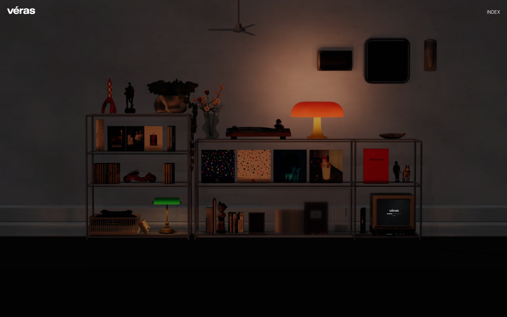
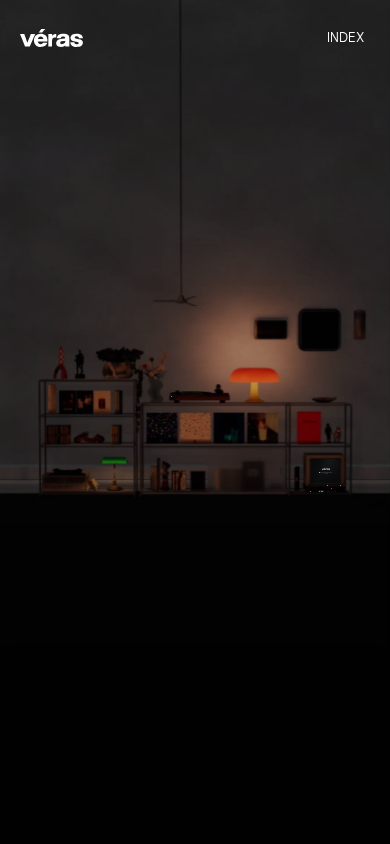

# UI Design System & Master Generation Blueprint: verasfawaz-com

> **Véras Fawaz** (https://verasfawaz.com) — Véras Fawaz © 1993 - 2026



---

## 1. Executive Visual Persona & Design Archetype

- **Brand Essence & Persona**: **Véras Fawaz** (`https://verasfawaz.com`). Véras Fawaz © 1993 - 2026
- **Final Redirected URL**: [https://www.verasfawaz.com/](https://www.verasfawaz.com/)
- **Capture Provenance**: Live browser capture (`tier1_fast`, HTTP `200`, captured `2026-11-23`).
- **Visual Archetype**: **Dark-Substrate WebGL / Canvas Interactive Experience (`#080808` / `#cbbfa9`)**.
- **Anti-AI-Slop Differentiators**:
  - **Live-Computed Chromatic Polarity**: Anchors the viewport in `#080808` (live computed `body` `background-color` (`computed_styles.json`)) paired with `#ffffff` primary typography and `#cbbfa9` accents.
  - **Grounded Typographic Hierarchy**: Pairs `Studio Sans` for display copy (`Véras Fawaz`) with `Studio Sans` and `Studio Mono`.
  - **Calibrated Spatial Grid & Motion**: Combines `1600px` container bounds (`gap: 20px`, padding `8px`) with `cubic-bezier(.22,1,.36,1)` easing and Three.js / WebGL Canvas Pipeline.

---

## 2. Spatial Architecture & Modular Grid Mathematics



### Viewport Allocation & Container Geometry
- **Captured Viewport Dimensions**: Desktop `1440×900px` (`assets/desktop.png`, single-viewport 100vh live capture (900px)), Mobile `390×844px` (`assets/mobile.png`, single-viewport 100vh live capture (844px)).
- **Master Container Bounds**: `1600px` (non-`@media` desktop container stylesheet rule).
- **Canvas Lateral Padding & Spacing**: `8px` lateral canvas padding with `20px` grid gap.
- **Border Radius Scale**: `14%`, `2px`, `3px`, `65px`.

### Responsive Breakpoint Architecture
- **Desktop Layout**: Multi-column CSS Grid / Flexbox layout at `1440px` (`max-width: 1600px`, `gap: 20px`).
- **Mobile Layout**: Single-column vertical stack at `390px` viewport width with `8px` horizontal padding.
- **Extracted CSS Media Queries**: `@media (prefers-reduced-motion:reduce)`, `@media (max-width:760px),(pointer:coarse)`, `@media (max-width:700px)`, `@media (min-width:1000px)`.

---

## 3. Color System, Materiality & Atmospheric Lighting

### Semantic Palette & Source Grounding
| Semantic Role | Ground-Truth Value | Extracted Live / CSS Source |
|---|---|---|
| **Primary Canvas Substrate** | `#080808` | live computed `body` `background-color` (`computed_styles.json`) |
| **Primary Typography Ink** | `#ffffff` | live computed `nav` `color` (`computed_styles.json`) |
| **Elevated Surface / Card Substrate** | `#24292b` | `var(--panel-ink)` in `:root` |
| **Interactive Accent / Highlight** | `#cbbfa9` | `.lynch-letter header button { color: #cbbfa9 }` |
| **Secondary / Muted Copy** | `#6a7173` | `var(--muted)` in `:root` |
| **Structural Hairline Border** | `#2d2d2d` | `var(--review-rule)` in `:root` (`ffffff26`) |
| **Variable Token (`--hair`)** | `#272d27` | `var(--hair)` in `:root` |
| **Variable Token (`--paper`)** | `#f7f7f2` | `var(--paper)` in `:root` |

### Sanitized Root CSS Variables (`ui-ux.md` Ground Truth)
| Variable Name | Extracted Value | Semantic Role |
|---|---|---|
| `--ink` | `#24292b` | Typography Ink Token |
| `--muted` | `#6a7173` | Color / Atmospheric Token |
| `--hair` | `#272d2723` | Color / Atmospheric Token |
| `--ui-space` | `32px` | Layout / Spatial Grid Token |
| `--edge-bottom` | `max(18px,env(safe-area-inset-bottom))` | Dimension / Scale Token |
| `--title` | `30px` | Dimension / Scale Token |
| `--action` | `15px` | Dimension / Scale Token |
| `--meta` | `13px` | Dimension / Scale Token |
| `--panel-bottom` | `160px` | Dimension / Scale Token |
| `--paper` | `#f7f7f2` | Canvas / Surface Token |
| `--panel-ink` | `#24292b` | Typography Ink Token |
| `--studio-safe-top` | `max(env(safe-area-inset-top,0px),var(--host-safe-top,0px))` | Dimension / Scale Token |
| `--studio-safe-bottom` | `max(env(safe-area-inset-bottom,0px),var(--host-safe-bottom,0px))` | Dimension / Scale Token |
| `--type-sans` | `'Studio Sans',Arial,sans-serif` | Typography / Scale Token |
| `--type-mono` | `'Studio Sans',Arial,sans-serif` | Typography / Scale Token |
| `--ui-font` | `var(--type-sans)` | Typography / Scale Token |

---

## 4. Typographic Scale & Editorial Hierarchy

### Font Family Stacks
- **Display Typography**: `Studio Sans`.
- **Primary Body Stack**: `Studio Sans`.
- **Technical / Metadata Stack**: `Studio Mono`.

### Typographic Scale & Rules (Live Computed & Stylesheet Grounded)
- **Hero Display (`H1`)**: rule `h1` (`font-size: var(--ui-title)`, `font-weight: 400`).
- **Section Heading (`H2`)**: live computed `h2` (`font-size: 12px`, `line-height: 18px`, `font-weight: 400`); rule `h2` (`font-size: 22px`, `line-height: 1.2`).
- **Body Copy**: live computed `body` (`font-size: 16px`, `line-height: normal`, `font-weight: 400`); rule `p` (`font-size: 16px`, `line-height: 1.5`).
- **Metadata & Navigation Labels**: live computed `nav/a` (`font-size: 15px`, `line-height: 21.75px`, `font-weight: 400`); CSS variables `--meta: 13px`, `--type-mono: 'Studio Sans',Arial,sans-serif`, `--ui-meta: 12px`; rule `small` (`letter-spacing: 0`).

---

## 5. Choreographed Motion & Interaction Physics

### Primary Easing Curves
- **Extracted Timing Functions**: `cubic-bezier(.22,1,.36,1)`, `cubic-bezier(.4,0,.2,1)`, `cubic-bezier(.22,.61,.36,1)`.

### Per-Element Transition & Choreography Rules
- **Selector `e):not(#project-flow-unused)>head...`**: `transition: none!important` extracted from `verasfawaz-com` stylesheet.
- **Selector `rolling:has(#detail[open]) .vinyl...`**: `transition: none!important` extracted from `verasfawaz-com` stylesheet.
- **Selector `html.project-entry-reveal::after`**: `transition: opacity 320ms ease` extracted from `verasfawaz-com` stylesheet.
- **Extracted Easing Curve (`cubic-bezier(.22,1,.36,1)`)**: Governs interactive state transitions across `<header.studio-power-pending>` and `<section.night>`.
- **Runtime Interaction Engine**: Integrates Three.js / WebGL Canvas Pipeline with `prefers-reduced-motion: reduce` fallback guards.

---

## 6. Component Wireframe & Structural DOM Map

### Visual Layout Schematic — Desktop (`1440px`, Grounded in `dom.html` & Landmark Bounding Boxes)
```
┌────────────────────────────────────────────────────────────────────────┐
│ DESKTOP VIEWPORT (1440px) — Véras Fawaz                                │
│ ====================================================================== │
│ [ <header.studio-power-p (1376x44px)  | The Gleam · We Were Here Onc ] │
│ ---------------------------------------------------------------------- │
│ | HERO STAGE: <section.room-3d> (w=1440px)                           | │
│ | H1: Véras Fawaz                                                    | │
│ | Substrate: #080808 | Ink: #ffffff | Accent: #cbbfa9                | │
│ ---------------------------------------------------------------------- │
│ | SHOWCASE GRID (<section.night>) max-w: 1600px                      | │
│ | +------------------------------+  +------------------------------+ | │
│ | | Featured Work & Interactive  |  | Technical Architecture & Nar | | │
│ | +------------------------------+  +------------------------------+ | │
│ ---------------------------------------------------------------------- │
│ | DETAIL MODULE (<section.studio-ui>) — Global Directory & Co        | │
│ ---------------------------------------------------------------------- │
│ [ FOOTER (<footer.compact-musi) | https://verasfawaz.com               │
└────────────────────────────────────────────────────────────────────────┘
```

### Visual Layout Schematic — Mobile Reflow (`390px`)
```
┌────────────────────────────────────────────────────────────────────────┐
│ MOBILE VIEWPORT REFLOW (390px) — Single-Column Stack (gap: 20px)       │
│ ====================================================================== │
│ [ HEADER BAR (<header.studio-power-pen) | Compact Menu (390px)         │
│ ---------------------------------------------------------------------- │
│ | HERO STAGE (<section.room-3d>) — 390px Vertical Lead               | │
│ | H1: Véras Fawaz                                                    | │
│ ---------------------------------------------------------------------- │
│ | SHOWCASE STACK (<section.night>) — 1-Col Stack                     | │
│ | [ Item 1: Featured Work & Interactive Showcase                   ] | │
│ | [ Item 2: Technical Architecture & Narrative                     ] | │
│ ---------------------------------------------------------------------- │
│ | DETAIL STACK (<section.studio-ui>) — 1-Col (Global Directory &)    | │
│ ---------------------------------------------------------------------- │
│ [ FOOTER (<footer.compact-musi) | Stacked 390px Colophon               │
└────────────────────────────────────────────────────────────────────────┘
```

### Granular DOM Region Breakdown
1. **Brand Header & Navigation Bar (<header.studio-power-pending> — `verasfawaz-com`)**:
   - Landmark `<header class="studio-power-pending">` (`1376x44px`) hosting `Véras Fawaz` navigation (`The Gleam · We Were Here Once · Warm · Leeuw Panter Wolvin · Joshua de Wit`), DOM attributes (`data-entrance-light="night"`, `data-entrance="loading"`, `data-studio-ready="true"`, `data-arrival="waiting"`), and stylesheet rule `before { display:none!important }`.
2. **Hero Stage & Focal Lead (<section.room-3d> — `Véras Fawaz`)**:
   - Landmark `<section class="room-3d">` presenting display lead `Véras Fawaz` and copy excerpt *"Skip to the archive"* over `#080808` canvas and `#ffffff` ink.
3. **Primary Showcase & Content Grid (<section.night> — `Featured Work & Interactive Showca`)**:
   - Landmark `<section class="night">` rendering section `Featured Work & Interactive Showcase` with copy *"PLEASE TOUCH EVERYTHING"*, asset references (`wide-blackout.webp`, `startup-input-game-exit-20261018.js`, `apple-touch-icon.png`, `index-dvd-sharp-20261022.js`), and grid rule `header::after { display:none!important }`.
4. **Interactive Detail & Feature Matrix (<section.studio-ui> — `Technical Architecture & Narrative`)**:
   - Landmark `<section class="studio-ui">` framing `Technical Architecture & Narrative` and `Global Directory & Contact` (*"Véras Fawaz © 1993 - 2026"*) with `#24292b` surface cards, `#cbbfa9` accents, and `header { background:none!important }`.
5. **Colophon & Global Directory Footer (<footer.compact-music-ui> — `https://verasfawaz.com`)**:
   - Landmark `<footer class="compact-music-ui">` anchoring `Véras Fawaz` footer links (`The Gleam · We Were Here Once · Warm · Leeuw Panter Wolvin · Joshua de Wit`), copy *"This room needs JavaScript. Visit Films , Music , Book or Ga"*, and `#2d2d2d` structural dividers.

---

## 7. Master Zero-Shot AI Generation Prompt

```markdown
# Master Zero-Shot Frontend Generation Prompt: verasfawaz-com (Véras Fawaz)

You are a principal frontend architect and design systems engineer. Build a complete, production-ready web application replicating the exact design system, DOM landmarks, typographic hierarchy, color tokens, and motion physics of `verasfawaz-com` (**Véras Fawaz** — `https://verasfawaz.com`).

### 1. Visual Archetype & Anti-AI-Slop Mandates
- **Archetype**: Dark-Substrate WebGL / Canvas Interactive Experience (`#080808` / `#cbbfa9`).
- **Identity & Domain Context**: Véras Fawaz © 1993 - 2026
- **Primary Substrate**: `#080808` (live computed `body` `background-color` (`computed_styles.json`)), **Primary Ink**: `#ffffff`, **Accent / Highlight**: `#cbbfa9`.
- **Site-Specific Differentiators**:
  - **Live-Computed Chromatic Polarity**: Anchors the viewport in `#080808` (live computed `body` `background-color` (`computed_styles.json`)) paired with `#ffffff` primary typography and `#cbbfa9` accents.
  - **Grounded Typographic Hierarchy**: Pairs `Studio Sans` for display copy (`Véras Fawaz`) with `Studio Sans` and `Studio Mono`.
  - **Calibrated Spatial Grid & Motion**: Combines `1600px` container bounds (`gap: 20px`, padding `8px`) with `cubic-bezier(.22,1,.36,1)` easing and Three.js / WebGL Canvas Pipeline.

### 2. Ground-Truth CSS Variables (`:root` Token Contract)
Declare and consume these exact custom properties extracted from `verasfawaz-com` in your global stylesheet:

:root {
  /* Véras Fawaz (verasfawaz-com) — Live-Grounded CSS Variables */
  --ink: #24292b; /* Typography Ink Token (verasfawaz-com) */
  --muted: #6a7173; /* Color / Atmospheric Token (verasfawaz-com) */
  --hair: #272d2723; /* Color / Atmospheric Token (verasfawaz-com) */
  --ui-space: 32px; /* Layout / Spatial Grid Token (verasfawaz-com) */
  --edge-bottom: max(18px,env(safe-area-inset-bottom)); /* Dimension / Scale Token (verasfawaz-com) */
  --title: 30px; /* Dimension / Scale Token (verasfawaz-com) */
  --action: 15px; /* Dimension / Scale Token (verasfawaz-com) */
  --meta: 13px; /* Dimension / Scale Token (verasfawaz-com) */
  --panel-bottom: 160px; /* Dimension / Scale Token (verasfawaz-com) */
  --paper: #f7f7f2; /* Canvas / Surface Token (verasfawaz-com) */
  --panel-ink: #24292b; /* Typography Ink Token (verasfawaz-com) */
  --studio-safe-top: max(env(safe-area-inset-top,0px),var(--host-safe-top,0px)); /* Dimension / Scale Token (verasfawaz-com) */
  --studio-safe-bottom: max(env(safe-area-inset-bottom,0px),var(--host-safe-bottom,0px)); /* Dimension / Scale Token (verasfawaz-com) */
  --type-sans: 'Studio Sans',Arial,sans-serif; /* Typography / Scale Token (verasfawaz-com) */
  --type-mono: 'Studio Sans',Arial,sans-serif; /* Typography / Scale Token (verasfawaz-com) */
  --ui-font: var(--type-sans); /* Typography / Scale Token (verasfawaz-com) */
}

### 3. Semantic Color & Materiality Contract
Map every surface, ink, and border strictly to these source-grounded tokens:
- **Primary Canvas Substrate**: `#080808` — grounded in live computed `body` `background-color` (`computed_styles.json`)
- **Primary Typography Ink**: `#ffffff` — grounded in live computed `nav` `color` (`computed_styles.json`)
- **Elevated Surface / Card Substrate**: `#24292b` — grounded in `var(--panel-ink)` in `:root`
- **Interactive Accent / Highlight**: `#cbbfa9` — grounded in `.lynch-letter header button { color: #cbbfa9 }`
- **Secondary / Muted Copy**: `#6a7173` — grounded in `var(--muted)` in `:root`
- **Structural Hairline Border**: `#2d2d2d` — grounded in `var(--review-rule)` in `:root` (`ffffff26`)
- **Variable Token (`--hair`)**: `#272d27` — grounded in `var(--hair)` in `:root`
- **Variable Token (`--paper`)**: `#f7f7f2` — grounded in `var(--paper)` in `:root`

### 4. Spatial Grid, Container Bounds & Responsive Breakpoints
- **Desktop Viewport Reference**: `1440×900px` (single-viewport 100vh live capture (900px), `1440px` standard desktop width).
- **Mobile Viewport Reference**: `390×844px` (single-viewport 100vh live capture (844px), `390px` standard mobile width).
- **Container Max-Width**: `1600px` (non-`@media` desktop container stylesheet rule)
- **Padding & Gutters**: `8px` lateral canvas padding with `20px` grid gap
- **Desktop Grid**: Multi-column CSS Grid / Flexbox layout at `1440px` (`max-width: 1600px`, `gap: 20px`)
- **Mobile Adaptation**: Single-column vertical stack at `390px` viewport width with `8px` horizontal padding
- **Media Queries**: `@media (prefers-reduced-motion:reduce)`, `@media (max-width:760px),(pointer:coarse)`, `@media (max-width:700px)`, `@media (min-width:1000px)`
- **Corner Radii**: `14%`, `2px`, `3px`, `65px`

### 5. Typography & Editorial Scale Contract
- **Display Font Stack**: `Studio Sans`
- **Body Font Stack**: `Studio Sans`
- **Monospace / Technical Font Stack**: `Studio Mono`
- **H1 Display Rule**: rule `h1` (`font-size: var(--ui-title)`, `font-weight: 400`)
- **H2 Section Rule**: live computed `h2` (`font-size: 12px`, `line-height: 18px`, `font-weight: 400`); rule `h2` (`font-size: 22px`, `line-height: 1.2`)
- **Body Copy Rule**: live computed `body` (`font-size: 16px`, `line-height: normal`, `font-weight: 400`); rule `p` (`font-size: 16px`, `line-height: 1.5`)
- **Metadata & Index Rule**: live computed `nav/a` (`font-size: 15px`, `line-height: 21.75px`, `font-weight: 400`); CSS variables `--meta: 13px`, `--type-mono: 'Studio Sans',Arial,sans-serif`, `--ui-meta: 12px`; rule `small` (`letter-spacing: 0`)

### 6. Component Hierarchy, Verbatim Copy & Real DOM Landmarks
Scaffold `verasfawaz-com` (`Véras Fawaz`) with these exact structural regions, extracted copy, and CSS rules from `dom.html`:
1. **Brand Header & Navigation Bar (<header.studio-power-pending> — `verasfawaz-com`)**:
   - DOM & Selectors: Landmark `<header class="studio-power-pending">` (`1376x44px`) hosting `Véras Fawaz` navigation (`The Gleam · We Were Here Once · Warm · Leeuw Panter Wolvin · Joshua de Wit`), DOM attributes (`data-entrance-light="night"`, `data-entrance="loading"`, `data-studio-ready="true"`, `data-arrival="waiting"`), and stylesheet rule `before { display:none!important }`.
   - Responsive Contract: Header `Brand Header & Navigation Bar (<header.studio-power-pending> — `verasfawaz-com`)` (`verasfawaz-com`) adapts across `@media (prefers-reduced-motion:reduce)`, `@media (max-width:760px),(pointer:coarse)`, `@media (max-width:700px)`, `@media (min-width:1000px)` with `cubic-bezier(.22,1,.36,1)`, `cubic-bezier(.4,0,.2,1)`, `cubic-bezier(.22,.61,.36,1)` transitions and links `The Gleam · We Were Here Once · Warm · Leeuw Panter Wolvin · Joshua de Wit`.
2. **Hero Stage & Focal Lead (<section.room-3d> — `Véras Fawaz`)**:
   - DOM & Selectors: Landmark `<section class="room-3d">` presenting display lead `Véras Fawaz` and copy excerpt *"Skip to the archive"* over `#080808` canvas and `#ffffff` ink.
   - Responsive Contract: Hero stage (`1440×900px` desktop / `390×844px` mobile) sets `#080808` background with `#ffffff` headline `Véras Fawaz`.
3. **Primary Showcase & Content Grid (<section.night> — `Featured Work & Interactive Showca`)**:
   - DOM & Selectors: Landmark `<section class="night">` rendering section `Featured Work & Interactive Showcase` with copy *"PLEASE TOUCH EVERYTHING"*, asset references (`wide-blackout.webp`, `startup-input-game-exit-20261018.js`, `apple-touch-icon.png`, `index-dvd-sharp-20261022.js`), and grid rule `header::after { display:none!important }`.
   - Responsive Contract: Showcase grid `Primary Showcase & Content Grid (<section.night> — `Featured Work & Interactive Showca`)` applies Multi-column CSS Grid / Flexbox layout at `1440px` (`max-width: 1600px`, `gap: 20px`) on desktop and Single-column vertical stack at `390px` viewport width with `8px` horizontal padding on mobile.
4. **Interactive Detail & Feature Matrix (<section.studio-ui> — `Technical Architecture & Narrative`)**:
   - DOM & Selectors: Landmark `<section class="studio-ui">` framing `Technical Architecture & Narrative` and `Global Directory & Contact` (*"Véras Fawaz © 1993 - 2026"*) with `#24292b` surface cards, `#cbbfa9` accents, and `header { background:none!important }`.
   - Responsive Contract: Detail module `Interactive Detail & Feature Matrix (<section.studio-ui> — `Technical Architecture & Narrative`)` uses `14%`, `2px`, `3px`, `65px` radii, `#cbbfa9` highlights, and assets (wide-blackout.webp, startup-input-game-exit-20261018.js, apple-touch-icon.png).
5. **Colophon & Global Directory Footer (<footer.compact-music-ui> — `https://verasfawaz.com`)**:
   - DOM & Selectors: Landmark `<footer class="compact-music-ui">` anchoring `Véras Fawaz` footer links (`The Gleam · We Were Here Once · Warm · Leeuw Panter Wolvin · Joshua de Wit`), copy *"This room needs JavaScript. Visit Films , Music , Book or Ga"*, and `#2d2d2d` structural dividers.
   - Responsive Contract: Footer `Colophon & Global Directory Footer (<footer.compact-music-ui> — `https://verasfawaz.com`)` aligns to `1600px` (non-`@media` desktop container stylesheet rule) with `8px` lateral canvas padding with `20px` grid gap and attributes (data-entrance-light="night", data-entrance="loading", data-studio-ready="true").

#### Verbatim DOM Copy Excerpts (`dom.html`)
- Copy Excerpt 1: *"Skip to the archive"*
- Copy Excerpt 2: *"PLEASE TOUCH EVERYTHING"*
- Copy Excerpt 3: *"Véras Fawaz © 1993 - 2026"*
- Copy Excerpt 4: *"This room needs JavaScript. Visit Films , Music , Book or Game ."*

### 7. Motion, Extracted Stylesheet Rules & Interaction Choreography
- **Primary Easing Functions**: `cubic-bezier(.22,1,.36,1)`, `cubic-bezier(.4,0,.2,1)`, `cubic-bezier(.22,.61,.36,1)`
- **Extracted Stylesheet Rules (`verasfawaz-com`)**:
- `before { display:none!important }`
- `header::after { display:none!important }`
- `header { background:none!important }`
- `.vinyl-play-hint { opacity:calc(var(--context-chrome-opacity,1) * var(--media-text-opacity,... }`
- `html.project-entry-cover::after { content:"";position:fixed;inset:0;background:000;z-index:2147483646;poin... }`
- **Per-Selector Transition Rules**:
- **Selector `e):not(#project-flow-unused)>head...`**: `transition: none!important` extracted from `verasfawaz-com` stylesheet.
- **Selector `rolling:has(#detail[open]) .vinyl...`**: `transition: none!important` extracted from `verasfawaz-com` stylesheet.
- **Selector `html.project-entry-reveal::after`**: `transition: opacity 320ms ease` extracted from `verasfawaz-com` stylesheet.
- **Extracted Easing Curve (`cubic-bezier(.22,1,.36,1)`)**: Governs interactive state transitions across `<header.studio-power-pending>` and `<section.night>`.
- **Runtime Interaction Engine**: Integrates Three.js / WebGL Canvas Pipeline with `prefers-reduced-motion: reduce` fallback guards.

### 8. Technical Deliverables
- Implement in Next.js (App Router) with TypeScript and Tailwind CSS consuming the `:root` custom properties defined above for `verasfawaz-com`.
- Reproduce both the `1440px` desktop architecture and `390px` mobile breakpoint transitions, preserving semantic HTML5 landmarks (`<header>`, `<nav>`, `<main>`, `<section>`, `<footer>`) and `prefers-reduced-motion` accessibility guards.
```
