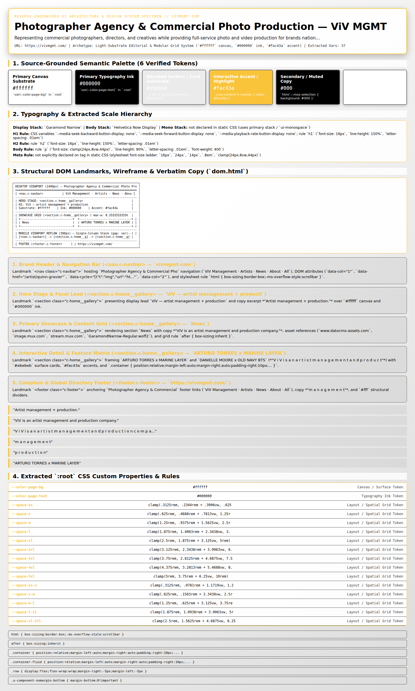
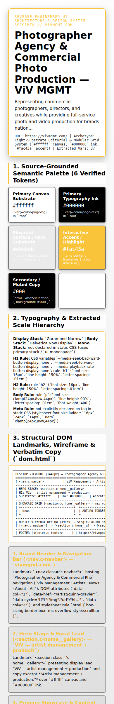

# UI Design System & Master Generation Blueprint: vivmgmt-com

> **Photographer Agency & Commercial Photo Production — ViV MGMT** (https://vivmgmt.com/) — Representing commercial photographers, directors, and creatives while providing full-service photo and video production for brands nation...



---

## 1. Executive Visual Persona & Design Archetype

- **Brand Essence & Persona**: **Photographer Agency & Commercial Photo Production — ViV MGMT** (`https://vivmgmt.com/`). Representing commercial photographers, directors, and creatives while providing full-service photo and video production for brands nation...
- **Visual Archetype**: **Light-Substrate Editorial & Modular Grid System (`#ffffff` canvas, `#000000` ink, `#fac43a` accent)**.
- **Anti-AI-Slop Differentiators**:
  - **Source-Grounded Chromatic Polarity**: Anchors the viewport in `#ffffff` (`var(--color-page-bg)` in `:root`) paired with `#000000` primary typography and `#fac43a` accents.
  - **Extracted Typographic Hierarchy**: Pairs `Garamond Narrow` for display copy (`ViV — artist management + production`) with `Helvetica Now Display` and not declared in static CSS (uses primary stack / `ui-monospace`).
  - **Calibrated Spatial Grid & Motion**: Combines `8.3333333333%` container bounds (`gap: var(--space-m)`, padding `10px`) with `cubic-bezier(.65,0,.35,1)` easing and Lenis Smooth Scroll (`data-lenis`), Lottie Vector Animation Player.

---

## 2. Spatial Architecture & Modular Grid Mathematics



### Viewport Allocation & Container Geometry
- **Captured Viewport Dimensions**: Desktop `1440×2400px` (`assets/desktop.png`, capped at 2400px multi-section capture), Mobile `390×2400px` (`assets/mobile.png`, capped at 2400px multi-section capture).
- **Master Container Bounds**: `8.3333333333%` extracted from `vivmgmt-com` stylesheet.
- **Canvas Lateral Padding & Spacing**: `10px` lateral canvas padding with `var(--space-m)` grid gap.
- **Border Radius Scale**: `0px` (sharp unrounded corners).

### Responsive Breakpoint Architecture
- **Desktop Layout**: Multi-column CSS Grid / Flexbox layout at `1440px` (`max-width: 8.3333333333%`, `gap: var(--space-m)`).
- **Mobile Layout**: Single-column vertical stack at `390px` viewport width with `10px` horizontal padding.
- **Extracted CSS Media Queries**: `@media (min-width:375px)`, `@media (min-width:550px)`, `@media (min-width:768px)`, `@media (min-width:992px)`.

---

## 3. Color System, Materiality & Atmospheric Lighting

### Semantic Palette & Source Grounding
| Semantic Role | Ground-Truth Value | Extracted CSS Source / Selector |
|---|---|---|
| **Primary Canvas Substrate** | `#ffffff` | `var(--color-page-bg)` in `:root` |
| **Primary Typography Ink** | `#000000` | `var(--color-page-text)` in `:root` |
| **Elevated Surface / Card Substrate** | `#ebebeb` | `.c-btn { background-color: #ebebeb }` |
| **Interactive Accent / Highlight** | `#fac43a` | `.cms-content li::marker { color: #fac43a }` |
| **Secondary / Muted Copy** | `#000` | `html ::-moz-selection { background: #000 }` |
| **Structural Hairline Border** | `#fff` | `html ::-moz-selection { color: #fff }` |

### Sanitized Root CSS Variables (`ui-ux.md` Ground Truth)
| Variable Name | Extracted Value | Semantic Role |
|---|---|---|
| `--color-page-bg` | `#ffffff` | Canvas / Surface Token |
| `--color-page-text` | `#000000` | Typography Ink Token |
| `--space-xs` | `clamp(.3125rem, .2344rem + .3906vw, .625rem)` | Layout / Spatial Grid Token |
| `--space-s` | `clamp(.625rem, .4688rem + .7813vw, 1.25rem)` | Layout / Spatial Grid Token |
| `--space-m` | `clamp(1.25rem, .9375rem + 1.5625vw, 2.5rem)` | Layout / Spatial Grid Token |
| `--space-l` | `clamp(1.875rem, 1.4063rem + 2.3438vw, 3.75rem)` | Layout / Spatial Grid Token |
| `--space-xl` | `clamp(2.5rem, 1.875rem + 3.125vw, 5rem)` | Layout / Spatial Grid Token |
| `--space-2xl` | `clamp(3.125rem, 2.3438rem + 3.9063vw, 6.25rem)` | Layout / Spatial Grid Token |
| `--space-3xl` | `clamp(3.75rem, 2.8125rem + 4.6875vw, 7.5rem)` | Layout / Spatial Grid Token |
| `--space-4xl` | `clamp(4.375rem, 3.2813rem + 5.4688vw, 8.75rem)` | Layout / Spatial Grid Token |
| `--space-5xl` | `clamp(5rem, 3.75rem + 6.25vw, 10rem)` | Layout / Spatial Grid Token |
| `--space-xs-s` | `clamp(.3125rem, .0781rem + 1.1719vw, 1.25rem)` | Layout / Spatial Grid Token |
| `--space-s-m` | `clamp(.625rem, .1563rem + 2.3438vw, 2.5rem)` | Layout / Spatial Grid Token |
| `--space-m-l` | `clamp(1.25rem, .625rem + 3.125vw, 3.75rem)` | Layout / Spatial Grid Token |
| `--space-l-xl` | `clamp(1.875rem, 1.0938rem + 3.9063vw, 5rem)` | Layout / Spatial Grid Token |
| `--space-xl-2xl` | `clamp(2.5rem, 1.5625rem + 4.6875vw, 6.25rem)` | Layout / Spatial Grid Token |

---

## 4. Typographic Scale & Editorial Hierarchy

### Font Family Stacks
- **Display Typography**: `Garamond Narrow`.
- **Primary Body Stack**: `Helvetica Now Display`.
- **Technical / Metadata Stack**: not declared in static CSS (uses primary stack / `ui-monospace`).

### Typographic Scale & Rules (Extracted from Stylesheet & Variables)
- **Hero Display (`H1`)**: CSS variables `--media-seek-backward-button-display: none`, `--media-seek-forward-button-display: none`, `--media-playback-rate-button-display: none`; rule `h1` (`font-size: 16px`, `line-height: 150%`, `letter-spacing: .01em`).
- **Section Heading (`H2`)**: rule `h2` (`font-size: 16px`, `line-height: 150%`, `letter-spacing: .01em`).
- **Body Copy**: rule `p` (`font-size: clamp(24px,8vw,44px)`, `line-height: 90%`, `letter-spacing: .01em`, `font-weight: 400`).
- **Metadata & Navigation Labels**: not explicitly declared on tag in static CSS (stylesheet font-size ladder: `16px`, `24px`, `14px`, `.8em`, `clamp(24px,8vw,44px)`).

---

## 5. Choreographed Motion & Interaction Physics

### Primary Easing Curves
- **Extracted Timing Functions**: `cubic-bezier(.65,0,.35,1)`, `cubic-bezier(.16,1,.3,1)`, `cubic-bezier(.19,1,.22,1)`.

### Per-Element Transition & Choreography Rules
- **Selector `.cms-content a:before`**: `transition: transform .5s` extracted from `vivmgmt-com` stylesheet.
- **Selector `.js-media-visibility-pckry:before`**: `transition: opacity .5s` extracted from `vivmgmt-com` stylesheet.
- **Selector `.js-element-visibility .will-animate`**: `transition: transform .5s,opacity .5s` extracted from `vivmgmt-com` stylesheet.
- **Extracted Easing Curve (`cubic-bezier(.65,0,.35,1)`)**: Governs interactive state transitions across `<nav.c-navbar>` and `<section.c-home__gallery>`.
- **Runtime Interaction Engine**: Integrates Lenis Smooth Scroll (`data-lenis`), Lottie Vector Animation Player with `prefers-reduced-motion: reduce` fallback guards.

---

## 6. Component Wireframe & Structural DOM Map

### Visual Layout Schematic (Grounded in `dom.html` — `1440px` Desktop & `390px` Mobile Reflow)
```
┌────────────────────────────────────────────────────────────────────────┐
│ DESKTOP VIEWPORT (1440px) — Photographer Agency & Commercial Photo Pro │
│ ====================================================================== │
│ [ <nav.c-navbar>           | ViV Management · Artists · News · Abou ]  │
│ ---------------------------------------------------------------------- │
│ | HERO STAGE: <section.c-home__gallery>                            |   │
│ | H1: ViV — artist management + production                         |   │
│ | Substrate: #ffffff    | Ink: #000000    | Accent: #fac43a        |   │
│ ---------------------------------------------------------------------- │
│ | SHOWCASE GRID (<section.c-home__gallery> ) max-w: 8.3333333333%  |   │
│ | +------------------------------+  +------------------------------+ | │
│ | | News                         |  | ARTURO TORRES x MARINE LAYER | | │
│ | +------------------------------+  +------------------------------+ | │
│ ---------------------------------------------------------------------- │
│ | MOBILE VIEWPORT REFLOW (390px) — Single-Column Stack (gap: var(--) | │
│ | [<nav.c-navbar>] -> [<section.c-home__g] -> [<section.c-home__g] |   │
│ ---------------------------------------------------------------------- │
│ [ FOOTER (<footer.c-footer>     ) | https://vivmgmt.com/               │
└────────────────────────────────────────────────────────────────────────┘
```

### Granular DOM Region Breakdown
1. **Brand Header & Navigation Bar (<nav.c-navbar> — `vivmgmt-com`)**:
   - Landmark `<nav class="c-navbar">` hosting `Photographer Agency & Commercial Pho` navigation (`ViV Management · Artists · News · About · All`), DOM attributes (`data-col="1"`, `data-href="/artist/quinn-gravier"`, `data-cycle="[("t":"img","url":"ht..."`, `data-col="2"`), and stylesheet rule `html { box-sizing:border-box;-ms-overflow-style:scrollbar }`.
2. **Hero Stage & Focal Lead (<section.c-home__gallery> — `ViV — artist management + producti`)**:
   - Landmark `<section class="c-home__gallery">` presenting display lead `ViV — artist management + production` and copy excerpt *"Artist management + production."* over `#ffffff` canvas and `#000000` ink.
3. **Primary Showcase & Content Grid (<section.c-home__gallery> — `News`)**:
   - Landmark `<section class="c-home__gallery">` rendering section `News` with copy *"ViV is an artist management and production company."*, asset references (`www.datocms-assets.com`, `image.mux.com`, `stream.mux.com`, `GaramondNarrow-Regular.woff2`), and grid rule `after { box-sizing:inherit }`.
4. **Interactive Detail & Feature Matrix (<section.c-home__gallery> — `ARTURO TORRES x MARINE LAYER`)**:
   - Landmark `<section class="c-home__gallery">` framing `ARTURO TORRES x MARINE LAYER` and `DANIELLE MOORE x OLD NAVY BTS` (*"V i V i s a n a r t i s t m a n a g e m e n t a n d p r o d u c t"*) with `#ebebeb` surface cards, `#fac43a` accents, and `.container { position:relative;margin-left:auto;margin-right:auto;padding-right:10px;... }`.
5. **Colophon & Global Directory Footer (<footer.c-footer> — `https://vivmgmt.com/`)**:
   - Landmark `<footer class="c-footer">` anchoring `Photographer Agency & Commercial` footer links (`ViV Management · Artists · News · About · All`), copy *"m a n a g e m e n t"*, and `#fff` structural dividers.

---

## 7. Master Zero-Shot AI Generation Prompt

```markdown
# Master Zero-Shot Frontend Generation Prompt: vivmgmt-com (Photographer Agency & Commercial Photo Production — ViV MGMT)

You are a principal frontend architect and design systems engineer. Build a complete, production-ready web application replicating the exact design system, DOM landmarks, typographic hierarchy, color tokens, and motion physics of `vivmgmt-com` (**Photographer Agency & Commercial Photo Production — ViV MGMT** — `https://vivmgmt.com/`).

### 1. Visual Archetype & Anti-AI-Slop Mandates
- **Archetype**: Light-Substrate Editorial & Modular Grid System (`#ffffff` canvas, `#000000` ink, `#fac43a` accent).
- **Identity & Domain Context**: Representing commercial photographers, directors, and creatives while providing full-service photo and video production for brands nation...
- **Primary Substrate**: `#ffffff` (`var(--color-page-bg)` in `:root`), **Primary Ink**: `#000000`, **Accent / Highlight**: `#fac43a`.
- **Site-Specific Differentiators**:
  - **Source-Grounded Chromatic Polarity**: Anchors the viewport in `#ffffff` (`var(--color-page-bg)` in `:root`) paired with `#000000` primary typography and `#fac43a` accents.
  - **Extracted Typographic Hierarchy**: Pairs `Garamond Narrow` for display copy (`ViV — artist management + production`) with `Helvetica Now Display` and not declared in static CSS (uses primary stack / `ui-monospace`).
  - **Calibrated Spatial Grid & Motion**: Combines `8.3333333333%` container bounds (`gap: var(--space-m)`, padding `10px`) with `cubic-bezier(.65,0,.35,1)` easing and Lenis Smooth Scroll (`data-lenis`), Lottie Vector Animation Player.

### 2. Ground-Truth CSS Variables (`:root` Token Contract)
Declare and consume these exact custom properties extracted from `vivmgmt-com` in your global stylesheet:

:root {
  /* Photographer Agency & Commercial Photo Production — ViV MGMT (vivmgmt-com) — Ground-Truth Extracted CSS Variables */
  --color-page-bg: #ffffff; /* Canvas / Surface Token (vivmgmt-com) */
  --color-page-text: #000000; /* Typography Ink Token (vivmgmt-com) */
  --space-xs: clamp(.3125rem, .2344rem + .3906vw, .625rem); /* Layout / Spatial Grid Token (vivmgmt-com) */
  --space-s: clamp(.625rem, .4688rem + .7813vw, 1.25rem); /* Layout / Spatial Grid Token (vivmgmt-com) */
  --space-m: clamp(1.25rem, .9375rem + 1.5625vw, 2.5rem); /* Layout / Spatial Grid Token (vivmgmt-com) */
  --space-l: clamp(1.875rem, 1.4063rem + 2.3438vw, 3.75rem); /* Layout / Spatial Grid Token (vivmgmt-com) */
  --space-xl: clamp(2.5rem, 1.875rem + 3.125vw, 5rem); /* Layout / Spatial Grid Token (vivmgmt-com) */
  --space-2xl: clamp(3.125rem, 2.3438rem + 3.9063vw, 6.25rem); /* Layout / Spatial Grid Token (vivmgmt-com) */
  --space-3xl: clamp(3.75rem, 2.8125rem + 4.6875vw, 7.5rem); /* Layout / Spatial Grid Token (vivmgmt-com) */
  --space-4xl: clamp(4.375rem, 3.2813rem + 5.4688vw, 8.75rem); /* Layout / Spatial Grid Token (vivmgmt-com) */
  --space-5xl: clamp(5rem, 3.75rem + 6.25vw, 10rem); /* Layout / Spatial Grid Token (vivmgmt-com) */
  --space-xs-s: clamp(.3125rem, .0781rem + 1.1719vw, 1.25rem); /* Layout / Spatial Grid Token (vivmgmt-com) */
  --space-s-m: clamp(.625rem, .1563rem + 2.3438vw, 2.5rem); /* Layout / Spatial Grid Token (vivmgmt-com) */
  --space-m-l: clamp(1.25rem, .625rem + 3.125vw, 3.75rem); /* Layout / Spatial Grid Token (vivmgmt-com) */
  --space-l-xl: clamp(1.875rem, 1.0938rem + 3.9063vw, 5rem); /* Layout / Spatial Grid Token (vivmgmt-com) */
  --space-xl-2xl: clamp(2.5rem, 1.5625rem + 4.6875vw, 6.25rem); /* Layout / Spatial Grid Token (vivmgmt-com) */
}

### 3. Semantic Color & Materiality Contract
Map every surface, ink, and border strictly to these source-grounded tokens:
- **Primary Canvas Substrate**: `#ffffff` — grounded in `var(--color-page-bg)` in `:root`
- **Primary Typography Ink**: `#000000` — grounded in `var(--color-page-text)` in `:root`
- **Elevated Surface / Card Substrate**: `#ebebeb` — grounded in `.c-btn { background-color: #ebebeb }`
- **Interactive Accent / Highlight**: `#fac43a` — grounded in `.cms-content li::marker { color: #fac43a }`
- **Secondary / Muted Copy**: `#000` — grounded in `html ::-moz-selection { background: #000 }`
- **Structural Hairline Border**: `#fff` — grounded in `html ::-moz-selection { color: #fff }`

### 4. Spatial Grid, Container Bounds & Responsive Breakpoints
- **Desktop Viewport Reference**: `1440×2400px` (capped at 2400px multi-section capture, `1440px` standard desktop width).
- **Mobile Viewport Reference**: `390×2400px` (capped at 2400px multi-section capture, `390px` standard mobile width).
- **Container Max-Width**: `8.3333333333%` extracted from `vivmgmt-com` stylesheet
- **Padding & Gutters**: `10px` lateral canvas padding with `var(--space-m)` grid gap
- **Desktop Grid**: Multi-column CSS Grid / Flexbox layout at `1440px` (`max-width: 8.3333333333%`, `gap: var(--space-m)`)
- **Mobile Adaptation**: Single-column vertical stack at `390px` viewport width with `10px` horizontal padding
- **Media Queries**: `@media (min-width:375px)`, `@media (min-width:550px)`, `@media (min-width:768px)`, `@media (min-width:992px)`
- **Corner Radii**: `0px` (sharp unrounded corners)

### 5. Typography & Editorial Scale Contract
- **Display Font Stack**: `Garamond Narrow`
- **Body Font Stack**: `Helvetica Now Display`
- **Monospace / Technical Font Stack**: not declared in static CSS (uses primary stack / `ui-monospace`)
- **H1 Display Rule**: CSS variables `--media-seek-backward-button-display: none`, `--media-seek-forward-button-display: none`, `--media-playback-rate-button-display: none`; rule `h1` (`font-size: 16px`, `line-height: 150%`, `letter-spacing: .01em`)
- **H2 Section Rule**: rule `h2` (`font-size: 16px`, `line-height: 150%`, `letter-spacing: .01em`)
- **Body Copy Rule**: rule `p` (`font-size: clamp(24px,8vw,44px)`, `line-height: 90%`, `letter-spacing: .01em`, `font-weight: 400`)
- **Metadata & Index Rule**: not explicitly declared on tag in static CSS (stylesheet font-size ladder: `16px`, `24px`, `14px`, `.8em`, `clamp(24px,8vw,44px)`)

### 6. Component Hierarchy, Verbatim Copy & Real DOM Landmarks
Scaffold `vivmgmt-com` (`Photographer Agency & Commercial Photo Production — ViV MGMT`) with these exact structural regions, extracted copy, and CSS rules from `dom.html`:
1. **Brand Header & Navigation Bar (<nav.c-navbar> — `vivmgmt-com`)**:
   - DOM & Selectors: Landmark `<nav class="c-navbar">` hosting `Photographer Agency & Commercial Pho` navigation (`ViV Management · Artists · News · About · All`), DOM attributes (`data-col="1"`, `data-href="/artist/quinn-gravier"`, `data-cycle="[("t":"img","url":"ht..."`, `data-col="2"`), and stylesheet rule `html { box-sizing:border-box;-ms-overflow-style:scrollbar }`.
   - Responsive Contract: Header `Brand Header & Navigation Bar (<nav.c-navbar> — `vivmgmt-com`)` (`vivmgmt-com`) adapts across `@media (min-width:375px)`, `@media (min-width:550px)`, `@media (min-width:768px)`, `@media (min-width:992px)` with `cubic-bezier(.65,0,.35,1)`, `cubic-bezier(.16,1,.3,1)`, `cubic-bezier(.19,1,.22,1)` transitions and links `ViV Management · Artists · News · About · All`.
2. **Hero Stage & Focal Lead (<section.c-home__gallery> — `ViV — artist management + producti`)**:
   - DOM & Selectors: Landmark `<section class="c-home__gallery">` presenting display lead `ViV — artist management + production` and copy excerpt *"Artist management + production."* over `#ffffff` canvas and `#000000` ink.
   - Responsive Contract: Hero stage (`1440×2400px` desktop / `390×2400px` mobile) sets `#ffffff` background with `#000000` headline `ViV — artist management + production`.
3. **Primary Showcase & Content Grid (<section.c-home__gallery> — `News`)**:
   - DOM & Selectors: Landmark `<section class="c-home__gallery">` rendering section `News` with copy *"ViV is an artist management and production company."*, asset references (`www.datocms-assets.com`, `image.mux.com`, `stream.mux.com`, `GaramondNarrow-Regular.woff2`), and grid rule `after { box-sizing:inherit }`.
   - Responsive Contract: Showcase grid `Primary Showcase & Content Grid (<section.c-home__gallery> — `News`)` applies Multi-column CSS Grid / Flexbox layout at `1440px` (`max-width: 8.3333333333%`, `gap: var(--space-m)`) on desktop and Single-column vertical stack at `390px` viewport width with `10px` horizontal padding on mobile.
4. **Interactive Detail & Feature Matrix (<section.c-home__gallery> — `ARTURO TORRES x MARINE LAYER`)**:
   - DOM & Selectors: Landmark `<section class="c-home__gallery">` framing `ARTURO TORRES x MARINE LAYER` and `DANIELLE MOORE x OLD NAVY BTS` (*"V i V i s a n a r t i s t m a n a g e m e n t a n d p r o d u c t"*) with `#ebebeb` surface cards, `#fac43a` accents, and `.container { position:relative;margin-left:auto;margin-right:auto;padding-right:10px;... }`.
   - Responsive Contract: Detail module `Interactive Detail & Feature Matrix (<section.c-home__gallery> — `ARTURO TORRES x MARINE LAYER`)` uses `0px` (sharp unrounded corners) radii, `#fac43a` highlights, and assets (www.datocms-assets.com, image.mux.com, stream.mux.com).
5. **Colophon & Global Directory Footer (<footer.c-footer> — `https://vivmgmt.com/`)**:
   - DOM & Selectors: Landmark `<footer class="c-footer">` anchoring `Photographer Agency & Commercial` footer links (`ViV Management · Artists · News · About · All`), copy *"m a n a g e m e n t"*, and `#fff` structural dividers.
   - Responsive Contract: Footer `Colophon & Global Directory Footer (<footer.c-footer> — `https://vivmgmt.com/`)` aligns to `8.3333333333%` extracted from `vivmgmt-com` stylesheet with `10px` lateral canvas padding with `var(--space-m)` grid gap and attributes (data-col="1", data-href="/artist/quinn-gravier", data-cycle="[("t":"img","url":"ht...").

#### Verbatim DOM Copy Excerpts (`dom.html`)
- Copy Excerpt 1: *"Artist management + production."*
- Copy Excerpt 2: *"ViV is an artist management and production company."*
- Copy Excerpt 3: *"V i V i s a n a r t i s t m a n a g e m e n t a n d p r o d u c t i o n c o m p a..."*
- Copy Excerpt 4: *"m a n a g e m e n t"*

### 7. Motion, Extracted Stylesheet Rules & Interaction Choreography
- **Primary Easing Functions**: `cubic-bezier(.65,0,.35,1)`, `cubic-bezier(.16,1,.3,1)`, `cubic-bezier(.19,1,.22,1)`
- **Extracted Stylesheet Rules (`vivmgmt-com`)**:
- `html { box-sizing:border-box;-ms-overflow-style:scrollbar }`
- `after { box-sizing:inherit }`
- `.container { position:relative;margin-left:auto;margin-right:auto;padding-right:10px;... }`
- `.container-fluid { position:relative;margin-left:auto;margin-right:auto;padding-right:10px;... }`
- `.row { display:flex;flex-wrap:wrap;margin-right:-5px;margin-left:-5px }`
- **Per-Selector Transition Rules**:
- **Selector `.cms-content a:before`**: `transition: transform .5s` extracted from `vivmgmt-com` stylesheet.
- **Selector `.js-media-visibility-pckry:before`**: `transition: opacity .5s` extracted from `vivmgmt-com` stylesheet.
- **Selector `.js-element-visibility .will-animate`**: `transition: transform .5s,opacity .5s` extracted from `vivmgmt-com` stylesheet.
- **Extracted Easing Curve (`cubic-bezier(.65,0,.35,1)`)**: Governs interactive state transitions across `<nav.c-navbar>` and `<section.c-home__gallery>`.
- **Runtime Interaction Engine**: Integrates Lenis Smooth Scroll (`data-lenis`), Lottie Vector Animation Player with `prefers-reduced-motion: reduce` fallback guards.

### 8. Technical Deliverables
- Implement in Next.js (App Router) with TypeScript and Tailwind CSS consuming the `:root` custom properties defined above for `vivmgmt-com`.
- Reproduce both the `1440px` desktop architecture and `390px` mobile breakpoint transitions, preserving semantic HTML5 landmarks (`<header>`, `<nav>`, `<main>`, `<section>`, `<footer>`) and `prefers-reduced-motion` accessibility guards.
```
