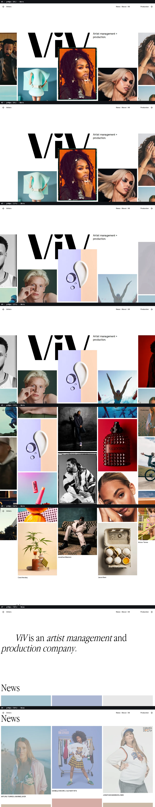
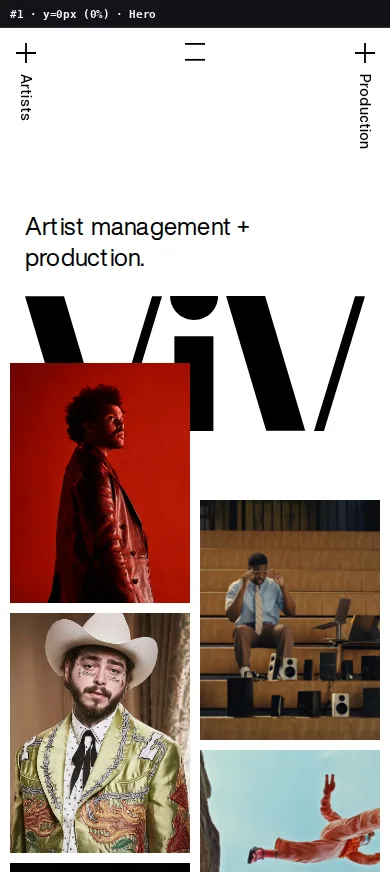

# UI Design System & Master Generation Blueprint: vivmgmt-com

> **Photographer Agency & Commercial Photo Production — ViV MGMT** (https://vivmgmt.com/) — Representing commercial photographers, directors, and creatives while providing full-service photo and video production for brands nation...





---

## 1. Executive Visual Persona & Design Archetype

- **Brand Essence & Persona**: **Photographer Agency & Commercial Photo Production — ViV MGMT** (`https://vivmgmt.com/`). Representing commercial photographers, directors, and creatives while providing full-service photo and video production for brands nation...
- **Capture Provenance**: Live browser capture (`tier1_fast`, HTTP `200`, captured `2026-11-24`).
- **Visual Archetype**: **Light-Substrate Editorial & Modular Grid System (`#ffffff` canvas, `#000000` ink, `#ebebeb` accent)**.
- **Anti-AI-Slop Differentiators**:
  - **Live-Computed Chromatic Polarity**: Anchors the viewport in `#ffffff` (live computed `body` `background-color` (`computed_styles.json`)) paired with `#000000` primary typography and `#ebebeb` accents.
  - **Grounded Typographic Hierarchy**: Uses `Helvetica Now Display` across display (`ViV — artist management + production`) and body copy.
  - **Calibrated Spatial Grid & Motion**: Combines `1440px` container bounds (`gap: var(--space-m)`, padding `10px`) with `cubic-bezier(.65,0,.35,1)` easing and Lenis Smooth Scroll (`data-lenis`), Lottie Vector Animation Player.

---

## 2. Spatial Architecture & Modular Grid Mathematics

### Viewport Allocation & Container Geometry
- **Captured Journey Filmstrips**: Desktop `1280×6624px` (`assets/desktop-journey.webp`, `8` keyframes up to `y=0px` / doc `900px`), Mobile `390×872px` (`assets/mobile-journey.webp`, `1` keyframes).
- **Master Container Bounds**: `1440px` (full-bleed `100%` desktop stage measured on `1440px` viewport).
- **Canvas Lateral Padding & Spacing**: `10px` lateral canvas padding with `var(--space-m)` grid gap.
- **Border Radius Scale**: `0px` (sharp unrounded corners).

### Responsive Breakpoint Architecture
- **Desktop Layout**: Multi-column CSS Grid / Flexbox layout at `1440px` (`max-width: 1440px`, `gap: var(--space-m)`).
- **Mobile Layout**: Single-column vertical stack at `390px` viewport width with `10px` horizontal padding.
- **Extracted CSS Media Queries**: `@media (min-width:375px)`, `@media (min-width:550px)`, `@media (min-width:768px)`, `@media (min-width:992px)`.

---

## 3. Color System, Materiality & Atmospheric Lighting

### Semantic Palette & Source Grounding
| Semantic Role | Ground-Truth Value | Extracted Live / CSS Source |
|---|---|---|
| **Primary Canvas Substrate** | `#ffffff` | live computed `body` `background-color` (`computed_styles.json`) |
| **Primary Typography Ink** | `#000000` | live computed `h1` `color` (`computed_styles.json`) |
| **Elevated Surface / Card Substrate** | `#ebebeb` | `.c-btn { background-color: #ebebeb }` |
| **Interactive Accent / Highlight** | `#ebebeb` | `.c-btn { background-color: #ebebeb }` |
| **Secondary / Muted Copy** | `#878787` | `.c-artist__nav-btn { color: #878787 }` |
| **Structural Hairline Border** | `#878787` | hairline divider derived from `.c-artist__nav-btn { color: #878787 }` |

### Sanitized Root CSS Variables (`ui-ux.md` Ground Truth)
| Variable Name | Extracted Value | Semantic Role |
|---|---|---|
| `--color-page-bg` | `#ffffff` | Canvas / Surface Token |
| `--color-page-text` | `#000000` | Typography Ink Token |
| `--space-xs` | `clamp(.3125rem, .2344rem + .3906vw, .625rem)` | Layout / Spatial Grid Token |
| `--space-s` | `clamp(.625rem, .4688rem + .7813vw, 1.25rem)` | Layout / Spatial Grid Token |
| `--space-m` | `clamp(1.25rem, .9375rem + 1.5625vw, 2.5rem)` | Layout / Spatial Grid Token |
| `--space-l` | `clamp(1.875rem, 1.4063rem + 2.3438vw, 3.75rem)` | Layout / Spatial Grid Token |
| `--space-xl` | `clamp(2.5rem, 1.875rem + 3.125vw, 5rem)` | Layout / Spatial Grid Token |
| `--space-2xl` | `clamp(3.125rem, 2.3438rem + 3.9063vw, 6.25rem)` | Layout / Spatial Grid Token |
| `--space-3xl` | `clamp(3.75rem, 2.8125rem + 4.6875vw, 7.5rem)` | Layout / Spatial Grid Token |
| `--space-4xl` | `clamp(4.375rem, 3.2813rem + 5.4688vw, 8.75rem)` | Layout / Spatial Grid Token |
| `--space-5xl` | `clamp(5rem, 3.75rem + 6.25vw, 10rem)` | Layout / Spatial Grid Token |
| `--space-xs-s` | `clamp(.3125rem, .0781rem + 1.1719vw, 1.25rem)` | Layout / Spatial Grid Token |
| `--space-s-m` | `clamp(.625rem, .1563rem + 2.3438vw, 2.5rem)` | Layout / Spatial Grid Token |
| `--space-m-l` | `clamp(1.25rem, .625rem + 3.125vw, 3.75rem)` | Layout / Spatial Grid Token |
| `--space-l-xl` | `clamp(1.875rem, 1.0938rem + 3.9063vw, 5rem)` | Layout / Spatial Grid Token |
| `--space-xl-2xl` | `clamp(2.5rem, 1.5625rem + 4.6875vw, 6.25rem)` | Layout / Spatial Grid Token |

---

## 4. Typographic Scale & Editorial Hierarchy

### Font Family Stacks
- **Display Typography**: `Helvetica Now Display`.
- **Primary Body Stack**: `Helvetica Now Display`.
- **Technical / Metadata Stack**: not declared in live computed styles (uses primary stack / `ui-monospace`).

### Typographic Scale & Rules (Live Computed & Stylesheet Grounded)
- **Hero Display (`H1`)**: live computed `h1` (`font-size: 24px`, `line-height: 24px`, `font-weight: 400`); CSS variables `--media-seek-backward-button-display: none`, `--media-seek-forward-button-display: none`, `--media-playback-rate-button-display: none`; rule `h1` (`font-size: 16px`, `line-height: 150%`, `letter-spacing: .01em`).
- **Section Heading (`H2`)**: live computed `h2` (`font-size: 96.0048px`, `line-height: 96.0048px`, `font-weight: 400`); rule `h2` (`font-size: 16px`, `line-height: 150%`, `letter-spacing: .01em`).
- **Body Copy**: live computed `body` (`font-size: 24px`, `line-height: 24px`, `font-weight: 400`); rule `p` (`font-size: clamp(24px,8vw,44px)`, `line-height: 90%`, `letter-spacing: .01em`, `font-weight: 400`).
- **Metadata & Navigation Labels**: live computed `nav/a` (`font-size: 24px`, `line-height: 24px`, `font-weight: 400`).

---

## 5. Choreographed Motion & Interaction Physics

### Primary Easing Curves
- **Extracted Timing Functions**: `cubic-bezier(.65,0,.35,1)`, `cubic-bezier(.16,1,.3,1)`, `cubic-bezier(.19,1,.22,1)`.

### Per-Element Transition & Choreography Rules
- **Selector `.cms-content a:before`**: `transition: transform .5s` extracted from `vivmgmt-com` stylesheet.
- **Selector `.js-media-visibility-pckry:before`**: `transition: opacity .5s` extracted from `vivmgmt-com` stylesheet.
- **Selector `.js-element-visibility .will-animate`**: `transition: transform .5s,opacity .5s` extracted from `vivmgmt-com` stylesheet.
- **Extracted Easing Curve (`cubic-bezier(.65,0,.35,1)`)**: Governs interactive state transitions across `<nav.c-navbar>` and `<section.c-home__gallery:nth(2)>`.
- **Runtime Interaction Engine**: Integrates Lenis Smooth Scroll (`data-lenis`), Lottie Vector Animation Player with `prefers-reduced-motion: reduce` fallback guards.
### Measured Runtime Scroll & Interaction Telemetry (`behavioral_journey_v2`)
- **Scroll Driver Mode**: `wheel` (max document height `900px`, deepest scrollY reached `0px` across `8` desktop keyframes).
- **Detected Scroll / Motion Libraries**: `Lenis`.
- **Hover Physics (`primary_cta` · `ARTURO TORRES x MARINE LAYER`)**: Computed transition `0s` / `ease` (no static color/transform shift captured at rest).
- **Route Transition Architecture**: First internal navigation (`/news`) measured as `SPA` in `1090ms`.

---

## 6. Component Wireframe & Structural DOM Map

### Visual Layout Schematic — Desktop (`1440px`, Grounded in `dom.html` & Landmark Bounding Boxes)
```
┌────────────────────────────────────────────────────────────────────────┐
│ DESKTOP VIEWPORT (1440px) — Photographer Agency & Commercial Photo Pro │
│ ====================================================================== │
│ [ <nav.c-navbar> (1440x41px)          | ViV Management · Artists · N ] │
│ ---------------------------------------------------------------------- │
│ | HERO STAGE: <section.c-home__gallery> (w=1440px)                   | │
│ | H1: ViV — artist management + production                           | │
│ | Substrate: #ffffff | Ink: #000000 | Accent: #ebebeb                | │
│ ---------------------------------------------------------------------- │
│ | SHOWCASE GRID (<section.c-home__gallery:n) max-w: 1440px           | │
│ | +------------------------------+  +------------------------------+ | │
│ | | ARTURO TORRES x MARINE LAYER |  | DANIELLE MOORE x OLD NAVY BT | | │
│ | +------------------------------+  +------------------------------+ | │
│ ---------------------------------------------------------------------- │
│ | DETAIL MODULE (<section.c-home__gallery:n) — JONATHAN MANNION x NI | │
│ ---------------------------------------------------------------------- │
│ [ FOOTER (<footer.c-footer>   ) | https://vivmgmt.com/                 │
└────────────────────────────────────────────────────────────────────────┘
```

### Visual Layout Schematic — Mobile Reflow (`390px`)
```
┌────────────────────────────────────────────────────────────────────────┐
│ MOBILE VIEWPORT REFLOW (390px) — Single-Column Stack (gap: var(--sp)   │
│ ====================================================================== │
│ [ HEADER BAR (<nav.c-navbar>          ) | Compact Menu (390px)         │
│ ---------------------------------------------------------------------- │
│ | HERO STAGE (<section.c-home__gallery) — 390px Vertical Lead        | │
│ | H1: ViV — artist management + production                           | │
│ ---------------------------------------------------------------------- │
│ | SHOWCASE STACK (<section.c-home__galle) — 1-Col Stack              | │
│ | [ Item 1: ARTURO TORRES x MARINE LAYER                           ] | │
│ | [ Item 2: DANIELLE MOORE x OLD NAVY BTS                          ] | │
│ ---------------------------------------------------------------------- │
│ | DETAIL STACK (<section.c-home__gallery) — 1-Col (JONATHAN MANNION x) │
│ ---------------------------------------------------------------------- │
│ [ FOOTER (<footer.c-footer>   ) | Stacked 390px Colophon               │
└────────────────────────────────────────────────────────────────────────┘
```

### Granular DOM Region Breakdown
1. **Brand Header & Navigation Bar (<nav.c-navbar> — `vivmgmt-com`)**:
   - Landmark `<nav class="c-navbar">` (`1440x41px`) hosting `Photographer Agency & Commercial Pho` navigation (`ViV Management · Artists · News · About · All`), DOM attributes (`data-col="1"`, `data-href="/artist/edward-tran"`, `data-cycle="[("t":"img","url":"ht..."`, `data-col="2"`), and stylesheet rule `html { box-sizing:border-box;-ms-overflow-style:scrollbar }`.
2. **Hero Stage & Focal Lead (<section.c-home__gallery> — `ViV — artist management + producti`)**:
   - Landmark `<section class="c-home__gallery">` presenting display lead `ViV — artist management + production` and copy excerpt *"Artist management + production."* over `#ffffff` canvas and `#000000` ink.
3. **Primary Showcase & Content Grid (<section.c-home__gallery:nth(2)> — `ARTURO TORRES x MARINE LAYER`)**:
   - Landmark `<section class="c-home__gallery">` rendering section `ARTURO TORRES x MARINE LAYER` with copy *"ViV is an artist management and production company."*, asset references (`www.datocms-assets.com`, `image.mux.com`, `stream.mux.com`, `GaramondNarrow-Regular.woff2`), and grid rule `after { box-sizing:inherit }`.
4. **Interactive Detail & Feature Matrix (<section.c-home__gallery:nth(3)> — `DANIELLE MOORE x OLD NAVY BTS`)**:
   - Landmark `<section class="c-home__gallery">` framing `DANIELLE MOORE x OLD NAVY BTS` and `JONATHAN MANNION x NIKE` (*"V i V i s a n a r t i s t m a n a g e m e n t a n d p r o d u c t"*) with `#ebebeb` surface cards, `#ebebeb` accents, and `.container { position:relative;margin-left:auto;margin-right:auto;padding-right:10px;... }`.
5. **Colophon & Global Directory Footer (<footer.c-footer> — `https://vivmgmt.com/`)**:
   - Landmark `<footer class="c-footer">` anchoring `Photographer Agency & Commercial` footer links (`ViV Management · Artists · News · About · All`), copy *"m a n a g e m e n t"*, and `#878787` structural dividers.
### Full Vertical Scroll Sequence (Desktop `1440×900` Keyframes)
- **Step 01** (`y=0px`, `0%`): Active landmark `Hero` · sticky/fixed elements: `1`
- **Step 02** (`y=0px`, `8%`): Active landmark `Hero` · sticky/fixed elements: `1`
- **Step 03** (`y=0px`, `17%`): Active landmark `Hero` · sticky/fixed elements: `1`
- **Step 04** (`y=0px`, `25%`): Active landmark `Hero` · sticky/fixed elements: `1`
- **Step 05** (`y=0px`, `33%`): Active landmark `Hero` · sticky/fixed elements: `1`
- **Step 06** (`y=0px`, `42%`): Active landmark `Hero` · sticky/fixed elements: `1`
- **Step 07** (`y=0px`, `50%`): Active landmark `News` · sticky/fixed elements: `1`
- **Step 08** (`y=0px`, `58%`): Active landmark `News` · sticky/fixed elements: `1`

### Multi-Page Internal Route Map
- **Listing Route (`/news`)**: `https://vivmgmt.com/news` — H1: `News`, scrollHeight `900px`, transition `SPA` (`1090ms`)
- **Detail Route (`/news/arturo-torres-x-marine-layer`)**: `https://vivmgmt.com/news/arturo-torres-x-marine-layer` — H1: `ARTURO TORRES x MARINE LAYER`, scrollHeight `900px`, transition `direct` (`808ms`)
- **About Route (`/about`)**: `https://vivmgmt.com/about` — H1: `About ViV`, scrollHeight `900px`, transition `direct` (`762ms`)

---

## 7. Master Zero-Shot AI Generation Prompt

```markdown
# Master Zero-Shot Frontend Generation Prompt: vivmgmt-com (Photographer Agency & Commercial Photo Production — ViV MGMT)

You are a principal frontend architect and design systems engineer. Build a complete, production-ready web application replicating the exact design system, DOM landmarks, typographic hierarchy, color tokens, and motion physics of `vivmgmt-com` (**Photographer Agency & Commercial Photo Production — ViV MGMT** — `https://vivmgmt.com/`).

### 1. Visual Archetype & Anti-AI-Slop Mandates
- **Archetype**: Light-Substrate Editorial & Modular Grid System (`#ffffff` canvas, `#000000` ink, `#ebebeb` accent).
- **Identity & Domain Context**: Representing commercial photographers, directors, and creatives while providing full-service photo and video production for brands nation...
- **Primary Substrate**: `#ffffff` (live computed `body` `background-color` (`computed_styles.json`)), **Primary Ink**: `#000000`, **Accent / Highlight**: `#ebebeb`.
- **Site-Specific Differentiators**:
  - **Live-Computed Chromatic Polarity**: Anchors the viewport in `#ffffff` (live computed `body` `background-color` (`computed_styles.json`)) paired with `#000000` primary typography and `#ebebeb` accents.
  - **Grounded Typographic Hierarchy**: Uses `Helvetica Now Display` across display (`ViV — artist management + production`) and body copy.
  - **Calibrated Spatial Grid & Motion**: Combines `1440px` container bounds (`gap: var(--space-m)`, padding `10px`) with `cubic-bezier(.65,0,.35,1)` easing and Lenis Smooth Scroll (`data-lenis`), Lottie Vector Animation Player.

### 2. Ground-Truth CSS Variables (`:root` Token Contract)
Declare and consume these exact custom properties extracted from `vivmgmt-com` in your global stylesheet:

:root {
  /* Photographer Agency & Commercial Photo Production — ViV MGMT (vivmgmt-com) — Live-Grounded CSS Variables */
  --color-page-bg: #ffffff; /* Canvas / Surface Token (vivmgmt-com) */
  --color-page-text: #000000; /* Typography Ink Token (vivmgmt-com) */
  --space-xs: clamp(.3125rem, .2344rem + .3906vw, .625rem); /* Layout / Spatial Grid Token (vivmgmt-com) */
  --space-s: clamp(.625rem, .4688rem + .7813vw, 1.25rem); /* Layout / Spatial Grid Token (vivmgmt-com) */
  --space-m: clamp(1.25rem, .9375rem + 1.5625vw, 2.5rem); /* Layout / Spatial Grid Token (vivmgmt-com) */
  --space-l: clamp(1.875rem, 1.4063rem + 2.3438vw, 3.75rem); /* Layout / Spatial Grid Token (vivmgmt-com) */
  --space-xl: clamp(2.5rem, 1.875rem + 3.125vw, 5rem); /* Layout / Spatial Grid Token (vivmgmt-com) */
  --space-2xl: clamp(3.125rem, 2.3438rem + 3.9063vw, 6.25rem); /* Layout / Spatial Grid Token (vivmgmt-com) */
  --space-3xl: clamp(3.75rem, 2.8125rem + 4.6875vw, 7.5rem); /* Layout / Spatial Grid Token (vivmgmt-com) */
  --space-4xl: clamp(4.375rem, 3.2813rem + 5.4688vw, 8.75rem); /* Layout / Spatial Grid Token (vivmgmt-com) */
  --space-5xl: clamp(5rem, 3.75rem + 6.25vw, 10rem); /* Layout / Spatial Grid Token (vivmgmt-com) */
  --space-xs-s: clamp(.3125rem, .0781rem + 1.1719vw, 1.25rem); /* Layout / Spatial Grid Token (vivmgmt-com) */
  --space-s-m: clamp(.625rem, .1563rem + 2.3438vw, 2.5rem); /* Layout / Spatial Grid Token (vivmgmt-com) */
  --space-m-l: clamp(1.25rem, .625rem + 3.125vw, 3.75rem); /* Layout / Spatial Grid Token (vivmgmt-com) */
  --space-l-xl: clamp(1.875rem, 1.0938rem + 3.9063vw, 5rem); /* Layout / Spatial Grid Token (vivmgmt-com) */
  --space-xl-2xl: clamp(2.5rem, 1.5625rem + 4.6875vw, 6.25rem); /* Layout / Spatial Grid Token (vivmgmt-com) */
}

### 3. Semantic Color & Materiality Contract
Map every surface, ink, and border strictly to these source-grounded tokens:
- **Primary Canvas Substrate**: `#ffffff` — grounded in live computed `body` `background-color` (`computed_styles.json`)
- **Primary Typography Ink**: `#000000` — grounded in live computed `h1` `color` (`computed_styles.json`)
- **Elevated Surface / Card Substrate**: `#ebebeb` — grounded in `.c-btn { background-color: #ebebeb }`
- **Interactive Accent / Highlight**: `#ebebeb` — grounded in `.c-btn { background-color: #ebebeb }`
- **Secondary / Muted Copy**: `#878787` — grounded in `.c-artist__nav-btn { color: #878787 }`
- **Structural Hairline Border**: `#878787` — grounded in hairline divider derived from `.c-artist__nav-btn { color: #878787 }`

### 4. Spatial Grid, Container Bounds & Responsive Breakpoints
- **Desktop Viewport Reference**: `1280×6624px` (multi-frame vertical journey filmstrip (6624px), `1440px` standard desktop width).
- **Mobile Viewport Reference**: `390×872px` (full-page live capture (872px), `390px` standard mobile width).
- **Container Max-Width**: `1440px` (full-bleed `100%` desktop stage measured on `1440px` viewport)
- **Padding & Gutters**: `10px` lateral canvas padding with `var(--space-m)` grid gap
- **Desktop Grid**: Multi-column CSS Grid / Flexbox layout at `1440px` (`max-width: 1440px`, `gap: var(--space-m)`)
- **Mobile Adaptation**: Single-column vertical stack at `390px` viewport width with `10px` horizontal padding
- **Media Queries**: `@media (min-width:375px)`, `@media (min-width:550px)`, `@media (min-width:768px)`, `@media (min-width:992px)`
- **Corner Radii**: `0px` (sharp unrounded corners)

### 5. Typography & Editorial Scale Contract
- **Display Font Stack**: `Helvetica Now Display`
- **Body Font Stack**: `Helvetica Now Display`
- **Monospace / Technical Font Stack**: not declared in live computed styles (uses primary stack / `ui-monospace`)
- **H1 Display Rule**: live computed `h1` (`font-size: 24px`, `line-height: 24px`, `font-weight: 400`); CSS variables `--media-seek-backward-button-display: none`, `--media-seek-forward-button-display: none`, `--media-playback-rate-button-display: none`; rule `h1` (`font-size: 16px`, `line-height: 150%`, `letter-spacing: .01em`)
- **H2 Section Rule**: live computed `h2` (`font-size: 96.0048px`, `line-height: 96.0048px`, `font-weight: 400`); rule `h2` (`font-size: 16px`, `line-height: 150%`, `letter-spacing: .01em`)
- **Body Copy Rule**: live computed `body` (`font-size: 24px`, `line-height: 24px`, `font-weight: 400`); rule `p` (`font-size: clamp(24px,8vw,44px)`, `line-height: 90%`, `letter-spacing: .01em`, `font-weight: 400`)
- **Metadata & Index Rule**: live computed `nav/a` (`font-size: 24px`, `line-height: 24px`, `font-weight: 400`)

### 6. Component Hierarchy, Verbatim Copy & Real DOM Landmarks
Scaffold `vivmgmt-com` (`Photographer Agency & Commercial Photo Production — ViV MGMT`) with these exact structural regions, extracted copy, and CSS rules from `dom.html`:
1. **Brand Header & Navigation Bar (<nav.c-navbar> — `vivmgmt-com`)**:
   - DOM & Selectors: Landmark `<nav class="c-navbar">` (`1440x41px`) hosting `Photographer Agency & Commercial Pho` navigation (`ViV Management · Artists · News · About · All`), DOM attributes (`data-col="1"`, `data-href="/artist/edward-tran"`, `data-cycle="[("t":"img","url":"ht..."`, `data-col="2"`), and stylesheet rule `html { box-sizing:border-box;-ms-overflow-style:scrollbar }`.
   - Responsive Contract: Header `Brand Header & Navigation Bar (<nav.c-navbar> — `vivmgmt-com`)` (`vivmgmt-com`) adapts across `@media (min-width:375px)`, `@media (min-width:550px)`, `@media (min-width:768px)`, `@media (min-width:992px)` with `cubic-bezier(.65,0,.35,1)`, `cubic-bezier(.16,1,.3,1)`, `cubic-bezier(.19,1,.22,1)` transitions and links `ViV Management · Artists · News · About · All`.
2. **Hero Stage & Focal Lead (<section.c-home__gallery> — `ViV — artist management + producti`)**:
   - DOM & Selectors: Landmark `<section class="c-home__gallery">` presenting display lead `ViV — artist management + production` and copy excerpt *"Artist management + production."* over `#ffffff` canvas and `#000000` ink.
   - Responsive Contract: Hero stage (`1280×6624px` desktop / `390×872px` mobile) sets `#ffffff` background with `#000000` headline `ViV — artist management + production`.
3. **Primary Showcase & Content Grid (<section.c-home__gallery:nth(2)> — `ARTURO TORRES x MARINE LAYER`)**:
   - DOM & Selectors: Landmark `<section class="c-home__gallery">` rendering section `ARTURO TORRES x MARINE LAYER` with copy *"ViV is an artist management and production company."*, asset references (`www.datocms-assets.com`, `image.mux.com`, `stream.mux.com`, `GaramondNarrow-Regular.woff2`), and grid rule `after { box-sizing:inherit }`.
   - Responsive Contract: Showcase grid `Primary Showcase & Content Grid (<section.c-home__gallery:nth(2)> — `ARTURO TORRES x MARINE LAYER`)` applies Multi-column CSS Grid / Flexbox layout at `1440px` (`max-width: 1440px`, `gap: var(--space-m)`) on desktop and Single-column vertical stack at `390px` viewport width with `10px` horizontal padding on mobile.
4. **Interactive Detail & Feature Matrix (<section.c-home__gallery:nth(3)> — `DANIELLE MOORE x OLD NAVY BTS`)**:
   - DOM & Selectors: Landmark `<section class="c-home__gallery">` framing `DANIELLE MOORE x OLD NAVY BTS` and `JONATHAN MANNION x NIKE` (*"V i V i s a n a r t i s t m a n a g e m e n t a n d p r o d u c t"*) with `#ebebeb` surface cards, `#ebebeb` accents, and `.container { position:relative;margin-left:auto;margin-right:auto;padding-right:10px;... }`.
   - Responsive Contract: Detail module `Interactive Detail & Feature Matrix (<section.c-home__gallery:nth(3)> — `DANIELLE MOORE x OLD NAVY BTS`)` uses `0px` (sharp unrounded corners) radii, `#ebebeb` highlights, and assets (www.datocms-assets.com, image.mux.com, stream.mux.com).
5. **Colophon & Global Directory Footer (<footer.c-footer> — `https://vivmgmt.com/`)**:
   - DOM & Selectors: Landmark `<footer class="c-footer">` anchoring `Photographer Agency & Commercial` footer links (`ViV Management · Artists · News · About · All`), copy *"m a n a g e m e n t"*, and `#878787` structural dividers.
   - Responsive Contract: Footer `Colophon & Global Directory Footer (<footer.c-footer> — `https://vivmgmt.com/`)` aligns to `1440px` (full-bleed `100%` desktop stage measured on `1440px` viewport) with `10px` lateral canvas padding with `var(--space-m)` grid gap and attributes (data-col="1", data-href="/artist/edward-tran", data-cycle="[("t":"img","url":"ht...").

#### Verbatim DOM Copy Excerpts (`dom.html`)
- Copy Excerpt 1: *"Artist management + production."*
- Copy Excerpt 2: *"ViV is an artist management and production company."*
- Copy Excerpt 3: *"V i V i s a n a r t i s t m a n a g e m e n t a n d p r o d u c t i o n c o m p a..."*
- Copy Excerpt 4: *"m a n a g e m e n t"*

### 7. Motion, Extracted Stylesheet Rules & Interaction Choreography
- **Primary Easing Functions**: `cubic-bezier(.65,0,.35,1)`, `cubic-bezier(.16,1,.3,1)`, `cubic-bezier(.19,1,.22,1)`
- **Extracted Stylesheet Rules (`vivmgmt-com`)**:
- `html { box-sizing:border-box;-ms-overflow-style:scrollbar }`
- `after { box-sizing:inherit }`
- `.container { position:relative;margin-left:auto;margin-right:auto;padding-right:10px;... }`
- `.container-fluid { position:relative;margin-left:auto;margin-right:auto;padding-right:10px;... }`
- `.row { display:flex;flex-wrap:wrap;margin-right:-5px;margin-left:-5px }`
- **Per-Selector Transition Rules**:
- **Selector `.cms-content a:before`**: `transition: transform .5s` extracted from `vivmgmt-com` stylesheet.
- **Selector `.js-media-visibility-pckry:before`**: `transition: opacity .5s` extracted from `vivmgmt-com` stylesheet.
- **Selector `.js-element-visibility .will-animate`**: `transition: transform .5s,opacity .5s` extracted from `vivmgmt-com` stylesheet.
- **Extracted Easing Curve (`cubic-bezier(.65,0,.35,1)`)**: Governs interactive state transitions across `<nav.c-navbar>` and `<section.c-home__gallery:nth(2)>`.
- **Runtime Interaction Engine**: Integrates Lenis Smooth Scroll (`data-lenis`), Lottie Vector Animation Player with `prefers-reduced-motion: reduce` fallback guards.
### 7b. Full-Page Scroll Choreography, Interactive States & Multi-Page Routes
- **Scroll Mechanics**: Implement `wheel` vertical progression up to `900px` across 8 distinct viewport chapters using Lenis.
- **Vertical Chapter Sequence**: Hero (0%) -> Hero (8%) -> Hero (17%) -> Hero (25%) -> Hero (33%) -> Hero (42%) -> News (50%) -> News (58%).
- **Multi-Page Routes**: Scaffold internal routes `/news` (listing, SPA), `/news/arturo-torres-x-marine-layer` (detail, direct), `/about` (about, direct) sharing the global header/footer shell and design tokens.

### 8. Technical Deliverables
- Implement in Next.js (App Router) with TypeScript and Tailwind CSS consuming the `:root` custom properties defined above for `vivmgmt-com`.
- Reproduce both the `1440px` desktop architecture and `390px` mobile breakpoint transitions, preserving semantic HTML5 landmarks (`<header>`, `<nav>`, `<main>`, `<section>`, `<footer>`) and `prefers-reduced-motion` accessibility guards.
```
---

## 8. Full-Page Scroll Journey, Interactive States & Subpage Inventory

### Desktop Scroll Keyframes (`1440×900` WebP)
| Step | Scroll Y | Progress | Active Landmark / Section | Sticky/Fixed | Visual Asset |
| :---: | :---: | :---: | :--- | :---: | :--- |
| `#01` | `0px` | `0%` | Hero | `1` | [desktop-step-01.webp](assets/desktop-step-01.webp) |
| `#02` | `0px` | `8%` | Hero | `1` | [desktop-step-02.webp](assets/desktop-step-02.webp) |
| `#03` | `0px` | `17%` | Hero | `1` | [desktop-step-03.webp](assets/desktop-step-03.webp) |
| `#04` | `0px` | `25%` | Hero | `1` | [desktop-step-04.webp](assets/desktop-step-04.webp) |
| `#05` | `0px` | `33%` | Hero | `1` | [desktop-step-05.webp](assets/desktop-step-05.webp) |
| `#06` | `0px` | `42%` | Hero | `1` | [desktop-step-06.webp](assets/desktop-step-06.webp) |
| `#07` | `0px` | `50%` | News | `1` | [desktop-step-07.webp](assets/desktop-step-07.webp) |
| `#08` | `0px` | `58%` | News | `1` | [desktop-step-08.webp](assets/desktop-step-08.webp) |

### Mobile Condensed Keyframes (`390×844` WebP)
| Step | Scroll Y | Progress | Active Landmark | Visual Asset |
| :---: | :---: | :---: | :--- | :--- |
| `#01` | `0px` | `0%` | Hero | [mobile-step-01.webp](assets/mobile-step-01.webp) |

### Internal Subpage Filmstrips (`1080px` Wide WebP)
| # | Template | Route URL | H1 / Title | Scroll Height | Transition | Filmstrip Asset |
| :-: | :---: | :--- | :--- | :---: | :---: | :--- |
| `1` | `listing` | `https://vivmgmt.com/news` | News | `900px` | `SPA` (`1090ms`) | [subpage-01-news.webp](assets/subpage-01-news.webp) |
| `2` | `detail` | `https://vivmgmt.com/news/arturo-torres-x-marine-layer` | ARTURO TORRES x MARINE LAYER | `900px` | `direct` (`808ms`) | [subpage-02-news-arturo-torres-x-marine-layer.webp](assets/subpage-02-news-arturo-torres-x-marine-layer.webp) |
| `3` | `about` | `https://vivmgmt.com/about` | About ViV | `900px` | `direct` (`762ms`) | [subpage-03-about.webp](assets/subpage-03-about.webp) |

