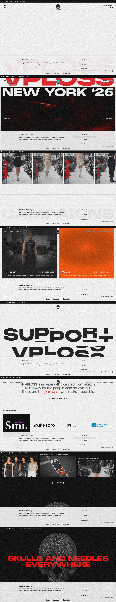
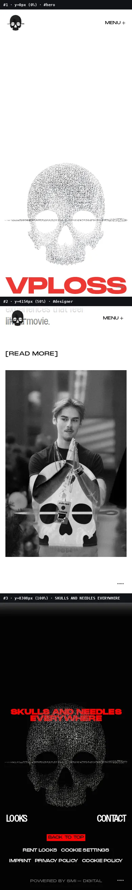

# UI Design System & Master Generation Blueprint: vploss-com

> **VPLOSS** (https://vploss.com) — VPLOSS, the fashion label of designer Vincent Ploss: the New York and Paris Fashion Week 2026 collections, with every runway look to rent.





---

## 1. Executive Visual Persona & Design Archetype

- **Brand Essence & Persona**: **VPLOSS** (`https://vploss.com`). VPLOSS, the fashion label of designer Vincent Ploss: the New York and Paris Fashion Week 2026 collections, with every runway look to rent.
- **Capture Provenance**: Live browser capture (`tier1_fast`, HTTP `200`, captured `2026-11-24`).
- **Visual Archetype**: **Light-Gallery WebGL / Canvas Interactive Experience (`#ffffff` / `#ff2a2a`)**.
- **Anti-AI-Slop Differentiators**:
  - **Live-Computed Chromatic Polarity**: Anchors the viewport in `#ffffff` (live computed `body` `background-color` (`computed_styles.json`)) paired with `#030303` primary typography and `#ff2a2a` accents.
  - **Grounded Typographic Hierarchy**: Pairs `PP Monument Extended` for display copy (`VPLOSS`) with `PP Monument Extended Fallback`.
  - **Calibrated Spatial Grid & Motion**: Combines `980px` container bounds (`gap: 8px`, padding `21px`) with `cubic-bezier(.33,1,.68,1)` easing and Lenis Smooth Scroll (`data-lenis`), HTML5 `<canvas>` Interactive Viewport Surface.

---

## 2. Spatial Architecture & Modular Grid Mathematics

### Viewport Allocation & Container Geometry
- **Captured Journey Filmstrips**: Desktop `1280×6624px` (`assets/desktop-journey.webp`, `8` keyframes up to `y=8195px` / doc `9095px`), Mobile `390×2616px` (`assets/mobile-journey.webp`, `3` keyframes).
- **Master Container Bounds**: `980px` (non-`@media` desktop container stylesheet rule).
- **Canvas Lateral Padding & Spacing**: `21px` lateral canvas padding with `8px` grid gap.
- **Border Radius Scale**: `50%`, `4px`, `3px`, `8px`.

### Responsive Breakpoint Architecture
- **Desktop Layout**: Multi-column CSS Grid / Flexbox layout at `1440px` (`max-width: 980px`, `gap: 8px`).
- **Mobile Layout**: Single-column vertical stack at `390px` viewport width with `21px` horizontal padding.
- **Extracted CSS Media Queries**: `@media (width<=767px)`, `@media (prefers-reduced-motion:reduce)`, `@media (prefers-reduced-motion:no-preference) and (hover:hover)`, `@media (prefers-reduced-motion:no-preference)`.

---

## 3. Color System, Materiality & Atmospheric Lighting

### Semantic Palette & Source Grounding
| Semantic Role | Ground-Truth Value | Extracted Live / CSS Source |
|---|---|---|
| **Primary Canvas Substrate** | `#ffffff` | live computed `body` `background-color` (`computed_styles.json`) |
| **Primary Typography Ink** | `#030303` | live computed `h1` `color` (`computed_styles.json`) |
| **Elevated Surface / Card Substrate** | `#ed3833` | `._fill_iqn1v_19 { background: #ed3833 }` |
| **Interactive Accent / Highlight** | `#ff2a2a` | `._backToTopBtn_np885_286:hover { background-color: #ff2a2a }` |
| **Secondary / Muted Copy** | `#ed3833` | live computed `p` `color` (`computed_styles.json`) |
| **Structural Hairline Border** | `#d4d4d4` | `._buttonPrimary_1cyng_93:hover { border-color: #d4d4d4 }` |
| **Variable Token (`--color-corridor-bg`)** | `#0a0a0a` | `var(--color-corridor-bg)` in `:root` |
| **Variable Token (`--color-grey-9`)** | `#171717` | `var(--color-grey-9)` in `:root` |
| **Variable Token (`--color-grey-96`)** | `#f5f5f5` | `var(--color-grey-96)` in `:root` |
| **Variable Token (`--color-pfw`)** | `#ff5100` | `var(--color-pfw)` in `:root` |
| **Variable Token (`--color-paris-night`)** | `#0b0908` | `var(--color-paris-night)` in `:root` |
| **Variable Token (`--color-paris-chalk`)** | `#efe9e2` | `var(--color-paris-chalk)` in `:root` |
| **Variable Token (`--paris-ember`)** | `#a02707` | `var(--paris-ember)` in `:root` |
| **Variable Token (`--paris-flame`)** | `#f66f1d` | `var(--paris-flame)` in `:root` |
| **Variable Token (`--paris-orange`)** | `#ffb142` | `var(--paris-orange)` in `:root` |
| **Variable Token (`--paris-amber`)** | `#ffdd86` | `var(--paris-amber)` in `:root` |
| **Variable Token (`--paris-core`)** | `#fff8e2` | `var(--paris-core)` in `:root` |
| **Variable Token (`--paris-soot`)** | `#4d4642` | `var(--paris-soot)` in `:root` |

### Sanitized Root CSS Variables (`ui-ux.md` Ground Truth)
| Variable Name | Extracted Value | Semantic Role |
|---|---|---|
| `--color-bg` | `#fff` | Canvas / Surface Token |
| `--color-fg` | `#030303` | Typography Ink Token |
| `--color-corridor-bg` | `#0a0a0a` | Canvas / Surface Token |
| `--color-grey-9` | `#171717` | Brand / Palette Token |
| `--color-grey-83` | `#d4d4d4` | Brand / Palette Token |
| `--color-grey-96` | `#f5f5f5` | Brand / Palette Token |
| `--color-pfw` | `#ff5100` | Brand / Palette Token |
| `--color-accent-red` | `#ed3833` | Brand / Palette Token |
| `--color-paris-night` | `#0b0908` | Brand / Palette Token |
| `--color-paris-chalk` | `#efe9e2` | Brand / Palette Token |
| `--paris-ember` | `#a02707` | Color / Atmospheric Token |
| `--paris-flame` | `#f66f1d` | Color / Atmospheric Token |
| `--paris-orange` | `#ffb142` | Color / Atmospheric Token |
| `--paris-amber` | `#ffdd86` | Color / Atmospheric Token |
| `--paris-core` | `#fff8e2` | Color / Atmospheric Token |
| `--paris-soot` | `#4d4642` | Color / Atmospheric Token |

---

## 4. Typographic Scale & Editorial Hierarchy

### Font Family Stacks
- **Display Typography**: `PP Monument Extended`.
- **Primary Body Stack**: `PP Monument Extended Fallback`.
- **Technical / Metadata Stack**: not declared in live computed styles (uses primary stack / `ui-monospace`).

### Typographic Scale & Rules (Live Computed & Stylesheet Grounded)
- **Hero Display (`H1`)**: live computed `h1` (`font-size: 32px`, `line-height: normal`, `font-weight: 700`).
- **Section Heading (`H2`)**: live computed `h2` (`font-size: 166.587px`, `line-height: 133.27px`, `font-weight: 900`, `letter-spacing: -4.16467px`).
- **Body Copy**: live computed `body` (`font-size: 16px`, `line-height: normal`, `font-weight: 400`).
- **Metadata & Navigation Labels**: live computed `nav/a` (`font-size: 16px`, `line-height: normal`, `font-weight: 400`).

---

## 5. Choreographed Motion & Interaction Physics

### Primary Easing Curves
- **Extracted Timing Functions**: `cubic-bezier(.33,1,.68,1)`, `cubic-bezier(.22,1,.36,1)`, `cubic-bezier(.16,1,.3,1)`.

### Per-Element Transition & Choreography Rules
- **Selector `._headerPanel_a9xy0_24`**: `transition: opacity .45s cubic-bezier(.33,1,.68,1)` extracted from `vploss-com` stylesheet.
- **Selector `._mobileFade_a9xy0_50`**: `transition: opacity .3s cubic-bezier(.33,1,.68,1)` extracted from `vploss-com` stylesheet.
- **Selector `._header_a9xy0_24`**: `transition: box-shadow .5s cubic-bezier(.33,1,.68,1)` extracted from `vploss-com` stylesheet.
- **Extracted Easing Curve (`cubic-bezier(.33,1,.68,1)`)**: Governs interactive state transitions across `<header.lenis>` and `<section#film>`.
- **Runtime Interaction Engine**: Integrates Lenis Smooth Scroll (`data-lenis`), HTML5 `<canvas>` Interactive Viewport Surface with `prefers-reduced-motion: reduce` fallback guards.
### Measured Runtime Scroll & Interaction Telemetry (`behavioral_journey_v2`)
- **Scroll Driver Mode**: `native` (max document height `9095px`, deepest scrollY reached `8195px` across `8` desktop keyframes).
- **Detected Scroll / Motion Libraries**: Native browser scroll / standard CSS transitions.
- **Route Transition Architecture**: First internal navigation (`/news`) measured as `SPA` in `1946ms`.

---

## 6. Component Wireframe & Structural DOM Map

### Visual Layout Schematic — Desktop (`1440px`, Grounded in `dom.html` & Landmark Bounding Boxes)
```
┌────────────────────────────────────────────────────────────────────────┐
│ DESKTOP VIEWPORT (1440px) — VPLOSS                                     │
│ ====================================================================== │
│ [ <header.lenis> (1440x117px)         | LOOKS L O O K S · RENT R E N ] │
│ ---------------------------------------------------------------------- │
│ | HERO STAGE: <section.heroPin> (w=1440px)                           | │
│ | H1: VPLOSS                                                         | │
│ | Substrate: #ffffff | Ink: #030303 | Accent: #ff2a2a                | │
│ ---------------------------------------------------------------------- │
│ | SHOWCASE GRID (<section#film>) max-w: 980px                        | │
│ | +------------------------------+  +------------------------------+ | │
│ | | NYFW '26                     |  | Campaigns                    | | │
│ | +------------------------------+  +------------------------------+ | │
│ ---------------------------------------------------------------------- │
│ | DETAIL MODULE (<section#looks>) — My Partners                      | │
│ ---------------------------------------------------------------------- │
│ [ FOOTER (<footer#footer>     ) | https://vploss.com                   │
└────────────────────────────────────────────────────────────────────────┘
```

### Visual Layout Schematic — Mobile Reflow (`390px`)
```
┌────────────────────────────────────────────────────────────────────────┐
│ MOBILE VIEWPORT REFLOW (390px) — Single-Column Stack (gap: 8px)        │
│ ====================================================================== │
│ [ HEADER BAR (<header.lenis>          ) | Compact Menu (390px)         │
│ ---------------------------------------------------------------------- │
│ | HERO STAGE (<section.heroPin>) — 390px Vertical Lead               | │
│ | H1: VPLOSS                                                         | │
│ ---------------------------------------------------------------------- │
│ | SHOWCASE STACK (<section#film>) — 1-Col Stack                      | │
│ | [ Item 1: NYFW '26                                               ] | │
│ | [ Item 2: Campaigns                                              ] | │
│ ---------------------------------------------------------------------- │
│ | DETAIL STACK (<section#looks>) — 1-Col (My Partners)               | │
│ ---------------------------------------------------------------------- │
│ [ FOOTER (<footer#footer>     ) | Stacked 390px Colophon               │
└────────────────────────────────────────────────────────────────────────┘
```

### Granular DOM Region Breakdown
1. **Brand Header & Navigation Bar (<header.lenis> — `vploss-com`)**:
   - Landmark `<header class="lenis">` (`1440x117px`) hosting `VPLOSS` navigation (`LOOKS L O O K S · RENT R E N T`), DOM attributes (`data-cover-scroll`, `data-astro-exec`, `data-header-panel`, `data-header-fade`), and stylesheet rule `._mobileFade_a9xy0_50 { display:block }`.
2. **Hero Stage & Focal Lead (<section.heroPin> — `VPLOSS`)**:
   - Landmark `<section class="heroPin">` presenting display lead `VPLOSS` and copy excerpt *"LOOKS FROM THE SHOW"* over `#ffffff` canvas and `#030303` ink.
3. **Primary Showcase & Content Grid (<section#film> — `NYFW '26`)**:
   - Landmark `<section id="film">` rendering section `NYFW '26` with copy *"Looks from the Show"*, asset references (`favicon.svg`, `favicon.ico`, `apple-touch-icon.png`, `site.webmanifest`), and grid rule `gnExpanded_a9xy0_95 ._navLink_a9x... { color:030303 }`.
4. **Interactive Detail & Feature Matrix (<section#looks> — `Campaigns`)**:
   - Landmark `<section id="looks">` framing `Campaigns` and `My Partners` (*"New York Fashion Week 2026 The Hourglass, Pinned, Confined, Ideal"*) with `#ed3833` surface cards, `#ff2a2a` accents, and `nded_a9xy0_95 ._navLink_a9xy0_108... { opacity:.85 }`.
5. **Colophon & Global Directory Footer (<footer#footer> — `https://vploss.com`)**:
   - Landmark `<footer id="footer">` anchoring `VPLOSS` footer links (`LOOKS L O O K S · RENT R E N T`), copy *"The Hourglass, Pinned, Confined, Ideal, The Thread, Armour /"*, and `#d4d4d4` structural dividers.
### Full Vertical Scroll Sequence (Desktop `1440×900` Keyframes)
- **Step 01** (`y=0px`, `0%`): Active landmark `Cookie Settings` · sticky/fixed elements: `4`
- **Step 02** (`y=850px`, `10%`): Active landmark `Cookie Settings` · sticky/fixed elements: `5`
- **Step 03** (`y=2550px`, `31%`): Active landmark `CAMPAIGNS` · sticky/fixed elements: `4`
- **Step 04** (`y=3400px`, `41%`): Active landmark `Cookie Settings` · sticky/fixed elements: `4`
- **Step 05** (`y=5100px`, `62%`): Active landmark `#partners` · sticky/fixed elements: `4`
- **Step 06** (`y=0px`, `0%`): Active landmark `Viewport` · sticky/fixed elements: `0`
- **Step 07** (`y=7650px`, `93%`): Active landmark `Cookie Settings` · sticky/fixed elements: `3`
- **Step 08** (`y=8195px`, `100%`): Active landmark `SKULLS AND NEEDLES EVERYWHERE` · sticky/fixed elements: `3`

### Multi-Page Internal Route Map
- **Listing Route (`/news`)**: `https://vploss.com/news` — H1: `NEWS`, scrollHeight `3392px`, transition `SPA` (`1946ms`)
- **Detail Route (`/campaigns/world-on-fire`)**: `https://vploss.com/campaigns/world-on-fire` — H1: `World on Fire — VPLOSS`, scrollHeight `8339px`, transition `direct` (`7169ms`)
- **About Route (`/about`)**: `https://vploss.com/about` — H1: `Vincent Ploss is the founder and designer behind...`, scrollHeight `5790px`, transition `direct` (`797ms`)

---

## 7. Master Zero-Shot AI Generation Prompt

```markdown
# Master Zero-Shot Frontend Generation Prompt: vploss-com (VPLOSS)

You are a principal frontend architect and design systems engineer. Build a complete, production-ready web application replicating the exact design system, DOM landmarks, typographic hierarchy, color tokens, and motion physics of `vploss-com` (**VPLOSS** — `https://vploss.com`).

### 1. Visual Archetype & Anti-AI-Slop Mandates
- **Archetype**: Light-Gallery WebGL / Canvas Interactive Experience (`#ffffff` / `#ff2a2a`).
- **Identity & Domain Context**: VPLOSS, the fashion label of designer Vincent Ploss: the New York and Paris Fashion Week 2026 collections, with every runway look to rent.
- **Primary Substrate**: `#ffffff` (live computed `body` `background-color` (`computed_styles.json`)), **Primary Ink**: `#030303`, **Accent / Highlight**: `#ff2a2a`.
- **Site-Specific Differentiators**:
  - **Live-Computed Chromatic Polarity**: Anchors the viewport in `#ffffff` (live computed `body` `background-color` (`computed_styles.json`)) paired with `#030303` primary typography and `#ff2a2a` accents.
  - **Grounded Typographic Hierarchy**: Pairs `PP Monument Extended` for display copy (`VPLOSS`) with `PP Monument Extended Fallback`.
  - **Calibrated Spatial Grid & Motion**: Combines `980px` container bounds (`gap: 8px`, padding `21px`) with `cubic-bezier(.33,1,.68,1)` easing and Lenis Smooth Scroll (`data-lenis`), HTML5 `<canvas>` Interactive Viewport Surface.

### 2. Ground-Truth CSS Variables (`:root` Token Contract)
Declare and consume these exact custom properties extracted from `vploss-com` in your global stylesheet:

:root {
  /* VPLOSS (vploss-com) — Live-Grounded CSS Variables */
  --color-bg: #fff; /* Canvas / Surface Token (vploss-com) */
  --color-fg: #030303; /* Typography Ink Token (vploss-com) */
  --color-corridor-bg: #0a0a0a; /* Canvas / Surface Token (vploss-com) */
  --color-grey-9: #171717; /* Brand / Palette Token (vploss-com) */
  --color-grey-83: #d4d4d4; /* Brand / Palette Token (vploss-com) */
  --color-grey-96: #f5f5f5; /* Brand / Palette Token (vploss-com) */
  --color-pfw: #ff5100; /* Brand / Palette Token (vploss-com) */
  --color-accent-red: #ed3833; /* Brand / Palette Token (vploss-com) */
  --color-paris-night: #0b0908; /* Brand / Palette Token (vploss-com) */
  --color-paris-chalk: #efe9e2; /* Brand / Palette Token (vploss-com) */
  --paris-ember: #a02707; /* Color / Atmospheric Token (vploss-com) */
  --paris-flame: #f66f1d; /* Color / Atmospheric Token (vploss-com) */
  --paris-orange: #ffb142; /* Color / Atmospheric Token (vploss-com) */
  --paris-amber: #ffdd86; /* Color / Atmospheric Token (vploss-com) */
  --paris-core: #fff8e2; /* Color / Atmospheric Token (vploss-com) */
  --paris-soot: #4d4642; /* Color / Atmospheric Token (vploss-com) */
}

### 3. Semantic Color & Materiality Contract
Map every surface, ink, and border strictly to these source-grounded tokens:
- **Primary Canvas Substrate**: `#ffffff` — grounded in live computed `body` `background-color` (`computed_styles.json`)
- **Primary Typography Ink**: `#030303` — grounded in live computed `h1` `color` (`computed_styles.json`)
- **Elevated Surface / Card Substrate**: `#ed3833` — grounded in `._fill_iqn1v_19 { background: #ed3833 }`
- **Interactive Accent / Highlight**: `#ff2a2a` — grounded in `._backToTopBtn_np885_286:hover { background-color: #ff2a2a }`
- **Secondary / Muted Copy**: `#ed3833` — grounded in live computed `p` `color` (`computed_styles.json`)
- **Structural Hairline Border**: `#d4d4d4` — grounded in `._buttonPrimary_1cyng_93:hover { border-color: #d4d4d4 }`
- **Variable Token (`--color-corridor-bg`)**: `#0a0a0a` — grounded in `var(--color-corridor-bg)` in `:root`
- **Variable Token (`--color-grey-9`)**: `#171717` — grounded in `var(--color-grey-9)` in `:root`
- **Variable Token (`--color-grey-96`)**: `#f5f5f5` — grounded in `var(--color-grey-96)` in `:root`
- **Variable Token (`--color-pfw`)**: `#ff5100` — grounded in `var(--color-pfw)` in `:root`
- **Variable Token (`--color-paris-night`)**: `#0b0908` — grounded in `var(--color-paris-night)` in `:root`
- **Variable Token (`--color-paris-chalk`)**: `#efe9e2` — grounded in `var(--color-paris-chalk)` in `:root`
- **Variable Token (`--paris-ember`)**: `#a02707` — grounded in `var(--paris-ember)` in `:root`
- **Variable Token (`--paris-flame`)**: `#f66f1d` — grounded in `var(--paris-flame)` in `:root`
- **Variable Token (`--paris-orange`)**: `#ffb142` — grounded in `var(--paris-orange)` in `:root`
- **Variable Token (`--paris-amber`)**: `#ffdd86` — grounded in `var(--paris-amber)` in `:root`
- **Variable Token (`--paris-core`)**: `#fff8e2` — grounded in `var(--paris-core)` in `:root`
- **Variable Token (`--paris-soot`)**: `#4d4642` — grounded in `var(--paris-soot)` in `:root`

### 4. Spatial Grid, Container Bounds & Responsive Breakpoints
- **Desktop Viewport Reference**: `1280×6624px` (multi-frame vertical journey filmstrip (6624px), `1440px` standard desktop width).
- **Mobile Viewport Reference**: `390×2616px` (multi-frame vertical journey filmstrip (2616px), `390px` standard mobile width).
- **Container Max-Width**: `980px` (non-`@media` desktop container stylesheet rule)
- **Padding & Gutters**: `21px` lateral canvas padding with `8px` grid gap
- **Desktop Grid**: Multi-column CSS Grid / Flexbox layout at `1440px` (`max-width: 980px`, `gap: 8px`)
- **Mobile Adaptation**: Single-column vertical stack at `390px` viewport width with `21px` horizontal padding
- **Media Queries**: `@media (width<=767px)`, `@media (prefers-reduced-motion:reduce)`, `@media (prefers-reduced-motion:no-preference) and (hover:hover)`, `@media (prefers-reduced-motion:no-preference)`
- **Corner Radii**: `50%`, `4px`, `3px`, `8px`

### 5. Typography & Editorial Scale Contract
- **Display Font Stack**: `PP Monument Extended`
- **Body Font Stack**: `PP Monument Extended Fallback`
- **Monospace / Technical Font Stack**: not declared in live computed styles (uses primary stack / `ui-monospace`)
- **H1 Display Rule**: live computed `h1` (`font-size: 32px`, `line-height: normal`, `font-weight: 700`)
- **H2 Section Rule**: live computed `h2` (`font-size: 166.587px`, `line-height: 133.27px`, `font-weight: 900`, `letter-spacing: -4.16467px`)
- **Body Copy Rule**: live computed `body` (`font-size: 16px`, `line-height: normal`, `font-weight: 400`)
- **Metadata & Index Rule**: live computed `nav/a` (`font-size: 16px`, `line-height: normal`, `font-weight: 400`)

### 6. Component Hierarchy, Verbatim Copy & Real DOM Landmarks
Scaffold `vploss-com` (`VPLOSS`) with these exact structural regions, extracted copy, and CSS rules from `dom.html`:
1. **Brand Header & Navigation Bar (<header.lenis> — `vploss-com`)**:
   - DOM & Selectors: Landmark `<header class="lenis">` (`1440x117px`) hosting `VPLOSS` navigation (`LOOKS L O O K S · RENT R E N T`), DOM attributes (`data-cover-scroll`, `data-astro-exec`, `data-header-panel`, `data-header-fade`), and stylesheet rule `._mobileFade_a9xy0_50 { display:block }`.
   - Responsive Contract: Header `Brand Header & Navigation Bar (<header.lenis> — `vploss-com`)` (`vploss-com`) adapts across `@media (width<=767px)`, `@media (prefers-reduced-motion:reduce)`, `@media (prefers-reduced-motion:no-preference) and (hover:hover)`, `@media (prefers-reduced-motion:no-preference)` with `cubic-bezier(.33,1,.68,1)`, `cubic-bezier(.22,1,.36,1)`, `cubic-bezier(.16,1,.3,1)` transitions and links `LOOKS L O O K S · RENT R E N T`.
2. **Hero Stage & Focal Lead (<section.heroPin> — `VPLOSS`)**:
   - DOM & Selectors: Landmark `<section class="heroPin">` presenting display lead `VPLOSS` and copy excerpt *"LOOKS FROM THE SHOW"* over `#ffffff` canvas and `#030303` ink.
   - Responsive Contract: Hero stage (`1280×6624px` desktop / `390×2616px` mobile) sets `#ffffff` background with `#030303` headline `VPLOSS`.
3. **Primary Showcase & Content Grid (<section#film> — `NYFW '26`)**:
   - DOM & Selectors: Landmark `<section id="film">` rendering section `NYFW '26` with copy *"Looks from the Show"*, asset references (`favicon.svg`, `favicon.ico`, `apple-touch-icon.png`, `site.webmanifest`), and grid rule `gnExpanded_a9xy0_95 ._navLink_a9x... { color:030303 }`.
   - Responsive Contract: Showcase grid `Primary Showcase & Content Grid (<section#film> — `NYFW '26`)` applies Multi-column CSS Grid / Flexbox layout at `1440px` (`max-width: 980px`, `gap: 8px`) on desktop and Single-column vertical stack at `390px` viewport width with `21px` horizontal padding on mobile.
4. **Interactive Detail & Feature Matrix (<section#looks> — `Campaigns`)**:
   - DOM & Selectors: Landmark `<section id="looks">` framing `Campaigns` and `My Partners` (*"New York Fashion Week 2026 The Hourglass, Pinned, Confined, Ideal"*) with `#ed3833` surface cards, `#ff2a2a` accents, and `nded_a9xy0_95 ._navLink_a9xy0_108... { opacity:.85 }`.
   - Responsive Contract: Detail module `Interactive Detail & Feature Matrix (<section#looks> — `Campaigns`)` uses `50%`, `4px`, `3px`, `8px` radii, `#ff2a2a` highlights, and assets (favicon.svg, favicon.ico, apple-touch-icon.png).
5. **Colophon & Global Directory Footer (<footer#footer> — `https://vploss.com`)**:
   - DOM & Selectors: Landmark `<footer id="footer">` anchoring `VPLOSS` footer links (`LOOKS L O O K S · RENT R E N T`), copy *"The Hourglass, Pinned, Confined, Ideal, The Thread, Armour /"*, and `#d4d4d4` structural dividers.
   - Responsive Contract: Footer `Colophon & Global Directory Footer (<footer#footer> — `https://vploss.com`)` aligns to `980px` (non-`@media` desktop container stylesheet rule) with `21px` lateral canvas padding with `8px` grid gap and attributes (data-cover-scroll, data-astro-exec, data-header-panel).

#### Verbatim DOM Copy Excerpts (`dom.html`)
- Copy Excerpt 1: *"LOOKS FROM THE SHOW"*
- Copy Excerpt 2: *"Looks from the Show"*
- Copy Excerpt 3: *"New York Fashion Week 2026 The Hourglass, Pinned, Confined, Ideal, The Thread, Arm..."*
- Copy Excerpt 4: *"The Hourglass, Pinned, Confined, Ideal, The Thread, Armour / Ghost, Enclosure, Rem..."*

### 7. Motion, Extracted Stylesheet Rules & Interaction Choreography
- **Primary Easing Functions**: `cubic-bezier(.33,1,.68,1)`, `cubic-bezier(.22,1,.36,1)`, `cubic-bezier(.16,1,.3,1)`
- **Extracted Stylesheet Rules (`vploss-com`)**:
- `._mobileFade_a9xy0_50 { display:block }`
- `gnExpanded_a9xy0_95 ._navLink_a9x... { color:030303 }`
- `nded_a9xy0_95 ._navLink_a9xy0_108... { opacity:.85 }`
- `nExpanded_a9xy0_95 ._plusIcon_a9x... { color:030303 }`
- `nExpanded_a9xy0_95 ._brandSvg_a9x... { filter:none }`
- **Per-Selector Transition Rules**:
- **Selector `._headerPanel_a9xy0_24`**: `transition: opacity .45s cubic-bezier(.33,1,.68,1)` extracted from `vploss-com` stylesheet.
- **Selector `._mobileFade_a9xy0_50`**: `transition: opacity .3s cubic-bezier(.33,1,.68,1)` extracted from `vploss-com` stylesheet.
- **Selector `._header_a9xy0_24`**: `transition: box-shadow .5s cubic-bezier(.33,1,.68,1)` extracted from `vploss-com` stylesheet.
- **Extracted Easing Curve (`cubic-bezier(.33,1,.68,1)`)**: Governs interactive state transitions across `<header.lenis>` and `<section#film>`.
- **Runtime Interaction Engine**: Integrates Lenis Smooth Scroll (`data-lenis`), HTML5 `<canvas>` Interactive Viewport Surface with `prefers-reduced-motion: reduce` fallback guards.
### 7b. Full-Page Scroll Choreography, Interactive States & Multi-Page Routes
- **Scroll Mechanics**: Implement `native` vertical progression up to `9095px` across 8 distinct viewport chapters.
- **Vertical Chapter Sequence**: Cookie Settings (0%) -> Cookie Settings (10%) -> CAMPAIGNS (31%) -> Cookie Settings (41%) -> #partners (62%) -> Viewport (0%) -> Cookie Settings (93%) -> SKULLS AND NEEDLES EVERYWHERE (100%).
- **Multi-Page Routes**: Scaffold internal routes `/news` (listing, SPA), `/campaigns/world-on-fire` (detail, direct), `/about` (about, direct) sharing the global header/footer shell and design tokens.

### 8. Technical Deliverables
- Implement in Next.js (App Router) with TypeScript and Tailwind CSS consuming the `:root` custom properties defined above for `vploss-com`.
- Reproduce both the `1440px` desktop architecture and `390px` mobile breakpoint transitions, preserving semantic HTML5 landmarks (`<header>`, `<nav>`, `<main>`, `<section>`, `<footer>`) and `prefers-reduced-motion` accessibility guards.
```
---

## 8. Full-Page Scroll Journey, Interactive States & Subpage Inventory

### Desktop Scroll Keyframes (`1440×900` WebP)
| Step | Scroll Y | Progress | Active Landmark / Section | Sticky/Fixed | Visual Asset |
| :---: | :---: | :---: | :--- | :---: | :--- |
| `#01` | `0px` | `0%` | Cookie Settings | `4` | [desktop-step-01.webp](assets/desktop-step-01.webp) |
| `#02` | `850px` | `10%` | Cookie Settings | `5` | [desktop-step-02.webp](assets/desktop-step-02.webp) |
| `#03` | `2550px` | `31%` | CAMPAIGNS | `4` | [desktop-step-03.webp](assets/desktop-step-03.webp) |
| `#04` | `3400px` | `41%` | Cookie Settings | `4` | [desktop-step-04.webp](assets/desktop-step-04.webp) |
| `#05` | `5100px` | `62%` | #partners | `4` | [desktop-step-05.webp](assets/desktop-step-05.webp) |
| `#06` | `0px` | `0%` | Viewport | `0` | [desktop-step-06.webp](assets/desktop-step-06.webp) |
| `#07` | `7650px` | `93%` | Cookie Settings | `3` | [desktop-step-07.webp](assets/desktop-step-07.webp) |
| `#08` | `8195px` | `100%` | SKULLS AND NEEDLES EVERYWHERE | `3` | [desktop-step-08.webp](assets/desktop-step-08.webp) |

### Mobile Condensed Keyframes (`390×844` WebP)
| Step | Scroll Y | Progress | Active Landmark | Visual Asset |
| :---: | :---: | :---: | :--- | :--- |
| `#01` | `0px` | `0%` | #hero | [mobile-step-01.webp](assets/mobile-step-01.webp) |
| `#02` | `4154px` | `50%` | #designer | [mobile-step-02.webp](assets/mobile-step-02.webp) |
| `#03` | `8308px` | `100%` | SKULLS AND NEEDLES EVERYWHERE | [mobile-step-03.webp](assets/mobile-step-03.webp) |

### Internal Subpage Filmstrips (`1080px` Wide WebP)
| # | Template | Route URL | H1 / Title | Scroll Height | Transition | Filmstrip Asset |
| :-: | :---: | :--- | :--- | :---: | :---: | :--- |
| `1` | `listing` | `https://vploss.com/news` | NEWS | `3392px` | `SPA` (`1946ms`) | [subpage-01-news.webp](assets/subpage-01-news.webp) |
| `2` | `detail` | `https://vploss.com/campaigns/world-on-fire` | World on Fire — VPLOSS | `8339px` | `direct` (`7169ms`) | [subpage-02-campaigns-world-on-fire.webp](assets/subpage-02-campaigns-world-on-fire.webp) |
| `3` | `about` | `https://vploss.com/about` | Vincent Ploss is the founder and desi... | `5790px` | `direct` (`797ms`) | [subpage-03-about.webp](assets/subpage-03-about.webp) |

