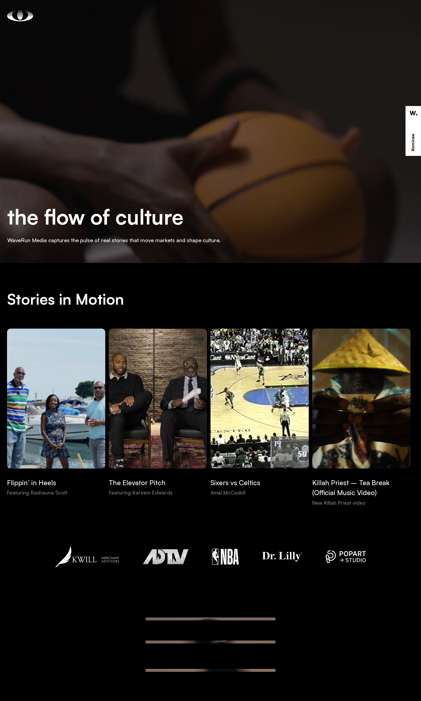
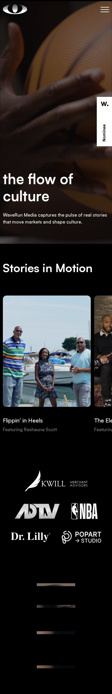

# UI Design System & Master Generation Blueprint: waverunmedia-com

> **WaveRun Media** (https://waverunmedia.com/) — WaveRun Media captures the pulse of real stories that move markets and shape culture.



---

## 1. Executive Visual Persona & Design Archetype

- **Brand Essence & Persona**: **WaveRun Media** (`https://waverunmedia.com/`). WaveRun Media captures the pulse of real stories that move markets and shape culture.
- **Capture Provenance**: Live browser capture (`tier1_fast`, HTTP `200`, captured `2026-11-23`).
- **Visual Archetype**: **High-Contrast Obsidian / Atmospheric Design System (`#000000` canvas, `#ffffff` ink, `#0000ff` accent)**.
- **Anti-AI-Slop Differentiators**:
  - **Live-Computed Chromatic Polarity**: Anchors the viewport in `#000000` (live computed `body` `background-color` (`computed_styles.json`)) paired with `#ffffff` primary typography and `#0000ff` accents.
  - **Grounded Typographic Hierarchy**: Pairs `Satoshi` for display copy (`the flow of culture`) with `Satoshi` and not declared in live computed styles (uses primary stack / `ui-monospace`).
  - **Calibrated Spatial Grid & Motion**: Combines `100rem` container bounds (`gap: 1rem`, padding `32px`) with `cubic-bezier(.04,.05,.12,1.52)` easing and Lenis Smooth Scroll (`data-lenis`), Swiper Touch Carousel Engine.

---

## 2. Spatial Architecture & Modular Grid Mathematics



### Viewport Allocation & Container Geometry
- **Captured Viewport Dimensions**: Desktop `1440×2400px` (`assets/desktop.png`, clamped at 2400px live multi-section capture), Mobile `390×2400px` (`assets/mobile.png`, clamped at 2400px live multi-section capture).
- **Master Container Bounds**: `100rem` (non-`@media` desktop container stylesheet rule).
- **Canvas Lateral Padding & Spacing**: `32px` lateral canvas padding with `1rem` grid gap.
- **Border Radius Scale**: `16px`, `10rem`, `50%`, `2px`.

### Responsive Breakpoint Architecture
- **Desktop Layout**: Multi-column CSS Grid / Flexbox layout at `1440px` (`max-width: 100rem`, `gap: 1rem`).
- **Mobile Layout**: Single-column vertical stack at `390px` viewport width with `32px` horizontal padding.
- **Extracted CSS Media Queries**: `@media screen and (max-width:480px)`, `@media screen and (min-width:1024px)`, `@media screen and (min-width:1921px)`, `@media screen and (min-width:768px)`.

---

## 3. Color System, Materiality & Atmospheric Lighting

### Semantic Palette & Source Grounding
| Semantic Role | Ground-Truth Value | Extracted Live / CSS Source |
|---|---|---|
| **Primary Canvas Substrate** | `#000000` | live computed `body` `background-color` (`computed_styles.json`) |
| **Primary Typography Ink** | `#ffffff` | live computed `h1` `color` (`computed_styles.json`) |
| **Elevated Surface / Card Substrate** | `#4b4b4b` | `.deco-lines--grey div { background-color: #4b4b4b }` |
| **Interactive Accent / Highlight** | `#0000ff` | `var(--wndb--color--primary)` in `:root` |
| **Secondary / Muted Copy** | `#0000ff` | `var(--wndb--color--secondary)` in `:root` |
| **Structural Hairline Border** | `#00a0d2` | `.wpcf7 form .wpcf7-response-output { border: #00a0d2 }` |

### Sanitized Root CSS Variables (`ui-ux.md` Ground Truth)
| Variable Name | Extracted Value | Semantic Role |
|---|---|---|
| `--wndb-mask-color` | `rgba(0,0,0,.15)` | Brand / Palette Token |
| `--wndb-mask-position` | `50% 50% at 50% 20%` | Dimension / Scale Token |
| `--wndb-mask-opacity` | `0.35` | Design System Custom Token |
| `--nfd-wb-anim-transition-duration` | `1400ms` | Motion / Easing Token |
| `--nfd-wb-anim-transition-delay` | `50ms` | Motion / Easing Token |
| `--nfd-wb-anim-transition-easing-function` | `cubic-bezier(0.4,1,0.65,1)` | Motion / Easing Token |
| `--slide-media-height` | `98.8vw` | Layout / Spatial Grid Token |
| `--wndb--max-w--prose` | `min(65ch,1100px)` | Layout / Spatial Grid Token |
| `--wndb--text-scale-factor` | `1` | Typography Ink Token |
| `--wndb--text--xs` | `0.75rem` | Typography Ink Token |
| `--wndb--text--sm` | `0.875rem` | Typography Ink Token |
| `--wndb--text--base` | `1rem` | Typography Ink Token |
| `--wndb--text--md` | `1.125rem` | Typography Ink Token |
| `--wndb--text--lg` | `1.5rem` | Typography Ink Token |
| `--wndb--text--xl` | `2.375rem` | Typography Ink Token |
| `--wndb--text--huge` | `clamp(2.75rem,1.4688rem + 2.5vw,3.5rem)` | Typography Ink Token |

---

## 4. Typographic Scale & Editorial Hierarchy

### Font Family Stacks
- **Display Typography**: `Satoshi`.
- **Primary Body Stack**: `Satoshi`.
- **Technical / Metadata Stack**: not declared in live computed styles (uses primary stack / `ui-monospace`).

### Typographic Scale & Rules (Live Computed & Stylesheet Grounded)
- **Hero Display (`H1`)**: live computed `h1` (`font-size: 72px`, `line-height: 86.4px`, `font-weight: 700`).
- **Section Heading (`H2`)**: live computed `h2` (`font-size: 50.4px`, `line-height: 55.44px`, `font-weight: 700`).
- **Body Copy**: live computed `body` (`font-size: 10px`, `line-height: normal`, `font-weight: 400`).
- **Metadata & Navigation Labels**: live computed `nav/a` (`font-size: 10px`, `line-height: normal`, `font-weight: 400`).

---

## 5. Choreographed Motion & Interaction Physics

### Primary Easing Curves
- **Extracted Timing Functions**: `cubic-bezier(.04,.05,.12,1.52)`, `cubic-bezier(.2,1,.8,1)`, `cubic-bezier(.68,.85,.17,1)`.

### Per-Element Transition & Choreography Rules
- **Selector `.btn`**: `transition: background-color .1s ease,color .1s ease` extracted from `waverunmedia-com` stylesheet.
- **Selector `.btn__arrow`**: `transition: .3s cubic-bezier(.04,.05,.12,1.52)` extracted from `waverunmedia-com` stylesheet.
- **Selector `.btn__arrow:after`**: `transition: -webkit-transform .3s cubic-bezier(.04,.05,.12,1.52),-webkit-f...` extracted from `waverunmedia-com` stylesheet.
- **Extracted Easing Curve (`cubic-bezier(.04,.05,.12,1.52)`)**: Governs interactive state transitions across `<header.header>` and `<section.hero>`.
- **Runtime Interaction Engine**: Integrates Lenis Smooth Scroll (`data-lenis`), Swiper Touch Carousel Engine with `prefers-reduced-motion: reduce` fallback guards.

---

## 6. Component Wireframe & Structural DOM Map

### Visual Layout Schematic — Desktop (`1440px`, Grounded in `dom.html` & Landmark Bounding Boxes)
```
┌────────────────────────────────────────────────────────────────────────┐
│ DESKTOP VIEWPORT (1440px) — WaveRun Media                              │
│ ====================================================================== │
│ [ <header.header> (1440x80px)         | Home · About · Partners · KW ] │
│ ---------------------------------------------------------------------- │
│ | HERO STAGE: <article.universal> (w=1440px)                         | │
│ | H1: the flow of culture                                            | │
│ | Substrate: #000000 | Ink: #ffffff | Accent: #0000ff                | │
│ ---------------------------------------------------------------------- │
│ | SHOWCASE GRID (<section.hero>) max-w: 100rem                       | │
│ | +------------------------------+  +------------------------------+ | │
│ | | Stories in Motion            |  | Flippin’ in Heels            | | │
│ | +------------------------------+  +------------------------------+ | │
│ ---------------------------------------------------------------------- │
│ | DETAIL MODULE (<section.slider-block>) — The Elevator Pitch        | │
│ ---------------------------------------------------------------------- │
│ [ FOOTER (<footer.footer>     ) | https://waverunmedia.com/            │
└────────────────────────────────────────────────────────────────────────┘
```

### Visual Layout Schematic — Mobile Reflow (`390px`)
```
┌────────────────────────────────────────────────────────────────────────┐
│ MOBILE VIEWPORT REFLOW (390px) — Single-Column Stack (gap: 1rem)       │
│ ====================================================================== │
│ [ HEADER BAR (<header.header>         ) | Compact Menu (390px)         │
│ ---------------------------------------------------------------------- │
│ | HERO STAGE (<article.universal>) — 390px Vertical Lead             | │
│ | H1: the flow of culture                                            | │
│ ---------------------------------------------------------------------- │
│ | SHOWCASE STACK (<section.hero>) — 1-Col Stack                      | │
│ | [ Item 1: Stories in Motion                                      ] | │
│ | [ Item 2: Flippin’ in Heels                                      ] | │
│ ---------------------------------------------------------------------- │
│ | DETAIL STACK (<section.slider-block>) — 1-Col (The Elevator Pitch) | │
│ ---------------------------------------------------------------------- │
│ [ FOOTER (<footer.footer>     ) | Stacked 390px Colophon               │
└────────────────────────────────────────────────────────────────────────┘
```

### Granular DOM Region Breakdown
1. **Brand Header & Navigation Bar (<header.header> — `waverunmedia-com`)**:
   - Landmark `<header class="header js-header">` (`1440x80px`) hosting `WaveRun Media` navigation (`Home · About · Partners · KWILL Advisors · ADTV`), DOM attributes (`data-globals="("ajax_url":"https://..."`, `data-video-ready="true"`, `data-video-ready="true"`, `data-from="center"`), and stylesheet rule `html { font-size:100%;-webkit-text-size-adjust:100%;-ms-text-size-adjust:100% }`.
2. **Hero Stage & Focal Lead (<article.universal> — `the flow of culture`)**:
   - Landmark `<article class="universal">` presenting display lead `the flow of culture` and copy excerpt *"WaveRun Media captures the pulse of real stories that move market"* over `#000000` canvas and `#ffffff` ink.
3. **Primary Showcase & Content Grid (<section.hero> — `Stories in Motion`)**:
   - Landmark `<section class="hero hero--bottom">` rendering section `Stories in Motion` with copy *"Featuring Rashauna Scott"*, asset references (`apple-icon-57x57.png`, `apple-icon-60x60.png`, `apple-icon-72x72.png`, `apple-icon-76x76.png`), and grid rule `a:active { outline:none }`.
4. **Interactive Detail & Feature Matrix (<section.slider-block> — `Flippin’ in Heels`)**:
   - Landmark `<section class="slider-block">` framing `Flippin’ in Heels` and `The Elevator Pitch` (*"Featuring Kareem Edwards"*) with `#4b4b4b` surface cards, `#0000ff` accents, and `strong { font-weight:700 }`.
5. **Colophon & Global Directory Footer (<footer.footer> — `https://waverunmedia.com/`)**:
   - Landmark `<footer class="footer">` anchoring `WaveRun Media` footer links (`Home · About · Partners · KWILL Advisors · ADTV`), copy *"New Killah Priest video"*, and `#00a0d2` structural dividers.

---

## 7. Master Zero-Shot AI Generation Prompt

```markdown
# Master Zero-Shot Frontend Generation Prompt: waverunmedia-com (WaveRun Media)

You are a principal frontend architect and design systems engineer. Build a complete, production-ready web application replicating the exact design system, DOM landmarks, typographic hierarchy, color tokens, and motion physics of `waverunmedia-com` (**WaveRun Media** — `https://waverunmedia.com/`).

### 1. Visual Archetype & Anti-AI-Slop Mandates
- **Archetype**: High-Contrast Obsidian / Atmospheric Design System (`#000000` canvas, `#ffffff` ink, `#0000ff` accent).
- **Identity & Domain Context**: WaveRun Media captures the pulse of real stories that move markets and shape culture.
- **Primary Substrate**: `#000000` (live computed `body` `background-color` (`computed_styles.json`)), **Primary Ink**: `#ffffff`, **Accent / Highlight**: `#0000ff`.
- **Site-Specific Differentiators**:
  - **Live-Computed Chromatic Polarity**: Anchors the viewport in `#000000` (live computed `body` `background-color` (`computed_styles.json`)) paired with `#ffffff` primary typography and `#0000ff` accents.
  - **Grounded Typographic Hierarchy**: Pairs `Satoshi` for display copy (`the flow of culture`) with `Satoshi` and not declared in live computed styles (uses primary stack / `ui-monospace`).
  - **Calibrated Spatial Grid & Motion**: Combines `100rem` container bounds (`gap: 1rem`, padding `32px`) with `cubic-bezier(.04,.05,.12,1.52)` easing and Lenis Smooth Scroll (`data-lenis`), Swiper Touch Carousel Engine.

### 2. Ground-Truth CSS Variables (`:root` Token Contract)
Declare and consume these exact custom properties extracted from `waverunmedia-com` in your global stylesheet:

:root {
  /* WaveRun Media (waverunmedia-com) — Live-Grounded CSS Variables */
  --wndb-mask-color: rgba(0,0,0,.15); /* Brand / Palette Token (waverunmedia-com) */
  --wndb-mask-position: 50% 50% at 50% 20%; /* Dimension / Scale Token (waverunmedia-com) */
  --wndb-mask-opacity: 0.35; /* Design System Custom Token (waverunmedia-com) */
  --nfd-wb-anim-transition-duration: 1400ms; /* Motion / Easing Token (waverunmedia-com) */
  --nfd-wb-anim-transition-delay: 50ms; /* Motion / Easing Token (waverunmedia-com) */
  --nfd-wb-anim-transition-easing-function: cubic-bezier(0.4,1,0.65,1); /* Motion / Easing Token (waverunmedia-com) */
  --slide-media-height: 98.8vw; /* Layout / Spatial Grid Token (waverunmedia-com) */
  --wndb--max-w--prose: min(65ch,1100px); /* Layout / Spatial Grid Token (waverunmedia-com) */
  --wndb--text-scale-factor: 1; /* Typography Ink Token (waverunmedia-com) */
  --wndb--text--xs: 0.75rem; /* Typography Ink Token (waverunmedia-com) */
  --wndb--text--sm: 0.875rem; /* Typography Ink Token (waverunmedia-com) */
  --wndb--text--base: 1rem; /* Typography Ink Token (waverunmedia-com) */
  --wndb--text--md: 1.125rem; /* Typography Ink Token (waverunmedia-com) */
  --wndb--text--lg: 1.5rem; /* Typography Ink Token (waverunmedia-com) */
  --wndb--text--xl: 2.375rem; /* Typography Ink Token (waverunmedia-com) */
  --wndb--text--huge: clamp(2.75rem,1.4688rem + 2.5vw,3.5rem); /* Typography Ink Token (waverunmedia-com) */
}

### 3. Semantic Color & Materiality Contract
Map every surface, ink, and border strictly to these source-grounded tokens:
- **Primary Canvas Substrate**: `#000000` — grounded in live computed `body` `background-color` (`computed_styles.json`)
- **Primary Typography Ink**: `#ffffff` — grounded in live computed `h1` `color` (`computed_styles.json`)
- **Elevated Surface / Card Substrate**: `#4b4b4b` — grounded in `.deco-lines--grey div { background-color: #4b4b4b }`
- **Interactive Accent / Highlight**: `#0000ff` — grounded in `var(--wndb--color--primary)` in `:root`
- **Secondary / Muted Copy**: `#0000ff` — grounded in `var(--wndb--color--secondary)` in `:root`
- **Structural Hairline Border**: `#00a0d2` — grounded in `.wpcf7 form .wpcf7-response-output { border: #00a0d2 }`

### 4. Spatial Grid, Container Bounds & Responsive Breakpoints
- **Desktop Viewport Reference**: `1440×2400px` (clamped at 2400px live multi-section capture, `1440px` standard desktop width).
- **Mobile Viewport Reference**: `390×2400px` (clamped at 2400px live multi-section capture, `390px` standard mobile width).
- **Container Max-Width**: `100rem` (non-`@media` desktop container stylesheet rule)
- **Padding & Gutters**: `32px` lateral canvas padding with `1rem` grid gap
- **Desktop Grid**: Multi-column CSS Grid / Flexbox layout at `1440px` (`max-width: 100rem`, `gap: 1rem`)
- **Mobile Adaptation**: Single-column vertical stack at `390px` viewport width with `32px` horizontal padding
- **Media Queries**: `@media screen and (max-width:480px)`, `@media screen and (min-width:1024px)`, `@media screen and (min-width:1921px)`, `@media screen and (min-width:768px)`
- **Corner Radii**: `16px`, `10rem`, `50%`, `2px`

### 5. Typography & Editorial Scale Contract
- **Display Font Stack**: `Satoshi`
- **Body Font Stack**: `Satoshi`
- **Monospace / Technical Font Stack**: not declared in live computed styles (uses primary stack / `ui-monospace`)
- **H1 Display Rule**: live computed `h1` (`font-size: 72px`, `line-height: 86.4px`, `font-weight: 700`)
- **H2 Section Rule**: live computed `h2` (`font-size: 50.4px`, `line-height: 55.44px`, `font-weight: 700`)
- **Body Copy Rule**: live computed `body` (`font-size: 10px`, `line-height: normal`, `font-weight: 400`)
- **Metadata & Index Rule**: live computed `nav/a` (`font-size: 10px`, `line-height: normal`, `font-weight: 400`)

### 6. Component Hierarchy, Verbatim Copy & Real DOM Landmarks
Scaffold `waverunmedia-com` (`WaveRun Media`) with these exact structural regions, extracted copy, and CSS rules from `dom.html`:
1. **Brand Header & Navigation Bar (<header.header> — `waverunmedia-com`)**:
   - DOM & Selectors: Landmark `<header class="header js-header">` (`1440x80px`) hosting `WaveRun Media` navigation (`Home · About · Partners · KWILL Advisors · ADTV`), DOM attributes (`data-globals="("ajax_url":"https://..."`, `data-video-ready="true"`, `data-video-ready="true"`, `data-from="center"`), and stylesheet rule `html { font-size:100%;-webkit-text-size-adjust:100%;-ms-text-size-adjust:100% }`.
   - Responsive Contract: Header `Brand Header & Navigation Bar (<header.header> — `waverunmedia-com`)` (`waverunmedia-com`) adapts across `@media screen and (max-width:480px)`, `@media screen and (min-width:1024px)`, `@media screen and (min-width:1921px)`, `@media screen and (min-width:768px)` with `cubic-bezier(.04,.05,.12,1.52)`, `cubic-bezier(.2,1,.8,1)`, `cubic-bezier(.68,.85,.17,1)` transitions and links `Home · About · Partners · KWILL Advisors · ADTV`.
2. **Hero Stage & Focal Lead (<article.universal> — `the flow of culture`)**:
   - DOM & Selectors: Landmark `<article class="universal">` presenting display lead `the flow of culture` and copy excerpt *"WaveRun Media captures the pulse of real stories that move market"* over `#000000` canvas and `#ffffff` ink.
   - Responsive Contract: Hero stage (`1440×2400px` desktop / `390×2400px` mobile) sets `#000000` background with `#ffffff` headline `the flow of culture`.
3. **Primary Showcase & Content Grid (<section.hero> — `Stories in Motion`)**:
   - DOM & Selectors: Landmark `<section class="hero hero--bottom">` rendering section `Stories in Motion` with copy *"Featuring Rashauna Scott"*, asset references (`apple-icon-57x57.png`, `apple-icon-60x60.png`, `apple-icon-72x72.png`, `apple-icon-76x76.png`), and grid rule `a:active { outline:none }`.
   - Responsive Contract: Showcase grid `Primary Showcase & Content Grid (<section.hero> — `Stories in Motion`)` applies Multi-column CSS Grid / Flexbox layout at `1440px` (`max-width: 100rem`, `gap: 1rem`) on desktop and Single-column vertical stack at `390px` viewport width with `32px` horizontal padding on mobile.
4. **Interactive Detail & Feature Matrix (<section.slider-block> — `Flippin’ in Heels`)**:
   - DOM & Selectors: Landmark `<section class="slider-block">` framing `Flippin’ in Heels` and `The Elevator Pitch` (*"Featuring Kareem Edwards"*) with `#4b4b4b` surface cards, `#0000ff` accents, and `strong { font-weight:700 }`.
   - Responsive Contract: Detail module `Interactive Detail & Feature Matrix (<section.slider-block> — `Flippin’ in Heels`)` uses `16px`, `10rem`, `50%`, `2px` radii, `#0000ff` highlights, and assets (apple-icon-57x57.png, apple-icon-60x60.png, apple-icon-72x72.png).
5. **Colophon & Global Directory Footer (<footer.footer> — `https://waverunmedia.com/`)**:
   - DOM & Selectors: Landmark `<footer class="footer">` anchoring `WaveRun Media` footer links (`Home · About · Partners · KWILL Advisors · ADTV`), copy *"New Killah Priest video"*, and `#00a0d2` structural dividers.
   - Responsive Contract: Footer `Colophon & Global Directory Footer (<footer.footer> — `https://waverunmedia.com/`)` aligns to `100rem` (non-`@media` desktop container stylesheet rule) with `32px` lateral canvas padding with `1rem` grid gap and attributes (data-globals="("ajax_url":"https://...", data-video-ready="true", data-video-ready="true").

#### Verbatim DOM Copy Excerpts (`dom.html`)
- Copy Excerpt 1: *"WaveRun Media captures the pulse of real stories that move markets and shape culture."*
- Copy Excerpt 2: *"Featuring Rashauna Scott"*
- Copy Excerpt 3: *"Featuring Kareem Edwards"*
- Copy Excerpt 4: *"New Killah Priest video"*

### 7. Motion, Extracted Stylesheet Rules & Interaction Choreography
- **Primary Easing Functions**: `cubic-bezier(.04,.05,.12,1.52)`, `cubic-bezier(.2,1,.8,1)`, `cubic-bezier(.68,.85,.17,1)`
- **Extracted Stylesheet Rules (`waverunmedia-com`)**:
- `html { font-size:100%;-webkit-text-size-adjust:100%;-ms-text-size-adjust:100% }`
- `a:active { outline:none }`
- `strong { font-weight:700 }`
- `img { border:0;-ms-interpolation-mode:bicubic;vertical-align:middle }`
- `textarea { vertical-align:middle }`
- **Per-Selector Transition Rules**:
- **Selector `.btn`**: `transition: background-color .1s ease,color .1s ease` extracted from `waverunmedia-com` stylesheet.
- **Selector `.btn__arrow`**: `transition: .3s cubic-bezier(.04,.05,.12,1.52)` extracted from `waverunmedia-com` stylesheet.
- **Selector `.btn__arrow:after`**: `transition: -webkit-transform .3s cubic-bezier(.04,.05,.12,1.52),-webkit-f...` extracted from `waverunmedia-com` stylesheet.
- **Extracted Easing Curve (`cubic-bezier(.04,.05,.12,1.52)`)**: Governs interactive state transitions across `<header.header>` and `<section.hero>`.
- **Runtime Interaction Engine**: Integrates Lenis Smooth Scroll (`data-lenis`), Swiper Touch Carousel Engine with `prefers-reduced-motion: reduce` fallback guards.

### 8. Technical Deliverables
- Implement in Next.js (App Router) with TypeScript and Tailwind CSS consuming the `:root` custom properties defined above for `waverunmedia-com`.
- Reproduce both the `1440px` desktop architecture and `390px` mobile breakpoint transitions, preserving semantic HTML5 landmarks (`<header>`, `<nav>`, `<main>`, `<section>`, `<footer>`) and `prefers-reduced-motion` accessibility guards.
```
